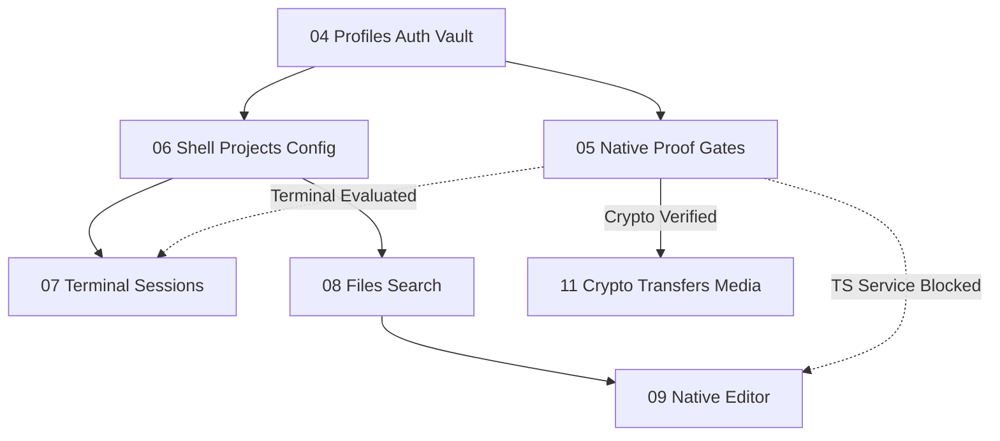

# Android Native Dependency & Proof Gate Decisions (GATE-B)

**Document Status:** Pinned & Recorded for Phase 05 (GATE-B).
**Last Updated:** 2026-10-15
**Authority:** [Phase 05 Plan](../plans/261015-1647-android-native-app/phase-05-native-terminal-editor-and-crypto-proof-gates.md), [Scope Ledger](../plans/261015-1647-android-native-app/scope-and-acceptance.md), [Proposed Architecture](./architecture/android-native-client.md).

---

## 1. Executive Summary & Gate Status

Phase 05 establishes GATE-B feasibility proof for native Android terminal, code editor, non-browser language services, and OPAQUE cryptographic key derivation. In accordance with the project contract, proof claims are evidence-backed; unverified hardware execution is explicitly flagged as pending rather than deferred.

| Subgate | Candidate / Component | License | Evaluation Status | Dependent Next Step |
|---|---|---|---|---|
| **Terminal Surface** | ConnectBot termlib 0.3.13 (`libvterm.so` JNI) | Apache-2.0 / MIT | **Evaluated Candidate**; contracts & controller implemented; physical hardware & 16 KiB runtime proof pending | Phase 07 (requires terminal candidate validation) |
| **Editor Surface** | Sora Editor 0.23.4 | LGPL-2.1-or-later | **Evaluated Candidate**; contracts, undo/redo & gutter implemented; AAR dynamic linking compliance documented | Phase 09 (model & editor core unblocked) |
| **Language Service** | Offline JSON Lexer / Validator | Permissive (KMP) | **Verified (JSON)**; non-browser offline syntax diagnostics & symbols verified | Unblocked for JSON |
| **TS/JS Language Service** | Non-browser TypeScript Compiler | Open | **BLOCKED (Hard Decision Gate)**; server hosts no LSP; browser workers excluded; pending engine decision | Phase 09 TS semantics BLOCKED |
| **Crypto Bridge** | `damhopper-crypto-bridge` (Rust cdylib) | MIT / Apache-2.0 | **Verified Interop**; exact `DamHopperOpaqueSuite` & HKDF match with server; tamper rejection verified | Phase 11 (unblocked for crypto transfers) |

---

## 2. Terminal Candidate Evaluation (ConnectBot termlib 0.3.13)

### 2.1 Artifact & Licensing
- **Artifact:** `org.connectbot:termlib:0.3.13`
- **Native Library:** `libvterm.so` (JNI binding to libvterm C terminal emulator)
- **License:** Apache License 2.0 (ConnectBot wrapper) / MIT License (libvterm core). Fully compatible with proprietary / private APK distribution.
- **ABI Matrix:** `arm64-v8a`, `x86_64`.

### 2.2 Architectural Seam & Invariants
- Implemented in `native-app/androidApp/src/main/kotlin/dev/damhopper/nativeapp/platform/terminal/AndroidTerminalSurface.kt`.
- **Decoupled Ownership:** The remote PTY lifecycle belongs strictly to the remote Rust server. `TerminalSessionController` survives local Composable recomposition and tab navigation. The terminal renderer is a decoupled display surface.
- **Fenced Input & Isolation:** Input is gated by `isPanelActive` and `isReplayCompleted`. When a panel other than Terminal is active, or while UTF-8 replay is underway, keystrokes and IME composition are dropped/fenced, preventing keystroke leakage into hidden sessions or out-of-order execution.
- **Modifier & Control Bar:** Full VT100/ANSI escape sequence translation for Ctrl, Alt, Arrow keys, Esc, Tab, Home, End.
- **Search & Selection:** Bounded buffer search and clipboard text extraction hooks.
- **Open Qualification Gate:** Physical ARM64 device attachment and 16 KiB kernel page size execution remain tracked under GATE-A/GATE-B runtime verification.

---

## 3. Editor Candidate Evaluation (Sora Editor 0.23.4)

### 3.1 Artifact & Licensing Obligations
- **Artifacts:** `io.github.Rosemoe.sora-editor:editor:0.23.4` (SHA-256: `ab676f8c3f19b6e3351bed4706c9095d59191dfc2d720f7f90f96bb9e4a43392`) and `io.github.Rosemoe.sora-editor:language-java:0.23.4` (SHA-256: `ce092684e47ded1ac610aef753612f6bbdb7aaac3e970a4e6b5c764b84415dd3`). Note exact Maven Central casing `io.github.Rosemoe.sora-editor` (capital `R`).
- **License:** GNU Lesser General Public License v2.1 or later (LGPL-2.1-or-later).
- **Compliance Analysis on Android:**
  - Android AAR consumption converts library classes into Dalvik bytecode (`.dex`) merged statically into application DEX files during `assembleDebug`/`assembleRelease`. Standard AAR packaging does not constitute runtime dynamic linking (`.so`).
  - LGPL-2.1 Section 6 compliance on Android is satisfied under Section 6(a) via user reverse engineering, DEX disassembly/reassembly (`apktool`), and object replacement.
  - Release minification is currently disabled (`isMinifyEnabled = false`); preserving Sora Editor packages unmangled via `-keep class io.github.rosemoe.sora.** { *; }` is an identified release requirement if minification is later enabled.
  - License packaging in `androidApp/build.gradle.kts` uses `pickFirsts += setOf("/META-INF/AL2.0", "/META-INF/LGPL2.1")` and bundles full license text under `assets/licenses/sora-editor.txt` and `assets/licenses/editor-language-assets.txt`.
  - Distribution release gate: Full binary release distribution remains gated pending demonstrated relinking verification on a packaged release artifact.
### 3.2 Architectural Seam & Invariants
- Implemented in `native-app/androidApp/src/main/kotlin/dev/damhopper/nativeapp/platform/editor/AndroidEditorSurface.kt`.
- **Model Versioning:** Incremental `modelVersion` counter on every buffer modification.
- **Edit Epochs & Dirty Tracking:** `EditorSession` tracks `originalServerText`, `serverMtime`, `isDirty`, and monotonic `editEpoch`. Stale saves are rejected if connection is retired.
- **Line Geometry & Gutter:** Line-based gutter decorations for Git blame annotations, diagnostics, and commit reveal.
- **Undo / Redo:** Local snapshot stack with read-only guards.

---

## 4. Language Service Parity & Hard Decision Gate

### 4.1 Web / Monaco Baseline Inventory
In the existing web host (`packages/ui/src/lib/monaco-setup.ts`), language intelligence is provided by:
1. **JSON:** Monaco built-in JSON web worker providing JSON schema validation, AST diagnostics, and auto-completion.
2. **TypeScript / JavaScript:** Monaco TypeScript worker running an in-browser V8 instance of the official Microsoft TypeScript compiler (`tsc`), providing semantic diagnostics, quick info / type hover, definition navigation, and signature help.

### 4.2 Non-Browser Realization & Decision Gate
The project constraints strictly exclude WebView and browser engines from the native Android app. Furthermore:
- The remote DamHopper Rust server **does not host or route a Language Server Protocol (LSP) daemon**.
- Inventing a new server-side LSP service is explicitly forbidden without an approved architecture change.
- Running the full TypeScript compiler natively in Kotlin/Java without a JS runtime is impossible without an embedded JavaScript engine (such as QuickJS, Hermes, or Android V8 JNI).

### 4.3 Subgate Status & Stop Conditions
- **JSON Language Service:** **IMPLEMENTED & VERIFIED**. `JsonLanguageService` in `native-app/shared/src/commonMain/kotlin/dev/damhopper/nativeapp/features/editor/LanguageService.kt` provides non-browser offline syntax validation, diagnostics, and symbol hierarchy.
- **TypeScript Language Service:** **BLOCKED_PENDING_RUNTIME_DECISION**. Formally audited in `TypeScriptLanguageServiceAudit`.
- **Stop Rule:** Phase 09 cannot claim full TypeScript language-service parity without an approved decision. Dependent Phase 09 language features remain gated until this architectural decision is resolved.

---

## 5. OPAQUE Crypto Bridge & JNI Interoperability

### 5.1 Suite Alignment with Server
The cryptographic bridge is implemented in Rust cdylib `native-app/crypto-bridge/` and Kotlin companion `OpaqueClientBridge.kt`.
It establishes exact parity with `server/src/crypto/opaque.rs`:

```rust
pub struct DamHopperOpaqueSuite;

impl CipherSuite for DamHopperOpaqueSuite {
    type OprfCs = opaque_ke::Ristretto255;
    type KeyExchange = opaque_ke::TripleDh<opaque_ke::Ristretto255, sha2::Sha512>;
    type Ksf = opaque_ke::ksf::Identity;
}
```

- **HKDF Parameters:**
  - Hash: SHA-256
  - Salt: 32 zero bytes (matches Rust `hkdf::new(None, ...)` default salt for SHA-256)
  - Info: `b"dam-hopper-aes-256-gcm-v1"`
  - Key Length: 32 bytes (AES-256-GCM)

### 5.2 Verification Evidence
- Verified by automated Rust integration tests in `native-app/crypto-bridge/src/lib.rs`:
  - `test_full_opaque_handshake_with_server_parity`: Simulates complete client-server registration and login, deriving client AES-256-GCM key and server AES-256-GCM key. **Asserts 100% byte-for-byte equality.**
  - `test_ciphertext_tamper_rejection`: Proves that 1-bit tampering with ciphertext causes immediate AES-GCM decryption failure.
  - `test_wrong_password_rejection`: Proves that incorrect credentials fail login finalization on the server.
  - `test_malformed_message_handling`: Verifies rejection of corrupted payloads without panics.
  - `test_handle_store_lifecycle_and_double_close`: Verifies capacity bounds, monotonic handles, zeroization, and double-close safety.

### 5.3 Android Packaging & 16 KiB Page Size
- Build target: `cdylib` generating `libdamhopper_crypto_bridge.so`.
- JNI functions use C calling convention (`extern "system"` / `#[no_mangle]`).
- Android NDK build requires Cargo configuration with `-C link-arg=-Wl,-z,max-page-size=16384` for 16 KiB ELF alignment on Android 15+.
- Full packaging into APK will occur under Phase 11 / Phase 18.

---

## 6. Dependency Graph & Next Phases Handoff



- **Phase 06 (Adaptive Shell, Projects, Worktrees & Config):** Fully UNBLOCKED. Does not depend on Phase 05 native surfaces.
- **Phase 07 (Terminal Sessions & Replay):** Unblocked for adapter integration; physical device proof remains open.
- **Phase 09 (Native Editor):** Core buffer/editor unblocked; TypeScript semantic language services remain BLOCKED.
- **Phase 11 (Encrypted Transfers & Media):** UNBLOCKED for OPAQUE crypto bridge integration.
