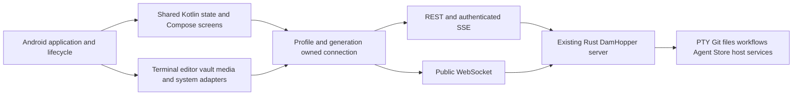

# Android Native Client Architecture

**Status (2026-10-25):** The active root remains Profile Login → Project List → Terminal, with focused Terminal/Files/Editor surfaces, retained Settings and notifications; the separate 12-panel `WorkbenchScreen` remains unmounted. The Traditional terminal Agents sidebar is implemented and user-approved after three review cycles (Cycle 3: 7/10, zero Critical findings, four warnings). Task-reported results: 824 shared JVM tests, 224 Android unit tests, `:androidApp:assembleDebug`, and controlled loopback HTTP404 passed; documentation changes did not rerun them. Real current-server MainActivity journeys and API 29/API 33+, emulator/physical-device visual and input qualification remain open.
**Plan:** [Android native-app](../../plans/261015-1647-android-native-app/plan.md).
**Terminal ANR remediation:** [Atomic display snapshot plan](../../plans/261023-0232-android-terminal-anr-remediation/plan.md).
**Baseline:** `d897a91f76a07ec819a50ffc2756cb69327b2fe3`; existing server/web/Tauri behavior unchanged.

## Product boundary

- New application root: repository-root `native-app/`, separate from existing `apps/native/` Tauri host.
- Kotlin Multiplatform shared application/state + Compose UI; native Android terminal/editor adapters.
- Android 10+ (`minSdk 29`); `arm64-v8a` physical-device and `x86_64` emulator qualification; signed private APK.
- All current non-browser remote workbench feature families included. Native Markdown, image/video and binary/large-file viewing remain in scope.
- User-approved first-release exception: embedded interactive HTML preview and rendered Mermaid browser preview. HTML remains editable source; Mermaid remains editable source/fenced content, with an explicit unsupported-rendering notice. Never call this full preview parity.
- No WebView, embedded browser engine, Tauri, Android-local PTY/Git/agents, local Linux environment, browser debugging/extension, local SSH tunnel client, or desktop package in this release.
- Linux/Windows extension is a design constraint, not implemented desktop functionality. No placeholder desktop host.
- Existing web and Tauri products remain; no cutover or retirement authorized.

## Core mobile app flow and lifecycle

`MainActivity` obtains `NativeWorkspaceViewModel` from the Android ViewModel store, initializes profile persistence and credentials, handles notification deep links, and routes platform Back through `AppFlowNavigation`. The root flow still has three stages; the Terminal stage now hosts a focused project workspace.

| Stage | Entry | Transition |
| --- | --- | --- |
| `PROFILE_LOGIN` | Initial state; also used when authentication is lost or Profiles / Switch is selected. | Successful authentication selects the active profile and advances to `PROJECT_LIST`. |
| `PROJECT_LIST` | `WorkspaceRepository` fetches projects for the active profile. | Selecting a project updates `ProjectTargetStore` and advances to `TERMINAL`. |
| `TERMINAL` | `TerminalRepository` loads sessions; `ProjectWorkspaceScreen` presents Terminal, Files, Editor, or focused Git when retained workspace state is available. | Back, project selection, profile navigation, and eligible deep links consult the retained departure guard when it is installed. |

`AppFlowState` stores the visible stage and active profile, project, and terminal-session IDs. `NativeWorkspaceViewModel` retains the profile runtime, flow navigation, target store, lifecycle coordinator, and workspace states. `DamHopperMobileApp` reconstructs current-profile repositories when profile, endpoint, or connection generation changes and requests the workspace state through the injected provider.

`AppFlowNavigation` preserves selection fields unless a transition explicitly changes them. The guard intercepts dirty departures before the route transition; without dirty documents, or after the user chooses to proceed, Terminal returns to Project List and Project List to Profile Login. Re-authenticating the same profile preserves selections; switching profile or project clears dependent selections.

Leaving the focused panel, or recreating the Activity for a configuration change, hides/detaches its UI without closing the retained workspace or killing the remote PTY. The editor widget detaches through its `AndroidView` release callback. Actual ViewModel teardown invokes `onCleared` and closes retained state. Some terminal presentation and stream work remains composition-scoped.

The app still exposes only the three root stages. Focused Terminal/Files/Editor are panels within the Terminal stage; `WorkbenchScreen`, `PanelHost`, and the separate 12-panel navigation remain unmounted and are not made reachable by this integration.

### Retained workbench panel-shell contract (not mounted by current root)

The following constraints describe the separate `WorkbenchScreen` subsystem and its approved shell design. They do not describe the active three-screen root flow or establish that those panel destinations are currently user-reachable.

- Workspace is **TERMINAL only** (`workspaceMode = "terminal"`); no IDE shell or workspace-mode switcher.
- Terminal presentation is **Traditional only** (`terminalUsageMode = "traditional"`); no Runtime terminal presentation or usage-mode switcher.
- Exactly one in-layout button row provides access to every included panel. On narrow screens it scrolls horizontally; it never wraps into multiple navigation rows or hides panels behind a navigation overflow menu.
- No floating navigation buttons, FABs, draggable launchers, floating panel-toggle buttons, or second navigation rail/drawer/bar. Panel actions remain inline in the row or the active panel.
- Files/editor/Git, projects/agents, workflows/plans, Agent Store, host/fleet/usage, ports/tunnels and settings remain available as panel destinations inside this shell; removing IDE/Runtime layouts does not remove their included functions.
- Panel transitions retain qualified terminal/editor controllers and return focus safely; no PTY restart or duplicate attachment.
- Validated row placement: top, directly below server/project header; icon + short text buttons; horizontal scrolling with selected-button reveal. The row remains visible while the software keyboard is open.
- Validated panel body: one content area on every phone/tablet/foldable size. Selecting a panel replaces the terminal visually, not its controllers/sessions; no wide-screen dock beside the terminal. Internal diff/merge panes remain content of their selected panel.
- The active panel alone receives input; hidden terminal/editor surfaces retain state but cannot receive keystrokes or steal IME focus. [Validation answers](../../plans/261015-1647-android-native-app/validation-answers.md) bind these decisions.

### Focused Files/Editor increment — Phase 05 bridge and Phase 07 active-root integration

The [approved design](../../plans/reports/brainstorm-261023-1351-native-editor-file-explorer.md) and [implementation plan](../../plans/261023-1429-native-editor-file-explorer/plan.md) define the focused workspace. Phase 02 established common contracts, Phase 03 shared editor state and bounded tiers, Phase 04 explorer actions and shared watchers, Phase 05 the Android document/editor bridge, Phase 06 save/mutation integration, and Phase 07 the active-root workspace/runtime wiring. Phase 07 was user-approved after Cycle 3 with noted issues; its reported 141 passing tests and compilation are recorded in the [changelog](../CHANGELOG.md) and do not close Phase 08 qualification.

### Phase 02 common contract baseline (2026-10-23)

Phase 02 work-cycle closure was approved by the user after Cycle 3; the tester reported 85/85 focused JVM tests passing. The interface-freeze ledger records the common boundary and W1–W6 findings; Phase 05 completion does not imply blanket closure of these cross-phase findings. See the [Phase 02 closeout](../../plans/261023-1429-native-editor-file-explorer/phase-02-frozen-common-contracts.md) for each disposition. Phase 05 unit/build evidence is summarized below; it is not integrated-workspace, API 29/arm64-v8a, or release qualification.

**Identity and authority**
- `WorkspaceFileOwner` binds optional `profileId`, normalized endpoint, account identity, project, and optional worktree. Authenticated identity is `AuthSession.user`, not a profile username or display label; loopback `devMode` uses the fixed `dev-user` identity.
- `DocumentId` is `(owner, normalized relative path, tabIncarnation)`. The incarnation is monotonic per owner across reconnects and close/reopen; path rekey preserves it. Length-prefixed presentation keys avoid delimiter collisions, and path normalization rejects absolute paths, drive letters, and root escape.
- `FileAuthority` binds that logical owner to a connection generation, optional exact socket reference, retirement token, and retired state. Validation rejects retired or mismatched targets and can require a socket reference; transport dispatch separately verifies that it is still active. Retirement revokes write authority without requiring the retained document buffer to be discarded.

**Transport and file-operation boundaries**
- `SocketBoundMessage` carries the socket instance that delivered each server message. `sendOnSocket` checks the expected socket while capturing its writer and again immediately before transmission; `requestOnSocket` registers correlation against that socket and awaits the response outside the lifecycle lock. The correlator rejects responses from a replaced socket.
- `ApiClient.getBytesBounded` streams at most the requested byte limit, cancels/rejects an oversized response body, and caps error bodies at 8 KiB. File responses apply decoded-size and strict UTF-8 checks; binary or invalid UTF-8 input cannot be published by `EditorContentLoader` as an empty editable document. Cycle 3 W2 remains open because nullable/excessive request bounds can reach WS/REST before local rejection.
- `FileOperationOutcome` separates `NotSubmitted`, authoritative `Rejected`, `Confirmed`, and ambiguous dispatched `Unknown`. With an owner and reservation, the outcome-aware write path retains uncertain state before commit; W3 remains open because legacy mutation/replacement callers can flatten uncertainty or dispatch without a retained reservation.
- `FileOperationArbiter` reserves source and destination subtrees atomically with segment-aware conflicts (`a` does not conflict with `ab`, but does with `a/b`). Child-save tokens require directional containment; quarantined tokens cannot be released through ordinary release. W6 remains open: numeric token-ID collisions across arbiter instances can affect local reservations.

**Document/session ports and retention**
- `EditorDocument` remains the interactive document authority in the common contract. Phase 05 supplies `AndroidEditorDocumentFactory` and the Android `CodeEditor` host through an injected shared surface bridge; Phase 07 mounts the focused Editor panel in the active root. Earlier candidate/Phase 05 unit-build evidence alone does not qualify that mounted flow or device behavior.
- `EditorSessionPorts` keeps full document text out of tab metadata, caps range windows at 64 KiB, and freezes revision-captured close intent, conflict choices, save outcomes, document access, and explorer dirty guards. `EditorContentLoader` fails binary or invalid-UTF-8 full-text loads rather than creating an empty editable buffer.
- Undo bounds: normal files (`<1 MiB`) retain at most 200 actions; degraded files (`1 MiB .. <5 MiB`) retain at most 50. Both cap logical UTF-16 undo payload at 2 MiB; degraded mode uses plain-text language and disables bracket matching and auto-complete. Files `>=5 MiB` use read-only range windows.
- The frozen memory model is `estimatedRetainedBytes = (utf8Length × 4) + undoStackBytes + (inFlightSnapshotBytes × 2)`, with a provisional workspace target of 64 MiB, 8 retained documents, and 2 degraded documents. Pending policy applies only when opening would exceed a workspace cap: evict only clean inactive documents not in flight; refuse admission if eligible eviction cannot free sufficient capacity. Never silently discard edits. Workspace admission/eviction remains unimplemented/unqualified. The Android adapter currently reports `content.length` as `utf8Length` and zero in-flight snapshot bytes, so these metrics are not byte-accurate enforcement or a heap guarantee.

Phase 01 measurements and the workspace caps are conservative design evidence, not integrated-device heap guarantees or proof of implemented admission/eviction. API 29/arm64-v8a profiling, mounted editor behavior, and release compliance remain downstream gates.

### Phase 07 retained workspace runtime, terminal input, and guarded departures (2026-10-24)

**Retained owner and Activity separation.** `NativeWorkspaceViewModel` is created with `Application` context and retains profile/runtime services, `AppFlowNavigation`, `ProjectTargetStore`, a lifecycle coordinator, and a `WorkspaceFileOwner`-keyed map of `ProjectWorkspaceState`. `MainActivity` obtains that ViewModel through `viewModels()`; configuration recreation reuses it. `AndroidLifecycleCoordinator` forwards foreground/background events; configuration destruction invokes the workspace detach hook, which currently marks retained terminal state hidden. The editor's `AndroidView.onRelease` detaches its Activity-bound editor. The instrumentation test verifies ViewModel/navigation and state-object identity—not real dirty-document/undo restoration, mounted widget/listener release, or leak freedom. Drafts are in-memory only; process-death recovery is not provided.

**Retained workspace state.** `ProjectWorkspaceState` owns the active panel, `EditorTabsState` and document/undo models, `FileTreeState`, file mutation coordinator, `ProjectTerminalState`, and pending departure intent under a logical `WorkspaceFileOwner` (profile, endpoint, account, project, optional worktree). Panel selection updates terminal visibility; background/foreground events pause/resume watches and update input eligibility. Final `close()` is called by the ViewModel's `onCleared` path; leaving a panel or route does not itself close the owner state.

**Terminal input policy.** `ProjectTerminalState` retains terminal controllers/surfaces, session selection, attachment/replay state, bounded FIFO writes, and session drafts. Input is eligible only while the terminal panel is visible, the app is foregrounded, authority is current, the session is selected, and it is not being destroyed. Queued dispatch also checks session epoch/incarnation, controller identity, replay completion, and the policy again before submission. Hiding the panel disables controller input without killing the server-owned PTY. The current screen still owns some session-query, collector, and write-worker effects, so this is not a claim that every terminal runtime concern has moved out of composition.

**Voluntary departure and forced authority loss.** `ProjectWorkspaceScreen` installs `AppFlowNavigation.departureGuard` while mounted. It captures dirty document IDs/revisions and presents Save All & Leave / Discard & Leave / Cancel. System Back and the Projects action use guarded back navigation; project selection and Profiles / Switch call guarded `AppFlowNavigation` methods. `MainActivity` also asks the installed guard before a notification deep link changes profile. A confirmed save must report `Confirmed`, preserve captured revisions, and leave no dirty documents before the continuation runs; failure or a newer edit keeps the route in place. On forced auth loss, `DamHopperMobileApp` calls `revokeAuthority()` before navigating to Profile Login. The authority-retired flag and terminal/editor input policy update synchronously while detached buffers remain in the in-memory owner map.

**Known limits carried into Phase 08.**
- Root identity is not fully proven exact: the app falls back to `"authenticated-user"` when authenticated session identity is absent and detects the loopback `"dev-user"` using URL substring checks; the workspace `remember` keys omit account identity and worktree path.
- `rebindTransports` replaces repositories held by `ProjectWorkspaceState`, but the already-created tab/tree/mutation coordinators retain their original constructor dependencies. Terminal rebinding checks profile identity but does not replace its stored connection reference. Do not treat generation-change rebind as fully reconciled or qualified.
- Guard coverage depends on the workspace screen having installed the hook. Direct `onProfileAuthenticated` transitions bypass it; a deep-link generation check occurs before the prompt and is not repeated in its continuation. `commitDepartureSave` checks authority before awaiting saves but not again before the final navigation callback.
- The project-list callback updates `ProjectTargetStore` before `AppFlowNavigation.selectProject` consults the guard. The route remains intercepted, but target-store mutation can precede the user's departure decision.
- “Discard & Leave” currently runs the navigation continuation without deleting the retained dirty documents. Drafts remain in memory under the old owner; no durable recovery is implied.
- The user-reported Phase 07 test/compile results do not exercise a full mounted edit/undo/rotation journey, physical device, live server, or release packaging. See the [Phase 07 review](../../plans/reports/code-reviewer-261024-1117-phase07-retained-active-workspace.md) and [Phase 08 qualification](../../plans/261023-1429-native-editor-file-explorer/phase-08-qualification-and-documentation.md).

**Phase 07 scope and release constraints.** This integration adds no backend/API schema changes, embedded WebView, rich-preview expansion, or unrelated 12-panel cutover. Explicit encrypted requests remain fail-closed. Server `.git` mutation rejection remains authoritative; client path checks are not a server-security boundary. Sora Editor 0.23.4 is LGPL-2.1-or-later; distribution notices, source, and relinking compliance remain open.

## Components

### Gradle/module boundaries

| Proposed location | Responsibility |
| --- | --- |
| `native-app/` | Independent Gradle wrapper, settings, version catalog, dependency verification and build documentation |
| `native-app/shared/` | Android/JVM targets; `commonMain` typed DTOs, ownership, connection registry, repositories/reducers, language services (`features/editor/LanguageService.kt`), ordinary Compose UI; `commonTest` and `jvmTest` for platform-neutral behavior |
| `native-app/androidApp/` | Application/activity, Compose host, Android lifecycle, Ktor OkHttp engine, platform vault (`platform/vault/AndroidCredentialVault.kt`), profile storage (`platform/storage/AndroidProfileMetadataStore.kt`), terminal surface adapter (`platform/terminal/AndroidTerminalSurface.kt`), editor surface adapter (`platform/editor/AndroidEditorSurface.kt`), crypto bridge companion (`platform/crypto/OpaqueClientBridge.kt`), media/IME/storage/notification integrations |
| `native-app/crypto-bridge/` | Rust cdylib generating `libdamhopper_crypto_bridge.so`. Narrow client OPAQUE/JNI boundary implementing exact `DamHopperOpaqueSuite`, SHA-256 HKDF AES-256-GCM derivation, monotonic atomic handles, zeroization, and fail-closed security; no server binary in APK |

Avoid one Gradle module per screen. Organize shared code by feature and separate source files by responsibility. Platform classes never leak into `commonMain`. Kotlin/JVM-compatible dependencies are not automatically common-source dependencies. Do not copy Doggo's Hub, task sync, Room database or API-key model.

## Ownership and state

- `ConnectionRef = { profileId, generation }`; `ProjectTargetRef = { profileId, project, worktreePath? }`.
- Resource keys include owner, target and resource identity; terminal keys additionally include PTY incarnation. Never treat display labels as identity.
- Capture owner before async work, obtain its client, verify owner after suspension before publication or mutation. Cancellation is not a substitute for identity checks.
- Profile endpoint/account change retires its runtime, media capabilities, requests and listeners; another healthy profile remains untouched.
- Wire projection omits client-only `profileId`; backend validates project/worktree authorization. No ambient profile/root fallback.
- Persist only non-secret preferences, profiles and eligible navigation metadata. Dirty buffers, passwords, MFA secrets, OPAQUE state, terminal output and socket decision capabilities are not ordinary persistent preferences.
- Dirty-buffer recovery and process-death UX must be explicitly designed; never advertise crash recovery without encrypted storage/restore evidence. Match current metadata-only persistence unless a separately approved design changes it.

## Transport and authentication

- Default authenticated use is HTTPS/WSS with platform certificate and hostname validation. The debug network configuration permits cleartext to any host and trusts user-installed CAs; app-level authentication guards do not make HTTP confidential or trustworthy. Never carry this debug allowance into the release policy.
- Ktor client uses a per-profile runtime with explicit API errors and cancellation. No single global authenticated client or shared cookie jar.
- REST Bearer session credential is obtained through current password/TOTP MFA flow, not the server signing-secret file. Enrollment challenges are not sessions; step-up rotates credentials.
- WebSocket auth currently accepts `token` query or auth cookie, not REST Bearer-header extraction. `server/src/api/ws.rs:262–274` admits an origin-less authenticated native handshake only with a query token. Use that existing WSS path with mandatory URL/request-log redaction; do not fabricate Origin to evade policy. Cookie-only admission requires an explicitly allowed Origin and separate proof, not an assumed native alternative.
- Strict `kind` JSON envelopes, exact per-field serialized casing, current integer bounds and mixed JSON/binary transfer ordering. One serialized writer owns header/binary pairs.
- REST snapshots reestablish domain baselines after reconnect. Do not replay uncertain input, file commits, Git/destructive mutations or capability approvals automatically.
- SSE is an authenticated stream with owner-qualified lifecycle, epoch/revision pairing, admission limits and documented REST fallback—not another permanent stream per composable.
- **Bearer-token request guards:** REST and SSE request builders attach bearer headers only to HTTPS or loopback URLs; the WebSocket builder adds a query token only for HTTPS/WSS or loopback. The SSE client belongs to the separate retained panel shell and is not mounted by the current root. These request-construction guards do not establish redirect behavior.
- `host:uiConnection` capability belongs only to the exact live socket; revoke it on termination and never persist or expose it in generic state/logs.

## Terminal lifetime

- Server owns processes; an Android screen owns visibility, not PTY lifetime.
- Session controller outlives tab/navigation recomposition. Explicit detach/dispose releases local resources; killing/removing a remote session requires distinct user intent.
- Replay uses UTF-8 byte end offsets, reset/truncation metadata and incarnation; queue incoming live output during replay, and keep input/protocol replies fenced until the authoritative baseline and queued-live drain complete.
- Preserve terminal grid/emulator state across ordinary UI reattachment; bound retained buffers and pending output. A retained raw tail is not a full emulator framebuffer.
- Android background suspension/process death can break transport. Foreground reconciliation must not spawn duplicate PTYs or replay keystrokes. No guaranteed always-on background socket or WorkManager keepalive.
- Android-native terminal candidate is selected only after IME, Unicode, resize, TUI, replay, lifecycle and 16 KiB JNI acceptance. Upstream screenshots or published AARs are not qualification.

### Implemented increment: Traditional terminal Agents sidebar (2026-10-25)

The active `ProjectTerminalScreen` toolbar exposes an inline `Agents <count>` trigger. This terminal-scoped status navigator complements the existing File Tree sidebar used for editor file browsing. It does not add a panel destination or mount the separate 12-panel shell, and it does not alter remote PTY ownership.

- **Owner and membership:** The retained roster joins observed status rows against explicit retained workspace/tab membership. It covers open, selectable Traditional PTYs in registered workspaces on already-attached runtimes only. Targets qualify profile/connection generation, current socket and attachment incarnation, endpoint/account, project/worktree, terminal ID, and incarnation. One shared existing-runtime inventory/observer is used; the sidebar adds no profile connections, keepalive, server endpoint, wire schema, or notification producer. It is not the Agent Store.
- **Freshness:** Ready presentation requires a current identity/socket, accepted current inventory, and installed status baseline. Transport loss or invalidation downgrades observations to Unavailable; a current typed snapshot HTTP 404 maps to Unsupported, while stale responses cannot update a successor. Identity retirement purges the cache. Cycle 3 review warned that successor inventory can rebind cached membership before status requalification, potentially mixing prior observations with successor metadata; cache handoff is therefore not fully reconciled.
- **Filter and responsive surface:** The Terminal-only sidebar pins left at 280dp from 600dp width; narrower layouts use a dismissible modal sheet. Seven-status multi-select and counts-before-filter operate on observed rows. Selection is stored only in Android's dedicated `terminal_agents_sidebar/status_filter` preference, outside profile and remote Settings state.
- **Navigation and Settings:** Group activation captures an exact profile/project/worktree/session ID+incarnation, validates current terminal metadata, and revalidates with a fresh request after a dirty-departure confirmation. Stale/busy targets are refused; no first-session fallback or notification attention/auto-switch behavior is used. Observation availability labels alone do not gate manual routing. Only a matching committed activation closes the compact sheet. The Settings action opens the retained overlay at **Host administration (HOST) → Agents (AGENTS)** for the current workspace server, independently of the preference source; origin and workspace state remain retained. The compact sheet blocks underlying navigation; Back/Escape follows the topmost visible cover, and terminal input/focus remains suspended until all covers clear.

The user approved the feature with noted issues after three review cycles (Cycle 3: 7/10, zero Critical findings, four warnings); see the [Cycle 3 review](../../plans/reports/code-review-261025-1647-terminal-agents-sidebar-cycle3.md). Actual current-server MainActivity journeys, API 29/API 33+ coverage, and physical-device/emulator visual, keyboard, IME, privacy, and input qualification remain open. Review approval and host-test results do not establish device qualification or release readiness.

### Completed terminal ANR, rendering, resize, and replay remediation (2026-10-23)

The remediation retains the Kotlin VT engine and existing remote PTY protocol; it does not claim full xterm compatibility.

- **ANR root cause and atomic publication:** Element-by-element `SnapshotStateList` updates caused expensive persistent-vector structural comparisons (`AbstractList.orderedEquals`) on the UI path during high-throughput output. `VtTerminalSurface` now publishes one immutable `TerminalDisplaySnapshot` through Compose state with `referentialEqualityPolicy()`, replacing per-row state-list mutations. Snapshot-reference comparison is O(1); building the snapshot still processes the rendered rows, and downstream Compose invalidation/rendering costs are separate.
- **Revision fencing and cursor presentation:** `RenderedRow.baseText` retains unpadded row text for identity-based content revision checks. Cursor-only presentation changes do not advance the revision or change row IDs. Cursor blinking updates the snapshot without acquiring `bufferLock`.
- **Rendering and row identity:** Unchanged rows reuse their `AnnotatedString` objects by reference. `lineIds: List<Long>` aligns one-for-one with `lines` and supplies stable Compose `LazyColumn` keys as rows move through scrollback.
- **Resize and VT commands:** Main-buffer width reflow and height changes preserve displaced text above and below the viewport within a shared 2,000-line retention budget, mapping cursor positions and preserving hard breaks. Wide-cell pairs are repaired. Erase and RIS reset remain authoritative; the alternate buffer is isolated without scrollback. DECAWM (`CSI ?7h/l`) supports right-edge overwrite while wrap is disabled. DCH (`CSI P`) shifts character cells and styles, blanks the trailing cells, and repairs wide-cell boundaries.
- **Attachment and replay:** `beginAttach(): ULong` synchronously closes the replay gate and returns the accepted byte end offset before asynchronous transport work. UTF-8 end-offset reconciliation discards stale/duplicate deltas, slices partial overlaps to unseen bytes, and requests reattach on gaps. Reset snapshots remain authoritative, including lower offsets. Queued live chunks drain as historical output while input and protocol replies stay fenced until the drain completes. `failAttach(): Unit` fences transport failure without dropping queued live chunks. The active REST buffer-prefill bypass has been removed.
- **Viewport and geometry:** User drag pauses follow; returning to bottom reenables it. Reading position is anchored by stable `lineId` plus pixel offset; eviction clamps to the earliest surviving row. Grid geometry is measured from the displayed monospace style (`terminalFontSize` in `10..32`sp, defaulting to `13`sp via `PreferencesStore`, with `terminalFontSize + 4`sp line height). `softWrap = false` with one line per text item keeps one visual row per terminal row.

**Reported validation (remediation handoff):** 111/111 JVM terminal tests passed; `:androidApp:assembleDebug` succeeded; a 50,000-line live-stream test on `Medium_Phone_API_36` recorded zero ANRs and zero dropped frames. These reported results were not independently rerun for this documentation update. Separate live-server, physical-device, visual, and IME qualification remains open.

### Phase 05 Terminal Surface Implementation & Candidate Pin
- **Implementation:** `AndroidTerminalSurface.kt` and `TerminalSessionController` in `native-app/androidApp/src/main/kotlin/dev/damhopper/nativeapp/platform/terminal/`.
- **Selected Candidate:** ConnectBot termlib 0.3.13 (`org.connectbot:termlib:0.3.13`) with `libvterm.so` JNI core under Apache-2.0 / MIT licenses.
- **Decoupled Architecture:** Remote Rust server owns PTY processes; terminal renderer is a decoupled display surface. `TerminalSessionController` outlives Composable recomposition and tab navigation.
- **Input Isolation & Replay Fencing:** Input is strictly gated by `isPanelActive` and `isReplayCompleted`. When another panel is active, or while UTF-8 replay is underway, keystrokes and IME composition are dropped/fenced, preventing keystroke leakage into hidden sessions or out-of-order execution.
- **Terminal Controls:** VT100/ANSI modifier translation for Ctrl, Alt, Arrow keys, Esc, Tab, Home, End; bounded search and clipboard selection hooks.
- **Open Qualification Gate:** Physical ARM64 device attachment and 16 KiB kernel page size execution remain open under Phase 07/18.

## Editor and data safety

- Retain current editing/language-service behavior, tabs/view state, mtime conflict safety, diff/revert, three-way merge, blame and commit reveal; only the explicit browser-preview exception is deferred.
- The common `EditorDocument`/factory and `EditorSessionPorts` baseline is implemented by `AndroidEditorDocument`; Phase 05 mounts its Sora `CodeEditor` surface through an Android-only Compose host. The widget adapter is no longer merely a candidate or metadata-only model, but reported unit/build evidence does not establish production Activity/IME behavior.
- JSON and TS/JS worker-backed behavior needs an evidenced non-browser implementation. No new server language service or Node sidecar is assumed. If local candidate proof fails, stop dependent work and request an explicit architecture decision.
- File tiers remain normal below 1 MiB, degraded from 1 MiB to below 5 MiB, and read-only range view from 5 MiB, with media/binary precedence. Undo and workspace retention budgets, including clean-only eviction, are specified in the Phase 02 contract section above; integrated device profiling remains open.
- Dirty tabs keep edits when remote content changes; unavailable/stale owners cannot save. Force overwrite remains explicit against the original target.
- OPAQUE uses exact server suite and HKDF domain separation. Missing/failed crypto cannot downgrade encrypted save/upload to plaintext.
- Media clients preserve ticket purpose, exact-origin paths and per-profile namespaced cookies; Android player/image loaders must use the same captured owner and revoke only their capabilities.

### Phase 05 Android Native Document and Shared Editor Presentation (implementation complete)
- **Exact native dependency:** Sora Editor `io.github.Rosemoe.sora-editor:editor:0.23.4` and `io.github.Rosemoe.sora-editor:language-java:0.23.4`, both LGPL-2.1-or-later.
- **Document/undo authority:** `AndroidEditorDocument` owns the Sora `Content` instance and native undo history, publishes revision/dirty/length/line-count/selection/undo state, applies configured undo action/byte bounds and read-only/input checks, supports find navigation, and captures explicit UTF-8 save snapshots. It detaches the Activity-bound widget/listeners and disables native undo on final close.
- **Android widget host:** `AndroidEditorSurfaceView` mounts Sora `CodeEditor` with `AndroidView`, native line numbers, and Java syntax only for `.java`; other/unknown grammars use `EmptyLanguage`. Widget attach/detach is separated from retained document ownership.
- **Shared editor presentation:** `NativeTextEditorView` passes the authoritative document handle and tab metadata to an injected `NativeEditorSurfaceHost`, rather than owning editable full-text Compose state. `EditorScreens`/`EditorTopBar` route editing commands through the shared tab/document boundary; `LargeFileView` renders bounded range windows when supplied and `SaveConflictDialog` presents explicit conflict choices.
- **Reported review and validation (2026-10-24):** 9/10 review, 0 Critical issues, 0 Warnings; 98/98 `:androidApp:testDebugUnitTest`, 478/478 `:shared:jvmTest`; `:androidApp:compileDebugAndroidTestKotlin`, `:shared:compileKotlinJvm`, and `:androidApp:compileDebugKotlin` succeeded. These supplied results were not rerun for this documentation update. Android test-source compilation is not instrumentation execution; earlier Phase 01 x86_64/API 36 qualification is separate.
- **Known qualification limits:** `DocumentViewState` records a cursor line and selection columns on that line, so it cannot represent a multi-line selection. The production host invokes view-state restore inside the `AndroidView` factory, while the qualification test waits for editor readiness before restoring. The `isInputAllowed` callback is sampled by the view update; the reported results do not prove immediate hidden/stale-owner input revocation, mounted IME behavior, or production restoration timing.
- **Scope and release boundary:** Phase 05 supplied the editor bridge without mounting it. Phase 06 added save/mutation integration, and Phase 07 mounted the focused workspace in the active root (`ProjectWorkspaceScreen` with inline Terminal/Files/Editor switcher). Phase 08 establishes real MainActivity server-backed journeys (`NativeEditorExplorerJourneys`, `NativeFileServerFixture`, `run-editor-explorer-journeys.sh`), bundles license assets (`assets/licenses/sora-editor.txt`, `editor-language-assets.txt`), and documents the LGPL-2.1 Section 6(a) user relinking runbook in `plans/261023-1429-native-editor-file-explorer/distribution-qualification.md`. Physical ARM64 device and API 29 execution remain explicit release qualification gates.

### Phase 08 Integrated App/Server Device and Distribution Qualification
- **Active-Root Journeys:** `NativeEditorExplorerJourneys` exercises acceptance matrix cases 01–09 on mounted `MainActivity` against real server bytes or local fixture boundaries.
- **Separate-Authority Verification:** `NativeFileServerFixture` queries the loopback server directly via raw REST calls using its own authority, independent of the app's repositories.
- **Distribution Compliance:** `distribution-qualification.md` clarifies that standard Android AARs merge bytecode into DEX files, precluding OS-level dynamic linking claims. Compliance with LGPL-2.1 Section 6 is satisfied via Section 6(a) user reverse engineering, Smali/DEX class replacement, and APK repackaging.
### Language Services & TypeScript Blocker
- **Offline JSON Language Service:** `JsonLanguageService` in `native-app/shared/src/commonMain/kotlin/dev/damhopper/nativeapp/features/editor/LanguageService.kt` delivers non-browser offline syntax validation, AST diagnostics, and symbol hierarchy.
- **Stale Request Fencing:** `LanguageServiceCoordinator` enforces monotonic request watermarks (`fileWatermarks`), discarding outdated async diagnostics from prior buffer revisions.
- **TypeScript Language Service Hard Blocker:** The remote DamHopper Rust server does not host or route a Language Server Protocol (LSP) daemon, and browser web-workers are prohibited by user mandate. Non-browser Kotlin/Java AST evaluation cannot run full TypeScript semantic analysis (diagnostics, type hover, definition navigation) without an embedded JS engine (QuickJS, Hermes, or V8 JNI). Formally audited in `TypeScriptLanguageServiceAudit` (`STATUS = "BLOCKED_PENDING_RUNTIME_DECISION"`). Dependent Phase 09 TS semantic features remain hard-gated.

### OPAQUE Cryptographic Bridge & Fail-Closed Security
- **Rust cdylib Bridge:** `native-app/crypto-bridge/` implements client-side OPAQUE PAKE and JNI entry points.
- **Exact Cipher Suite Parity:** Implements `DamHopperOpaqueSuite` matching `server/src/crypto/opaque.rs`:
  - `type OprfCs = opaque_ke::Ristretto255`
  - `type KeyExchange = opaque_ke::TripleDh<opaque_ke::Ristretto255, sha2::Sha512>`
  - `type Ksf = opaque_ke::ksf::Identity`
- **HKDF Key Derivation:** SHA-256 with 32 zero-byte salt, info `b"dam-hopper-aes-256-gcm-v1"`, deriving 32-byte AES-256-GCM session keys; host-side Rust tests verify byte-for-byte session key derivation parity against simulated server output (live server end-to-end network interop remains an open qualification gate).
- **Fail-Closed Security:** Insecure simulated fallback upon `UnsatisfiedLinkError` was eliminated during code review; `OpaqueClientBridge` strictly fails closed by throwing `OpaqueCryptoException`. Monotonic atomic handles (`AtomicI64`, capacity 64, zeroization on release, double-close safety).
- **Packaging & 16 KiB Page Size:** Android NDK compilation requires `-C link-arg=-Wl,-z,max-page-size=16384` for 16 KiB ELF segment alignment; complete 16 KiB runtime qualification further requires APK zip alignment (`zipalign -p 16384`), prebuilt dependency `.so` validation, and physical execution on a 16 KiB page size kernel environment (tracked under Phase 11/18).

## Filesystem, watchers, search and replace (Phase 08)

The separate retained panel subsystem contains filesystem navigation, live directory events, search federation, and bulk replacement. It is not reachable from the current three-screen root flow.

### Target-Qualified File Operations & Mutex Writes
- **Repository and bounded-read boundary (`FileRepository.kt`):** Explicit-owner construction binds API and WebSocket clients to the same profile/generation/endpoint and rejects mismatched project/worktree targets. The legacy constructor still supplies a fabricated `authenticated-user` and wildcard project; Cycle 3 W1 requires exact authenticated account, endpoint, project, and worktree identity at production callsites. REST fallback streams through `getBytesBounded`; WebSocket responses are size-checked and strictly decoded, but request bounds still need pre-dispatch validation (W2). These client guards do not replace server authorization.
- **Operation outcomes and reservations (`FileMutationCoordinator.kt`, `FileOperationArbiter.kt`):** Mutating `fs:op` actions (create file, create directory, rename, move, delete) yield typed `FileOperationOutcome` (`NotSubmitted`, `Rejected`, `Confirmed`, `Unknown`). Reservations use `FileOperationArbiter` with segment-aware conflict checks (`pathsConflict`, `isPathAncestorOrEqual`) and child-save containment. `FileMutationCoordinator` checks `EditorDirtyGuardPort` before mutation dispatch, refusing operations when open documents in the target subtree have unsaved edits. Retained modal state (`ExplorerDialogState`) preserves inputs, captured target identities, validation errors, and unresolved states across recomposition and device rotation, preventing optimistic path rekeys before server confirmation. Unresolved `Unknown` outcomes quarantine the arbiter reservation and disable automatic retry until reconciled. Explicit confirmation is required before deletion; protected `.git` paths and `force_git` bypass are strictly rejected.
- **Serialized writes and mutations (`FsWriteCoordinator.kt`):** Chunked writes preserve begin/chunk/commit ordering on the existing WebSocket protocol. Expected-socket dispatch prevents a queued file action from being redirected to a replacement socket; server wire DTOs are unchanged.

### Live Watcher Lifecycle & Subscription Management
- **Demand-Shared Directory Watch Coordinator (`FileWatchCoordinator.kt`):** Coordinates reference-counted nonrecursive directory watch subscriptions per `(owner, directoryPath)` across explorer expanded folders (`EXPLORER_EXPANDED_DIRECTORY`) and open-document parent directories (`OPEN_DOCUMENT_PARENT`). Enforces subscribe-before-list ordering when a live socket is available, preventing missing changes between listing and subscription. Employs monotonic listing request epochs (`requestEpoch`) and watermark-ordered event replay (`watermarkSequence`), rejecting superseded listing results and replaying newer buffered events over the listing snapshot. Invalidation occurs on server/client overflow (`fs:overflow` or early buffer overflow) or missing target-relative routing: the dropped subscription is retired, recreated first, and followed by directory refetch. Lifecycle coordination pauses watches on background and restores demand/reconciles state on foreground or socket replacement before enabling write readiness.
- **Origin- and Incarnation-Fenced Subscriptions (`TreeSubscriptionManager.kt`):** Enforces origin-socket and subscription-incarnation fencing against stale socket callbacks and reused `subId`s. Pre-activates an `UNDISPATCHED` event listener immediately before sending the subscribe request. Replaces unbounded channels with a finite early buffer bounded to `MAX_EARLY_EVENT_COUNT = 128` events and `MAX_EARLY_EVENT_BYTES = 65,536` bytes. Filters incoming events post-snapshot by confirmed `subId`, dropping unrelated events.
- **Observable tree state (`FileTreeState.kt`):** Manages lazy directory expansion, virtualized rows (`FileTreeItemView`), selection highlight, and hidden-file visibility toggle. Dispatches events and overflow recovery via `FileWatchCoordinator`.

### Focused File Explorer UI Components
- **Focused Files Explorer (`FocusedFilesExplorerScreen.kt` / `FileScreens.kt`):** Composable entry point wrapping `FilesPanelScreen` with `focusedWorkspaceMode = true`, cleanly hiding dormant project-wide search/replace subtabs while exposing the single inline file explorer row and virtualized tree.
- **Inline Action Row (`FilesTopBar.kt`):** Touch-friendly single action bar (`+File`, `+Dir`, `Rename`, `Move`, `Copy Path`, `Del`, `Refresh`, `Show .`/`Hide .`). Disables mutation buttons during in-flight mutations, unresolved operations, or when selection is empty/root, maintaining zero FABs and no second navigation rail.
- **Virtualized Tree Rows (`FileTreeItemView.kt`):** `FileTreeNodeRow` enforces a minimum 40dp touch target height (`defaultMinSize(minHeight = 40.dp)`), provides a dedicated folder chevron toggle (`clickable { onToggleFolder(node.path) }`), displays distinct "Unresolved" warning badges on quarantined paths, surfaces error indicators, and formats file sizes for non-directory items.
- **Inline Dialogs & Modals Host (`FileActionDialogs.kt`, `FileModalsHost.kt`):** Inline Compose modal dialogs (`CreateItemDialog`, `RenameItemDialog`, `MoveItemDialog`, `DeleteConfirmDialog`) bound to `ExplorerDialogState`. Retains draft names and validation/rejection errors across configuration changes, enforces explicit deletion confirmation, and blocks retry when an operation outcome is `Unknown`.
- **Remote Path Copying:** Copies normalized project-relative paths to the platform clipboard via `LocalClipboardManager`, preserving server target semantics.

### Search & Federated Multi-Profile Queries
- **Search Repository (`SearchRepository.kt`):** Executes REST content search (`/api/fs/search`) and path search (`/api/fs/search-paths`).
- **Federated Coordinator (`FederatedSearchCoordinator.kt`):** Queries connected profiles in parallel via coroutine `async` (without desktop 4-request concurrency throttling), enforcing an aggregate 500-match cap, isolating partial profile failures, and projecting workspace-scope matches to their originating project targets (`QualifiedSearchMatch`).

### Replace Coordinator & Data Safety Boundaries
- **Literal Replacement (`ReplaceCoordinator.kt`):** Replaces occurrences literally without regex expansion.
- **Preview Semantics:** Preview retains aggregate match counts per enumerated file, not exact match positions.
- **Batch Application:** `applyBatch` executes sequential replacements using the frozen search spec; it checks only that some occurrence remains in current content, then replaces all occurrences in each enumerated file.
- **CAS Safety Boundary:** Concurrency safety uses a read-to-write CAS: write commit uses the freshly read mtime, which does not guard against external changes occurring between preview and apply.
- **Dirty-State Provider Gate:** Dirty state is checked before the asynchronous read; the authoritative dirty-buffer provider interface (`ReplaceCoordinator.isDirtyFile`) was wired in Phase 09 via `EditorTabsState` to skip in-memory dirty buffers.

### Historical Cycle 2 review findings (pre-Phase 02)

These findings describe the earlier Phase 08 review baseline and were not all requalified by freezing common contracts. Do not treat their presence here as a new Phase 02 failure report; downstream implementation and integration dispositions belong to the owning phase records.

1. **Lossy UTF-8 Replace Fallback:** Permissive `decodeToString()` in fallback paths can corrupt files with invalid sequences past the server binary probe boundary.
2. **Timeout as Cancellation:** Timeout in read/write aborts the entire batch and can report indeterminate writes as generic cancellation.
3. **Root-Only Directory Watcher:** Expanded subdirectories do not receive live watcher events; rebind on reconnect does not trigger on socket instance replacement when a stale subscription reference remains.
4. **Secondary Profile Target Resolution:** Workbench federation effect defaults non-active profiles to profile display names rather than authoritative project targets.
5. **Dirty Gate (Historical Phase 08 limitation):** `ReplaceCoordinator.isDirtyFile` initially defaulted to `{ false }` in Phase 08; resolved in Phase 09 by injecting `EditorTabsState.isDirtyFile`.
6. **Outcome UI Detail:** Partial failures and per-file conflict/failure details are not rendered in the search/replace UI.

## Encrypted transfers, media streaming and Android storage (Phase 11)

### Cryptographic Envelopes & Sessions
- **Envelope Format & Wire Parity (`CryptoEnvelope.kt`):** Implements exact server wire parity (`decrypt_blob` in `server/src/crypto/decrypt.rs`): `iv(12) || ciphertext + tag(16)`. Packs metadata JSON (`FileBlobMetadata`/`TextBlobMetadata`), single `0x00` delimiter byte, and content bytes. Max metadata length is 4,096 bytes.
- **Session Lifecycle & Zeroization (`CryptoSession.kt`):** Holds derived 32-byte AES-256-GCM key with generation validation via `assertValid(expectedOwner)`. Implements `AutoCloseable` with explicit in-memory zeroization (`keyBytes.fill(0)`), subject to documented JVM garbage collection copy limitations.
- **Crypto Primitives & JNI Exports:** `PlatformCrypto` expect/actual provides AES-256-GCM and HKDF-SHA256. `libdamhopper_crypto_bridge.so` exports `nativeEncryptEnvelope` and `nativeDecryptEnvelope` via `OpaqueClientBridge`.

### WebSocket Chunked Transfers & Encrypted Saves
- **Transfer Coordinator (`TransferCoordinator.kt`):** Manages chunked binary and encrypted uploads over WebSocket using atomic frame pairs (`sendAtomicPair`), default 64 KiB chunks, and 100 MiB enforced envelope/document cap where applicable. Pre-registers ack listeners before chunk dispatch; handles timeouts on in-flight commits as `UnknownOutcome`.
- **Encrypted Save Coordinator (`EncryptedSaveCoordinator.kt`):** Orchestrates conflict-aware `saveEncrypted` (using expected mtime CAS) and explicit single-blob `forceOverwriteEncrypted` (`fs:put_save` atomic pair). `EditorRepository` strictly fails closed without plaintext downgrade if crypto session is unavailable or fails.

### Android SAF Document Storage
- **Scoped Document Storage (`AndroidDocumentStorage.kt`):** Implements `DocumentStorage` over scoped Storage Access Framework (SAF) content URIs without broad storage permissions; enforces 100 MiB document size cap (`MAX_DOCUMENT_BYTES`), filename sanitization (`sanitizeFilename`), and bounded chunk streaming (`streamFromUri`, `streamToUri`).

### Origin-Bound Media Client & Video Surface
- **Media Client Security (`AndroidMediaClient.kt`):** Adapts [Media Isolation and Encryption Architecture](./media-isolation-and-encryption.md) to native Android networking. Enforces UUIDv4 `mediaClientId`, namespaced session cookie (`damhopper-media-session-<uuidv4>`), strict same-origin checks (`assertSameOrigin`), redirect rejection (`followRedirects(false)`, `followSslRedirects(false)`), and purpose-scoped capabilities (`PLAYBACK` vs `DOWNLOAD`).
- **Native Video Presentation (`AndroidVideoSurface.kt`, `MediaPreviewCard.kt`):** Utilizes `SurfaceView` and `MediaPlayer` backed by `LeaseMediaDataSource`; `MediaPreviewCard` renders metadata and optional SAF download button with zero FABs.

### Recorded Open Limitations (Cycle 2 Review 5/10)
1. **Production Wiring Gaps:** `CryptoSession` from OPAQUE login and SAF document picker/download flows are not connected to production user actions.
2. **Permissive Cookie Capture:** `cookie.contains(name)` matching allows nullable cookie header rather than fail-closed rejection at issue time.
3. **Unbounded Range Read:** `response.body.bytes()` in `readRangeSync` buffers full response bodies for 200 or oversized 206 responses.
4. **Generation Fencing:** Initial owner assertion is enforced, but revalidation across all subsequent asynchronous boundaries is incomplete.
5. **Envelope Implementation Duplication:** Parallel implementations in Rust JNI exports and Kotlin `CryptoEnvelope`.
## Git and safe history workflows (Phase 12)

### Architecture & Repository Split
- Unified `GitRepository` facade aggregating `GitQueryRepository`, `GitMutationRepository`, `GitBranchWorktreeRepository`, `GitHistoryMutationRepository`, and `GitPublishRepository`.
- All operations capture `GitOperationScope(profileId, generation, project, worktreePath)` ensuring target isolation and generation fencing.
- Worktree removal precheck (`validateRemovalPrecheck`) verifies no active terminals and no dirty in-memory editor buffers (`EditorTabsState.isDirtyTarget`).

### Safe History Rewrites & Leased Publication Gate
- Local branch rewrites (`isViewingLocalBranch` = `refs/heads/*`) allow commit message editing (`CommitMessageSnapshot` CAS) and contiguous squash with receipts (`SquashReceipt`).
- Destructive mutations (`reset`, `drop`, `undoLastCommit`) and working-tree mutations (`cherryPick`, `revert`) require checked-out active branch (`isViewingActiveBranch`).
- Leased push publication (`LeasedPublishController`) is a separate user-confirmed action using exact expected remote OID (`PrepareLeasedPushRequest`, `PublishLeasedPushRequest`); stale remote aborts; explicit exact-OID leased publication with zero blind `--force` push fallback.
- Zero-FAB UI presentation: `GitPanelScreen` (Changes, History, Branches/Worktrees sections) and inline `GitModalsHost` dialogs.

### Historical Open Limitations & Phase 07 Re-Evaluation Dispositions
The historical Phase 12 baseline (2026-10-16, Cycle 3 Review 6/10) recorded limitations H1–H5. During the Focused Git qualification cycle (2026-10-30), these findings were re-evaluated against the current architecture:
1. **Branch Checkout Scope Sync (H1):** *Historically:* `GitBranchController.refreshBranches()` cancelled in-flight reloads, leaving eligibility gated against old branch. *Current disposition:* Resolved by `GitWorkspaceRuntime`. Branch mutations emit `GitMutationEvent(impact = GitMutationImpact.REFS)`. The host port triggers coordinated refresh across both `GitBranchController` and `GitHistoryController`, re-evaluating branch state and eligibility atomically.
2. **Repeat Identical Failure Suppression (H2):** *Historically:* Action error dialog failed to redisplay for repeated identical failures due to un-reset `modalState.actionErrorResult`. *Current disposition:* Resolved in contracts. Error state tracks monotonically increasing controller-local event sequence identities in `GitMutationEvent`, ensuring dismissed errors re-present on fresh identical failures.
3. **Details Dialog Mutation Invalidation (H3):** *Historically:* File-variant mutations in commit details dialog bypassed invalidation hooks. *Current disposition:* Resolved. File mutations route through `GitHostPorts.withMutationGuard` with `GitMutationImpact.FILES`, invalidating cached authority and scheduling refresh across changes and details views upon completion.
4. **Premature Discard Invalidation (H4):** *Historically:* Discard invalidation executed before async request completion and fired on failure. *Current disposition:* Resolved. Invalidation and reconciliation execute strictly within the post-completion callback of `onMutationOutcome` when the server responds with `GitOutcomeKind.SUCCEEDED`.
5. **Query Parameter Encoding (H5):** *Historically:* Default `encodeURLQueryComponent()` left `& + # =` raw, risking path corruption for special worktree paths. *Current disposition:* Resolved. All query parameters in `NativeGitServerFixture`, `ApiClient`, and `git-workspace-fixture.mjs` pass through strict URL-encoding (`URLEncoder.encode(..., "UTF-8")` and `encodeURIComponent`), preserving complex worktree path segments.
6. **Live Multi-Root & Disposable Repo Verification:** Live repository qualification was executed against disposable Git fixtures via `git-workspace-fixture.mjs` (self-test: 0 failures; current-server live smoke: 0 failures). Integrated physical ARM64 and API 29 device qualification remains deferred (GATE-C).

### Implemented increment: focused-project Git workspace view

The focused Git view is implemented and landed in the codebase on `feat/android-native-features` per [approved design](../../plans/reports/brainstorm-261030-1451-android-focused-git-view.md) and [implementation plan](../../plans/261030-1617-android-focused-git-view/plan.md).

**Qualification Status:**
- Independent Git Oracle Fixture (`git-workspace-fixture.mjs --self-test`): **PASSED (0 failures)**.
- Current-Server Live Smoke (`git-workspace-fixture.mjs --smoke-current-server`): **PASSED (0 failures)**.
- Automated Unit Tests: All 1,168 automated unit tests reported passing (937 shared JVM + 231 Android unit tests, 0 failures/errors/skips, with predecessor `TerminalPresentationPolicyTest` regressions resolved in source); `:androidApp:compileDebugAndroidTestKotlin` and debug APK assembly `:androidApp:assembleDebug` succeeded (reported in `plans/reports/tester-261031-0029-c1-verification.md` and `plans/reports/code-review-261031-0035-android-focused-git-view-cycle-3.md`).
- Code Review Disposition: Cycle 3 review reports 0 Critical issues remaining (6/10; W1–W12 non-critical warnings tracked).
- Connected Device Qualification (Q2/Q3): **BLOCKED_PENDING_DEVICE (GATE-C)**. Connected device journeys not executed; host workstation lacks `adb` in PATH, and physical ARM64 hardware, API 29 minimum SDK verification, emulator journeys, and human visual inspection remain open release blockers.

**Implemented Architecture & Invariants:**
- **Single Content Host Mounting:** Focused Git is mounted directly alongside Terminal, Files, and Editor in `ProjectTerminalScreen` (`WorkspacePanel.GIT`). The separate 12-panel shell remains unmounted. Changes, History, and Branches/Worktrees are first-class Git sections; commit details and read-only diffs are nested routes. Hardware Back and toolbar Back affordances unwind nested routes before guarded workspace departure.
- **Four Distinct Working Identities:** Enforces strict distinction between:
  1. *Authenticated logical owner (`ProfileId` / `profileId`):* Fences controllers, repositories, and cache entries.
  2. *Connection generation (`generation`):* Monotonic watermark counter; stale background jobs and callbacks are rejected via `assertCurrentOwner`.
  3. *Workspace project target (`ProjectTargetRef` / `targetWorktree`):* Active project directory or linked worktree target.
  4. *Working tree root (`VcsRoot` / `root`):* Repository root within multi-root or submodule configurations.
- **Worktree Switching & Safety Retention:** Git tracks the active workspace worktree. Switching worktrees is a guarded whole-workspace transition that prompts on unsaved editor drafts. Existing terminal PTYs retain their original target and VT geometry; new sessions adopt the selected target. Worktree removal aggregates dirty editor buffers across all retained matching owners and active PTY inventory, refusing removal if dirty drafts or active PTYs exist, and blocking main worktree removal.
- **Pure Ancestry OID Graph Layout:** `GitGraphLayout` computes DAG commit lanes strictly from commit OIDs and ordered parent links. Supports linear histories, 2-parent merges, multi-parent octopus merges, skewed commit timestamps, downward/upward edges, and off-page parent stubs. Computed per changed dataset, not per draw. Literal search query filtering debounces input, renders a flat list, and disables squash selection.
- **Safe History Rewrites & Leased Publication:** Distinguishes active checked-out branch actions (amend, reset, discard, drop, cherry-pick) from inactive local branch rewrites (CAS message edit snapshot and contiguous oldest-first squash). Signed commits require explicit consent (`allowSignatureRemoval = true`) to prevent accidental signature stripping. History rewrites never publish automatically; publication is an explicit subsequent user action (`/push/prepare` + `/push/publish`) verifying exact remote OIDs without blind `--force` fallback.
- **Read-Only Conflict & Operation Handoff:** Conflict states (`GET /api/git/:project/conflicts`) and stopped operations (`GET /api/git/:project/operation`) provide read-only status and guidance directing the developer to Terminal or web CLI. Zero wire calls are made to `POST /resolve` or `POST /operation`.
- **Secondary-Root Restrictions & Drop-Ack Idempotence:** The server fetch and pull endpoints (`POST /api/git/fetch`, `POST /api/git/pull`) do not support a root parameter; secondary roots in multi-root workspaces visibly disable fetch/pull with zero wire dispatch. Ordinary push (`POST /api/git/push`) supports root qualification. Mutating requests forwarded across a dropped acknowledgement connection do not trigger client replay or offline write queues (fault-injection test observed a single forwarded request; client does not assert distributed exactly-once server execution); the client reconciles state authoritatively upon refresh (`GitRefreshReason.RECONCILE`).
- **Shortcut & Shell Scope:** Git shortcuts remain unmapped in this focused root; Git tab availability does not authorize broader Settings shortcut changes or 12-panel shell activation.

## Workflow tracking and project plans (Phase 13)

### Architecture & Invariants
- Authoritative single panel host `WorkflowPanelScreen` under `WorkbenchPanel.WORKFLOW` with top segmented switcher between manual workflow tracking (`WorkflowSubProduct.TRACKING`) and read-only project plans (`WorkflowSubProduct.PROJECT_PLANS`).
- Workflow domain contracts (W01): `WorkflowModels.kt` declaring typed enums (`ItemKind`, `ItemStatus`, `SessionStatus`, `ResourceLinkType`, `ResourceObservedState`, `WorkflowSource`), DTOs (`ItemDto`, `SessionDto`, `LinkDto`, `NoteDto`, `EventDto`, `WorkflowOverviewDto`, `WorkflowEventsDto`, `PurgeDto`), mutation requests with custom `PatchItemRequestSerializer`, and `WorkflowDomainHelpers`.
- Repository & controller: `WorkflowRepository` executing protected REST operations (`/api/workflow/overview`, `/events`, items, sessions, notes, purge); RFC4122 v4 UUID request identity generation; HTTP 404 detection for profiles without workflow tracking enabled (`WorkflowOverviewResult.Unavailable`). `WorkflowController` enforcing multi-server profile and generation fencing via `updateContext`, optimistic CAS conflict preservation (`conflictWarning`), and manual non-blocking lifecycle (terminal exit never auto-completes tasks).
- Project plans & bounded reads (W02): `ProjectPlansRepository` querying `/api/plans/folders` and `/api/plans` (camelCase `planPath` parameter); strict path traversal guards; 64 KiB document read ceiling (`MAX_DOCUMENT_BYTES = 64 * 1024`) via `FileRepository` with `maxBytes + 1` range requests, mapping excess sizes to `PlanDocumentReadResult.Oversize`.
- UI invariants: Zero FABs, zero WebViews, conditional back handler in `WorkbenchScreen`, native Markdown document rendering via `MarkdownPreviewView` with B02 Mermaid notice (`⚠ Mermaid rendering deferred for this release`).

## Agent Store, imports and memory (Phase 14)

### Domain Models & Wire DTOs (S01, S02)
- **Typed Enums (`AgentStoreModels.kt`):**
  - `AgentType`: `CLAUDE` ("claude"), `GEMINI` ("gemini").
  - `AgentItemCategory`: `SKILL` ("skill"), `COMMAND` ("command"), `HOOK` ("hook"), `MCP_SERVER` ("mcp-server"), `SUBAGENT` ("subagent"), `MEMORY_TEMPLATE` ("memory-template").
  - `DistributionMethod`: `SYMLINK` ("symlink"), `COPY` ("copy").
- **Store Catalog & Health DTOs:**
  - `AgentStoreItem`: Catalog entry with category, relative path, description, compatible agents, and size.
  - `DistributionStatus`: Project distribution state (`shipped`, `method`).
  - `ShipResult`: Per-item distribution outcome (`success`, `method`, `targetPath`, `error`).
  - `HealthCheckResult`: Detects `BrokenSymlink` and `OrphanedItem` across workspace projects.
  - `ProjectAgentScanResult` / `AgentPresence`: Scans projects for existing agent configurations and memory files.
- **Action Requests:** `ShipRequest`, `UnshipRequest`, `AbsorbRequest`, `BulkShipRequest`.
- **Agent Memory DTOs:** `MemoryTemplateInfo`, `ProjectMemoryAgentEntry`, `ProjectMemoryDetailResponse`, `UpdateMemoryRequest`, `ApplyTemplateRequest`, `ApplyTemplateResponse`.
- **Import DTOs:** `RepoScanItem`, `ScanRepoRequest`, `ScanRepoResponse` (with server-created `tmpDir`), `ScanLocalRequest`, `ScanLocalResponse`, `ImportConfirmRequest` (with `cleanup` flag), `ImportResult`.

### Repositories & REST Contracts
- **`AgentStoreRepository`:**
  - Endpoints: GET `/api/agent-store` (404 maps to `AgentStoreCatalogResult.Unavailable`), GET `/api/agent-store/{category}/{name}` (404 returns null), GET `/api/agent-store/{category}/{name}/content`, DELETE `/api/agent-store/{category}/{name}`, POST `/api/agent-store/ship`, POST `/api/agent-store/unship`, POST `/api/agent-store/absorb`, POST `/api/agent-store/bulk-ship`, GET `/api/agent-store/matrix`, GET `/api/agent-store/scan`, GET `/api/agent-store/health`.
  - Path segment encoding: Uses `ApiClient.encodePathSegment` for category, item name, and project name.
- **`AgentMemoryRepository`:**
  - Endpoints: GET `/api/agent-memory/templates`, GET `/api/agent-memory/{project}` (`listProjectMemory`), GET `/api/agent-memory/{project}/{agent}` (404 returns null), PUT `/api/agent-memory/{project}/{agent}` (`updateProjectMemory`), POST `/api/agent-memory/apply` (`applyTemplate`).
- **`AgentImportRepository`:**
  - Endpoints: POST `/api/agent-import/scan` (Git repository clone scan), POST `/api/agent-import/scan-local` (server directory scan), POST `/api/agent-import/confirm` (import selected items).

### Controllers, Lifecycle Isolation & Fencing
- **Lifecycle Isolation Model:**
  - Controllers hold `profileId` and `generation` parameters; isolation is enforced through controller-instance ownership and explicit `retire()` on profile disconnect or reconnect.
  - `retire()` sets `isRetired = true`, resets UI state, and invalidates all in-flight asynchronous completions.
- **`AgentStoreController`:**
  - Monotonic `requestSequence` guards catalog/matrix refreshes against ABA race conditions; `contentRequestSequence` protects item markdown content loads.
  - Partial bulk ship results are surfaced in state rather than failing completely.
- **`AgentMemoryController`:**
  - Monotonic revision counters: `readOpRevision`, `templateOpRevision`, and `saveOpRevision`.
  - Dirty draft protection: `isDirty` (`content != initialSavedContent`); switching projects with dirty drafts sets `pendingTargetSwitch` for user confirmation rather than discarding edits silently.
  - Safe saves: `saveMemory` captures text snapshot and updates `initialSavedContent` on success; template preview requires explicit confirmation before overwriting dirty drafts.
- **`AgentImportController`:**
  - Monotonic `scanRevision` tracking: `setSource` and `resetScan` increment revision and purge prior captured scans and selected keys.
  - Safe cleanup derivation: `cleanup` flag sent to server is derived from captured source (`cleanup = source == ImportSource.REPO`), ensuring local directory imports never request deletion.
  - Deduplication key: Items keyed by `"${category.wireName}:${name}:${relativePath}"`.

### Unified UI Architecture & Shell Invariants (NAV01, B01, B02)
- **Authoritative Panel Host:** `AgentsUnifiedPanelScreen` docked under `WorkbenchPanel.AGENTS` in `WorkbenchScreen.kt`.
- **Top Segmented Switcher (`AgentsSubProduct`):**
  - `STORE`: Catalog grid, search, category chips, item detail modal, distribution matrix (`AgentDistributionMatrixView`), health check, and ship/unship dialogs (`AgentStoreModals.kt`).
  - `MEMORY`: Project and agent target selector, memory editor, template picker with side-by-side/stacked preview, and overwrite draft confirmation.
  - `IMPORT`: Git repo URL and server directory scanning, multi-select list, confirm dialog, and cleanup toggle.
  - `OBSERVATION`: Hosts the Phase 07 Observation Engine (`TerminalAgentsScreen`), wire status reducer, and OMP/native agent lifecycle controls.
- **Shell Invariants:** Zero floating action buttons (`FloatingActionButton`, `ExtendedFloatingActionButton`), zero WebViews (`WebView`), single content area `PanelHost`, native markdown rendering via `MarkdownPreviewView`.

### Documented Open Limitations & Review Findings (Cycle 2 Review 7/10)
- **Status:** Implementation baseline recorded; review remediations and live server qualification deferred to Phase 18.
- **Save Retry Lockout (H1):** Shared `error` field in `AgentMemoryState` locks out save retries after a transient failure until target switch.
- **Controller Reconnect Initialization (H2):** Reconnection effect replacing controller without project list change can miss initial `setProjects` call.
- **Stale Import Confirm Race (H3):** `confirmImport` lacks scan-revision fencing on late response application.
- **Empty Project List Draft Loss (M5):** Switching workspace to an empty project list drops dirty memory drafts without a prompt.
- **REPO Partial-Import Cleanup (M3):** Retaining captured scan on partial failure risks retry hitting deleted temp directory.
- **Absorb Action Semantics (M2):** Server absorb moves project-local non-symlink items to the store; offering absorb on shipped matrix cells contradicts server distributor semantics.
- **Unused Repository Methods:** `getItem` and `listProjectMemory` lack UI callers.
- **Live Qualification (L1/L2):** Physical Android device execution, symlink traversal across filesystems, and live temp dir deletion deferred to Phase 18.

## Host resources fleet and usage (Phase 15)

- **Domain Models & DTOs (H01, U01):**
  - Host resources & alerts: `HostResourceSnapshotV1`, `HostIdentity`, `Availability`, `MemorySnapshot`, `PressureInfo`, `MemoryPressure`, `CgroupMemory`, `ProcessMemory`, `ProcessInventory`, `MountContext`, `BatterySnapshot`, `HostMetrics`, `CpuMetrics`, `MemoryMetrics`, `DiskMetrics`, `AlertSummary`, `AlertIncident`.
  - Usage & sessions: `UsageRange`, `TokenAggregate`, `UsageTimeBucket`, `CollectorHealthSnapshot`, `UsageHealth`, `UsageSummaryResponse`, `SessionRange`, `SessionTokens`, `SessionSummaryDto`, `SessionListResponse`, `SessionDetailResponse`, `DeleteUsageRequest` (default confirmation `"delete-usage-data"`), `CodexExporterStatus`, `UsageSettingsResponse`, `SettingsPatchRequest`, `UsageSetupStatusResponse`.
- **Resource Streaming, Coordination & Pairing (H01):**
  - Authenticated SSE: `HostResourceSseClient` (`Accept: text/event-stream`, `Cache-Control: private, no-store, no-transform`, bearer token) with bounded control reads (< 4 KiB), 256 KiB data event limit (`MAX_DATA_EVENT_BYTES`), and progress callbacks (`onByteProgress`).
  - Owner-scoped coordinator: `ResourceStreamCoordinator` manages active interest registration (`registerInterest`), visibility and lifecycle (`setForeground`), 5s REST fallback cadence (`canUseResourceRest()`), and error latching (`AUTH_UNAVAILABLE` to AuthBlocked, `FRAME_TOO_LARGE` to RestOnly via `ResourceFailureHandler`).
  - Monotonic revision & epoch pairing: `ResourceFrameCommitter` verifies monotonic decimal-string revisions (`newRev <= currentRev`), tracks server epoch restart (`currentEpoch == data.serverEpoch`), and commits paired snapshot/metrics atomically.
  - Stream timers: `ResourceStreamTimers` enforces 10s initial data deadline, 45s byte idle timeout, 5-attempt retry limit with exponential backoff, and 60s stable live window.
- **Aggregate Usage Analytics & Safe Deletion (U01):**
  - Aggregate isolation: Server telemetry is aggregate-only; `UsageRepository` queries summaries, health, setup, settings, session pagination, and deletion without exposing raw prompts or commands.
  - Controller & safe pagination: `UsageController` implements cursor-based session pagination, omitting `from`/`to` on continuation pages when `cursor != null`; floors deletion bounds to UTC midnight (`calculateUtcDayRange`); protects against race conditions with re-entrancy and disposed guards; and increments `summaryGeneration` and `sessionsGeneration` on deletion to fence stale loads.
- **Unified UI Architecture & Shell Invariants (NAV01, B01, B02):**
  - Panel host: Single content area `ResourcesUnifiedPanelScreen` docked under `WorkbenchPanel.RESOURCES` in `WorkbenchScreen.kt`.
  - Segmented switcher: Top switcher between `ResourcesSubProduct.FLEET` (`FleetScreens`, `FleetDetailComponents`) and `ResourcesSubProduct.USAGE` (`UsageScreens`, `UsageDialogs`, `UsageSettingsSection`).
  - Invariants: Zero FABs (`FloatingActionButton`), zero WebViews (`WebView`), honest null indicators (`--`) without fabricating zero metrics.
- **Documented Open Limitations & Review Findings (Cycle 3 Review 7/10):**
  - Range-delete today exclusion: Range deletion floors to UTC midnight with `to = todayUtc`, excluding today's events from day-count deletion (deferred semantics clarification/relabeling).
  - Dialog epoch-ms display: Range delete dialog displays raw epoch-ms bounds instead of formatted UTC date strings.
  - Incomplete settings controls: Only pause/resume is wired; enable, exporter, retention, and retry controls remain read-only.
  - Hardcoded model filter chip: Hardcoded `"gpt-4"` filter chip instead of deriving model options dynamically from session summaries.
  - Live qualification: Physical Android device execution, real SSE proxy buffering, and 32 global / 4 per-subject server admission limit qualification deferred to Phase 18.

## Ports, tunnels, idle consent, and host controls (Phase 16)

- **Host Ports & Cloudflared Tunnels (P01):**
  - Models & Repositories: `PortModels.kt`, `PortRepository.kt`, `TunnelModels.kt`, `TunnelRepository.kt` (`features/host/`).
  - REST Endpoints: `GET /api/ports`, `GET /api/tunnels`, `POST /api/tunnels`, `DELETE /api/tunnels/{id}`, `GET /api/tunnels/install`, `POST /api/tunnels/install`.
  - WebSocket Events: `PortDiscovered`, `PortLost` with monotonic incarnation sequence checking (`msg.incarnation >= existing.incarnation`); `TunnelReady`, `TunnelFailed`, `TunnelStopped`, `TunnelReminder` (`reminderDue = true`).
  - UI Presentation: `PortsPanelScreen` docked under `WorkbenchPanel.PORTS` with `PortsDialogs` (quick tunnel creation, URL copy, service installation confirmation; zero FABs, single content host).
- **Idle Suspend & Live Socket Capability Consent (H02):**
  - Models & Controller: `IdleSuspendModels.kt`, `IdleSuspendRepository.kt`, `IdleConsentController.kt`, `IdleSuspendDialogs.kt` (`features/host/`).
  - REST & Normalization: `GET /api/system/idle-suspend/v1/status`, `PATCH /timing`, `POST /force-suspend`, `POST /consent/decision`; fallback normalization `decodeIdleSuspendStatusV1`.
  - Fail-Closed Capability Gating: `IdleConsentController` requires live WebSocket capability receipt (`receiptProvider: () -> UiConnectionReceipt?`), rejecting consent decisions when absent.
  - Conflict Handling & Countdown: 409 conflict exception mappings; `WorkbenchSleepConsentBanner` ticking countdown with 0s decision button lockout.
- **Remote SSH Keys, Host Controls & Diagnostics (C03):**
  - Repositories: `SshRepository.kt` (`/api/ssh/keys`, `/api/ssh/agent`, `/api/ssh/keys/load` with `passphrase=[REDACTED]`), `HostControlRepository.kt` (action intents/capabilities scaffolding), `DiagnosticsRepository.kt` (`/api/diagnostics/export` defaulting `includeTerminalOutput = false`).
  - UI Presentation: `HostControlScreens` docked under `WorkbenchPanel.SSH_HOST` with zero FABs, zero WebViews.
- **Documented Open Limitations & Review Findings (Cycle 2 Review 7/10):**
  - Mutation action error cleared before render in `refreshStatus()`.
  - Missing status reconciliation on WebSocket reconnect.
  - Credential forget ignores failure outcomes; action execution flows lack UI callers.
  - Live hardware qualification and keystore credential binding deferred to Phase 18.

## Preferences, privacy, notifications, and lifecycle (Phase 17)

- **Domain Models & Settings Repository (C02, C03):**
  - Models: `SettingsModels.kt` declaring `WorkbenchPreferences`, `SettingsSourceTargetState`, `WorkbenchTheme`, `CognitoModeStyle`, `ExplorerLanguageFilter`, `PreferenceSourceStatus`, `TerminalAgentNotifications`.
  - Clamping Bounds: Font sizes clamped to 10..32 (`clampFont`), terminal scroll step clamped to 1..20 (`clampScrollStep`).
  - Repository & Persistence: `SettingsRepository` coordinates local `PreferencesStore` (`AndroidPreferencesStore` backed by EncryptedSharedPreferences/SharedPreferences) with debounced (500ms) remote saving to the active preference source (`RemoteConfigRepository.updateGlobalUi`). Client-side stale-owner fencing captures profile, connection generation, and edit revision, rejecting out-of-order updates when ownership changes or the edit is superseded.
  - Settings Target & Operations: Explicit `settingsProfileId` target selection; 1 MiB TOML import (`MAX_CONFIG_IMPORT_BYTES = 1024L * 1024L`) with generation verification (`expectedGeneration`); TOML export (`/api/settings/export/workspace.toml`), server cache clear (`/api/settings/cache-clear`), and nuclear reset (`/api/settings/reset`).
- **Ephemeral Privacy Controller & Three-Layer Input Gating (N01):**
  - Ephemeral Isolation: The configured keyboard shortcut preference (`cognitoModeShortcut`) persists and syncs remotely, while runtime mask activation (`isMaskActive`) and the captured dismissal chord (`activationChord`) remain strictly in memory; reset on background, activity destruction, and profile switch; never persisted across process restarts.
  - 3-Tier Input Gating:
    1. Overlay Boundary: `CognitoOverlay` consumes all pointer events via `pointerInput` and marks underlying content `semantics { invisibleToUser() }`.
    2. Session Controller Boundary: `TerminalSessionController` gates `sendInput`, `getSelectedText`, `copySelection`, `pasteText`; `EditorSession` gates `setText`, `applyEdit`, `undo`, `redo`, `saveEdit`; `EditorTabsState` propagates `isInputAllowed` to active sessions.
    3. Platform Surface Boundary: `TerminalInputController` intercepts hardware keys, IME text commits, IME delete backward, and clipboard paste; `AndroidEditorSurface` gates edits and undo/redo.
  - Interaction Suppression: Mask activation triggers `keyboardController.hide()` and `focusManager.clearFocus(force = true)`.
  - Chord & Emergency Dismissal: Dismissal requires matching the exact activation chord; mobile touch emergency dismissal fallback; trailing release consumption (`consumeTrailingRelease()`). Note: modal dialogs outside `CognitoOverlay` are not covered by the overlay boundary; physical key chord recognition is limited to supported letter keys (P, L, K, C, D, Z, Esc) and numeric keyCodes.
- **Notification Sink, Channels & Target-Routing Scaffolding (N01):**
  - Platform Sink: `NotificationSink` and `AndroidNotificationSink` managing notification channels: `channel_terminal_attention` (high importance), `channel_transfers` (low importance), and `channel_idle_suspend` (high importance).
  - Lock-Screen Redaction: Channels configure `Notification.VISIBILITY_PRIVATE` and attach a sanitized generic public version (`publicTitle = "DamHopper"`, `publicBody = "Attention required"`) intended to redact confidential terminal or file content on lock screens (on-device presentation unqualified).
  - Target-Routing Scaffolding & Deep Links: Notifications launch `MainActivity` with `EXTRA_TARGET_PROFILE_ID`, `EXTRA_TARGET_GENERATION`, `EXTRA_TARGET_SERVER_EPOCH`, `EXTRA_TARGET_TERMINAL_ID`, `EXTRA_TARGET_INCARNATION`, and `EXTRA_TARGET_ATTENTION_REVISION` wrapped in `FLAG_UPDATE_CURRENT or FLAG_IMMUTABLE`. `MainActivity.handleDeepLink` verifies matching profile and generation; carrying epoch/incarnation/revision extras does not establish server-side validation or single-consumption semantics.
  - Profile Retirement: `cancelNotificationsForProfile(profileId)` clears notifications registered for a retired profile.
- **Lifecycle Coordination & Demand-Pausing (V01):**
  - State Machine & Adapter: `LifecycleCoordinator` (`LifecycleState`: `INITIALIZED`, `FOREGROUND`, `BACKGROUND`, `DESTROYED`) mapped via `AndroidLifecycleCoordinator` (`DefaultLifecycleObserver`).
  - Demand-Driven Stream Pausing: Backgrounding pauses host resource streaming (`hostResourceController?.coordinator?.setForeground(false)`) and resets ephemeral privacy state (`privacyController.reset()`); foregrounding re-evaluates visible streaming demand (`setForeground(true)`). This broader lifecycle implementation still lacks full `LifecycleAware` coverage for SSE, usage polling, and media. Phase 07 separately coordinates pause/resume of the focused workspace's file watches.
  - Profile Retirement Teardown: `onProfileRetired(profileId)` cleans up profile-scoped notifications, resets settings source/target states, and closes profile-bound terminal session controllers.
- **Settings Screen Presentation & UI Invariants (NAV01, B01, B02):**
  - Panel Host: Authoritative screen host `SettingsScreens` docked under `WorkbenchPanel.SETTINGS` in `PanelHost`.
  - Top Horizontal Sub-Section Switcher: Segmented switcher across 5 sub-sections: `PREFERENCES` (`PreferencesPrivacyView`), `MAINTENANCE` (`MaintenanceView`), `NOTIFICATIONS` (`NotificationsView`), `REMOTE_CONFIG` (`RemoteConfigScreen`), `PROFILES` (`ProfileListScreen`).
  - Invariants: Zero FABs (`FloatingActionButton`, `ExtendedFloatingActionButton`), zero WebViews (`WebView`), single content host, dark workbench theme.
- **Documented Open Limitations & Review Findings (Cycle 2 Review 6/10):**
  - Inert Preferences: Theme, font sizes (system, editor, terminal), sound, haptics, and explorer filters persist and sync with remote server, but downstream native rendering components (editor, terminal surface, file tree) have not yet wired reactive consumers.
  - Test-Only Notification Producer: Notifications are only posted via manual test alert button; background agents, transfers, and idle suspend do not post notifications; runtime `POST_NOTIFICATIONS` permission launcher is not wired in UI.
  - Partial Lifecycle Demand-Pausing: Outside the Phase 07 focused workspace's file-watch coordination, only `HostResourceController` implements demand pause on background; SSE, usage polling, and media remain active or unwired; endpoint change does not trigger full owner retirement.
  - Storage & Deep Linking: TOML import/export uses clipboard/paste instead of Android SAF file picker; deep link extras are not consumed once and lack server-side target terminal validation.
  - Live Qualification: Physical Android hardware, native IME suppression, lockscreen notification redaction, and process death recovery deferred to Phase 18.

## Integrated device security and performance qualification (Phase 18)

### Core Qualification Suites & Ownership Isolation
- `OwnershipAndReplayTests.kt` (`commonTest`): Multi-server profile isolation, generation watermark rejection, UTF-8 chunk boundary splitting across multi-byte characters, monotonic terminal replay ordering/gap/overlap/duplicate handling, clean SSE stream EOF completion, 5s REST fallback interval verification, UTC date interval calculation and formatting, and fail-closed crypto envelope tamper rejection.
- `WorkbenchJourneysUnitTest.kt` (`androidApp/src/test/`): Validates in-memory 12-panel navigation journey (`TERMINAL`, `FILES`, `EDITOR`, `DIFF`, `MERGE`, `GIT`, `WORKFLOW`, `AGENTS`, `RESOURCES`, `PORTS`, `SSH_HOST`, `SETTINGS`), solitary top navigation row, zero FABs, zero WebViews, back-stack hierarchical unwinding, and Cognito privacy overlay input gating.
- `WorkbenchJourneys.kt` (`androidApp/src/androidTest/`): Android JUnit4 instrumentation journey suite validating package identity, device workbench state invariants, 12-panel navigation on device runtime, and Cognito overlay touch/keyboard dismissal.

### Security Audit & Automation Tooling
- `run-device-journeys.sh`: Automated device test runner configuring reverse port forwarding (4801); cleanly exits with code 2 and `BLOCKED_PENDING_DEVICE` status when ADB or physical/emulator hardware is absent without faking evidence.
- `audit-apk-security.sh`: Unpacks `androidApp-debug.apk` to inspect manifest backup exclusions, `adjustResize`, release TLS-only policy, debug network configuration, secret leaks, ABI filters, and packaged-library ELF alignment. Its debug check verifies common development-domain entries are present; it does not assert that cleartext is limited to those domains. The current debug base config permits cleartext to any host.

### Cross-Phase Remediations Delivered
- Phase 15: Clean EOF handling in `ResourceStreamCoordinator`; 5s REST fallback and `LifecycleAware` in `HostResourceController` registered in `WorkbenchScreen`; dynamic model filter derivation with `knownModels` accumulation in `UsageController`/`UsageScreens`; explicit UTC date bounds and completed-days interval labeling in `UsageDialogs`.
- Phase 16: Action error preservation across refresh in `IdleConsentController`; explicit failure validation on SSH credential forget in `SshRepository`.
- Phase 17: Runtime `WorkbenchTheme` application in `NativeTheme`; font sizes wired into `TerminalPanelScreen` (header label), `EditorPanelScreen`, and `NativeTextEditorView`.

### Documented Open Limitations & Review Findings (Cycle 2 Review 6/10)
- L1 (Device Hardware & Runtime): Physical ARM64 device attachment, physical 16 KiB page size execution, and human visual review tracked for physical device testbed (GATE-C BLOCKED_PENDING_DEVICE).
- L2 (Native Library Packaging): Native crypto bridge packaging: `libdamhopper_crypto_bridge.so` is built in `crypto-bridge` host crate but not yet packaged into Android APK `jniLibs` (tracked for Phase 19 release packaging).
- L3 (Phase 15 Residuals): Live SSE proxy buffering, 32 global / 4 per-subject server admission limits, background dispatcher payload decoding, exporter toggle, and end-of-day boundary option open.
- L4 (Phase 17 Residuals): Terminal scrollback preference consumption, runtime `POST_NOTIFICATIONS` permission launcher, and Android SAF file picker open.
- L5 (Live Journeys, Performance & Licensing): Real-server UI/IME/PTY journeys, performance/soak profiling, and third-party license audit open.
## Extended workbench

- Workflow uses server CAS/request identities; manual tracking stays distinct from read-only project plan documents and administrative reported status.
- Agent Store/import/memory operations are server-local and owner-bound; never ship between different profiles accidentally.
- Host resources/usage dashboards retain source freshness, unsupported/degraded/unknown states and stream limits. No raw prompt/command telemetry.
- Ports and Cloudflared forwards run on the server, not Android. Explicit tunnels survive PTY/origin loss; a reminder is not expiry.
- Remote settings/configuration, SSH key loading, maintenance and idle-suspend controls follow currently routed APIs and server capabilities. No invented updater/restart/account-promotion endpoints.
- Host-action routes may be unavailable by server design; show capability denial rather than implementing a privileged fallback.
- Cognito remains ephemeral in-app masking/input isolation, not an OS screenshot guarantee. Native editor/terminal overlays, IME, accessibility and notification payloads need explicit proof.

## Implemented active Settings and notifications

The [Android notifications and Settings plan](../../plans/261024-2042-android-notifications-settings/plan.md) is the design record; this section describes the implemented focused-root integration. It does not mount the separate 12-panel `WorkbenchScreen`, and it does not imply device or live-server qualification.

### Retained Settings and reactive consumers

`DamHopperMobileApp` exposes Settings and the notification feed through inline entries in the existing login, project-list and workspace headers. Settings is a retained overlay with a captured origin, not a second navigation stack: Back returns to the same panel/document/session. The retained workspace, dirty editor/undo state, file sidebar and remote PTY survive while hidden-surface input is suspended. Settings services and preference state live above Compose screen lifetime.

Settings covers Android-applicable preferences, profile/source and independent administrative-target selection, supported shortcut capture, native accessory keyboard and opt-in command history, agent integration/path configuration, usage and idle controls, global defaults/known workspaces, structured workspace/project configuration, maintenance/local diagnostics, and bounded SAF TOML import/export. Only Git, Ports, Fleet and IDE-layout shortcut destinations are unavailable in this focused root. All remote writes use exact owner/selection-bound request-local admission; before-admission stale work is not submitted, while post-admission cancellation, malformed success or lost response can be `Unknown`, never automatically retried or represented as socket/server cancellation. Defaults Set sends `{"defaults":{"workspace":path}}`; Clear sends `{"defaults":{}}`. TOML import is confirmed only by a valid response with `imported == true` and required `fileName` / `backupFileName`. Nuclear Reset destroys PTYs and runtime workspace state, not saved preferences. LOCAL diagnostics use an allowlist and omit credentials, paths, history, commands and terminal output.

`SettingsRepository.preferences` is the active root's single reactive preference source. Theme/system text size, editor and terminal fonts/zoom, Files and sidebar hidden-file/language-family filters, terminal scroll controls/accessory keyboard, project auto-switch, supported shortcuts and app-local command suggestions/history consume its current values without replacing retained workspace ownership. Terminal scroll steps clamp to `1..50` lines (default `5`). Explorer wire filters are `all`, `rust`, `javascript-typescript`, and `java`; legacy `known`/`code`/`text` values migrate to a visible, non-equivalent local `all` fallback that is not dirty or automatically synchronized.

### C2a1 awaited retirement

`ConnectionRegistry` revokes generation N and reserves N+1 without publishing it as usable; it captures ordered awaited retirement barriers and observers. A drain runs outside the registry mutex in a cancellation-safe, non-cancellable cleanup phase, attempts every barrier and aggregates failures; observers run only after barriers finish, and successor/removal disposition is finalized afterward. During pending or failed retirement, the profile remains unavailable to lookup, creation, mutation admission and runtime publication. A failed drain remains latched until the explicit bounded recovery for that retired owner succeeds. The retained runtime registers its barrier before watchers/effects become eligible and drains before unregistering. Callbacks must not re-enter profile/registry ownership or await work that depends on those locks.

### Active-runtime notification reducer and delivery

`AgentStatusReducer` establishes an owner/socket-bound silent snapshot baseline and emits `AcceptedLiveAttention` only for a matching semantic event on a contiguous revision, above the row and retained per-agent high-water. Epoch/socket changes, gaps, snapshots, invalidation, stale or duplicate frames reconcile silently; replay does not generate catch-up alerts. OMP semantic attention and qualified Claude needs-attention can notify; Codex is status-only. The prior `seenAttentionIds` LRU is not the dedupe mechanism. Runtime-qualified readiness is checked again before history, audio or OS effects; preference source A or Settings target B cannot certify event runtime C.

`NotificationCoordinator` keeps at most 50 process-local records and 3 foreground transients. Read/clear affects display history, not reducer high-water; permission denial and OS-channel blocking do not erase history. API 29 requires no runtime permission; API 33+ prompts only after the user explicitly requests it. The three stable private channels are `channel_terminal_attention` (high), `channel_transfers` (low), and `channel_idle_suspend` (high)—there is no health or per-policy fourth channel. Generic public notification text avoids lock-screen disclosure. Foreground OS posts are silent and optional in-app audio uses the selected pattern/volume; background delivery uses OS channel sound only. Android channel sound/importance remains user-controlled. No alert, feed update or keepalive is promised after process stop.

Feed and OS clicks use collision-safe canonical identities and immutable explicit intents. The retained owner validates the current profile/generation and terminal identity, requiring matching authenticated account and active authority before guarded navigation. Stale, disconnected, cold-process or retired targets show safe status rather than selecting a fallback profile. Reading a record is independent from whether its destination remains valid.

**Evidence and limits:** Main reports 905 passing unit tests (725 `:shared:jvmTest`, 180 `:androidApp:testDebugUnitTest`) and a successful debug APK assembly (`pnpm native-app:assembleDebug`). Live MainActivity/server journeys, API 29/API 33+ permission/channel presentation, physical ARM64, hardware keyboard/IME, lock-screen behavior and human visual review remain open qualification gates.

## Qualification and release boundary

- All phases remain pending until their actual acceptance runs pass; no source/configuration-only success claims.
- Native device journeys, touch/IME evidence and installed signed APK checks supplement JVM/domain tests. Existing browser tests still qualify only the existing browser product.
- Real two-server isolation, authenticated MFA flows, PTY replay, concurrent file saves, safe Git mutations, encrypted writes, stream teardown and process recreation are release gates.
- Freeze package licenses/version compatibility, Android/device matrix, performance budgets and binary page-size alignment before release. Never equate building on Linux with desktop or physical-device qualification.
- Full future preview parity remains unresolved outside this first-release exception; no hidden browser engine, external-browser substitution or remote-rendering service is authorized.

## Unresolved implementation gates

1. Exact compatible Kotlin/Compose/AGP/JDK/Ktor/native-terminal/editor versions and license obligations; toolchain verified in Phase 02; ConnectBot 0.3.13 and Sora Editor 0.23.4 pinned in Phase 05; physical device execution and LGPL compliance/relinking validation remain open.
2. Native terminal/IME/reflow/search behavior and native JSON/TS language-service equivalence: JSON lexer verified offline; TypeScript language service hard-blocked pending runtime engine/LSP architectural decision.
3. OPAQUE JNI interoperability and supported ABI/page-size combinations: Suite parity and HKDF derivation verified in host Rust tests; Android NDK 16 KiB ELF cross-compilation and on-device JNI qualification open.
4. Measured performance budgets on named reference hardware; no estimated percentages or deadlines inferred from Doggo.
