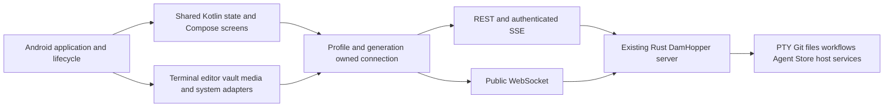

# Android Native Client — Proposed Architecture

**Status:** Core foundation (Phase 02), contracts & live transport (Phase 03), profiles, auth & credential vault (Phase 04), shell & config (Phase 06), terminal sessions/replay/agents (Phase 07), filesystem watchers/search/replace (Phase 08), editor safe saves (Phase 09), diff/merge/blame (Phase 10), and encrypted transfers/media/storage scaffolding (Phase 11) baselines recorded; contract/host prototypes validated with documented open limitations; live device qualification (Phase 18) and TypeScript language engine decision pending. Updated: 2026-10-16.
**Plan:** [Android native-app](../../plans/261015-1647-android-native-app/plan.md).
**Baseline:** `d897a91f76a07ec819a50ffc2756cb69327b2fe3`; existing server/web/Tauri behavior unchanged.

## Product boundary

- New application root: repository-root `native-app/`, separate from existing `apps/native/` Tauri host.
- Kotlin Multiplatform shared application/state + Compose UI; native Android terminal/editor adapters.
- Android 10+ (`minSdk 29`); `arm64-v8a` physical-device and `x86_64` emulator qualification; signed private APK.
- All current non-browser remote workbench feature families included. Native Markdown, image/video and binary/large-file viewing remain in scope.
- User-approved first-release exception: embedded interactive HTML preview and rendered Mermaid browser preview. HTML remains editable source; Mermaid remains editable source/fenced content, with an explicit unsupported-rendering notice. Never call this full preview parity.
- No WebView, embedded browser engine, Tauri, Android-local PTY/Git/agents, local Linux environment, browser debugging/extension, local SSH tunnel client, or desktop package in this release.
- Linux/Windows extension is a design constraint, not implemented desktop functionality. No placeholder desktop host.
- Existing web and Tauri products remain; no cutover or retirement authorized.

### Workspace presentation — user restriction

- Workspace is **TERMINAL only** (`workspaceMode = "terminal"`); no IDE shell or workspace-mode switcher.
- Terminal presentation is **Traditional only** (`terminalUsageMode = "traditional"`); no Runtime terminal presentation or usage-mode switcher.
- Exactly one in-layout button row provides access to every included panel. On narrow screens it scrolls horizontally; it never wraps into multiple navigation rows or hides panels behind a navigation overflow menu.
- No floating navigation buttons, FABs, draggable launchers, floating panel-toggle buttons, or second navigation rail/drawer/bar. Panel actions remain inline in the row or the active panel.
- Files/editor/Git, projects/agents, workflows/plans, Agent Store, host/fleet/usage, ports/tunnels and settings remain available as panel destinations inside this shell; removing IDE/Runtime layouts does not remove their included functions.
- Panel transitions retain qualified terminal/editor controllers and return focus safely; no PTY restart or duplicate attachment.
- Validated row placement: top, directly below server/project header; icon + short text buttons; horizontal scrolling with selected-button reveal. The row remains visible while the software keyboard is open.
- Validated panel body: one content area on every phone/tablet/foldable size. Selecting a panel replaces the terminal visually, not its controllers/sessions; no wide-screen dock beside the terminal. Internal diff/merge panes remain content of their selected panel.
- The active panel alone receives input; hidden terminal/editor surfaces retain state but cannot receive keystrokes or steal IME focus. [Validation answers](../../plans/261015-1647-android-native-app/validation-answers.md) bind these decisions.

## Components

### Gradle/module boundaries

| Proposed location | Responsibility |
| --- | --- |
| `native-app/` | Independent Gradle wrapper, settings, version catalog, dependency verification and build documentation |
| `native-app/shared/` | Android/JVM targets; `commonMain` typed DTOs, ownership, connection registry, repositories/reducers, language services (`features/editor/LanguageService.kt`), ordinary Compose UI; `commonTest` and `jvmTest` for platform-neutral behavior |
| `native-app/androidApp/` | Application/activity, Compose host, Android lifecycle, Ktor OkHttp engine, platform vault (`platform/vault/AndroidCredentialVault.kt`), profile storage (`platform/storage/AndroidProfileMetadataStore.kt`), terminal surface adapter (`platform/terminal/AndroidTerminalSurface.kt`), editor surface adapter (`platform/editor/AndroidEditorSurface.kt`), crypto bridge companion (`platform/crypto/OpaqueClientBridge.kt`), media/IME/storage/notification integrations |
| `native-app/crypto-bridge/` | Rust cdylib generating `libdamhopper_crypto_bridge.so`. Narrow client OPAQUE/JNI boundary implementing exact `DamHopperOpaqueSuite`, SHA-256 HKDF AES-256-GCM derivation, monotonic atomic handles, zeroization, and fail-closed security; no server binary in APK |

Avoid one Gradle module per screen. Organize shared code by feature and separate source files by responsibility. Platform classes never leak into `commonMain`. Kotlin/JVM-compatible dependencies are not automatically common-source dependencies. Do not copy Doggo's Hub, task sync, Room database or API-key model.

## Ownership and state

- `ConnectionRef = { profileId, generation }`; `ProjectTargetRef = { profileId, project, worktreePath? }`.
- Resource keys include owner, target and resource identity; terminal keys additionally include PTY incarnation. Never treat display labels as identity.
- Capture owner before async work, obtain its client, verify owner after suspension before publication or mutation. Cancellation is not a substitute for identity checks.
- Profile endpoint/account change retires its runtime, media capabilities, requests and listeners; another healthy profile remains untouched.
- Wire projection omits client-only `profileId`; backend validates project/worktree authorization. No ambient profile/root fallback.
- Persist only non-secret preferences, profiles and eligible navigation metadata. Dirty buffers, passwords, MFA secrets, OPAQUE state, terminal output and socket decision capabilities are not ordinary persistent preferences.
- Dirty-buffer recovery and process-death UX must be explicitly designed; never advertise crash recovery without encrypted storage/restore evidence. Match current metadata-only persistence unless a separately approved design changes it.

## Transport and authentication

- Default HTTPS/WSS with platform certificate/hostname validation. Debug-only loopback/emulator development exceptions cannot leak into release policy.
- Ktor client uses a per-profile runtime with explicit API errors and cancellation. No single global authenticated client or shared cookie jar.
- REST Bearer session credential is obtained through current password/TOTP MFA flow, not the server signing-secret file. Enrollment challenges are not sessions; step-up rotates credentials.
- WebSocket auth currently accepts `token` query or auth cookie, not REST Bearer-header extraction. `server/src/api/ws.rs:262–274` admits an origin-less authenticated native handshake only with a query token. Use that existing WSS path with mandatory URL/request-log redaction; do not fabricate Origin to evade policy. Cookie-only admission requires an explicitly allowed Origin and separate proof, not an assumed native alternative.
- Strict `kind` JSON envelopes, exact per-field serialized casing, current integer bounds and mixed JSON/binary transfer ordering. One serialized writer owns header/binary pairs.
- REST snapshots reestablish domain baselines after reconnect. Do not replay uncertain input, file commits, Git/destructive mutations or capability approvals automatically.
- SSE is an authenticated stream with owner-qualified lifecycle, epoch/revision pairing, admission limits and documented REST fallback—not another permanent stream per composable.
- `host:uiConnection` capability belongs only to the exact live socket; revoke it on termination and never persist or expose it in generic state/logs.

## Terminal lifetime

- Server owns processes; an Android screen owns visibility, not PTY lifetime.
- Session controller outlives tab/navigation recomposition. Explicit detach/dispose releases local resources; killing/removing a remote session requires distinct user intent.
- Replay uses UTF-8 byte offsets, reset/truncation metadata and incarnation; gate live output/input until baseline replay is applied.
- Preserve terminal grid/emulator state across ordinary UI reattachment; bound retained buffers and pending output. A retained raw tail is not a full emulator framebuffer.
- Android background suspension/process death can break transport. Foreground reconciliation must not spawn duplicate PTYs or replay keystrokes. No guaranteed always-on background socket or WorkManager keepalive.
- Android-native terminal candidate is selected only after IME, Unicode, resize, TUI, replay, lifecycle and 16 KiB JNI acceptance. Upstream screenshots or published AARs are not qualification.

### Phase 05 Terminal Surface Implementation & Candidate Pin
- **Implementation:** `AndroidTerminalSurface.kt` and `TerminalSessionController` in `native-app/androidApp/src/main/kotlin/dev/damhopper/nativeapp/platform/terminal/`.
- **Selected Candidate:** ConnectBot termlib 0.3.13 (`org.connectbot:termlib:0.3.13`) with `libvterm.so` JNI core under Apache-2.0 / MIT licenses.
- **Decoupled Architecture:** Remote Rust server owns PTY processes; terminal renderer is a decoupled display surface. `TerminalSessionController` outlives Composable recomposition and tab navigation.
- **Input Isolation & Replay Fencing:** Input is strictly gated by `isPanelActive` and `isReplayCompleted`. When another panel is active, or while UTF-8 replay is underway, keystrokes and IME composition are dropped/fenced, preventing keystroke leakage into hidden sessions or out-of-order execution.
- **Terminal Controls:** VT100/ANSI modifier translation for Ctrl, Alt, Arrow keys, Esc, Tab, Home, End; bounded search and clipboard selection hooks.
- **Open Qualification Gate:** Physical ARM64 device attachment and 16 KiB kernel page size execution remain open under Phase 07/18.

## Editor and data safety

- Retain current editing/language-service behavior, tabs/view state, mtime conflict safety, diff/revert, three-way merge, blame and commit reveal; only the explicit browser-preview exception is deferred.
- Native editor candidate must expose model edits/version, line geometry, decorations, selection, undo and navigation seams. Missing behavior is an implementation/release gate, not permission to remove it.
- JSON and TS/JS worker-backed behavior needs an evidenced non-browser implementation. No new server language service or Node sidecar is assumed. If local candidate proof fails, stop dependent work and request an explicit architecture decision.
- File tiers remain normal below 1 MiB, degraded below 5 MiB, and read-only range view from 5 MiB, with media/binary precedence. Bound client caches separately from remote file size.
- Dirty tabs keep edits when remote content changes; unavailable/stale owners cannot save. Force overwrite remains explicit against the original target.
- OPAQUE uses exact server suite and HKDF domain separation. Missing/failed crypto cannot downgrade encrypted save/upload to plaintext.
- Media clients preserve ticket purpose, exact-origin paths and per-profile namespaced cookies; Android player/image loaders must use the same captured owner and revoke only their capabilities.

### Phase 05 Editor Surface Implementation & Candidate Pin
- **Implementation:** `AndroidEditorSurface.kt` and `EditorSession` in `native-app/androidApp/src/main/kotlin/dev/damhopper/nativeapp/platform/editor/`.
- **Selected Candidate:** Sora Editor 0.23.4 (`io.github.rosemoe.sora-editor:editor:0.23.4`) under LGPL-2.1-or-later.
- **Model Invariants & Dirty Tracking:** Incremental `modelVersion` counter on every buffer modification; `EditorSession` tracks `originalServerText`, `serverMtime`, `isDirty`, and monotonic `editEpoch`. Stale saves are rejected if connection generation is retired.
- **Line Geometry & Gutter:** Line-based gutter decorations for Git blame annotations, diagnostics, and commit reveal.
- **Undo / Redo:** Local snapshot stack with read-only guards.
- **LGPL-2.1 Compliance Obligations:** Distributed as an AAR artifact. License obligations identified; compliance and user relinking validation pending (packaging configuration in `build.gradle.kts` sets `pickFirsts += setOf("/META-INF/AL2.0", "/META-INF/LGPL2.1")`, ProGuard keeps `io.github.rosemoe.sora.**`, and user relinking verification runbook is tracked for Phase 09; DEX class merging mechanisms require separate compliance validation).

### Language Services & TypeScript Blocker
- **Offline JSON Language Service:** `JsonLanguageService` in `native-app/shared/src/commonMain/kotlin/dev/damhopper/nativeapp/features/editor/LanguageService.kt` delivers non-browser offline syntax validation, AST diagnostics, and symbol hierarchy.
- **Stale Request Fencing:** `LanguageServiceCoordinator` enforces monotonic request watermarks (`fileWatermarks`), discarding outdated async diagnostics from prior buffer revisions.
- **TypeScript Language Service Hard Blocker:** The remote DamHopper Rust server does not host or route a Language Server Protocol (LSP) daemon, and browser web-workers are prohibited by user mandate. Non-browser Kotlin/Java AST evaluation cannot run full TypeScript semantic analysis (diagnostics, type hover, definition navigation) without an embedded JS engine (QuickJS, Hermes, or V8 JNI). Formally audited in `TypeScriptLanguageServiceAudit` (`STATUS = "BLOCKED_PENDING_RUNTIME_DECISION"`). Dependent Phase 09 TS semantic features remain hard-gated.

### OPAQUE Cryptographic Bridge & Fail-Closed Security
- **Rust cdylib Bridge:** `native-app/crypto-bridge/` implements client-side OPAQUE PAKE and JNI entry points.
- **Exact Cipher Suite Parity:** Implements `DamHopperOpaqueSuite` matching `server/src/crypto/opaque.rs`:
  - `type OprfCs = opaque_ke::Ristretto255`
  - `type KeyExchange = opaque_ke::TripleDh<opaque_ke::Ristretto255, sha2::Sha512>`
  - `type Ksf = opaque_ke::ksf::Identity`
- **HKDF Key Derivation:** SHA-256 with 32 zero-byte salt, info `b"dam-hopper-aes-256-gcm-v1"`, deriving 32-byte AES-256-GCM session keys; host-side Rust tests verify byte-for-byte session key derivation parity against simulated server output (live server end-to-end network interop remains an open qualification gate).
- **Fail-Closed Security:** Insecure simulated fallback upon `UnsatisfiedLinkError` was eliminated during code review; `OpaqueClientBridge` strictly fails closed by throwing `OpaqueCryptoException`. Monotonic atomic handles (`AtomicI64`, capacity 64, zeroization on release, double-close safety).
- **Packaging & 16 KiB Page Size:** Android NDK compilation requires `-C link-arg=-Wl,-z,max-page-size=16384` for 16 KiB ELF segment alignment; complete 16 KiB runtime qualification further requires APK zip alignment (`zipalign -p 16384`), prebuilt dependency `.so` validation, and physical execution on a 16 KiB page size kernel environment (tracked under Phase 11/18).

## Filesystem, watchers, search and replace (Phase 08)

The native Android client introduces filesystem navigation, live directory events, search federation, and bulk replacement within the solitary TERMINAL shell, adhering to the single top navigation row (`FILES` panel) and zero FABs:

### Target-Qualified File Operations & Mutex Writes
- **Repository Wire Contracts (`FileRepository.kt`):** Interfaces with REST `/api/fs/list` (`DirEntryDto`), `/api/fs/stat` (`FileStatDto`), and WebSocket messages (`ClientMsg.FsRead`, `ClientMsg.FsOp`). Operations forward the supplied `ProjectTargetRef` through `ApiClient` and `WsConnection`; independent in-client `target.profileId` validation against captured generation is not enforced in commonMain.
- **Serialized Write Coordinator (`FsWriteCoordinator.kt`):** Mutex-guarded chunked file writes (`fs:write_begin` with `expected_mtime` CAS, binary/text frames, `fs:write_commit`) using monotonic `reqId` allocated by `WsConnection`.
- **Mutation Coordinator & Modals (`FileMutationCoordinator.kt`, `FileModalsHost.kt`):** Coordinates `create_file`, `create_dir`, `rename`, and `delete` operations. Compose modals preserve user input upon failure with zero floating action buttons.

### Live Watcher Lifecycle & Subscription Management
- **Early-Buffered Tree Subscriptions (`TreeSubscriptionManager` in `FileTreeSubscription.kt`):** Subscribes via `ClientMsg.FsSubscribeTree` (`watchOnly = true`). Buffers incoming `fs:event` and `fs:overflow` messages through an in-memory channel before the subscribe request completes, filtering events by `subId` and protecting unsubscriptions with generation fencing (the current unbounded channel carries memory risk under high event volume).
- **Observable Tree State (`FileTreeState.kt`):** Manages lazy directory expansion, virtualized rows (`FileTreeItemView`), selection highlight, and hidden file visibility toggle. Server `fs:event` path mapping handles root `.` and project-relative paths. `fs:overflow` triggers re-subscription and refetches loaded directories.
- **Watcher Scope Boundary:** Live directory watching is currently bounded to the root directory without automatic per-subfolder subscriptions. Rebind on reconnect triggers only when `activeSubscription == null`.

### Search & Federated Multi-Profile Queries
- **Search Repository (`SearchRepository.kt`):** Executes REST content search (`/api/fs/search`) and path search (`/api/fs/search-paths`).
- **Federated Coordinator (`FederatedSearchCoordinator.kt`):** Queries connected profiles in parallel via coroutine `async` (without desktop 4-request concurrency throttling), enforcing an aggregate 500-match cap, isolating partial profile failures, and projecting workspace-scope matches to their originating project targets (`QualifiedSearchMatch`).

### Replace Coordinator & Data Safety Boundaries
- **Literal Replacement (`ReplaceCoordinator.kt`):** Replaces occurrences literally without regex expansion.
- **Preview Semantics:** Preview retains aggregate match counts per enumerated file, not exact match positions.
- **Batch Application:** `applyBatch` executes sequential replacements using the frozen search spec; it checks only that some occurrence remains in current content, then replaces all occurrences in each enumerated file.
- **CAS Safety Boundary:** Concurrency safety uses a read-to-write CAS: write commit uses the freshly read mtime, which does not guard against external changes occurring between preview and apply.
- **Dirty-State Provider Gate:** Dirty state is checked before the asynchronous read; the authoritative dirty-buffer provider interface (`ReplaceCoordinator.isDirtyFile`) was wired in Phase 09 via `EditorTabsState` to skip in-memory dirty buffers.

### Recorded Open Limitations (Cycle 2 Review 6/10)
1. **Lossy UTF-8 Replace Fallback:** Permissive `decodeToString()` in fallback paths can corrupt files with invalid sequences past the server binary probe boundary.
2. **Timeout as Cancellation:** Timeout in read/write aborts the entire batch and can report indeterminate writes as generic cancellation.
3. **Root-Only Directory Watcher:** Expanded subdirectories do not receive live watcher events; rebind on reconnect does not trigger on socket instance replacement when a stale subscription reference remains.
4. **Secondary Profile Target Resolution:** Workbench federation effect defaults non-active profiles to profile display names rather than authoritative project targets.
5. **Dirty Gate (Historical Phase 08 limitation):** `ReplaceCoordinator.isDirtyFile` initially defaulted to `{ false }` in Phase 08; resolved in Phase 09 by injecting `EditorTabsState.isDirtyFile`.
6. **Outcome UI Detail:** Partial failures and per-file conflict/failure details are not rendered in the search/replace UI.

## Encrypted transfers, media streaming and Android storage (Phase 11)

### Cryptographic Envelopes & Sessions
- **Envelope Format & Wire Parity (`CryptoEnvelope.kt`):** Implements exact server wire parity (`decrypt_blob` in `server/src/crypto/decrypt.rs`): `iv(12) || ciphertext + tag(16)`. Packs metadata JSON (`FileBlobMetadata`/`TextBlobMetadata`), single `0x00` delimiter byte, and content bytes. Max metadata length is 4,096 bytes.
- **Session Lifecycle & Zeroization (`CryptoSession.kt`):** Holds derived 32-byte AES-256-GCM key with generation validation via `assertValid(expectedOwner)`. Implements `AutoCloseable` with explicit in-memory zeroization (`keyBytes.fill(0)`), subject to documented JVM garbage collection copy limitations.
- **Crypto Primitives & JNI Exports:** `PlatformCrypto` expect/actual provides AES-256-GCM and HKDF-SHA256. `libdamhopper_crypto_bridge.so` exports `nativeEncryptEnvelope` and `nativeDecryptEnvelope` via `OpaqueClientBridge`.

### WebSocket Chunked Transfers & Encrypted Saves
- **Transfer Coordinator (`TransferCoordinator.kt`):** Manages chunked binary and encrypted uploads over WebSocket using atomic frame pairs (`sendAtomicPair`), default 64 KiB chunks, and 100 MiB enforced envelope/document cap where applicable. Pre-registers ack listeners before chunk dispatch; handles timeouts on in-flight commits as `UnknownOutcome`.
- **Encrypted Save Coordinator (`EncryptedSaveCoordinator.kt`):** Orchestrates conflict-aware `saveEncrypted` (using expected mtime CAS) and explicit single-blob `forceOverwriteEncrypted` (`fs:put_save` atomic pair). `EditorRepository` strictly fails closed without plaintext downgrade if crypto session is unavailable or fails.

### Android SAF Document Storage
- **Scoped Document Storage (`AndroidDocumentStorage.kt`):** Implements `DocumentStorage` over scoped Storage Access Framework (SAF) content URIs without broad storage permissions; enforces 100 MiB document size cap (`MAX_DOCUMENT_BYTES`), filename sanitization (`sanitizeFilename`), and bounded chunk streaming (`streamFromUri`, `streamToUri`).

### Origin-Bound Media Client & Video Surface
- **Media Client Security (`AndroidMediaClient.kt`):** Adapts [Media Isolation and Encryption Architecture](./media-isolation-and-encryption.md) to native Android networking. Enforces UUIDv4 `mediaClientId`, namespaced session cookie (`damhopper-media-session-<uuidv4>`), strict same-origin checks (`assertSameOrigin`), redirect rejection (`followRedirects(false)`, `followSslRedirects(false)`), and purpose-scoped capabilities (`PLAYBACK` vs `DOWNLOAD`).
- **Native Video Presentation (`AndroidVideoSurface.kt`, `MediaPreviewCard.kt`):** Utilizes `SurfaceView` and `MediaPlayer` backed by `LeaseMediaDataSource`; `MediaPreviewCard` renders metadata and optional SAF download button with zero FABs.

### Recorded Open Limitations (Cycle 2 Review 5/10)
1. **Production Wiring Gaps:** `CryptoSession` from OPAQUE login and SAF document picker/download flows are not connected to production user actions.
2. **Permissive Cookie Capture:** `cookie.contains(name)` matching allows nullable cookie header rather than fail-closed rejection at issue time.
3. **Unbounded Range Read:** `response.body.bytes()` in `readRangeSync` buffers full response bodies for 200 or oversized 206 responses.
4. **Generation Fencing:** Initial owner assertion is enforced, but revalidation across all subsequent asynchronous boundaries is incomplete.
5. **Envelope Implementation Duplication:** Parallel implementations in Rust JNI exports and Kotlin `CryptoEnvelope`.
## Extended workbench

- Workflow uses server CAS/request identities; manual tracking stays distinct from read-only project plan documents and administrative reported status.
- Agent Store/import/memory operations are server-local and owner-bound; never ship between different profiles accidentally.
- Host resources/usage dashboards retain source freshness, unsupported/degraded/unknown states and stream limits. No raw prompt/command telemetry.
- Ports and Cloudflared forwards run on the server, not Android. Explicit tunnels survive PTY/origin loss; a reminder is not expiry.
- Remote settings/configuration, SSH key loading, maintenance and idle-suspend controls follow currently routed APIs and server capabilities. No invented updater/restart/account-promotion endpoints.
- Host-action routes may be unavailable by server design; show capability denial rather than implementing a privileged fallback.
- Cognito remains ephemeral in-app masking/input isolation, not an OS screenshot guarantee. Native editor/terminal overlays, IME, accessibility and notification payloads need explicit proof.

## Qualification and release boundary

- All phases remain pending until their actual acceptance runs pass; no source/configuration-only success claims.
- Native device journeys, touch/IME evidence and installed signed APK checks supplement JVM/domain tests. Existing browser tests still qualify only the existing browser product.
- Real two-server isolation, authenticated MFA flows, PTY replay, concurrent file saves, safe Git mutations, encrypted writes, stream teardown and process recreation are release gates.
- Freeze package licenses/version compatibility, Android/device matrix, performance budgets and binary page-size alignment before release. Never equate building on Linux with desktop or physical-device qualification.
- Full future preview parity remains unresolved outside this first-release exception; no hidden browser engine, external-browser substitution or remote-rendering service is authorized.

## Unresolved implementation gates

1. Exact compatible Kotlin/Compose/AGP/JDK/Ktor/native-terminal/editor versions and license obligations; toolchain verified in Phase 02; ConnectBot 0.3.13 and Sora Editor 0.23.4 pinned in Phase 05; physical device execution and LGPL compliance/relinking validation remain open.
2. Native terminal/IME/reflow/search behavior and native JSON/TS language-service equivalence: JSON lexer verified offline; TypeScript language service hard-blocked pending runtime engine/LSP architectural decision.
3. OPAQUE JNI interoperability and supported ABI/page-size combinations: Suite parity and HKDF derivation verified in host Rust tests; Android NDK 16 KiB ELF cross-compilation and on-device JNI qualification open.
4. Measured performance budgets on named reference hardware; no estimated percentages or deadlines inferred from Doggo.
