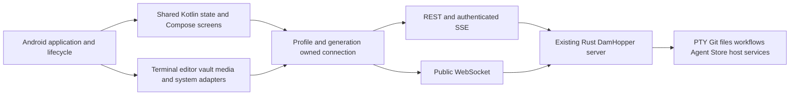

# Android Native Client — Proposed Architecture

**Status:** design only; implementation pending. Decision date: 2026-10-15.
**Plan:** [Android native-app](../../plans/261015-1647-android-native-app/plan.md).
**Baseline:** `d897a91f76a07ec819a50ffc2756cb69327b2fe3`; existing server/web/Tauri behavior unchanged.

## Product boundary

- New application root: repository-root `native-app/`, separate from existing `apps/native/` Tauri host.
- Kotlin Multiplatform shared application/state + Compose UI; native Android terminal/editor adapters.
- Android 10+ (`minSdk 29`); `arm64-v8a` physical-device and `x86_64` emulator qualification; signed private APK.
- All current non-browser remote workbench feature families included. Native Markdown, image/video and binary/large-file viewing remain in scope.
- User-approved first-release exception: embedded interactive HTML preview and rendered Mermaid browser preview. HTML remains editable source; Mermaid remains editable source/fenced content, with an explicit unsupported-rendering notice. Never call this full preview parity.
- No WebView, embedded browser engine, Tauri, Android-local PTY/Git/agents, local Linux environment, browser debugging/extension, local SSH tunnel client, or desktop package in this release.
- Linux/Windows extension is a design constraint, not implemented desktop functionality. No placeholder desktop host.
- Existing web and Tauri products remain; no cutover or retirement authorized.

### Workspace presentation — user restriction

- Workspace is **TERMINAL only** (`workspaceMode = "terminal"`); no IDE shell or workspace-mode switcher.
- Terminal presentation is **Traditional only** (`terminalUsageMode = "traditional"`); no Runtime terminal presentation or usage-mode switcher.
- Exactly one in-layout button row provides access to every included panel. On narrow screens it scrolls horizontally; it never wraps into multiple navigation rows or hides panels behind a navigation overflow menu.
- No floating navigation buttons, FABs, draggable launchers, floating panel-toggle buttons, or second navigation rail/drawer/bar. Panel actions remain inline in the row or the active panel.
- Files/editor/Git, projects/agents, workflows/plans, Agent Store, host/fleet/usage, ports/tunnels and settings remain available as panel destinations inside this shell; removing IDE/Runtime layouts does not remove their included functions.
- Panel transitions retain qualified terminal/editor controllers and return focus safely; no PTY restart or duplicate attachment.
- Validated row placement: top, directly below server/project header; icon + short text buttons; horizontal scrolling with selected-button reveal. The row remains visible while the software keyboard is open.
- Validated panel body: one content area on every phone/tablet/foldable size. Selecting a panel replaces the terminal visually, not its controllers/sessions; no wide-screen dock beside the terminal. Internal diff/merge panes remain content of their selected panel.
- The active panel alone receives input; hidden terminal/editor surfaces retain state but cannot receive keystrokes or steal IME focus. [Validation answers](../../plans/261015-1647-android-native-app/validation-answers.md) bind these decisions.

## Components

### Gradle/module boundaries

| Proposed location | Responsibility |
| --- | --- |
| `native-app/` | Independent Gradle wrapper, settings, version catalog, dependency verification and build documentation |
| `native-app/shared/` | Android/JVM targets; `commonMain` typed DTOs, ownership, repositories/reducers, ordinary Compose UI; `commonTest` and `jvmTest` for platform-neutral behavior |
| `native-app/androidApp/` | Application/activity, Compose host, Android lifecycle, Ktor OkHttp engine, platform vault, terminal/editor/media/IME/storage/notification integrations |
| `native-app/crypto-bridge/` | Narrow Rust client OPAQUE/JNI boundary, only if the native interop gate validates it; no server binary in APK |

Avoid one Gradle module per screen. Organize shared code by feature and separate source files by responsibility. Platform classes never leak into `commonMain`. Kotlin/JVM-compatible dependencies are not automatically common-source dependencies. Do not copy Doggo's Hub, task sync, Room database or API-key model.

## Ownership and state

- `ConnectionRef = { profileId, generation }`; `ProjectTargetRef = { profileId, project, worktreePath? }`.
- Resource keys include owner, target and resource identity; terminal keys additionally include PTY incarnation. Never treat display labels as identity.
- Capture owner before async work, obtain its client, verify owner after suspension before publication or mutation. Cancellation is not a substitute for identity checks.
- Profile endpoint/account change retires its runtime, media capabilities, requests and listeners; another healthy profile remains untouched.
- Wire projection omits client-only `profileId`; backend validates project/worktree authorization. No ambient profile/root fallback.
- Persist only non-secret preferences, profiles and eligible navigation metadata. Dirty buffers, passwords, MFA secrets, OPAQUE state, terminal output and socket decision capabilities are not ordinary persistent preferences.
- Dirty-buffer recovery and process-death UX must be explicitly designed; never advertise crash recovery without encrypted storage/restore evidence. Match current metadata-only persistence unless a separately approved design changes it.

## Transport and authentication

- Default HTTPS/WSS with platform certificate/hostname validation. Debug-only loopback/emulator development exceptions cannot leak into release policy.
- Ktor client uses a per-profile runtime with explicit API errors and cancellation. No single global authenticated client or shared cookie jar.
- REST Bearer session credential is obtained through current password/TOTP MFA flow, not the server signing-secret file. Enrollment challenges are not sessions; step-up rotates credentials.
- WebSocket auth currently accepts `token` query or auth cookie, not REST Bearer-header extraction. `server/src/api/ws.rs:262–274` admits an origin-less authenticated native handshake only with a query token. Use that existing WSS path with mandatory URL/request-log redaction; do not fabricate Origin to evade policy. Cookie-only admission requires an explicitly allowed Origin and separate proof, not an assumed native alternative.
- Strict `kind` JSON envelopes, exact per-field serialized casing, current integer bounds and mixed JSON/binary transfer ordering. One serialized writer owns header/binary pairs.
- REST snapshots reestablish domain baselines after reconnect. Do not replay uncertain input, file commits, Git/destructive mutations or capability approvals automatically.
- SSE is an authenticated stream with owner-qualified lifecycle, epoch/revision pairing, admission limits and documented REST fallback—not another permanent stream per composable.
- `host:uiConnection` capability belongs only to the exact live socket; revoke it on termination and never persist or expose it in generic state/logs.

## Terminal lifetime

- Server owns processes; an Android screen owns visibility, not PTY lifetime.
- Session controller outlives tab/navigation recomposition. Explicit detach/dispose releases local resources; killing/removing a remote session requires distinct user intent.
- Replay uses UTF-8 byte offsets, reset/truncation metadata and incarnation; gate live output/input until baseline replay is applied.
- Preserve terminal grid/emulator state across ordinary UI reattachment; bound retained buffers and pending output. A retained raw tail is not a full emulator framebuffer.
- Android background suspension/process death can break transport. Foreground reconciliation must not spawn duplicate PTYs or replay keystrokes. No guaranteed always-on background socket or WorkManager keepalive.
- Android-native terminal candidate is selected only after IME, Unicode, resize, TUI, replay, lifecycle and 16 KiB JNI acceptance. Upstream screenshots or published AARs are not qualification.

## Editor and data safety

- Retain current editing/language-service behavior, tabs/view state, mtime conflict safety, diff/revert, three-way merge, blame and commit reveal; only the explicit browser-preview exception is deferred.
- Native editor candidate must expose model edits/version, line geometry, decorations, selection, undo and navigation seams. Missing behavior is an implementation/release gate, not permission to remove it.
- JSON and TS/JS worker-backed behavior needs an evidenced non-browser implementation. No new server language service or Node sidecar is assumed. If local candidate proof fails, stop dependent work and request an explicit architecture decision.
- File tiers remain normal below 1 MiB, degraded below 5 MiB, and read-only range view from 5 MiB, with media/binary precedence. Bound client caches separately from remote file size.
- Dirty tabs keep edits when remote content changes; unavailable/stale owners cannot save. Force overwrite remains explicit against the original target.
- OPAQUE uses exact server suite and HKDF domain separation. Missing/failed crypto cannot downgrade encrypted save/upload to plaintext.
- Media clients preserve ticket purpose, exact-origin paths and per-profile namespaced cookies; Android player/image loaders must use the same captured owner and revoke only their capabilities.

## Extended workbench

- Workflow uses server CAS/request identities; manual tracking stays distinct from read-only project plan documents and administrative reported status.
- Agent Store/import/memory operations are server-local and owner-bound; never ship between different profiles accidentally.
- Host resources/usage dashboards retain source freshness, unsupported/degraded/unknown states and stream limits. No raw prompt/command telemetry.
- Ports and Cloudflared forwards run on the server, not Android. Explicit tunnels survive PTY/origin loss; a reminder is not expiry.
- Remote settings/configuration, SSH key loading, maintenance and idle-suspend controls follow currently routed APIs and server capabilities. No invented updater/restart/account-promotion endpoints.
- Host-action routes may be unavailable by server design; show capability denial rather than implementing a privileged fallback.
- Cognito remains ephemeral in-app masking/input isolation, not an OS screenshot guarantee. Native editor/terminal overlays, IME, accessibility and notification payloads need explicit proof.

## Qualification and release boundary

- All phases remain pending until their actual acceptance runs pass; no source/configuration-only success claims.
- Native device journeys, touch/IME evidence and installed signed APK checks supplement JVM/domain tests. Existing browser tests still qualify only the existing browser product.
- Real two-server isolation, authenticated MFA flows, PTY replay, concurrent file saves, safe Git mutations, encrypted writes, stream teardown and process recreation are release gates.
- Freeze package licenses/version compatibility, Android/device matrix, performance budgets and binary page-size alignment before release. Never equate building on Linux with desktop or physical-device qualification.
- Full future preview parity remains unresolved outside this first-release exception; no hidden browser engine, external-browser substitution or remote-rendering service is authorized.

## Unresolved implementation gates

1. Exact compatible Kotlin/Compose/AGP/JDK/Ktor/native-terminal/editor versions and license obligations; select by actual build/device evidence.
2. Native terminal/IME/reflow/search behavior and native JSON/TS language-service equivalence.
3. OPAQUE JNI interoperability and supported ABI/page-size combinations.
4. Measured performance budgets on named reference hardware; no estimated percentages or deadlines inferred from Doggo.
