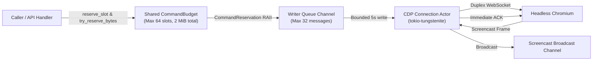

# Host Browser CDP Streaming Architecture

**Authority:** Backend Subsystem (`server/src/browser_host/`, `server/examples/browser_host_qualification.rs`)  
**Status:** Supervised Principal Profiles, Admission Control, Leased Input, Raw CDP Gateway, Screencast & Live Tab Audio Streaming, Bounded Media Fanout, Decoder & WebAudio PCM Pipeline, OS Root Lifecycle Cutover, Secure Selection / Confirmed Logout Reset, and Cycle 13 Video/Audio Streaming Remediation (Automated Checks Qualified; Code Review 9/10 Approved With Notes; Live Output-Browser Qualification & Physical/Windows Gates Pending). Native Browser Tabs & Session Continuity Phases 01–03 owner contracts, canonical persistence, Web Locks recovery, target lifecycle, tuple-keyed tab resource slots, active-only stream attachments, popup admission guard, and live authority bridges implemented (`verifiedBrowserIdentity`, `browser-tab-types.ts`, `browser-owner-scope.ts`, `browser-tab-state.ts`, `browser-persistence.ts`, `browser-recovery-store.ts`, `browser-create-lifecycle.ts`, `browser-close-lifecycle.ts`, `browser-window-close-coordinator.ts`, `browser-popup-tabs.ts`, `browser-session-sync.ts`, `BrowserStreamKeepAliveHost.tsx`); Phases 04–05 tab chrome integration and visual qualification remain pending.

This specification defines the architectural contracts, process containment boundaries, bounded CDP actor lifecycle, and binary wire framing for the Host Browser CDP Streaming subsystem.

## 1. Scope, Identity and Trust Model

The Host Browser subsystem provides candidate headless Chromium process management and CDP streaming primitives for developer browser sessions.

- **Principal Isolation:** Exactly one lazily launched Chromium instance per authenticated principal/server. Different authenticated principals never share browser processes or user-data directories.
- **Identity Hierarchy:**
  - `browserSessionId`: Authoritative server-issued UUID representing a single logical page target, distinct from native Chromium target IDs.
  - `browserIncarnation`: Fresh UUID minted on each browser process launch.
  - `profileEpoch`, `viewportEpoch`, `frameSeq`, `docEpoch`, `audioSeq`: Canonical decimal `u64` string counters matching `[1-9][0-9]{0,19}` with numeric values $\le 18446744073709551615$. Zero, leading zeros, signs, whitespace, and non-ASCII characters are rejected. Counters never wrap; exhaustion requires identity recreation. Within-page same-document audio transitions also track `subDocGen` (`>= 1`).
  - `producerRun`, `subscriptionEpoch`: Fresh UUIDs for screencast runs and viewer subscriptions.
- **Trust Boundaries:** Raw CDP exposes full native browser and host privileges. Cooperative leases and target mappings do not sandbox an untrusted agent. Loopback debugging assumes local processes with loopback access can reach debug ports; stronger isolation requires external containerization.

## 2. Bounded CDP Actor and Command Budget

The CDP connection actor (`server/src/browser_host/cdp.rs`) manages a single WebSocket connection to the browser's DevTools endpoint with bounded resource admission:



### Resource Admission Bounds

| Resource Ceiling | Limit | Enforcement Mechanism |
| --- | --- | --- |
| Writer Queue Channel | 32 messages | `mpsc::channel(32)`; saturation returns `CdpError::WriterQueueFull` |
| Total Admitted Caller RPCs | 64 commands | Shared across queued and in-flight caller requests; returns `CdpError::TooManyPendingCommands` |
| Command Byte Budget | 2 MiB (2,097,152 bytes) | Shared RAII `CommandBudget` reservation held from pre-serialization until response or drop |
| Single Command Payload | 64 KiB (65,536 bytes) | Serialization ceiling; payloads $> 64$ KiB return `CdpError::CommandTooLarge` |
| Actor Write Deadline | 5 seconds | Stalled writes pause actor reads/sweeps; timeout aborts connection |
| WebSocket Frame/Message Cap | 4 MiB (4,194,304 bytes) | Tungstenite `max_message_size` and `max_frame_size` |

### RAII Budget Lifecycle (`command_budget.rs`)

`CommandReservation` guarantees that reserved command slots and payload bytes are atomically returned to `CommandBudget` when the reservation is dropped across any termination path: normal response receipt, caller deadline timeout, caller cancellation, or connection teardown.

Browser-wide Fetch decisions are internal one-way release messages, not caller RPCs. The actor evaluates one paused request and writes its bounded decision before reading another event; it retains no request backlog or response-owner map. Unique negative command IDs separate these decisions from positive caller IDs. Each write holds a memory reservation and the normal write deadline. Malformed/unexpected decision responses fail closed; only Chromium's exact canceled-loader error (`-32602`, `Invalid InterceptionId.`) is tolerated because no intercepted loader remains.

### Response and Screencast Frame Routing

- **Response Demultiplexing:** Responses are routed to callers by monotonic numeric command ID. Unknown events increment an atomic counter (`unknown_events_count`) without allocating queue slots.
- **Screencast Frame Handling:** `Page.screencastFrame` events are validated for finite metadata (`offsetTop`, `pageScaleFactor`, `deviceWidth`, `deviceHeight`, `scrollOffsetX`, `scrollOffsetY`) and broadcast to subscribers.
- **Native Frame Credit Decoupling:** `CdpClient::ack_screencast_frame` acknowledges frames back to Chromium independently of downstream viewer consumption, preventing stalled viewers from exhausting native frame credits.
- **Fail-Closed Malformed Envelopes:** A malformed known screencast frame (unparseable envelope, missing session ID, non-finite geometry) has no routable caller and closes the actor with `CdpError::MalformedResponse`.

## 3. Fail-Closed Process Supervision & Containment Model

Process management (`server/src/browser_host/process.rs`) supervises Chromium execution with fail-closed containment:

### Launch Configuration & Allowlist

- **No Automatic Discovery:** `find_browser_executable(None)` fails closed with `ProcessError::ExecutableNotFound` when `DAM_HOPPER_BROWSER_EXECUTABLE` is not explicitly set. Automatic PATH or standard-directory scanning is prohibited.
- **Strict Argument Allowlist (`is_allowlisted_arg`):**
  - **Permitted Exact Flags & Prefixes:** Exact `--disable-blink-features=AutomationControlled` (prevents `navigator.webdriver = true` across main frames, cross-origin OOPIF iframes, and workers) and exact `--autoplay-policy=no-user-gesture-required` (applied by `BrowserProcess::launch` and allowlisted in `is_allowlisted_arg`), plus prefixes `--window-size=`, `--user-agent=`, `--lang=`, `--force-device-scale-factor=`, `--default-background-color=`. Other `--disable-blink-features*` or autoplay policy values fail closed.
  - **Explicitly Forbidden Flags:** `--remote-debugging*`, `--remote-allow-origins*`, `--user-data-dir*`, `--load-extension*`, `no-sandbox`, `disable-web-security`, `ignore-certificate-errors`, `disable-site-isolation`, `password-store`, `use-mock-keychain`, `disable-hang-monitor`, `disable-ipc-flooding`, `disable-renderer-backgrounding`, `disable-backgrounding-occluded`, `disable-background-timer-throttling`.
  - **Platform-Coherent Chrome Identity, Media Stealth & Audio Bridge (`server/src/browser_host/stealth.rs`):** On page session setup and cross-origin OOPIF `iframe` attachment (`Target.setAutoAttach`), `ScreencastProducer::apply_stealth_and_focus` preserves the exact command order `Browser.getVersion` $\rightarrow$ `Emulation.setFocusEmulationEnabled` $\rightarrow$ `Emulation.setUserAgentOverride` (`Chrome/<major>.0.0.0` + `sec-ch-ua`) $\rightarrow$ `Page.addScriptToEvaluateOnNewDocument` $\rightarrow$ `Runtime.evaluate` $\rightarrow$ `Target.setAutoAttach`, with zero `Runtime.enable` or `Runtime.addBinding`. `ANTI_DETECTION_SCRIPT` additionally installs: (1) a unified non-stacked `Permissions.prototype.query` hook (`27` defaults, `Notification.permission` correlation normalizing `'denied'` to `'default'`, native fallback); (2) privacy-fenced `navigator.mediaDevices.enumerateDevices()` blanking `deviceId`, `label`, and `groupId` while preserving `kind` and count; (3) `HTMLMediaElement.prototype.canPlayType` and `MediaSource.isTypeSupported` codec normalization (`video/mp4`, `audio/mp4`, `video/webm`, `audio/webm`, `audio/mpeg`, `audio/ogg`, `audio/wav`, `audio/flac` for H.264/AAC/AV1/VP8/VP9/Opus/Vorbis/Theora/FLAC/MP3 without advertising EME/DRM); and (4) a non-enumerable `EventTarget.prototype[Symbol.for('dh.a')]` 24 kHz mono PCM16LE capture bridge (`start`, `drain`, `drainDoc`, `drainPcm`, `stop`, `stopDoc`) tapping `<audio>`/`<video>` via `captureStream()` (with `createMediaElementSource` deduplication), `AudioNode.prototype.connect`/`disconnect` destination graphs, and child iframes (direct or bounded `postMessage` relay across up to 8 frames), mixing into a 24,000-sample `Int32Array` ring (16-source cap, 5-chunk ready queue up to 2,400 samples / 100 ms each, 3s drain lease, `rms < 0.0002` silence skip) and advancing `subDocGen` while clearing pre-transition chunks on `hashchange`, `popstate`, `History.prototype.pushState`/`replaceState`, and `runToken` rotation. Allowed `Fetch.requestPaused` subresource/worker requests carrying `HeadlessChrome` headers are sanitized on `Fetch.continueRequest`.
  - All default Chromium sandboxing, certificate verification, and site isolation protections remain active.

### Unix Process Group & Death-Pipe Watcher

- **Linux 6.9+ Kernel Requirement (`PIDFD_SIGNAL_PROCESS_GROUP`):** Chromium process launch strictly requires Linux 6.9+ for process group pidfd signalling (`pidfd_send_signal(PIDFD_SIGNAL_PROCESS_GROUP)`) and `close_range` (5.9+). Spawns Chromium in a dedicated process group (`process_group(0)`).
- **Bidirectional Death-Pipe Watcher:** The dedicated watcher process (`process/death_watcher.rs`) holds a leader pidfd acquired prior to fork and signals the kernel's process group object directly rather than a numerical PGID. Supervisor termination drops the anonymous POSIX death pipe; the watcher receives `EOF` on `death_r` and executes `pidfd_send_signal` against the process group, ensuring orphaned renderer and utility processes are terminated without risking signalling recycled process group IDs after leader reap. On kernels without `PIDFD_SIGNAL_PROCESS_GROUP` (< 6.9, e.g. Ubuntu 24.04 6.8), watcher arming fails with `EINVAL` and launch fails closed; legacy pre-6.9 killpg/procfs fallbacks are permanently deleted.
- **Dual-Stage Liveness Verification:** `live_members(pgid)` verifies termination via pidfd probe and `/proc` process-tree scanning against captured launch token markers.
- **Graceful Shutdown Protocol:** Sends `SIGTERM` with a 3-second grace period (`SHUTDOWN_GRACE_PERIOD_SECS`), followed by `SIGKILL` if processes survive.
- **Non-Positive PGID Rejection:** During unmanaged prior process group cleanup (e.g. after daemon restart or crash recovery), any stored `process_pgid <= 1` (where `0` represents current process group, `-1` all processes, and `1` init/systemd) is rejected fail-closed. Tombstone stage transitions to `ResetStage::Failed`, error records `invalid non-positive PGID {pgid}`, and the instance transitions to `InstanceLifecycleState::CleanupPending`, refusing to signal host or init processes.
- **Durable Containment Fencing:** Process group containment is proven before completing process launch or profile wipe. If processes survive the 3-second `SIGTERM` grace period and 2-second `SIGKILL` proof deadline, the failure is recorded in an atomic `reset.json` tombstone and the profile enters `CleanupPending`. On server restart, `load_tombstone` recovers this state and fences subsequent launch attempts until resolved.

### Endpoint Discovery and Loopback Validation

- **Bounded Stream Reading:** Stderr is consumed in 1024-byte chunks up to a hard ceiling of 64 KiB (`MAX_STDERR_CAPTURE_BYTES = 65_536`). Oversized stderr streams without an endpoint token fail closed with `ProcessError::StderrOverflow`.
- **DevToolsActivePort Corroboration:** When present, `DevToolsActivePort` (read up to 512 bytes) is corroborated against the stderr endpoint; mismatch between port file and stderr fails closed with `ProcessError::EndpointMismatch`.
- **Loopback Enforcement (`validate_loopback_endpoint`):** Endpoints must parse as `ws://`, bind strictly to `127.0.0.1`, `[::1]`, or `localhost`, specify an explicit non-zero port, and match `/devtools/browser/<canonical-uuid>` where the UUID is a 36-character lowercase RFC 4122/9562 UUID.
- **Non-Unix Platform Containment:** On non-Unix platforms (such as Windows), `BrowserProcess::launch` fails closed immediately with `ProcessError::ContainmentUnavailable`. Windows containment remains unimplemented; no qualification is claimed.

## 4. Binary Wire Framing Protocol (BHJF v1)

Streaming frames from the server to viewers use the atomic `BHJF` binary envelope (`server/src/browser_host/protocol.rs`):

```text
 0                   1                   2                   3
 0 1 2 3 4 5 6 7 8 9 0 1 2 3 4 5 6 7 8 9 0 1 2 3 4 5 6 7 8 9 0 1
+-+-+-+-+-+-+-+-+-+-+-+-+-+-+-+-+-+-+-+-+-+-+-+-+-+-+-+-+-+-+-+-+
|   'B'   |   'H'   |   'J'   |   'F'   |        version (1)    |
+-+-+-+-+-+-+-+-+-+-+-+-+-+-+-+-+-+-+-+-+-+-+-+-+-+-+-+-+-+-+-+-+
|       json_header_len         |           payload_len         |
+-+-+-+-+-+-+-+-+-+-+-+-+-+-+-+-+-+-+-+-+-+-+-+-+-+-+-+-+-+-+-+-+
|    payload_len (continued)    |            reserved           |
+-+-+-+-+-+-+-+-+-+-+-+-+-+-+-+-+-+-+-+-+-+-+-+-+-+-+-+-+-+-+-+-+
|                      reserved (continued)                     |
+-+-+-+-+-+-+-+-+-+-+-+-+-+-+-+-+-+-+-+-+-+-+-+-+-+-+-+-+-+-+-+-+
| JSON Header Bytes (1 .. 1024 bytes) ...                       |
+-+-+-+-+-+-+-+-+-+-+-+-+-+-+-+-+-+-+-+-+-+-+-+-+-+-+-+-+-+-+-+-+
| JPEG Payload Bytes (1 .. 2,097,152 bytes) ...                 |
+-+-+-+-+-+-+-+-+-+-+-+-+-+-+-+-+-+-+-+-+-+-+-+-+-+-+-+-+-+-+-+-+
```

### Header Specification

- **Header Size:** Fixed 16-byte big-endian prefix.
- **Magic:** `0x42 0x48 0x4A 0x46` (`BHJF`).
- **Version:** `1` (`u16`).
- **JSON Header Length:** `u16` ($\le 1024$ bytes).
- **Payload Length:** `u32` ($\le 2,097,152$ bytes / 2 MiB).
- **Reserved:** `u32` (must be zero).

### Frame Geometry & Decimal Counters

`TargetFrameHeader` enforces strict validation rules:
- **Canonical Decimal Counters:** `profileEpoch`, `viewportEpoch`, and `frameSeq` are non-empty positive ASCII decimal strings $\le \text{u64::MAX}$ without signs, whitespace, or leading zeros (`validate_decimal_sequence`).
- **CSS Viewport Ceilings:** Layout viewport width $\in (0, 1920]$, height $\in (0, 1080]$.
- **Scale Bounds:** `dpr` $\in [0.1, 10.0]$, `pageScale` $\in [0.1, 10.0]$.
- **Offset Bounds:** Absolute offsets $\le 10,000,000$ CSS px.
- **Payload Consistency:** Declared header `width` and `height` must match JPEG SOF0/SOF2 marker dimensions exactly.

## 5. Authenticated Agent CDP Gateway & Upstream Relay (`cdp_gateway.rs`)

The production CDP Gateway (`server/src/browser_host/cdp_gateway.rs`) exposes authenticated raw Chrome DevTools Protocol access to external automation clients (e.g. Playwright via `connectOverCDP`):

### Discovery Endpoint Rewriting

CDP discovery routes (`GET /api/browser/cdp/json/version`, `GET /api/browser/cdp/json/list`, and `GET /api/browser/cdp/json`) authenticate callers and proxy metadata from the running Chromium instance:
- **Gateway WS Base Resolution:** Rewrites internal `webSocketDebuggerUrl` and `devtoolsFrontendUrl` to public gateway WebSocket endpoints (`/api/browser/cdp/ws` or `/api/browser/cdp/ws/{target_id}`). The public URL is derived strictly from operator-configured `DAM_HOPPER_PUBLIC_SERVER_ORIGIN` (scheme and authority only, mapping `http` to `ws` and `https` to `wss`), or in guarded `--no-auth` development mode with a verified loopback bound listener socket. The request `Host` and forwarded headers (`X-Forwarded-Host`, `X-Forwarded-For`) are never consulted or reflected; an unconfigured origin rejects discovery with HTTP 503 Service Unavailable (`kind: "publicOriginUnavailable"`).
- **Endpoint Sanitization:** Internal loopback DevTools ports (e.g. `127.0.0.1:xxxxx`) are stripped from frontend URLs before returning to callers.
- **Payload Bounds:** Discovery target list payloads from Chromium are strictly bounded to 256 KiB; oversized responses fail closed with HTTP 502 Bad Gateway.

### Exact Single Origin Policy

Origin validation enforces strict single-origin invariants (`validate_cdp_origin`):
1. **Single Header Enforcement:** Multiple `Origin` headers (`headers.get_all(header::ORIGIN).iter().count() > 1`) fail closed with HTTP 403 Forbidden (`kind: "forbiddenOrigin"`).
2. **Format Sanitation:** Origins equal to `"null"`, ending in a trailing slash (`/`), or containing commas (`,`) fail closed with HTTP 403 Forbidden.
3. **Allowlist Matching:** Evaluates byte-for-byte exact equality against approved origins (`server.cors_origins`, `public_server_origin`, and in dev `browser.allowed_dev_origins`). An empty allowlist approves nothing (denies all Origin-bearing requests).
4. **Origin-less Requests:** Permitted strictly for clients presenting bearer credentials (`Authorization: Bearer <token>`) or loopback development bypass. Origin-less requests without bearer authentication fail closed with HTTP 403 Forbidden.
5. **Oracle Mitigation:** Discovery endpoints evaluate caller authentication before validating Origin headers; unauthenticated requests fail with HTTP 401 Unauthorized, preventing unauthenticated origin enumeration or probing.

### Canonical Claims Evaluation & MFA Integration

Browser host admission integrates directly with the canonical authentication service (`authenticate_browser_caller` in `api/browser_host.rs`):
- Decodes `AuthClaims` from Bearer tokens or cookies and executes `state.auth_service.evaluate_claims(&claims)`.
- Enforces multi-factor authentication requirements: computes effective session deadlines via `crate::auth::compute_mfa_due_at(mfa_verified_at, expires_at)`.
- `AuthDecision::MfaRequired` returns HTTP 401 Unauthorized (`kind: "mfaRequired"`).
- `AuthDecision::FullLoginRequired` returns HTTP 401 (`kind: "invalidSession"`) or HTTP 403 (`kind: "accountDisabled"`).
- `AuthDecision::Unavailable` returns HTTP 503 Service Unavailable (`kind: "authUnavailable"`).
- Revalidates active session in the database: `revoked_at.is_none()`, `auth_version` and `credential_version` match user records, and caller holds the enabled `Admin` role (`UserRole::Admin`).

### Server-Derived Capability Tickets & Subprotocol Upgrade

Clients connecting without Bearer headers may authenticate using single-use capability tickets:
- Issued exclusively via server endpoint `POST /api/browser/attachments` with `purpose: "agentCdp"`.
- 256-bit random entropy from `rand::rngs::OsRng`, URL-safe unpadded Base64 encoded; server stores only the 32-byte SHA-256 hash in memory.
- Expiration: 30 seconds (`TICKET_TTL`), clipped to caller auth session deadline.
- Redeemed via WebSocket subprotocol: `Sec-WebSocket-Protocol: damhopper.browser.cdp.v1, damhopper.ticket.<base64url>`.
- Single-use atomic consumption: consumed ticket is removed immediately from the ticket store.
- Validates that running instance `browserIncarnation` and `profileEpoch` match the ticket.

### Foreign Session Checks

Every session retrieval, mutation, navigation, or control operation verifies ownership:
- If the target session ID exists but is owned by another principal, the lookup returns `SessionError::NotFound` (HTTP 404 `kind: "sessionNotFound"`), indistinguishable from a non-existent session.
- Prevents cross-principal session presence discovery, ID enumeration, or information leakage.

### Bounded Upstream Relay & Concurrency Bounds

- **Concurrency Ceiling:** Max 2 concurrent agent CDP connections globally by default (`DEFAULT_MAX_AGENT_CDP_CONNECTIONS = 2`), guarded by `Semaphore`. Admissions when saturated return HTTP 429 Too Many Requests (`kind: "browserBusy"`).
- **Dedicated Upstream Per Agent:** Each agent WebSocket connection spawns a dedicated, unshared upstream WebSocket client to Chromium's DevTools endpoint with a 5-second connection deadline (`UPSTREAM_CONNECT_TIMEOUT = 5s`). No multiplexing through internal screencast actors.
- **Framing & Write Bounds:** Bounded to 4 MiB frame and message caps (`MAX_WS_MESSAGE_BYTES = 4_194_304`). Outgoing socket writes enforce a 5-second deadline (`WRITE_DEADLINE = 5s`).

### Live Auth Cancellation Racing with Socket Writes & Fast Teardown

Long-running CDP relays do not rely solely on initial handshake authentication:
1. **Continuous Auth Supervisor:** Spawns a background task running every 5 seconds (`LIVE_CHECK_INTERVAL`) with a 2-second database timeout (`LIVE_CHECK_TIMEOUT`) calling `verify_live_admission`.
2. **Live Demotion & Revocation:** Detects account disabling, demotion from Admin role, session revocation, or credential/auth version increments.
3. **Cancellation Racing with Writes (`write_with_cancel`):** Outgoing socket writes wrap send futures with `write_with_cancel`, which uses `tokio::select!` to race the write future against an auth cancellation receiver channel (`auth_abort_rx`). If auth is revoked while a socket write is stalled or in progress, the write is aborted immediately without waiting for the 5-second write deadline.
4. **Fast Teardown:** If aborted due to auth failure (`aborted_by_auth == true`), the relay skips the cooperative 500ms WebSocket close handshake (`close(None)`), dropping client and upstream sockets immediately to prevent data leakage.
5. **Instance Authority Warning:** Attaching to the raw CDP gateway grants instance-wide authority, bypassing cooperative input leases and target fences. The connection registers with the manager (`register_agent_cdp`) and logs an authoritative security warning.
## 6. Configuration Schema & Admission Budgets (`config.rs`)

The browser host subsystem is configured under `[server.browser]` in `config.toml` (with legacy top-level `[browser]` mapped transparently into `server.browser`).

### Configuration Model (`BrowserHostConfig`)

| Field | Type | Default | Validation & Semantics |
| --- | --- | --- | --- |
| `enabled` | `bool` | `false` | Master enable switch. Defaults to `false` until an executable and origin policy are configured. |
| `executable_path` | `Option<PathBuf>` | `None` | Path to browser binary. Must be regular file with execute permissions (`mode & 0o111 != 0`) and not world-writable (`mode & 0o002 == 0`). |
| `profile_root` | `Option<PathBuf>` | `None` | Base directory for principal profiles. Defaults to `~/.config/dam-hopper/browser-profiles`. Must not be a symlink; directory permissions must be strictly mode `0700` (`mode & 0o077 == 0`). |
| `allowed_target_origins` | `Vec<String>` | `[]` | Approved target page origins. Strictly formatted (`http://` or `https://`, host, optional port; credentials, query, fragment, path segments, and trailing slashes forbidden). |
| `allowed_asset_origins` | `Vec<String>` | `[]` | Approved asset origins for viewer frames and static resources. Strictly formatted. |
| `allowed_dev_origins` | `Vec<String>` | `[]` | Approved developer debug origins. Strictly formatted. |
| `denied_destinations` | `Vec<String>` | Cloud metadata IPs | Blocked destination addresses. Default list: `169.254.169.254`, `fd00:ec2::254`, `metadata.google.internal`, `100.100.100.200`. Formats: IP, IP CIDR, hostname, or `host:port`. |
| `budgets` | `BrowserBudgetsConfig` | Defaults below | Structured admission bounds and memory limits. |

### Budget Limits (`BrowserBudgetsConfig`)

| Budget Field | Default | Range | Enforcement Mechanism |
| --- | --- | --- | --- |
| `max_processes` | `1` | `1 ..= 4` | Capped by global process atomic counter; excess returns `ManagerError::Busy` (HTTP 429) |
| `max_targets` | `2` | `1 ..= 16` | Maximum concurrent page targets per principal |
| `max_viewers` | `2` | `1 ..= 16` | Maximum concurrent streaming viewers per target |
| `max_raw_cdp_connections` | `2` | `1 ..= 8` | Maximum concurrent raw CDP proxy WebSocket connections |
| `memory_ceiling_bytes` | `134,217,728` (128 MiB) | `33,554,432` (32 MiB) ..= `1,073,741,824` (1 GiB) | Hard memory ceiling checked against worst-case allocation |
| `jpeg_quality` | `75` | `10 ..= 100` | Screencast JPEG encoding quality |
| `max_width` | `1280` | `64 ..= 1920` | Maximum capture frame width |
| `max_height` | `900` | `64 ..= 1080` | Maximum capture frame height |
| `frame_rate_fps` | `24` | `1 ..= 30` | Maximum screencast capture frame rate |

### Memory Reservation Bounds Calculation

The budget validator enforces an analytical ceiling check:
$$\text{estimated} = (\text{max\_targets} \times 12.1\text{ MiB}) + (\text{max\_viewers} \times 4.2\text{ MiB}) + (\text{max\_raw\_cdp} \times 8.0\text{ MiB}) \le \text{memory\_ceiling\_bytes}$$

- **Per-Target (~12.1 MiB):** 2 MiB command budget + 4 MiB WS event buffer + 4 MiB candidate buffer + ~2.1 MiB complete BHJF buffer + 103,792 B headroom covering the `broadcast::channel(4)` shared `Arc<str>` audio ring ($\le 26,624$ B).
- **Per-Viewer (~4.2 MiB):** 2 outstanding + 1 pending Bytes handles (buffered) + writer queue (including $\le 8$ KiB serialized `audioChunk` envelope).
- **Per-Raw-CDP (8.0 MiB):** 4 MiB frame buffer per direction.
Configurations exceeding the memory ceiling fail validation with `BrowserConfigError::MemoryCeilingExceeded`.

### Domain Capability Evaluation (`evaluate_capabilities`)

Direct probe evaluating subsystem capabilities without launching Chromium or making network calls:
- Returns `BrowserCapabilitiesDto` (`protocolVersion: 1`, `available: bool`, `unavailableReason: Option<String>`, `effectiveLimits: BrowserEffectiveLimitsDto`, `engineQualified: bool`, `profileEpoch: String`, `managedProfilePresent: bool`).
- Reports explicit `unavailableReason` for disabled status, non-Unix platform, missing executable, invalid permissions, overbudget memory ceiling, or active reset tombstone (`CleanupPending`).
- Never exposes internal loopback debug ports or URLs.

## 7. Principal Profile Directory Layout & Advisory Flock Exclusivity (`profile.rs`)

Principal isolation ensures that different authenticated users never share browser processes, cookies, or user-data directories.

### Filesystem Layout

Profiles are organized under `<profile_root>/` by namespace and hashed subject:

```text
<profile_root>/
├── dev/                     # Development namespace (--no-auth mode)
│   └── <sha256(subject)>/   # 64-character hex hash, mode 0700
│       ├── manager.lock     # Advisory flock target (stable inode, never deleted)
│       ├── manager.json     # Metadata record (mode 0600, atomic write)
│       ├── reset.json       # Durable reset tombstone (mode 0600; active during reset)
│       └── user-data/       # Chromium user-data directory (mode 0700; deleted on reset)
└── prod/                    # Production authenticated namespace
    └── <sha256(subject)>/
        ├── manager.lock
        ├── manager.json
        ├── reset.json
        └── user-data/
```

- **Non-User-Controlled Paths:** Principal directories use 64-char lowercase SHA-256 hashes of the principal subject, preventing path traversal attacks.
- **Strict POSIX Permissions:** Principal directories and parent namespace directories are created with mode `0700` (`rwx------`). Metadata and tombstone files use mode `0600` (`rw-------`). Symbolic links for profile roots are forbidden.
- **Advisory OS Lock (`ProfileLock`):** Holds open `manager.lock` via non-blocking `flock(fd, LOCK_EX | LOCK_NB)` on Unix. Released automatically on drop (`LOCK_UN`). Lock wait timeout is bounded to 5 seconds (`DEFAULT_LOCK_TIMEOUT`). The lock file inode is preserved across profile resets.
- **Profile Lock Retention Across Resets:** Exclusive OS advisory `flock` (`manager.lock`) is retained across resets and restarts on a stable file inode directly in the principal directory (`<profile_root>/<namespace>/<sha256(subject)>/manager.lock`). The lock file itself is never deleted during profile reset or credential wipe (only `user-data/` is purged and recreated), preventing file lock races, directory unlinking races, or concurrent process spawns during teardown.

### Metadata Schema & Durable Persistence Pipeline (`manager.json`, `profile.rs`)

Every persistent metadata and tombstone mutation executes a four-stage durability pipeline (`write_durably`):
1. **Mode 0600 Temp File:** Serializes JSON into a unique temporary file (`.<name>.tmp.<pid>.<uuid>`) with mode `0600` (`rw-------`).
2. **File Fsync:** Flushes bytes and file metadata to disk (`FileSync`).
3. **Atomic Rename:** Renames the temp file over the final target (`Rename`).
4. **Directory Fsync:** Calls `fsync` on the parent principal directory (`DirSync`) to make directory entry creation durable across system crashes. Tombstone unlinking similarly performs directory fsync.

**Persisted Process Identity (`ContainmentIdentity`):**
- `pid` and `pgid`: Numeric process and group identifiers.
- `startTime`: Kernel start time read from field 22 of `/proc/<pid>/stat`, preventing PID recycling confusion.
- `bootId`: System boot ID distinguishing restarts.
- `launchToken`: Unique UUID token exported via environment variable `DAM_HOPPER_BROWSER_LAUNCH_TOKEN` to Chromium and all child processes. A launch intent marker is written and synced to `manager.json` *before* process spawn so crash recovery can reconcile surviving trees.
- `ProfileFaults`: Test-only fault injector allowing automated suites to simulate step-specific I/O failures across `FileSync`, `Rename`, `DirSync`, `Unlink`, and `UserData` operations.

**Metadata Fields (`manager.json`):**
- `subject`: Principal identifier string.
- `isDev`: Boolean distinguishing `--no-auth` dev mode from authenticated production profiles.
- `profileEpoch`: Monotonic `u64` counter matching `[1-9][0-9]{0,19}`.
- `browserIncarnation`: Fresh UUID minted on each process launch; `null` when dormant.
- `containment`: Captured `ContainmentIdentity`.
- `updatedAtUnixMs`: Millisecond Unix timestamp of last update.
- `lastResetOperationId`: Optional UUID of last successfully completed reset operation (for idempotence).
## 8. Reset Reconciliation & Durable Tombstone Lifecycle (`manager.rs`)

The reset state machine purges user credentials (`user-data/`) and recreates a fresh profile while maintaining process exclusivity and preventing concurrent operations.

### Reset Sequence (`reset_profile_with_hooks`)

1. **Acquire Lock & Live Admin Recheck:** Acquires exclusive `ProfileLock` on `manager.lock` (up to 5s timeout) and executes `ResetFenceHooks::recheck_admin` (`verify_live_admin_for_reset`) before modifying profile state.
2. **Idempotence & Epoch Validation:** Returns `ResetOutcome::Completed` immediately if `meta.last_reset_operation_id == Some(operation_id)`; resumes interrupted `reset.json` when `operation_id` matches; otherwise verifies `meta.profile_epoch == expected_profile_epoch` (`ManagerError::StaleEpoch`).
3. **Advance Epoch & Persist Tombstone:** Increments `profileEpoch`, writes `reset.json` (`ResetStage::Initiated`) and `manager.json` atomically, updates `live_profile_epochs`, and spawns a manager-owned worker (returning `ResetOutcome::CleanupPending` after `DEFAULT_RESET_WAIT_TIMEOUT = 2s` while the worker continues).
4. **Synchronous Fence & Bounded Async Teardown:** Inside worker ownership, runs `sync_fence` (revokes attachments, closes sessions/input managers, fences selection state and `ManagedBrowser` artifacts) followed by `async_teardown` (deletes fenced artifact files before bounded CDP/producer removal within 2s).
5. **Terminate Process & Delete User Data:** Executes bounded 10s process termination (`DEFAULT_TERMINATE_TIMEOUT`), bounded 10s `user-data/` deletion (`DEFAULT_DELETE_TIMEOUT`), and `0700` `user-data/` recreation; failure persists `ResetStage::Failed` and `CleanupPending`.
6. **Clear Tombstone & Status Polling:** Records `last_reset_operation_id`, clears `reset.json` durably (unlink + dir fsync), and returns `Dormant`; `GET /api/browser/profile/reset/{operationId}` inspects active workers, tombstones, and metadata via `get_reset_status`.

### Tombstone & Crash Reconciliation Recovery

On server restart or subsequent launch attempts under exclusive `ProfileLock`:
- **Prior Tree Reconciliation:** Scans processes carrying the matching `launchToken`, boot ID, and kernel start time before launching a new browser or running resets, safely signalling orphaned trees.
- **Interrupted Resets:** Resumes interrupted operations from persisted `reset.json` stage markers without clobbering epochs.
- **Creation Marker Reconciliation:** If a browser crashed during target creation, lost pages tagged with `about:blank#dh-<session_id>` are discovered and reconciled or safely cleaned up.

| Stage | Trigger / Transition | Failure Behavior |
| --- | --- | --- |
| `Initiated` | Reset requested and epoch validated | Atomically written before process termination |
| `Terminating` | Process termination signaled | 10s timeout; failure sets `Failed` stage and `CleanupPending` |
| `DeletingUserData` | Process confirmed dead | 10s timeout; failure sets `Failed` stage and `CleanupPending` |
| `RecreatingUserData` | `user-data/` removed | Directory creation with mode `0700`; failure sets `Failed` stage |
| `Failed` | Timeout or I/O error during reset | Tombstone retained; profile enters `CleanupPending` |

- **Startup Reconciliation:** When loading an instance, `BrowserHostManager` checks for `reset.json`. If present, the instance enters `CleanupPending`:
  - `capabilities()` reports `available: false` with reason `"profile cleanup pending from prior failed reset or termination; recovery or confirmed reset required"`.
  - `ensure_running()` fails closed with `ManagerError::CleanupPending`.
  - Resuming reset: Invoking `reset_profile` with the matching `operation_id` resumes the interrupted reset under lock.

## 9. Lazy AppState Lifecycle & Graceful Shutdown (`state.rs`, `main.rs`)

### Lazy Manager Integration

`BrowserHostManager` is constructed during `AppState::new` as an `Arc<BrowserHostManager>`:
- **Zero Startup Spawning:** No browser processes are launched during server initialization or `AppState` creation. Processes are spawned lazily only when `ensure_running()` is explicitly called by browser workflows.
- **Global Process Capacity Admission:** Managed by an atomic counter `global_process_count` capped at `budgets.max_processes` (default 1). Admissions exceeding capacity fail closed with `ManagerError::Busy` (HTTP 429).
- **Reconnect Deduplication:** Reconnecting clients reuse the existing alive browser instance handle (`BrowserInstanceHandle { pid, ws_endpoint, browser_incarnation, profile_epoch, user_data_dir }`) without consuming additional process capacity. Stale processes (dead PID) are detected and cleaned up before relaunching.

### Graceful Server Teardown Protocol

During server shutdown (`server/src/main.rs`), `browser_host.shutdown_all().await` executes alongside debug artifact disposal:
1. Iterates across all active principal instances in `instances` map.
2. For each running instance, extracts the `BrowserProcess` handle and executes `proc.terminate()` with a bounded 10-second deadline (`DEFAULT_TERMINATE_TIMEOUT`).
3. Clears in-memory active target maps, viewer counters, and raw CDP connection counters.
4. Transitions instance lifecycle states to `Dormant`.
5. Resets `global_process_count` to zero.
6. **Credential Preservation:** Ordinary shutdown terminates browser processes and cleans up runtime locks, but strictly preserves the `user-data/` directory and persisted profile credentials.

## 10. Admission Security Model & Live Session Verification (`auth.rs`)

Every HTTP and WebSocket request to `/api/browser/*` undergoes strict admission evaluation via `evaluate_browser_admission`:

### Dual-Mode Admission Control

- **Production Authentication:** Requires a valid bearer token or auth cookie. Evaluates the database live:
  - Account exists and `is_enabled == true`.
  - User holds the `Admin` role (`UserRole::Admin`); ordinary users receive HTTP 403 `kind: "adminRequired"`.
  - Session exists and is not revoked (`revoked_at.is_none()`).
  - Token `auth_version` and `credential_version` match active user and session database records.
  - Token `effective_deadline` has not passed.
- **Development Bypass (`state.no_auth == true`):**
  - Requires `state.no_auth` AND an actually bound loopback listener address (`bound_listener`) AND a loopback peer socket (`127.0.0.1` or `::1`). If either listener or peer is non-loopback (or listener address is unknown), admission fails closed with HTTP 403 `kind: "devBypassDenied"`.
  - Forwarded headers (`X-Forwarded-For`, `X-Real-IP`, `Forwarded`) are explicitly ignored; only raw socket addresses are evaluated.
  - Any `Origin` header must strictly match approved origins (`server.cors_origins`, trusted `public_server_origin`, or `allowed_dev_origins`, falling back to local Vite ports `http://127.0.0.1:5173`, `http://localhost:5173` only when no dev origins are configured). An empty allowlist approves nothing.
  - Loopback requests without Origin (local native CLI/agents) are permitted. Assigned principal is `"dev-user"` with `is_dev: true`.
### Periodic Live Verification (`verify_live_admission`)

Long-running streaming connections and active attachments do not rely on static handshake validation alone:
- Checked every 5 seconds (`LIVE_CHECK_INTERVAL`) with a strict 2-second timeout (`LIVE_CHECK_TIMEOUT`).
- Detects database account disablement, demotion from Admin role, session revocation, or credential version increments.
- Bounded cancellation triggers an independent `CancellationToken` shared across the attachment pair, terminating connections immediately without waiting for stalled outgoing media queues.

## 11. Single-Use Capability Tickets & Attachment Management (`attachments.rs`)

Streaming WebSockets (`/ws/browser/media`, `/ws/browser/control`, `/ws/browser/cdp`) require a capability ticket minted via `POST /api/browser/attachments`:

### Ticket Lifecycle & Memory Storage

1. **Generation:** 256-bit (32-byte) cryptographically secure random value generated by `rand::rngs::OsRng`, URL-safe unpadded Base64 encoded (`URL_SAFE_NO_PAD`).
2. **Hash-Only Storage:** Server stores only the 32-byte SHA-256 hash in memory (`HashMap<[u8; 32], StoredTicket>`). Raw ticket tokens are never stored, logged, or serialized.
3. **Atomic Single-Use Consumption:** `consume_ticket` atomically removes the ticket hash from the map on connection upgrade. Replay attempts fail immediately with HTTP 401 `kind: "ticketNotFound"`.
4. **Purpose & Identity Binding:** Tickets strictly bind `purpose` (`media`, `control`, `agentCdp`), principal, auth session ID, versions, deadline, `profileEpoch`, `browserIncarnation`, `browserSessionId`, `viewerId`, `subscriptionEpoch`, and issuing `Origin`.
5. **Bounded TTL & Capacity:** 30-second TTL (`TICKET_TTL`), clipped to auth session deadline. Unconsumed tickets capped at 16 per principal and 64 globally; excess returns HTTP 429 `kind: "ticketCapacityExceeded"`.
6. **Media/Control Pairing (`PairedSlot`):** Media and control connections must specify identical `viewerId` and `subscriptionEpoch`. The first arriving socket waits up to 15 seconds (`PAIR_WAIT_TIMEOUT`) for its counterpart; timeout evicts the slot and cancels both connections.

## 12. Cooperative Leased Input Queue & Coordinate Transformation (`input.rs`)

Target interaction enforces strict single-viewer authority and reliable event delivery:

### Cooperative Lease Semantics

- **30-Second Lease:** Acquired via `POST /api/browser/sessions/{id}/control/acquire` (`LEASE_TTL = 30s`). Renewed within 5s window (`LEASE_RENEWAL_WINDOW = 5s`).
- **Exclusivity:** Only one viewer (`human` or `agent`) holds control. Conflicting acquire returns HTTP 409 `kind: "leaseConflict"`.
- **Fail-Safe Release (`HeldInputState`):** Tracks currently held mouse buttons and keyboard keys. When a lease is released, expired, revoked, or dropped, `generate_release_events` automatically generates synthetic `PointerUp` and `KeyUp` events to clear stuck keys/buttons in Chromium.

### Reliable Input Queue & Sequencing

- **Queue Bounds:** Max 128 reliable records (`MAX_RELIABLE_RECORDS`), max 256 KiB queued bytes (`MAX_RELIABLE_BYTES`).
- **Decimal Sequence Ordering (`inputSeq`):** Enforces strictly contiguous decimal sequence counters (`inputSeq == last_processed_seq + 1`).
  - Sequence gap: Returns HTTP 400 `kind: "sequenceViolation"`, flushes queue, clears held keys, and revokes lease.
  - Stale sequence: Dropped with HTTP 400 `kind: "sequenceViolation"`.
- **Event Coalescing:** Adjacent `PointerMove` and `Wheel` events are coalesced between ordering barriers (`PointerDown`, `PointerUp`, `KeyDown`, `KeyUp`, `InsertText`).

### Coordinate Mapping (`map_fraction_to_css_coords`)

Transforms normalized aspect-fit image fractions $(u, v) \in [0.0, 1.0]$ into CDP CSS layout coordinates:
$$x = u \times \text{css\_width}, \quad y = v \times \text{css\_height} + \text{offset\_top}$$
- Validates finite bounds; out-of-range returns `InputError::InvalidFraction` (HTTP 400).
- Requires valid non-zero layout geometry; missing geometry returns `InputError::GeometryUnavailable` (HTTP 503 `kind: "inputUnavailable"`).
- Viewport scroll offsets are metadata and are not added to coordinates; DPR rescales screencast images only and is never applied twice.

## 13. Session Registry & Idempotent Target Management (`session.rs`)

`SessionRegistry` manages target lifecycle and state transitions:
- **Idempotent Creation & Reservation:** `POST /api/browser/sessions` requires `creationKey`. Caches up to 128 idempotency records per principal for 10 minutes (`IDEMPOTENCY_TTL = 600s`). Retrying with the same key returns the existing session with HTTP 200 OK.
- **Shared Native Target Capacity:** Configured `max_targets` (default 2, 1..=16) is strictly honored across all shared native target consumers: startup pages, REST sessions (`reserve_creation`), raw CDP targets (`register_raw_target`), and admitted popups. When total occupied targets reach `max_targets`, new sessions fail with HTTP 429 `kind: "browserBusy"`, and popups are rejected with `popupBlocked: true`.
- **Session Lifecycle Status Truth:** Server session status reflects five lifecycle states: `initializing`, `running`, `closing`, `lost`, and `closed`. A session in `closing` state holds its target capacity slot until native absence is proven via `finish_close` or native destruction events (`native_destroyed`). `lost` indicates unexpected native page destruction while freeing its slot.
- **Failed Close Handling:** `DELETE /api/browser/sessions/{id}` returning an unconfirmed native close results in HTTP 502 Bad Gateway (`kind: "nativeCloseUnconfirmed"`), keeping the session in `closing` status with its target capacity held.
- **Session Listing & TTL Reaping:** `GET /api/browser/sessions` lists all non-closed sessions (including `closing` and `lost`) so operators and UI observe truth. Retired sessions and idempotency records are reaped after `IDEMPOTENCY_TTL = 600s`. Note: UI TypeScript `BrowserSessionStatus` union does NOT yet include `closing` or `lost` (Phase 02/03 owns UI contract alignment).
- **Independent Epochs:** Tracks `navigationRevision` independently of `viewportEpoch` and `profileEpoch`.

- **Popup Parent-Child Lifecycle (`activePopupSessionId` / `parentSessionId`):** Admitted `window.open` popups record `parentSessionId` on the child session at reservation and publish `activePopupSessionId` on the opener session once `commit_running` succeeds. When the popup session retires (`begin_close`, `finish_close`, `native_destroyed`, `rollback_creation`, incarnation retirement, or principal close), `clear_parent_popup_link` clears the opener's `activePopupSessionId` (if it still matches that child) and publishes `sessionUpdated`, enabling `BrowserStreamKeepAliveHost` and `BrowserApp` to switch into admitted OAuth popups and restore the opener when sign-in completes.
## 14. Navigation & HTTP Network Policy (`network_policy.rs`)

Navigation URLs are validated against `validate_navigation_url`:
- **Length Ceilings:** URL length $\le 4096$ bytes (`MAX_URL_BYTES`), title length $\le 512$ bytes (`MAX_TITLE_BYTES`).
- **Scheme Restrictions:** Only `http`, `https`, and `about:blank` are permitted; `file:`, `javascript:`, `chrome:`, `data:` are rejected.
- **Credentials Prohibited:** Embedded usernames/passwords in URLs fail closed.
- **Public Internet Allowed & Private/Metadata IP Blocking:** All public HTTP/HTTPS pages and assets are permitted by default in both production and development. Private IPv4/IPv6, link-local, loopback (`localhost`, `127.0.0.1`, `[::1]`), and cloud metadata endpoints (`169.254.169.254`, `100.100.100.200`, `fd00:ec2::254`, `metadata.google.internal`, `instance-data`) are rejected unless the local/private origin is explicitly listed in `allowed_target_origins` or `allowed_asset_origins` (cloud metadata and `denied_destinations` are always denied).
- **Browser-Owned Fetch Policy:** One manager-owned CDP connection installs browser-session `Fetch.enable` before control publication. It checks document, asset, worker/nested-worker script, and redirect-hop requests with the existing navigation/subresource policy. Each Page producer keeps its own CDP transport and flattened session, isolating screencast credits and Page events from other targets and the manager observer. The browser-wide policy still covers their loader factories; dedicated workers are not sent unsupported `Fetch.enable` commands.
- **Startup Worker Reconciliation:** Existing worker, shared-worker, and service-worker targets may retain pre-policy URL loader factories. On initial control setup, those running targets are stopped and their absence proven before exposing managed pages. Profile data and service-worker registrations are preserved; later workers run under the installed browser policy. Failure to prove absence contains the incarnation.
## 15. Native Screencast Producer & Bounded Ingress (`screencast.rs`)

The screencast producer (`server/src/browser_host/screencast.rs`) manages native Chromium screencast streaming with bounded memory admission and strict lifecycle control:

### Dedicated Page Session Attachment

- **Explicit Page Session:** Subscribes to target via `Target.attachToTarget(flatten: true)` before starting screencast; enables the `Page` domain on the target session.
- **Initial Viewport Synchronization:** Applies `Emulation.setDeviceMetricsOverride` with the requested CSS width, height, and DPR before publishing the Page session. Capture and pointer dispatch therefore use the same viewport from the first frame; initial setup does not advance `viewportEpoch`. CSS display scaling and letterboxing remain viewer-local.
- **Serial Lifecycle Runs:** Starts, stops, and reconfigures with a fresh `producerRun` UUID and native `sessionId` learned from the ordered run. Reconnection or run abort generates a new `producerRun`.

### Prompt Exact-Once CDP ACK

- **compositor Starvation Prevention:** Enqueues exactly one ACK (`Page.screencastFrameAck`) for each received current-run event after bounded admission or explicit drop.
- **No ACK Retries:** Ambiguously written ACKs are not replayed or retried; connection failure aborts the run cleanly to avoid over-ACKing or state desynchronization.

### Single Replaceable Encoded Candidate Mailbox

- **No Task-per-Event:** Event ingress drains into one replaceable candidate mailbox without spawning background tasks per incoming frame.
- **Base64 Bounds Enforcement:** Enforces base64 size ceiling (`MAX_BASE64_BYTES = 2_796_204`, corresponding to 2 MiB decoded payload) before admission.
- **Late Base64 Decoding & Configurable Capture Policy:** Overwritten candidates are dropped and ACKed immediately. Base64 is decoded once when the governor ticks at `self.governor_interval`. Production builds producers via `ScreencastProducer::with_capture_policy(fps, jpeg_quality)` (`1..=30` FPS, `10..=100` quality; defaults `24 FPS` / `JPEG 75` across `Page.startScreencast`, `update_geometry`, governor interval `Duration::from_secs_f64(1.0 / fps)`, and `Page.captureScreenshot` fallback), while `ScreencastProducer::new` preserves legacy `DEFAULT_GOVERNOR_INTERVAL = 100ms` (10 FPS) and `DEFAULT_JPEG_QUALITY_LEGACY = 65`.
- **SOF Dimension Validation:** Parses JPEG SOF0/SOF2 marker (`parse_jpeg_dimensions`) directly to inspect image dimensions ($\le 1920 \times 1080$, $\le 2,073,600$ pixels). Never decodes uncompressed pixels or re-encodes JPEG images.

### Viewport Epoch & Geometry Reconciliation

- **Epoch Synchronization:** Synchronizes `viewportEpoch` and layout geometry (`TargetGeometry`) before publishing.
- **Cached Frame Reuse:** On initial attachment, resize, or restart, the producer reuses the valid cached frame if dimensions match.
- **Zero Periodic Screenshots:** If 250 ms elapses without a native frame (`SCREENSHOT_FALLBACK_DELAY`), allows exactly one bracketed `Page.captureScreenshot` fallback per epoch. Periodic or post-input screenshot engines are strictly prohibited.

### Demand-Driven Lifecycle & Heartbeat Expiry

- **Viewer Demand Tracking:** Screencast runs only when active viewers register visible demand (`ViewerDemand`, `visible: true`).
- **Heartbeat Cadence:** Viewers send heartbeats every 5 seconds (`HEARTBEAT_INTERVAL`); demand expires after 15 seconds (`VISIBLE_DEMAND_EXPIRY`).
- **Zero-Demand Teardown:** When visible demand drops to zero (or all viewer heartbeats expire), screencast stops immediately (`zero_demand_stops`).
- **Final Frame Retention:** The final published frame is retained in cache without withholding ACKs from Chromium.

### Audio Capture Drain & `AudioDocAuthority` Navigation Correlation

- **Single-Flight Audio Drain Worker (`run_audio_drain_loop`):** Owned by `run_producer_tasks` (`AUDIO_DRAIN_INTERVAL = 50ms`, `MissedTickBehavior::Skip`), polling `EventTarget.prototype[Symbol.for('dh.a')]('drainDoc', runToken)` only when `visible_viewer_count() > 0` and `active_committed_epoch().is_some()`. `doc_auth_rx.changed()` or `cancel_token` aborts active waits and emits `stop` to the page so slow page evaluations never block native video ACKs.
- **Synchronous Pre-Enqueue Epoch Binding (`cdp.rs`, `screencast.rs`, `api/browser_host.rs`):** `ScreencastProducer::new` registers `ProducerNavListener` (`CdpNavigationListener`) on `CdpClient` and binds `page_session_id` in `ensure_page_session()`. `build_producer`, `navigate_session`, `history_session`, and `reload_session` call `request_audio_doc_epoch(rev)` + `dispatch_navigation_for_epoch` / `dispatch_navigation_for_epoch_with_url` (with `resolve_noop_audio_doc_epoch(rev)` for out-of-bounds history). `CdpClient::dispatch` invokes `notify_nav_dispatched(session_id, call_id, method, explicit_epoch, expected_url)` synchronously before `command_tx.try_send`, rejecting stale epochs fail-closed with `CdpError::Protocol(-32000)`.
- **Native `loaderId` & `NavigatedWithinDocument` Disambiguation:** `CdpActor` extracts `loaderId` on `Page.navigate` responses and main-frame `Page.frameNavigated`, and `(frameId, url, navigationType)` on `Page.navigatedWithinDocument`. Returned `Some(loaderId)` proves a cross-document load, clears `PendingNoopRestore` and `same_doc_committed`, and commits only when the matching `loaderId` finishes. Same-document `Page.navigate` (fragment add or removal without `#`) completes with `loaderId: None` and matching main-frame `Page.navigatedWithinDocument` (`frame_id == target_id`, `navigationType != "historyApi"`, matching `expected_url`), restoring `PendingNoopRestore`, unretiring `prev_doc_id`, and advancing `committed_sub_doc_gen`.
- **Strict Drain Verification & Bounded Fanout:** `parse_and_verify_drain_doc_value` / `verify_drained_document` require `{ docId, subDocGen, chunks }` ($\le 2$ chunks/poll), reject raw arrays, retired `docId`s (16-entry ring), and backward `subDocGen`, reserve memory, validate base64 PCM16LE ($\le 4,800$ B), increment checked `audioSeq`, and broadcast `ProducerAudioChunk` (`Arc<str>`) on `broadcast::channel(4)`.

## 16. Binary Media Fanout & Independent Credit Governor (`media.rs`)

The media fanout layer (`server/src/browser_host/media.rs`) delivers atomic binary frames to multiple concurrent viewers with independent credit flow control:

### Atomic Binary Envelope & Publication

- **Serialize Once:** Complete immutable BHJF frame (16-byte prefix + target frame header + JPEG payload) is serialized once per publication.
- **Zero App-Level Copies:** Broadcasts identical contiguous `Bytes` clones through Axum 0.8.8 / tungstenite 0.28.0 WebSocket `AxumWsMessage::Binary(Bytes)`. Viewers share the underlying memory buffer.

### Independent Per-Viewer Credit Governor

- **Configurable Rate Ceiling:** Production `media_ws_handler` configures `ViewerCreditController::with_min_interval(subscription_epoch, min_delivery_interval)` from `budgets.frame_rate_fps` (`1..=30`, default `24 FPS` / $\approx 41.67\text{ ms}$), while `ViewerCreditController::new` retains legacy `MIN_DELIVERY_INTERVAL = 100ms` (10 FPS).
- **Credit Budget:** Maximum 2 outstanding frames (`MAX_OUTSTANDING_PER_VIEWER = 2`) + 1 latest pending frame (`MAX_PENDING_PER_VIEWER = 1`) per viewer.
- **Outstanding Key:** Each delivery is tracked by `OutstandingKey(subscriptionEpoch, producerRun, viewportEpoch, frameSeq)`.
- **Originating Socket Subscription Authority:** Incoming `frameAck` and `frameDiscarded` messages must match the connected socket's `subscriptionEpoch` (`control_sub == self.subscription_epoch`). Foreign, duplicate, future, or old-socket traffic cannot alter credit or clear replacement entries.
- **Settled-Frame & 15 ms Pending Flush:** Releasing credit immediately flushes any buffered pending frame, and `run_media_session` ticks `flush_ticker` every `15ms` (`Duration::from_millis(15)`) to dispatch rate-governed pending frames promptly.
- **Deadlines & Timeouts:** 30-second outstanding frame timeout (`OUTSTANDING_TIMEOUT = 30s`) and 5-second physical socket write deadline (`WRITE_DEADLINE = 5s`). Failed writes close the subscription, while buffer reservations survive until the last clone drops.
- **Independent Audio Text Fanout:** `run_media_session` forwards `ProducerAudioChunk` as `BrowserAudioChunk` JSON text (`write_media_text`, 5s `WRITE_DEADLINE` raced against `cancel_token` and `doc_auth_rx.changed()`) without consuming video credits, skipping `!viewer_visible` or inadmissible `doc_epoch` chunks and dropping oldest on `RecvError::Lagged`.

### Pause & Rebind Protocol

- **Demand Detachment:** Pausing detaches viewer demand and frees credit controller state.
- **Fresh Socket Requirement:** Resuming requires a fresh media socket + new single-use capability ticket + new `subscriptionEpoch` and paired control connection. Old sockets cannot be retagged.

### Viewer Capacity

- **Global Ceiling:** Capped at 2 concurrent active streaming viewers globally (`MAX_GLOBAL_VIEWERS = 2`), guarded by RAII `ViewerPermit`. Admissions beyond capacity return HTTP 429 Too Many Requests (`kind: "browserBusy"`).

## 17. Memory Admission Controller & Stream Diagnostics (`diagnostics.rs`)

The memory admission controller (`server/src/browser_host/diagnostics.rs`) enforces strict bounds across all browser payload buffers:

### Global Payload Memory Ceiling

- **128 MiB Hard Cap:** Hard memory ceiling of 128 MiB (`MAX_BROWSER_PAYLOAD_MEMORY_BYTES = 134,217,728` bytes) enforced across actor ingress, commands, raw gateway, and encoded/JPEG references.
- **Pre-Allocation Admission:** Memory is reserved via `try_reserve(bytes)` before base64 decoding or frame packing; exhaustion drops candidates cleanly.

### Complete BHJF Buffer Tracking (`TrackedBhjfFrame`)

- **Last-Clone RAII Release:** Wraps packed frame `Bytes` with a shared `Arc<FrameReservationOwner>` holding `MemoryReservation`.
- **Survives Subscription Teardown:** The memory reservation remains held until the LAST active-writer, cache, outstanding, or pending clone drops—including slow-writer or old-outstanding clones after subscription cleanup.

### Bounded Operational Stream Diagnostics (`StreamDiagnostics`)

- **Operational Counters:** Reports bounded-label atomic counters: `events_received`, `events_admitted`, `events_dropped`, `acks_enqueued`, `acks_failed`, `base64_decoded_bytes`, `jpeg_bytes_total`, `frames_delivered`, `acks_received`, `discards_received`, `timeouts_occurred`, `reservations_denied`.
- **Capture vs Delivery Distinction:** Distinguishes native engine capture rate from viewer delivery rate.
- **Synthetic Qualification Ring:** Bounded ring buffer for qualification event timestamps (`MAX_QUALIFICATION_EVENTS = 256`).

## 18. Streaming WebSocket Transports (`/api/browser/media` and `/api/browser/control`)

The streaming interface exposes two paired WebSocket routes:

### Dual-Transport Separation

- **Media Transport (`GET /api/browser/media`):** Dedicated delivery socket for binary BHJF v1 video frames and validated `audioChunk` JSON text frames (`24 kHz`, mono, `pcm16le`, `docEpoch`, monotonic `audioSeq`, max `4,800` decoded PCM bytes / `6,400` base64 chars / `8,192` B JSON envelope). Subprotocol: `damhopper.browser.media.v1`. Inbound client controls (`frameAck`, `frameDiscarded`, `pause`, `heartbeat`) remain capped at `MAX_MEDIA_CONTROL_BYTES = 1024`.
- **Control Transport (`GET /api/browser/control`):** Dedicated ordered text socket for input dispatch and browser events. Subprotocol: `damhopper.browser.control.v1`. Max message/frame size: 16 KiB (`MAX_CONTROL_MESSAGE_BYTES`). Rate limited: burst 200, sustained 100/s. Transmits `InputMessage` records; receives `ServerControlEvent` notifications. Zero JPEG bytes.
- **Capability Ticket Authentication:** Both sockets require single-use capability tickets (`damhopper.ticket.<base64url>`) with respective purposes (`media`, `control`).
- **Socket Pairing:** Paired via `AttachmentManager` requiring identical `viewerId` and `subscriptionEpoch` with a 15-second wait timeout.
- **Continuous Auth Supervisor:** Active sockets share a `CancellationToken` wired to the 5s live auth check; revocation aborts both connections immediately without waiting for stalled media writes.

## 19. Viewer Client Decoder & Android-Web Input Subsystem

The frontend client modules (`packages/ui/src/browser-host/`, `packages/ui/src/api/`, `packages/ui/src/os/`) implement the viewer-facing decode pipeline and user input dispatch. Currently implemented OS runtime (`BrowserStreamKeepAliveHost.tsx`, `BrowserApp.tsx`, `browser-session-sync.ts`, `window-store.ts`) operates on single-session `windowId` slots with in-place popup swap (`switchBrowserWindowSession`) and fire-and-forget close until Phases 02–05 cut over:

### Typed Browser Client Identity & REST Transport (`browser-host-client.ts`, `browser-host-types.ts`)

- **Connection Ownership Validation:** Every asynchronous request and ticket minting operation asserts connection validity (`assertValidConnection`), verifying profile ID and generation before and after network operations.
- **Session Lifecycle & Management:** Typed REST calls manage capabilities, session creation, navigation, history, reloads, viewport adjustments, control lease acquisition/renewal/release, dialog responses, page search, selected text, and profile resets.
- **Viewer Attachment Authority:** The keepalive host fetches the live session identity before minting matching media/control tickets. A newer navigation snapshot does not cancel an otherwise current-runtime attachment. Tickets stay in memory, never URLs or local storage.
- **WebSocket Session Synchronization:** The existing authenticated control socket sends `{kind: "sessionUpdated", session: BrowserSessionDto}` initially and on registry changes. Each session retains only its latest snapshot for slow viewers; subscriptions and initial reads share the registry lock. Native URL/revision, viewport, input availability, and terminal status update presentation without replacing the attachment. Retired-socket/runtime/owner snapshots are rejected. REST GET remains for bootstrap, reconnect, and explicit CAS command preflight—not a recurring poll.
- **Toolbar CAS Commands:** Navigate, reload, back, and forward fetch current authority before one mutation. Concurrent actions are serialized; owner/session replacement retires pending requests. A raced 409 refreshes state and displays the conflict without replaying the command.

### Target-Scoped Binary Frame Parser (`frame-protocol.ts`)

- **Header Validation:** Binary unpacker (`unpackBhjfFrame`) validates the 16-byte `BHJF` prefix, version 1, header length ($\le 1024$ bytes), payload length ($\le 2$ MiB), and canonical lowercase UUID fields.
- **JPEG SOF0 Marker Inspection:** `parseJpegDimensions` parses image dimensions directly from JPEG Start-of-Frame markers ($\le 1920 \times 1080$, $\le 2,073,600$ pixels) without full pixel decompression or canvas allocation.
- **Strict Sequence Counters:** Canonical decimal string validation (`validateDecimalSequence`) parses positive numeric sequence IDs (`profileEpoch`, `viewportEpoch`, `frameSeq`) as `bigint`.

### Bounded Canvas Stream Controller (`stream-controller.ts`, `canvas-view.tsx`)

- **1-Active + 1-Pending Decode Governor:** Canvas controller maintains at most one in-flight `createImageBitmap` decode and one pending compressed frame. Intermediate frames arriving during an active decode replace the pending slot and emit an immediate `frameDiscarded` (reason `replaced`) for the overwritten frame.
- **Captured Originating Socket & Subscription:** ACKs and discards are transmitted strictly over the captured originating media WebSocket with the frame's admission subscription epoch. If the socket closes, no replacement traffic is sent over subsequent connections.
- **Synchronous Privacy Blackening:** Triggering privacy mode (`setPrivacyMode(true)`) synchronously clears and blacks the canvas, advances the decode epoch to invalidate in-flight decode completions, cancels queued frames, and closes active media and control WebSockets.
- **Visibility & Detachment Lifecycle:** Hiding the viewer (`setVisibility(false)`) pauses stream delivery, detaches demand, and closes both WebSockets. Resuming requires fresh capability tickets, a new subscription epoch, and paired WebSocket handshakes.
- **ImageBitmap Cleanup:** Guarantees `ImageBitmap.close()` execution across normal render, exceptional draw, and disposal paths.

### WebAudio `PcmPlayer` & Root Audio Ownership (`pcm-player.ts`, `stream-controller.ts`, `BrowserStreamKeepAliveHost.tsx`, `BrowserApp.tsx`)

- **Gapless `PcmPlayer` (`pcm-player.ts`, 199 LOC):** Dependency-free `24 kHz` mono WebAudio scheduler owning one lazy `AudioContext`, master `GainNode`, `nextStartTime` scheduling (`20ms` lead), `MAX_AUDIO_QUEUE_SECONDS = 0.5` ceiling (flushing or evicting aged/overflow pending chunks while suspended), explicit little-endian PCM16LE decode, single-flight `playbackEpoch`-fenced `resume()` with `canPlay` revalidation, autoplay-blocked state callbacks, and synchronous `flush()` (advancing `playbackEpoch`, zeroing `masterGain`, and stopping/disconnecting active `AudioBufferSourceNode`s).
- **Audio Fencing in `BrowserStreamController` (`stream-controller.ts`):** Opens media WebSocket before control WebSocket; learns active `currentProducerRun` from validated BHJF frames; validates incoming `BrowserAudioChunk` payloads (`8 KiB` cap, identity match, `docEpoch > retiredAudioDocEpoch && docEpoch >= lastAudioDocEpoch`, monotonic `audioSeq > lastAudioSeq`); invokes `onAudioReset()` on `docEpoch` advances, `audioSeq` gaps, `producerRun` rotation, `resetAudioAuthority()`, detach, socket close (`audioAttachmentRetired` without blacklisting active producer runs across reattachment), privacy, hide, or disposal.
- **Root Sync Flush & Viewer-Local Toolbar Toggle (`BrowserStreamKeepAliveHost.tsx`, `BrowserApp.tsx`):** `ParkedBrowserStreamItem` owns one `PcmPlayer` and subscribes synchronously to `subscribeBrowserViewFences`, `subscribeConnections`, `useCognitoModeStore`, `useLockScreenStore`, and `useWindowStore` to execute `flush()` and `resetAudioAuthority()` BEFORE React commits on Cognito mode, LockScreen, reset fences, disconnect, hide/minimize, session replacement, or navigation changes. `BrowserApp` renders `data-testid="browser-audio-toggle-btn"` (`"Audio"` / `"Muted"` / `"Unlock Audio"`, ephemeral viewer-local `useState(false)`, zero control lease required).

### Virtual Pointer, Keyboard & IME Input Controller (`input-controller.ts`, `text-input-proxy.tsx`)

- **Aspect-Fit Coordinate Transformation:** Maps canvas client coordinates to normalized image fractions $(u, v) \in [0.0, 1.0]$ based on letterbox aspect-fit calculations; pointer events falling within letterbox margins or with untrusted geometry (`inputTrusted: false`) are rejected.
- **Lease Token Tracking & Held Input Cleanup:** Input messages carry the current 30-second control lease token and monotonic sequence counter (`inputSeq`). Loss of lease, blur, or disposal immediately sends synthetic release events (`releaseAllHeldInput`) to avoid stuck modifier keys or held mouse buttons.
- **Pointer Move Coalescing:** Consecutive pointer move events within the same microtask coalesce into the latest coordinate, while discrete barriers (pointerDown, pointerUp, wheel) flush pending moves beforehand.
- **Soft-Keyboard & IME Composition Proxy:** Focusable `TextInputProxy` manages virtual keyboard visibility on mobile and Android web, deduplicating Vietnamese and Japanese multi-stage IME compositions (`compositionstart`, `compositionend`, `beforeinput`) to prevent duplicate character insertions.
- **Click-to-Type Focus & Control:** Canvas pointer-down prevents native focus transfer away from the text proxy. While control is acquired, one bounded gesture retains pointer down/latest-move/up plus up to 128 records / 16 KiB of ordered keyboard and text input. Retained input drains at 25 ms intervals ($\le 40$/s) after the focusing click, staying under the control socket's 100/s rate limit; arrivals during drain append behind it. Authoritative Cognito/lock/fence state, blur, navigation, runtime, viewport, subscription, owner, or viewer changes cancel the gesture and release any abandoned lease.
- **Native Editing Keys:** CDP key down/up carry Windows virtual-key metadata; unmodified Enter also supplies its character phase for newline insertion and form submission. Ordinary printable/IME text remains `Input.insertText`, avoiding duplicate text.
- **Local Paste Authority:** Ctrl/Meta+V and Shift+Insert are handled locally, not dispatched as remote native paste shortcuts. The proxy forwards local clipboard plain text once, independently of the remote browser clipboard.

### Client Tab Lifecycle, Persistence & Target Governance (Phases 01–03 Implemented; Phases 04–05 Pending)

- **Implemented Phase 01 Owner & Pure Tab-State Contracts (`connections.ts`, `os/browser/`):** `ConnectionSnapshot.verifiedBrowserIdentity` exposes verified `{ principal, namespace }` strictly while current-generation connected (`checkAuthStatus` protocol-2 `user` + `devMode`/`dev_mode`); `browser-owner-scope.ts` binds `BrowserOwnerScope`, `captureVerifiedBrowserOwner`, `isCapturedBrowserOwnerCurrent`, cross-profile `createBrowserNativeTargetKey` (excluding `profileId`), `isCanonicalPositiveU64Decimal`, `isBrowserRuntimeCompatible`, and `mayReferenceSameNativeTarget`; `browser-tab-types.ts` defines canonical `BrowserWindowState`, disk (`BrowserWindowDisk`, `BrowserRecoveryDisk`, `RememberedBrowserGroup`), and portable (`BrowserPortableWindowDisk`) schemas (`MAX_BROWSER_METADATA_BYTES = 1_048_576`); and `browser-tab-state.ts` implements `browserTabSlotKey` (`JSON.stringify([windowId, tabId])`) and pure immutable tab/draft operations.
- **Phase 02 Canonical Persistence & Web Locks Recovery Store (`browser-persistence.ts`, `browser-recovery-store.ts`, `browser-recovery-validation.ts`, `persistence.ts`, `OsShell.tsx`):** Strictly separates `local` (keeps exact `sessionId` hints only within verified `ownerScope`), `portable`/`recipe` (strips credentials, owner scope, and session IDs), and `import` projections. Exclusive Web Lock `dam-hopper:browser:v1:recovery-lock` coordinates all mutations to `dam-hopper:browser:v1:recovery` and Browser address-bearing `dam-hopper:os:v1:session` saves. Failing or missing Web Locks fail closed. Rereads recovery state under lock immediately before write. Clear operations persist `addressSuppressedScopes` under lock before stripping addresses, surviving hydration and stale autosaves until explicit user address submission. `loadOsSession` and `saveOsSession` run asynchronously under recovery lock; `OsShell.tsx` gates autosave/deep-links on hydration and listens to `storage` events to refresh gates and notices.
- **Phase 02 Target Lifecycle & Cross-Profile Close Coordination (`browser-create-lifecycle.ts`, `browser-close-lifecycle.ts`, `browser-admission-guard.ts`, `browser-closing-gates.ts`, `browser-native-reference-census.ts`, `browser-session-inventory.ts`, `browser-window-close-coordinator.ts`, `window-store.ts`):** Single-flight create intent dispatcher (`dispatchBrowserCreateIntent`) stages pending recovery operations under Web Lock before POST and queues withheld cleanups if tabs/owners change. Multi-profile target closure (`closeBrowserTarget`) censuses all retained same-client native references across profiles (`countRetainedNativeReferences`), checks runtime compatibility, issues zero `DELETE` on shared references (`kind: "released"`), and exactly one `DELETE` on final release under initiating owner authority. Synchronous atomic admission commit (`commitNativeTargetAdmission`) prevents attachment races against active closing gates (`isNativeTargetClosing`). `coordinateBrowserWindowClose` stages durable recovery groups and close-window operations under lock before marking tabs/window closing in Zustand store, deferring window removal until target settlement or explicit risk acknowledgment.
- **Tuple-Keyed Tab Resource Slots & Active-Only Streaming Invariant (Phase 03):** `BrowserStreamKeepAliveHost` manages root-owned tab resource slots keyed deterministically by `(windowId, tabId)` via `browserTabSlotKey(windowId, tabId)` (`JSON.stringify([windowId, tabId])`) across slot registration, presentation claims, audio mute/unlock, and text-proxy focus registries. Each tab in `BrowserWindowState.tabs` owns stable container DOM nodes, canvas elements, `BrowserStreamController`, `BrowserInputController`, `TextInputProxy`, and `PcmPlayer` instances across window repositioning, tile/float/maximize/minimize docking, and desktop switching without remounting or leaking allocations.
  - **Active-Only Streaming Invariant:** **Inactive tabs hold zero media/control WebSockets and produce zero audio output.** Remote Chromium pages stay alive in the background while local stream sockets attach strictly when `isEffectiveVisible` is satisfied: window not minimized, tab phase `connecting` or `live`, active desktop, current verified `BrowserOwnerScope`, successful local `ResourceClaim`, unlocked/non-Cognito state, unfenced runtime, and `currentWindowAndTab.appState.activeTabId === tab.tabId`. Background tabs detach sockets immediately, while container DOM elements reparent cleanly between visible slot elements (`slot.element`) and off-screen parking (`data-os-browser-parking-host="true"`).
  - **Live Authority Ref Bridges & Synchronous Teardown:** Stable stream controllers, input controllers, and event callbacks dispatch through live authority refs (`canStreamTabRef`, `pcmPlayerRef`, `inputControllerRef`, `streamControllerRef`) rather than stale closure captures. Pushed runtime mismatches (incarnation or profileEpoch displacement), role demotions, or disconnects synchronously close stream sockets, flush WebAudio PCM buffers, release held control leases, clear text proxies, dismiss active dialogs, and transition the tab to `unavailable`.
  - **Server Dialog Summary Preservation:** Server dialog summaries (`BrowserSessionDialogSummary`: `{ dialogId, message, dialogType }`) in `BrowserSessionDto` are preserved across live tab snapshot synchronization in `syncBrowserSessionWindow` (`browser-session-sync.ts`) and hydrated on stream host attachment and control events. Dialogs render via `BrowserDialogModal` overlay and synchronously clear when the session closes or switches to terminal status (`closed`, `lost`).
  - **Popup Tab Admission & Completion Lifecycle (`browser-popup-tabs.ts`):** `reconcileOpenerPopupSnapshot` validates opener-child links against live verified owner scopes, matching incarnations, canonical `profileEpoch`s, and active closing gates. Valid popups are admitted atomically via `commitNativeTargetAdmission` without stealing opener focus (auto-activated only if the opener window is actively focused and the opener is the active tab), inserting adjacent `kind: "popup"` tabs with clean URL drafts and popup provenance (`parentTabId`, `popupAdmissionId`). Popups are strictly excluded from persistent disk state (`BrowserWindowDisk`). Upon popup dismissal, navigation to `about:blank`, or child close (`completeBrowserPopupTab`), the child tab is pruned, returning active focus to the surviving opener or nearest ordinary fallback tab without leaving orphaned entries.
- **Reconnect, Restart, Navigation, Explicit Close & Default Reopen:**
  - *Live Reconnect / App Reload:* Verify `BrowserOwnerScope`, then issue exact-ID `GET` only (`zero POST/navigate/reload`), preserving remote DOM, native history, and form state (no "gapless" reconnect/playback claim); hidden tabs reconcile on activation.
  - *Server / Chromium Restart or Missing Target (`404` / `lost` / `closed`):* Retain `committedUrl` and tab shell as `unavailable` (`"Page unavailable — Reload to open a fresh page"`), clear leases/attachments, and issue zero auto-`POST` on selection or reconnect until explicit `Reload` (or validated `Enter` after resolving/acknowledging blockers). Note: server `BrowserSessionStatus` already models `closing` and `lost`; UI alignment is planned in Phases 02–03.
  - *Navigation CAS & Per-Tab Drafts:* Single-flight per tab (`preflight GET` then one CAS mutation with decimal-string `navigationRevision`); `409` refreshes state and prompts retry without replay. `Enter` is ignored during IME composition or pending actions; `Escape` restores `committedUrl`; live `Reload` ignores dirty drafts; clean snapshots update clean drafts while dirty drafts survive tab/placement switches.
  - *Explicit Close & Cross-Profile Reference Census:* Suppress viewer/audio/input immediately (`closing`), then atomically release reference under a native-target final-reference lock keyed by `(normalized endpoint, exact principal, prod/dev namespace, sessionId)` **across all same-client `profileId`s** (counting hidden, minimized, and deferred views; comparing `browserIncarnation`/`profileEpoch` where available; missing runtime evidence conservatively retains references). The shared native-key closing gate excludes concurrent inventory attach, popup admission, and viewer attach across profiles while final delete is pending/unknown and serializes concurrent final releases to one `DELETE`; every request uses strictly its initiating view's captured `BrowserOwnerScope` + `generation` (zero credential transfer). Closing the last tab yields one blank New Tab in the same OS window.
  - *Explicit OS Window Close vs. Default Reopen vs. New Window / Deep Links:* Closing a Browser OS window stages up to one replacement `RememberedBrowserGroup` per owner scope from committed ordinary addresses, order, and surviving active index (omitting drafts, blanks, and popups) plus pending operation markers under `dam-hopper:browser:v1:recovery-lock` before destroying unshared targets (preserving server Chromium cookies/`user-data/`). Default `app.browser.open` focuses an existing eligible window unchanged; only when no eligible Browser window exists and no URL is given does it acquire `dam-hopper:browser:v1:recovery-lock` once, verify eligibility/blockers, consume the group into one same-document window intent (fresh `tabId`s, order, active index), release the lock, and lazily create only the selected tab (leaving others `deferred`; a reloaded deferred tab becomes `unavailable` until explicit `Reload`; consumption is same-document once, never cross-document merge or crash-atomic). Explicit **New Browser Window** always opens one blank New Tab; `browser:open`/`browser:preview`/URL deep links keep explicit target routing without consuming closed groups; recipes stay terminal-only.
- **Root Lifecycle Ownership & 600s Unknown Reconciliation Boundary:** A single root-owned lifecycle service tracks create/close promises by `(scope, windowId, tabId, operationId)`, minting `creationKey` + immutable validated URL/viewport once and persisting pending markers under `dam-hopper:browser:v1:recovery-lock` before network dispatch (never holding Web Locks over network I/O). Repeated `Enter`/StrictMode remounts/selection cannot duplicate dispatch; `429/browserBusy` preserves placeholder URL for explicit retry and separates target vs. viewer admission (no guessed `targetCapacityReached` kind or fake occupancy counter). Late exact create results adopt only if intended tab and scope remain current; otherwise queue reference-checked cleanup (withheld on owner change until original scope re-verifies). Because backend `SessionRegistry` creation keys expire after `IDEMPOTENCY_TTL = 600s` (`server/src/browser_host/session.rs`) and list/GET DTOs do not expose `creationKey`, timeouts, aborted transports, reloads, or `502/nativeCloseUnconfirmed` persist durably as `create-unknown` or `close-unknown`. Clients NEVER replay unknown `POST`s, infer matches via URL/title/delta, or clear uncertainty from an empty inventory response. Durable unknown markers block automatic restore of **only their affected saved group**, surfacing `Check close status / Retry close`, manual owner-qualified session inventory with explicit selected-ID attach/reveal or close, and an explicit duplicate-risk acknowledgment (`"previous page may still exist; fresh pages can duplicate it"`) permitting fresh explicit intents while retaining the unresolved notice.
- **Popup Lifecycle & Ordinary URL Privacy / Clear Suppression:** Popups keep lifetime provenance (`parentSessionId` verified against opener, scope, `browserIncarnation`, and `profileEpoch` across the native-key closing gate; redirect never downgrades to ordinary). Inserted adjacent once per `popupAdmissionId` and auto-selected once ONLY if opener remains active in that same focused Browser window at admission completion (no background focus steal). On popup close/`lost`/`404`, removes child and returns to surviving opener ONLY while popup remains active in that same focused window (background windows pick nearest fallback internally without focusing OS window or DOM; missing opener falls back to nearest ordinary tab or blank tab). Hidden popups hold zero sockets and reconcile lazily on activation or one single-flight GET when a visible opener snapshot changes `activePopupSessionId` (zero recurring polling); close never cascades across distinct referenced targets, and capacity notices explain popups share the unchanged `max_targets` budget (default 2) with zero automatic eviction. Ordinary committed HTTP(S) URLs retain full normalized `URL.href` (query and hash intact) as plaintext local/export metadata (omitting userinfo and non-HTTP(S) schemes while preserving local `sessionId` hint; unredacted same-tab OAuth query tokens are disclosed explicitly); **all** popup URLs are excluded everywhere. **Clear remembered pages** holds `dam-hopper:browser:v1:recovery-lock`, writes owner suppression first, rereads OS bytes to strip saved addresses/groups while preserving session hints and unknown operation markers, and clarifies it neither closes live pages nor resets Chromium profiles/cookies.

## 20. Selection Artifacts, Actor Binding & Revoke-First Logout Reset (Phase 08)

Phase 08 integrates secure CDP DOM selection, actor-bound artifact authorization, revoke-first logout ordering, and confirmed profile reset UX:

- **Actor-Bound Debug Artifacts & Handoff Authority Fences (`browser_debug/`, `state.rs`):** Every artifact carries an immutable `owner` (`AuthenticatedActor.subject`) and internal `ArtifactSource` (`Cooperative` vs `ManagedBrowser { principal, profile_epoch, browser_incarnation }`). Public `POST /api/browser-debug/artifacts` (`deny_unknown_fields`) always assigns `Cooperative`; managed selection artifacts require live `AppStateBrowserAdmissionAuthority` checks (enabled Admin or `--no-auth` dev, matching `profileEpoch`, and zero active reset tombstones) across create, PNG upload, delete, and handoff—denying demoted Admins and foreign owners with indistinguishable `404`. Global quota enforces 64 records / 64 MiB via cancellation-safe `QuotaReservationGuard`, `UploadReservationGuard`, and `PublishedPathCleanupGuard`. During PTY handoff writes, `HandoffAuthority::is_current` revalidates revocation epoch (`publish_revocation`), live browser incarnation, navigation revision, and actor deadline synchronously inside the PTY mutation lock without awaiting, denying stale writes. Unlink failures retain charged storage in the `pending_cleanups` set.
- **CDP Selection Preview & Atomic Terminal Delivery (`selection.rs`, `cdp.rs`, `selection-controller.ts`, `BrowserApp.tsx`):** `Overlay` inspect mode (`Overlay.setInspectMode`) and one-shot `inspectPoint` (`DOM.getNodeForLocation` + allowlisted `Runtime.callFunctionOn`) sanitize DOM metadata into `BrowserSelectionV1` (omitting form values, passwords, raw HTML, and control bytes) with optional cropped CDP PNG capture (`<= 4 MiB` at `1.0x`/`0.5x` scale). A session-lifetime background navigation watcher subscribes to projected `CdpLifecycleEvent` records (`MAX_LIFECYCLE_EVENT_SLOTS = 8`, bounded via `MemoryAdmissionController`) to invalidate selections/pending artifacts on main-frame or same-document navigation. Atomic handoff holds `acquire_managed_selection_fence` and executes `pty_manager.write_if_incarnation` with server-generated reference paths only (`[DamHopper browser-debug artifact ...]`); UI `useHostBrowserSelection` enforces 409 `navigationRevision` sync recovery and preserves Cooperative extension/bridge flows (`use-browser-debug.ts`, `browser-bridge`).
- **Revoke-First Logout & Truthful Outcome UX (`api/auth.rs`, `AccountLogoutDialog.tsx`, `ServerProfilesDialog.tsx`, `ServerSettingsDialog.tsx`, `BrowserStreamKeepAliveHost.tsx`):** `POST /api/auth/logout` captures pre-revocation live Admin admission, then **always executes session revocation, media-ticket revocation, Browser attachment/lease teardown (`revoke_auth_session_browser_resources`), and cookie clearing FIRST**, returning HTTP 200 `{ browserResetState: "retained", resetRequired: true }` for legacy/missing/stale-confirmation callers. The response sets `sessionRevoked: true` only when the request's own credential was identified and revoked (accompanied by explicit `sessionIdentified: bool`); client-side auth clients never treat `sessionRevoked: true` as confirmation for an unsent Bearer token. Destructive reset additionally requires CSRF/Origin (`validate_destructive_browser_csrf`), `confirmed: true`, `expectedProfileEpoch`, `operationId`, and lock-guarded Admin recheck; if private artifact file purge remains incomplete, the outcome reports `browserResetState: "cleanupPending"`.

## 21. Qualification Status & Open Proof Obligations

Qualification was executed on Linux x86_64 (`Linux 7.2.15-200.fc44.x86_64`) against real Google Chrome 157.0.8103.38:

| Gate | Status | Evidence / Invariant |
| --- | --- | --- |
| Linux Process Containment | **PASS** | Process group pidfd signalling (`PIDFD_SIGNAL_PROCESS_GROUP`) and `close_range` verified on Linux 6.9+; older kernels fail closed |
| Adapter Bounds & Budget | **PASS** | 64-command cap, 2 MiB RAII byte budget, 32-msg writer queue, 5s write deadline |
| Coordinate Mapping | **PASS** | Authoritative marker centroids verified for DPR 1/2, scroll, pageScale, visual offsets |
| Wire Codec (BHJF) | **PASS** | Roundtrip encode/decode, SOF dimension verification, decimal sequence validation |
| Dual Bearer Relay | **PASS** | Exact Origin policy, bearer authentication, 2-connection concurrency, 4 MiB frame limit |
| Configuration & Capabilities | **PASS** | Bounded budgets, origin/destination validation, executable/root permissions, domain DTO |
| Principal Profile Isolation | **PASS** | Dev/prod separation, 64-hex hashed root, 0700/0600 permissions, advisory flock exclusivity |
| Reset Reconciliation & Tombstones | **PASS** | Epoch advance, atomic reset.json, 2s wait + async worker, 10s terminate/delete timeouts, CleanupPending fencing |
| Lazy Manager & Graceful Shutdown | **PASS** | Zero startup spawn, reconnect reuse, 10s shutdown reap preserving credentials |
| Admission & Network Policy | **PASS** | Admin live role checks, dev loopback/Origin bypass, scheme/metadata filtering |
| Single-Use Capability Tickets | **PASS** | 256-bit OsRng, SHA-256 memory store, 30s TTL, single-use atomic consume, pair matching |
| Leased Input Queue & Releases | **PASS** | 30s lease, 128-record queue, contiguous inputSeq, stuck key auto-release, aspect-fit mapping |
| Agent CDP Gateway & Relay | **PASS** | Authenticated discovery URL rewriting, dedicated upstream relay, 4 MiB frame/message cap, 5s write timeout, exact Origin policy, dynamic connection budget (`budgets.max_raw_cdp_connections`, cap 8), manager target tracking (64 targets), viewport epoch fencing with stale input Conflict (409), live auth cancellation racing with socket writes and absolute deadline, and fast socket drop on revocation. Verified by 14 Rust gateway tests and 8 Playwright E2E tests in `agent.spec.ts` against production gateway mode. User approved after Cycle 3 (score 7/10; 57/57 tests passing). |
| Screencast Producer & Ingress | **PASS** | Dedicated Page session, serial `producerRun`, prompt exact-once CDP ACK, single replaceable candidate, JPEG SOF dimension validation, `with_capture_policy` (24 FPS/JPEG 75 default, `100ms`/65 legacy preserved), zero periodic screenshots, and 15s visible demand stop |
| Binary Media Fanout & Credits | **PASS** | Immutable BHJF v1 fanout via Axum `Binary(Bytes)` with zero per-viewer JPEG copies, `ViewerCreditController::with_min_interval` (24 FPS default, `100ms` legacy preserved), `15ms` pending flush, 2 outstanding + 1 pending, originating socket authority, 5s write deadline, and max 2 global viewers |
| Video/Audio Streaming & Media Stealth (Cycle 13) | **AUTOMATED PASS / LIVE PENDING** | 40 Rust tests (`browser_host_{process,media,screencast}`), config & `AudioDocAuthority` (`C12-H2`/`C12-H6`) unit tests, 89 UI Vitest tests (`pcm-player`, `stream-controller`, `BrowserStreamKeepAliveHost`, `BrowserApp`), clean `@dam-hopper/ui build`, `pcm-player.ts` 199 LOC; Code Review 9/10 APPROVED WITH NOTES. Real output-browser live audible/privacy/two-viewer/FPS/latency qualification pending |
| Stream Memory Admission | **PASS** | Hard 128 MiB global memory reservation ceiling across ingress, commands, raw gateway, BHJF frames, and audio chunks; `TrackedBhjfFrame` shared RAII reservation held until last clone drops; bounded stream diagnostics counters and ring buffer |
| Viewer Client Decoder & Input | **PASS** | 1-active + 1-pending frame decode governor, captured subscription credit ACKs, `PcmPlayer` 24 kHz scheduling + sync flush, letterbox coordinate mapping, and IME deduplication. Verified by unit tests, Chromium browser tests, and UI builds (Phase 06 review 4/10 carryovers remediated in Phases 07–09 and Cycle 13) |
| Root Browser Keep-Alive & OS Cutover | **PASS** | Root keepalive host, canvas slot reparenting, viewer-local presentation/audio claims, explicit target close, recipe sanitization, and retired iframe path (Phase 07: 208/208 checks; Phase 09 E2E continuity) |
| Actor-Bound Artifacts, Selection & Logout Reset | **PASS** | Immutable owner/source class, live Admin demotion checks, bounded CDP selection + PNG + atomic terminal handoff, revoke-first logout, 2s bounded async reset worker, and Cancel-first UI (`selection.spec.ts` authored & E2E typechecked; Phase 08: 237/237 checks + 3,718 UI unit tests; Cycle 3 approved 7/10) |
| Integrated Security, Platform & Android E2E | **PASS** | Phase 09 (54/54 checks, Cycle 3 approved 4/10): `browser_host_security.rs` (7/7), `browser_host_platform.rs` (5/5), `host-browser-android.browser.tsx` (6/6), 36 core regressions, and Playwright E2E specs (`same-target`, `performance`, `android`, `host-browser`) |
| Native Browser Zoom | **UNVERIFIED** | Unreachable via standard CDP in headless Chromium 157; `inputTrusted: false` enforced |
| Windows Containment | **FAIL-CLOSED** | Windows Job Object containment unimplemented; non-Unix launch returns `ContainmentUnavailable`. Retained fail-closed; no qualification claimed |

### Phase Verification & Open Release Gates

- **Completed Automated Gates (Phases 04–09 & Cycle 13):** Phase 04 (57/57, score 7/10), Phase 05 (70/70, score 4/10), Phase 06 (70/70, score 4/10), Phase 07 (208/208, score 4/10), Phase 08 (237/237, score 7/10), Phase 09 (54/54 across 5 gates, score 4/10), and Browser Video/Audio Streaming Cycle 13 (42 Rust + 89 UI tests, clean UI build, Code Review 9/10 APPROVED WITH NOTES).
- **Open Release & Qualification Gates:**
  - Real output-browser audible/gapless playback, privacy/retirement silence, autoplay gesture recovery, two-viewer independence, and measured FPS/audio latency under live load (`plans/261111-0220-browser-video-audio-streaming/reports/code-review-report.md`).
  - Physical Android device receipts with Gboard Vietnamese Telex and Japanese Kana IME (A09, `reports/human-acceptance.md`).
  - Desktop Chrome/Firefox human visual and agent interference ledger (A40, `reports/human-acceptance.md`).
  - Continuous 60s soak workloads, physical scanout latency, and production capture benchmarks (A37, `reports/performance-qualification.md`).
  - Dedicated native Windows release host runner for Job Object containment (A29, `reports/platform-qualification.md`).

### Phase 01 Authority & Lifecycle Remediation (2026-11-10)

Phase 01 remediates backend authority, lifecycle truth, durable reset recovery, and request-policy interception:
- **Implemented Remediation Tasks:** Delivered `secure-browser-admission` (loopback listener + peer socket enforcement, exact Origin allowlist matching, trusted public origin resolution for raw CDP), `reconcile-native-targets` (shared `max_targets` capacity across startup/REST/raw/popups, `closing`/`lost` lifecycle statuses, 502 `nativeCloseUnconfirmed`, Fetch request-policy interception on pages/workers), `persist-reset-recovery` (0600 temp + fsync + rename + dir fsync, launch token reconciliation under flock, `ProfileFaults`), and `secure-artifact-logout` (in-lock PTY handoff authority revalidation, `sessionIdentified` logout truth, pending cleanup retention).
- **Windows Platform Boundary:** Task `implement-windows-containment` remains blocked due to absence of a native Windows runner. Windows stays fail-closed (`ContainmentUnavailable`); no qualification is claimed.
- **Tracked Known Limitations (Open Review Follow-ups):**
  - **C1 (Recycled-Group Race):** Supervisor and recovery scanner (`process.rs:1233-1346`) uses lazy `/proc` traversal, introducing a potential race with recycled process group numbers during prior-tree termination after the original leader was reaped.
  - **C2 (MFA StepUp Epoch Race):** Database credential commit precedes epoch publication (`auth_mfa.rs:939-969`), leaving an interval where cancellation or failure can lose publication.
  - **C3 (Live Containment Capacity):** Failed live containment (`manager.rs:1947-1999`) invokes dead-browser retirement, potentially releasing target capacity before native child process teardown is confirmed.
  - **Cleanup & Drain Bounds:** Queued artifact cleanup vector retains historical IDs without a hard bound; shutdown does not join every detached cleanup/escalation task; observer overlay mutations bypass the generation gate.
  - **Accepted Design Limits:** Direct database demotion relies on 5s supervisor poll latency rather than synchronous push; cancelled handoff workers blocked on std Mutex release without writing; page-session overflow drops worker identity.

### Browser Tabs Acceptance & Pre-Code Visual Governance (Phases 01–03 Unit-Checked; Phases 04–05 Pending)

- **Planned Matrix (`A01–A15`):** Phase 01 (`Owner and state contracts`), Phase 02 (`Canonical persistence and target lifecycle`), and Phase 03 (`Tab-scoped root resources`) passed `@dam-hopper/ui` TypeScript build (`tsc`), 12 targeted unit test suites (103/103 tests passed across `browser-session-sync.test.ts`, `browser-popup-tabs.test.ts`, `BrowserStreamKeepAliveHost.test.tsx`, and `browser/`), and Cycle 3 code review (8/10 approved). Phases 04–05 runtime chrome UI, accessible disclosure, and live `A01–A15` Playwright checks (`plans/261111-0943-browser-native-tabs-session-ux/design.md` §7) remain unimplemented and unexecuted; existing open gates (real audible/gapless output-browser audio, physical Android IME, desktop multi-browser ledger, 60s soak, Windows host) remain open and unfulfilled.
- **Pre-Code Visual Acceptance Gate (`packages/ui/e2e/os-host-browser/tabs-visual/`):** Future full-viewport captures use `capture-evidence.ts` in one evidence session emitting colocated checkpoint PNGs, `evidence.json`, and `review.md` (optional attachment duplicates do not replace colocated files or act as golden baselines). Automation initializes/resets `review.md` to `PENDING_HUMAN_REVIEW` only. Visual qualification strictly requires an independent **actual-human** `ACCEPTED` receipt in `review.md` recording operator identity, timestamp, matching source fingerprint / Git HEAD / run ID, every inspected image SHA-256 digest, and visual notes; automated assertions, captures, or agent image inspections are separate evidence and cannot synthesize or bypass `ACCEPTED`.

## 22. Source Map

| Responsibility | Path |
| --- | --- |
| Bounded CDP Actor | `server/src/browser_host/cdp.rs` |
| Atomic Command Budget | `server/src/browser_host/command_budget.rs` |
| Process Supervisor & Containment | `server/src/browser_host/process.rs` |
| Binary BHJF Protocol | `server/src/browser_host/protocol.rs` |
| Configuration & Capability DTO | `server/src/browser_host/config.rs` |
| Principal Profile & Lock Management | `server/src/browser_host/profile.rs` |
| Lifecycle Manager & Reset Supervisor | `server/src/browser_host/manager.rs` |
| Admission Security & Live Verifier | `server/src/browser_host/auth.rs` |
| Single-Use Tickets & Attachments | `server/src/browser_host/attachments.rs` |
| Leased Input Queue & Coordinates | `server/src/browser_host/input.rs` |
| Session Registry & Target Epochs | `server/src/browser_host/session.rs` |
| Navigation & HTTP Network Policy | `server/src/browser_host/network_policy.rs` |
| Browser Host REST API Handlers | `server/src/api/browser_host.rs` |
| Agent CDP Gateway & Upstream Relay | `server/src/browser_host/cdp_gateway.rs` |
| Module Exports | `server/src/browser_host/mod.rs` |
| Media Stealth & Audio Capture Bridge | `server/src/browser_host/stealth.rs` |
| Screencast Producer Actor | `server/src/browser_host/screencast.rs` |
| Binary Media Fanout & Transports | `server/src/browser_host/media.rs` |
| Stream Diagnostics & Memory Admission | `server/src/browser_host/diagnostics.rs` |
| Managed Selection & Nav Watcher | `server/src/browser_host/selection.rs` |
| Actor-Bound Debug Artifact Store | `server/src/browser_debug/{mod,store,error}.rs`, `server/src/api/browser_debug.rs` |
| Revoke-First Logout & Cleanup Wiring | `server/src/api/auth.rs`, `server/src/api/router.rs`, `server/src/state.rs` |
| Qualification Example Harness | `server/examples/browser_host_qualification.rs` |
| Adapter & Protocol Test Suite | `server/tests/browser_host_adapter.rs` |
| Process Containment Test Suite | `server/tests/browser_host_process.rs` |
| Real-Engine Compatibility Test Suite | `server/tests/browser_host_compatibility.rs` |
| Profile Lifecycle & Reset Test Suite | `server/tests/browser_host_lifecycle.rs` |
| Graceful Shutdown Test Suite | `server/tests/browser_host_shutdown.rs` |
| Admission & REST Test Suite | `server/tests/browser_host_admission.rs` |
| Capability Ticket & Live Auth Test Suite | `server/tests/browser_host_auth.rs` |
| Leased Input Queue Test Suite | `server/tests/browser_host_input.rs` |
| Agent CDP Gateway Test Suite | `server/tests/browser_host_gateway.rs` |
| Native Screencast Test Suite | `server/tests/browser_host_screencast.rs` |
| Media Fanout & Credit Test Suite | `server/tests/browser_host_media.rs` |
| Bounds Admission Test Suite | `server/tests/browser_host_bounds.rs` |
| Actor-Bound Artifacts Test Suite | `server/tests/browser_debug_artifacts.rs` |
| Managed Selection Test Suite | `server/tests/browser_host_selection.rs` |
| Revoke-First Logout & Reset Suite | `server/tests/browser_host_logout.rs` |
| Device Session & Cleanup Suite | `server/tests/auth_device_sessions.rs` |
| E2E Qualification Harness Fixture | `packages/ui/e2e/fixtures/browser-host-qualification.ts` |
| Playwright Compatibility Spec | `packages/ui/e2e/os-host-browser/compatibility.spec.ts` |
| Agent CDP Qualification Spec | `packages/ui/e2e/os-host-browser/agent.spec.ts` |
| Browser Host REST & Ticket Client | `packages/ui/src/api/browser-host-client.ts` |
| Browser Host Client & Wire Types | `packages/ui/src/api/browser-host-types.ts` |
| Binary BHJF Frame Codec & Parser | `packages/ui/src/browser-host/frame-protocol.ts` |
| Bounded Canvas Stream Controller | `packages/ui/src/browser-host/stream-controller.ts` |
| WebAudio Gapless PCM Player | `packages/ui/src/browser-host/pcm-player.ts` |
| Bounded Canvas View Component | `packages/ui/src/browser-host/canvas-view.tsx` |
| Virtual Input Controller | `packages/ui/src/browser-host/input-controller.ts` |
| Soft-Keyboard & IME Text Proxy | `packages/ui/src/browser-host/text-input-proxy.tsx` |
| Browser Host Client & Protocol Tests | `packages/ui/src/api/browser-host-client.test.ts`, `packages/ui/src/browser-host/frame-protocol.test.ts` |
| Stream, Audio & Input Controller Tests | `packages/ui/src/browser-host/{stream-controller,pcm-player,input-controller}.test.ts` |
| Chromium Decoder & Input Browser Tests | `packages/ui/browser-tests/host-browser-{decoder,input}.browser.tsx` |
| Root Browser Keep-Alive Host & App | `packages/ui/src/os/BrowserStreamKeepAliveHost.tsx`, `packages/ui/src/os/apps/BrowserApp.tsx` |
| Keep-Alive & BrowserApp Unit/Browser Tests | `packages/ui/src/os/BrowserStreamKeepAliveHost.test.tsx`, `packages/ui/src/os/apps/BrowserApp.test.tsx`, `packages/ui/browser-tests/host-browser-lifecycle.browser.tsx` |
| Verified Browser Connection Identity (Phase 01) | `packages/ui/src/api/connections.ts`, `packages/ui/src/api/connections.test.ts` |
| Browser Tab Types, Owner Scope & Pure State (Phase 01) | `packages/ui/src/os/browser/{browser-tab-types,browser-owner-scope,browser-tab-state}.ts` |
| Browser Owner Scope & Tab State Tests (Phase 01) | `packages/ui/src/os/browser/{browser-owner-scope,browser-tab-state}.test.ts` |
| Browser Canonical Persistence & Projections (Phase 02) | `packages/ui/src/os/browser/{browser-persistence,browser-group-projection,browser-url-normalization}.ts` |
| Browser Web Locks Recovery Store & Validation (Phase 02) | `packages/ui/src/os/browser/{browser-recovery-store,browser-recovery-validation}.ts` |
| Browser Target Lifecycle & Closing Gates (Phase 02) | `packages/ui/src/os/browser/{browser-create-lifecycle,browser-close-lifecycle,browser-admission-guard,browser-closing-gates}.ts` |
| Native Reference Census & Close Coordinator (Phase 02) | `packages/ui/src/os/browser/{browser-native-reference-census,browser-session-inventory,browser-window-close-coordinator}.ts` |
| Browser Phase 02 Unit & Lifecycle Tests | `packages/ui/src/os/browser/{browser-persistence,browser-recovery-store,browser-create-lifecycle,browser-close-lifecycle,browser-session-inventory,browser-window-lifecycle}.test.ts` |
| Browser Popup Tab Admission & Lifecycle (Phase 03) | `packages/ui/src/os/browser/browser-popup-tabs.ts` |
| Browser Popup Tab Lifecycle Tests (Phase 03) | `packages/ui/src/os/browser/browser-popup-tabs.test.ts` |
| Browser Session Sync & Dialog Preservation (Phase 03) | `packages/ui/src/os/browser-session-sync.ts`, `packages/ui/src/os/browser-session-sync.test.ts` |
| Playwright Selection E2E Spec | `packages/ui/e2e/os-host-browser/selection.spec.ts` |
| Selection Preview & Handoff Controller | `packages/ui/src/browser-host/selection-controller.ts` |
| Unified Cancel-First Logout Dialog | `packages/ui/src/components/organisms/AccountLogoutDialog.tsx` |
| Profile Management & Settings Reset UI | `packages/ui/src/components/organisms/{ServerProfilesDialog,ServerSettingsDialog}.tsx` |
| Chromium Selection & Logout Tests | `packages/ui/browser-tests/host-browser-{selection,logout}.browser.tsx` |
| Security Matrix Integration Suite | `server/tests/browser_host_security.rs` |
| Platform Containment & Reset Suite | `server/tests/browser_host_platform.rs` |
| Android Web Interaction Browser Suite | `packages/ui/browser-tests/host-browser-android.browser.tsx` |
| Real Host Browser E2E App Fixture | `packages/ui/e2e/fixtures/host-browser-app.ts` |
| OS Lifecycle & Target Cap E2E Spec | `packages/ui/e2e/os-lifecycle/host-browser.spec.ts` |
| Agent Same-Target Interference Spec | `packages/ui/e2e/os-host-browser/same-target.spec.ts` |
| Tuning Grid & Zero-Polling E2E Spec | `packages/ui/e2e/os-host-browser/performance.spec.ts` |
| Full-SPA Android Web E2E Spec | `packages/ui/e2e/os-host-browser/android.spec.ts` |
| Integrated Qualification Report | `plans/261108-0237-host-browser-cdp-streaming/reports/integrated-qualification.md` |
| Platform Qualification Report | `plans/261108-0237-host-browser-cdp-streaming/reports/platform-qualification.md` |
| Performance & Tuning Qualification Report | `plans/261108-0237-host-browser-cdp-streaming/reports/performance-qualification.md` |
| Human & Physical Acceptance Ledger | `plans/261108-0237-host-browser-cdp-streaming/reports/human-acceptance.md` |
