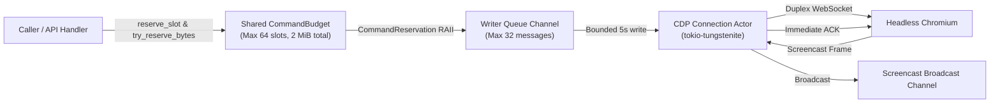

# Host Browser CDP Streaming Architecture

**Authority:** Backend Subsystem (`server/src/browser_host/`, `server/examples/browser_host_qualification.rs`)  
**Status:** Pre-Product Adapter, Supervised Principal Profiles, Admission Control & Leased Input (Phase 01 Qualified on Linux x86_64; Phase 02 Approved; Phase 03 Verified & Completed)

This specification defines the architectural contracts, process containment boundaries, bounded CDP actor lifecycle, and binary wire framing for the Host Browser CDP Streaming subsystem.

## 1. Scope, Identity and Trust Model

The Host Browser subsystem provides candidate headless Chromium process management and CDP streaming primitives for developer browser sessions.

- **Principal Isolation:** Exactly one lazily launched Chromium instance per authenticated principal/server. Different authenticated principals never share browser processes or user-data directories.
- **Identity Hierarchy:**
  - `browserSessionId`: Authoritative server-issued UUID representing a single logical page target, distinct from native Chromium target IDs.
  - `browserIncarnation`: Fresh UUID minted on each browser process launch.
  - `profileEpoch`, `viewportEpoch`, `frameSeq`: Canonical decimal `u64` string counters matching `[1-9][0-9]{0,19}` with numeric values $\le 18446744073709551615$. Zero, leading zeros, signs, whitespace, and non-ASCII characters are rejected. Counters never wrap; exhaustion requires identity recreation.
  - `producerRun`, `subscriptionEpoch`: Fresh UUIDs for screencast runs and viewer subscriptions.
- **Trust Boundaries:** Raw CDP exposes full native browser and host privileges. Cooperative leases and target mappings do not sandbox an untrusted agent. Loopback debugging assumes local processes with loopback access can reach debug ports; stronger isolation requires external containerization.

## 2. Bounded CDP Actor and Command Budget

The CDP connection actor (`server/src/browser_host/cdp.rs`) manages a single WebSocket connection to the browser's DevTools endpoint with bounded resource admission:



### Resource Admission Bounds

| Resource Ceiling | Limit | Enforcement Mechanism |
| --- | --- | --- |
| Writer Queue Channel | 32 messages | `mpsc::channel(32)`; saturation returns `CdpError::WriterQueueFull` |
| Total Admitted Commands | 64 commands | Shared across queued and in-flight commands; returns `CdpError::TooManyPendingCommands` |
| Command Byte Budget | 2 MiB (2,097,152 bytes) | Shared RAII `CommandBudget` reservation held from pre-serialization until response or drop |
| Single Command Payload | 64 KiB (65,536 bytes) | Serialization ceiling; payloads $> 64$ KiB return `CdpError::CommandTooLarge` |
| Actor Write Deadline | 5 seconds | Stalled writes pause actor reads/sweeps; timeout aborts connection |
| WebSocket Frame/Message Cap | 4 MiB (4,194,304 bytes) | Tungstenite `max_message_size` and `max_frame_size` |

### RAII Budget Lifecycle (`command_budget.rs`)

`CommandReservation` guarantees that reserved command slots and payload bytes are atomically returned to `CommandBudget` when the reservation is dropped across any termination path: normal response receipt, caller deadline timeout, caller cancellation, or connection teardown.

### Response and Screencast Frame Routing

- **Response Demultiplexing:** Responses are routed to callers by monotonic numeric command ID. Unknown events increment an atomic counter (`unknown_events_count`) without allocating queue slots.
- **Screencast Frame Handling:** `Page.screencastFrame` events are validated for finite metadata (`offsetTop`, `pageScaleFactor`, `deviceWidth`, `deviceHeight`, `scrollOffsetX`, `scrollOffsetY`) and broadcast to subscribers.
- **Native Frame Credit Decoupling:** `CdpClient::ack_screencast_frame` acknowledges frames back to Chromium independently of downstream viewer consumption, preventing stalled viewers from exhausting native frame credits.
- **Fail-Closed Malformed Envelopes:** A malformed known screencast frame (unparseable envelope, missing session ID, non-finite geometry) has no routable caller and closes the actor with `CdpError::MalformedResponse`.

## 3. Fail-Closed Process Supervision & Containment Model

Process management (`server/src/browser_host/process.rs`) supervises Chromium execution with fail-closed containment:

### Launch Configuration & Allowlist

- **No Automatic Discovery:** `find_browser_executable(None)` fails closed with `ProcessError::ExecutableNotFound` when `DAM_HOPPER_BROWSER_EXECUTABLE` is not explicitly set. Automatic PATH or standard-directory scanning is prohibited.
- **Strict Argument Allowlist (`is_allowlisted_arg`):**
  - **Permitted Prefixes:** `--window-size=`, `--user-agent=`, `--lang=`, `--force-device-scale-factor=`, `--default-background-color=`.
  - **Explicitly Forbidden Flags:** `--remote-debugging*`, `--remote-allow-origins*`, `--user-data-dir*`, `--load-extension*`, `no-sandbox`, `disable-web-security`, `ignore-certificate-errors`, `disable-site-isolation`, `password-store`, `use-mock-keychain`, `disable-hang-monitor`, `disable-ipc-flooding`, `disable-renderer-backgrounding`, `disable-backgrounding-occluded`, `disable-background-timer-throttling`.
  - All default Chromium sandboxing, certificate verification, and site isolation protections remain active.

### Unix Process Group & Death-Pipe Watcher

- **Process Group Isolation:** Spawns Chromium in a dedicated process group (`process_group(0)`).
- **Bidirectional Death-Pipe Watcher:** Uses an anonymous POSIX pipe between supervisor and child watcher. Supervisor process termination automatically drops the write-end of the pipe; the watcher receives `EOF` on `death_r` and executes `killpg` against the process group, terminating all orphaned renderer, GPU, and utility processes immediately.
- **Dual-Stage Liveness Verification:** `live_members(pgid)` verifies termination via both `killpg(pgid, 0)` kernel probe and `/proc` process-tree scanning.
- **Graceful Shutdown Protocol:** Sends `SIGTERM` with a 3-second grace period (`SHUTDOWN_GRACE_PERIOD_SECS`), followed by `SIGKILL` if processes survive.

### Endpoint Discovery and Loopback Validation

- **Bounded Stream Reading:** Stderr is consumed in 1024-byte chunks up to a hard ceiling of 64 KiB (`MAX_STDERR_CAPTURE_BYTES = 65_536`). Oversized stderr streams without an endpoint token fail closed with `ProcessError::StderrOverflow`.
- **DevToolsActivePort Corroboration:** When present, `DevToolsActivePort` (read up to 512 bytes) is corroborated against the stderr endpoint; mismatch between port file and stderr fails closed with `ProcessError::EndpointMismatch`.
- **Loopback Enforcement (`validate_loopback_endpoint`):** Endpoints must parse as `ws://`, bind strictly to `127.0.0.1`, `[::1]`, or `localhost`, specify an explicit non-zero port, and match `/devtools/browser/<canonical-uuid>` where the UUID is a 36-character lowercase RFC 4122/9562 UUID.
- **Non-Unix Platform Containment:** On non-Unix platforms (such as Windows), `BrowserProcess::launch` fails closed immediately with `ProcessError::ContainmentUnavailable`.

## 4. Binary Wire Framing Protocol (BHJF v1)

Streaming frames from the server to viewers use the atomic `BHJF` binary envelope (`server/src/browser_host/protocol.rs`):

```text
 0                   1                   2                   3
 0 1 2 3 4 5 6 7 8 9 0 1 2 3 4 5 6 7 8 9 0 1 2 3 4 5 6 7 8 9 0 1
+-+-+-+-+-+-+-+-+-+-+-+-+-+-+-+-+-+-+-+-+-+-+-+-+-+-+-+-+-+-+-+-+
|   'B'   |   'H'   |   'J'   |   'F'   |        version (1)    |
+-+-+-+-+-+-+-+-+-+-+-+-+-+-+-+-+-+-+-+-+-+-+-+-+-+-+-+-+-+-+-+-+
|       json_header_len         |           payload_len         |
+-+-+-+-+-+-+-+-+-+-+-+-+-+-+-+-+-+-+-+-+-+-+-+-+-+-+-+-+-+-+-+-+
|    payload_len (continued)    |            reserved           |
+-+-+-+-+-+-+-+-+-+-+-+-+-+-+-+-+-+-+-+-+-+-+-+-+-+-+-+-+-+-+-+-+
|                      reserved (continued)                     |
+-+-+-+-+-+-+-+-+-+-+-+-+-+-+-+-+-+-+-+-+-+-+-+-+-+-+-+-+-+-+-+-+
| JSON Header Bytes (1 .. 1024 bytes) ...                       |
+-+-+-+-+-+-+-+-+-+-+-+-+-+-+-+-+-+-+-+-+-+-+-+-+-+-+-+-+-+-+-+-+
| JPEG Payload Bytes (1 .. 2,097,152 bytes) ...                 |
+-+-+-+-+-+-+-+-+-+-+-+-+-+-+-+-+-+-+-+-+-+-+-+-+-+-+-+-+-+-+-+-+
```

### Header Specification

- **Header Size:** Fixed 16-byte big-endian prefix.
- **Magic:** `0x42 0x48 0x4A 0x46` (`BHJF`).
- **Version:** `1` (`u16`).
- **JSON Header Length:** `u16` ($\le 1024$ bytes).
- **Payload Length:** `u32` ($\le 2,097,152$ bytes / 2 MiB).
- **Reserved:** `u32` (must be zero).

### Frame Geometry & Decimal Counters

`TargetFrameHeader` enforces strict validation rules:
- **Canonical Decimal Counters:** `profileEpoch`, `viewportEpoch`, and `frameSeq` are non-empty positive ASCII decimal strings $\le \text{u64::MAX}$ without signs, whitespace, or leading zeros (`validate_decimal_sequence`).
- **CSS Viewport Ceilings:** Layout viewport width $\in (0, 1920]$, height $\in (0, 1080]$.
- **Scale Bounds:** `dpr` $\in [0.1, 10.0]$, `pageScale` $\in [0.1, 10.0]$.
- **Offset Bounds:** Absolute offsets $\le 10,000,000$ CSS px.
- **Payload Consistency:** Declared header `width` and `height` must match JPEG SOF0/SOF2 marker dimensions exactly.

## 5. Dual Bearer Auth & Proxy Relay (`browser_host_qualification.rs`)

The qualification test harness demonstrates authenticated CDP discovery and proxy relay:

- **Exact Single Origin Policy:** Origin-bearing HTTP/WS requests must match the approved Origin byte-for-byte. Missing Origin headers are permitted for native bearer-authenticated agent clients (e.g. Playwright). Foreign, duplicate, or `null` origins are rejected with HTTP 403 Forbidden.
- **Dual Bearer Authentication:** Validates `Authorization: Bearer <token>` on both discovery (`/json/version`, `/json/list`) and WebSocket upgrade routes.
- **Bounded Proxy Relay:** Proxy sockets enforce a maximum 4 MiB message size and bounded 5-second per-write deadlines in both directions, with mutual teardown on read/write failure or timeout.

## 6. Configuration Schema & Admission Budgets (`config.rs`)

The browser host subsystem is configured under `[server.browser]` in `config.toml` (with legacy top-level `[browser]` mapped transparently into `server.browser`).

### Configuration Model (`BrowserHostConfig`)

| Field | Type | Default | Validation & Semantics |
| --- | --- | --- | --- |
| `enabled` | `bool` | `false` | Master enable switch. Defaults to `false` until an executable and origin policy are configured. |
| `executable_path` | `Option<PathBuf>` | `None` | Path to browser binary. Must be regular file with execute permissions (`mode & 0o111 != 0`) and not world-writable (`mode & 0o002 == 0`). |
| `profile_root` | `Option<PathBuf>` | `None` | Base directory for principal profiles. Defaults to `~/.config/dam-hopper/browser-profiles`. Must not be a symlink; directory permissions must be strictly mode `0700` (`mode & 0o077 == 0`). |
| `allowed_target_origins` | `Vec<String>` | `[]` | Approved target page origins. Strictly formatted (`http://` or `https://`, host, optional port; credentials, query, fragment, path segments, and trailing slashes forbidden). |
| `allowed_asset_origins` | `Vec<String>` | `[]` | Approved asset origins for viewer frames and static resources. Strictly formatted. |
| `allowed_dev_origins` | `Vec<String>` | `[]` | Approved developer debug origins. Strictly formatted. |
| `denied_destinations` | `Vec<String>` | Cloud metadata IPs | Blocked destination addresses. Default list: `169.254.169.254`, `fd00:ec2::254`, `metadata.google.internal`, `100.100.100.200`. Formats: IP, IP CIDR, hostname, or `host:port`. |
| `budgets` | `BrowserBudgetsConfig` | Defaults below | Structured admission bounds and memory limits. |

### Budget Limits (`BrowserBudgetsConfig`)

| Budget Field | Default | Range | Enforcement Mechanism |
| --- | --- | --- | --- |
| `max_processes` | `1` | `1 ..= 4` | Capped by global process atomic counter; excess returns `ManagerError::Busy` (HTTP 429) |
| `max_targets` | `2` | `1 ..= 16` | Maximum concurrent page targets per principal |
| `max_viewers` | `2` | `1 ..= 16` | Maximum concurrent streaming viewers per target |
| `max_raw_cdp_connections` | `2` | `1 ..= 8` | Maximum concurrent raw CDP proxy WebSocket connections |
| `memory_ceiling_bytes` | `134,217,728` (128 MiB) | `33,554,432` (32 MiB) ..= `1,073,741,824` (1 GiB) | Hard memory ceiling checked against worst-case allocation |
| `jpeg_quality` | `65` | `10 ..= 100` | Screencast JPEG encoding quality |
| `max_width` | `1280` | `64 ..= 1920` | Maximum capture frame width |
| `max_height` | `900` | `64 ..= 1080` | Maximum capture frame height |
| `frame_rate_fps` | `10` | `1 ..= 30` | Maximum screencast capture frame rate |

### Memory Reservation Bounds Calculation

The budget validator enforces an analytical ceiling check:
$$\text{estimated} = (\text{max\_targets} \times 12.1\text{ MiB}) + (\text{max\_viewers} \times 4.2\text{ MiB}) + (\text{max\_raw\_cdp} \times 8.0\text{ MiB}) \le \text{memory\_ceiling\_bytes}$$

- **Per-Target (~12.1 MiB):** 2 MiB command budget + 4 MiB WS event buffer + 4 MiB candidate buffer + ~2.1 MiB complete BHJF buffer.
- **Per-Viewer (~4.2 MiB):** 2 outstanding + 1 pending Bytes handles (buffered) + writer queue.
- **Per-Raw-CDP (8.0 MiB):** 4 MiB frame buffer per direction.
Configurations exceeding the memory ceiling fail validation with `BrowserConfigError::MemoryCeilingExceeded`.

### Domain Capability Evaluation (`evaluate_capabilities`)

Direct probe evaluating subsystem capabilities without launching Chromium or making network calls:
- Returns `BrowserCapabilitiesDto` (`protocolVersion: 1`, `available: bool`, `unavailableReason: Option<String>`, `effectiveLimits: BrowserEffectiveLimitsDto`, `engineQualified: bool`, `profileEpoch: String`, `managedProfilePresent: bool`).
- Reports explicit `unavailableReason` for disabled status, non-Unix platform, missing executable, invalid permissions, overbudget memory ceiling, or active reset tombstone (`CleanupPending`).
- Never exposes internal loopback debug ports or URLs.

## 7. Principal Profile Directory Layout & Advisory Flock Exclusivity (`profile.rs`)

Principal isolation ensures that different authenticated users never share browser processes, cookies, or user-data directories.

### Filesystem Layout

Profiles are organized under `<profile_root>/` by namespace and hashed subject:

```text
<profile_root>/
├── dev/                     # Development namespace (--no-auth mode)
│   └── <sha256(subject)>/   # 64-character hex hash, mode 0700
│       ├── manager.lock     # Advisory flock target (stable inode, never deleted)
│       ├── manager.json     # Metadata record (mode 0600, atomic write)
│       ├── reset.json       # Durable reset tombstone (mode 0600; active during reset)
│       └── user-data/       # Chromium user-data directory (mode 0700; deleted on reset)
└── prod/                    # Production authenticated namespace
    └── <sha256(subject)>/
        ├── manager.lock
        ├── manager.json
        ├── reset.json
        └── user-data/
```

- **Non-User-Controlled Paths:** Principal directories use 64-char lowercase SHA-256 hashes of the principal subject, preventing path traversal attacks.
- **Strict POSIX Permissions:** Principal directories and parent namespace directories are created with mode `0700` (`rwx------`). Metadata and tombstone files use mode `0600` (`rw-------`). Symbolic links for profile roots are forbidden.
- **Advisory OS Lock (`ProfileLock`):** Holds open `manager.lock` via non-blocking `flock(fd, LOCK_EX | LOCK_NB)` on Unix. Released automatically on drop (`LOCK_UN`). Lock wait timeout is bounded to 5 seconds (`DEFAULT_LOCK_TIMEOUT`). The lock file inode is preserved across profile resets.

### Metadata Schema (`manager.json`)

Atomic writes via temporary file (`manager.json.tmp.<pid>.<uuid>`) and rename:
- `subject`: Principal identifier string.
- `isDev`: Boolean distinguishing `--no-auth` dev mode from authenticated production profiles.
- `profileEpoch`: Monotonic `u64` counter matching `[1-9][0-9]{0,19}`.
- `browserIncarnation`: Fresh UUID minted on each process launch; `null` when dormant.
- `updatedAtUnixMs`: Millisecond Unix timestamp of last update.
- `lastResetOperationId`: Optional UUID of last successfully completed reset operation (for idempotence).

## 8. Reset Reconciliation & Durable Tombstone Lifecycle (`manager.rs`)

The reset state machine purges user credentials (`user-data/`) and recreates a fresh profile while maintaining process exclusivity and preventing concurrent operations.

### Reset Sequence (`reset_profile`)

1. **Acquire Lock:** Acquires exclusive `ProfileLock` on `manager.lock` (up to 5s timeout).
2. **Idempotence Check:** If `meta.last_reset_operation_id == Some(operation_id)`, returns `ResetOutcome::Completed` immediately without re-executing.
3. **Epoch Validation:** Confirms `meta.profile_epoch == expected_profile_epoch`; mismatch returns `ManagerError::StaleEpoch`.
4. **Advance Epoch & Persist Tombstone:** Increments `profileEpoch`, sets state to `InstanceLifecycleState::Resetting`, and atomically writes `reset.json` tombstone with `stage: ResetStage::Initiated`. Atomically saves `manager.json` with new epoch.
5. **Terminate Process (Bounded 10s):** Updates tombstone to `stage: ResetStage::Terminating`. If running, terminates browser process via `proc.terminate()` with `DEFAULT_TERMINATE_TIMEOUT = 10s`. Failure or timeout transitions tombstone to `stage: ResetStage::Failed`, enters `InstanceLifecycleState::CleanupPending`, and returns `ResetOutcome::CleanupPending`.
6. **Delete User Data (Bounded 10s):** Updates tombstone to `stage: ResetStage::DeletingUserData`. Asynchronously deletes `user-data/` with `DEFAULT_DELETE_TIMEOUT = 10s`. Failure or timeout records `stage: ResetStage::Failed`, enters `CleanupPending`, and returns `ResetOutcome::CleanupPending`.
7. **Recreate User Data:** Updates tombstone to `stage: ResetStage::RecreatingUserData`. Recreates empty `user-data/` directory with mode `0700`.
8. **Clear Tombstone & Complete:** Records `last_reset_operation_id` in `manager.json`, clears `reset.json`, transitions state to `Dormant`, releases `ProfileLock`, and returns `ResetOutcome::Completed`.

### Tombstone Lifecycle & Crash Reconciliation

| Stage | Trigger / Transition | Failure Behavior |
| --- | --- | --- |
| `Initiated` | Reset requested and epoch validated | Atomically written before process termination |
| `Terminating` | Process termination signaled | 10s timeout; failure sets `Failed` stage and `CleanupPending` |
| `DeletingUserData` | Process confirmed dead | 10s timeout; failure sets `Failed` stage and `CleanupPending` |
| `RecreatingUserData` | `user-data/` removed | Directory creation with mode `0700`; failure sets `Failed` stage |
| `Failed` | Timeout or I/O error during reset | Tombstone retained; profile enters `CleanupPending` |

- **Startup Reconciliation:** When loading an instance, `BrowserHostManager` checks for `reset.json`. If present, the instance enters `CleanupPending`:
  - `capabilities()` reports `available: false` with reason `"profile cleanup pending from prior failed reset or termination; recovery or confirmed reset required"`.
  - `ensure_running()` fails closed with `ManagerError::CleanupPending`.
  - Resuming reset: Invoking `reset_profile` with the matching `operation_id` resumes the interrupted reset under lock.

## 9. Lazy AppState Lifecycle & Graceful Shutdown (`state.rs`, `main.rs`)

### Lazy Manager Integration

`BrowserHostManager` is constructed during `AppState::new` as an `Arc<BrowserHostManager>`:
- **Zero Startup Spawning:** No browser processes are launched during server initialization or `AppState` creation. Processes are spawned lazily only when `ensure_running()` is explicitly called by browser workflows.
- **Global Process Capacity Admission:** Managed by an atomic counter `global_process_count` capped at `budgets.max_processes` (default 1). Admissions exceeding capacity fail closed with `ManagerError::Busy` (HTTP 429).
- **Reconnect Deduplication:** Reconnecting clients reuse the existing alive browser instance handle (`BrowserInstanceHandle { pid, ws_endpoint, browser_incarnation, profile_epoch, user_data_dir }`) without consuming additional process capacity. Stale processes (dead PID) are detected and cleaned up before relaunching.

### Graceful Server Teardown Protocol

During server shutdown (`server/src/main.rs`), `browser_host.shutdown_all().await` executes alongside debug artifact disposal:
1. Iterates across all active principal instances in `instances` map.
2. For each running instance, extracts the `BrowserProcess` handle and executes `proc.terminate()` with a bounded 10-second deadline (`DEFAULT_TERMINATE_TIMEOUT`).
3. Clears in-memory active target maps, viewer counters, and raw CDP connection counters.
4. Transitions instance lifecycle states to `Dormant`.
5. Resets `global_process_count` to zero.
6. **Credential Preservation:** Ordinary shutdown terminates browser processes and cleans up runtime locks, but strictly preserves the `user-data/` directory and persisted profile credentials.

## 10. Admission Security Model & Live Session Verification (`auth.rs`)

Every HTTP and WebSocket request to `/api/browser/*` undergoes strict admission evaluation via `evaluate_browser_admission`:

### Dual-Mode Admission Control

- **Production Authentication:** Requires a valid bearer token or auth cookie. Evaluates the database live:
  - Account exists and `is_enabled == true`.
  - User holds the `Admin` role (`UserRole::Admin`); ordinary users receive HTTP 403 `kind: "adminRequired"`.
  - Session exists and is not revoked (`revoked_at.is_none()`).
  - Token `auth_version` and `credential_version` match active user and session database records.
  - Token `effective_deadline` has not passed.
- **Development Bypass (`state.no_auth == true`):**
  - Connecting peer socket address must be loopback (`127.0.0.1` or `::1`). Non-loopback fails closed with HTTP 403 `kind: "devBypassDenied"`.
  - Forwarded headers (`X-Forwarded-For`, `X-Real-IP`) are explicitly ignored; only raw socket peer address is evaluated.
  - If an `Origin` header is present, it must match configured `cors_origins` or standard local Vite dev ports (`http://127.0.0.1:5173`, `http://localhost:5173`).
  - Loopback requests without Origin (local native CLI/agents) are permitted. Assigned principal is `"dev-user"` with `is_dev: true`.

### Periodic Live Verification (`verify_live_admission`)

Long-running streaming connections and active attachments do not rely on static handshake validation alone:
- Checked every 5 seconds (`LIVE_CHECK_INTERVAL`) with a strict 2-second timeout (`LIVE_CHECK_TIMEOUT`).
- Detects database account disablement, demotion from Admin role, session revocation, or credential version increments.
- Bounded cancellation triggers an independent `CancellationToken` shared across the attachment pair, terminating connections immediately without waiting for stalled outgoing media queues.

## 11. Single-Use Capability Tickets & Attachment Management (`attachments.rs`)

Streaming WebSockets (`/ws/browser/media`, `/ws/browser/control`, `/ws/browser/cdp`) require a capability ticket minted via `POST /api/browser/attachments`:

### Ticket Lifecycle & Memory Storage

1. **Generation:** 256-bit (32-byte) cryptographically secure random value generated by `rand::rngs::OsRng`, URL-safe unpadded Base64 encoded (`URL_SAFE_NO_PAD`).
2. **Hash-Only Storage:** Server stores only the 32-byte SHA-256 hash in memory (`HashMap<[u8; 32], StoredTicket>`). Raw ticket tokens are never stored, logged, or serialized.
3. **Atomic Single-Use Consumption:** `consume_ticket` atomically removes the ticket hash from the map on connection upgrade. Replay attempts fail immediately with HTTP 401 `kind: "ticketNotFound"`.
4. **Purpose & Identity Binding:** Tickets strictly bind `purpose` (`media`, `control`, `agentCdp`), principal, auth session ID, versions, deadline, `profileEpoch`, `browserIncarnation`, `browserSessionId`, `viewerId`, `subscriptionEpoch`, and issuing `Origin`.
5. **Bounded TTL & Capacity:** 30-second TTL (`TICKET_TTL`), clipped to auth session deadline. Unconsumed tickets capped at 16 per principal and 64 globally; excess returns HTTP 429 `kind: "ticketCapacityExceeded"`.
6. **Media/Control Pairing (`PairedSlot`):** Media and control connections must specify identical `viewerId` and `subscriptionEpoch`. The first arriving socket waits up to 15 seconds (`PAIR_WAIT_TIMEOUT`) for its counterpart; timeout evicts the slot and cancels both connections.

## 12. Cooperative Leased Input Queue & Coordinate Transformation (`input.rs`)

Target interaction enforces strict single-viewer authority and reliable event delivery:

### Cooperative Lease Semantics

- **30-Second Lease:** Acquired via `POST /api/browser/sessions/{id}/control/acquire` (`LEASE_TTL = 30s`). Renewed within 5s window (`LEASE_RENEWAL_WINDOW = 5s`).
- **Exclusivity:** Only one viewer (`human` or `agent`) holds control. Conflicting acquire returns HTTP 409 `kind: "leaseConflict"`.
- **Fail-Safe Release (`HeldInputState`):** Tracks currently held mouse buttons and keyboard keys. When a lease is released, expired, revoked, or dropped, `generate_release_events` automatically generates synthetic `PointerUp` and `KeyUp` events to clear stuck keys/buttons in Chromium.

### Reliable Input Queue & Sequencing

- **Queue Bounds:** Max 128 reliable records (`MAX_RELIABLE_RECORDS`), max 256 KiB queued bytes (`MAX_RELIABLE_BYTES`).
- **Decimal Sequence Ordering (`inputSeq`):** Enforces strictly contiguous decimal sequence counters (`inputSeq == last_processed_seq + 1`).
  - Sequence gap: Returns HTTP 400 `kind: "sequenceViolation"`, flushes queue, clears held keys, and revokes lease.
  - Stale sequence: Dropped with HTTP 400 `kind: "sequenceViolation"`.
- **Event Coalescing:** Adjacent `PointerMove` and `Wheel` events are coalesced between ordering barriers (`PointerDown`, `PointerUp`, `KeyDown`, `KeyUp`, `InsertText`).

### Coordinate Mapping (`map_fraction_to_css_coords`)

Transforms normalized aspect-fit image fractions $(u, v) \in [0.0, 1.0]$ into CDP CSS layout coordinates:
$$x = u \times \text{css\_width}, \quad y = v \times \text{css\_height} + \text{offset\_top}$$
- Validates finite bounds; out-of-range returns `InputError::InvalidFraction` (HTTP 400).
- Requires valid non-zero layout geometry; missing geometry returns `InputError::GeometryUnavailable` (HTTP 503 `kind: "inputUnavailable"`).
- Viewport scroll offsets are metadata and are not added to coordinates; DPR rescales screencast images only and is never applied twice.

## 13. Session Registry & Idempotent Target Management (`session.rs`)

`SessionRegistry` manages target lifecycle and state transitions:
- **Idempotent Creation:** `POST /api/browser/sessions` requires `creationKey`. Caches up to 128 idempotency records per principal for 10 minutes (`IDEMPOTENCY_TTL = 600s`). Retrying with the same key returns the existing session with HTTP 200 OK.
- **Target Capacity Limits:** Bounded to `DEFAULT_MAX_TARGETS = 2` per principal. Over-capacity creates return HTTP 429 `kind: "browserBusy"`.
- **Independent Epochs:** Tracks `navigationRevision` independently of `viewportEpoch` and `profileEpoch`.
- **Popup Management:** Native popup creation creates bounded server sessions; capacity overflow closes the popup and sets `popupBlocked: true`.

## 14. Navigation & HTTP Network Policy (`network_policy.rs`)

Navigation URLs are validated against `validate_navigation_url`:
- **Length Ceilings:** URL length $\le 4096$ bytes (`MAX_URL_BYTES`), title length $\le 512$ bytes (`MAX_TITLE_BYTES`).
- **Scheme Restrictions:** Only `http`, `https`, and `about:blank` are permitted; `file:`, `javascript:`, `chrome:`, `data:` are rejected.
- **Credentials Prohibited:** Embedded usernames/passwords in URLs fail closed.
- **Production Private & Metadata IP Blocking:** Rejects private IPv4/IPv6, link-local, loopback, and cloud metadata endpoints (`169.254.169.254`, `100.100.100.200`, `fd00:ec2::254`, `metadata.google.internal`) unless matching explicit project origin exceptions.
- **Development Isolation:** Rejects general internet destinations; restricts navigation to loopback and configured `allowed_origins`.

## 15. Qualification Status & Open Proof Obligations

Qualification was executed on Linux x86_64 (`Linux 7.2.15-200.fc44.x86_64`) against real Google Chrome 157.0.8103.38:

| Gate | Status | Evidence / Invariant |
| --- | --- | --- |
| Linux Process Containment | **PASS** | Process group isolation, death-pipe watcher, and procfs scan verified |
| Adapter Bounds & Budget | **PASS** | 64-command cap, 2 MiB RAII byte budget, 32-msg writer queue, 5s write deadline |
| Coordinate Mapping | **PASS** | Authoritative marker centroids verified for DPR 1/2, scroll, pageScale, visual offsets |
| Wire Codec (BHJF) | **PASS** | Roundtrip encode/decode, SOF dimension verification, decimal sequence validation |
| Dual Bearer Relay | **PASS** | Exact Origin policy, bearer authentication, 2-connection concurrency, 4 MiB frame limit |
| Configuration & Capabilities | **PASS** | Bounded budgets, origin/destination validation, executable/root permissions, domain DTO |
| Principal Profile Isolation | **PASS** | Dev/prod separation, 64-hex hashed root, 0700/0600 permissions, advisory flock exclusivity |
| Reset Reconciliation & Tombstones | **PASS** | Epoch advance, atomic reset.json, 10s terminate/delete timeouts, CleanupPending fencing |
| Lazy Manager & Graceful Shutdown | **PASS** | Zero startup spawn, reconnect reuse, 10s shutdown reap preserving credentials |
| Admission & Network Policy | **PASS** | Admin live role checks, dev loopback/Origin bypass, scheme/metadata filtering |
| Single-Use Capability Tickets | **PASS** | 256-bit OsRng, SHA-256 memory store, 30s TTL, single-use atomic consume, pair matching |
| Leased Input Queue & Releases | **PASS** | 30s lease, 128-record queue, contiguous inputSeq, stuck key auto-release, aspect-fit mapping |
| Native Browser Zoom | **UNVERIFIED** | Unreachable via standard CDP in headless Chromium 157; `inputTrusted: false` enforced |
| Windows Containment | **FAIL-CLOSED** | Windows Job Object containment unqualified; non-Unix launch returns `ContainmentUnavailable` |

*Cycle 2 Verification:* 39 tests passing across Phase 03 suites (`browser_host_admission`, `browser_host_auth`, `browser_host_input`), building on 221 passed Phase 02 tests.

## 16. Source Map

| Responsibility | Path |
| --- | --- |
| Bounded CDP Actor | `server/src/browser_host/cdp.rs` |
| Atomic Command Budget | `server/src/browser_host/command_budget.rs` |
| Process Supervisor & Containment | `server/src/browser_host/process.rs` |
| Binary BHJF Protocol | `server/src/browser_host/protocol.rs` |
| Configuration & Capability DTO | `server/src/browser_host/config.rs` |
| Principal Profile & Lock Management | `server/src/browser_host/profile.rs` |
| Lifecycle Manager & Reset Supervisor | `server/src/browser_host/manager.rs` |
| Admission Security & Live Verifier | `server/src/browser_host/auth.rs` |
| Single-Use Tickets & Attachments | `server/src/browser_host/attachments.rs` |
| Leased Input Queue & Coordinates | `server/src/browser_host/input.rs` |
| Session Registry & Target Epochs | `server/src/browser_host/session.rs` |
| Navigation & HTTP Network Policy | `server/src/browser_host/network_policy.rs` |
| Browser Host REST API Handlers | `server/src/api/browser_host.rs` |
| Module Exports | `server/src/browser_host/mod.rs` |
| Qualification Example Harness | `server/examples/browser_host_qualification.rs` |
| Adapter & Protocol Test Suite | `server/tests/browser_host_adapter.rs` |
| Process Containment Test Suite | `server/tests/browser_host_process.rs` |
| Real-Engine Compatibility Test Suite | `server/tests/browser_host_compatibility.rs` |
| Profile Lifecycle & Reset Test Suite | `server/tests/browser_host_lifecycle.rs` |
| Graceful Shutdown Test Suite | `server/tests/browser_host_shutdown.rs` |
| Admission & REST Test Suite | `server/tests/browser_host_admission.rs` |
| Capability Ticket & Live Auth Test Suite | `server/tests/browser_host_auth.rs` |
| Leased Input Queue Test Suite | `server/tests/browser_host_input.rs` |
| E2E Qualification Harness Fixture | `packages/ui/e2e/fixtures/browser-host-qualification.ts` |
| Playwright Compatibility Spec | `packages/ui/e2e/os-host-browser/compatibility.spec.ts` |
