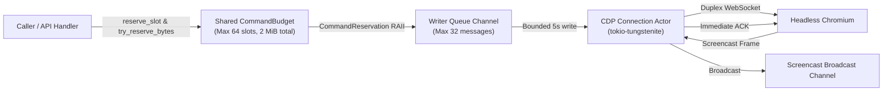

# Host Browser CDP Streaming Architecture

**Authority:** Backend Subsystem (`server/src/browser_host/`, `server/examples/browser_host_qualification.rs`)  
**Status:** Pre-Product Adapter and Process Primitives (Phase 01 Qualified on Linux x86_64; Windows Containment Fail-Closed)

This specification defines the architectural contracts, process containment boundaries, bounded CDP actor lifecycle, and binary wire framing for the Host Browser CDP Streaming subsystem.

## 1. Scope, Identity and Trust Model

The Host Browser subsystem provides candidate headless Chromium process management and CDP streaming primitives for developer browser sessions.

- **Principal Isolation:** Exactly one lazily launched Chromium instance per authenticated principal/server. Different authenticated principals never share browser processes or user-data directories.
- **Identity Hierarchy:**
  - `browserSessionId`: Authoritative server-issued UUID representing a single logical page target, distinct from native Chromium target IDs.
  - `browserIncarnation`: Fresh UUID minted on each browser process launch.
  - `profileEpoch`, `viewportEpoch`, `frameSeq`: Canonical decimal `u64` string counters matching `[1-9][0-9]{0,19}` with numeric values $\le 18446744073709551615$. Zero, leading zeros, signs, whitespace, and non-ASCII characters are rejected. Counters never wrap; exhaustion requires identity recreation.
  - `producerRun`, `subscriptionEpoch`: Fresh UUIDs for screencast runs and viewer subscriptions.
- **Trust Boundaries:** Raw CDP exposes full native browser and host privileges. Cooperative leases and target mappings do not sandbox an untrusted agent. Loopback debugging assumes local processes with loopback access can reach debug ports; stronger isolation requires external containerization.

## 2. Bounded CDP Actor and Command Budget

The CDP connection actor (`server/src/browser_host/cdp.rs`) manages a single WebSocket connection to the browser's DevTools endpoint with bounded resource admission:



### Resource Admission Bounds

| Resource Ceiling | Limit | Enforcement Mechanism |
| --- | --- | --- |
| Writer Queue Channel | 32 messages | `mpsc::channel(32)`; saturation returns `CdpError::WriterQueueFull` |
| Total Admitted Commands | 64 commands | Shared across queued and in-flight commands; returns `CdpError::TooManyPendingCommands` |
| Command Byte Budget | 2 MiB (2,097,152 bytes) | Shared RAII `CommandBudget` reservation held from pre-serialization until response or drop |
| Single Command Payload | 64 KiB (65,536 bytes) | Serialization ceiling; payloads $> 64$ KiB return `CdpError::CommandTooLarge` |
| Actor Write Deadline | 5 seconds | Stalled writes pause actor reads/sweeps; timeout aborts connection |
| WebSocket Frame/Message Cap | 4 MiB (4,194,304 bytes) | Tungstenite `max_message_size` and `max_frame_size` |

### RAII Budget Lifecycle (`command_budget.rs`)

`CommandReservation` guarantees that reserved command slots and payload bytes are atomically returned to `CommandBudget` when the reservation is dropped across any termination path: normal response receipt, caller deadline timeout, caller cancellation, or connection teardown.

### Response and Screencast Frame Routing

- **Response Demultiplexing:** Responses are routed to callers by monotonic numeric command ID. Unknown events increment an atomic counter (`unknown_events_count`) without allocating queue slots.
- **Screencast Frame Handling:** `Page.screencastFrame` events are validated for finite metadata (`offsetTop`, `pageScaleFactor`, `deviceWidth`, `deviceHeight`, `scrollOffsetX`, `scrollOffsetY`) and broadcast to subscribers.
- **Native Frame Credit Decoupling:** `CdpClient::ack_screencast_frame` acknowledges frames back to Chromium independently of downstream viewer consumption, preventing stalled viewers from exhausting native frame credits.
- **Fail-Closed Malformed Envelopes:** A malformed known screencast frame (unparseable envelope, missing session ID, non-finite geometry) has no routable caller and closes the actor with `CdpError::MalformedResponse`.

## 3. Fail-Closed Process Supervision & Containment Model

Process management (`server/src/browser_host/process.rs`) supervises Chromium execution with fail-closed containment:

### Launch Configuration & Allowlist

- **No Automatic Discovery:** `find_browser_executable(None)` fails closed with `ProcessError::ExecutableNotFound` when `DAM_HOPPER_BROWSER_EXECUTABLE` is not explicitly set. Automatic PATH or standard-directory scanning is prohibited.
- **Strict Argument Allowlist (`is_allowlisted_arg`):**
  - **Permitted Prefixes:** `--window-size=`, `--user-agent=`, `--lang=`, `--force-device-scale-factor=`, `--default-background-color=`.
  - **Explicitly Forbidden Flags:** `--remote-debugging*`, `--remote-allow-origins*`, `--user-data-dir*`, `--load-extension*`, `no-sandbox`, `disable-web-security`, `ignore-certificate-errors`, `disable-site-isolation`, `password-store`, `use-mock-keychain`, `disable-hang-monitor`, `disable-ipc-flooding`, `disable-renderer-backgrounding`, `disable-backgrounding-occluded`, `disable-background-timer-throttling`.
  - All default Chromium sandboxing, certificate verification, and site isolation protections remain active.

### Unix Process Group & Death-Pipe Watcher

- **Process Group Isolation:** Spawns Chromium in a dedicated process group (`process_group(0)`).
- **Bidirectional Death-Pipe Watcher:** Uses an anonymous POSIX pipe between supervisor and child watcher. Supervisor process termination automatically drops the write-end of the pipe; the watcher receives `EOF` on `death_r` and executes `killpg` against the process group, terminating all orphaned renderer, GPU, and utility processes immediately.
- **Dual-Stage Liveness Verification:** `live_members(pgid)` verifies termination via both `killpg(pgid, 0)` kernel probe and `/proc` process-tree scanning.
- **Graceful Shutdown Protocol:** Sends `SIGTERM` with a 3-second grace period (`SHUTDOWN_GRACE_PERIOD_SECS`), followed by `SIGKILL` if processes survive.

### Endpoint Discovery and Loopback Validation

- **Bounded Stream Reading:** Stderr is consumed in 1024-byte chunks up to a hard ceiling of 64 KiB (`MAX_STDERR_CAPTURE_BYTES = 65_536`). Oversized stderr streams without an endpoint token fail closed with `ProcessError::StderrOverflow`.
- **DevToolsActivePort Corroboration:** When present, `DevToolsActivePort` (read up to 512 bytes) is corroborated against the stderr endpoint; mismatch between port file and stderr fails closed with `ProcessError::EndpointMismatch`.
- **Loopback Enforcement (`validate_loopback_endpoint`):** Endpoints must parse as `ws://`, bind strictly to `127.0.0.1`, `[::1]`, or `localhost`, specify an explicit non-zero port, and match `/devtools/browser/<canonical-uuid>` where the UUID is a 36-character lowercase RFC 4122/9562 UUID.
- **Non-Unix Platform Containment:** On non-Unix platforms (such as Windows), `BrowserProcess::launch` fails closed immediately with `ProcessError::ContainmentUnavailable`.

## 4. Binary Wire Framing Protocol (BHJF v1)

Streaming frames from the server to viewers use the atomic `BHJF` binary envelope (`server/src/browser_host/protocol.rs`):

```text
 0                   1                   2                   3
 0 1 2 3 4 5 6 7 8 9 0 1 2 3 4 5 6 7 8 9 0 1 2 3 4 5 6 7 8 9 0 1
+-+-+-+-+-+-+-+-+-+-+-+-+-+-+-+-+-+-+-+-+-+-+-+-+-+-+-+-+-+-+-+-+
|   'B'   |   'H'   |   'J'   |   'F'   |        version (1)    |
+-+-+-+-+-+-+-+-+-+-+-+-+-+-+-+-+-+-+-+-+-+-+-+-+-+-+-+-+-+-+-+-+
|       json_header_len         |           payload_len         |
+-+-+-+-+-+-+-+-+-+-+-+-+-+-+-+-+-+-+-+-+-+-+-+-+-+-+-+-+-+-+-+-+
|    payload_len (continued)    |            reserved           |
+-+-+-+-+-+-+-+-+-+-+-+-+-+-+-+-+-+-+-+-+-+-+-+-+-+-+-+-+-+-+-+-+
|                      reserved (continued)                     |
+-+-+-+-+-+-+-+-+-+-+-+-+-+-+-+-+-+-+-+-+-+-+-+-+-+-+-+-+-+-+-+-+
| JSON Header Bytes (1 .. 1024 bytes) ...                       |
+-+-+-+-+-+-+-+-+-+-+-+-+-+-+-+-+-+-+-+-+-+-+-+-+-+-+-+-+-+-+-+-+
| JPEG Payload Bytes (1 .. 2,097,152 bytes) ...                 |
+-+-+-+-+-+-+-+-+-+-+-+-+-+-+-+-+-+-+-+-+-+-+-+-+-+-+-+-+-+-+-+-+
```

### Header Specification

- **Header Size:** Fixed 16-byte big-endian prefix.
- **Magic:** `0x42 0x48 0x4A 0x46` (`BHJF`).
- **Version:** `1` (`u16`).
- **JSON Header Length:** `u16` ($\le 1024$ bytes).
- **Payload Length:** `u32` ($\le 2,097,152$ bytes / 2 MiB).
- **Reserved:** `u32` (must be zero).

### Frame Geometry & Decimal Counters

`TargetFrameHeader` enforces strict validation rules:
- **Canonical Decimal Counters:** `profileEpoch`, `viewportEpoch`, and `frameSeq` are non-empty positive ASCII decimal strings $\le \text{u64::MAX}$ without signs, whitespace, or leading zeros (`validate_decimal_sequence`).
- **CSS Viewport Ceilings:** Layout viewport width $\in (0, 1920]$, height $\in (0, 1080]$.
- **Scale Bounds:** `dpr` $\in [0.1, 10.0]$, `pageScale` $\in [0.1, 10.0]$.
- **Offset Bounds:** Absolute offsets $\le 10,000,000$ CSS px.
- **Payload Consistency:** Declared header `width` and `height` must match JPEG SOF0/SOF2 marker dimensions exactly.

## 5. Dual Bearer Auth & Proxy Relay (`browser_host_qualification.rs`)

The qualification test harness demonstrates authenticated CDP discovery and proxy relay:

- **Exact Single Origin Policy:** Origin-bearing HTTP/WS requests must match the approved Origin byte-for-byte. Missing Origin headers are permitted for native bearer-authenticated agent clients (e.g. Playwright). Foreign, duplicate, or `null` origins are rejected with HTTP 403 Forbidden.
- **Dual Bearer Authentication:** Validates `Authorization: Bearer <token>` on both discovery (`/json/version`, `/json/list`) and WebSocket upgrade routes.
- **Bounded Proxy Relay:** Proxy sockets enforce a maximum 4 MiB message size and bounded 5-second per-write deadlines in both directions, with mutual teardown on read/write failure or timeout.

## 6. Qualification Status & Open Proof Obligations

Qualification was executed on Linux x86_64 (`Linux 7.2.15-200.fc44.x86_64`) against real Google Chrome 157.0.8103.38:

| Gate | Status | Evidence / Invariant |
| --- | --- | --- |
| Linux Process Containment | **PASS** | Process group isolation, death-pipe watcher, and procfs scan verified |
| Adapter Bounds & Budget | **PASS** | 64-command cap, 2 MiB RAII byte budget, 32-msg writer queue, 5s write deadline |
| Coordinate Mapping | **PASS** | Authoritative marker centroids verified for DPR 1/2, scroll, pageScale, visual offsets |
| Wire Codec (BHJF) | **PASS** | Roundtrip encode/decode, SOF dimension verification, decimal sequence validation |
| Dual Bearer Relay | **PASS** | Exact Origin policy, bearer authentication, 2-connection concurrency, 4 MiB frame limit |
| Native Browser Zoom | **UNVERIFIED** | Unreachable via standard CDP in headless Chromium 157; `inputTrusted: false` enforced |
| Windows Containment | **FAIL-CLOSED** | Windows Job Object containment unqualified; non-Unix launch returns `ContainmentUnavailable` |

## 7. Source Map

| Responsibility | Path |
| --- | --- |
| Bounded CDP Actor | `server/src/browser_host/cdp.rs` |
| Atomic Command Budget | `server/src/browser_host/command_budget.rs` |
| Process Supervisor & Containment | `server/src/browser_host/process.rs` |
| Binary BHJF Protocol | `server/src/browser_host/protocol.rs` |
| Module Exports | `server/src/browser_host/mod.rs` |
| Qualification Example Harness | `server/examples/browser_host_qualification.rs` |
| Adapter & Protocol Test Suite | `server/tests/browser_host_adapter.rs` |
| Process Containment Test Suite | `server/tests/browser_host_process.rs` |
| Real-Engine Compatibility Test Suite | `server/tests/browser_host_compatibility.rs` |
| E2E Qualification Harness Fixture | `packages/ui/e2e/fixtures/browser-host-qualification.ts` |
| Playwright Compatibility Spec | `packages/ui/e2e/os-host-browser/compatibility.spec.ts` |
