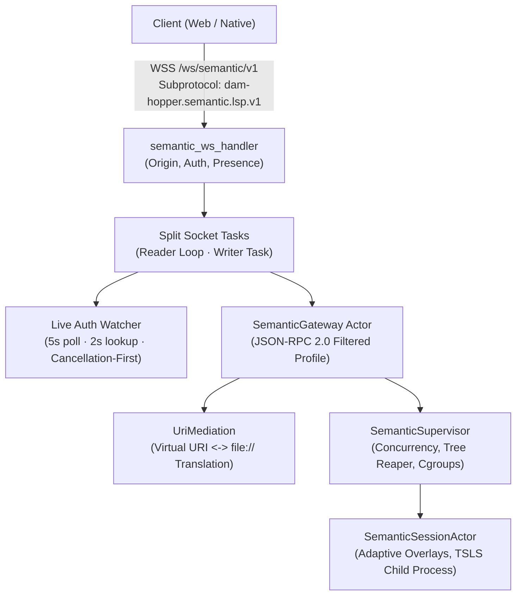

# Authenticated Semantic WebSocket Gateway Architecture

**Authority:** Server Semantic Subsystem (`server/src/api/semantic_ws.rs`, `server/src/semantic/gateway.rs`, `server/src/semantic/uri.rs`)  
**Status:** Maintained Architecture Specification (Phase 05 Delivered; Phase 07 Shared Monaco Client Integrated)

## Scope and Subsystem Boundary

The semantic WebSocket gateway exposes a dedicated, isolated transport endpoint (`/ws/semantic/v1`) for language server interactions (TypeScript/JavaScript). It bridges web and desktop clients to the AppState-owned session supervisor while enforcing strict authentication parity, admission fencing, bidirectional URI containment, and bounded resource consumption.



### Key Architectural Invariants

- **Dedicated Route & Protocol Isolation:** The `/ws/semantic/v1` endpoint is isolated from the core `/ws` multiplexed connection. It uses standard JSON-RPC 2.0 frames instead of the `{ kind: ... }` message envelope and shares zero channel budgets, message queues, or event dispatchers with terminal PTY or filesystem operations.
- **Required Subprotocol:** Handshakes require exact negotiation of the `dam-hopper.semantic.lsp.v1` subprotocol via `Sec-WebSocket-Protocol`. Requests omitting or offering differing subprotocols fail with HTTP 400 Bad Request.
- **Server-Global Hot Toggle & Default-Disabled State:** The semantic supervisor defaults to disabled (`is_enabled() == false`). Server administrators can enable or disable the subsystem dynamically at runtime via `PATCH /api/semantic/settings` without daemon restart. When disabled, WebSocket connections may upgrade at the HTTP layer, but initialization attempts return JSON-RPC error `-32000 SEMANTIC_DISABLED`. When toggled OFF by an administrator, active sessions are immediately revoked and their process trees reaped before updating persisted configuration.
- **Cancellation-First Teardown:** Live authentication invalidation terminates supervisor admission and reaps the child process tree _before_ socket-level close delivery, preventing slow network consumers from delaying resource reclamation.

---

## Handshake, Origin Allowlist & Authentication

The `/ws/semantic/v1` route is placed under the public router in `server/src/api/router.rs` so the handler (`server/src/api/semantic_ws.rs`) can enforce exact handshake policy before upgrading:

### 1. Subprotocol Negotiation

The client MUST send `Sec-WebSocket-Protocol: dam-hopper.semantic.lsp.v1`. Comma-separated protocol lists are supported if they include the exact subprotocol name. Mismatch or absence yields:

```json
{
  "error": "Sec-WebSocket-Protocol must negotiate 'dam-hopper.semantic.lsp.v1'",
  "code": "INVALID_SUBPROTOCOL"
}
```

### 2. Origin Policy

Handshake Origin validation strictly matches core `/ws` policy via `websocket_origin_allowed`:

- **When `Origin` header is present:** The origin MUST pass `state.origin_is_allowed(&headers)`. Disallowed browser origins are rejected with HTTP 403 Forbidden, even in development `--no-auth` mode.
- **When `Origin` header is absent:** Origin-less clients (such as native tools or CLI helpers) are permitted only if they provide a query-string bearer token (`?token=...`) or if the server explicitly runs with `--no-auth`. Cookie-only origin-less requests are rejected with HTTP 403 Forbidden.

### 3. Token Extraction & Claims Evaluation

Authentication token extraction checks query parameters first, falling back to the `dam_hopper_auth` cookie:

```text
token = query.get("token") || cookieJar.get("dam_hopper_auth")
```

When `--no-auth` is inactive, tokens must decode as valid V2 `AuthClaims` matching `jwt_secret`. The handler then evaluates claims via `state.auth_service.evaluate_claims(&claims)`:

- `AuthDecision::Authenticated`: Captures `AuthenticatedActor` with session ID, auth version, credential version, and calculated MFA deadline.
- `AuthDecision::MfaRequired`: Returns HTTP 401 Unauthorized (`MFA_REQUIRED`).
- `AuthDecision::FullLoginRequired`: Returns HTTP 401 Unauthorized (`SESSION_EXPIRED`, `SESSION_REVOKED`, `ACCOUNT_DISABLED`, or `AUTH_REQUIRED`).
- `AuthDecision::Unavailable`: Returns HTTP 503 Service Unavailable (`AUTH_UNAVAILABLE`).

### 4. Client Presence Admission

Before socket upgrade completes, the connection reserves a slot in the server's presence registry:

```rust
let pending_guard = state.client_presence.reserve_pending_upgrade(actor)?;
```

If the presence registry is exhausted, upgrade fails with HTTP 503 `PRESENCE_UNAVAILABLE`. Upon successful socket upgrade, the reservation is promoted to an active presence connection and assigned a unique connection identifier (`semantic-<uuid>`).

---

## Live Auth Watcher & Cancellation-First Invalidation

Once the socket is upgraded, a dedicated asynchronous watcher monitors authentication validity in the background:

- **Cadence & Lookup Bound:** Runs every 5 seconds with a 2-second timeout (`AUTH_STORE_LOOKUP_TIMEOUT`) for persistent store lookups.
- **Inspection Scope:**
  - Effective MFA and session deadlines (`now >= mfa_due_at` or `now >= expires_at`).
  - Active user enablement (`user.is_enabled == true`).
  - Session revocation timestamps (`session.revoked_at.is_none()`).
  - Version increments (`session.auth_version == user.auth_version == actor.auth_version`, `session.credential_version == actor.credential_version`).
  - Store unavailability or query timeout fails closed.

### Cancellation-First Teardown Sequence

When invalidation is detected, the watcher enforces strict cancellation-first ordering:

```text
Watcher detects invalidation
  1. state.semantic_supervisor.invalidate_connection(&connection_id).await
     -> Reaps child process tree and cancels session actor IMMEDIATELY
  2. Deliver close frame code (4401 / 4403 / 1013) to writer task
  3. Signal cancel channel (cancel_tx.send(true)) to abort reader and writer loops
```

This ordering guarantees that an unresponsive network client or full outbound channel cannot prolong child process lifetime or delay host resource cleanup.

---

## Resource Controls and Finite Bounds

| Parameter                     | Limit                   | Constant / Enforcement Location                                      |
| ----------------------------- | ----------------------- | -------------------------------------------------------------------- |
| Max Frame & Message Size      | 4 MiB (4,194,304 bytes) | `MAX_FRAME_BODY_BYTES` in `resources.rs`; Axum upgrade config        |
| Max Stdio Header Size         | 8 KiB (8,192 bytes)     | `MAX_STDIO_HEADER_BYTES` in `resources.rs`                           |
| Token Bucket Refill Rate      | 40 tokens / sec         | `MESSAGE_RATE_PER_SEC` in `resources.rs`                             |
| Token Bucket Burst Capacity   | 80 tokens               | `MESSAGE_RATE_BURST` in `resources.rs`                               |
| Rate Cost per Message         | 1.0 token               | In-memory `TokenBucketRateLimiter` in `semantic_ws.rs`               |
| In-Flight Navigation Requests | 8 concurrent requests   | `MAX_IN_FLIGHT_REQUESTS` in `resources.rs`; `in_flight_count` atomic |
| Outbound Message Queue        | 32 messages             | `MAX_QUEUED_MESSAGES` in `resources.rs`; bounded Tokio mpsc          |
| Socket Write Timeout          | 2.0 seconds             | `SOCKET_SEND_TIMEOUT` in `resources.rs`                              |
| Peer Inactivity Timeout       | 60.0 seconds            | Read stream timeout in `semantic_ws.rs`                              |

### Throttling & Payload Rejections

- **Rate Limit Exceeded:** When bucket tokens fall below 1.0, the message is dropped and the gateway returns JSON-RPC error `-32004` (`RATE_LIMIT_EXCEEDED`).
- **Binary Payloads:** The semantic JSON-RPC protocol accepts UTF-8 text messages only. Incoming binary WebSocket frames are rejected with JSON-RPC error `-32700` (`Parse error`).
- **Batch Requests:** JSON-RPC batching (JSON arrays) is explicitly forbidden. Messages must be single JSON objects.

### Reader/Writer Task Decoupling & Inactivity Limitation

The socket handler splits into a dedicated writer task and a sequential reader loop. If the outbound writer task terminates (e.g. on socket send failure or close frame delivery), incoming messages continue to be read until the reader encounters an error, disconnect, or timeout. If an active client continuously transmits frames, the 60-second peer inactivity timeout does not trigger. Adding an explicit writer-closure select branch (`outbound_tx.closed()`) to immediately abort the reader loop is tracked for Phase 06/08.

---

## Filtered JSON-RPC 2.0 Protocol Profile

The gateway exposes a strictly fenced subset of the Language Server Protocol. Unknown methods, commands, workspace configuration mutations, and dynamic registrations are rejected.

### Lifecycle State Machine

```text
[ Unattached ]
      |
      | damHopper/attachTarget
      v
 [ Attached ]
      |
      | initialize
      v
[ Initializing ]
      |
      | initialized
      v
   [ Ready ] <---> (didOpen, didChange, didClose, definition, implementation, $/cancelRequest)
      |
      | shutdown
      v
[ ShuttingDown ]
      |
      | exit / disconnect
      v
 [ Terminated ]
```

### Supported Method Allowlist

| Method                        | Direction        | Lifecycle State          | Behavior & Requirements                                                                                                                                                                                                                                          |
| ----------------------------- | ---------------- | ------------------------ | ---------------------------------------------------------------------------------------------------------------------------------------------------------------------------------------------------------------------------------------------------------------- |
| `damHopper/attachTarget`      | Client -> Server | `Unattached`             | Attaches connection to `{ target: { project, worktreePath? }, descriptor: "typescript" }`. Resolves canonical target root and captures immutable `root_identity`.                                                                                                |
| `initialize`                  | Client -> Server | `Attached`               | Revalidates root identity and admission epoch. Lazily spawns supervisor session actor, initializes child TSLS, and replies with fixed capabilities: single Incremental sync (`textDocumentSync: 2`), `definitionProvider: true`, `implementationProvider: true`. |
| `initialized`                 | Client -> Server | `Initializing`           | Transitions connection to `Ready`.                                                                                                                                                                                                                               |
| `textDocument/didOpen`        | Client -> Server | `Ready`                  | Validates virtual URI and supported language (`typescript`, `typescriptreact`, `javascript`, `javascriptreact`). Opens document in session overlay.                                                                                                              |
| `textDocument/didChange`      | Client -> Server | `Ready`                  | Translates virtual URI to child `file://` URI. Forwards incremental edit batch to session actor. Rejection triggers protective `didClose`.                                                                                                                       |
| `textDocument/didClose`       | Client -> Server | `Ready`                  | Releases unsaved overlay for model. Unrelated models remain intact. Triggers 60s idle eviction if zero open documents remain.                                                                                                                                    |
| `textDocument/definition`     | Client -> Server | `Ready`                  | Requires `damHopperDocumentVersion` extension. Dispatches asynchronously via internal ID; strips extension before child dispatch. Filters results.                                                                                                               |
| `textDocument/implementation` | Client -> Server | `Ready`                  | Same contract and version fencing as definition.                                                                                                                                                                                                                 |
| `$/cancelRequest`             | Client -> Server | `Ready`                  | Maps client request ID to internal sequential ID and cancels in-flight session request.                                                                                                                                                                          |
| `shutdown`                    | Client -> Server | `Ready` / `Initializing` | Gracefully shuts down child language server. Replies with `result: null`.                                                                                                                                                                                        |
| `exit`                        | Client -> Server | Any                      | Releases session and tears down connection.                                                                                                                                                                                                                      |

### Document Version Extension (`damHopperDocumentVersion`)

Navigation requests (`textDocument/definition`, `textDocument/implementation`) MUST supply `damHopperDocumentVersion: <integer>` in `params`. The gateway:

1. Validates that the requested version matches the active in-memory overlay version for the document.
2. Rejects stale requests with `-32003 STALE_VERSION`.
3. Strips `damHopperDocumentVersion` and `damHopperModelGeneration` before dispatching the standard LSP request to child TSLS.

### Known JSON-RPC Protocol Deviations

- **Cancelled Request ID Correlation (Tracked W-B):** When `$/cancelRequest` cancels an in-flight navigation request, the completion response currently returns `{ id: null }` rather than echoing the client's original request ID.
- **Invalid Request ID Handling (Tracked W-C):** Requests with invalid ID types (e.g. boolean, array, or object) return error frames with `{ id: null }` rather than echoing the invalid value.
- **Pre-Actor Rejection Overlay Sync (Tracked W-D):** If an opened file encounters pre-actor validation errors on subsequent operations, an explicit `did_close` is issued to prevent in-memory overlay desynchronization.

---

## Virtual URI Grammar & Path Containment

Clients communicate exclusively using virtual URIs. The server mediates between virtual client URIs and physical host paths, ensuring host paths are never disclosed over the network.

### Canonical Virtual URI Format

```text
dam-hopper://semantic/<target-id>/<encoded-relative-path>
```

- **Scheme:** Exact literal `dam-hopper`.
- **Authority:** Exact literal `semantic`.
- **Target ID:** Opaque target identifier generated during target resolution.
- **Relative Path:** Slash-separated path segments relative to target root. Each segment is percent-encoded using RFC 3986 rules.

### Strict Parsing & Mediation Rules (`server/src/semantic/uri.rs`)

- **Query & Fragment Forbidden:** Presence of `?` or `#` produces `QueryOrFragmentForbidden`.
- **Null Bytes:** Any `\0` character produces `NullByte`.
- **Traversal Rejection:** Segments matching `.` or `..` produce `TraversalDetected`.
- **Pre-Decode Splitting:** URI path is split on `/` _before_ percent-decoding. This prevents `%2F` or `%5C` from crossing segment boundaries.
- **Single Decode:** Segments are percent-decoded exactly once.
- **Unreserved Character Rule:** RFC 3986 unreserved characters (`a-z`, `A-Z`, `0-9`, `-`, `.`, `_`, `~`) MUST NOT be percent-encoded. Encoded unreserved characters (e.g. `%61` for `a`) fail with `InvalidUriFormat`.
- **Drive Letters & Traversal:** Decoded segments containing `/`, `\`, `.`, `..`, or drive specifiers (`C:`) fail closed.

### Bidirectional Translation & Containment

1. **Virtual to Host Path (`virtual_uri_to_file_uri`):**
   - Joins relative path to canonical target root.
   - Verifies lexical containment (`target_path_is_within`).
   - Resolves canonical path via `dunce::canonicalize` to detect symlink escapes.
   - For non-existent files, verifies that nearest existing ancestor directory resolves inside target root.

2. **Child `file://` to Virtual URI (`file_uri_to_virtual_uri`):**
   - Parses `file://` URL from child process output.
   - Canonicalizes path and checks containment within canonical target root.
   - If path falls outside target root (e.g. system header, standard library, external package, or sibling worktree), returns `Err(UriMediationError::OutsideTarget)`.
   - On valid in-target paths, strips target root prefix and percent-encodes segments into `dam-hopper://semantic/<target-id>/<encoded-path>`.

### Result Sanitization & `outsideTarget` Filtering

Containment is evaluated strictly against the canonical target root (`canonical_path.strip_prefix(canonical_target_root)`):

- **In-Target Files:** File paths resolving within the canonical target root are translated to virtual URIs and validated for finite, zero-based, non-inverted coordinates (`start <= end`).
- **Out-of-Root Files:** Paths resolving outside the target root (such as global package stores, standard library sources, external TypeScript definitions, or symlinks pointing outside the target) fail containment and are stripped.
- **`outsideTarget` Marker:** If all locations fall outside the target root, the gateway returns `{ "outsideTarget": true }` instead of an empty result, signaling that definitions exist externally without disclosing host filesystem paths.
- **Implementation Note on Classification Folding:** If a child location object is malformed (e.g. non-object or non-string URI), `filter_single_location_or_link` returns `Ok(None)`, which is counted alongside genuine outside-target locations. Consequently, an entirely malformed child array produces `{"outsideTarget": true}`. Distinguishing malformed child outputs from authentic out-of-root locations is tracked for future refinement.

---

## Error Handling & Close Code Taxonomy

### WebSocket Close Codes

| Close Code | Identifier                  | Trigger / Condition                                                        |
| ---------- | --------------------------- | -------------------------------------------------------------------------- |
| `1000`     | Normal Closure              | Normal client or server disconnect.                                        |
| `1008`     | `CLOSE_POLICY_VIOLATION`    | Protocol violation or policy breach.                                       |
| `1011`     | `CLOSE_INTERNAL_ERROR`      | Internal server or task failure.                                           |
| `1013`     | `CLOSE_AUTH_UNAVAILABLE`    | Auth store error or timeout during live recheck.                           |
| `4401`     | `CLOSE_FULL_LOGIN_REQUIRED` | Live watcher detected revoked session, disabled account, or expired token. |
| `4403`     | `CLOSE_MFA_REQUIRED`        | Live watcher detected MFA verification deadline elapsed.                   |

### JSON-RPC Error Codes

| JSON-RPC Code | Error Code        | DamHopper Code                           | Meaning                                                                |
| ------------- | ----------------- | ---------------------------------------- | ---------------------------------------------------------------------- |
| `-32700`      | Parse error       | N/A                                      | Invalid JSON syntax or binary frame received.                          |
| `-32600`      | Invalid request   | N/A                                      | Missing `method`, missing `id`, or lifecycle violation.                |
| `-32601`      | Method not found  | N/A                                      | Method not in filtered semantic allowlist.                             |
| `-32602`      | Invalid params    | N/A                                      | Missing parameters, invalid URI, or inverted coordinates.              |
| `-32603`      | Internal error    | N/A                                      | Child process spawn or unexpected internal failure.                    |
| `-32000`      | Server error      | `SEMANTIC_DISABLED`                      | Subsystem disabled on server (`is_enabled() == false`).                |
| `-32001`      | Server error      | `UNSUPPORTED_DESCRIPTOR`                 | Language descriptor other than `"typescript"` requested.               |
| `-32002`      | Server error      | `TARGET_NOT_FOUND`                       | Target project unavailable or inaccessible.                            |
| `-32003`      | Server error      | `STALE_VERSION`                          | Document version does not match active overlay.                        |
| `-32004`      | Server error      | `RATE_LIMIT_EXCEEDED` / `IN_FLIGHT_FULL` | Token-bucket exhausted or 8 concurrent requests exceeded.              |
| `-32005`      | Server error      | `AUTH_REVOKED`                           | Connection admission epoch invalidated during execution.               |
| `-32800`      | Request cancelled | `REQUEST_CANCELLED`                      | Client cancelled request via `$/cancelRequest` or session interrupted. |

---

## Client Integration: Shared Monaco Semantic Client (Phase 07)

Phase 07 delivers the frontend client layer integrating the Monaco code editor with the semantic WebSocket gateway (`packages/ui/src/api/semantic-client.ts`, `packages/ui/src/lib/semantic-model-uri.ts`, `packages/ui/src/lib/semantic-monaco.ts`, `packages/ui/src/stores/semantic-navigation.ts`, `MonacoHost.tsx`, `EditorTabs.tsx`):

### 1. Connection Lifecycle and Subprotocol Handshake

`SemanticClient` establishes a dedicated WebSocket connection directly to `/ws/semantic/v1` specifying subprotocol `dam-hopper.semantic.lsp.v1` and including an authentication token via query parameter (`?token=...`). It progresses through a strict lifecycle state machine:

```text
disconnected -> connecting -> attaching (damHopper/attachTarget)
             -> initializing (initialize)
             -> replaying (initialized + replayMatchingModels)
             -> ready
```

Unexpected socket closure or authentication invalidation transitions the client to `disconnected` and cleans up pending request timers and document queues.

### 2. Stable Local Identity vs. Replaceable Wire Bindings

To prevent dirty editor state, undo stacks, or cursor positions from being destroyed during reconnects or target generation bumps, the client decouples local editor model identity from session wire bindings via `SemanticModelRegistry`:

- **Local Model URI:** Follows Monaco's existing in-memory scheme: `inmemory://dam-hopper/${encodeURIComponent(tabKey)}`.
- **Virtual Wire URI:** Follows the gateway's RFC 3986 virtual URI scheme: `dam-hopper://semantic/<target-id>/<encoded-relative-path>`.
- **Reconnection Invariant:** On reconnect or target re-attach, the local model object is retained in memory. Only the wire binding is updated, and current editor text is replayed to the new language server session before transitioning to `ready` (subsequent edit dispatch across generation shifts is governed by dynamic client resolution at call time via `findClientForTab`, remediating Phase 07 C-1 in Phase 08).

### 3. Adaptive Document Synchronization

`SemanticClient` mirrors the server's single-capability adaptive sync policy at `ADAPTIVE_SYNC_THRESHOLD_BYTES = 64 KiB`:

- **Exact Post-Edit Accounting:** Keystroke edits compute the new full document UTF-8 byte length via `new TextEncoder().encode(newFullContent).length`.
- **Sync Path Selection:**
  - **Below 64 KiB:** Transmits range-less full text replacements (`{ text: newFullContent }`).
  - **At or Above 64 KiB:** Forwards incremental edit change batches (`{ range, text }`) directly.
- **Monotonic Wire Versioning & Queue Serialization:** Each committed edit increments `wireBinding.wireVersion`. Document edits are queued sequentially per document via promise chaining (`documentQueues`), ensuring strict FIFO order across async boundaries.

### 4. Model-Scoped Monaco Provider Coexistence

`SemanticMonacoManager` registers Monaco `DefinitionProvider` and `ImplementationProvider` for `typescript` and `javascript` (`.ts`, `.tsx`, `.js`, `.jsx`):

- **Model-Scoped Resolution:** Callbacks check whether the requesting Monaco model is registered in `SemanticModelRegistry` and bound to an active `SemanticClient`. Semantic models query the language server via `queryDefinition` / `queryImplementation`. Non-semantic models (e.g. diff editors, scratchpads, non-project files) delegate directly to Monaco's built-in TypeScript worker (`getTypeScriptWorker` / `getJavaScriptWorker`).
- **Coordinate Translation:** Converts between Monaco 1-based line/column coordinates (`monacoPositionToLsp`) and LSP 0-based UTF-16 code units (`lspRangeToMonaco`).
- **Clean Mode Restoration:** Deactivating the manager or toggling the feature OFF restores Monaco's default TypeScript/JavaScript mode configuration (`definitions: true, implementations: true`).

### 5. Ephemeral Reveal Coordination

Cross-document navigation utilizes `useSemanticNavigationStore`:

- Navigation responses outside the active editor file dispatch a typed `NavigationRevealIntent` (`targetId`, `profileId`, `project`, `targetKey`, `relativePath`, `range`, `createdAt`) with a 10-second TTL.
- Destination editor tabs consume the intent atomically upon mounting or focusing, selecting and revealing the matching range before clearing the intent.
- The ephemeral semantic navigation store (`useSemanticNavigationStore`) tracks reveal intents in memory (intents and document content are never persisted to `localStorage`; tab metadata persistence is governed independently by the editor store).

### 6. Gateway Cancellation & Desync Protection Hardening

- **Request Cancellation:** Client cancellation via `$/cancelRequest` completes the original in-flight request with its original request ID and returns standard JSON-RPC error `-32800 REQUEST_CANCELLED` (notifications themselves do not return responses).
- **Malformed Change Protection:** If a client submits malformed `contentChange` items in `didChange`, the gateway closes the document overlay (`handle.did_close`) to prevent desynchronization between the client and language server process.

## Lifecycle Invalidation and Client Recovery (Phase 08)

Phase 08 delivers comprehensive lifecycle invalidation and client-side fault recovery across server operations and frontend editor surfaces.

### 1. Authoritative Trigger, Ordering, and Teardown Matrix

Different system events enforce distinct invalidation and reaping guarantees to prevent deadlocks, data corruption, or denial-of-service:

| Trigger / Boundary | Admission Cutoff | Process Tree Reaping | Lock Scope & Ordering | Client Recovery Path |
|---|---|---|---|---|
| **Live Auth Invalidation** (5s poll, 2s DB lookup) | Immediate revocation of connection admission epoch | Reaped **before** socket close delivery (`TOTAL_TEARDOWN_BUDGET = 5s`) | Out-of-band watcher; no workspace lock held | Socket closes with `4401 CLOSE_FULL_LOGIN_REQUIRED`. Client fails closed; no reconnect unless fresh valid credentials supplied. |
| **Admin Hot Toggle OFF** (`PATCH /api/semantic/settings`) | Synchronous revocation on supervisor | Reaped **before** committing durable configuration | `global_config_mutation_lock` -> `transition_lock`; supervisor sessions drained | Ongoing queries fail with `-32005` or socket drops; client transitions to `disconnected`. New handshakes fail `initialize` with `-32000 SEMANTIC_DISABLED`. |
| **Workspace Switch / Init** (`switch_workspace`, `init_workspace`) | Synchronous Phase 1 detachment from registry under write lock; actor invalidation enqueued | Asynchronous Phase 2 non-blocking reap outside write lock (subject to R3 child exit race checks) | `workspace_context_guard.write()` acquires lock -> detaches sessions (`prepare_invalidate_all`) -> drops lock -> reaps trees (`spawn_reap_sessions`) | In-flight requests fail with `-32005 AUTH_REVOKED` (result fencing tracked under C2). Client enters auto-reconnect backoff (1.5s–10s) and attaches to new workspace targets. |
| **Config Reload with Project Diffing** (`reload_config_locked`) | Synchronous Phase 1 detachment of removed projects only | Asynchronous Phase 2 non-blocking reap of removed projects outside write lock | `workspace_context_guard.write()` -> diffs project sets -> detaches removed (`prepare_invalidate_project`) -> drops lock -> reaps (`spawn_reap_sessions`) | Clients on removed project roots fail with `-32005` / `-32002 TARGET_NOT_FOUND` and fail closed. Clients on surviving projects remain undisturbed. |
| **Settings Cache Clear** (`clear_cache`) | Synchronous Phase 1 detachment from registry under write lock | Asynchronous Phase 2 non-blocking reap outside write lock | `workspace_context_guard.write()` -> detaches all sessions -> drops lock -> reaps (`spawn_reap_sessions`) | In-flight requests fail with `-32005`. Client enters auto-reconnect backoff and re-establishes session wire bindings. |
| **Settings Import Rollback** (`import_workspace_settings`) | Synchronous detachment on reload attempt and on restore | Asynchronous non-blocking reap on reload and on restore | `workspace_context_guard.write()` during atomic restore; reaps detached handles on both attempt and rollback | Clients detached during invalid import or rollback fail with `-32005` and recover via auto-reconnect backoff. |
| **Worktree Removal / Target Refresh** (`invalidate_project_root`) | Synchronous Phase 1 detachment for matching project root | Asynchronous Phase 2 non-blocking reap | Resolves project name under `config.read()` -> `prepare_invalidate_project` -> `spawn_reap_sessions` | Associated sessions invalidated; client reconnect fails with `-32002 TARGET_NOT_FOUND` if root no longer exists (worktree wire alignment tracked under R2, git route invalidation under W5). |
| **Early Daemon Shutdown** (SIGINT / SIGTERM) | Synchronous `revoke_admission()` in shutdown signal handler | Managed supervisor `shutdown()` reaps all session trees | Signal handler executes cutoff before socket listener drain or graceful service teardown | New connection attempts rejected immediately at admission check (`is_admission_revoked()`). Existing sessions reaped cleanly. |

### 2. Client-Side Fault Recovery State Machine

The frontend `SemanticClient` (`packages/ui/src/api/semantic-client.ts`) and navigation store (`packages/ui/src/stores/semantic-navigation.ts`) implement resilient recovery protocols:

1. **Local Cancellation via `$/cancelRequest`:**
   - Navigation requests (`textDocument/definition`, `textDocument/implementation`) accept `AbortSignal` and enforce client-side timeouts (`NAVIGATION_TIMEOUT_MS = 5000`).
   - On timeout or external abort, the client immediately emits a JSON-RPC notification `$/cancelRequest` with `{ id: clientRequestId }` to release server and language server resources.
   - The client locally resolves the query with empty locations and gracefully catches server `-32800 REQUEST_CANCELLED` responses without surfacing errors to the user.

2. **Full `didChange` Resync on Version Divergence (`-32003 STALE_VERSION`):**
   - If the server detects a version mismatch between incoming edits and its authoritative `SessionOverlayMap`, it returns JSON-RPC error `-32003`.
   - Instead of breaking navigation permanently, `SemanticClient` invokes `resyncDocument(tabKey, currentText)`.
   - Resync increments the wire version (`wireVersion++`) and sends a full `TextDocumentSyncKind.Full` replacement notification containing the complete editor buffer text, realigning the language server overlay before subsequent queries.

3. **Auto-Reconnect Backoff on Admission Invalidation (`-32005 AUTH_REVOKED`):**
   - When the server returns `-32005` (indicating session invalidation during workspace changes, config reloads, or token rotation), or when the socket closes unexpectedly, the client transitions to `disconnected`.
   - The client cancels in-flight request timers and schedules exponential auto-reconnect backoff (initial delay 1,500 ms, doubling up to a 10,000 ms ceiling with randomized jitter).
   - **Backoff Hygiene:** The backoff timer is immediately cleared on explicit `connect()`, `disconnect()`, owner replacement, or final reference release.
   - **Replay Provenance Boundary (Open Finding R1):** Reconnection re-attaches and full-replays dirty local models matching target keys. Local model retention preserves unsaved text, but replay matching currently checks target key equality without validating that the local draft's captured endpoint, project root, and actor provenance match the newly authorized connection. This foreign-binding replay gate is tracked under open security finding R1 for Phase 09.
   - **Terminal Failures:** If reconnection attempts encounter permanent errors (such as target project removed `-32002`, subsystem disabled `-32000`, profile disabled, or credentials revoked), the client aborts backoff and remains `disconnected`.
4. **Reference-Counted Client Lifetimes & Profile Enablement:**
   - `useSemanticNavigationStore` maintains reference counts (`clientRefCounts: Map<string, number>`) across mounted editor panes and tabs.
   - Multiple tabs targeting the same semantic scope share a single `SemanticClient` connection.
   - When a tab unmounts, it invokes `releaseClient(scopeKey)`. The client connection is disconnected and pruned only when all references reach zero.
   - Profile-scoped enablement (`setProfileSemanticEnabled(profileId, enabled)`) tracks enabled state per profile; disabling a profile disconnects only that profile's active clients while leaving sibling profile sessions unaffected.

5. **Active Model Status Presentation (`EditorStatusBar.tsx`):**
   - `EditorStatusBar` inspects the active model's semantic client status from `useSemanticNavigationStore` (`clientStatuses`).
   - Displays live status: `ready` (emerald dot), `starting` / `replaying` (amber dot), `error` (rose dot), `disconnected` (muted dot), or `unsupported` (muted label), accompanied by descriptive tooltips.

### 3. Open Review Items and Acceptance Boundaries

Static review of Phase 08 implementation (`plans/reports/code-reviewer-261023-2250-phase-08-lifecycle-cycle-2.md`, score 6/10) identifies the following tracked boundaries carried forward into the Phase 09 receiving checklist:

- **C2 (Actor Invalidation Fence):** `SemanticSessionHandle::invalidate()` dispatches `SessionCommand::Invalidate` over a bounded mpsc channel. Invalidation is enqueued rather than acting as a synchronous execution barrier if the session actor is blocked during startup or backoff. Gateway result publishing fencing is tracked for Phase 09.
- **R1 (Foreign-Binding Dirty Replay Gate):** `replayMatchingModels` filters models by target key equality without validating that the local draft's captured endpoint, project root, and actor provenance match the newly authorized connection. Mismatched draft upload protection is tracked for Phase 09.
- **W2 (Handshake Socket Identity Race):** Asynchronous WebSocket close events that clear `this.ws` before `performHandshake()` rejection continuations execute could strand pending connect promises or tear down replacement sockets.
- **W3 (Monaco Opener Target Derivation):** Opener callback registration and fallback routing across linked worktree destinations rather than assuming project root.
- **R2 (Worktree Wire Parameter Alignment):** Client attach sends `target.worktree` while gateway expects `target.worktreePath`; wire alignment tracked for Phase 09.
- **R3 (Invalidated Actor Exit / Reap Race):** Child termination during the prepare/reap gap could trigger restart before shutdown acknowledgment; terminal exit verification before reap completion tracked for Phase 09.
- **W5 (Git Route Worktree Invalidation):** Target-scoped worktree invalidation across Git mutation routes.
- **Full Browser Qualification (G8 Gate):** Headless Chromium component tests verify client recovery, cancellation, and status bar rendering; full end-to-end multi-tab application journeys and live language server process qualification against containerized server environments remain deferred to Phase 10.

## Related Documentation

- [WebSocket API](../api/websocket.md) — Endpoint overview and core `/ws` protocol comparison.
- [WebSocket Protocol Guide](../ws-protocol-guide.md) — Core multiplexed `{ kind: ... }` protocol specification.
- [System Architecture](../system-architecture.md) — Overall server subsystems and process boundaries.
- [Authentication Architecture](./authentication-state-and-cryptography.md) — Session policy, V2 claims, and live watcher models.
