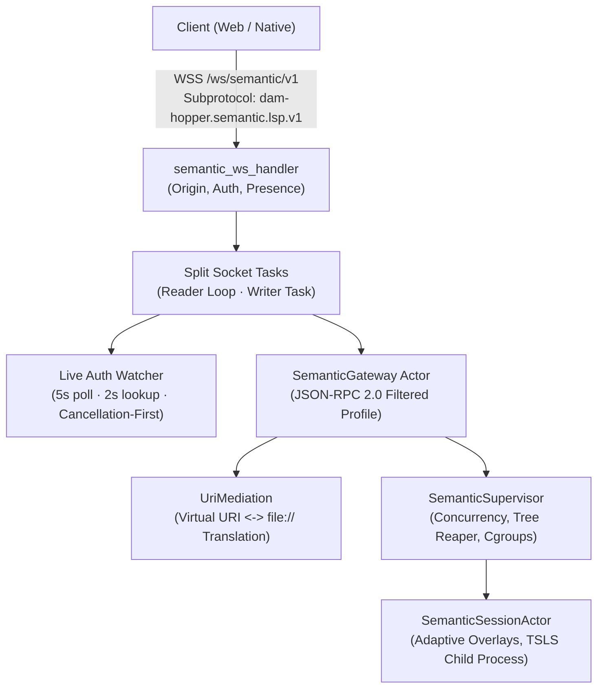

# Authenticated Semantic WebSocket Gateway Architecture

**Authority:** Server Semantic Subsystem (`server/src/api/semantic_ws.rs`, `server/src/semantic/gateway.rs`, `server/src/semantic/uri.rs`)  
**Status:** Maintained Architecture Specification (Phase 09 Qualified for Portable-Only Linux x64 Server + Web; PR #74 Remediation: Phase 01 Passed, Phases 02 & 03 Accepted with Deferred Issues; Release Hold Maintained)

## Scope and Subsystem Boundary

The semantic WebSocket gateway exposes a dedicated, isolated transport endpoint (`/ws/semantic/v1`) for language server interactions (TypeScript/JavaScript). It bridges web and desktop clients to the AppState-owned session supervisor while enforcing strict authentication parity, admission fencing, bidirectional URI containment, and bounded resource consumption.



### Key Architectural Invariants

- **Dedicated Route & Protocol Isolation:** The `/ws/semantic/v1` endpoint is isolated from the core `/ws` multiplexed connection. It uses standard JSON-RPC 2.0 frames instead of the `{ kind: ... }` message envelope and shares zero channel budgets, message queues, or event dispatchers with terminal PTY or filesystem operations.
- **Required Subprotocol:** Handshakes require exact negotiation of the `dam-hopper.semantic.lsp.v1` subprotocol via `Sec-WebSocket-Protocol`. Requests omitting or offering differing subprotocols fail with HTTP 400 Bad Request.
- **Server-Global Hot Toggle & Default-Disabled State:** The semantic supervisor defaults to disabled (`is_enabled() == false`). Server administrators can enable or disable the subsystem dynamically at runtime via `PATCH /api/semantic/settings` without daemon restart. When disabled, WebSocket connections may upgrade at the HTTP layer, but initialization attempts return JSON-RPC error `-32000 SEMANTIC_DISABLED`. When toggled OFF by an administrator, active sessions are immediately revoked and their process trees reaped before updating persisted configuration.
- **Cancellation-First Teardown:** Live authentication invalidation terminates supervisor admission, immediately revokes shared session tokens lock-free, fences queued outgoing results, and reaps the child process tree _before_ socket-level close delivery, preventing slow or stalled network consumers from delaying resource reclamation or receiving late responses.

---

## Handshake, Origin Allowlist & Authentication

The `/ws/semantic/v1` route is placed under the public router in `server/src/api/router.rs` so the handler (`server/src/api/semantic_ws.rs`) can enforce exact handshake policy before upgrading:

### 1. Subprotocol Negotiation

The client MUST send `Sec-WebSocket-Protocol: dam-hopper.semantic.lsp.v1`. Comma-separated protocol lists are supported if they include the exact subprotocol name. Mismatch or absence yields:

```json
{
  "error": "Sec-WebSocket-Protocol must negotiate 'dam-hopper.semantic.lsp.v1'",
  "code": "INVALID_SUBPROTOCOL"
}
```

### 2. Origin Policy

Handshake Origin validation strictly matches core `/ws` policy via `websocket_origin_allowed`:

- **When `Origin` header is present:** The origin MUST pass `state.origin_is_allowed(&headers)`. Disallowed browser origins are rejected with HTTP 403 Forbidden, even in development `--no-auth` mode.
- **When `Origin` header is absent:** Origin-less clients (such as native tools or CLI helpers) are permitted only if they provide a query-string bearer token (`?token=...`) or if the server explicitly runs with `--no-auth`. Cookie-only origin-less requests are rejected with HTTP 403 Forbidden.

### 3. Token Extraction & Claims Evaluation

Authentication token extraction checks query parameters first, falling back to the `dam_hopper_auth` cookie:

```text
token = query.get("token") || cookieJar.get("dam_hopper_auth")
```

When `--no-auth` is inactive, tokens must decode as valid V2 `AuthClaims` matching `jwt_secret`. The handler then evaluates claims via `state.auth_service.evaluate_claims(&claims)` bounded by an asynchronous timeout:

```rust
let eval_res = tokio::time::timeout(
    AUTH_STORE_LOOKUP_TIMEOUT,
    state.auth_service.evaluate_claims(&claims),
)
.await;
```

- **Pre-Upgrade Timeout & Fail-Closed Behavior:** Bounded by `AUTH_STORE_LOOKUP_TIMEOUT` (2.0 seconds). If persistent claims lookup times out or backend is unavailable, claims evaluation fails closed with HTTP 503 Service Unavailable (`AUTH_UNAVAILABLE`).
- **Presence Budget Protection:** Pre-upgrade evaluation executes *strictly prior* to presence reservation (`reserve_pending_upgrade`). Unauthenticated or timed-out requests are rejected before reserving client presence capacity or allocating session actors.
- **SQLite Blocking Worker Limitation:** On timeout, the claims-evaluation future is dropped and the handler returns HTTP 503 `AUTH_UNAVAILABLE`. Two seconds is the configured asynchronous timeout deadline (`AUTH_STORE_LOOKUP_TIMEOUT = 2s`), subject to Tokio scheduling jitter; already-started SQLite database queries dispatched to `tokio::task::spawn_blocking` cannot be preemptively aborted and will execute to completion on the worker thread.
- **Decision Outcomes:**
  - `AuthDecision::Authenticated`: Captures `AuthenticatedActor` with session ID, auth version, credential version, and calculated MFA deadline.
  - `AuthDecision::MfaRequired`: Returns HTTP 401 Unauthorized (`MFA_REQUIRED`).
  - `AuthDecision::FullLoginRequired`: Returns HTTP 401 Unauthorized (`SESSION_EXPIRED`, `SESSION_REVOKED`, `ACCOUNT_DISABLED`, or `AUTH_REQUIRED`).
  - `AuthDecision::Unavailable`: Returns HTTP 503 Service Unavailable (`AUTH_UNAVAILABLE`).
### 4. Client Presence Admission

Before socket upgrade completes, the connection reserves a slot in the server's presence registry:

```rust
let pending_guard = state.client_presence.reserve_pending_upgrade(actor)?;
```

If the presence registry is exhausted, upgrade fails with HTTP 503 `PRESENCE_UNAVAILABLE`. Upon successful socket upgrade, the reservation is promoted to an active presence connection and assigned a unique connection identifier (`semantic-<uuid>`).

---

## Live Auth Watcher & Cancellation-First Invalidation

Once the socket is upgraded, a dedicated asynchronous watcher monitors authentication validity in the background:

- **Cadence & Lookup Bound:** Runs every 5 seconds with a 2-second timeout (`AUTH_STORE_LOOKUP_TIMEOUT`) for persistent store lookups.
- **Inspection Scope:**
  - Effective MFA and session deadlines (`now >= mfa_due_at` or `now >= expires_at`).
  - Active user enablement (`user.is_enabled == true`).
  - Session revocation timestamps (`session.revoked_at.is_none()`).
  - Version increments (`session.auth_version == user.auth_version == actor.auth_version`, `session.credential_version == actor.credential_version`).
  - Store unavailability or query timeout fails closed (HTTP 503 / close code 1013 `CLOSE_AUTH_UNAVAILABLE`). Tested against real SQLite WAL reader locks and MongoDB network timeouts (sustained exactly 2,001 ms).

### Cancellation-First Teardown Sequence

When invalidation is detected, the watcher enforces strict cancellation-first ordering:

```text
Watcher detects invalidation
  1. session_revocation.revoke()
     -> Immediately revokes shared session token lock-free (0 awaits)
  2. state.semantic_supervisor.invalidate_connection(&connection_id).await
     -> Reaps child process tree and cancels session actor out-of-band (~508ms)
  3. Queued writer fence drops non-null success results if token is revoked
  4. Deliver close frame code (4401 / 4403 / 1013) to writer task
  5. Signal cancel channel (cancel_tx.send(true)) to abort reader and writer loops
```

This ordering guarantees that an unresponsive network client or full outbound channel cannot prolong child process lifetime, delay host resource cleanup, or observe stale results. Phase 09 qualification verified 20/20 cases across real SQLite and MongoDB stores: admission cutoff was immediate (0 ms) and descendant process tree reap completed in 506–510 ms under saturated backpressure with non-reading consumers.
---

## Resource Controls and Finite Bounds

| Parameter                     | Limit                   | Constant / Enforcement Location                                      |
| ----------------------------- | ----------------------- | -------------------------------------------------------------------- |
| Adaptive Wire Sync Threshold  | 64 KiB (65,536 bytes)   | `ADAPTIVE_SYNC_THRESHOLD_BYTES` in `resources.rs` (frozen post-Phase 09) |
| Max Single Document Size      | 1 MiB (1,048,576 bytes) | `MAX_DOCUMENT_BYTES` in `resources.rs`                               |
| Max Session Overlay Budget    | 4 MiB (4,194,304 bytes) | `MAX_SESSION_OVERLAY_BYTES` in `resources.rs`                        |
| Max Global Overlay Budget     | 8 MiB (8,388,608 bytes) | `MAX_GLOBAL_OVERLAY_BYTES` in `resources.rs`                         |
| Max Frame & Message Size      | 4 MiB (4,194,304 bytes) | `MAX_FRAME_BODY_BYTES` in `resources.rs`; Axum upgrade config        |
| Max Stdio Header Size         | 8 KiB (8,192 bytes)     | `MAX_STDIO_HEADER_BYTES` in `resources.rs`                           |
| Token Bucket Refill Rate      | 40 tokens / sec         | `MESSAGE_RATE_PER_SEC` in `resources.rs`                             |
| Token Bucket Burst Capacity   | 80 tokens               | `MESSAGE_RATE_BURST` in `resources.rs`                               |
| Rate Cost per Message         | 1.0 token               | In-memory `TokenBucketRateLimiter` in `semantic_ws.rs`               |
| In-Flight Navigation Requests | 8 concurrent requests   | `MAX_IN_FLIGHT_REQUESTS` in `resources.rs`; `in_flight_count` atomic |
| Outbound Message Queue        | 32 messages             | `MAX_QUEUED_MESSAGES` in `resources.rs`; bounded Tokio mpsc          |
| Outbound Queued Byte Budget   | 4 MiB (4,194,304 bytes) | `MAX_QUEUED_BYTES` in `resources.rs`; serialized UTF-8 accounting    |
| Socket Write Timeout          | 2.0 seconds             | `SOCKET_SEND_TIMEOUT` in `resources.rs`                              |
| Live Auth Lookup Timeout      | 2.0 seconds             | `AUTH_STORE_LOOKUP_TIMEOUT` in `resources.rs`                        |
| Peer Inactivity Timeout       | 60.0 seconds            | Read stream timeout in `semantic_ws.rs`                              |
| Resource Control Mode         | Portable-Only Qualified | Linux cgroups v2 mode explicitly unqualified (`NOT_SELECTED`)        |
### Throttling & Payload Rejections

- **Rate Limit Exceeded:** When bucket tokens fall below 1.0, the message is dropped and the gateway returns JSON-RPC error `-32004` (`RATE_LIMIT_EXCEEDED`).
- **Binary Payloads:** The semantic JSON-RPC protocol accepts UTF-8 text messages only. Incoming binary WebSocket frames are rejected with JSON-RPC error `-32700` (`Parse error`).
- **Batch Requests:** JSON-RPC batching (JSON arrays) is explicitly forbidden. Messages must be single JSON objects.

### Reader/Writer Task Decoupling & Inactivity Limitation

The socket handler splits into a dedicated writer task and a sequential reader loop. The reader loop includes an explicit select branch on `outbound_tx.closed()` and the shared cancellation channel; if the outbound writer task terminates on socket send failure or close frame delivery, the reader terminates immediately without lingering until the 60-second inactivity timeout.
---

## Filtered JSON-RPC 2.0 Protocol Profile

The gateway exposes a strictly fenced subset of the Language Server Protocol. Unknown methods, commands, workspace configuration mutations, and dynamic registrations are rejected.

### Lifecycle State Machine

```text
[ Unattached ]
      |
      | damHopper/attachTarget
      v
 [ Attached ]
      |
      | initialize
      v
[ Initializing ]
      |
      | initialized
      v
   [ Ready ] <---> (didOpen, didChange, didClose, definition, implementation, $/cancelRequest)
      |
      | shutdown
      v
[ ShuttingDown ]
      |
      | exit / disconnect
      v
 [ Terminated ]
```

### Supported Method Allowlist

| Method                        | Direction        | Lifecycle State          | Behavior & Requirements                                                                                                                                                                                                                                          |
| ----------------------------- | ---------------- | ------------------------ | ---------------------------------------------------------------------------------------------------------------------------------------------------------------------------------------------------------------------------------------------------------------- |
| `damHopper/attachTarget`      | Client -> Server | `Unattached`             | Attaches connection to `{ target: { project, worktreePath? }, descriptor: "typescript" }`. Resolves canonical target root and captures immutable `root_identity`.                                                                                                |
| `initialize`                  | Client -> Server | `Attached`               | Revalidates root identity and admission epoch. Lazily spawns supervisor session actor, initializes child TSLS, and replies with fixed capabilities: single Incremental sync (`textDocumentSync: 2`), `definitionProvider: true`, `implementationProvider: true`. |
| `initialized`                 | Client -> Server | `Initializing`           | Transitions connection to `Ready`.                                                                                                                                                                                                                               |
| `textDocument/didOpen`        | Client -> Server | `Ready`                  | Validates virtual URI and supported language (`typescript`, `typescriptreact`, `javascript`, `javascriptreact`). Opens document in session overlay.                                                                                                              |
| `textDocument/didChange`      | Client -> Server | `Ready`                  | Translates virtual URI to child `file://` URI. Forwards incremental edit batch to session actor. Rejection triggers protective `didClose`.                                                                                                                       |
| `textDocument/didClose`       | Client -> Server | `Ready`                  | Releases unsaved overlay for model. Unrelated models remain intact. Triggers 60s idle eviction if zero open documents remain.                                                                                                                                    |
| `textDocument/definition`     | Client -> Server | `Ready`                  | Requires `damHopperDocumentVersion` extension. Dispatches asynchronously via internal ID; strips extension before child dispatch. Filters results.                                                                                                               |
| `textDocument/implementation` | Client -> Server | `Ready`                  | Same contract and version fencing as definition.                                                                                                                                                                                                                 |
| `$/cancelRequest`             | Client -> Server | `Ready`                  | Maps client request ID to internal sequential ID and cancels in-flight session request.                                                                                                                                                                          |
| `shutdown`                    | Client -> Server | `Ready` / `Initializing` | Gracefully shuts down child language server. Replies with `result: null`.                                                                                                                                                                                        |
| `exit`                        | Client -> Server | Any                      | Releases session and tears down connection.                                                                                                                                                                                                                      |

### Document Version Extension (`damHopperDocumentVersion`)

Navigation requests (`textDocument/definition`, `textDocument/implementation`) MUST supply `damHopperDocumentVersion: <integer>` in `params`. The gateway:

1. Validates that the requested version matches the active in-memory overlay version for the document.
2. Rejects stale requests with `-32003 STALE_VERSION`.
3. Strips `damHopperDocumentVersion` and `damHopperModelGeneration` before dispatching the standard LSP request to child TSLS.

### Known Protocol Deviations & Resolution Status

- **Cancelled Request ID Correlation (Tracked W-B — Resolved in Phase 02):** Previously, cancelling an in-flight request returned `{ id: null }`. Phase 02 introduces `LogicalNavigationEntry` keyed by client request ID. When `$/cancelRequest` cancels a request, the gateway marks `entry.cancelled = true`, cancels any active child request, and returns JSON-RPC error `-32800 REQUEST_CANCELLED` with the client's original request ID. Outbound admission and deadline coverage races remain tracked under W3/W4.
- **Invalid Request ID Handling (Tracked W-C):** Requests with invalid ID types (e.g. boolean, array, or object) return error frames with `{ id: null }` rather than echoing the invalid value.
- **Pre-Actor Rejection Overlay Sync (Tracked W-D):** If an opened file encounters pre-actor validation errors on subsequent operations, an explicit `did_close` is issued to prevent in-memory overlay desynchronization.
---

## Virtual URI Grammar & Path Containment

Clients communicate exclusively using virtual URIs. The server mediates between virtual client URIs and physical host paths, ensuring host paths are never disclosed over the network.

### Canonical Virtual URI Format

```text
dam-hopper://semantic/<target-id>/<encoded-relative-path>
```

- **Scheme:** Exact literal `dam-hopper`.
- **Authority:** Exact literal `semantic`.
- **Target ID:** Opaque target identifier generated during target resolution.
- **Relative Path:** Slash-separated path segments relative to target root. Each segment is percent-encoded using RFC 3986 rules.

### Strict Parsing & Mediation Rules (`server/src/semantic/uri.rs`)

- **Query & Fragment Forbidden:** Presence of `?` or `#` produces `QueryOrFragmentForbidden`.
- **Null Bytes:** Any `\0` character produces `NullByte`.
- **Traversal Rejection:** Segments matching `.` or `..` produce `TraversalDetected`.
- **Pre-Decode Splitting:** URI path is split on `/` _before_ percent-decoding. This prevents `%2F` or `%5C` from crossing segment boundaries.
- **Single Decode:** Segments are percent-decoded exactly once.
- **Unreserved Character Rule:** RFC 3986 unreserved characters (`a-z`, `A-Z`, `0-9`, `-`, `.`, `_`, `~`) MUST NOT be percent-encoded. Encoded unreserved characters (e.g. `%61` for `a`) fail with `InvalidUriFormat`.
- **Drive Letters & Traversal:** Decoded segments containing `/`, `\`, `.`, `..`, or drive specifiers (`C:`) fail closed.

### Bidirectional Translation & Containment

1. **Virtual to Host Path (`virtual_uri_to_file_uri`):**
   - Joins relative path to canonical target root.
   - Verifies lexical containment (`target_path_is_within`).
   - Resolves canonical path via `dunce::canonicalize` to detect symlink escapes.
   - For non-existent files, verifies that nearest existing ancestor directory resolves inside target root.

2. **Child `file://` to Virtual URI (`file_uri_to_virtual_uri`):**
   - Parses `file://` URL from child process output.
   - Canonicalizes path and checks containment within canonical target root.
   - If path falls outside target root (e.g. system header, standard library, external package, or sibling worktree), returns `Err(UriMediationError::OutsideTarget)`.
   - On valid in-target paths, strips target root prefix and percent-encodes segments into `dam-hopper://semantic/<target-id>/<encoded-path>`.

### Result Sanitization & `outsideTarget` Filtering

Containment is evaluated strictly against the canonical target root (`canonical_path.strip_prefix(canonical_target_root)`):

- **In-Target Files:** File paths resolving within the canonical target root are translated to virtual URIs and validated for finite, zero-based, non-inverted coordinates (`start <= end`).
- **Out-of-Root Files:** Paths resolving outside the target root (such as global package stores, standard library sources, external TypeScript definitions, or symlinks pointing outside the target) fail containment and are stripped.
- **`outsideTarget` Marker:** If all locations fall outside the target root, the gateway returns `{ "outsideTarget": true }` instead of an empty result, signaling that definitions exist externally without disclosing host filesystem paths.
- **Implementation Note on Classification Folding:** If a child location object is malformed (e.g. non-object or non-string URI), `filter_single_location_or_link` returns `Ok(None)`, which is counted alongside genuine outside-target locations. Consequently, an entirely malformed child array produces `{"outsideTarget": true}`. Distinguishing malformed child outputs from authentic out-of-root locations is tracked for future refinement.

---

## Destination Coordinate Proofs & Multi-Stage Requery (Phase 02 / F3)

Cross-document navigation (`textDocument/definition`, `textDocument/implementation`) coordinates unopened files using a two-stage pin-and-requery workflow:

1. **Preliminary Stage-1 Query:** The client's request is submitted to the active session actor. If the response references in-target files that are not open in the gateway's overlay registry, the gateway identifies unopened destination candidates.
2. **Bounded Destination Pinning & Requery:** Unopened candidate files are read from disk within strict limits (`MAX_DOCUMENT_BYTES`), projected, and pinned into the language server session via `submit_pinned_navigation`. The actor then executes a stage-2 requery against the pinned state.
3. **Internal Proof Generation & Stripping:** The session actor attaches an internal coordinate proof (`_damHopperProvenSnapshots`) to its requery response payload, containing `{ text, contentSha256, version, openIncarnation }` for each snapshot evaluated. Before returning the final result or serializing frames to the client, the gateway extracts and deletes `_damHopperProvenSnapshots` (`obj.remove("_damHopperProvenSnapshots")`). Internal proof metadata is never transmitted on the wire to clients.
4. **Separated Actor vs. Gateway Incarnation Validation:**
   - **Gateway-Level State Validation:** The gateway compares `open_docs_at_submit` with post-requery gateway state (`open_docs`) to ensure the user did not modify or close the destination document through the gateway while requery was in flight.
   - **Actor-Level State Validation:** The gateway compares the snapshot's actor version and incarnation (`actor_ver`, `actor_inc` in `open_dest_actor_identities`) with the proven snapshot metadata (`snap_ver`, `snap_inc`).
   - **Separation Invariant:** Gateway overlay versioning and actor child incarnation operate in distinct domains; separating their validation prevents false-positive version collisions and eliminates relabeling destination coordinates with live content when documents mutate during requery.
5. **Wire Destination Provenance:** Validated in-target destinations append DamHopper wire extension attributes (`damHopperDestinationContentSha256`, `damHopperDestinationVersion`, `damHopperDestinationIncarnation`) to standard Location and LocationLink structures via `filter_location_or_link_result_with_provenance`.

---

## Borrowed Lossless Line-Span Iteration (Phase 02 / F8)

Accurate position-to-byte conversion and destination range validation require exact line-ending accounting matching TypeScript 5.9 parser behavior:

- **Zero-Allocation Borrowed Iteration:** `server/src/semantic/overlay.rs` provides `lossless_line_spans(text: &str) -> LosslessLineSpans<'a>`, yielding borrowed `LineSpan<'a>` (`line_number`, `start_byte`, `content`, `separator_len`).
- **Separator Recognition:** Recognizes CRLF (`\r\n`, separator len 2), LF (`\n`, separator len 1), and lone CR (`\r`, separator len 1), preserving trailing empty lines without allocating intermediate `String` instances per line.
- **Client Overlay Text Preservation:** Direct-client text is never rewritten or mutated to LF-only representations in memory or storage. Both `position_to_byte_offset` (in `overlay.rs`) and `validate_range_in_text` (in `uri.rs`) consume `lossless_line_spans`, guaranteeing that byte accounting and UTF-16 code unit indexing match direct-client documents containing mixed or lone CR endings.

---

## Retained Logical Cancellation Ownership Across Child Stages (Phase 02 / F9)

Navigation requests span multiple asynchronous stages (initial query, disk reads, pin acquisition, and stage-2 requery). The gateway enforces unified logical request ownership:

- **Single Logical Registration (`LogicalNavigationEntry`):** The gateway maintains `client_to_logical: Arc<Mutex<HashMap<Value, LogicalNavigationEntry>>>` where `LogicalNavigationEntry` records `{ active_child_id: Option<u64>, cancelled: bool }`.
- **Child ID Correlation:** `internal_to_client: Arc<Mutex<HashMap<u64, Value>>>` correlates child request IDs back to the original client request ID.
- **Lifecycle Span & In-Flight Tracking:** A single in-flight permit (`in_flight_count`) and navigation deadline (`nav_deadline`) cover stage 1, disk snapshot reads, pin acquisition, stage 2, and outbound frame publication (with remaining deadline coverage gaps across disk/cancel awaits tracked as W4, and outbound channel capacity races tracked as W3).
- **Duplicate-ID Rejection Throughout:** Re-using an active client request ID before terminal publication is rejected with JSON-RPC error `-32600 Invalid request` across all execution stages.
- **Cancellation Propagation:** Incoming `$/cancelRequest` notifications lookup the logical entry by client ID:
  - If found, `entry.cancelled = true` is set immediately.
  - If an `active_child_id` is present, the gateway dispatches `handle.cancel_request(child_id)` to the active child process.
  - If cancellation arrives during the inter-stage gap (between stage 1 and stage 2), stage 2 is aborted before dispatch.
- **Terminal Error Echoing:** When a cancelled request terminates, the gateway emits JSON-RPC error `-32800 REQUEST_CANCELLED` carrying the client's original request ID. (Cancellation notifications themselves do not produce responses).
- **Session Revocation on Enqueue Failure:** If outbound channel transmission fails during request finalization, the gateway revokes the session token (`tok.revoke()`) to fence against orphaned responses (direct transport termination rather than token revocation alone remains tracked as W8).

---

## Test Feature Gating & Phase 04 Deferred Items

### Cargo `test-support` Feature Gate

The integration test suite `server/tests/semantic_websocket.rs` exercises deterministic barrier synchronization (`test_barriers`) to verify complex interleavings. In `server/Cargo.toml`, the test target is gated:

```toml
[features]
test-support = []

[[test]]
name = "semantic_websocket"
required-features = ["test-support"]
```

This prevents test-only barrier synchronization flags (`BarrierGuard`, `F3_ENABLED`, `F9_GAP_ENABLED`, `F9_STAGE2_ENABLED`) from being compiled into default production release binaries. Running gateway integration tests requires `--features test-support`.

### Phase 04 Deferred Issues

Phase 02 was formally accepted with seven deferred review issues tracked for Phase 04 integrated qualification, linking directly to [Cycle 3 Code Review Report](../plans/reports/code-review-261026-0709-phase02-gateway-coordinate-proofs-cycle3.md):

1. **W1 (High) — CI Test-Support Wiring & Process-Global Barriers:** `semantic_websocket` requires `--features test-support`; runner scripts and CI must explicitly enable the feature. Barrier flags are process-global; tests must be serialized (`--test-threads=1`) with bounded waits and cleanup that wakes paused workers.
2. **W3 (High) — Outbound Admission Cancellation/Deadline Race:** In `finish()`, capacity recovery under saturated outbound channels can commit responses after a cancellation or deadline has elapsed. Capacity reservation must occur under the navigation deadline and wakeable cancellation signal.
3. **W4 (Medium) — Navigation Deadline Coverage of All Awaits:** The navigation deadline must cover all owned awaits from initiation, including disk snapshot reads, session handle submissions, and bounded child-cancel cleanup.
4. **W5 (High) — Test Coverage Fidelity (F3/F9):** Gateway fixtures must test the exact planned absent-at-submission → user-open A before pin → query A → edit B interleaving, and held-child cancellation logging.
5. **W7 (Medium) — Baseline Diff Header & API Repair:** Repair corrupt patch line counts and outdated API signatures in `plans/reports/baseline-b031e6a-f3-f9-failing-before.md`.
6. **W8 (Medium) — Transport Termination on Enqueue Failure:** Enqueue failure revokes the session token, but should additionally invoke direct connection transport termination.
7. **W9 (High) — Bounded Off-Thread Snapshot Reader & Worker Lifetime:** Off-thread disk snapshot reads must enforce `MAX_DOCUMENT_BYTES + 1` caps, validate file descriptors/identities without following symlinks, and retain worker permits until blocking tasks complete to prevent detached worker accumulation.
---

## Error Handling & Close Code Taxonomy

### WebSocket Close Codes

| Close Code | Identifier                  | Trigger / Condition                                                        |
| ---------- | --------------------------- | -------------------------------------------------------------------------- |
| `1000`     | Normal Closure              | Normal client or server disconnect.                                        |
| `1008`     | `CLOSE_POLICY_VIOLATION`    | Protocol violation or policy breach.                                       |
| `1011`     | `CLOSE_INTERNAL_ERROR`      | Internal server or task failure.                                           |
| `1013`     | `CLOSE_AUTH_UNAVAILABLE`    | Auth store error or timeout during live recheck.                           |
| `4401`     | `CLOSE_FULL_LOGIN_REQUIRED` | Live watcher detected revoked session, disabled account, or expired token. |
| `4403`     | `CLOSE_MFA_REQUIRED`        | Live watcher detected MFA verification deadline elapsed.                   |

### JSON-RPC Error Codes

| JSON-RPC Code | Error Code        | DamHopper Code                           | Meaning                                                                |
| ------------- | ----------------- | ---------------------------------------- | ---------------------------------------------------------------------- |
| `-32700`      | Parse error       | N/A                                      | Invalid JSON syntax or binary frame received.                          |
| `-32600`      | Invalid request   | N/A                                      | Missing `method`, missing `id`, or lifecycle violation.                |
| `-32601`      | Method not found  | N/A                                      | Method not in filtered semantic allowlist.                             |
| `-32602`      | Invalid params    | N/A                                      | Missing parameters, invalid URI, or inverted coordinates.              |
| `-32603`      | Internal error    | N/A                                      | Child process spawn or unexpected internal failure.                    |
| `-32000`      | Server error      | `SEMANTIC_DISABLED`                      | Subsystem disabled on server (`is_enabled() == false`).                |
| `-32001`      | Server error      | `UNSUPPORTED_DESCRIPTOR`                 | Language descriptor other than `"typescript"` requested.               |
| `-32002`      | Server error      | `TARGET_NOT_FOUND`                       | Target project unavailable or inaccessible.                            |
| `-32003`      | Server error      | `STALE_VERSION`                          | Document version does not match active overlay.                        |
| `-32004`      | Server error      | `RATE_LIMIT_EXCEEDED` / `IN_FLIGHT_FULL` | Token-bucket exhausted or 8 concurrent requests exceeded.              |
| `-32005`      | Server error      | `AUTH_REVOKED`                           | Connection admission epoch invalidated during execution.               |
| `-32800`      | Request cancelled | `REQUEST_CANCELLED`                      | Client cancelled request via `$/cancelRequest` or session interrupted. |

---

## Client Integration: Shared Monaco Semantic Client (Phase 07)

Phase 07 delivers the frontend client layer integrating the Monaco code editor with the semantic WebSocket gateway (`packages/ui/src/api/semantic-client.ts`, `packages/ui/src/lib/semantic-model-uri.ts`, `packages/ui/src/lib/semantic-monaco.ts`, `packages/ui/src/stores/semantic-navigation.ts`, `MonacoHost.tsx`, `EditorTabs.tsx`):

### 1. Connection Lifecycle and Subprotocol Handshake

`SemanticClient` establishes a dedicated WebSocket connection directly to `/ws/semantic/v1` specifying subprotocol `dam-hopper.semantic.lsp.v1` and including an authentication token via query parameter (`?token=...`). It progresses through a strict lifecycle state machine:

```text
disconnected -> connecting -> attaching (damHopper/attachTarget)
             -> initializing (initialize)
             -> replaying (initialized + replayMatchingModels)
             -> ready
```

Unexpected socket closure or authentication invalidation transitions the client to `disconnected` and cleans up pending request timers and document queues.

### 2. Stable Local Identity vs. Replaceable Wire Bindings

To prevent dirty editor state, undo stacks, or cursor positions from being destroyed during reconnects or target generation bumps, the client decouples local editor model identity from session wire bindings via `SemanticModelRegistry`:

- **Local Model URI:** Follows Monaco's existing in-memory scheme: `inmemory://dam-hopper/${encodeURIComponent(tabKey)}`.
- **Virtual Wire URI:** Follows the gateway's RFC 3986 virtual URI scheme: `dam-hopper://semantic/<target-id>/<encoded-relative-path>`.
- **Reconnection Invariant:** Retain the local model, undo and view state. Replay requires matching immutable endpoint/root/credential provenance, the current profile connection generation, and an exact-owner project cache entry. Missing or conflicting authority fails closed before reading retained draft text. Each socket attempt owns its promises, bindings, queues and cleanup.

### 3. Adaptive Document Synchronization

`SemanticClient` requires the complete attach policy and an identical initialize policy before replay or navigation. It has no operational threshold fallback; the server's compiled threshold is the single authority.

- **Exact Post-Edit Accounting:** Keystroke edits compute the new full document UTF-8 byte length via `new TextEncoder().encode(newFullContent).length`.
- **Sync Path Selection:**
  - **Below the negotiated threshold:** Range-less full text replacement (`{ text: newFullContent }`).
  - **At or above the threshold:** Ordered ranged change batches (`{ range, text }`); the boundary uses post-edit UTF-8 bytes.
- **Monotonic Wire Versioning & Queue Serialization:** Each committed edit increments `wireBinding.wireVersion`. Document edits are queued sequentially per document via promise chaining (`documentQueues`), ensuring strict FIFO order across async boundaries.

### 4. Model-Scoped Monaco Provider Coexistence

`SemanticMonacoManager` registers Monaco `DefinitionProvider` and `ImplementationProvider` for `typescript` and `javascript` (`.ts`, `.tsx`, `.js`, `.jsx`):

- **Model-Scoped Resolution:** Exclusive per-model selectors suppress competing providers only for authorized semantic models. Every mounting manager registration owns a distinct disposal token; unrelated models retain their built-in providers.
- **Coordinate Translation:** Converts Monaco 1-based coordinates to LSP 0-based UTF-16 code units.
- **Clean Mode Restoration:** OFF disposes owned selectors; global Monaco TypeScript/JavaScript mode defaults are never modified.

### 5. Ephemeral Reveal Coordination

Cross-document navigation utilizes `useSemanticNavigationStore`:

- Navigation captures exact source version/incarnation and destination content SHA256 plus overlay version/incarnation when open. Unopened destinations are bounded disk snapshots temporarily pinned into the child, then re-queried in FIFO order; hashing a later read alone is insufficient.
- Reveal intents preserve the actual source profile/project/worktree target. Destination content, authority and currentness are rechecked after asynchronous work and immediately before synchronous selection. Rejected owned semantic destinations cannot fall through to an ambient opener.
- The ephemeral semantic navigation store (`useSemanticNavigationStore`) tracks reveal intents in memory (intents and document content are never persisted to `localStorage`; tab metadata persistence is governed independently by the editor store).

### 6. Gateway Cancellation & Desync Protection Hardening

- **Request Cancellation:** Client cancellation via `$/cancelRequest` completes the original in-flight request with its original request ID and returns standard JSON-RPC error `-32800 REQUEST_CANCELLED` (notifications themselves do not return responses).
- **Malformed Change Protection:** If a client submits malformed `contentChange` items in `didChange`, the gateway closes the document overlay (`handle.did_close`) to prevent desynchronization between the client and language server process.

## Lifecycle Invalidation and Client Recovery (Phase 08)

Phase 08 delivers comprehensive lifecycle invalidation and client-side fault recovery across server operations and frontend editor surfaces.

### 1. Authoritative Trigger, Ordering, and Teardown Matrix

Different system events enforce distinct invalidation and reaping guarantees to prevent deadlocks, data corruption, or denial-of-service:

| Trigger / Boundary | Admission Cutoff | Process Tree Reaping | Lock Scope & Ordering | Client Recovery Path |
|---|---|---|---|---|
| **Live Auth Invalidation** (5s poll, 2s DB lookup) | Immediate revocation of connection admission epoch | Reaped **before** socket close delivery (`TOTAL_TEARDOWN_BUDGET = 5s`) | Out-of-band watcher; no workspace lock held | Socket closes with `4401 CLOSE_FULL_LOGIN_REQUIRED`. Client fails closed; no reconnect unless fresh valid credentials supplied. |
| **Admin Hot Toggle OFF** (`PATCH /api/semantic/settings`) | Synchronous revocation on supervisor | Reaped **before** committing durable configuration | `global_config_mutation_lock` -> `transition_lock`; supervisor sessions drained | Ongoing queries fail with `-32005` or socket drops; client transitions to `disconnected`. New handshakes fail `initialize` with `-32000 SEMANTIC_DISABLED`. |
| **Workspace Switch / Init** (`switch_workspace`, `init_workspace`) | Synchronous Phase 1 detachment from registry under write lock; actor invalidation enqueued | Asynchronous Phase 2 non-blocking reap outside write lock | `workspace_context_guard.write()` acquires lock -> detaches sessions (`prepare_invalidate_all`) -> drops lock -> reaps trees (`spawn_reap_sessions`) | In-flight requests fail with `-32005 AUTH_REVOKED`. Client schedules auto-reconnection after 1,000 ms and attaches to new workspace targets. |
| **Config Reload with Project Diffing** (`reload_config_locked`) | Synchronous Phase 1 detachment of removed projects only | Asynchronous Phase 2 non-blocking reap of removed projects outside write lock | `workspace_context_guard.write()` -> diffs project sets -> detaches removed (`prepare_invalidate_project`) -> drops lock -> reaps (`spawn_reap_sessions`) | Clients on removed project roots fail with `-32005` / `-32002 TARGET_NOT_FOUND` and fail closed. Clients on surviving projects remain undisturbed. |
| **Settings Cache Clear** (`clear_cache`) | Synchronous Phase 1 detachment from registry under write lock | Asynchronous Phase 2 non-blocking reap outside write lock | `workspace_context_guard.write()` -> detaches all sessions -> drops lock -> reaps (`spawn_reap_sessions`) | In-flight requests fail with `-32005`. Client schedules auto-reconnect after 1,000 ms and re-establishes session wire bindings. |
| **Settings Import Rollback** (`import_workspace_settings`) | Synchronous detachment on reload attempt and on restore | Asynchronous non-blocking reap on reload and on restore | `workspace_context_guard.write()` during atomic restore; reaps detached handles on both attempt and rollback | Clients detached during invalid import or rollback fail with `-32005` and recover via 1,000 ms auto-reconnect. |
| **Worktree Removal / Target Refresh** (`invalidate_project_root`) | Synchronous Phase 1 detachment for matching project root | Asynchronous Phase 2 non-blocking reap | Resolves project name under `config.read()` -> `prepare_invalidate_project` -> `spawn_reap_sessions` | Associated sessions invalidated; client reconnect fails with `-32002 TARGET_NOT_FOUND` if root no longer exists. |
| **Early Daemon Shutdown** (SIGINT / SIGTERM) | Synchronous `revoke_admission()` in shutdown signal handler | Managed supervisor `shutdown()` reaps all session trees | Signal handler executes cutoff before socket listener drain or graceful service teardown | New connection attempts rejected immediately at admission check (`is_admission_revoked()`). Existing sessions reaped cleanly. |

### 2. Client-Side Fault Recovery State Machine

The frontend `SemanticClient` (`packages/ui/src/api/semantic-client.ts`) and navigation store (`packages/ui/src/stores/semantic-navigation.ts`) implement resilient recovery protocols:

1. **Local Cancellation via `$/cancelRequest`:**
   - Navigation requests (`textDocument/definition`, `textDocument/implementation`) accept `AbortSignal` and enforce client-side timeouts (`NAVIGATION_TIMEOUT_MS = 5000`).
   - On timeout or external abort, the client immediately emits a JSON-RPC notification `$/cancelRequest` with `{ id: clientRequestId }` to release server and language server resources.
   - The client locally resolves the query with empty locations and gracefully catches server `-32800 REQUEST_CANCELLED` responses without surfacing errors to the user.

2. **Full `didChange` Resync on Version Divergence (`-32003 STALE_VERSION`):**
   - If the server detects a version mismatch between incoming edits and its authoritative `SessionOverlayMap`, it returns JSON-RPC error `-32003`.
   - Instead of breaking navigation permanently, `SemanticClient` invokes `resyncDocument(tabKey, currentText)`.
   - Resync increments the wire version (`wireVersion++`) and sends a range-less full-content replacement `didChange` notification under the negotiated Incremental sync kind (without renegotiating capability `2`) containing the complete editor buffer text, realigning the language server overlay before subsequent queries.

3. **Auto-Reconnect on Admission Invalidation (`-32005 AUTH_REVOKED`):**
   - When the server returns `-32005` (indicating session invalidation during workspace changes, config reloads, or token rotation), or when the socket closes unexpectedly, the client transitions to `disconnected`.
   - The client cancels in-flight request timers and schedules a single auto-reconnection attempt after 1,000 ms (`reconnectTimer = setTimeout(..., 1000)`).
   - **Backoff Hygiene:** The reconnect timer is immediately cleared on explicit `connect()`, `disconnect()`, owner replacement, or final reference release.
   - **Replay Provenance Matching:** Reconnection re-attaches and full-replays dirty local models matching target keys. The client strictly verifies that the local model's captured endpoint (`serverUrl`), `configuredRoot`, and `actor` provenance match the active connection before replaying dirty buffers, preventing foreign-binding cross-session data leakage.
   - **Terminal Failures:** If reconnection attempts encounter permanent errors (such as target project removed `-32002`, subsystem disabled `-32000`, profile disabled, or credentials revoked), the client aborts reconnect attempts and remains `disconnected`.
4. **Reference-Counted Client Lifetimes & Profile Enablement:**
   - `useSemanticNavigationStore` maintains reference counts (`clientRefCounts: Map<string, number>`) across mounted editor panes and tabs.
   - Multiple tabs targeting the same semantic scope share a single `SemanticClient` connection.
   - When a tab unmounts, it invokes `releaseClient(scopeKey)`. The client connection is disconnected and pruned only when all references reach zero.
   - Profile-scoped enablement (`setProfileSemanticEnabled(profileId, enabled)`) tracks enabled state per profile; disabling a profile disconnects only that profile's active clients while leaving sibling profile sessions unaffected.

5. **Active Model Status Presentation (`EditorStatusBar.tsx`):**
   - `EditorStatusBar` inspects the active model's semantic client status from `useSemanticNavigationStore` (`clientStatuses`).
   - Displays live status: `ready` (emerald dot), `starting` / `replaying` (amber dot), `error` (rose dot), `disconnected` (muted dot), or `unsupported` (muted label), accompanied by descriptive tooltips.

### 3. Remediated Review Items and Phase 09 Qualification

Phase 09 resolved and qualified all tracked boundaries carried forward from Phase 08 review:

- **C2 (Actor Invalidation Fence):** `session_revocation_handle` provides a synchronous, lock-free revocation token fence on session and connection boundaries before actor drain and result publication, preventing stale responses from surviving invalidation.
- **R1 (Foreign-Binding Dirty Replay Gate):** `replayMatchingModels` validates that local draft models match the newly authorized connection's exact endpoint URL, project root, and actor provenance before replaying unsaved text.
- **W2 (Handshake Socket Identity Race):** `performHandshake()` isolates socket attempts, ensuring abort or failure cleanup operates on its own attempt-local socket without clearing or stranding replacement `this.ws` instances.
- **W3 (Monaco Opener Target Derivation):** `SemanticMonacoManager` registers per-instance disposal tokens and routes cross-tab navigation through the unified destination target resolver across linked worktrees.
- **R2 (Worktree Wire Parameter Alignment):** Client attach and gateway wire contracts align on `target.worktreePath`.
- **R3 (Invalidated Actor Exit / Reap Race):** Child processes exit cleanly on invalidated actors before reap acknowledgment, eliminating crash restart races during retirement.
- **W5 (Git Route Worktree Invalidation):** Git mutation routes enforce target-scoped worktree invalidation rather than project-wide disruption.
- **G5 / Phase 07 W-1 (Destination Freshness Proof):** Destination coordinate-to-content freshness validates file content and pins unopened destinations before cross-tab reveal.
- **G8 / Phase 07 C-2 (Real Browser Monaco Qualification):** 21-step fixed union qualification executed in real Chromium against live Axum server and packaged TSLS. Verified 0 stale reveals, stable model retention, and clean provider restoration on OFF. Full end-to-end multi-tab user journey visual sign-off is governed by Phase 10.
## PR74 Remediation Contracts (Phases 01–03 Implemented; Phase 04 Proposed Design)

> **Notice:** The following section documents architectural contracts and remediation designs for findings F1–F13 (PR #74 review remediation). Phase 01–03 mechanisms (F1, F3, F5, F6, F7, F8, F9, F10, F11, F13) are implemented in client and server source code with unit and integration test coverage, with remaining integration qualification gaps (W1, W2, W3) tracked for Phase 04 under active release hold. Phase 04 specifications represent proposed designs undergoing implementation.
### 1. Editor Content Integrity & Representation (Phase 01 Implemented: F1, F5, F6, F7)

- **F1 — Clean Reload Reconciliation & Model Identity:**
  - **Tab-Keyed Mounting:** `EditorTabs.tsx` mounts `MonacoHost` keyed by active tab (`key={activeTab.key}`), guaranteeing that switching tabs or unmounting/remounting creates a dedicated host instance rather than recycling host state across different tabs, eliminating cross-tab clean model overwrite paths.
  - **Accepted-Revision Tracking:** `Tab` records a session-only `acceptedRevision?: number` (in `packages/ui/src/stores/editor.ts`), advanced only when clean file content is loaded or reloaded (`setFileContent`, `replaceFileContentOnReload`), strictly separate from filesystem `mtime` and Monaco model versions.
  - **Readiness Barrier & Reconciliation:** On mount or when `acceptedRevision` changes on an open clean tab, `MonacoHost` runs `reconcileModelWithStore(editor, isMount)`:
    - Verifies matching model URI (`expectedUri.toString() === model.uri.toString()`).
    - Gated by clean status: if `effectiveTab.isDirty` is true, reconciliation is skipped entirely, preserving dirty model identity, undo stack, user edits racing reload, and mtime conflict semantics.
    - When clean and `reconciledRevisionRef.current !== effectiveTab.acceptedRevision`: suppresses synthetic `onChange` dirtying via `isReconcilingRef.current = true`, updates the model via `model.setValue(...)`, and advances `reconciledRevisionRef.current`.
    - Wire sync through document queue: If the semantic client is bound and ready, reconciliation immediately transmits the reconciled model via range-less full `didChange` at a bumped wire version (or `didOpen` if unbound) through the per-document FIFO queue before user editing begins.
    - Store content fallback lookup: `EditorTabs` implements `getModelText(tabKey)` preferring active non-disposed Monaco model content projected via `projectSemanticText(model.getValue())`, falling back to accepted store text materialized and projected via `projectMaterializedText(currentTab.content)`.
    - Semantics OFF containment: F1 is implemented within core editor and tab components (`editor.ts`, `EditorTabs.tsx`, `MonacoHost.tsx`); it operates identically and protects clean model integrity even when semantic navigation is disabled (`semantics OFF`). Semantics OFF does NOT mitigate F1; the core editor fix must operate independently.

- **F5 — Owner-Bound Transport Loss Recovery:**
  - **Single Owner-Fenced Scheduler:** Transient transport loss (e.g. WebSocket close code `1006` or network drops) invokes `scheduleReconnect()` with a fixed 1,000 ms timer (`this.reconnectTimer`).
  - **Active Gating Guards:** Recovery execution is strictly fenced by live client state before initiating connection:
    - Client status must be `disconnected`.
    - Profile enablement: `isProfileEnabled()` must return true (connected to `useSemanticNavigationStore.isSemanticEnabledForProfile(profileId)`).
    - Active mount refcount: `hasActiveRef()` must return true (tracking mounted tab instances in `clientRefCounts`).
    - Target provenance: Connection handshake (`performHandshake`) and dirty replay validate that the active target matches the authorized server endpoint and project root.
  - **Terminal Code Classification:** Disconnect codes `1008` (Policy Violation), `4401` (Unauthorized), `4403` (Forbidden), and `1000` (Normal Closure) are classified as terminal. They cancel reconnection timers and never auto-retry. Codes `4401`/`4403` transition the client to `error` status with descriptive error text.
  - **Error-to-Close Pipeline:** `ws.onerror` captures `attempt.lastError` without prematurely retiring the attempt. The subsequent `ws.onclose` consumes `attempt.lastError` for diagnostic reporting and correctly routes terminal vs retryable scheduling.
  - **Admissible Dirty Buffer Replay:** Prior to declaring `ready`, the client re-attaches the target, initializes the session, and replays all admissible dirty buffers matching provenance via `replayMatchingModels()`. Over-cap models remain blocked.

- **F6 — Over-Cap Synchronization Fencing & Reservation Lifecycle:**
  - **Cap Enforcement & Invalidation Fencing:** When a document change would exceed the single-document overlay limit (default 1 MiB) or session aggregate overlay limit (default 4 MiB), the change is rejected locally before wire transmission. The binding is immediately marked `unsynchronized = true`, its invalidation generation is incremented (`invalidationGen`), and `onSyncInvalidated` clears active reveal intents in the UI store.
  - **Source Query Suppression:** Navigation queries (`textDocument/definition`, `textDocument/implementation`) await any active per-document queue, and then check `unsynchronized === true` or wire version / invalidation generation mismatches. If unsynchronized, queries are suppressed and return `{ locations: [] }` immediately without sending wire requests to the server. (Note: in-flight request cancellation via `$/cancelRequest` is governed by Phase 02 / F9).
  - **Local Admission Reservation Lifecycle:** Reservations represent *local client admission accounting* (since `didChange` is an unacknowledged LSP notification), not server acknowledgments:
    - *Admitted operations:* An admitted change registers an `activeReservation` (`reservationId`, `tabKey`, `bytes`) in `attempt.activeReservations`.
    - *Rejected operations:* Over-cap rejected operations do NOT create a reservation; older runnable reservations from prior admitted queued edits MUST survive and remain active.
    - *In-flight retention & release:* Reservations are held while queued and during transmission. Upon send completion, accounted bytes are committed to `attempt.openDocumentBytes.set(tabKey, byteLength)` and the reservation entry is deleted in `finally`.
    - *Send failure fallback:* If send throws and triggers catch/fallback full-resync, the fallback's reservation is retained through its full `didChange` transmission, committing to server bytes before release in `finally`.
    - *Document close & attempt retirement:* Closing a document (`notifyDidClose`) removes all active reservations for that `tabKey`. Retiring a socket attempt clears all its active reservations.
    - *Session aggregate calculation:* `calculateSessionBytes(attempt, excludeTabKey)` computes session overlay usage by taking `Math.max(serverBytes, maxPending)` across all other tabs, ensuring concurrent queued operations never exceed the session budget.
  - **Bounded Re-entry Protocol:** Re-entry from an unsynchronized state requires transmitting a range-less full-content `textDocument/didChange` at a fresh monotonic version once within caps. Even if the content exceeds the 64 KiB adaptive threshold, an unsynchronized binding forces full text resync (`wasUnsynchronized`). Once the full replacement send completes and matches `lastQueuedVersion` and current `invalidationGen`, `unsynchronized` is cleared (`false`).

- **F7 — Unified Semantic Representation & Server Pinning:**
  - **Composed Intake Pipeline:** A single composed representation pipeline governs disk-to-model materialization:
    1. Disk bytes are decoded by `b64ToUtf8` via `new TextDecoder()`, which strips one leading UTF-8 BOM (`U+FEFF`) by default.
    2. Decoded text is materialized in Monaco 0.55.1 (`MonacoHost.tsx`), where `PieceTreeTextBufferBuilder` extracts a second leading BOM if present and normalizes EOL delimiters to the dominant form.
    3. Model value reads default to `model.getValue(preserveBOM=false)`.
  - **Double-Stripping Named STOP/GO Outcome:** Monaco 0.55.1's buffer builder extracts a leading BOM; thus 2-BOM disk files (`\u{feff}\u{feff}`) have their first BOM stripped by `TextDecoder` and second BOM extracted by Monaco. This existing materialization is preserved; semantic projection follows model text (`projectSemanticText`).
  - **Editor Literal `U+FEFF` Preservation:** Literal `U+FEFF` typed or inserted in the editor is preserved as character data; it is an intended invariant that it is never stripped during semantic projection or incremental change sync.
  - **Server Destination Freshness Pin Intake:** `server/src/semantic/uri.rs` provides `project_disk_text_for_pin(disk_text: &str) -> Cow<'a, str>`. It matches client `TextDecoder` + Monaco buffer builder behavior:
    - Strips up to two leading BOMs (`\u{feff}`) from disk file metadata.
    - Converts EOL delimiters (`\r\n` and lone `\r`) to canonical `\n` via `project_semantic_text`.
    - Returns `Cow::Borrowed` when no `\r` is present, avoiding unnecessary String allocation.
    - Consumed by `server/src/semantic/gateway.rs` when pinning unopened destination files for destination content freshness proofs (G5) before emitting `textDocument/didOpen`.
  - **Projection Helpers:**
    - `projectSemanticText(text: string): string`: Converts `\r\n` and lone `\r` to canonical LF (`\n`). Returns original string reference if no `\r` exists. Preserves all other characters (including literal `U+FEFF`).
    - `projectMaterializedText(text: string): string`: Used exclusively at raw store content fallback boundaries; extracts leading `U+FEFF` (representing the 2nd BOM from disk) and converts EOL to canonical LF.
  - **Content Digest & Coordinate Validation:**
    - Exact UTF-8 byte hashing: `computeUtf8Sha256Hex` hashes exact UTF-8 bytes of projected semantic text.
    - Coordinate mapping: Zero-based UTF-16 line and column coordinates are validated and resolved against canonical projected text.
    - Event mapping: Incremental model changes are projected. Flush and EOL-only changes fallback to bounded full replacement. Deprecated raw `rangeLength` is omitted when unmappable.
### 2. Gateway Coordinate Proofs & Cancellation (Phase 02 Implemented: F3, F8, F9)

- **F3 — Immutable Query Snapshot Proof:** Destination coordinates, text SHA, version, and open incarnation are captured from an exact immutable query snapshot, never by live relabeling or racing callbacks.
- **F8 — UTF-16 Coordinate Mapping Proofs:** Mathematical equivalence of line/UTF-16 coordinates and edit commutation ($P(\text{applyModelChanges}(M, \Delta)) = \text{applyWireChanges}(P(M), P(\Delta))$) across all BOM and EOL fixture variations.
- **F9 — Unified Logical Navigation Cancellation:** Client-side cancellation spans both supervisor queuing and language-server processing stages without orphaned tasks.

### 3. Session Lifecycle & Idle Management (Phase 03 Implemented: F10, F11, F13)

- **F10 — First-Start Lazy Initialization vs Budgeted Recovery:**
  - **Zero-Child Default Lifecycle & Lazy Startup:** Newly acquired session actors instantiate in `SemanticState::Idle` with zero child processes spawned (`initial_start_completed = false`). Child process spawning is deferred until the first explicit `initialize` request or first document `didOpen`.
  - **Startup Fence (`initial_start_completed`):** The `initial_start_completed` flag is set to `true` immediately before initiating the first child spawn attempt. This fence strictly prevents `initialize` or `didOpen` from retrying a failed initial launch or reviving a crashed child process, enforcing that lifecycle recovery proceeds exclusively through the supervisor's budgeted crash recovery path.
  - **Bounded Crash Restart Budget:** When unexpected child process termination is detected via `ChildEvent::Terminated` or channel disconnection, in-flight requests are immediately drained with `SessionError::ChildCrashed`, and the session enters `SemanticState::Crashed`. The actor maintains a rolling restart history (`restarts_in_window`), retaining timestamps within a 60-second window (`RESTART_WINDOW = 60s`). A maximum of 2 restarts is permitted per window (`MAX_RESTARTS_PER_WINDOW = 2`).
  - **Cancellation-Aware Restart Backoff:** If within budget, the actor applies two-stage restart backoff (100 ms for initial restart, 500 ms for subsequent restart) while selecting against session revocation (`revocation.cancelled()`). If admission is revoked during backoff, the restart aborts and resources are reclaimed out-of-band.
  - **FIFO Overlay Replay Ordered by Open Incarnation:** Upon launching the replacement child process, the actor iterates all active document overlays sorted strictly in ascending order of their initial opening incarnation (`ordered_document_uris()` mapped from `doc.open_incarnation`). It re-enqueues full-text `didOpen` notifications into the replacement child's stdin stream with backpressure (`send_child_json_with_backpressure`, retrying with 5 ms intervals up to a 5-second deadline).
  - **Transition to `Ready` vs Asynchronous Processing:** The session actor transitions to `SemanticState::Ready` once all accepted overlay notifications are successfully enqueued into child stdin. Note that LSP `didOpen` is a one-way notification without RPC acknowledgment; subsequent queries rely on strict stdio FIFO ordering for child language server processing.
  - **Terminal `Crashed` State:** If restart budget is exhausted or if replacement child launch or replay fails, the actor transitions to terminal `SemanticState::Crashed` and reaps the child process tree. The actor will not revive on subsequent requests, and does not automatically revive when the rolling 60s window expires; new admissions require a fresh session registration.

- **F11 — Server-Authoritative Idle Session Eviction:**
  - **60-Second Eviction Deadline:** Empty sessions with zero open documents (`overlays.document_count() == 0`), zero temporary disk pins (`temp_pins.is_empty()`), and zero in-flight requests schedule an idle eviction deadline of 60 seconds (`IDLE_SHUTDOWN_TIMEOUT = 60s`).
  - **Empty Transition Evaluation:** The idle timer check (`check_schedule_idle_timer()`) is evaluated deterministically across all empty state transitions:
    - Session initialization completed with zero open documents.
    - Document closed (`didClose`) leaving zero remaining open documents and zero pins.
    - In-flight navigation request completed leaving zero active requests.
    - Document open rejected (e.g. unsupported language or overlay quota exceeded) rearming idle evaluation.
    - Child crash restart replaying zero documents.
  - **Monotonic Token Tracking & Cancellation:** Scheduling generates a monotonic `idle_timer_token` (`AtomicU64`) and sets `idle_timer_scheduled = true`. Opening any document or receiving new work immediately cancels the timer (`cancel_idle_timer()`), clearing the scheduled flag and bumping the token counter to invalidate pending timer callbacks.
  - **Actor-Serialized `RetireIfIdle` Verification:** When the 60s timer expires with matching token, an `IdleEvictionNotice` (`{ key, session_generation, idle_token }`) is delivered to the supervisor. The supervisor validates the session generation and submits `SessionCommand::RetireIfIdle` through the session actor's serialized command channel. The actor confirms in its message loop that the session is still in `Ready` state, has zero open documents, zero pins, zero in-flight requests, and the current token matches before executing retirement.
  - **Atomic Invalidation Cutoff:** Upon successful retirement verification, the actor executes `apply_invalidation()`, immediately revoking admission tokens lock-free, marking the state `Invalidated`, and reaping the child process tree. Subsequent operations targeting the retired session fail closed with `SessionError::Invalidated`. The supervisor then cleanly removes the session handle via `close_session_if_generation`.
  - **Independence from Transport Socket Pings:** Transport-level WebSocket Ping/Pong keepalive frames are processed exclusively in the `semantic_ws.rs` split-socket loop and never reach the session actor. Consequently, active WebSocket keepalives do NOT touch idle tokens or prevent idle session eviction; idle sessions reliably evict after 60 seconds of zero document activity regardless of continuous ping traffic.

- **F13 — Bounded Pre-Upgrade Claims Evaluation:**
  - **Two-Second Timeout Bound:** Pre-upgrade JWT claims verification in `semantic_ws_handler` bounds `state.auth_service.evaluate_claims(&claims)` using `tokio::time::timeout(AUTH_STORE_LOOKUP_TIMEOUT, ...)`, configured to 2.0 seconds (`AUTH_STORE_LOOKUP_TIMEOUT = 2s`).
  - **Fail-Closed Rejection Before Presence Reservation:** If evaluation times out or encounters store unavailability, the handler immediately fails closed with HTTP 503 Service Unavailable (`AUTH_UNAVAILABLE`). Crucially, this bound executes *strictly prior* to client presence slot reservation (`reserve_pending_upgrade`), preventing slow or stalled auth lookups from exhausting server presence budgets or leaking connection tracking state.
  - **Async Preemption vs SQLite Blocking Workers:** On timeout, the claims-evaluation future is dropped and the handler returns HTTP 503 `AUTH_UNAVAILABLE`. Two seconds is the configured asynchronous timeout deadline, subject to Tokio scheduling jitter. Already-started SQLite database queries dispatched to Tokio's blocking threadpool (`spawn_blocking`) cannot be preemptively aborted and will execute to completion on the worker thread.
### 4. Release Packaging & Configuration Boundaries (Phase 04 Proposed: F2, F4, F12)

- **F2 — Bundled Toolchain Packaging:** Packaging pipeline bundles and verifies the exact pinned engine tuple (Node 24.16.0, TypeScript 5.9.3, TSLS 6.0.2) with cryptographic manifest validation.
- **F4 — Canonical Git Protected Configuration:** Canonical config guards protect configuration paths across reachable Git mutations; semantics OFF does not contain F4.
- **F12 — Hot Toggle Error Refresh:** Failed administrative toggle-OFF operations refresh captured owner status and surface descriptive error diagnostics to operators.

## Related Documentation

- [WebSocket API](../api/websocket.md) — Endpoint overview and core `/ws` protocol comparison.
- [WebSocket Protocol Guide](../ws-protocol-guide.md) — Core multiplexed `{ kind: ... }` protocol specification.
- [System Architecture](../system-architecture.md) — Overall server subsystems and process boundaries.
- [Authentication Architecture](./authentication-state-and-cryptography.md) — Session policy, V2 claims, and live watcher models.
