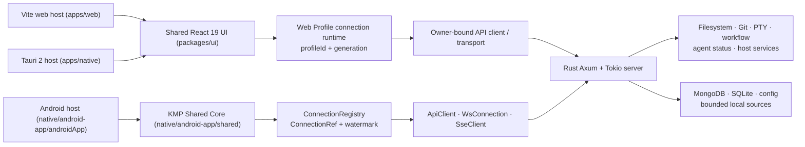

# System Architecture

**Status:** Current architecture overview, updated 2026-10-23. Detailed subsystem contracts are linked below; source code is authoritative.

## Runtime Overview

DamHopper is a monorepo with an Axum/Tokio Rust server and multiple workbench clients: shared React UI for browser and desktop (Tauri 2), and a dedicated native Android client (`native/android-app`) built with Kotlin Multiplatform and Jetpack Compose. The server owns remote project/workspace configuration, filesystem operations, Git, PTYs, authentication, workflow data, host resources, and privileged helper coordination. Clients own only their local profile connection state, credentials, and UI presentation.



### Code Boundaries

- `server/src/api/` registers protected HTTP, REST-backed client operations, the core multiplexed WebSocket (`/ws`), the dedicated authenticated semantic gateway (`/ws/semantic/v1`), and semantic settings routes (`/api/semantic/settings`). `server/src/state.rs` contains shared application state.
- `server/src/` domains include `auth`, `config` (global and workspace schema, serialized read-modify-write), `crypto`, `fs` (sandboxed operations, canonical config protection), `git`, `pty`, `workflow`, `agent_status`, `agent_store`, `telemetry`, `idle_suspend`, `linux_release`, `port_forward`, `tunnel`, and `semantic` (language server session supervision, process tree reaper, Linux cgroups, adaptive overlays, filtered JSON-RPC gateway, cancellation handling, and global admin hot toggle; see [Semantic WebSocket Gateway Architecture](./architecture/semantic-websocket-gateway.md)).
- `packages/ui/src/` owns the shared React application, owner-bound API clients (including dedicated semantic language server client), transports, query keys, stores, Monaco semantic navigation, and feature components (canonical entry `packages/ui/src/embed/dam-hopper-app.tsx`).
- `apps/web/` is the Vite browser host; `apps/native/` is the Tauri 2 desktop host. `packages/shared/` contains shared utilities; `packages/browser-bridge/` contains browser-debug runtime protocol v1.
- `native/android-app/` is the native Android workbench implementation using Kotlin Multiplatform (`:shared` for core models, connection registry, and live transports; `:androidApp` for Jetpack Compose UI, `MainActivity`, and Android platform OkHttp network factory).
- The former DamHopper plugin platform, runner, SDK, plugin APIs, and plugin iframe bridge are retired.

### Port & Network Topology

| Runtime Environment                         | API Port | Web Port                      | Bind Address         | Authority & Invariants                                             |
| ------------------------------------------- | -------- | ----------------------------- | -------------------- | ------------------------------------------------------------------ |
| **Standalone Server** (`dam-hopper-server`) | `4800`   | N/A (combined if `--web-dir`) | `0.0.0.0`            | `server/src/main.rs:44,48` default.                                |
| **Production Systemd Managed**              | `4801`   | `4802` (`dam-hopper-web`)     | `0.0.0.0`            | `deploy/systemd/dam-hopper-api.service`, `dam-hopper-web.service`. |
| **Development Mode**                        | `4803`   | `5173` (Vite)                 | `0.0.0.0` / loopback | `apps/web/vite.config.ts` proxy to `127.0.0.1:4803`.               |

_Security Warning:_ When starting the server with `--no-auth` during local development, operators should explicitly bind to loopback (`--host 127.0.0.1`) to prevent exposing unauthenticated control surfaces to the local network.

### UI Surfaces and Settings Topology

The shared React 19 UI partitions workbench surfaces into IDE mode (`IdeShell`), terminal workspace mode (`TerminalWorkspaceShell`), Git management (`GitPage`), and server settings (`SettingsPage`). On the Settings page, persistent uncollapsed server selectors govern the active target server and workbench preferences source, while all individual configuration sections (`SettingsSectionAccordion`) default to a collapsed state (`defaultOpen = false`), reducing cognitive load and mount overhead across appearance, shortcuts, idle suspend, maintenance, and import/export panels.

The ambient ribbon and floating surface (`WorkflowContextRibbon`, `WorkflowContextDeck`, `WorkflowContextSheet`) provide responsive task tracking across all shell viewports without persisting ephemeral UI state.

### Traditional Projects + Agents navigator

Traditional terminal mode retains Projects first and adds a flat Agents list across open terminals on both wide and compact surfaces. `TraditionalTerminalProjectsDisplay` projects exact qualified UI session metadata into the roster builder's raw-server metadata contract without changing terminal routing IDs. The roster joins registered profile, mounted/tab membership, live incarnation and existing status observations; it does not read terminal content or create another terminal host.

Connection generation/status and profile metadata are subscribed once in the display. Retained observations become Unavailable until the current owner has a ready baseline. Agent activation rejects stale instance callbacks and forwards the exact existing terminal selection, including split panes. Agent Settings targets the selected project's registered owner; unresolved owners require explicit choice, never ambient fallback.

`WorkspacePage` owns the sole `TerminalKeepAliveHost` above responsive shell selection, keeping backend PTY attachments and xterm DOM elements alive across wide/compact shell switches (`MobileWorkspaceShell` vs. `TerminalWorkspaceShell`). Responsive shells and split panes own visible host attachment and layout geometry, not xterm object lifetime.

Primary labels are Working, Idle, Needs attention and Unknown. `Done (turn ended)` is a secondary historical hint only for ready, nonexpired Idle evidence with explicit ended outcome and no current turn; it is not task success. Notification preferences and server semantics are unchanged. Component, focused browser, and production application journey gates have been qualified; full-viewport visual review is accepted. See [implementation progress](../plans/261008-0233-traditional-terminal-agents-sidebar/progress.md).

The navigator includes an accessible multi-select status filter dropdown (`TraditionalTerminalAgentFilter`) directly beneath the `agents` header that filters observed agents across seven presentation statuses (`Needs attention`, `Working`, `Idle`, `Unknown`, `Unavailable`, `Platform unqualified`, `Unsupported`) plus an `"all"` reset sentinel, with live count badges and multi-status selection support. The in-memory selection (`"all" | readonly TraditionalAgentStatusLabel[]`) is saved to `localStorage` under `dam-hopper:traditional-terminal-agents-status-filter` (persisting single statuses as legacy scalar strings and multi-status selections as canonical JSON arrays; falling back to `"all"` without writes on mount) and restored on page refresh or component mount. When no agents match an active filter, a descriptive empty state is displayed (`No observed agents match <status>.` or `No observed agents match <status1>, <status2>.`). In compact sheets, the listbox dynamically adapts positioning by flipping upward (`bottom-full mb-1`) and limiting listbox height to available viewport space when opening near the viewport bottom. Filtering is purely presentational: it operates before status grouping, never interferes with active session selection or PTY processes, and preserves exact cycling and tab activation semantics.

### Traditional Terminal Worktree Shortcut

**Implemented and qualified.** See [implementation plan](../plans/261009-1403-traditional-terminal-worktree-switching/phase-01-scoped-target-routing.md).

- Each existing configured-project row in the Traditional terminal navigator exposes a compact inline worktree dropdown independent of optional commit metadata. Free-terminal groups have no project worktree selector.
- Selection reuses the Project panel's project-target store, keyed by the owning profile and project (`{ profileId, project }`). Other target-aware surfaces observe the same target. Narrow Zustand persistence under `dam-hopper:project-target-state` (version 1) preserves the selected worktree across reloads, while root represents absence (selecting root removes the stored entry), and discovery gracefully demotes missing targets to root.
- New terminals resolve the selected target through the owning profile's launch path (`worktreePath`). Existing PTYs, terminal grouping, splits, and editor target bindings remain completely unchanged; selection never sends `cd`, restarts a process, or checks out a branch.
- Discovery uses profile/generation-qualified worktree queries (`useWorktrees`). Project root is explicit; unavailable, bare, or prunable paths are disabled and cannot be selected. Detached HEAD and locked worktree states are informative; failed discovery or transport errors preserve the current target selection safely.
- Project tabs and dropdown triggers remain separate interactive controls in desktop and compact Projects-sheet layouts. Same-name cross-profile isolation, root switching, and unchanged live-terminal identity/directory are verified by focused Chromium regressions and production application PTY journeys.

## Multi-Profile Ownership Model

A browser-side `profileId` selects one saved server endpoint/identity. A monotonically replaced connection `generation` identifies the current runtime for that profile. UI work captures both before issuing requests.

```text
profile selection -> capture { profileId, generation }
  -> owner-bound ApiClient + transport
  -> profile/generation-qualified queries and event subscriptions
  -> server request on that connection
  -> recheck captured owner before publishing response or cleanup
```

- Each profile has its own connection runtime, authentication state, and transport. Failure or reconnect of one profile does not block another.
- Projects, PTYs, filesystem data, workflow state, and server configuration remain authoritative on their owning server. Equal names or IDs across servers are not globally equivalent.
- Query identity, callbacks, subscriptions, cancellation, and cleanup are owner-qualified via tuple keys (`[profileId, project]`, `[profileId, generation]`). A stale response or event cannot update a replacement generation.
- Connection receipts (`host:uiConnection`, `getUiConnectionReceipt`) are bound to the exact captured `{ profileId, generation }` owner and discarded immediately on transport termination, close, or error.
- Project target, Settings target, preference source, and Browser target are independent selectors. Missing/unavailable qualified targets fail closed; there is no first-connected or ambient fallback.
- In Fleet mode, the top navigation host popover renders a multi-server deck (`HostResourceFleetDeck`), allowing operators to monitor disparate daemon endpoints simultaneously.

See [Multi-Server Profiles User Guide](./user-guide-multi-server-profiles.md) and [Workbench Files, Editor, Search, and Git Architecture](./architecture/workbench-files-editor-and-git.md).

### Native Android Ownership Implementation (Kotlin Multiplatform)

The native Android client (`native/android-app/shared/src/commonMain/kotlin/dev/damhopper/nativeapp/core/`) realizes the exact multi-profile ownership invariants natively in Kotlin without browser runtime dependencies:

1. **`ConnectionRef` Tuple Keys:** Modeled as `ConnectionRef(profileId, generation)` producing deterministic JSON tuple keys `["profileId", generation]` identically matching web TypeScript clients.
2. **Monotonic Watermark ABA Guard:** `ConnectionRegistry` maintains an in-memory `generationWatermarks` table that survives profile deletion/logout within the registry process lifetime, ensuring newly registered profiles with previously used IDs never reuse earlier generation numbers.
3. **Socket Lifecycle Separation:** `SocketInstanceRef(connection, socketId)` separates individual WebSocket socket attempts from overall profile connection generations. Capabilities such as `host:uiConnection` receipts (`UiConnectionReceipt`) are bound to the concrete socket and revoked immediately on disconnect, error, or reconnect.
4. **Owner Verification Fences:** `ConnectionRegistry.assertCurrentOwner` gates request initiation and completion across REST (`ApiClient`), WebSocket (`WsConnection`), and SSE (`HostResourceSseClient`), rejecting stale responses and retired generations with typed `ConnectionOwnerError`.

### Native Android Profiles, Auth, MFA & Credential Vault Architecture

The native Android client implements end-to-end multi-server profile management, protocol version 2 authentication with TOTP MFA, and fail-closed credential custody (`native/android-app/shared/src/commonMain/kotlin/dev/damhopper/nativeapp/features/profiles/` and `native/android-app/androidApp/src/main/kotlin/dev/damhopper/nativeapp/platform/`):

1. **Profile Lifecycle & Non-Secret Metadata Storage:**
   - `ProfileRepository`: Central orchestrator for profile CRUD, active profile selection, and auth state coordination across independent server endpoints.
   - `ServerProfile`: Immutable profile model (`id`, `name`, `baseUrl`, `username`). URL normalization via `validateServerUrl` enforces `http`/`https` schemes, strips trailing slashes, rejects user-info credentials in authority, query parameters, and fragments, and maps Android emulator loopback (`10.0.2.2`).
   - `ProfileMetadataStore` & `AndroidProfileMetadataStore`: Persists non-secret profile configurations across application restarts in Android `SharedPreferences` under key `"damhopper_server_profiles"`.
2. **Attempt Watermark Fencing (`AuthAttemptTracker` & `AuthAttemptRef`):**
   - Fences asynchronous authentication calls (login, MFA setup, TOTP verification, step-up) against concurrent lifecycle transitions (endpoint edit, account logout, profile deletion, credential rotation).
   - `AuthAttemptTracker.startAttempt(profileId)` issues monotonically increasing `AuthAttemptRef(profileId, attemptId)` watermarks under coroutine `Mutex`.
   - `assertActive(attempt)` validates attempt freshness before session tokens are stored in the vault; stale callbacks throw `AuthAttemptStaleException`.
   - Profile edits, deletions, or logouts call `attemptTracker.invalidate(profileId)`, immediately advancing the watermark and cancelling pending in-flight callbacks.
3. **Android Keystore Credential Custody (`CredentialVault` & `AndroidCredentialVault`):**
   - `CredentialVault`: Contract defining token storage keyed by `token:${profileId}:${baseUrl}`. Passwords, TOTP setup secrets, and challenge tokens are transient and strictly prohibited from persistent storage.
   - `AndroidCredentialVault`: Platform implementation using Android Keystore-backed `MasterKey` (`KeyScheme.AES256_GCM`) and `EncryptedSharedPreferences` (`AES256_SIV` key encryption, `AES256_GCM` value encryption).
   - Fail-Closed Invariant: Keystore key invalidation or corruption throws `VaultKeyInvalidatedException`, forcing explicit user re-authentication rather than falling back to unencrypted storage.
   - Backup Exclusion: Android manifest sets `android:allowBackup="false"`; `data_extraction_rules.xml` excludes `sharedpref` domain from both `<cloud-backup>` and `<device-transfer>`.
4. **Frozen Protocol v2 Authentication & TOTP MFA (`AuthRepository`, `AuthState`):**
   - `AuthRepository`: Executes REST auth endpoints (`/api/auth/login`, `/api/auth/register`, `/api/auth/mfa/setup`, `/api/auth/mfa/confirm`, `/api/auth/mfa/verify`, `/api/auth/mfa/challenge`, `/api/auth/status`, `/api/auth/logout`).
   - `AuthResponseParser` and `AuthStatusParser`: Validate frozen protocol versions (`authProtocol = 2`, `workbenchProtocol = 2`), rejecting incompatible protocols with `INCOMPATIBLE_PROTOCOL`.
   - Error mapping: Mapped codes include `ACCOUNT_DISABLED` (newly registered accounts require local operator approval), `MFA_REQUIRED`, `SESSION_EXPIRED`, `SESSION_REVOKED`, and `ATTEMPT_STALE`.
   - Redaction: `AuthSession`, `LoginChallenge`, and `MfaSetupData` sanitize Bearer tokens and TOTP setup secrets in `toString()` diagnostics (`[REDACTED]`).
5. **ConnectionRegistry Session Lifecycle & Generation Retirement:**
   - Any endpoint modification (`baseUrl` or `username`), credential rotation, or logout automatically retires the active connection generation via `ConnectionRegistry.retireConnection()`.
   - Retiring a connection generation immediately invalidates all active REST requests (`ApiClient`), WebSocket instances (`WsConnection`), and SSE streams (`HostResourceSseClient`) bound to the retired `ConnectionRef(profileId, generation)`.
   - Profiles are strictly isolated: invalidating, rotating, or logging out one profile has zero side effects on other active profiles.

## Backend State and Service Composition

`AppState` is cloned through Axum state extraction and holds shared subsystem services, config, storage, and synchronization points.

Session metadata, port bindings, and terminal buffer snapshots are persisted locally in SQLite (`~/.config/dam-hopper/sessions.db`) via the background `PersistWorker`.

Keep API handlers responsible for request decoding, auth/role checks, and response mapping. Domain services enforce their own bounds and business invariants. Do not hold synchronous locks across `.await`; asynchronous process and filesystem work must not block PTY hot paths or server state locks. Persisted updates use validated revisions and atomic replacement where their contract requires it.

### Tunnel Isolation and Port Forwarding

Ephemeral Cloudflared quick tunnels (`server/src/tunnel/`) isolate subprocesses from host and user configurations by passing `--config ""` and `--no-autoupdate`. Forwarded dev-server requests rewrite the Host header (`--http-host-header localhost`) to prevent DNS rebinding rejections on modern dev servers (such as Vite 6 `server.allowedHosts`). The tunnel lifecycle enforces a **single-authority supervisor exit pattern**: `child.wait()` in the supervisor task is the sole authority for emitting `Exited` or `Failed` notifications, guarded by atomic state flags (`terminal_reached`) to eliminate race conditions with the stderr URL-discovery reader task. Discovered ports are validated against danger port deny-lists (`[22, 25, 110, 143, 3306, 5432, 6379, 27017]`) and ports < 1024.

Tunnels are explicitly started port forwards, independent of detected PTY ownership and origin-listener lifetime. Port loss, terminal exit/removal, and ownership replacement do not terminate Cloudflared or reset the tunnel's PID, URL, ID, or start time. Explicit Stop, connector termination/startup failure, and DamHopper shutdown remain terminal; no automatic restart or cross-server-restart restoration. A Tokio monotonic creation deadline marks required `reminderDue: boolean` at three hours and emits one `tunnel:reminder` event. REST retains due state for reload/reconnect catch-up. Shared web/native UI provides profile-qualified URL, port, Dismiss, and captured-owner Stop, without expiry; sessionStorage dismissal survives reload/reconnect in that browser session. Current-generation events cancel superseded list queries before patch/reconciliation. Undetected origins remain visible as untracked, not falsely listening. A replacement service binding the same port is public until Stop; an offline origin normally returns 502, and Quick Tunnel hostnames do not survive connector recreation.

## Native Desktop & Platform Boundaries

- **Windows Desktop:** Supports native local SSH port forwarding (`cfg(windows)`) via `apps/native/src-tauri/src/ssh_forward/` using `russh`, DPAPI credential storage, elliptic-curve host trust, and 20 specialized Tauri IPC commands. Allows connecting to remote HTTP/HTTPS profile URLs.
- **Linux Desktop & Web:** Native SSH port forwarding is unsupported (`cfg(windows)` gated). Non-Windows native desktop enforces exact same-origin server profile URLs for security isolation.
- **Host Remediation Actions:** The `HostActionService` scaffolding exists in `server/src/host_actions/` (`/api/system/actions/v1/*`), but `HostActionService::new()` uses `UnavailableExecutor`, and capabilities currently report `available: false` (reasons include `noAuth`, `reauthUnavailable`, or `helperNotEnrolled`).

### Android Native Client Transport Boundary (`native/android-app`)

The native Android client connects directly to the Axum backend using a specialized, owner-fenced Kotlin networking stack:

- **Origin-less WebSocket Handshake:** Native client connects to `GET /ws?token=<bearer_token>` without forging browser `Origin` headers, matching server admission requirements in `server/src/api/ws.rs`.
- **Polymorphic Wire Contracts:** Strict JSON envelope using `"kind"` class discriminator for client-to-server `ClientMsg` and server-to-client `ServerMsg`, with `ServerMsgSerializer` falling back safely to `ServerMsg.Unknown` to preserve forward compatibility.
- **Atomic Frame Serialization:** `SerializedWsWriter` serializes outgoing frames with coroutine `Mutex`. Atomic JSON-header and binary frame pairs (for `fs:write_chunk_binary` and `fs:upload_chunk`) abort the connection with `CloseReason.Codes.PROTOCOL_ERROR` if partial transmission occurs, preventing server desynchronization.
- **Bounded Request Correlator:** `WsRequestCorrelator` bounds in-flight request capacity (default 256) and unregisters requests upon timeout (`unregister(reqId)`), eliminating capacity leaks. Cancels all pending requests on socket replacement.
- **Close Code Mapping:** Maps server close codes to typed `WsState`: `4403` (`MfaRequired`), `4401` (`LoginRequired`), `1013` (`AuthUnavailable`), and `4001` (`Overflow`).
- **Bounded Host Resource SSE:** `HostResourceSseClient` enforces a 256 KiB data cap (`MAX_DATA_EVENT_BYTES`) and 4 KiB status cap (`MAX_CONTROL_EVENT_BYTES`), requiring strict revision adjacency between status and data frames before emitting metrics.
- **Credential Redaction:** `redactUrl()` sanitizes query tokens and user-info passwords across `http`, `https`, `ws`, and `wss` schemes; masks `decisionCapability=[REDACTED]` in `toString()` diagnostics.
- **Android Platform Engine:** `AndroidHttpClientFactory` configures OkHttp with pinned 15s connect / 30s read/write timeouts, 15s WebSocket ping intervals, disabled redirects (`followRedirects(false)`, `followSslRedirects(false)`), and release TLS-only network security config.

## Workflow Tracking Engine

The `WorkflowService` manages hierarchical plans, phases, tasks (max depth 3), workflow sessions, notes, and activity event streams backed by SQLite (`010_workflow_tracking.sql`).

- Non-blocking PTY observation receives terminal lifecycle transitions via bounded `sync_channel(256)` without capturing terminal I/O.
- Event records in the database use a hardcoded 90-day retention (`DEFAULT_EVENT_RETENTION_DAYS = 90`) at insertion time, while deleted-note retention is configurable through `server.workflow_deleted_note_retention_days`, defaulting to 7 days.
- Optimistic concurrency control uses `updatedAt` CAS timestamps on item and note mutations.

See [Workflow API Specification](./workflow-api.md).

### Project Plans Dashboard (Implemented)

**Implemented and qualified 2026-10-07.** See the
[frozen contracts](../plans/261006-1653-project-plans-dashboard/contracts.md) and
[implementation plan](../plans/261006-1653-project-plans-dashboard/plan.md).

- Extends current Plan surface with folder-first selection, then one selected plan's Overview,
  Timeline, and read-only documents; preserves separate SQLite manual tracking.
- Resolves configured project / registered worktree on server; browses immediate
  folders under fixed `plans/`, reading `plan.md` only after explicit selection.
- `plan.md` supplies metadata and the complete declared phase inventory, including
  valid short GFM rows. Status, phases, completion fractions, and dates derive
  exclusively from `plan.md` frontmatter and declared phase rows. Explicit Current status
  columns take precedence over Status.
- Reported status is an administrative declaration, not verified execution evidence.
  The dashboard never calls controllers, runs agents, or updates files.
- Selected Timeline uses explicit planned/actual ranges, creation milestones, or
  Undated state. No mtime/effort duration inference, cross-plan Board, or bulk status load.
- Scopes requests, queries, document links, and watcher cleanup to the captured
  profile, connection generation, and project/worktree target.
- Reuses native Rust API / auth / filesystem boundaries and shared React rendering;
  no database import, Node sidecar, iframe, or second terminal lifecycle.
- Strict bounded `plan-document` reads use rooted descriptors/native Windows
  handles, reject linked ancestors, and validate file identity, modification/change
  timestamps, named entries, and pinned ancestors before publishing a snapshot.
  Atomic replacement during a read reports changed without an automatic retry.
- Folder responses retain a whole sorted prefix under the 2 MiB JSON limit using
  bounded linear size accounting, not repeated full-response trimming.
- Owner-bound `watchOnly` subscriptions cover existing navigation ancestors and
  selected document parents, not all children. Registration/rebinding is serialized;
  coverage is live only after installation and a fresh authoritative read.
  Missing directories are covered through their existing parents; requirements
  beyond the 33-watch cap remain explicitly degraded. Reconcile retries missing
  watches rather than clearing the warning optimistically.
  Shared server watchers use pinned directory identities and exact generation
  leases; a retained Explorer subscription cannot force plans onto an old-inode
  watcher or release a replacement generation.
- Reuses Markdown / GFM / Mermaid; local images show notices, no media integration.
  Local document paths are URI-decoded once before containment checks; document
  Retry requests the failed path again.
- Linux runtime exercised. Windows strict source/tests cross-compiled in an
  isolated harness; full cross-target build requires native MSVC tools. Windows
  runtime remains explicitly unqualified until tested on Windows.

## Telemetry & OTLP Analytics

<a id="codex-otel-usage-analytics"></a>
DamHopper server includes an internal loopback OTLP collector (`server/src/telemetry/`) receiving protobuf metrics and execution traces:

- **Identifier Obfuscation:** Uses HMAC-SHA256 (`~/.config/dam-hopper/telemetry-hmac-key`, regular file, mode `0600`, opened with `O_NOFOLLOW`).
- **Strict Privacy Invariants:** Forbidden fields (`command`, `argv`, `cwd`, `environment`, `pty_output`, `prompt`, `response`, `tool_arguments`, `tool_output`) are dropped during normalization.
- **Storage:** Persisted locally in SQLite (`~/.config/dam-hopper/telemetry.db`) with daily retention rollups.

## Agent Status

`AgentStatusRuntime` correlates terminal ID with PTY incarnation and stores current semantic state in process memory. It does not replace PTY process state, workflow lifecycle, or task outcome.

- Managed OMP uses a private loopback WebSocket collector, with 5-second heartbeats and a 15-second lease. The collector is not the public API or tunnel discovery surface.
- Codex and Claude hook reports enter through a protected Unix domain socket. Peer credentials (`SO_PEERCRED`) and PTY shell ancestry are verified before accepting reports.
- Reporter epochs and terminal incarnations fence stale callbacks. Hook reports and snapshots do not carry prompts, tool arguments, or transcript text.
- Silence, disconnect, a normal turn end, or an unknown outcome does not prove success. Unknown remains an explicit state.

See [Agent Status Architecture](./architecture/agent-status.md).

## Git Safety Model

Git operations use porcelain semantics for worktree/index state. Normal push remains fast-forward-only. A commit-message edit or squash operates on raw object plumbing without modifying working tree files or index entries:

- **Compare-and-swap ref updates**: First captures branch and HEAD, checks candidate rewrites against that snapshot, and updates refs via compare-and-swap. Squash requires a unique contiguous oldest-first parent chain reaching the captured tip and preserving the final tree. Signature loss requires explicit consent when applicable.
- **Active vs. inactive branch safety**:
  - Active branch updates lock `HEAD` then the branch ref (`refs/heads/<branch>`), checking worktree invariants.
  - Inactive branch rewrites lock only the target branch ref (`refs/heads/<branch>`), atomically verifying `HEAD` did not transition to the target branch during mutation. Active checkout, index, staged, unstaged, and untracked files remain completely untouched.
  - Operations fail closed with `checked-out-branch` if the target is checked out in another linked worktree, and with `active-operation` if a rebase, merge, or cherry-pick is ongoing; the active-operation detector also recognizes `REVERT_HEAD` (`server/src/git/cli_fallback.rs`), while complete revert lifecycle/sequencer coverage remains unqualified.
- **UI surface parity and accessibility**:
  - Both the compact Workspace Git Panel and standalone Git Page permit commit-message editing and squashing when viewing any local branch (`isViewingLocalBranch`), active or inactive.
  - Checkout-sensitive operations (`reset`, `drop`, `undoLastCommit`) remain strictly guarded by `isViewingActiveBranch`.
  - The branch banner communicates current context: `Viewing {branchLabel}. Cherry-pick and revert apply to checked-out branch {activeBranch}.`
  - Ineligible views (remote branches, detached `HEAD`) provide accessible disabled explanations via `aria-describedby` linking to a unique `useId()` description ID in `GitLogTree` context menus.
- **Leased publication**: Local rewrite and publication are strictly decoupled. Publication uses an exact-OID CAS lease tied to the target branch (`PublishSnapshot`) and expected remote OID; stale remote state aborts the push with `stale-remote`. The lease is invariant to subsequent checkout state changes.

Search filters full commit messages before pagination without mutating refs. See [Git History Architecture](./architecture/git-history-search.md) and [Git API Reference](./api/git.md).

### Git Conflict Resolver Architecture (Phase 08 Workspace Integration & Cutover Completed; Phase 09 Automation & Documentation Delivered, Qualification Pending)

Development progresses under the [Git conflict resolver plan](../plans/261019-1505-git-conflict-resolver/plan.md). Phase 02 discovery and snapshots, Phase 03 safe backend resolution, Phase 04 operation lifecycle, Phase 05 scoped client and in-memory draft stores, and Phase 06 merge model/decision history are implemented. Phase 07 delivers the floating cross-shell Monaco surface (`ConflictResolverPanel`), unified floating panel stacking identity across `WorkspacePage` and `TerminalWorkspaceShell`, scoped Escape key arbitration, responsive narrow tabbed mode, in-memory model routing, region-ID actions, and browser regression coverage. Phase 08 delivers complete workspace integration and cutover: `ConflictResolverPanel` cross-shell host integration in `WorkspacePage`, reveal intent routing (`ConflictRevealIntent`) avoiding editor tabs, entry root derivation in aggregate views, active operation banner entry and floating conflict pill, stage bypass closures (CUT1) across row checkboxes, popovers, bulk staging, and backend preflight, retirement of legacy `conflict-parser.ts` and `ConflictBlock` (CUT2), configured-editor terminal handoff guidance with post-return requery, and nonce-tracked selection stability. Phase 09 qualification gates remain pending. Backend contracts are enforced in `server/src/git/conflict_resolve.rs`, `server/src/git/mutation_coordination.rs`, `server/src/git/diff.rs`, and `server/src/git/operation.rs`; frontend client DTO cutover, in-memory draft stores, merge model, history controllers, and floating surface are implemented in `packages/ui/src/lib/conflict-*.ts`, `packages/ui/src/lib/joint-history-authority.ts`, `packages/ui/src/api/client.ts`, and `packages/ui/src/components/organisms/MergeConflictEditor.tsx`.

- **Implemented Discovery & Snapshots (Phase 02):**
  - `GET /api/git/{project}/conflicts`: returns bounded deterministic `ConflictSummaryResponse` directly from the unmerged index without reading blob content or touching worktree files. Opaque v2 cursors bind the full unmerged conflict-set fingerprint and last raw-path anchor; changed sets or missing anchors return `GIT_CONFLICT_CURSOR_STALE`, allowing a client to restart pagination from the first page.
  - `GET /api/git/{project}/conflicts/file`: returns on-demand `ConflictSnapshot` with descriptors for stages 1 (base), 2 (ours), and 3 (theirs), worktree disk state, and effective gitattributes.
  - **Pre-allocation Bounds & Memory Protection:** Inspects Git ODB object headers before allocating blob memory. Stage blob sizes exceeding `MAX_STAGE_BYTES` (5 MiB) or cumulative stage sizes exceeding `MAX_TOTAL_STAGE_BYTES` (15 MiB combined across stages 1, 2, 3) mark the stage `unsupported` and withhold `textTokens`. Worktree files exceeding `MAX_WORKTREE_BYTES` (5 MiB) withhold `textTokens`.
  - **Lossless Line Tokenization:** Splits UTF-8 text into line tokens preserving raw terminators (`\r\n`, `\n`, lone `\r`) with enforcement of `MAX_LINES` (50,000) and `MAX_LINE_LENGTH` (100,000 bytes) during tokenization. Exceeding limits marks the stage `unsupported` and withholds tokens.
  - **Coherence Verification (`REFRESH_REQUIRED`):** Before/after state fingerprinting checks HEAD target OID, full index entries, and worktree file attributes. Detected state drift between before and after reads triggers HTTP 409 `REFRESH_REQUIRED`.
- **Implemented Safe Resolution & Mutation Coordination (Phase 03):**
  - **Process-Local Mutation Coordination (`GitMutationCoordinator`):** Located at `server/src/git/mutation_coordination.rs`. In-memory fail-fast exclusion keyed on the canonical repository common Git directory (`commondir` for linked worktrees, or canonical `.git` directory). Participating server operations (`stage_files`, `unstage_files`, `discard_changes`, `discard_hunk`, `commit_files`, `apply_conflict_resolution`) acquire this lock to prevent concurrent server-driven mutations and avoid Git child lock self-deadlocks. Note: Coordinates participating server handlers only; not a cross-process lock or filesystem transaction covering uninstrumented external Git processes or CLI commands.
  - **Conflict Resolution Endpoint (`POST /api/git/{project}/resolve`):** Accepts typed `ResolveRequest` containing `conflictId`, `snapshotVersion`, `fullIndexFingerprint`, and tagged action (`reviewedText`, `indexSide`, `delete`). Rejects requests missing `conflictId` or `snapshotVersion` strings, or containing legacy `content`, with HTTP 400 `LEGACY_PAYLOAD_REJECTED`; unknown fields or malformed payloads fail closed (`deny_unknown_fields`) with HTTP 400 `INVALID_INPUT`.
  - **Precondition & Gating Checks:** Validates full index fingerprint, snapshot version, path traversal boundaries (`verify_safe_worktree_path`), and on-disk file type (refusing to overwrite symlinks or directories). Rejects unsupported configurations (symlink/directory/gitlink worktree kinds, `ident=true`, custom encoding, non-default filters).
  - **Atomic Publication & Index Staging:** Writes reviewed or index-side content to sibling temporary files (`.tmp_resolve_<hex>`) before renaming (`safe_atomic_write`), removes unmerged stages 1–3, and inserts stage 0 with exact OID and mode (`stage_index_entry`). This pathname-based publication does not establish a cross-process worktree/index transaction against external writers.
  - **Post-Mutation Verification Oracle:** Reopens repository and index to assert outcome facts for the resolved path: for `reviewedText` and `indexSide` (`verify_applied_oracle`), verifies unmerged stages 1–3 are removed, stage 0 matches expected OID/mode, and disk bytes match; for `delete` (`verify_deleted_oracle`), asserts that all index stages 0–3 are absent and the file no longer exists in the worktree. Returns typed `ResolveOutcome` tagged union (`applied`, `stale`, `unsupported`, `busy`, `failedBeforeWrite`, `worktreeChangedStageFailed`, `outcomeUnknown`). Automatic or blind retry after timeout, response loss, or uncertain completion is prohibited without client refresh/review.
  - **Generic Stage Preflight (CUT1):** `stage_files` in `server/src/git/diff.rs` checks `index.has_conflicts()`. If any path in the batch is in an unmerged conflict state, the batch is rejected atomically with HTTP 400 `INVALID_INPUT` ("Cannot stage unmerged conflicted file '{path}'. Resolve conflict first.") before any clean file in the batch is staged; clean-only batches pass this conflict preflight.
- **Implemented Operation Lifecycle Contracts (Phase 04):**
  - `GET /api/git/{project}/operation`: returns `OperationStatusResponse` detecting active operations (`none`, `merge`, `rebase`, `cherry-pick`, `revert`), stopped reason (`conflicts`, `messageEditRequired`, `hookBlocked`, `unknown`), `canContinue`, `canAbort`, role labels, blockers, and `terminalHandoffRequired` (when commit-message editing is blocked).
  - `POST /api/git/{project}/operation`: accepts typed `OperationActionRequest` (`continue` | `abort`) preconditioned on `operationFingerprint` and `fullIndexFingerprint`, executing under `GitMutationCoordinator` and returning typed `OperationOutcome`.
- **Frontend Scoped Client & In-Memory Draft Store (Phase 05):**
  - **Memory-Only Draft Store (`ConflictDraftRegistry`):** Located at `packages/ui/src/lib/conflict-draft-store.ts`. Singleton registry managing in-memory draft entries with snapshot publication (`getSnapshot`, `subscribe`, `notify`). Draft state is strictly memory-only; it is never persisted to `localStorage`, `sessionStorage`, or IndexedDB, eliminating stale draft resuscitation across reloads.
  - **Owner-Scoped Draft Key Identity & Fencing:** Generated by `createDraftKey` in `packages/ui/src/lib/conflict-draft-key.ts` as a deterministic JSON tuple:
    `[profileId, generation, serverUrl, configuredRoot, project, worktreePath, root, repositoryRoot, worktreeRoot, fullIndexFingerprint, conflictId, snapshotVersion]`.
    Separates persistent repository target identity from active connection-generation fencing (`isOwnerActive`). Requests, callbacks, and draft subscriptions capture `{ profileId, generation }` and fail closed on profile switch or reconnection, preventing cross-profile, cross-server, or cross-worktree draft bleed and fencing out stale asynchronous callbacks or replays.
  - **Measured Capacity Boundaries & Eviction Rules:** Enforced by `packages/ui/src/lib/conflict-draft-capacity.ts` using accounted UTF-8 text bytes via `TextEncoder` (measuring string payload bytes rather than JavaScript object heap overhead).
    - _Tracked byte metrics:_ `sourceBytes` (stages 1–3 + worktree file content), `resultBytes` (resolved text), `historyBytes` (past/future history entries text), and `recoveryBytes` (`recoveryText`).
    - _Default limits:_ `DEFAULT_MAX_TOTAL_BYTES` = 10 MiB (10,485,760 bytes) across all drafts in the registry, `DEFAULT_MAX_DRAFT_BYTES` = 2 MiB (2,097,152 bytes) per individual draft, and `DEFAULT_MAX_DIRTY_DRAFTS` = 10 dirty drafts per registry instance.
    - _Admission & Eviction (`canAdmitDraft`):_ When admitting new drafts under memory pressure, clean drafts (not dirty, not in recovery, not in flight) are evicted oldest-first. Dirty and recovery drafts are never silently evicted; admission fails closed with `"Memory capacity exceeded"` if dirty drafts saturate capacity.
    - _Prospective Edit Growth (`checkProspectiveEditGrowth`):_ Inspects proposed text updates and history creation before mutating draft text. Edits exceeding per-draft (2 MiB) or registry total (10 MiB) limits are rejected fail-closed. Typing edits within 1,000ms coalesce into a single history entry to bound history growth.
  - **Stale Snapshot Drift & Recovery Import Flow:** When `loadSnapshot` receives an updated snapshot version or altered index fingerprint for a conflict with uncommitted edits (`isDirty`, `isRecovery`, or `isResolving`), the existing draft transitions to `isRecovery = true` with `requiresReview = true` and `recoveryReason: "Conflict snapshot changed; import into a fresh snapshot and review"`. Direct resolve and automatic replaying are blocked. `importRecoveryDraft(recoveryId, freshDraftId)` enforces:
    1. Source draft is in recovery (`isRecovery: true`) with valid `recoveryText`.
    2. Target draft is an unrecovered, clean baseline snapshot (`!fresh.isRecovery`, `!fresh.isDirty`, empty history).
    3. Scopes match exactly (`profileId`, `serverUrl`, `configuredRoot`, `project`, `worktreePath`, `root`, `path`, `repositoryRoot`, `worktreeRoot`).
    4. Distinct snapshot versions (`source.id !== fresh.id`), preventing duplicate replay on the identical snapshot.
    5. After import, `fresh.requiresReview = true` is latched, mandating operator review before resolution submission.
  - **Monaco Delayer Promise Patch:** Applied via `patches/monaco-editor@0.55.1.patch` targeting `esm/vs/editor/contrib/wordHighlighter/browser/wordHighlighter.js`. In Monaco 0.55.1, `WordHighlighter` schedules occurrence highlights via `this.runDelayer.trigger(...)`. Canceling the delayer during editor unmount or model disposal rejects the underlying promise with `CancellationError`, creating unhandled promise rejection errors. The patch wraps all delayer trigger promises in `observeDelayerPromise(promise)` using a `WeakSet` to attach `.catch(onUnexpectedError)` without unhandled rejection noise. This patch addresses Monaco contribution unmount cancellation only, and is distinct from text tokenization or EOL byte fidelity gates.
- **Conflict Merge Model, Tokenization & Region Mapping (Phase 06):**
  - **Canonical BOM-less Model Representation:** Located across `packages/ui/src/lib/conflict-merge-*.ts`. `ConflictMergeModel` holds `stages` (base, ours, theirs with content, presence, and token arrays), `eol` (`crlf`, `lf`, `mixed`, `none`), `hasBom` (boolean flag), `regions` (`readonly ConflictMergeRegion[]`), `resultText` (canonical BOM-less string), `resultRevision` (monotonic integer revision), and `readiness` (`ConflictReadiness`). One leading UTF-8 BOM (`\uFEFF`) at index 0 is separated into the boolean `hasBom` flag on ingest (`createConflictMergeModel`, `applyManualResultTextEdit`, `confirmWholeFileAction`) so all line ranges and character offsets in region mappings align directly with JavaScript string indices without stripping arbitrary `U+FEFF` characters elsewhere in text. Whole-file actions take `hasBom` from worktree/preview source; subsequent text edits preserve the model's `hasBom` flag. BOM is re-attached strictly at output boundaries via `getModelSerializedResult(model)`.
  - **Lossless Line Tokenization (`conflict-tokenization.ts`):** `tokenizeLosslessLines` splits UTF-8 text into line tokens preserving raw terminators (`\r\n`, `\n`, lone `\r`) and missing final newlines exactly with 100% roundtrip fidelity (`rejoinLosslessLines(tokens) === text`). Line ending classification (`detectLineEnding`) reports dominant `crlf`, `lf`, `mixed`, or `none` based on CRLF and LF presence; standalone `\r` is preserved in tokens without altering dominant classification.
  - **Git Conflict Marker Parser (`conflict-marker-parser.ts`):** `parseResultMarkerBlocks` scans result text for completed, balanced Git conflict blocks (`<<<<<<<`, optional `|||||||` diff3 base separator, `=======`, `>>>>>>>`). Extracts stage token slices, 1-based line spans, and character offsets. Note: Requires completed balanced marker blocks; unterminated or malformed markers are treated as plain text.
  - **Conservative 3-Way Region Mapping (`conflict-region-mapper.ts`):** Runs pinned `node-diff3@3.2.1` (`diff3MergeRegions`) on stage tokens to construct source regions (`SourceConflictRegion[]`). Note: Proposed main-thread execution budget ($\le$ 5,000 lines or $\le$ 500 KB) and worst-case diff complexity bounds remain unqualified; tokenization bounds alone do not establish safe diff3 execution bounds. Maps source regions to result text conservatively:
    1. _Strategy 1A (Count & Token Alignment):_ When parsed marker count matches conflict region count and token contents align, assigns exact line and offset ranges.
    2. _Strategy 1B (Unique Token Match):_ Matches isolated marker blocks by unique content, verifying non-overlapping line ranges.
    3. _Resolved Content Search:_ When conflict markers are absent, searches result lines for accepted side content (`ours`, `theirs`, or both in order). Ambiguous multiple occurrences flag `confidence: "ambiguous"`; unmapped regions flag `confidence: "unmapped"`.
    4. _Manual Edit Review Downgrade:_ When `applyManualResultTextEdit` updates result text, `ambiguous` and `unmapped` regions are downgraded to `manualReview: "needs-review"` and `decision: "pending"`.
  - **Readiness Evaluation (`computeConflictReadiness`):** Aggregates conflict counts (`totalConflicts`, `resolvedConflicts`, `unresolvedConflicts`, `needsReviewConflicts`, `ambiguousRegions`, `hasMarkers`, `unresolvedReasons`). Evaluates `parseResultMarkerBlocks(resultText)`; permits `isReady = true` when unresolved conflicts = 0, ambiguous regions = 0, and all conflict regions have `manualReview === "reviewed"` (note: if a file has malformed/unterminated markers not parsed into blocks, or contains zero conflict regions, the "all regions reviewed" check can be vacuously satisfied).
- **Draft Store Decision History & Model Actions (Phase 06):**
  - **Model Actions:** `acceptRegionSide`, `ignoreRegionSide`, `acceptRegionBoth` (`ours-then-theirs` | `theirs-then-ours`), `markRegionReviewed`, whole-file previews (`previewAcceptAllOurs`, `previewAcceptAllTheirs`, `previewRebuildClean`), and `confirmWholeFileAction`.
  - **Decision-Aware History in `ConflictDraftRegistry`:** Draft entries track `mergeModel` and history entries with `decisions` snapshots (`draft.history.past` and `future`), enabling atomic undo/redo of both text and region decisions. Supports undo/redo of identical-text accept actions (records decision transition even when result text is unchanged, enabling clean undo/redo of acceptance).
  - **Open Correctness Defects & Boundary Realities:**
    - _Open Defect — Capacity Accounting Bypass:_ Metadata-only store actions (`ignoreSide`, `markReviewed`, and identical-text accept) push full text snapshots into history with a fixed 100-entry stack cap, but bypass `checkProspectiveEditGrowth` and do not increment `historyBytes` metrics, contradicting the hard-capacity invariant.
    - _Open Defect — Redo Dirtiness Invariant:_ On redo of an identical-text accept, `applyDraftRedo` computes `isDirty` strictly against initial text, meaning decision-only changes do not register as dirty after redo and risk premature clean eviction under memory pressure or missed recovery.
    - _Open Defect — Typing Coalescing Sequence:_ In text-changing store actions, `draft.canCoalesceHistory = false` is assigned after `updateResult`, so typing edits immediately preceding an accept action within 1000ms may coalesce unless explicitly interrupted.
    - _Open Gate — BOM Re-application Boundary:_ Store actions serialize via `getModelSerializedResult`, while manual Monaco edits return un-BOM'd strings from `getValue()`; downstream Phase 07/08 wiring will reconcile the single authority for BOM re-attachment prior to backend staging.
- **Joint History Authority (`JointHistoryAuthority`):**
  - Located at `packages/ui/src/lib/joint-history-authority.ts`.
  - Standalone controller wrapping Monaco editor public APIs (`model.onDidChangeContent`, `editor.addCommand`, `editor.addAction`) to intercept `Ctrl+Z`, `Ctrl+Shift+Z`, and `Ctrl+Y`, and register context-menu Undo/Redo actions.
  - Records atomic transactions (`JointTransaction`: text, metadata, or combined atomic text+decisions) with `maxDepth` bounding (default 100) and branch-clears-redo semantics.
  - Supports `getSnapshot()` / `restoreSnapshot()` across Monaco editor remounts.
  - _Open Qualification & Integration Gates:_ `JointHistoryAuthority` is verified in isolated unit tests and headless Chromium browser tests (`conflict-monaco-history.browser.tsx`), but operates as a separate controller alongside `ConflictDraftRegistry`'s internal `draft.history`. Phase 01 native-history and Monaco byte-fidelity gates remain open, and unification into a single integrated history authority wired to `MergeConflictEditor` remains tracked under Phase 09 qualification.
- **Floating Monaco Surface, Unified Stacking & Responsive Narrow Mode (Phase 07):**
  - **Shared Floating Host (`ConflictResolverPanel` & `ConflictResolverToolbar`):** Mounted in `WorkspacePage` above `IdeShell`, `TerminalWorkspaceShell`, and `MobileWorkspaceShell` when `conflictResolver.isPanelVisible` is true. Keeps draft model and history ownership strictly outside frame visibility so hiding and reopening retains in-progress draft text and decision states in memory (while unified Monaco-level command undo/redo remains an open Phase 09 gate). When unmerged conflicts exist and the panel is hidden, a floating conflict pill button (`bottom-4 right-4 z-40`) displays conflict counts and provides one-click panel reopening.
  - **Unified Floating Panel Stacking Identity (`terminal-workspace-panel.ts`):** Extends `TerminalFloatingPanelId` to `"files" | "tool" | "resolver"`. Employs `updateFloatingPanelStack`, `resolveFloatingPanelStackZIndex` (`TERMINAL_FLOATING_PANEL_BASE_Z_INDEX = 20`, with +2 per stack depth), and `isTopmostFloatingPanel` across both `WorkspacePage` and `TerminalWorkspaceShell` to coordinate logical stack ordering across panels, provided compatible ancestor CSS stacking contexts are maintained.
  - **Scoped Keyboard Arbitration & Escape Priority (`conflict-resolver-panel-state.ts`):** `handleResolverPanelKeyDown` checks `event.key === "Escape"` and hides the panel only when:
    1. The resolver panel is the topmost floating panel (`isTopmost === true`).
    2. Focus is inside the panel DOM subtree or at document body.
    3. No active Monaco overlay widget or menu is visible (`.suggest-widget.visible`, `.find-widget.visible`, `.monaco-menu-container`), allowing Monaco widgets to consume Escape before panel dismissal.
       When hiding, calls `stopImmediatePropagation()`, `stopPropagation()`, and `preventDefault()` to prevent keystrokes from leaking into underlying terminal PTY sessions or closing background panels.
  - **Panel Geometry & Clamping (`use-floating-panel-geometry.ts`, `conflict-resolver-panel-state.ts`):** Manages floating frame position and dimensions (default `1040x700`, min `480x360`, 12px margins) clamped via `clampResolverPanelLayout` on window resize and maximize toggle (`isMaximized`). Supports dragging via title toolbar handle and corner resizing via `Grip` control.
  - **Responsive Narrow Layout (768px Container Breakpoint):** In `MergeConflictEditor.tsx`, a `ResizeObserver` observing the editor container node (`containerNode`) dynamically switches between wide multi-column layout ($\ge 768\text{px}$) and narrow tabbed layout ($< 768\text{px}$). Wide layout renders `Theirs` (readonly), `Result` (editable), `Ours` (readonly), and an optional 4th `Base` column (`showBaseInWide`). Narrow layout provides an accessible tablist with `Theirs`, `Result*`, `Ours`, and optional `Base` tabs. Switching tabs changes visible editor view without unmounting or resetting the underlying draft model or in-progress edits.
  - **In-Memory Model URI Routing & Open Target Gap:** Monaco editor instances mount to dedicated URIs: `inmemory://${projectName}/${filePath}/theirs`, `/result`, `/ours`, and `/base`, configured with `keepCurrentModel: true`. Note: Current URI routing encodes project name and file path, but lacks profile ID, connection generation, or worktree path; full owner-qualified URI scoping remains an open isolation gate for multi-target environments.
  - **Region-ID Keyed Navigation & Actions (`ConflictRegionNav.tsx`):** Exposes conflict chunk navigation chips and actions (`onAcceptSide`, `onAcceptBoth`, `onIgnoreSide`, `onMarkReviewed`) keyed strictly by stable `region.id` to prevent hunk mismatching.
  - **Monaco Public Delta Decorations (`conflict-editor-decorations.ts`):** `buildResultDecorations` and `buildSourceDecorations` apply public Monaco delta decorations using CSS rules (`.mc-conflict-marker`, `.mc-conflict-ours`, `.mc-conflict-theirs`, `.mc-conflict-base`, `.mc-conflict-sep`, `.mc-conflict-resolved`) injected once via `injectConflictStylesOnce()`.
  - **Workspace Integration, Reveal Intent Routing & Cutover (Phase 08):**
    - **Shared Floating Host Mount:** Mounted conditionally in `WorkspacePage` above `IdeShell`, `TerminalWorkspaceShell`, and `MobileWorkspaceShell` when `conflictResolver.isPanelVisible` is true. Retains in-progress draft text and region decisions for the matching `DraftKey` in `ConflictDraftRegistry` outside component lifecycle (while Monaco-specific view states like scroll position and local undo command stacks reset on remount).
    - **Reveal Intent Routing (`ConflictRevealIntent`):** `ChangedFilesList` routes row selection for conflicted files (`status === "conflicted"`) via `onSelectConflict` to `handleOpenConflictResolver(selection)` instead of calling `onSelectFile`. `openChangedFileDiff` returns immediately when `selection.status === "conflicted"`, preventing editor tab opening or diff invocation. `buildConflictRevealIntent` produces `{ nonce, filePath, root }`, mapping `selection.gitRootId` (when not `"."`) to `root` to ensure aggregate and multi-root views resolve to the entry's actual worktree rather than assuming the project root.
    - **Stopped Operation Entry & Floating Conflict Pill:** `ChangedFilesList` renders an active operation banner (`GitMerge` status badge) when `useGitOperationStatus` returns an active operation (`merge`, `rebase`, `cherry-pick`, `revert`), displaying stopped reasons (`conflicts`, `messageEditRequired`) and providing an "Open Resolver" button. A floating conflict pill also mounts when conflicts exist or an active operation is stopped while the resolver panel is hidden.
    - **Stage Bypass Closures (CUT1):** Conflicted row checkboxes in `ChangedFilesList` are disabled (`disabled={isConflicted}`, `readOnly`, `cursor-not-allowed`, click handler early returns). `GitContextMenuPopover` replaces "Add to commit", "Remove from commit", and "Discard changes" with "Resolve conflict…" for conflicted rows. Bulk staging (`handleStageAll`) filters out conflicted entries (`files.filter(f => f.status !== "conflicted")`). Backend CUT1 preflight in `server/src/git/diff.rs` (`stage_files`) acquires `GitMutationCoordinator` lock and checks `index.has_conflicts()`; any batch containing unmerged conflicted files is rejected with HTTP 400 `INVALID_INPUT` before any clean files in the batch are staged. Legacy resolve payloads with `{ path, content }` fail closed with HTTP 400 `LEGACY_PAYLOAD_REJECTED`.
    - **Retirement of Legacy Conflict Parser & Block Types (CUT2):** `packages/ui/src/lib/conflict-parser.ts` is deleted (`git status: D`). `ConflictBlock`, `parseConflictRegions`, and `hasRemainingConflicts` removed from `MergeConflictEditor.tsx` and all production exports. Zero production occurrences in `packages/ui` or `server`. Android Chrome read-only input policy coverage preserved through behavioral rewrite against `ConflictRegionNav`.
    - **Configured-Editor Terminal Handoff & Post-Terminal Requery:** When `resolver.terminalHandoff` is set (stopped reason `messageEditRequired`), the resolver toolbar and editor card display a prominent guidance banner detailing the exact `worktreeRoot` and Git configured editor requirement. A "Refresh after terminal return" button invokes `resolver.refreshAfterTerminalReturn(terminalHandoff)` or `resolver.refetchAll()`, triggering authoritative requery of operation status, conflict inventory, and index fingerprints.
    - **Nonce Consumption & Intent Snap-Back Prevention:** `ConflictResolverPanel` tracks `lastConsumedNonceRef` during component mount to apply `revealIntent` file paths once without snapping back during background refetches. Because `lastConsumedNonceRef` is local to the panel component, unmounting the panel resets the ref; reopening via fresh reveal intent re-evaluates the intent.
    - **Phase 09 Automation & Documentation Delivery (Qualification Pending):**
      - **Delivered Subprocess & Cancellation Hardening:** `run_bounded_git_command` implements `ProcessGroupGuard` RAII termination (`-pgid` SIGKILL on Unix, best-effort `taskkill /F /T` on Windows). In `server/src/api/git_diff.rs`, `execute_operation` decouples mutation tasks via `tokio::spawn`, ensuring client disconnects do not abort mutations mid-flight or release the `GitMutationCoordinator` lock while Git subprocesses run.
      - **Streaming Editor Sentinel Detection:** `RollingSentinelScanner` and `drain_bounded_with_sentinel` inspect streaming stderr across chunk boundaries (sliding window of `sentinel.len() - 1` bytes), reliably detecting `DAM_HOPPER_EDITOR_REQUIRED` across arbitrary chunk splits and streaming data volumes independently of retained diagnostic buffer limits.
      - **Diagnostic Sanitization:** `sanitize_git_diagnostic` replaces known worktree paths with `[WORKTREE_ROOT]`, redacts secrets via `redact_diagnostic_text`, and bounds trimmed text to 4,096 bytes plus `... [truncated]`.
      - **Stat Cache Coherence on Index Stage:** `stage_index_entry` populates index entry stat fields (`mtime`, `ctime`, `dev`, `ino`, `uid`, `gid`) from disk metadata (`symlink_metadata`), ensuring porcelain Git commands recognize staged files as clean.
      - **Multi-Panel Browser Layout & TopNav Z-Order Matrix:** Headless Chromium component tests in `packages/ui/browser-tests/git-conflict-resolver.browser.tsx` verify wide 3-pane layout at 1400px, narrow tabbed switcher at <768px, and z-order arbitration ensuring floating panels (z-20 to z-24) remain subordinate to TopNav (z-50) for hit testing.
      - **Live Daemon Smoke Verification:** `scripts/qualify-git-conflict-resolver.mjs` verifies functional lifecycle across 54 assertions in primary and nested repositories (operation status, conflict inventory, snapshots, CUT1 staging rejection, CUT2 legacy rejection, stale preconditions, text resolution, guarded continue, commit-message editor sentinel handoff, nested repository target isolation, and confirmed abort). Linked-worktree isolation is independently verified by integration tests in `server/tests/git_conflict_operation_lifecycle.rs`.
      - **Preserved Open Deferrals & Review Items:** Joint history authority unification, draft capacity accounting on metadata actions, decision-only redo dirtiness evaluation, owner-qualified Monaco URIs, aggregate nested-root operation-banner parity, multi-panel layout test depth across all simultaneous panes, and Monaco view-zones/marker-parser cleanup deferral tracking remain documented under [plan.md](../plans/261019-1505-git-conflict-resolver/plan.md) and [phase-09](../plans/261019-1505-git-conflict-resolver/phase-09-qualification-and-documentation.md).
      - **Release Gating & Platform Status:** Production release remains blocked pending AC12 actual Linux-native host launch, fresh local captures, human visual review, and authoritative disposition of remaining Cycle 2 review items. Windows-native client qualification remains separately pending and explicitly unqualified.

## Cognito Privacy Mode

<a id="cognito-mode"></a>
Cognito is an ephemeral in-app overlay controlled by the Cognito state store and configurable shortcut (`Mod+Alt+KeyB`). The app installs a window input guard using event capture to intercept 38 pointer, keyboard, clipboard, wheel, and drag events, and places app content behind an `inert` and `aria-hidden="true"` boundary while the mask is active. Activation is memory-only; only supported presentation style preferences persist.

Current CSS in `packages/ui/src/index.css` sets Heavy Blur to `blur(16px) saturate(180%)` with `rgba(148, 163, 184, 0.12)` when backdrop-filter is supported. Unsupported engines and reduced-transparency preferences use opaque black; Black Screen is solid black. This is an in-browser visual screen mask, not an operating system-wide screenshot boundary.

## Authentication, Privacy, and Capability Boundaries

- Normal server requests use validated session authentication and role checks across default MongoDB or environment-selected SQLite lite mode (`DAM_HOPPER_LITE_MODE` set to trim/case-insensitive `true` or `1`; unset/empty/`false`/`0` selects MongoDB, other nonempty values fail startup, and there is no automatic backend detection or fallback). `DAM_HOPPER_AUTH_SQLITE_PATH` applies only to SQLite (default `auth.db` in the global config directory; production uses absolute local storage, strictly one server process per local auth file, never network/shared filesystems, and fatal startup on SQLite failure). Production authenticated mode requires a dedicated 32-byte owner-only `DAM_HOPPER_MFA_KEY_FILE`.
- `POST /api/auth/register` creates disabled `user` accounts (`auth_version = 0`) and never grants automatic first-user `admin` rights; login returns `401 ACCOUNT_DISABLED` until a local operator approves and, when intended, promotes the account to `admin`, after which password login without an enrolled factor returns `enrollmentRequired` for TOTP MFA completion. The server's `server-token` is the JWT signing secret, never a client credential. See [Authentication API](./api/authentication.md), [Authentication State & Cryptography](./architecture/authentication-state-and-cryptography.md), and the canonical runbook in [Server Environment & Authentication](./configuration/server-environment-auth.md#operator-account-approval-and-role-promotion-runbook).
- Credentialed browser requests use explicit allowed origins. `--no-auth` is a separate loopback development bypass—never SQLite lite mode—and must be bound to `127.0.0.1`, never to an untrusted network interface.
- Filesystem and media operations validate resolved targets and bound data. Opaque media tickets bind actor, client namespace, target, file identity/version, kind, purpose, and incarnation; cleanup stays with the original owner.
- Encrypted uploads use OPAQUE PAKE exchange and chunked AES-256-GCM over the WebSocket transport. One captured profile/generation transport owns authentication and final write; no plaintext or alternate-owner fallback is allowed.
- The shared logger redacts sensitive metadata. Agent status carries lifecycle facts only, never conversation content.

<a id="login-device-management-design"></a>

### Device Login Sessions Architecture (Delivered)

Device login session management operates across the entire selected server for the authenticated user account, spanning all projects rather than per-project ACLs or physical device identities.

- **Backend Routing & Middleware:** `router.rs` mounts `/api/auth/sessions` (`GET`) and `/api/auth/sessions/{id}` (`DELETE`) wrapped in an outer `no_store` middleware layer that inserts `Cache-Control: no-store` across all success and error responses.
- **Session Inventory (`GET /api/auth/sessions`):** Admits Bearer tokens or `damhopper-auth` cookies. Employs stable keyset pagination with a fixed page size of 50 (fetching 51 to determine `nextCursor`) ordered newest first by `(issuedAt DESC, id DESC)`. Malformed or invalid cursors return HTTP 400 `INVALID_CURSOR`. Queries only unrevoked, unexpired sessions for the caller's username and current `authVersion`; sessions with due MFA remain visible in the inventory.
- **Bearer-only Revocation (`DELETE /api/auth/sessions/{id}`):** Requires explicit `Authorization: Bearer <token>` validated by `require_auth` (`CredentialMechanism::Bearer`). Missing credentials return HTTP 401 `AUTH_REQUIRED`; an invalid or expired Bearer token returns HTTP 401 without cookie fallback. Requests authenticated via cookie (including non-Bearer header fallback) are rejected at the handler with HTTP 403 `BearerRequired` before any revocation write. Authentication middleware may still read account/session state; cookie credentials cannot authorize this mutation.
- **Ownership & Idempotence:** Storage operations predicate on username and session ID. When requested with an active Bearer token, revoking an owned session (including an already-revoked session) returns HTTP 204 `No Content`, preserving the original `revoked_at` timestamp. Repeating self-revocation using the now-revoked token fails at `require_auth` with HTTP 401 (`SESSION_REVOKED`). Foreign or nonexistent sessions return an indistinguishable HTTP 404 `SESSION_NOT_FOUND`.
- **Cookie Invariants & Self-Revocation:** The server never emits a `Set-Cookie` header on DELETE. Self-revocation revokes the server-side session and instructs the client to clear only the owning profile's credentials; unrelated or replacement browser cookies in the jar are preserved untouched.
- **Live Transport & Capability Cleanup:**
  - **Media Capabilities:** Revocation immediately invalidates tickets and media sessions bound to the target login (`media_tickets.revoke_by_actor_or_session`), preserving sibling capabilities. Existing responses revalidate persisted auth on a subsequent body read after at least 5 seconds since the last check, with a 2-second store timeout; this is not a wall-clock guarantee for paused or buffered responses.
  - **WebSocket Termination:** Frames enforce the captured authentication deadline; a periodic watcher checks persisted user/session state on a 5-second interval with a 2-second database timeout. Scheduling and transport delivery are not strict cutoff guarantees. The [live-probe report](../plans/261022-0322-device-login-management/reports/live-revocation.md) records observed WS/SSE termination and sibling survival.
- **Metadata & Persistence:** Captures an untrusted `userAgent` hint at full MFA session creation, bounded to `<= 512` UTF-8 bytes on a character boundary; empty or control-containing values normalize to null. No IP addresses, browser fingerprints, tokens, or arbitrary headers are stored. SQLite migration `002-session-user-agent.sql` adds a bounded nullable column and `auth_sessions_inventory` index on `username, auth_version, issued_at_ms DESC, id DESC`; MongoDB retains equivalent document/query semantics.
- **Frontend UI & Owner Fencing:** `LoginDevicesSection` within `ServerSettingsDialog` enforces HTTPS or loopback HTTP (`credentials: "omit"`). Requests, subscriptions, and self-revocation cleanup capture profile ID, URL, credential, and connection generation (`{ profileId, generation }`); stale responses or superseded generations cannot clear replacement credentials, leak into newer login drafts, or affect another profile. Acknowledging self-revocation marks the dialog credential draft as revoked; subsequent dialog saves will not re-save the dead token or overwrite newer replacement credentials.
- **No-Auth Mode:** Both endpoints return HTTP 409 `DEVICE_SESSIONS_UNAVAILABLE` under `--no-auth`.
- **Visual Evidence Governance:** Full-application Chromium Playwright journeys (`device-login-management.spec.ts`) exercise same-account and foreign session isolation, bearer-only DELETE denial, real-time revocation, narrow-viewport layout, and atomic evidence generation. Automated runs initialize `review.md` in `packages/ui/e2e/device-login-management/` to `PENDING_HUMAN_REVIEW` (retained as Pending); green automated test execution validates functional assertions only and does not substitute for human visual inspection.

## Idle Suspend and Deployment

<a id="server-authoritative-terminal-idle-suspend-architecture"></a>
Linux terminal idle suspend is coordinated by the server and an enrolled Unix-socket helper (`dam-hopper-idle-suspend-helper`) with systemd integration. The server applies bounded policy (`empty-fleet` or `agent-activity`) and sysfs RTC wakealarm preflight; helper peer verification, deduplication, audit ordering, and fixed execution keep side effects fail-closed. Quiet period and wake interval are clamped between 60 and 86,400 seconds. Quiet is not proof of agent completion. See [Terminal Idle-Suspend Security](./terminal-idle-suspend-security.md) and [PTY Activity Observation](./pty-activity-observation.md).

### Semantic agent-free automatic sleep

Feature branch `feat/host-resources-auto-sleep`; implementation plan: `plans/261010-1746-host-resources-auto-sleep/plan.md`.
Phase 01 through Phase 06 are fully implemented and certified, including end-to-end verification, security boundaries, and safe operational rollout runbooks.

- **Policy & Fixed Timing**:
  - Opt-in startup policy `agent-free` (`IdleSuspendAutomaticPolicy::AgentFree`); retains existing `empty-fleet` and `agent-activity` policies without regression.
  - Fixed 10,800s (3 hours) quiet period enforced fail-closed at startup validation and timing PATCH admission; dynamic adjustment rejected.
  - Startup policy is immutable: full configuration updates, workspace reload, and settings import preserve the running startup policy even if the on-disk file changes.
  - Wire protocol `IdleSuspendStatusV1` enforces strict mutual exclusivity between `activity` (`agent-activity` only) and `agentFree`/`clientPresence`/`consent` (`agent-free` only).
- **Managed Agent Inventory & Descendant Closures**:
  - `ProcessDiscovery` in `server/src/idle_suspend/activity/process.rs` bounds candidate matching strictly to managed PTY session roots and retained lineage (`MAX_MANAGED_ROOTS_LIMIT = 64`, `MAX_RELEVANT_PROCESSES_LIMIT = 1024`, `MAX_SCANNED_PROCESSES_LIMIT = 8192`).
  - Traces complete `descendant_processes` closures per recognized agent (Codex, Claude, OMP) using process-tree traversal; child workers or subagents cannot hide running activity under an idle parent.
  - Privacy-preserving `ProcessImageKey` captures device ID (`exe_dev`), inode (`exe_ino`), and sanitized entrypoint token without exposing raw arguments or environment variables.
  - Produces deduplicated, sorted `matched_agents: Vec<MatchedManagedAgent>` with exact process identities (`pid`, `start_ticks`) and terminal bindings.
  - Independent external agents (tmux, SSH, shell outside managed PTYs) are deliberately excluded by product design and do not block sleep.
- **Verified OMP TCP Peer Binding**:
  - `verify_tcp_peer_process` in `server/src/agent_status/collector.rs` binds loopback WebSocket connections to verified OS process identities on Linux:
    1. Pre-check: reads `/proc/<claimed_pid>/stat` to record `start_ticks` and reject zombie/dead states (`Z`, `X`).
    2. Socket lookup: locates client socket inode from `/proc/net/tcp` and `/proc/net/tcp6` matching `peer_addr.port()`.
    3. Descriptor check: scans `/proc/<claimed_pid>/fd/` for symlinks targeting `socket:[<inode>]`, bounded by `MAX_PEER_FDS_SCAN = 256` to prevent DoS.
    4. Ancestry check: traces `/proc/<pid>/stat` parent PIDs (up to 32 hops) ensuring lineage connects to the registered terminal root; asserts `stat_before.start_ticks == root.start_ticks` on direct root match to defeat recycled PID spoofing.
    5. Post-check: re-reads `/proc/<claimed_pid>/stat` ensuring `start_ticks` remained identical and the process remained alive.
  - Unverified connections fail closed in semantic evaluation as `UnverifiedProcessBinding` without leaking socket inodes or PIDs to clients.
- **Hard Fail-Closed Native Freshness Gate**:
  - Codex and Claude CLI hooks lack keepalive heartbeats; leases expire after 15s (`DEFAULT_LEASE_MS = 15_000`).
  - Enforces hard fail-closed gate: zero synthetic lease stretching, zero simulated Idle states from stop events, zero screen/transcript scraping, and zero cloud API substitution.
  - Unrefreshed native providers transition to `AgentSemanticBlockReason::UnrefreshedNativeProvider` (`AgentSemanticEvaluation::Unknown`), blocking automatic sleep until refreshed or proven exited.
- **Monotonic Non-Free Generation Tracking & Semantic Evaluation**:
  - `AgentStatusRegistry` maintains monotonic `non_free_generation: u64` (initialized at 1) incremented on every non-free mutation: working reporter admission, hook state transition, lease expiration sweep, terminal removal, or reconnect.
  - Brief `Working -> Idle` gaps between coordinator polling sweeps increment `non_free_generation`, invalidating previous Free claim tickets.
  - `evaluate_managed_agents` executes under registry read lock:
    - Empty matched agents -> `Free` (0 idle, 0 blocked).
    - Any agent `Working` -> `Working` (capturing implicated PIDs).
    - Expired lease, unrefreshed native provider, unverified binding, ambiguous owner, or uncovered subagent -> `Unknown`.
    - All matched agents `Idle` or `Blocked` with active leases -> `Free` with `min_lease_remaining_ms`, current `non_free_generation`, and `semantic_revision`.
- **AgentFreeClaimTicket & PTY Manager Handoff Fences**:
  - `AgentFreeClaimTicket` in `server/src/idle_suspend/activity/sampler.rs` captures atomic evaluation snapshot with sanitized `Debug` formatting.
  - `PtySessionManager::try_claim_agent_free_handoff` in `server/src/pty/manager.rs` enforces 8-point admission fence under `inner` lock:
    1. Policy is `AgentFree` and enabled.
    2. Request ID, semantic revision, non-free generation, and timing revision match ticket.
    3. Monotonic eligibility deadline is expired.
    4. Observation age <= 5 seconds (`MAX_ACCEPTED_OBSERVATION_AGE`).
    5. Input revision matches ticket.
    6. Fleet generation matches ticket.
    7. Live sessions count and root process identities match ticket roots exactly.
    8. Atomic fleet handoff claim acquires handoff flag, verifying no session is creating, closing, disposing, or restarting.
- **Public WebSocket Client Presence Registry & RAII Guards**:
  - `ClientPresenceRegistry` (`server/src/idle_suspend/client_presence.rs`) provides a bounded in-memory registry (`DEFAULT_MAX_PUBLIC_CLIENTS = 1024`) embedded in `AppState.client_presence`.
  - Exclusions: Strictly tracks authenticated public UI `/ws` WebSocket connections. Private loopback OMP reporter sockets (`/ws/agent-status`) and HTTP Server-Sent Events streams (host-resource SSE) are deliberately excluded.
  - Two-Phase Connection Admission:
    1. `PendingUpgradeGuard`: Reserved post-authentication (`reserve_pending_upgrade`) before Axum WebSocket upgrade. Capacity saturation immediately rejects admission with `PresenceAdmissionError::CapacityExceeded` (HTTP 503 `PRESENCE_UNAVAILABLE`). Expired pending reservations (`PENDING_UPGRADE_TIMEOUT = 30s`) are pruned on every mutation. Dropped guards cleanly release reservation slots without leaking active state.
    2. `ClientPresenceGuard`: Promoted upon upgrade completion (`promote_pending_to_live`), capturing connection ID (UUIDv4) and actor session invariants (`subject`, `session_id`, `auth_version`, `credential_version`, `effective_deadline`). Guard drop automatically decrements connection count and increments monotonic membership revision.
  - Zero-Client Admission Fence: `try_claim_no_client_fence(expected_revision)` atomically asserts zero live connections and zero pending upgrades while verifying monotonic revision match; latches `host_suspending = true` to immediately reject new upgrades with `HostSuspending` (HTTP 503).
  - Monotonic `membership_revision: u64`: Increments on every reservation, promotion, liveness prune, retirement, or fence transition. Broadcasts `IdleSuspendClientPresenceStatusV1` snapshots via a Tokio watch channel without lock contention.
- **Cryptographic Capability Verification & Session Invariants**:
  - Immediate Receipt Delivery: Immediately after upgrade promotion, the server sends a private `host:uiConnection` frame (`UiConnectionFrame`: `{ kind: "host:uiConnection", version: 1, connectionId, decisionCapability }`) directly to the socket's private channel ahead of broadcast events.
  - 122-bit high-entropy secret (`Uuid::new_v4()`) generated per socket. Server stores only a 32-byte SHA-256 digest (`hash_capability`); plaintext capability secrets are never logged, never emitted to `event_sink`, and never exposed in GET/status endpoints.
  - `verify_decision_capability`: Validates candidate capability secrets using constant-time comparison (`subtle::ConstantTimeEq`) to defeat timing attacks. Enforces actor session invariants (`subject`, `session_id`, `auth_version`, `credential_version`, and non-expired `effective_deadline`).
  - Active/Closing Invariant: Rejects connections with `closing: true`; explicit `mark_closing()` immediately revokes decision capability prior to task teardown.
- **Decoupled Frame Reader & Heartbeat Supervision**:
  - Dedicated `frame_reader` loop in `server/src/api/ws.rs` decouples WebSocket control frames (Ping, Pong, Close) from the bounded application queue (`APP_MSG_CAP = 64`), ensuring long PTY or filesystem commands cannot starve transport liveness.
  - Control frames and application data immediately refresh `last_liveness` via `record_pong()`.
  - Dedicated heartbeat supervisor task sends periodic pings (`HEARTBEAT_INTERVAL = 30s`) and evaluates elapsed silence against `HEARTBEAT_DEADLINE = 90s`. Silent connections exceeding 90 seconds are marked closing, logged, and gracefully terminated via unified cancellation channels.
- **UI Exact-Owner Receipt Binding & Lifecycle**:
  - `WsTransport` (`packages/ui/src/api/ws-transport.ts`): Caches `host:uiConnection` receipt in memory upon arrival (`getUiConnectionReceipt()`); immediately delivers cached snapshot to late subscribers (`subscribeUiConnection`). Socket disconnect, close, error, reconnect, or transport disposal resets receipt to `null` and notifies subscribers.
  - `connections.ts` (`packages/ui/src/api/connections.ts`): Provides `getUiConnectionReceipt(owner)` and `subscribeUiConnectionReceipt(owner, listener)` gated strictly by `isCurrentConnection(owner)` with generation matching. Stale owners, disconnected profiles, or non-WebSocket transports return `null` with no ambient or fallback profile resolution.
- **Three-Hour Coordinator Engine & Monotonic Epochs**:
  - Tracks continuous quiescence epoch (>10,800s, 3 hours) using monotonic `Instant` timestamps (`free_anchor`, `elapsed > Duration::from_secs(quiet_period_seconds)`). Strict inequality required; exact boundary (`== 10,800s`) rejected.
  - Clean zero-agent boot support: fleets starting with zero agents initialize directly in valid tracking epoch without false blockers.
  - Intervening non-free agent activity (`Working`, hook transitions, lease expiration) or safety invalidations immediately reset continuity and clear `free_anchor`.
- **Public Client Presence Arbitration & Branching**:
  - Zero connected public clients (`connection_count == 0 && pending_upgrade_count == 0`): coordinator enters `FinalCheck` automatically, bypassing consent prompt.
  - Positive connected public clients (`connection_count > 0`): coordinator issues single active consent request (`ActiveConsentRequest`) with unique UUID (`consent-<uuid>`), monotonic revision, and 60-second expiration (`expires_at = now + 60s`), transitioning to `AgentFreePhase::AwaitingConsent`.
  - Pending-only connection upgrades (`pending_upgrade_count > 0`): coordinator pauses and waits across cadence ticks until pending upgrades complete promotion or timeout, eliminating handshake race conditions.
- **First-Valid Consent Latching & Immediate Final Check Dispatch**:
  - `POST /api/system/idle-suspend/v1/consent/decision` endpoint passes decisions to coordinator actor loop.
  - First valid server-accepted decision latches atomically into `active_consent.decision` and records `last_settled_consent`.
  - Subsequent contrary decisions return HTTP 409 `decisionAlreadySettled`.
  - Duplicate identical decisions return idempotent HTTP 200 OK (`Success { idempotent: true }`).
  - Approval (`Approve`): sets `AgentFreePhase::Approved`, captures approving actor and connection ID, responds HTTP 200 OK, and immediately dispatches `attempt_agent_free_final_check(true, ...)` without waiting for the 60s timeout.
  - Refusal (`Deny`): sets `AgentFreePhase::Deferred` with reason `ClientRefusal`, responds HTTP 200 OK, and defers coordinator for full `> 10,800s` (3 hours) cooldown.
- **Timeouts, Disconnects, and Pre-Dispatch Invalidation**:
  - 60s Unanswered Timeout: if `now >= expires_at` with no decision, consent request transitions to `ConsentState::Expired`, sets reason `UnansweredTimeout`, and defers coordinator for `> 10,800s`.
  - Last-Client Disconnect: if client count drops to 0 while in `AwaitingConsent` or `Approved`, in-flight consent transitions to `ConsentState::Cancelled`, sets reason `LastClientDisconnected`, and defers for `> 10,800s`.
  - Pre-Dispatch Actor Revalidation: `revalidate_approving_actor` re-checks the approving actor before final execution against database: user enabled, auth version matched, session unrevoked, session non-expired (`now < expires_at`), MFA deadline valid (`now < mfa_due_at`), and credential version matched. Revalidation failure cancels consent with `SafetyInvalidation` and defers for `> 10,800s`.
- **Fresh Final Check Pipeline & Atomic Handoff**:
  - Captures fresh PTY snapshot and runs `process_discovery.prepare_sample` / `commit_sample` and `agent_status.evaluate_managed_agents`.
  - Any working agent, ambiguous owner, unrefreshed native provider, or expired lease cancels consent, sets `Blocked`, and resets quiet anchor.
  - All-free evaluation acquires PTY handoff claim via `try_claim_agent_free_handoff(admission)` under middle lock.
  - Zero-client flow: atomically claims `try_claim_no_client_fence(pres_rev)`. If clients arrived during final check, releases PTY claim and issues consent request instead.
  - Approved client flow: sets `client_presence.set_host_suspending(true)`.
  - Emits `FinalCheckCompleted`, `HandoffClaimAccepted`, `HelperRequestDispatched` server events and dispatches single `SuspendWithRtcWakeRequest` to executor.
- **Audit Logging & Privacy-Preserving Redaction**:
  - `IdleSuspendServerAudit` appends `ConsentAuditRecord` (version, timestamp, actor, request_id, request_revision, connection_id, decision, status_revision, result) via verified file descriptors (`O_NOFOLLOW | O_CLOEXEC | O_NONBLOCK`, mode 0600, UID/GID checks, `sync_data`).
  - `project_server_audit` redacts actor subject to boolean `actor_present: bool`, omits `connection_id`, projects canonical UUID `correlation_id`, and redacts details to `requestRevision,statusRevision` for diagnostic bundles.
- **Canonical Admission Lock Order**:
  1. Outer / Coarse: `ClientPresenceRegistry` lock (synchronous in-memory lock for live/pending sockets and reservation guards).
  2. Middle: `PtySessionManager::inner` lock (synchronous lock for fleet generation and managed terminal sessions).
  3. Inner / Fine: `AgentStatusRuntime::registry` lock (synchronous read/write lock for semantic agent states).
     Invariants:
  - Never hold any lock across `.await`, Tokio channel dispatch, filesystem I/O, or procfs/network inspection.
  - Never acquire in reverse order (`AgentStatusRuntime` -> `PtySessionManager` -> `ClientPresence`).
  - Asynchronous authentication, database verification, and fresh process sampling complete before acquiring the final admission fence; only monotonic session/revocation epochs and fleet/semantic revisions are checked under the fence.

`deploy/release/` provides release packaging, installers, and service templates. Host-resource SSE streams deep Linux metrics under capped subscriber leases (max 32 global, 4 per subject). See [Host-Resource SSE Architecture](./architecture/host-resource-sse.md).

## TypeScript and JavaScript LSP Semantic Navigation

<a id="lsp-semantic-navigation-architecture"></a>
Development progresses under the [LSP server integration plan](../plans/260901-1000-lsp-server-integration/plan.md). The semantic navigation subsystem is designed to provide high-performance, secure code navigation (Go to Definition, Go to Implementation) for TypeScript and JavaScript within Monaco Editor without IDE bloat, cloud dependencies, or unvetted third-party services.

The Phase 01 feasibility spike (`scripts/spike-lsp-test.mjs`, `plans/260901-1000-lsp-server-integration/reports/`) empirically verified feasibility gates G0–G7 on real operating-system processes, with Gate G8 tracked for in-browser qualification in Phases 07 and 10.

### Feasibility Spike Empirical Findings (Phase 01)

- **Real-Process Latency & Handshake (G3):** Measured real-process `initialize`/`initialized` handshake in 66.98 ms against pinned Node v24.16.0 / TS 5.9.3 / TSLS 6.0.2. Capabilities advertised and parsed include `textDocumentSync: 2` (Incremental), `definitionProvider: true`, and `implementationProvider: true`.
- **Single-Kind Adaptive Sync Verification (G4):** Confirmed that TSLS operates under a single negotiated `textDocumentSync: 2` (Incremental) mode and natively accepts range-less full-document text updates (`{ text: newContent }`) below 64 KiB without protocol errors. Verified bidirectional 64 KiB threshold crossing (<64 KiB -> >=64 KiB -> <64 KiB), empty document lifecycle (`""` didOpen -> edit -> didClose -> reopen), and exact same-line UTF-16 code unit offset alignment across non-BMP characters (astral emoji `🚀`, 2 UTF-16 code units / 4 UTF-8 bytes).
- **Version Fencing & Unopened File Navigation (G5):** Proved FIFO stdio ordering and verified that definition queries resolve symbols imported from unopened on-disk files (`UNOPENED_SYMBOL`), returning accurate `file://` URIs without requiring prior `didOpen` calls.
- **Hostile Hook & Plugin Suppression Controls (G6):** Active positive controls verified that canary scripts execute when directly invoked by Node. When spawned against a hostile workspace containing malicious tsconfig plugins and a local `node_modules/typescript` decoy, supervisor settings (`"plugins": []`, `"disableAutomaticTypingAcquisition": true`, absolute `--tsserver-path`, and stripped `NODE_OPTIONS`/`NODE_PATH`) completely bypassed local decoys and suppressed tsconfig plugin execution.
- **Process Tree Observation & Reaping (G7):** Pre-recorded descendant audits in `scripts/spike-lsp-test.mjs` observed multi-process trees (`tsserver.js` + `typingsWorker.js`) under the child PGID. Both graceful RPC shutdown (`shutdown` -> `exit`) and forced signal escalation (`kill(-pgid, SIGTERM)` -> `kill(-pgid, SIGKILL)`) resulted in 0 surviving descendants and 0 zombie processes in the OS process table in the tested Linux x86_64 environment.
- **Vite Web Bundle Baseline (G2):** Evaluated pinned `vscode-ws-jsonrpc@3.5.0` + `vscode-jsonrpc@8.2.1`. Vite build benchmark demonstrated that Monaco's lazy chunk boundary is preserved: 0 bytes added to the initial application chunk (`index.js`), with ~14.2 KiB gzip impact (+0.34%) measured on the dynamic `monaco.js` chunk.
- **Web Provider Coexistence Boundary (G8):** Evaluated initially in the Phase 01 spike as pending live browser DOM execution. Provider coexistence with Monaco's built-in TypeScript worker was subsequently implemented in Phase 07, verified in Chromium browser component tests (`semantic-navigation.browser.tsx`), and fully qualified in the containerized web application E2E suite under Phase 10 (with visual human review governance in `review.md`).

### Implemented Primitives: Phase 02 Child Process Owner, LSP Framing Codec & Reaper Controls

Phase 02 delivers the backend foundation for isolated child language servers (`server/src/semantic/`), accompanied by a deterministic Node.js test harness (`server/tests/fixtures/lsp-test-server.mjs`, `server/tests/semantic_child_process.rs`):

- **LSP Stdio Framing Codec (`server/src/semantic/framing.rs`):**
  - Implements the standard JSON-RPC 2.0 framing format: `Content-Length: <len>\r\n\r\n<payload>`.
  - Enforces `MAX_HEADER_SIZE = 8 * 1024` (8 KiB) to guard against unbounded memory growth from malformed or delimiter-less header streams.
  - Enforces `MAX_BODY_SIZE = 4 * 1024 * 1024` (4 MiB) on frame payloads, matching gateway transmission policies.
  - Validates UTF-8 encoding and valid JSON syntax before publishing extracted frame bytes; rejects duplicate or missing `Content-Length` headers, negative or non-digit values, and malformed header lines via typed `FramingError`.
  - `AsyncLspReader<R>`: asynchronous streaming reader wrapping `AsyncRead` with 8 KiB chunk reads and an internal buffer ceiling (`MAX_HEADER_SIZE + MAX_BODY_SIZE + 1024`), returning `Ok(None)` on clean EOF when empty or `UnexpectedEof` on truncated streams.
  - `AsyncLspWriter<W>`: asynchronous streaming writer wrapping `AsyncWrite` that encodes payloads and ensures complete writes and flushes.

- **Bounded Buffer Accounting & Queue Limits (`server/src/semantic/types.rs`):**
  - `ByteBudgetCounter`: atomic byte tracking using a compare-and-swap (CAS) loop with `try_reserve(bytes)` and `release(bytes)` up to `MAX_QUEUE_BYTES = 4 * 1024 * 1024` (4 MiB).
  - `BoundedMessage`: RAII byte-accounting guard wrapping payload bytes that automatically releases reserved bytes from `ByteBudgetCounter` on drop or explicit `into_bytes()`.
  - Queue limits and timeouts:
    - Outbound mpsc channel bound: `MAX_QUEUE_COUNT = 32`.
    - Inbound and outbound byte accounting ceiling: `MAX_QUEUE_BYTES = 4 * 1024 * 1024` (4 MiB). Outbound reservation is claimed on submission and released as the message is dequeued for writing; inbound reservation is claimed by the reader before channel send. These limits provide channel backpressure and payload accounting; they do not place an absolute ceiling on total process memory.
    - Stderr ring buffer ceiling: `MAX_STDERR_RING_BYTES = 64 * 1024` (64 KiB).
    - Timeout invariants: `STDIN_WRITE_TIMEOUT = 2,000 ms`, `GRACEFUL_SHUTDOWN_TIMEOUT = 2,000 ms`, `FORCED_KILL_GRACE = 3,000 ms`.
  - Typed event stream: `ChildEvent::Message(BoundedMessage)`, `ChildEvent::StderrSummary { total_lines, total_bytes, recent_snippet }`, `ChildEvent::Terminated(ChildStatus)`.
  - Lifecycle statuses: `ChildStatus::Starting`, `Running`, `ShuttingDown`, `Exited(Option<i32>)`, `Crashed(String)`.

- **Bundled Launch Specification (`server/src/semantic/launch.rs`):**
  - `BundledLaunchSpec`: strictly verified invocation parameters: absolute executable path (verified as existing file; zero `PATH` resolution), absolute entrypoint script path, existing working directory, and existing home directory.
  - V8 heap cap configured via `--max-old-space-size=<mb>` (default 256 MiB).
  - Sanitized execution environment: `env_clear()` strips all inherited environment variables; minimal allowlist configures `PATH="/usr/bin:/bin"`, `HOME`, and `NODE_ENV="production"`, stripping `NODE_OPTIONS`, `NODE_PATH`, `LD_PRELOAD`, and `LD_LIBRARY_PATH`.
  - Subprocess isolation: `process_group(0)` on Unix isolates the child into a new process group (`pgid = pid`); stdio streams are piped; `kill_on_drop(true)` serves as an emergency fallback guard.

- **Process Tree Reaper Controls (`server/src/semantic/reaper.rs`):**
  - Addresses multi-process descendant tracking for background child processes spawned by language servers (such as `typingsWorker.js`) via snapshot-based `/proc` discovery and group signal escalation:
  - Linux `/proc/<pid>/task/<pid>/children` discovery: `get_proc_children(pid)` and recursive BFS traversal `get_all_descendants(root_pid)` snapshot known descendant PIDs before teardown begins.
  - Group signal dispatch: `signal_pgid(pgid, signal)` targets `-pgid` via POSIX `kill`.
  - Process group emptiness verification: `is_pgid_empty(pgid)` verifies `kill(-pgid, 0)` returns `ESRCH`.
  - `terminate_and_reap_tree(child, pgid, term_grace, kill_grace)`:
    1. Sends `SIGTERM` to `-pgid` and recorded descendant PIDs; awaits direct child exit within `term_grace`.
    2. If processes persist, escalates with `SIGKILL` to `-pgid` and recorded descendant PIDs; awaits direct child exit with fallback `child.kill()`.
    3. Verifies process group emptiness and deceased PIDs within `kill_grace` (`verify_pgid_reaped`), returning `ReaperError::DescendantLeak(pgid)` if surviving descendants are detected.

- **Process Tree Owner & Lifecycle Actor (`server/src/semantic/child.rs`):**
  - `SemanticChildOwner::spawn(&BundledLaunchSpec)` spawns the child and starts three concurrent Tokio tasks:
    1. _Stderr Drain Task:_ reads stderr bytes non-blocking into a `VecDeque` circular buffer capped at 64 KiB (`MAX_STDERR_RING_BYTES`), counts lines and bytes, applies keyword-based redaction (`sanitize_text` redacting lines containing `authorization`, `bearer`, `token`, `password`), and emits a single `ChildEvent::StderrSummary` upon EOF without blocking stdout/stdin pipelines.
    2. _Stdout Reader Task:_ reads framed messages via `AsyncLspReader`, reserves inbound byte budget via `ByteBudgetCounter`, packages frames as `BoundedMessage`, and forwards `ChildEvent::Message` over the event channel; emits internal signals (`StdoutEof`, `StdoutError`, `InboundFull`) on EOF, framing errors, or budget exhaustion.
    3. _Owner Actor Task:_ single authority managing the child process lifecycle using `tokio::select!`:
       - Biased selection prioritizes stop signals and internal stream failure signals over pending outbound commands.
       - Dispatches outbound commands from `cmd_rx` to child stdin via `AsyncLspWriter` with a 2,000 ms write timeout (`STDIN_WRITE_TIMEOUT`), releasing the byte reservation upon dequeue.
       - Spontaneous child exit: `child.wait()` detects termination, dispatches fallback group cleanup, and publishes `ChildEvent::Terminated(ChildStatus)`.
       - Teardown sequencing: governed by a 5,000 ms teardown-operation budget (`TOTAL_TEARDOWN_BUDGET`), followed by bounded final cleanup and notification. When graceful, sends LSP `shutdown` RPC (300 ms timeout), waits for voluntary exit (500 ms), sends LSP `exit` notification (200 ms), and waits for exit (300 ms). If the child persists, escalates to `terminate_and_reap_tree` (800 ms term grace, 1,200 ms kill grace). An unconditional `SIGKILL` to `-pgid` and up to 500 ms PGID verification run outside the teardown timeout as final safety.
       - Attempts bounded publication of `ChildEvent::Terminated(status)` (with a 500 ms timeout; send failure or receiver drop does not prevent shutdown) and marks `terminal_published` atomically (`is_terminated()` reflects owner task completion rather than verified client receipt).
  - `SemanticChildHandle`: exposes `send_message(payload)`, `shutdown()`, and `is_terminated()`, with `Drop` invoking `shutdown()` for clean handle drop semantics.

### Implemented Primitives: Phase 03 Pinned Tool Provisioning and Resource Controls

Phase 03 establishes immutable tool provisioning, passive zero-child integrity verification, centralized resource policy definitions, Linux child-only cgroups attachment with honest portable degradation, and SPDX 2.3 SBOM generation (`server/src/semantic/tool_profile.rs`, `resources.rs`, `resources/linux.rs`, `deploy/release/`):

- **Immutable Bundled Toolchain Layout (`lib/semantic-engine`):**
  - Canonical layout resides at `<release-root>/lib/semantic-engine/` (default `/opt/dam-hopper/lib/semantic-engine`).
  - Contains the pinned Linux x64 Node.js runtime (`node`, v24.16.0, pinned SHA-256 `b2959781cc5a74c357ffa02367efa8a0330cbb1c9cb347732fdfaaaca381cbcd`), `tsls/package.json` (`1aebb20f4c8d8b699745853542ecce7f1e7e42c85f97843bfd8064f9efdc3f7c`), `tsls/node_modules/typescript-language-server/lib/cli.mjs` (v6.0.2, pinned SHA-256 `192638f1fa62c907fd54c0b55b12dd3dff01325a1a0ed5973907efca1c57b5eb`), and `tsls/node_modules/typescript/lib/tsserver.js` (v5.9.3, pinned SHA-256 `e3ccfeec65ec5c470b8ffc5611878a31182650c7e8a062c38a719f83b523edcb`).
  - Staging in `deploy/release/build-release-archive.sh` uses `--semantic-engine-dir <dir>` and dereferences symlinks via `cp -rL`, guaranteeing the release archive contains only regular files and directories.
  - Release manifest generator (`deploy/release/generate-release-manifest.mjs`) and release validator (`server/src/linux_release/inventory_validation.rs`) recognize `lib/semantic-engine` entries, require role `server` (omitted from `web`-only installations), prohibit group/world-writable bits (`mode & 0o022 == 0`), and enforce execute permissions on `lib/semantic-engine/node` (`mode & 0o111 != 0`).
  - Filesystem permissions and ownership prevent workspace tampering; the daemon never resolves Node or language servers from `PATH`, global `npm`/`pnpm`/`npx`, workspace `node_modules`, or environment overrides.

- **Passive Zero-Child Integrity Verification (`server/src/semantic/tool_profile.rs`):**
  - `SemanticToolProfile`: Built-in descriptor bound to the active release root (`from_release_root`, `discover`). Discovers installation root relative to the running server binary (`dam-hopper-server`) or falls back to `/opt/dam-hopper`.
  - `verify_integrity(&self) -> ToolIntegrityStatus`: Purely passive filesystem check that spawns zero child processes (`node`, `npm`, or shell commands are never invoked). Verifies directory existence, checks each component via `symlink_metadata` to enforce regular-file kind and strictly reject symlinks, validates permission bits (Node executable `mode 0755`, no group/world-writable files), and streams 64 KiB chunks to verify SHA-256 digests against `PinnedDigests`.
  - Strict boundary separation: Passive artifact integrity readiness is strictly decoupled from executable protocol qualification. Integrity validation verifies on-disk layout and checksums at configuration time without running the binary; protocol compatibility is lazily verified inside the managed child owner on first session use.
  - Language support boundaries: Only TypeScript and JavaScript (`ts`, `tsx`, `js`, `jsx`) are supported; unsupported language queries (such as Rust or Java) fail immediately with `ToolProfileError::UnsupportedLanguage` without third-party plugin search.

- **Centralized Resource Policy Constants (`server/src/semantic/resources.rs`):**
  - Centralizes the finite production policy constants selected in Phase 01 into `ResourcePolicy` (version `RESOURCE_POLICY_VERSION = "1.0.0"`).
  - _Directly wired constants:_ Protocol and queue constants are imported by `framing.rs` and `types.rs`: `MAX_STDIO_HEADER_BYTES = 8 KiB`, `MAX_FRAME_BODY_BYTES = 4 MiB`, `MAX_QUEUED_MESSAGES = 32`, `MAX_QUEUED_BYTES = 4 MiB`, `MAX_RETAINED_STDERR_BYTES = 64 KiB`, `GRACEFUL_SHUTDOWN_TIMEOUT = 2,000 ms`, `FORCE_KILL_REAP_BUDGET = 3,000 ms`, `TOTAL_TEARDOWN_BUDGET = 5,000 ms`.
  - _Wired supervisor and gateway constants:_ Defined centrally with validation helpers (`validate_document_size`, `validate_frame_size`, `validate_header_size`, `is_incremental_sync_recommended`) and wired across supervisor, gateway, and session actors: concurrency (`MAX_GLOBAL_SEMANTIC_TREES = 2`, `MAX_TREES_PER_CONNECTION = 1`, `MAX_PROCESSES_PER_TREE = 8`, `MAX_IN_FLIGHT_REQUESTS = 8`), rate limits (`MESSAGE_RATE_PER_SEC = 40`, `MESSAGE_RATE_BURST = 80`), document/overlay budgets (`ADAPTIVE_SYNC_THRESHOLD_BYTES = 64 KiB`, `MAX_DOCUMENT_BYTES = 1 MiB`, `MAX_OPEN_DOCUMENTS_PER_SESSION = 16`, `MAX_SESSION_OVERLAY_BYTES = 4 MiB`, `MAX_GLOBAL_OVERLAY_BYTES = 8 MiB`), timeouts (`STARTUP_TIMEOUT = 30s`, `NAVIGATION_REQUEST_TIMEOUT = 10s`, `IDLE_SHUTDOWN_TIMEOUT = 60s`, `SOCKET_SEND_TIMEOUT = 2s`, `AUTH_STORE_LOOKUP_TIMEOUT = 2s`), restart backoff (`MAX_RESTARTS_PER_WINDOW = 2` within `RESTART_WINDOW = 300s`, backoffs 1s / 3s), and V8 old space hint (`V8_MAX_OLD_SPACE_MB = 256`).
- **Linux Child-Only Cgroup Primitives & Unqualified Status (`server/src/semantic/resources/linux.rs` & `launch.rs`):**
  - _Candidate Cgroup Primitives:_ Implements candidate Linux cgroup v2 controller attachment logic in `resources/linux.rs` targeting child subcgroups (`dam-hopper-semantic-<session_id>`) in `pre_exec` (`cgroup.procs`).
  - _Unqualified Host Status:_ Production sessions do not wire these controllers; Linux cgroup v2 mode is explicitly unqualified (`status: "NOT_SELECTED"`). Current production sessions run strictly under portable application limits (`PASS_PORTABLE_ONLY`) with in-memory byte accounting, document caps, tree limits, V8 heap bounds (`--max-old-space-size=256`), and sampled procfs RSS monitoring.
  - _Honest Boundary:_ Portable caps are application-level limits and sampled termination thresholds; they do not provide hard kernel RSS/CPU containment or OS filesystem sandboxing, and no core service starvation guarantees are claimed.

- **SPDX 2.3 SBOM Integration & Provenance (`deploy/release/generate-release-manifest.mjs` & `provenance.json`):**
  - Release metadata and cryptographic digests are recorded in `deploy/release/semantic-engine/provenance.json` (components: `node`, `typescript`, `typescriptLanguageServer`, `packageJson`).
  - During Linux release packaging, `generate-release-manifest.mjs` detects `lib/semantic-engine/` in the inventory and generates a formal SPDX 2.3 JSON Software Bill of Materials (`dam-hopper-<tag>.spdx.json`).
  - Defines package entries: `dam-hopper` (MIT), `typescript` (Apache-2.0, v5.9.3), `typescript-language-server` (Apache-2.0, v6.0.2), and `nodejs` (MIT, v24.16.0 with source URL and SHA-256).
  - Records SPDX package relationships: `SPDXRef-DOCUMENT DESCRIBES SPDXRef-Package-dam-hopper`, and `SPDXRef-Package-dam-hopper CONTAINS SPDXRef-Package-typescript`, `CONTAINS SPDXRef-Package-typescript-language-server`, `CONTAINS SPDXRef-Package-nodejs`.
  - Classifies inventory file licenses: files within `lib/semantic-engine/tsls/node_modules/typescript*` are assigned `Apache-2.0`; core files remain `MIT`.

### Implemented Primitives: Phase 04 Semantic Session Supervisor

Phase 04 implements the session supervision layer, isolated per-connection session actors, in-memory authoritative overlay tracking with adaptive synchronization, sliding-window crash recovery with replay, and complete-tree teardown (`server/src/semantic/supervisor.rs`, `session.rs`, `overlay.rs`, `protocol.rs`, `state.rs`, `main.rs`):

- **AppState-Owned Supervisor & Lifecycle Integration (`server/src/semantic/supervisor.rs`, `server/src/state.rs`, `server/src/main.rs`):**
  - `SemanticSupervisor` is owned directly by `AppState` (`state.semantic_supervisor`), initialized in disabled state (`is_enabled() == false`) without spawning child processes.
  - Daemon startup logs passive toolchain integrity (`tool_integrity_status()`) without launching Node or executing shell probes.
  - Toolchain SHA-256 integrity is verified off-thread via `verify_integrity_off_thread` under an asynchronous permit on each enable and child launch/restart; cached readiness is strictly diagnostic and never authorizes child execution.
  - Server graceful shutdown (`server/src/main.rs`) calls `state.semantic_supervisor.shutdown().await` after idle-suspend teardown, terminating all active sessions. Setting `set_enabled(false)` similarly drains and reaps all active sessions.

- **Session Admission & Multi-Tier Capacity Limits:**
  - Enforces finite resource limits defined in `resources.rs`: global tree concurrency (`MAX_GLOBAL_SEMANTIC_TREES = 2`), per-connection concurrency (`MAX_TREES_PER_CONNECTION = 1`), global overlay memory (`MAX_GLOBAL_OVERLAY_BYTES = 8 MiB`), per-session overlay memory (`MAX_SESSION_OVERLAY_BYTES = 4 MiB`), and open document count (`MAX_OPEN_DOCUMENTS_PER_SESSION = 16`).
  - Pre-admission queries active session overlay byte counts across existing handles before permitting a new session; write-lock acquisition rechecks `enabled`, key uniqueness, and global tree capacity to protect against concurrent creation races.

- **Isolated Target-Scoped Session Actor (`server/src/semantic/session.rs`, `protocol.rs`):**
  - Each session is keyed by `SessionKey(connection_id, project, worktree)` and isolated within a dedicated `SemanticSessionActor` task spawned via `SemanticSessionActor::spawn(...)`.
  - External communication passes through `SemanticSessionHandle` over a bounded mpsc channel (`cmd_tx`). Dropping all handles closes `cmd_rx`, causing the actor run loop to break and trigger teardown.
  - Tracks composite identity fences (`SessionIdentityFence`): `connection_id`, `connection_generation`, `project`, `worktree`, `target_generation`, `session_generation`, and `child_incarnation`.
  - Client-to-child communication maintains strict FIFO ordering. Child-initiated `workspace/configuration` requests are intercepted by the actor and immediately resolved with `[{}]` to satisfy TSLS initialization without deadlocks or environment leakage.
  - In-flight navigation requests are capped (`MAX_IN_FLIGHT_REQUESTS = 8`) with a 10-second server deadline ticker (`NAVIGATION_REQUEST_TIMEOUT = 10s`) sweeping expired requests, distinct from the client's 5-second query cancellation timeout.

- **Authoritative In-Memory SessionOverlayMap & Adaptive Synchronization (`server/src/semantic/overlay.rs`):**
  - `SessionOverlayMap` maintains authoritative in-memory document buffers, tracking aggregate bytes against `MAX_SESSION_OVERLAY_BYTES` (4 MiB) and per-document size limits (`MAX_DOCUMENT_BYTES = 1 MiB`).
  - UTF-16 code unit position translation: `position_to_byte_offset` converts LSP line and UTF-16 character offsets to UTF-8 byte offsets, strictly validating line bounds, CRLF stripping, and surrogate pair boundaries.
  - Speculative atomic multi-change batch editing: `apply_changes` clones document state before applying change events sequentially (`apply_ranged_edit_internal`, `apply_full_replacement_internal`), validating monotonic versions and byte budgets before committing atomically, preserving prior state on any edit failure.
  - Adaptive wire sync: checks threshold `ADAPTIVE_SYNC_THRESHOLD_BYTES = 64 KiB`. Below 64 KiB, forwards range-less full text replacements (`{ range: None, text }`); at or above 64 KiB, forwards the incoming change batch directly without re-synthesizing ranged edits.

- **Freshness Validation & Document-Scoped Invalidation:**
  - Source freshness validates both document `open_incarnation` and `version` before resolving navigation responses, returning `Value::Null` if the document was modified or closed while in flight.
  - Destination freshness takes a snapshot of open overlay versions at request dispatch and verifies that destination overlays have not advanced, discarding stale cross-file navigation responses.
  - Closing a document (`textDocument/didClose`) immediately evicts the overlay, recovers its byte budget, cancels and resolves all pending navigation requests for that URI with `Value::Null`, and forwards `didClose` to TSLS.

- **Crash Resilience, Bounded Restart & Document Replay:**
  - Detects child exit (`ChildEvent::Terminated`) and transitions session state to `SemanticState::Crashed`, failing in-flight requests immediately with `SessionError::ChildCrashed`.
  - Enforces restart budget: maximum 2 restarts (`MAX_RESTARTS_PER_WINDOW = 2`) within a 300-second sliding window (`RESTART_WINDOW = 300s` / 5 minutes) with two-stage exponential backoff (`RESTART_BACKOFF_STAGE1 = 1s`, `RESTART_BACKOFF_STAGE2 = 3s`).
  - Upon successful child respawn and handshake re-initialization, initiates bounded restart attempts with best-effort full-text `didOpen` replay of all tracked open document overlays (`SessionOverlayMap::all_documents()`).

- **Process Group Teardown, Descendant Reaping & Idle Eviction:**
  - Distinguishes child teardown budget (`TOTAL_TEARDOWN_BUDGET = 5.0s`, where `reaper.rs` escalates SIGTERM to SIGKILL against process group `-pgid` and procfs-discovered descendants) from the session actor wait allowance (5.5s timeout awaiting child termination).
  - Teardown is triggered uniformly by explicit `close_session`, server shutdown, session invalidation, or dropping all `SemanticSessionHandle` references (shutdown sequentially awaits handles with unstarted children bounded by `STARTUP_TIMEOUT = 30s`; child reap operations apply SIGTERM then SIGKILL to `-pgid` and procfs descendants within `TOTAL_TEARDOWN_BUDGET = 5.0s` per session actor, with reap-error status recorded for supervisor failure handling).
  - Background idle session eviction: when open document count and in-flight requests both drop to zero, an idle timer token schedules an eviction notification after 60s (`IDLE_SHUTDOWN_TIMEOUT = 60s`); if still idle, the supervisor reaps the session.

### Implemented Primitives: Phase 05 Authenticated Semantic WebSocket Gateway

Phase 05 establishes a dedicated, isolated transport gateway for language server JSON-RPC traffic (`server/src/api/semantic_ws.rs`, `server/src/semantic/gateway.rs`, `server/src/semantic/uri.rs`):

- **Dedicated Route & Subprotocol Isolation:** Exposed strictly at `/ws/semantic/v1` with mandatory subprotocol `dam-hopper.semantic.lsp.v1`. Operates on independent reader/writer tasks, sharing zero channel budgets or message queues with core `/ws`. Upgrades enforce Origin allowlist parity (`websocket_origin_allowed`) and reserve presence slots (`reserve_pending_upgrade`).
- **Cancellation-First Live Auth Invalidation:** Live authentication is monitored every 5 seconds with a bounded 2-second store lookup. Upon credential invalidation or expiration, supervisor admission is immediately revoked and the child process tree reaped before socket close delivery, preventing stalled clients from pinning resources.
- **Framing, Rate Limiting & In-Flight Bounds:** Axum WebSocket frames are capped at 4 MiB (`MAX_FRAME_BODY_BYTES`). Incoming traffic is metered by a token-bucket rate limiter (40 tokens/s refill, burst 80 tokens, cost 1 token/message; exceeding limits returns JSON-RPC `-32004 RATE_LIMIT_EXCEEDED`). In-flight navigation requests are capped at 8 (`MAX_IN_FLIGHT_REQUESTS`).
- **Filtered JSON-RPC Profile & Configuration Replies (G3):** Enforces a strict method allowlist (`damHopper/attachTarget`, `initialize`, `initialized`, `textDocument/didOpen`, `textDocument/didChange`, `textDocument/didClose`, `textDocument/definition`, `textDocument/implementation`, `$/cancelRequest`, `shutdown`, `exit`). Intercepts child-initiated `workspace/configuration` requests and replies immediately with safe empty configurations (`[{}]`), resolving TSLS without deadlock or client environment leakage.
- **FIFO Ordering, Version Fencing & Document Freshness (G5):** Serialized stdio dispatch ensures document changes reach TSLS before subsequent queries. Navigation requests require the `damHopperDocumentVersion` extension matching the in-memory overlay version (stripped before stdio dispatch), and the gateway discards late child responses if the client document version has advanced.
- **Hostile Plugin & Decoy Suppression (G6):** Pinned launch specifications force `initializationOptions` with `"plugins": []` and `"disableAutomaticTypingAcquisition": true`, use absolute `--tsserver-path` to bypass workspace `node_modules` replacement decoys, and sanitize the execution environment by stripping `NODE_OPTIONS` and `NODE_PATH`.
- **Bidirectional Virtual URI Containment:** Client URIs use `dam-hopper://semantic/<target-id>/<encoded-path>` grammar. Paths are split before decoding, percent-decoded once, and checked against target root boundaries lexically and via `dunce::canonicalize`. Results outside target roots return `{ "outsideTarget": true }`, preventing host path disclosure.

### Implemented Primitives: Phase 06 Admin-Only Global Hot Toggle and Configuration Protection

Phase 06 delivers server-global administrative enablement without daemon restart, serialized config mutation boundaries, and canonical config file protection (`server/src/api/semantic_settings.rs`, `server/src/config/schema.rs`, `server/src/fs/secure_path.rs`, `packages/ui/src/components/organisms/SettingsSemanticNavigationSection.tsx`):

- **Dedicated REST Endpoints (`server/src/api/semantic_settings.rs`):**
  - `GET /api/semantic/settings`: Safe inspection of configured intent (`configuredEnabled`), effective runtime admission (`runtimeEnabled`, `runtimeState`), passive toolchain verification (`toolchainReady`, `integrityStatus`), engine tuple (`tupleIdentifier`), resource capability (`policyCapability`, `resourceWarning`), active trees, open documents, total overlay bytes, runtime generation, transition errors, and caller mutation authority (`canMutate`). Accessible by any authenticated caller or development session.
  - `PATCH /api/semantic/settings`: Accepts typed `{ "enabled": bool }` to hot-toggle semantic navigation. Strictly requires signed administrator credentials and fresh role evaluation; `--no-auth` and non-admin dev/user accounts are rejected with stable 403.
- **Strict Schema & Tampering Prevention (`server/src/config/schema.rs`, `parser.rs`):**
  - Global configuration persists `GlobalConfig.semantic.enabled` (default `false`) with `#[serde(deny_unknown_fields)]`. Custom commands, arguments, environment variables, paths, or shadow workspace sections are strictly denied.
  - Workspace configurations (`dam-hopper.toml`) and project imports reject any misplaced `[semantic]` or `[server.semantic]` sections.
- **Bounded Fresh Current-Admin Authorization (`server/src/api/auth.rs`):**
  - `evaluate_current_admin` evaluates `AuthService.evaluate_claims` within a bounded 2-second store timeout (`AUTH_STORE_LOOKUP_TIMEOUT`) against active session and user store state.
  - Rejects `state.no_auth`, `CredentialMechanism::NoAuthDev`, missing verified claims, actor/claim mismatches, demoted users, or non-admin roles with stable 403.
  - Evaluates authority first before taking locks, and re-evaluates immediately before durable disk/runtime commit (especially post-teardown or post-integrity I/O). If demotion occurs during teardown, the system fails closed into a safe-disabled state with an explicit configuration/runtime mismatch.
- **Dual-Layer Serialized Transitions & Invariant Lock Ordering:**
  - Mutating global semantic settings requires acquiring `global_config_mutation_lock` followed by `transition_lock`. No reverse acquisition is permitted.
  - Serialized read-modify-write patterns (`mutate_global_config`) preserve unrelated global configuration keys and current semantic intent across concurrent writers.
- **Passive Zero-Child ON vs Complete-Tree OFF Teardown:**
  - _Transitioning ON:_ Validates bundled toolchain integrity passively (`verify_integrity`, zero child processes spawned), re-evaluates current-admin authority immediately prior to commit, atomically persists `enabled: true`, and commits enabled status on the supervisor. Startup sync initializes runtime state according to persisted intent with zero children.
  - _Transitioning OFF:_ Supervisor revokes admission, drains sessions, and reaps child process groups within teardown budgets (`TOTAL_TEARDOWN_BUDGET = 5.0s` per session actor). Upon successful cleanup, re-verifies admin authority immediately preceding commit, atomically persists `enabled: false`, and publishes disabled status with zero children. If teardown fails, failed handles are retained, safe-disabled status is recorded with transition error, durable false intent is withheld, and re-enable is blocked until clean.
- **Canonical Config Protection Across Raw FS Mutation Sinks (`server/src/fs/`):**
  - `is_protected_global_config_path` resolves canonical paths, parent directory and filename equivalence, and dev/inode hardlinks on Unix.
  - Guarded sinks: `fs::ops::atomic_write_with_check`, `atomic_persist_with_check`, `fs::secure_path::persist_temp`, `persist_temp_sync`, `write_bytes`, `fs::mutate::assert_safe_mutation` (create, rename, move, delete), and WebSocket chunked upload (`fs:write_commit`). All refuse direct mutation of the global config file, directing operators to authorized configuration and semantic settings APIs.
- **Shared React Settings UI (`packages/ui/src/components/pages/SettingsPage.tsx`):**
  - Mounts `SettingsSemanticNavigationSection` under `SettingsSectionAccordion` ("Semantic Navigation").
  - Admin sessions render an actionable switch with pending lockout and global-impact explanation.
  - Non-admin and development sessions render a read-only state with an informative explanation of admin requirements.
  - Advisory portable mode banner alerts operators when Linux cgroup v2 controllers are missing, confirming fallback to portable resource limits.
  - Configuration / runtime mismatch alert displays if configured intent differs from runtime state or if the runtime entered safe-disabled mode following a transition failure.

### Implemented Primitives: Phase 07 Shared Monaco Semantic Client and Navigation

Phase 07 delivers the frontend Monaco editor integration for TypeScript and JavaScript semantic navigation (`packages/ui/src/api/semantic-client.ts`, `packages/ui/src/lib/semantic-model-uri.ts`, `packages/ui/src/lib/semantic-monaco.ts`, `packages/ui/src/stores/semantic-navigation.ts`, `packages/ui/src/components/organisms/MonacoHost.tsx`, `packages/ui/src/components/organisms/EditorTabs.tsx`), alongside backend gateway cancellation and desync hardening (`server/src/semantic/gateway.rs`, `server/src/semantic/session.rs`):

- **Stable Local Model Identity & Replaceable Wire Bindings (`packages/ui/src/lib/semantic-model-uri.ts`):**
  - Decouples stable local Monaco model identity (`StableModelIdentity`: `profileId`, `project`, `targetKey`, `relativePath`, `tabKey`, `localModelUri`, `incarnation`) from session-scoped wire bindings (`SemanticWireBinding`: `targetId`, `relativePath`, `wireUri`, `connectionGeneration`, `targetGeneration`, `sessionGeneration`, `languageDescriptor`, `wireVersion`).
  - Local models adhere to Monaco's in-memory convention `inmemory://dam-hopper/${encodeURIComponent(tabKey)}`; wire bindings use RFC 3986 virtual URIs `dam-hopper://semantic/<target-id>/<encoded-relative-path>`.
  - `SemanticModelRegistry` maps local models to wire URIs without mutating Monaco model objects or rekeying tabs on socket reconnect, retaining dirty buffer text, view state, and undo stacks on the local model object (subsequent edit routing to replaced clients is governed by dynamic client resolution at call time via `findClientForTab`, remediating Phase 07 C-1 in Phase 08). Incarnation counters fence late callbacks and closed document updates.
- **Owner-Bound Semantic Client & Adaptive Synchronization (`packages/ui/src/api/semantic-client.ts`):**
  - Dedicated WebSocket client connecting to `/ws/semantic/v1` with mandatory subprotocol `dam-hopper.semantic.lsp.v1`.
  - Enforces strict lifecycle state progression: `disconnected` -> `connecting` -> `attaching` (`damHopper/attachTarget`) -> `initializing` (`initialize`) -> `replaying` (`initialized`, `replayMatchingModels`) -> `ready`.
  - Single-capability adaptive sync at `ADAPTIVE_SYNC_THRESHOLD_BYTES = 64 KiB`: computes exact post-edit UTF-8 byte length via `TextEncoder`. Changes below 64 KiB transmit range-less full-text replacement (`{ text }`); changes at or above 64 KiB forward incremental UTF-16 edit ranges directly.
  - Monotonic wire version tracking (`wireVersion++`) per edit; serialized per-document promise queues (`documentQueues`) prevent out-of-order delivery.
  - Request timeouts (`NAVIGATION_TIMEOUT_MS = 5000`) and client cancellation via `$/cancelRequest`; intercepts child `workspace/configuration` requests and replies with safe defaults (`[{}]`).
  - Backend gateway integration: client cancellation via `$/cancelRequest` completes the original in-flight request echoing its original request ID with `RPC_ERR_REQUEST_CANCELLED = -32800` (`REQUEST_CANCELLED`), and closes documents upon malformed `contentChange` items to protect against desynchronization.
- **Model-Scoped Monaco Provider Integration (`packages/ui/src/lib/semantic-monaco.ts`):**
  - Registers Monaco `DefinitionProvider` and `ImplementationProvider` for `typescript` and `javascript` (`.ts`, `.tsx`, `.js`, `.jsx`).
  - Strict model-scoping: resolves only registered, semantic-bound models through `SemanticClient`; non-semantic models (diffs, scratchpads, non-project files) route to Monaco's built-in TypeScript worker (`getTypeScriptWorker` / `getJavaScriptWorker`).
  - Translates coordinates between Monaco 1-based line/column (`IRange`, `IPosition`) and LSP 0-based UTF-16 code units (`monacoPositionToLsp`, `lspRangeToMonaco`).
  - Registers custom editor opener via `monaco.editor.registerEditorOpener` for cross-document navigation. Clean deactivation restores default Monaco TypeScript/JavaScript mode configuration (`definitions: true, implementations: true`).
- **Ephemeral Reveal Coordination & Editor Lifecycle (`packages/ui/src/stores/semantic-navigation.ts`, `EditorTabs.tsx`, `MonacoHost.tsx`):**
  - The ephemeral semantic navigation store (`useSemanticNavigationStore`) tracks reveal intents in memory (intents and document content are never persisted to `localStorage`; tab metadata persistence is governed independently by the editor store).
  - Cross-file navigation dispatches `NavigationRevealIntent` (`targetId`, `profileId`, `project`, `targetKey`, `relativePath`, `range`, `createdAt`) with a 10-second TTL, consumed atomically when the destination editor tab mounts.
  - `EditorTabs` synchronizes runtime settings via `useSemanticSettings`, manages `SemanticClient` creation/destruction for active connected targets, and cleans up client instances on generation changes or unmount.
  - `MonacoHost` binds models to `defaultSemanticModelRegistry` on mount and pushes content edits via `notifyDidChange`. `editor.ts` notifies document closure (`notifyDidClose`) on tab close.
- **Browser Qualification & Coexistence Status (G8 Gate):**
  - Headless Chromium browser tests (`semantic-navigation.browser.tsx`) verified provider registration, model-scoped routing, coexistence with non-semantic models (diff editors and scratchpads), and dirty buffer preservation across socket reconnection.
  - Live web application multi-model qualification was subsequently executed in Phase 10 via Playwright E2E testing against containerized backend staging, capturing visual evidence for Definition jumps, multi-result peek widgets, and restored tab styling.

### Implemented Primitives: Phase 08 Lifecycle Invalidation and Recovery

Phase 08 implements scoped lifecycle invalidation and resilient client recovery across the backend supervisor and frontend Monaco integration (`server/src/semantic/supervisor.rs`, `server/src/semantic/session.rs`, `server/src/semantic/gateway.rs`, `server/src/api/workspace.rs`, `server/src/api/config.rs`, `server/src/api/settings.rs`, `server/src/state.rs`, `server/src/main.rs`, `packages/ui/src/api/semantic-client.ts`, `packages/ui/src/stores/semantic-navigation.ts`, `packages/ui/src/components/organisms/EditorStatusBar.tsx`, `packages/ui/src/components/organisms/EditorTabs.tsx`, `packages/ui/src/components/organisms/MonacoHost.tsx`):

- **Two-Phase Scoped Invalidation (`server/src/semantic/supervisor.rs`):**
  - Distinguishes admission cutoff from asynchronous process tree teardown:
    - _Phase 1 (Admission Revocation & Detachment):_ Executed synchronously while holding `workspace_context_guard.write()`. Methods `prepare_invalidate_all()`, `prepare_invalidate_project(project)`, and `prepare_invalidate_target(target)` remove session handles from the supervisor registry under write lock, detaching them and enqueuing actor invalidation commands failing in-flight requests.
    - _Phase 2 (Non-Blocking Process Tree Reaping):_ Executed outside inner configuration/workspace locks via `spawn_reap_sessions(handles)` (background Tokio task) or caller-driven `reap_sessions(handles)` using `futures::future::join_all`. Escalates SIGTERM to SIGKILL against process groups `-pgid` and procfs descendants without stalling API callers or holding workspace locks.

- **Lifecycle Invalidation Boundaries & Triggers:**
  - _Workspace Switch & Init (`server/src/api/workspace.rs`):_ `init_workspace` and `switch_workspace` prepare invalidation of all active semantic sessions under the write lock, then spawn background tree reaping.
  - _Config Reload with Project Diffing (`server/src/api/config.rs`):_ `reload_config_locked` performs set-difference analysis (`old_projects` vs `new_projects`). Only removed project roots trigger `prepare_invalidate_project`, preserving unaffected project sessions.
  - _Cache Clear & Settings Restore (`server/src/api/settings.rs`):_ `clear_cache` prepares full session invalidation; `import_workspace_settings` reaps detached handles on reload and restores on rollback.
  - _Worktree Removal & Target Refresh (`server/src/state.rs`):_ `invalidate_project_root` resolves project identity and prepares scoped invalidation.
  - _Early Daemon Shutdown Cutoff (`server/src/main.rs`):_ Sets `admission_revoked: AtomicBool` immediately in the SIGINT/SIGTERM handler (`revoke_admission`), rejecting new WebSocket handshakes before socket draining or service exit.
- **Gateway Invalidation Mapping & Teardown Hardening (`server/src/semantic/gateway.rs`, `server/src/api/semantic_ws.rs`):**
  - When a session actor returns `Err(SessionError::Invalidated)` during request processing, the gateway removes internal ID mappings and returns JSON-RPC `-32005` (`AUTH_REVOKED`).
  - Bounded writer task join with timeout (`SOCKET_SEND_TIMEOUT = 2s`) explicitly aborts the writer task if it does not exit within the timeout window.
- **Client-Side Recovery & Lifetime Management (`packages/ui/src/api/semantic-client.ts`, `packages/ui/src/stores/semantic-navigation.ts`):**
  - _Query Cancellation:_ Navigation queries support `AbortSignal` and client timeouts; sends `$/cancelRequest` and locally discards `-32800` (`REQUEST_CANCELLED`) without UI errors.
  - _Full Resync on Version Divergence:_ Receiving `-32003` (`STALE_VERSION`) triggers `resyncDocument(tabKey, text)`, bumping the wire version and transmitting a full `didChange` notification to realign server overlays with current editor text.
  - _Auto-Reconnect:_ Receiving `-32005` (`AUTH_REVOKED`) transitions the client to `disconnected` and schedules a single auto-reconnection attempt after 1,000 ms. Reconnection enforces strict provenance matching across endpoint, configured root, actor, profile, and target before dirty model replay. Permanent terminal states (removed target, disabled subsystem, revoked auth) fail closed.
  - _Reference-Counted Client Lifetimes & Profile Enablement:_ `clientRefCounts` tracks active pane and tab consumers; `releaseClient(scopeKey)` disconnects only when all consumers unmount. Disabling a profile via `setProfileSemanticEnabled` disconnects only that profile's clients.

  - _Dynamic Client Resolution:_ Remediates Phase 07 C-1 by resolving `findClientForTab(tabKey)` dynamically at call time in `MonacoHost.tsx` (`onChange`, `notifyDidClose`), preventing edits from routing to stale cached references.
- **Active Model Status Presentation (`packages/ui/src/components/organisms/EditorStatusBar.tsx`):**
  - Renders live semantic status for the active editor model (`ready`, `starting`, `error`, `disconnected`, `unsupported`) with color-coded status dots and descriptive tooltips in the editor status bar.
- **Phase 08 Review Item Dispositions:**
  - Open review items from Phase 08 Cycle 2 (`plans/reports/code-reviewer-261023-2250-phase-08-lifecycle-cycle-2.md`) were formally verified and resolved in Phase 09: C2 (synchronous session revocation token fencing lock-free before writer delivery), R1 (provenance matching on reconnect before dirty replay), W2 (handshake isolation), W3 (target derivation across worktrees), R2 (`worktreePath` wire alignment), R3 (terminal child exit non-blocking reap), and W5 (target-scoped git route invalidation).

### Implemented Primitives: Phase 09 Security, Real-Process Tests, and Performance Qualification

Phase 09 executed comprehensive real-process security, lifecycle invalidation, backpressure resilience, and fixed-method performance qualification against live SQLite and MongoDB backends (`server/src/semantic/`, `server/tests/`):

- **Adversarial Code Loading Denial:**
  - Pinned TSLS launches in a strictly sanitized execution environment: `PATH=/usr/bin:/bin`, `NODE_ENV=production`, `NODE_OPTIONS` and `NODE_PATH` stripped; descendant `NODE_PATH` set strictly to bundled `node_modules`.
  - Arguments strictly enforce `--disableAutomaticTypingAcquisition`, no `--allowLocalPluginLoads`, no `--globalPlugins`, and no `--pluginProbeLocations`.
  - Active positive controls confirmed canary scripts execute when directly invoked; in production, 0 canary executions occurred across tsconfig plugins (V1), workspace SDK decoys (V2), preload/import hooks (V3), and ATA shims (V4).
- **Settings & All-Write-Path Authorization:**
  - Enforces a 2-second admission deadline on settings routes. Safe status inspection (`GET /api/semantic/settings`) is available to all authenticated callers and development sessions, truthfully returning `canMutate: false` when non-admin. Settings mutation (`PATCH /api/semantic/settings`) strictly requires fresh current-Admin verification; non-admin roles, `--no-auth` dev sessions, unauthenticated actors, or demoted admins fail closed with HTTP 403 Forbidden.
  - Canonical configuration (`dam-hopper.toml` and hardlinks) is protected against raw filesystem write sinks (`atomic_write_with_check`, `persist_temp`, WebSocket chunk uploads). Workspace configuration sections (`[semantic]`, `[server.semantic]`) and raw imports attempting to mutate semantic settings fail closed with HTTP 400.
- **Cancellation-First Live Auth Invalidation under Saturated Consumers:**
  - Verified across 20/20 non-reading socket test cases against real SQLite and MongoDB stores.
  - Under unread sockets and saturated outbound backpressure, admission cutoff is immediate, session revocation tokens revoke shared gateway handles lock-free (0 awaits) before writer delivery, and physical child process tree reap completes in 506–510 ms out-of-band under the 5.0-second teardown budget (`TOTAL_TEARDOWN_BUDGET`).
  - Real store timeout checks (SQLite WAL reader locks and MongoDB network timeouts) sustained exactly 2,001 ms before failing closed with HTTP 503 / close code 1013 (`CLOSE_AUTH_UNAVAILABLE`).
- **Frozen Final Resource Policy (`server/src/semantic/resources.rs`):**
  - Frozen single adaptive wire sync threshold at 64 KiB (`ADAPTIVE_SYNC_THRESHOLD_BYTES = 65,536 bytes`).
  - Single document text capped at 1 MiB (`MAX_DOCUMENT_BYTES`), session overlay budget at 4 MiB, global overlay budget at 8 MiB, concurrent in-flight requests at 8, and live auth admission lookup timeout at 2.0s (`AUTH_STORE_LOOKUP_TIMEOUT`).
- **Deterministic Fault Matrix & Child Lifecycle:**
  - Verified handling of fragmented/coalesced frames, malformed/oversized headers, duplicate replies, stderr ring buffer saturation (64 KiB cap), child crash restart with didOpen replay, stubborn descendant SIGKILL escalation, and non-leader worker-thread child discovery via procfs task scanning.
- **Performance Acceptance Margins:**
  - Satisfies all canonical predeclared qualification budgets with wide margins: cold ready p95 1.14s (budget <= 15s), small warm nav p95 10.08 ms (budget <= 500 ms), medium warm nav p95 18.73 ms (budget <= 1,500 ms), large warm nav p95 40.42 ms (budget <= 3,000 ms), core/terminal p95 relative ceiling 40.74 ms (budget <= 121.87 ms relative ceiling; baseline 40.62 ms), 0 terminal drops, 0 stale Monaco reveals, 0 outside-target path disclosures, 0 orphan processes.
- **Evaluated Scope & Limitations:**
  - Evaluated status is `PASS_PORTABLE_ONLY`. Linux cgroup v2 mode is explicitly unqualified (`status: "NOT_SELECTED"`); portable application caps and sampled procfs termination are enforced without hard OS RSS/CPU guarantees. Trusted workspaces only (child runs under daemon account OS authority). Native desktop hosts (Tauri, Windows, Android) and non-TS/JS engines remain unqualified and non-blocking.

### Implemented Primitives: Phase 10 Linux Server and Actual Web Application Qualification

Phase 10 qualifies the shipped built web SPA (`apps/web`) against an authenticated containerized Linux x64 server (`dam-hopper-server`) with real MongoDB authentication and pinned bundled engine (`packages/ui/e2e/semantic-navigation/semantic-navigation.spec.ts`):

- **Transport-Only Client Bundle & Lazy Chunk Partitioning Gate (G2):**
  - Pinned `vscode-ws-jsonrpc@3.5.0` and `vscode-jsonrpc@8.2.1`. Semantic client code must remain isolated to the dynamic lazy Monaco chunk (`monaco.js`), with 0 bytes delta added to the initial entry chunk (`index.js`) and Monaco lazy chunk impact below the 50 KiB gzip delta ceiling.
- **Isolated Container Staging & Bundled Engine Deployment (`application-services.ts`):**
  - Test harness dynamically copies pre-staged, digest-verified semantic engine artifacts into `/opt/dam-hopper/lib/semantic-engine` (`node`, `tsls`, `package.json`).
  - Container-level user role management provisions distinct `admin` and `user` accounts with real MFA/session state; non-admin mutation attempts (`PATCH /api/semantic/settings`) fail closed with HTTP 403 Forbidden.
- **Full Monaco Application Journeys across Extensions & Encodings:**
  - Real browser DOM navigation exercises Go to Definition across `.ts`, `.tsx`, `.js`, and `.jsx` fixtures.
  - Verifies UTF-16 code unit cursor alignment for astral non-BMP characters (`unicode.ts`), and renders the Monaco peek widget for multi-result declarations (`multi_def.ts`).
  - Unsupported languages (`unsupported.rs`) fail fast with no active semantic status and zero language server interactions.
- **In-Memory Dirty Buffer Freshness & Adaptive Sync Crossings:**
  - In-memory unsaved edits (`StandardSemanticItem.getUnsavedValue`) navigate successfully while verifying container disk files omit unsaved edits (`not.toContain('getUnsavedValue')`). Tab dirtiness is indicated via `data-dirty="true"`.
  - Exercises Go to Definition navigation in `adaptive_sync.ts` across threshold boundaries (below 64 KiB at ~61.7 KiB, above 64 KiB by inserting ~8 KiB padding comments, and returning below 64 KiB upon undo).
  - WebSocket loss recovery (`forceSocketLoss`) verifies automatic backoff reconnection, dirty buffer replay, and restored `TS/JS Ready` navigation on the replacement wire session.
- **Lifecycle Teardown & Six Full-Viewport Visual Checkpoints:**
  - Admin hot-disable revokes runtime admission and drains sessions, confirming strictly 0 orphan language server processes (`typescript-language-server`, `tsserver`) via container procfs scan.
  - Captures 6 full-viewport (1440x900) checkpoints (`default-off`, `admin-enabled-portable`, `definition-jump`, `multi-result-selection`, `threshold-dirty-edit`, `narrow-layout-dock`) with PNG IHDR verification, machine-readable `evidence.json`, and human review governance in `review.md`. Narrow dock checkpoint records `dockWidth: 320` convention metadata.
  - Automated runs initialize `review.md` to `PENDING_HUMAN_REVIEW`; human visual acceptance is required before release sign-off.
  - All native platforms (Linux Tauri, Windows native/desktop, Android) remain explicitly unqualified, deferred, and non-blocking.

### Implemented Primitives: Phase 11 Documentation, Roadmap, Changelog, and Release Cleanup

Phase 11 completes the formal documentation, roadmap reconciliation, and release hygiene across repository publications:

- **Authoritative Protocol Specification:** Published the dedicated [Semantic LSP Protocol Guide](./semantic-lsp-protocol-guide.md) detailing the isolated `/ws/semantic/v1` gateway, `dam-hopper.semantic.lsp.v1` subprotocol, single Incremental sync mode with frozen 64 KiB adaptive wire sync threshold, canonical virtual URI grammar (`dam-hopper://semantic/<target-id>/<encoded-path>`), `damHopperDocumentVersion` extension fence, FIFO stdio sequencing, live auth watcher cancellation-first teardown, and close/error taxonomies.
- **Claim & Evidence Reconciliation:** Synchronized `README.md`, `system-architecture.md`, `codebase-summary.md`, `code-standards.md`, and `project-overview-pdr.md` to reflect measured, delivered capabilities: supported Linux x64 server + built web TS/JS Definition/Implementation only; release-default OFF; current Admin-only mutation across all write paths (with `--no-auth` dev mode denied); zero-child startup and idle states; and bundled toolchain updates requiring server release updates and normal daemon restarts.
- **Honest Boundary and Limitation Governance:**
  - *Trusted Workspaces Only:* Explicitly documented that child language server processes retain daemon OS user authority; virtual URI containment prevents client path escape, but does not provide an OS filesystem sandbox.
  - *Portable-Only Qualified:* Documented that production operates under `PASS_PORTABLE_ONLY` with portable application limits, sampled procfs process termination, and V8 heap limits, while Linux cgroup v2 controller mode is explicitly unqualified (`status: "NOT_SELECTED"`). No hard kernel RSS/CPU guarantees are made.
  - *Visual Review Governance:* Preserved visual review governance in `packages/ui/e2e/semantic-navigation/review.md` initialized to `PENDING_HUMAN_REVIEW`. Green automated tests confirm functional assertions only and cannot synthesize human visual acceptance.
  - *Deferred Platforms & Future Languages:* Native desktop platforms (Linux Tauri, Windows native/desktop, Android) remain explicitly unqualified and non-blocking. Rust is unsupported; future language additions (e.g. Java, Rust) require complete separate integration, security, resource, and platform qualification before inclusion.
- **Release Packaging Consistency & Cleanup:** Verified release archive builder (`deploy/release/build-release-archive.sh`) and manifest generator (`deploy/release/generate-release-manifest.mjs`) for deterministic bundling of the immutable `lib/semantic-engine` toolchain with SPDX 2.3 SBOM generation, while reconciling documentation, removing obsolete generic LSP documentation sections, and preserving deterministic test fixtures and visual review evidence.

### PR #74 Remediation: Phase 01 Editor Integrity and Phase 02 Coordinate Proofs

Remediation for PR #74 review findings progresses under `plans/261025-0731-pr74-review-remediation/plan.md`:

- **Phase 01 — Editor Content Integrity (Passed):** Delivered clean reload model reconciliation preserving dirty undo stacks, retryable WebSocket loss recovery with dirty model replay, rejected sync invalidation and query suppression, and aligned semantic text representation with disk BOM intake alignment and LF-only wire projection.
- **Phase 02 — Gateway Coordinate Proofs (Accepted with Deferred Issues):** Delivered borrowed lossless line-span iteration (`lossless_line_spans` in `overlay.rs` and `uri.rs`) recognizing CRLF, LF, and lone CR line endings without per-line allocations or rewriting client overlays (F8); immutable requery snapshot proof retention via `_damHopperProvenSnapshots` with SHA validation, separated actor and gateway destination incarnation checks, and wire provenance extensions (F3); and two-stage logical navigation cancellation ownership via `LogicalNavigationEntry` with duplicate-ID rejection throughout, echoing the client's original request ID in `-32800 REQUEST_CANCELLED` responses (F9). Test-only barrier synchronization is gated behind the `test-support` Cargo feature in `server/Cargo.toml`.
- **Deferred Items & Governance:** Phase 02 was formally accepted with seven deferred review issues (W1 CI test-support wiring & global barriers, W3 outbound admission cancellation/deadline race, W4 navigation deadline coverage of disk/cancel awaits, W5 F3/F9 test coverage fidelity, W7 baseline diff header repair, W8 transport termination on enqueue failure, W9 bounded off-thread snapshot reader and worker lifetime) tracked for Phase 04 integrated qualification linking to [Cycle 3 Code Review Report](../plans/reports/code-review-261026-0709-phase02-gateway-coordinate-proofs-cycle3.md). Release hold is maintained. See [Semantic WebSocket Gateway Architecture](./architecture/semantic-websocket-gateway.md) and [Semantic LSP Protocol Guide](./semantic-lsp-protocol-guide.md).

## Android Native Client Architecture

**Android app entry flow and focused workspace implemented; runtime/release qualification remains open.** `native/android-app/` is the Kotlin Multiplatform and Jetpack Compose client, isolated from Tauri (`apps/native/`). The root keeps Profile Login → Project List → Terminal route stages; the Terminal stage mounts focused Terminal/Files/Editor panels through retained workspace state. User-approved Phase 07 closeout is distinct from live-server or physical-device qualification.

### Two-Module Architecture
- `:shared` — Kotlin Multiplatform module targeting Android and JVM (`jvmTarget` set to JVM 17, `minSdk = 29`). Contains common domain models (`dev.damhopper.nativeapp.model.WorkbenchModel`), state containers, theme definitions, and Compose Multiplatform UI components (`WorkbenchScreen`, `WorkbenchHeader`, `PanelNavigationRow`, `PanelPlaceholders`). Common code strictly excludes Android- or Swing-specific APIs.
- `:androidApp` — Android application module (`compileSdk = 35`, `minSdk = 29`, `targetSdk = 35`, ABI filters `arm64-v8a` and `x86_64`). Hosts `MainActivity.kt` providing Compose entry point with `statusBarsPadding()` top status bar inset handling, Android application manifest, and security configurations.

### Active Android root flow and navigation lifecycle

`MainActivity` obtains `NativeWorkspaceViewModel` from the Android ViewModel store, initializes the profile repository, handles notification deep links, and installs the root Back handler. `DamHopperMobileApp` renders Profile Login, Project List, or the Terminal stage; when the retained workspace state is available, the Terminal stage hosts `ProjectWorkspaceScreen` with one visible Terminal, Files, or Editor panel. The separate 12-panel `WorkbenchScreen` remains unmounted.

After authentication the flow enters Project List; choosing a project updates `ProjectTargetStore` and opens Terminal. The root reconstructs `WorkspaceRepository` and `TerminalRepository` when profile ID, base URL, or connection generation changes, and requests a `WorkspaceFileOwner`-keyed `ProjectWorkspaceState` from the retained ViewModel provider. Current profile/account owner derivation and transport rebinding still have documented Phase 07 limitations; see [Android Native Client Architecture](./architecture/android-native-client.md#phase-07-retained-workspace-runtime-terminal-input-and-guarded-departures-2026-10-24).

The Activity-scoped lifecycle adapter forwards foreground/background events to shared lifecycle state; configuration recreation reuses the ViewModel, while `onCleared` closes retained workspaces. The app's three root stages remain; Files and Editor are focused panels inside Terminal.

`AppFlowNavigation` routes Back, project selection, and Profiles / Switch through the installed departure guard. The project-list callback updates `ProjectTargetStore` before calling guarded `selectProject`, so its route transition is deferred but target-store mutation can precede the prompt. Notification deep links consult the guard when the workspace screen has installed it. The auth-loss path revokes workspace authority before routing to Profile Login. Direct authentication transitions and post-confirmation owner/generation checks have known Phase 07 limitations documented in the native client reference. Leaving a panel does not kill the remote PTY.

The current root does not mount `WorkbenchScreen` or `PanelHost`. Their separate 12-panel shell remains in source and in the panel-shell contract below, but those destinations are not reachable through the active three-screen flow.


### Toolchain Pins
Cataloged in `native/android-app/gradle/libs.versions.toml` and pinned in wrapper:
- **Gradle**: 8.11.1 wrapper with verified SHA-256 checksum (`f397b287023acdba1e9f6fc5ea72d22dd63669d59ed4a289a29b1a76eee151c6`).
- **Android Gradle Plugin (AGP)**: 8.7.3.
- **Kotlin**: 2.1.10 (`org.jetbrains.kotlin.multiplatform`, `org.jetbrains.kotlin.plugin.serialization`, `org.jetbrains.kotlin.plugin.compose`).
- **Compose Multiplatform**: 1.7.3 (`org.jetbrains.compose`).
- **Kotlinx Libraries**: Coroutines 1.10.1, Serialization 1.8.0, Datetime 0.6.1.
- **Ktor Client**: 3.1.0 (`ktor-client-okhttp`, `ktor-client-java` staged for Phase 03 transport).
- **Bytecode & SDK Target**: Java 17 across modules; minSdk 29 (Android 10+), targetSdk 35, compileSdk 35.

### Retained 12-Panel Workbench Shell (Separate from Active Root Flow)

`WorkbenchScreen`, `PanelHost`, and `WorkbenchNavigation` describe a separate panel subsystem. `MainActivity` currently hosts `DamHopperMobileApp`, which exposes only the three core flow screens; do not infer panel reachability from the retained components or their unit tests.
- **12-Panel Registry**: Modeled authoritatively in `dev/damhopper/nativeapp/model/WorkbenchModel.kt` (`WorkbenchPanel` enum) and registered in `ui/navigation/PanelRegistry.kt` (`PanelDescriptor` map for all 12 entries: `TERMINAL`, `FILES`, `EDITOR`, `DIFF`, `MERGE`, `GIT`, `WORKFLOW`, `AGENTS`, `RESOURCES`, `PORTS`, `SSH_HOST`, `SETTINGS`), each with display label, monospace short code (e.g. `RESOURCES` / `RES`, `SSH_HOST` / `HOST`), icon glyph, and description. Fails closed on unmodeled panel identifiers.
- **Single-Row Navigation**: Docked horizontal scrollable row (`ui/navigation/PanelNavigationRow.kt`) directly beneath the server/project header. Monospace short codes and labels indicate active selection; Compose `BringIntoViewRequester` automatically scrolls the selected button into viewport on activation. Zero floating action buttons (FABs) or secondary navigation drawers.
- **Shell Restrictions**: Strict TERMINAL mode only (`workspaceMode = "terminal"`), Traditional terminal presentation only (`terminalUsageMode = "traditional"`), and a single content area across all screen geometries (`singleContentArea = true`). Selecting a panel replaces the visible content area without multi-panel or split docking.
- **Single Content Area Host**: `ui/navigation/PanelHost.kt` renders exactly one visible panel content area across all screen geometries; selected panel replaces visible content without multi-panel or split docking.
- **Back-Stack Precedence**: `ui/navigation/WorkbenchNavigation.kt` state machine coordinates navigation with deterministic back-press fixed precedence (auth -> workspace switch warning -> target picker -> workspace switcher -> profile list -> return to TERMINAL -> platform exit).
- **Preview Exceptions**: Embedded interactive HTML previews and DOM-rendered Mermaid diagrams are explicitly excluded for this release; HTML and Markdown are edited as raw source with notices.

### Security Policies & Manifest Isolation
- **Network Security Configuration**:
  - Release base config (`src/main/res/xml/network_security_config.xml`) sets `cleartextTrafficPermitted="false"` with system trust anchors.
  - Debug network configuration (`src/debug/res/xml/network_security_config.xml`) permits cleartext traffic to any host and trusts system and user-installed certificates. This is a debug-only transport allowance; authenticated device traffic should use HTTPS. Release config remains TLS-only with system trust anchors.
- **Data Extraction & Backup**:
  - Application manifest explicitly sets `android:allowBackup="false"` and `android:fullBackupContent="false"`.
  - Data extraction rules (`src/main/res/xml/data_extraction_rules.xml`) exclude root path (`.`) from both `<cloud-backup>` and `<device-transfer>`.
- **Component Isolation**: All components non-exported by default except `MainActivity` (`android:exported="true"` with `MAIN`/`LAUNCHER` intent filter).
- **IME Window Management**: Configured with `android:windowSoftInputMode="adjustResize"` to request window resizing when the software keyboard opens (visual dock stability across third-party IMEs pending device testing).
- **Web Engine Exclusion**: Zero occurrences of `WebView` or `tauri` detected in `native-app` source code by the static verification suite.
### Workspaces, Target Fencing & Remote Configuration (Phase 06)
- **Project Target Store & Revision Fencing (`features/workspace/`):**
  - `ProjectTargetStore` manages active project target (root vs worktree) with monotonic workspace revisions (`invalidateWorkspace`) preventing race conditions and stale async worktree responses from contaminating cross-workspace or cross-project state.
  - Fail-closed unavailable target handling: worktrees marked prunable or missing do not silently redirect to root; UI reflects unverified or unavailable state explicitly.
  - `WorkspaceRepository` wires `/api/workspace/status`, `/api/workspace`, `/api/projects`, `/api/git/{project}/worktrees`, `/api/workspace/known`, `/api/workspace/discover`, and `/api/workspace/switch`.
- **Destructive Workspace Switch Lifecycle & PTY Disposal:**
  - Workspace switching via `WorkspaceRepository.switchWorkspace(path)` reinitializes server sandboxes and terminates all active remote PTY sessions.
  - `WorkspaceSwitchWarningDialog` presents a mandatory two-phase confirmation dialog explicitly alerting users to terminal process termination.
  - Fenced at initiation: `isSwitchingWorkspace` mutex prevents concurrent switches, target cache is invalidated and revision bumped before network dispatch, and stale project/worktree state is synchronously cleared.
- **Lossless & Conflict-Aware Remote Config Editor (`features/settings/`):**
  - `RemoteConfigRepository` interfaces with `/api/config`, `/api/config/projects/{name}`, `/api/global-config`, and `/api/global-config/ui`.
  - `RemoteConfigEditor` preserves raw JSON documents (`baseConfigJson`, `draftConfigJson`) to avoid stripping unmodeled server fields during whole-document updates.
  - Background server refreshes preserve dirty local drafts without clobbering, surfacing external server drift via `hasConflict = true` and `conflictingServerJson` for user resolution.
  - Granular `UiPreferences` (system font size, editor font size, terminal font size, Cognito mode style/shortcut) supported via `/api/global-config/ui`.

### Terminal Sessions, Stream Replay & Agent Status (Phase 07)
- **Retained Session Controller (`features/terminal/`):** `TerminalSessionController` manages PTY incarnation, input isolation, modifier translations, and ANSI escape sequences, decoupled from Compose recomposition lifecycles.
- **Stream Replay Gate & Output Reconciliation:** `TerminalReplayGate` queues live WebSocket output during attach buffer replay; `reconcileTerminalOutput` performs duplicate chunk discard, gap detection, and overlap slicing; outbound terminal queries are suppressed during replay to prevent echo loops.
- **Agent Status Reducer:** `AgentStatusReducer` applies `serverEpoch` and monotonic `revision` ordering with snapshot reloads hoisted outside non-reentrant mutex locks to avoid deadlocks; unread attention alerts deduplicated with a bounded 1,000-entry LRU cache.

### Filesystem Watchers, Search & Replace Architecture (Phase 08)
- **Target-Qualified Filesystem Repository (`features/files/`):**
  - `FileRepository` provides target-qualified operations (`listDirectory`, `stat`, `readFile`, `writeFile`, `executeFsOp`). Requests forward the specified `ProjectTargetRef` through `ApiClient` and `WsConnection` without independent in-client `target.profileId` validation against captured generation.
  - `FsWriteCoordinator` serializes chunked writes (`fs:write_begin` with `expected_mtime` CAS, chunk frames, `fs:write_commit`) under coroutine `Mutex` with monotonic `reqId` allocated by `WsConnection`. Phase 06: with a reservation token, quarantines it before commit dispatch, recording submitted bytes/revision, `baselineMtime`, and `tabIncarnation` for reconciliation.
  - `TreeSubscriptionManager` implements origin-socket and subscription-incarnation fencing with pre-snapshot `UNDISPATCHED` listener activation, finite early buffering (bounded to 128 events and 65,536 bytes), and post-snapshot `subId` filtering to drop mismatched events.
  - `FileWatchCoordinator` coordinates demand-shared reference-counted nonrecursive directory subscriptions per `(owner, directoryPath)` for root, expanded folders, and open-document parents; enforces subscribe-before-list ordering, monotonic listing request epochs, watermark-ordered event replay or invalidation on overflow / missing relative routing, and lifecycle pause/reconciliation.
- **File Tree State & Virtualized Explorer:**
  - `FileTreeState` manages lazy directory expansion, virtualized node flattening (`FileTreeItemView`), selection highlight, hidden file visibility toggle, and dispatches events and overflow recovery via `FileWatchCoordinator`.
  - `FileMutationCoordinator` validates and executes mutating `fs:op` actions (create file, create directory, rename, move, delete) producing typed `FileOperationOutcome`, owner- and path-qualified reservations via `FileOperationArbiter`, `EditorDirtyGuardPort` unsaved dirty buffer checks, confirmed deletion, and retained modal state (`FileModalsHost`, `FileActionDialogs`) preventing optimistic path rekeys before server confirmation. Phase 06 transaction semantics: see [Phase 06 integration](#phase-06-sequential-mutation-save-and-identity-integration-2026-10-24).
  - Focused file explorer UI (`FocusedFilesExplorerScreen`, `FilesTopBar`, `FileTreeItemView`) provides inline touch actions, clipboard remote path copying, minHeight 40dp touch targets, dedicated folder chevron toggles, and suppresses dormant search/replace tabs with zero FABs.
- **Search & Federated Search:**
  - `SearchRepository` executes REST content search (`/api/fs/search`) and filename path search (`/api/fs/search-paths`).
  - `FederatedSearchCoordinator` launches parallel searches across provided connected profile bindings via coroutine `async` (without desktop 4-request concurrency throttling), enforcing an aggregate 500-match cap, isolating partial profile errors, and projecting workspace-scope matches to their originating project target.
- **Replace Coordinator & Data Safety Boundaries:**
  - `ReplaceCoordinator` generates previews retaining match counts per enumerated file, not exact match positions.
  - `applyBatch` executes sequential replacements using the frozen search spec; it checks only that some occurrence remains in current content, then replaces all occurrences literally.
  - Concurrency safety uses a read-to-write CAS: write commit uses the freshly read mtime, which does not guard against changes between preview and apply.
  - Dirty-buffer checks run in preview and before each batch-file read; the provider is wired through `WorkbenchScreen` to `EditorTabsState`.
- **Recorded Limitations & Open Gates:**
  - Remaining limitations include permissive UTF-8 decode in fallback paths, generic-cancellation batch abort, secondary-profile display-name target resolution, and partial failure/outcome UI detail; Phase 04 resolved root-only watching via `FileWatchCoordinator` and bounded early buffering. See [Android Native Architecture](./architecture/android-native-client.md) and [Acceptance Ledger](./android-native-acceptance.md).


### Native Editor Language Services & Safe Saves (Phase 09)

#### Phase 03 Shared Editor State (2026-10-23)

  - **Document authority:** `EditorSession` delegates text, undo/redo, and save-point tracking to injected `EditorDocument`. Obsolete `EditorUndoManager`, `EditorFindReplaceHelper`, and `EditorPositionHelper` were removed; `TestEditorDocument` is the `jvmTest` double.
  - **Bounded reads and saves:** `EditorRepository` implements `EditorRangeRequestPort` and fail-closed `EditorSavePort`. `saveDocument` requires `documentProvider` and an installed `saveGate`; saturated `loadEditableText` reads escalate `NORMAL → DEGRADED → LARGE` and fall back to 64 KiB `BoundedRangeWindow`s.
  - **Tab ports and identity:** `EditorTabsState` implements `EditorTabLifecyclePort`, `EditorDirtyGuardPort`, `EditorDocumentAccessPort`, `EditorCommandPort`, and `EditorSaveOutcomePort`. A reload changing tier rotates `tabIncarnation` and `DocumentId`; `CloseIntent.DISCARD` is rejected if document revision advanced after consent.
  - **Open carryovers after Phase 05:** W-P03-1 (Phases 05/06) remains open for workspace budget admission/eviction. When opening would exceed a workspace cap, the pending contract allows eviction only of clean inactive documents not in flight; refuse admission if eligible eviction cannot free sufficient capacity, and never silently discard edits. `AndroidEditorDocument.getBudgetMetrics` currently supplies `content.length` as `utf8Length` and zero `inFlightSnapshotBytes`, so it does not establish byte-accurate workspace accounting. W-P03-2 remains open: `EditorSession` still exposes `getText` and full-text listener/snapshot paths; replacing the Compose `TextField` alone does not close per-edit snapshot or metadata-publication work.
  - **Open carryovers, continued:** W-P03-3 (Phase 06): Unknown-save arbiter token, submitted snapshot preservation, and original stage/opId quarantine — implemented by Phase 06 (pre-send quarantine, retained `submittedSnapshot` on `UnknownOutcome`); child-save reconcile residual open. W-P03-4 (Phase 06): open/reload/range error watermarks and disposed-session save-cleanup fencing — no Phase 06 change evidenced; open.
  - **Disposition:** Cycle 4 user approval (2026-10-23, 8/10, 0 Critical) closed the Phase 03 work cycle; full technical acceptance remains gated on W-P03-1..4. Phase 02 W1–W6 remain tracked through their assigned Phase 04/05/06 gates. Historical Phase 03 verification was `:shared:jvmTest` 458/458 plus successful `:shared:compileDebugKotlinAndroid` and `:androidApp:compileDebugKotlin`; Phase 05 implementation and its reported verification are summarized below without implying these carryovers are closed.

#### Phase 05 Android Native Document and Shared Editor Presentation (2026-10-24)

Phase 05 adds the Android document adapter and common editor presentation bridge for the focused Files/Editor increment; see the [phase record](../plans/261023-1429-native-editor-file-explorer/phase-05-android-native-editor.md).
- **Document authority:** `AndroidEditorDocument` owns a Sora `Content` instance as the interactive text/undo authority. It publishes revision, dirty, length, line-count, selection, and undo state/events; enforces configured undo-count/byte limits and read-only/input checks; supports find navigation; and captures explicit UTF-8 save snapshots. Final close detaches the widget/listeners and disables native undo.
- **Android surface:** `AndroidEditorSurfaceView` mounts Sora `CodeEditor` through Compose `AndroidView`, enables native line numbers, selects Java syntax for `.java`, and uses `EmptyLanguage` otherwise. The common `NativeTextEditorView` receives an `EditorDocument`, metadata, and an injected `NativeEditorSurfaceHost`; shared presentation no longer uses an editable full-text Compose `TextField`.
- **Editor presentation:** `EditorScreens` and `EditorTopBar` route dirty/undo/redo/find/save actions through the shared tab/document interfaces. `LargeFileView` renders bounded range windows when supplied, and `SaveConflictDialog` presents explicit conflict choices. Phase 05 supplied the surface bridge; Phase 07 subsequently mounted the focused Editor panel in the active root. This does not imply TypeScript semantics, richer preview parity, or LGPL distribution compliance.
- **Reported review and verification:** Review 9/10, 0 Critical issues, 0 Warnings; `:androidApp:testDebugUnitTest` 98/98 and `:shared:jvmTest` 478/478 passed. `:androidApp:compileDebugAndroidTestKotlin`, `:shared:compileKotlinJvm`, and `:androidApp:compileDebugKotlin` succeeded. These handoff results were not rerun for this documentation update; compiling instrumentation sources is not connected-device execution.
- **Qualification limits:** `DocumentViewState` stores selection columns for one cursor line, not both endpoints of a multiline selection. The production Android host restores view state in the `AndroidView` factory; the qualification test waits for editor readiness before restoring. Reported unit/build evidence does not establish production mount timing, multiline-selection retention, IME behavior, or immediate hidden-input revocation. Phase 05 implementation completion is distinct from mounted runtime qualification.
- **Remaining boundary:** Phase 07 mounts the focused workspace in the active root; the independent 12-panel `WorkbenchScreen` remains dormant. Phase 08 live-server, API 29/arm64-v8a, IME/visual, memory, and distribution checks remain separate gates.
- **File Tier Policy (`FileTierPolicy`):** Enforces exact size boundaries: normal (< 1 MiB editable), degraded (≥ 1 MiB and < 5 MiB editable), large (≥ 5 MiB read-only 64 KiB range pager), binary (raw hex view), and media (preview-only card). `decodeUtf8Safe` safely drops incomplete trailing multi-byte sequences at 64 KiB chunk boundaries.
- **Language Services:** Offline `JsonLanguageService` (AST diagnostics & symbols) and `TsJsLanguageService` (delimiter scanner with quote-before-comment precedence). Formal `TypeScriptLanguageServiceAudit` records TS semantic analysis blocker pending QuickJS/Hermes engine or server LSP decision.

#### Phase 06 Sequential Mutation Save and Identity Integration (2026-10-24)

Integrates C4/C5 across editor tabs, tree, watch demand, and arbiter; see [phase record](../plans/261023-1429-native-editor-file-explorer/phase-06-mutation-save-integration.md). Review Cycle 3 7/10, 0 Critical. Recorded (Main/PM handoff, not rerun here): 36/36 targeted tests, 495/495 `:shared:jvmTest`, `:androidApp:compileDebugKotlin`. No server/schema change, no automatic retry or inverse remote mutation.

- **Arbiter capabilities (`FileOperationArbiter`):** `EXACT_FILE_SAVE`, `MUTATION_SUBTREE`, `CHILD_SAVE` kinds; `ACTIVE` → `QUARANTINED` → `RELEASED` states; foreign-instance tokens rejected. `pathsConflict` compares segments (`a`/`ab` independent; equal, ancestor, or root conflict). `tryReserveMutation` reserves source+destination all-or-nothing. `createChildSaveToken` requires an active `MUTATION_SUBTREE` parent whose path encloses the save path (`isPathAncestorOrEqual`) and no other conflicting token, so dirty saves inside a reserved subtree run without self-deadlock. `releaseToken` throws for quarantined tokens or parents with quarantined children; `abandonQuarantine` releases token, children, and records.
- **Effective owner scoping:** `FileWatchCoordinator.resolveEffectiveOwner` maps wildcard repository owner (`project == "*"`) to target profile/project/worktree. Used by `FileMutationCoordinator.owner`, `FileRepository.writeFileWithOutcome` / `executeFsOpWithOutcome`, `EditorRepository.saveDocument`, and `EditorTabsState.saveTab` / `forceOverwriteTab`, so saves and mutations contend in one owner namespace; other owners stay independent.
- **Mutation transaction (`FileMutationCoordinator.executeReservedMutation`):**

  | Step | Behavior |
  | --- | --- |
  | 1. Gate | Target/owner assertion; quarantined source/destination → `NotSubmitted`. |
  | 2. Reserve | `tryReserveMutation`; token owner/kind/state/paths re-qualified before use. |
  | 3. Collision | Destination (or descendant) open in a same-target tab → `NotSubmitted`, reservation released. |
  | 4. Dirty settlement | Dirty docs in source + destination subtrees frozen; `settleDirtyDocuments` applies `CloseDecision`. |
  | 5. Dispatch | `executeFsOpWithOutcome` quarantines token before `fs:op` send. |
  | 6. Settle | `Confirmed`: rekey/delete locally, then release, then refresh (refresh failure keeps `Confirmed`). `Rejected`/`NotSubmitted`: unfreeze, release, identity unchanged. `Unknown`: keep quarantine, record `UnresolvedMutation`. |

- **Dirty document settlement:** `EditorTabsState.freezeDocuments` sets `EditorSession.isFrozen`; `isInputPermitted` blocks edits/undo/redo while save snapshots stay allowed. `SAVE` saves each doc via child token (`saveDocumentWithToken`) and aborts if doc is still dirty; `DISCARD` aborts when current revision exceeds captured consent revision (`capturedDirtyRevisions`); `CANCEL` → `NotSubmitted`. Buffers never discarded locally before commit.
- **Atomic rekeying:** on confirmed rename/move, `EditorTabsState.rekeyPath` moves descendant tab keys, `DocumentId`, sessions, save outcomes, and active tab in one `_tabs` swap; `EditorSession.rekey` calls `EditorDocument.rekey`, keeping document/undo identity. `FileTreeState.rekeyPath` then rekeys selection, watch demand, and loaded nodes, all before reservation release.
- **Confirmed delete:** `EditorTabsState.markPathDeleted` sets `targetAvailable = false` plus error on affected tabs (buffers retained; save cannot recreate); `FileTreeState.handleConfirmedDeletion` prunes tree.
- **Unknown save/mutation reconciliation:**
  - `QuarantinedOperation` adds `destinationPath`, `operationKind`, `tabIncarnation`, `baselineMtime` to stage/opId/submitted bytes; `EditorTabSaveCoordinator` keeps `submittedSnapshot` on `UnknownOutcome`.
  - Save: `EditorTabsState.reconcileUnknownSave` checks tab incarnation and `write` kind; `FileRepository.reconcileUnknownSave` does stat → byte compare → stat. Match → `Reconciled` (submitted revision adopted as baseline, newer edits stay dirty, quarantine abandoned); size/byte mismatch → `Conflicted`; probe failure or concurrent change → `Unresolved`.
  - Mutation: `FileMutationCoordinator.reconcileUnknownOperation` → `FileRepository.reconcileUnknownMutation` probes source/destination and always returns `Unresolved` (protocol lacks inode/opId proof); quarantine and local identity retained, no rekey from existence alone.
- **Tests:** `FileEditorMutationTest` (save blocked by subtree, child save, destination collision, discard after newer edit, descendant rekey with undo, delete unavailability, unknown save/mutation reconciliation, wildcard owner, force-overwrite reservation, incarnation check), `FileOperationArbiterTest`, `EditorSaveRaceTest`.
- **Residuals (Cycle 3 review):** child-save `Unknown` records parent token id and can leave parent reservation/quarantine unreleasable after save reconcile; filesystem mutation dialogs do not expose a dirty-settlement Save/Discard/Cancel prompt (dialogs pass default `SAVE`); move rekey leaves tree expansion/watch demand incoherent (rename coherent); public `abandonUnresolvedOperation` still calls `abandonQuarantine`; reconcile lacks production callers; the dormant `WorkbenchScreen.kt` constructs `FileMutationCoordinator(repo, newState)` without `editorTabsState`, which is not repaired by Phase 07's separate focused workspace. Real-server lost-response journey deferred to Phase 08.

#### Phase 07 Retained Active Workspace and Guarded Navigation (2026-10-24)

Phase 07's active-root workspace work cycle was closed by user approval after Cycle 3 with noted issues. User-reported verification was 43 scoped JVM and 98 Android unit tests (141 total), successful compilation, and 0 critical build/test failures; results were not rerun here. This closeout does not imply connected-device, live-server, or release qualification.

- **Runtime owner:** `NativeWorkspaceViewModel` keeps profile/runtime services, flow navigation, target state, lifecycle coordination, and owner-keyed `ProjectWorkspaceState` instances outside Activity composition. The Android lifecycle adapter forwards foreground/background events; configuration recreation reuses the ViewModel, and `onCleared` closes states.
- **Workspace owner:** `ProjectWorkspaceState` holds document/tab and undo state, file tree/mutation state, terminal state, active panel, and pending departure intent for a `WorkspaceFileOwner`. Dirty drafts remain in memory; process-death restoration is not implemented.
- **Terminal policy:** `ProjectTerminalState` retains session/controller state and makes input eligible only when visible, foregrounded, authoritative, selected, and not being destroyed; queue dispatch rechecks session epoch/incarnation and replay readiness.
- **Departure/auth policy:** with the workspace screen mounted, the guard covers active-root Back, Projects, project selection, Profiles / Switch, and notification deep-link transitions; project-list target-store updates can occur before the prompt. Forced auth loss revokes authority synchronously before routing to Profile Login, leaving in-memory drafts under their owner.
- **Limitations:** Root identity fallbacks/memoization, incomplete transport rebinding, direct authentication transitions that bypass the hook, no deep-link generation recheck after confirmation, no post-suspension authority check before departure continuation, and “Discard & Leave” retaining dirty buffers remain documented issues. Instrumentation examples do not establish mounted document/undo retention, terminal input journeys, or leak-free widget teardown. See [Android Native Client Architecture](./architecture/android-native-client.md#phase-07-retained-workspace-runtime-terminal-input-and-guarded-departures-2026-10-24).

### Native Diff, 3-Way Merge & Git Blame (Phase 10)
- **Native Diff Review (`DiffReviewController`, `DiffCalculator`, `LcsDiffEngine`):** Side-by-side and inline layouts with 10,000 line computation cap. Server hunk index mapping, hunk discard mapping with dirty buffer / modified / read-only guards, CAS baseline mtime saves, and commit diff inspection.
- **3-Way Merge Conflict Resolution (`MergeConflictController`, `ConflictParser`):** 2-way and 3-way/diff3 marker parsing, ours/theirs/ancestor/both resolution, malformed marker detection, and server resolution submission.
- **Git Blame Attribution & Caching (`BlameRepository`, `BlameValidator`, `BlameCache`):** 5 MiB buffer threshold, 250 ms keystroke debounce with per-file coroutine cancellation, contiguous partition validation, bounded 64-entry / 32 MiB LRU cache with SHA-256 buffer fingerprinting (`Sha256Digest`), editor gutter annotations (`EditorBlameGutter`), and commit reveal routing (`CommitRevealRequest`).

### Encrypted Transfers, Media Streaming & Android Storage Scaffolding (Phase 11)
- **Cryptographic Envelopes & Sessions (`core/security/`):**
  - `CryptoEnvelope` implements exact wire parity with server `decrypt_blob` (`iv(12) || ciphertext + tag(16)`), packing metadata JSON (`FileBlobMetadata`/`TextBlobMetadata`), 0x00 delimiter, and content bytes with max 4096-byte metadata JSON.
  - `CryptoSession` manages derived 32-byte AES-256-GCM key, generation validation via `assertValid(expectedOwner)`, and explicit `close()` zeroization (`keyBytes.fill(0)`), subject to JVM GC zeroization limitations.
  - `PlatformCrypto` expect/actual and `OpaqueClientBridge` JNI bindings to `libdamhopper_crypto_bridge.so` (7 Rust unit/parity tests).
- **Chunked Binary Transfer State Machine (`features/files/TransferCoordinator.kt`):**
  - `TransferCoordinator` coordinates chunked binary and encrypted uploads over WebSocket using atomic frame pairs (`sendAtomicPair`), default 64 KiB chunks, and 100 MiB enforced envelope/document cap where applicable. Pre-registers ack listeners before chunk dispatch; handles timeouts on in-flight commits as `UnknownOutcome`.
- **Encrypted Saves & Conflict Protection (`features/editor/EncryptedSaveCoordinator.kt`):**
  - `EncryptedSaveCoordinator` provides conflict-aware `saveEncrypted` (using expected mtime CAS) and explicit single-blob `forceOverwriteEncrypted` (`fs:put_save` atomic pair). `EditorRepository` strictly fails closed without plaintext downgrade if crypto session is unavailable or fails.
- **Android SAF Document Storage (`platform/storage/AndroidDocumentStorage.kt`):**
  - `AndroidDocumentStorage` implements `DocumentStorage` over scoped content URIs without broad storage permissions; enforces 100 MiB document size cap (`MAX_DOCUMENT_BYTES`), filename sanitization (`sanitizeFilename`), and bounded chunk streaming (`streamFromUri`, `streamToUri`).
- **Origin-Bound Media Client & Cookie Isolation (`platform/media/`):**
  - `AndroidMediaClient` enforces UUIDv4 `mediaClientId`, namespaced session cookie (`damhopper-media-session-<uuidv4>`), strict same-origin checks (`assertSameOrigin`), redirect rejection (`followRedirects(false)`, `followSslRedirects(false)`), and purpose-scoped capabilities (`PLAYBACK` vs `DOWNLOAD`).
  - `AndroidVideoSurface` utilizes `SurfaceView` and `MediaPlayer` backed by `LeaseMediaDataSource`; `MediaPreviewCard` renders metadata and optional SAF download button with zero FABs.
- **Blocking Integration Gaps & Open Qualification:**
  - Scaffolding delivered; documented critical defects from code review (score 5/10) prevent production enablement: unwired production paths for crypto session and SAF picker, permissive non-fail-closed cookie capture (`contains` matching, nullable `cookieHeader`), unbounded `readRangeSync` memory allocation, incomplete asynchronous generation fencing, and duplicate Rust/Kotlin envelope implementations. End-to-end device/server qualification is deferred to Phase 18.
### Native Android Git & Safe History Workflows (Phase 12)
- **Domain Repositories & Facade (`features/git/`):**
  - Unified `GitRepository` facade aggregates target-qualified domain repositories: `GitQueryRepository` (roots, branches, logs with literal `messageQuery`, diff summaries, commit details/files/diffs), `GitMutationRepository` (stage, unstage, discard, commit, fetch, pull, push), `GitBranchWorktreeRepository` (branch CRUD/checkout, worktree list/add/remove/prune), `GitHistoryMutationRepository` (cherry-pick, revert, reset, drop, undo-last-commit, message edit, squash), and `GitPublishRepository` (leased push prepare/publish).
  - Operations capture `GitOperationScope(profileId, generation, project, worktreePath)` to prevent cross-profile collisions and enforce generation fencing.
- **Changes, Staging, Commit & Worktree Guarding:**
  - `GitChangesController` coordinates working tree diff summaries, individual/batch staging (`stage`/`unstage`), discard, and commits with optional amend.
  - `WorktreeMutationController` enforces prechecks (`validateRemovalPrecheck`) before worktree deletion, checking `isTargetDirty` via `EditorTabsState.isDirtyTarget` (preventing deletion with unsaved in-memory editor tabs) and `hasActiveTerminal`.
- **Safe History Rewrites & Action Controllers:**
  - `GitHistoryController` manages paginated commit history, branch selection, and commit inspection.
  - Distinguishes inactive local branch rewrites (`isViewingLocalBranch`) from active-only destructive mutations (`isViewingActiveBranch`). Commit message editing and contiguous-chain squashing with receipts (`GitRewriteActionController`) are permitted on inactive local branches.
  - Destructive operations (`reset`, `drop`, `undoLastCommit`) and working-tree mutations (`cherryPick`, `revert`) are strictly restricted to checked-out active branches via `GitHistoryActionController`.
- **Leased Push Publication Safety Gate (`LeasedPublishController`):**
  - Local history rewrites never publish automatically. Publication is an explicit, separate user action.
  - `LeasedPublishController` prepares leased push with exact expected remote OID (`PrepareLeasedPushRequest`), verifies target branch and `sourceOid`, and publishes via `PublishLeasedPushRequest`.
  - Aborts on stale remote with blocked status; zero blind `--force` push fallback.
- **UI Architecture & Zero FABs:**
  - Integrated into `GitPanelScreen` (docked Changes, History, and Branches/Worktrees sections in single content area) and `GitModalsHost` (inline dialogs for message edit, squash, leased push, worktree add/remove, commit details, confirmations, and errors); zero floating action buttons.
- **Documented Limitations & Defect Ledger (Cycle 3 Review 6/10, NOT Accepted):**
  - H1: Branch checkout scope sync defect (branch controller `refreshBranches()` cancels in-flight reload; history entries not reloaded on checkout).
  - H2: Repeated identical action failures are suppressed after first dismissal due to un-reset `modalState.actionErrorResult`.
  - H3: File-variant mutations in commit details dialog (cherry-pick-files, revert-files, drop-files) bypass invalidation hooks and error handling.
  - H4: Discard invalidation hook executes immediately before async request completes and fires on failure.
  - H5: Query parameter encoding via default `encodeURLQueryComponent()` leaves `& + # =` raw, risking path corruption for special worktree paths.
  - Real disposable multi-root/worktree repository verification deferred to Phase 18.

### Native Android Workflow Tracking & Project Plans (Phase 13)
- **Workflow Domain Models & DTO Contracts (W01):**
  - Strict enum typing: `ItemKind` (`PLAN`, `PHASE`, `TASK`), `ItemStatus` (`todo`, `in_progress`, `blocked`, `done`, `canceled`), `SessionStatus` (`active`, `ended`, `abandoned`), `ResourceLinkType` (`terminal`, `agent`), `ResourceObservedState`, `WorkflowSource`.
  - Request DTOs: `CreateItemRequest`, `PatchItemRequest` with custom `PatchItemRequestSerializer`, `DeleteItemRequest`, `CreateSessionRequest`, `EndSessionRequest`, `AbandonSessionRequest`, `LinkResourceRequest`, `UnlinkResourceRequest`, `CreateNoteRequest`, `DeleteNoteRequest`, `PurgeHistoryRequest`.
  - Domain helpers: `WorkflowDomainHelpers` (hierarchy validation `isValidParentKind`, valid status transitions `isValidStatusTransition`, progress formatting `formatTrackedTasksProgress`).
- **Workflow Repository & Manual Tracking Controller (`features/workflow/`):**
  - `WorkflowRepository`: Protected REST operations (`/api/workflow/overview`, `/events`, items, sessions, notes, purge); HTTP 404 detection for profiles without workflow tracking enabled (`WorkflowOverviewResult.Unavailable`); RFC4122 v4 UUID request identity generation.
  - `WorkflowController`: Multi-server profile and generation fencing via `updateContext`; optimistic concurrency control preserving remote edits and user drafts on 409 conflict (`conflictWarning = "Item was modified remotely. Your draft was preserved."`); manual session lifecycle (terminal exits never automatically complete tasks).
  - Explicit confirmation for history purge labelled workspace-wide ("Purge All Workspace History", deleting events across all workspace projects).
- **Project Plans Repository & Bounded Document Reads (W02):**
  - `ProjectPlansRepository`: Read-only queries `/api/plans/folders` and `/api/plans` (with camelCase `planPath` parameter); strict path traversal guards rejecting absolute paths, leading slashes, parent segments (`..`, `.`), and external URLs (`http://`, `https://`).
  - 64 KiB document read ceiling (`MAX_DOCUMENT_BYTES = 64 * 1024`) via `FileRepository` with `maxBytes + 1` range requests, mapping excess sizes to `PlanDocumentReadResult.Oversize`.
  - `ProjectPlansController`: Folder browsing, auto-opening plan file on `PLAN` kind folder (`selectPlan(response.path)`), hierarchical back-stack navigation (`handleBack()`), target switching via `updateTarget`.
- **Workflow Panel UI & Shell Invariants (NAV01, B01, B02):**
  - `WorkflowPanelScreen` acts as single content host for `WorkbenchPanel.WORKFLOW`, providing a top segmented switcher between `WorkflowSubProduct.TRACKING` and `WorkflowSubProduct.PROJECT_PLANS`.
  - Shell invariants: Zero floating action buttons (`FloatingActionButton`), zero WebViews (`WebView`), single content host in `PanelHost`.
  - Conditional back handler in `WorkbenchScreen`: intercepts system back when active panel is `WORKFLOW` and sub-product is `PROJECT_PLANS`, delegating to `projectPlansController.handleBack()`.
  - Native Markdown document rendering with GFM support via `MarkdownPreviewView`. Mermaid diagrams display an explicit rendering-unavailable warning notice (`⚠ Mermaid rendering deferred for this release`) adhering to approved exception B02.
- **Documented Open Limitations & Review Findings:**
  - Session links exist client-side only (server overview has no link list endpoint; links clear on context update).
  - Purge history is workspace-wide across all projects (server scope).
  - Terminal/agent link is free-text ID entry, not live terminal picker.
  - Full live device qualification and WebSocket chunked integration deferred to Phase 18.

### Native Android Agent Store, Imports & Memory (Phase 14)
- **Domain Models & Repositories (`features/agents/`):**
  - Strict enum typing: `AgentType` (`claude`, `gemini`), `AgentItemCategory` (`skill`, `command`, `hook`, `mcp-server`, `subagent`, `memory-template`), `DistributionMethod` (`symlink`, `copy`).
  - Wire DTO contracts: `AgentStoreItem`, `DistributionStatus`, `ShipResult`, `HealthCheckResult`, `ProjectAgentScanResult`, `MemoryTemplateInfo`, `ProjectMemoryDetailResponse`, `RepoScanItem`, `ScanRepoResponse`, `ScanLocalResponse`, `ImportConfirmRequest`, `ImportResult`.
  - Repositories: `AgentStoreRepository` (catalog, item content, delete, ship, unship, absorb, bulk-ship, matrix, scan, health; HTTP 404 detection for unavailable store feature), `AgentMemoryRepository` (templates, project memory CRUD, template application), `AgentImportRepository` (Git repository clone scan, server directory scan, confirm import).
- **Controllers & Lifecycle Fencing:**
  - Isolation model: Controller-instance ownership with explicit `retire()` clearing state on profile disconnect or reconnect.
  - `AgentStoreController`: Monotonic `requestSequence` and `contentRequestSequence` fencing in-flight catalog loads; surfaces partial bulk ship results.
  - `AgentMemoryController`: Monotonic `readOpRevision`, `templateOpRevision`, and `saveOpRevision`. Dirty draft protection (`isDirty = content != initialSavedContent`); preserves dirty draft on project switch via `pendingTargetSwitch` dialog; safe saves update `initialSavedContent`.
  - `AgentImportController`: Monotonic `scanRevision` tracking; switching source or resetting increments revision and purges prior captured scan and selection; safe cleanup derivation (`cleanup = source == ImportSource.REPO`, never true for local scans).
- **Unified UI Architecture & Shell Invariants (NAV01, B01, B02):**
  - Authoritative single panel host `AgentsUnifiedPanelScreen` docked under `WorkbenchPanel.AGENTS` in `WorkbenchScreen.kt`.
  - Top segmented switcher across 4 sub-products: `STORE` (`AgentStoreView`, `AgentDistributionMatrixView`), `MEMORY` (`AgentMemoryView`), `IMPORT` (`AgentImportView`), and `OBSERVATION` (`TerminalAgentsScreen` hosting the Phase 07 Observation Engine with OMP and native Claude/Codex integration).
  - Shell invariants: Zero floating action buttons (`FloatingActionButton`, `ExtendedFloatingActionButton`), zero WebViews (`WebView`), single content host in `PanelHost`, native markdown preview via `MarkdownPreviewView`.
- **Documented Open Limitations & Review Findings (Cycle 2 Review 7/10):**
  - Save retry lockout (H1): Shared `error` field in `AgentMemoryState` locks out save retries after transient failure until target switch.
  - Controller reconnect initialization (H2): Reconnect effect replacing controller without project list change can miss initial `setProjects` call.
  - Stale import confirm race (H3): `confirmImport` lacks scan-revision fencing on late response application.
  - Empty project list draft loss (M5): Switching to empty project list drops dirty memory drafts without a prompt.
  - REPO partial-import cleanup (M3): Retaining captured scan on partial failure risks retry hitting deleted temp directory.
  - Absorb action semantics (M2): Server absorb moves project-local non-symlink items to the store; offering absorb on shipped matrix cells contradicts server distributor semantics.
  - Unused repository methods: `getItem` and `listProjectMemory` lack UI callers.
  - Live qualification (L1/L2): Physical Android device execution, symlink traversal across filesystems, and live temp dir deletion deferred to Phase 18.
### Native Android Host Resources Fleet & Usage Insights (Phase 15)
- **Host Resource & Alert Models (H01):**
  - Strict enum typing: `AvailabilityState` (`NORMAL`, `DEGRADED`, `UNKNOWN`), `AlertState` (`ACTIVE`, `RESOLVED`, `UNKNOWN`), `AlertSeverity` (`INFO`, `WARNING`, `CRITICAL`).
  - Wire DTO contracts: `HostResourceSnapshotV1`, `HostIdentity`, `Availability`, `MemorySnapshot`, `PressureInfo`, `MemoryPressure`, `CgroupMemory`, `ProcessMemory`, `ProcessInventory`, `MountContext`, `BatterySnapshot`, `HostMetrics`, `CpuMetrics`, `MemoryMetrics`, `DiskMetrics`, `AlertSummary`, `AlertIncident`.
  - Repositories: `HostResourceRepository` (REST accessors for `/api/system/resources/v1/snapshot`, `/api/system/metrics`, and `/api/system/resources/v1/alerts`).
- **Resource Streaming, Coordination & Pairing (H01):**
  - Authenticated SSE transport: `HostResourceSseClient` uses Ktor/OkHttp engine with `Accept: text/event-stream`, `Cache-Control: private, no-store, no-transform`, and bearer token authorization. Bounded control reads (< 4 KiB) and 256 KiB data event overflow limit (`MAX_DATA_EVENT_BYTES = 262_144`); progressive read tracking via `onByteProgress`.
  - Centralized coordinator: `ResourceStreamCoordinator` provides single-owner stream coordination, demand-driven visible streaming, 5-second REST fallback cadence via `canUseResourceRest()`, subscriber interest tracking (`registerInterest`), and foreground/background awareness (`setForeground`).
  - Atomic frame committer: `ResourceFrameCommitter` verifies monotonic decimal-string revisions (`newRev <= currentRev`), tracks server epoch restart (`currentEpoch == data.serverEpoch`), and commits paired snapshot/metrics atomically.
  - Failure handler & timers: `ResourceFailureHandler` latches `AUTH_UNAVAILABLE` to `AuthBlocked` and `FRAME_TOO_LARGE` to `RestOnly`; `ResourceStreamTimers` manages 10s initial data deadline, 45s byte idle timeout, 5-attempt retry limit with exponential backoff, and 60s stable live window.
- **Aggregate Usage Analytics & Safe Deletion (U01):**
  - Domain models: `UsageRange`, `TokenAggregate`, `UsageTimeBucket`, `CollectorHealthSnapshot`, `UsageHealth`, `UsageSummaryResponse`, `SessionRange`, `SessionTokens`, `SessionSummaryDto`, `SessionListResponse`, `SessionDetailResponse`, `DeleteUsageRequest` (default confirmation token `"delete-usage-data"`), `CodexExporterStatus`, `UsageSettingsResponse`, `SettingsPatchRequest`, `UsageSetupStatusResponse`.
  - Usage repository: `UsageRepository` provides typed operations for `/api/usage/summary`, `/api/usage/health`, `/api/usage/settings`, `/api/usage/setup`, `/api/usage/sessions`, and `/api/usage` deletion.
  - Controller & safety invariants: `UsageController` isolates aggregate summaries from raw prompt telemetry; manages opaque cursor pagination (omitting `from/to` on continuation pages when `cursor != null`); enforces UTC midnight floored date-range calculations (`calculateUtcDayRange`); protects against race conditions with re-entrancy and disposed guards; and bumps `summaryGeneration` and `sessionsGeneration` after deletion to fence stale loads.
- **Unified UI Architecture & Shell Invariants (NAV01, B01, B02):**
  - Authoritative panel host `ResourcesUnifiedPanelScreen` docked under `WorkbenchPanel.RESOURCES` in `WorkbenchScreen.kt`.
  - Top segmented switcher across 2 sub-products: `FLEET` (`FleetScreens`, `FleetDetailComponents`) and `USAGE` (`UsageScreens`, `UsageDialogs`, `UsageSettingsSection`).
  - Shell invariants: Zero floating action buttons (`FloatingActionButton`, `ExtendedFloatingActionButton`), zero WebViews (`WebView`), single content host in `PanelHost`, honest null rendering (`--` for missing/unsupported values without fabricating zero metrics).
- **Documented Open Limitations & Review Findings (Cycle 3 Review 7/10):**
  - Range-delete today exclusion: Range deletion floors to UTC midnight with `to = todayUtc`, excluding today's events from day-count deletion (deferred semantics clarification/relabeling).
  - Dialog epoch-ms display: Range delete dialog displays raw epoch-ms bounds instead of formatted UTC date strings.
  - Incomplete settings controls: Only pause/resume is wired in settings; enable, exporter, retention, and retry controls remain read-only.
  - Hardcoded model filter chip: Hardcoded `"gpt-4"` filter chip instead of deriving model options dynamically from session summaries.
  - Live qualification: Physical Android device execution, real SSE proxy buffering, and 32 global / 4 per-subject server admission limit qualification deferred to Phase 18.

### Native Android Ports, Tunnels, Idle Consent & Host Controls (Phase 16)
- **Host Ports & Cloudflared Tunnels (P01):**
  - Models & Repositories: `PortModels.kt`, `PortRepository.kt`, `TunnelModels.kt`, `TunnelRepository.kt` (`features/host/`).
  - REST endpoints: `GET /api/ports`, `GET /api/tunnels`, `POST /api/tunnels`, `DELETE /api/tunnels/{id}`, `GET /api/tunnels/install`, `POST /api/tunnels/install`.
  - WebSocket framing: `PortDiscovered`, `PortLost` with monotonic incarnation sequence checking (`msg.incarnation >= existing.incarnation`); `TunnelReady`, `TunnelFailed`, `TunnelStopped`, `TunnelReminder` (`reminderDue = true`).
  - Presentation: `PortsPanelScreen` docked under `WorkbenchPanel.PORTS` with `PortsDialogs` (quick tunnel creation, URL copy, service installation confirmation; zero FABs, single content host).
- **Idle Suspend & Live Socket Capability Consent (H02):**
  - Models & Repositories: `IdleSuspendModels.kt`, `IdleSuspendRepository.kt`, `IdleConsentController.kt`, `IdleSuspendDialogs.kt` (`features/host/`).
  - REST operations: `GET /api/system/idle-suspend/v1/status`, `PATCH /timing`, `POST /force-suspend`, `POST /consent/decision`.
  - Fallback normalization: `decodeIdleSuspendStatusV1` fallback normalization for old/unsupported server responses.
  - Fail-closed capability gating: `IdleConsentController` requires live WebSocket capability receipt (`receiptProvider: () -> UiConnectionReceipt?`), rejecting consent decisions when absent (`live WebSocket capability receipt not available`).
  - Typed conflict handling: Maps 409 responses to `IdleSuspendActiveFleetConflictException`, `IdleSuspendFleetChangedConflictException`, `IdleSuspendHandoffConflictException` (conflict test currently exercises success branch).
  - Countdown presentation: `WorkbenchSleepConsentBanner` with 1-second ticking countdown, disabling decision buttons at 0s remaining.
- **Remote SSH Keys, Host Controls & Diagnostics (C03):**
  - Models & Repositories: `SshModels.kt`, `SshRepository.kt`, `HostActionModels.kt`, `HostControlRepository.kt`, `DiagnosticsModels.kt`, `DiagnosticsRepository.kt` (`features/host/`).
  - Remote SSH: `GET /api/ssh/keys`, `GET /api/ssh/agent`, `POST /api/ssh/keys/load` with `passphrase=[REDACTED]` masking; per-key credentials and forget/load operations mapped by key basename.
  - Host remediation actions: `GET /capabilities`, `POST /intents`, `POST /intents/{id}/approve`, `POST /executions`, `GET /audit` (repository scaffolding; action execution flows lack UI callers in Phase 16).
  - Diagnostics export: `POST /api/diagnostics/export` defaulting `includeTerminalOutput = false` and acknowledging server-daemon memory storage (no direct device save/share in Phase 16).
  - Presentation: `HostControlScreens` docked under `WorkbenchPanel.SSH_HOST` with zero FABs, zero WebViews.
- **Documented Open Limitations & Review Findings (Cycle 2 Review 7/10 — Changes Required / Qualification Open):**
  - High-1 (Action error clearing): `refreshStatus()` clears `_actionError` before render; mutation failures in `submitConsent` / `requestForceSuspend` remain unrendered in banner and force dialog.
  - High-2 (Reconnect reconciliation): Missing status reconciliation on WebSocket reconnect or new receipt; consent becoming pending while WS is down is not pushed until subsequent hint or tab switch.
  - High-3 (Default forget check): Default credential forget ignores `success=false` / `forgotten=false` / `error`; silent agent/capabilities query failures.
  - Warnings W-A through W-I: WS handler coroutine launch on every message; mixed-owner profile window during initialization; tunnel/port snapshot replacement races vs live WS updates; device clock skew vs server `expiresAtMs`.
  - Static structural assertions (194/194) assert AST/source invariants (models, routes, wire mappings, 0 FABs, 0 WebViews, redactions) without establishing dynamic Compose interaction or behavioral execution.
  - Live qualification: Physical Android hardware, live server WebSocket integration, and credential keystore binding deferred to Phase 18.
### Native Android Preferences, Privacy, Notifications & Lifecycle (Phase 17)
- **Settings & Preferences Models and Boundaries (C02, C03):**
  - Models & Store: `SettingsModels.kt`, `PreferencesStore.kt`, `AndroidPreferencesStore.kt` (`features/settings/`, `platform/storage/`).
  - Typed Enums: `WorkbenchTheme` (`DARK`, `LIGHT`, `SYSTEM`), `CognitoModeStyle` (`HEAVY_BLUR`, `BLACK_SCREEN`), `ExplorerLanguageFilter` (`ALL`, `KNOWN`, `CODE`, `TEXT`), `PreferenceSourceStatus` (`ACTIVE`, `SOURCE_REMOVED`, `UNSET`).
  - Clamping Invariants: Font sizes strictly clamped to 10..32 (`FONT_MIN = 10`, `FONT_MAX = 32`), terminal scroll step clamped to 1..20 (`SCROLL_STEP_MIN = 1`, `SCROLL_STEP_MAX = 20`).
  - Repository & Synchronization: `SettingsRepository` manages local `PreferencesStore` and debounced (500ms) synchronization with the active preference source profile via `RemoteConfigRepository.updateGlobalUi`; client-side stale-owner fencing captures profile, connection generation, and edit revision, rejecting out-of-order responses if ownership changes or the edit is superseded; preference source switching hydrations (`switchPreferenceSource`); target server selection (`setSettingsTarget`); 1 MiB TOML import (`MAX_CONFIG_IMPORT_BYTES = 1024L * 1024L`) with generation verification (`expectedGeneration`); TOML export (`/api/settings/export/workspace.toml`), server cache clear (`/api/settings/cache-clear`), and nuclear reset (`/api/settings/reset`).
- **Ephemeral Privacy & Three-Layer Input Gating (N01):**
  - Models & Controller: `PrivacyController.kt` (`core/security/`).
  - Strict In-Memory Ephemerality: The configured keyboard shortcut preference (`cognitoModeShortcut`) persists and syncs remotely, while runtime mask activation (`isMaskActive`) and the captured dismissal chord (`activationChord`) remain strictly in memory and are never persisted or restored across process restarts.
  - 3-Layer Input Gating: Input is blocked at the Compose overlay boundary (`CognitoOverlay.kt`), at session/controller dispatch (`TerminalSessionController.sendInput/getSelectedText/copySelection/pasteText`, `EditorSession.setText/applyEdit/undo/redo/saveEdit`, `EditorTabsState`), and at the platform surface boundary (`TerminalInputController` hardware keys, IME text commits, IME delete backward, clipboard paste; `AndroidEditorSurface`).
  - Interaction Suppression: Mask activation triggers soft keyboard hiding (`keyboardController.hide()`) and focus clearance (`focusManager.clearFocus(force = true)`); underlying workbench is marked `semantics { invisibleToUser() }`; overlay consumes all pointer events.
  - Chord & Emergency Dismissal: Dismissal requires exact matching of the captured activation chord, with emergency touch dismissal fallback; trailing release events are consumed (`consumeTrailingRelease()`). Note: modal dialogs outside `CognitoOverlay` are not covered by the overlay boundary; physical key chord recognition is limited to supported letter keys (P, L, K, C, D, Z, Esc) and numeric keyCodes.
- **Notification Sink, Redaction & Target-Routing Scaffolding (N01):**
  - Channels & Sink: `NotificationSink.kt`, `AndroidNotificationSink.kt` (`core/notifications/`, `platform/notifications/`).
  - Channels: `channel_terminal_attention` ("Terminal Attention", high importance), `channel_transfers` ("File Transfers", low importance), `channel_idle_suspend` ("Idle Suspend", high importance).
  - Lock-Screen Redaction: All channels configure `Notification.VISIBILITY_PRIVATE` and attach a sanitized generic public version (`publicTitle = "DamHopper"`, `publicBody = "Attention required"` via `setPublicVersion`) intended to redact confidential terminal or file content on lock screens (on-device presentation unqualified).
  - Target-Routing Scaffolding & Deep Links: Notification intents carry `EXTRA_TARGET_PROFILE_ID`, `EXTRA_TARGET_GENERATION`, `EXTRA_TARGET_SERVER_EPOCH`, `EXTRA_TARGET_TERMINAL_ID`, `EXTRA_TARGET_INCARNATION`, and `EXTRA_TARGET_ATTENTION_REVISION` with `FLAG_UPDATE_CURRENT or FLAG_IMMUTABLE`. `MainActivity.handleDeepLink` verifies matching profile and target generation; carrying epoch/incarnation/revision extras does not establish server-side validation or single-consumption semantics.
  - Profile Retirement: `cancelNotificationsForProfile(profileId)` cancels all notifications registered for a retired profile.
- **Lifecycle Coordination & Demand-Pausing (V01):**
  - Coordinator: `LifecycleCoordinator.kt`, `AndroidLifecycleCoordinator.kt` (`core/lifecycle/`, `platform/lifecycle/`).
  - State Machine: `LifecycleState` (`INITIALIZED`, `FOREGROUND`, `BACKGROUND`, `DESTROYED`); `DefaultLifecycleObserver` maps Android lifecycle to coordinator methods.
  - Demand-Driven Pausing: Backgrounding pauses host resource streaming (`hostResourceController?.coordinator?.setForeground(false)`) and resets ephemeral privacy state (`privacyController.reset()`); foregrounding re-evaluates visible streaming demand (`setForeground(true)`). Note: other features (SSE, usage polling, filesystem watchers) do not yet implement `LifecycleAware`.
  - Profile Retirement: `onProfileRetired(profileId)` tears down notifications, settings source/target states, and profile-bound terminal session controllers (`terminalControllers.remove(key)?.close()`).
- **Settings Screen Presentation & UI Invariants (NAV01, B01, B02):**
  - Panel Host: Authoritative screen host `SettingsScreens` docked under `WorkbenchPanel.SETTINGS` in `PanelHost`.
  - Top Horizontal Sub-Section Switcher: Switcher across 5 sub-sections: `PREFERENCES` (`PreferencesPrivacyView`), `MAINTENANCE` (`MaintenanceView`), `NOTIFICATIONS` (`NotificationsView`), `REMOTE_CONFIG` (`RemoteConfigScreen`), `PROFILES` (`ProfileListScreen`).
  - UI Invariants: Zero FABs (`FloatingActionButton`, `ExtendedFloatingActionButton`), zero WebViews (`WebView`), single content host, dark workbench theme.
- **Documented Open Limitations & Review Findings (Cycle 2 Review 6/10 — Changes Requested / Qualification Open):**
  - Inert Preferences: Theme, font sizes (system, editor, terminal), sound, haptics, and explorer filters persist and sync with remote server, but downstream native rendering components (editor, terminal surface, file tree) have not yet wired reactive consumers.
  - Test-Only Notification Producer: Notifications are only posted via manual test alert button; background agents, transfers, and idle suspend do not post notifications; runtime `POST_NOTIFICATIONS` permission launcher is not wired in UI.
  - Partial Lifecycle Demand-Pausing: Outside the Phase 07 focused workspace's file-watch coordination, only `HostResourceController` implements demand pause on background; SSE, usage polling, and media remain active or unwired; endpoint change does not trigger full owner retirement.
  - Storage & Deep Linking: TOML import/export uses clipboard/paste instead of Android SAF file picker; deep link extras are not consumed once and lack server-side target terminal validation.
  - Live Qualification: Physical Android hardware, native IME suppression, lockscreen notification redaction, and process death recovery deferred to Phase 18.
### Native Android Integrated Device Security & Performance Qualification (Phase 18)
- **Core Qualification Suites & Ownership Fencing:**
  - `OwnershipAndReplayTests.kt` (`commonTest`): Validates multi-server profile isolation, generation watermark rejection, UTF-8 chunk boundary splitting across multi-byte characters, monotonic terminal replay ordering/gap/overlap/duplicate handling, clean SSE stream EOF completion, 5s REST fallback interval verification, UTC date interval calculation and formatting, and fail-closed crypto envelope tamper rejection.
  - `WorkbenchJourneysUnitTest.kt` (`androidApp/src/test/`): Validates in-memory 12-panel navigation journey (`TERMINAL`, `FILES`, `EDITOR`, `DIFF`, `MERGE`, `GIT`, `WORKFLOW`, `AGENTS`, `RESOURCES`, `PORTS`, `SSH_HOST`, `SETTINGS`), solitary top navigation row, zero FABs, zero WebViews, back-stack hierarchical unwinding, and Cognito privacy overlay input gating.
  - `WorkbenchJourneys.kt` (`androidApp/src/androidTest/`): Android JUnit4 instrumentation journey suite validating package identity, device workbench state invariants, 12-panel navigation on device runtime, and Cognito overlay touch/keyboard dismissal.
- **Automation & Security Audit Tooling:**
  - `run-device-journeys.sh`: Automated device test runner configuring reverse port forwarding (4801); cleanly exits with code 2 and `BLOCKED_PENDING_DEVICE` status when ADB or physical/emulator hardware is absent without faking evidence.
  - `audit-apk-security.sh`: Unpacks `androidApp-debug.apk` to inspect manifest backup exclusions, `adjustResize`, release TLS-only policy, debug network configuration, secret leaks, ABI filters, and packaged-library ELF alignment. Its debug check verifies common development-domain entries are present; it does not assert that cleartext is limited to those domains. The current debug base config permits cleartext to any host.
- **Cross-Phase Residual Remediations Delivered:**
  - Phase 15: Clean EOF handling in `ResourceStreamCoordinator`; 5s REST fallback and `LifecycleAware` in `HostResourceController` registered in `WorkbenchScreen`; dynamic model filter derivation with `knownModels` accumulation in `UsageController`/`UsageScreens`; explicit UTC date bounds and completed-days interval labeling in `UsageDialogs`.
  - Phase 16: Action error preservation across refresh in `IdleConsentController`; explicit failure validation on SSH credential forget in `SshRepository`.
  - Phase 17: Runtime `WorkbenchTheme` application in `NativeTheme`; font sizes wired into `TerminalPanelScreen` (header label), `EditorPanelScreen`, and `NativeTextEditorView`.
- **Documented Open Limitations & Review Findings (Cycle 2 Review 6/10):**
  - L1 (Device Hardware & Runtime): Physical ARM64 device attachment, physical 16 KiB page size execution, and human visual review tracked for physical device testbed (GATE-C BLOCKED_PENDING_DEVICE).
  - L2 (Native Library Packaging): Native crypto bridge packaging: `libdamhopper_crypto_bridge.so` is built in `crypto-bridge` host crate but not yet packaged into Android APK `jniLibs` (tracked for Phase 19 release packaging).
  - L3 (Phase 15 Residuals): Live SSE proxy buffering, 32 global / 4 per-subject server admission limits, background dispatcher payload decoding, exporter toggle, and end-of-day boundary option open.
  - L4 (Phase 17 Residuals): Terminal scrollback preference consumption, runtime `POST_NOTIFICATIONS` permission launcher, and Android SAF file picker open.
  - L5 (Live Journeys, Performance & Licensing): Real-server UI/IME/PTY journeys, performance/soak profiling, and third-party license audit open.
### Test Commands & Foundation Verification
- `pnpm native-app:test` — Runs `:shared:jvmTest` (state invariants, panel registry, serialization).
- `pnpm native-app:test:android` — Runs `:androidApp:testDebugUnitTest` (manifest security, network security configs, data extraction rules).
- `pnpm native-app:assembleDebug` — Assembles debug APK for ARM64 and x86_64 targets.
- `bash tests/test-phase-02-foundation.sh` — Foundation and security static verification suite (47/47 assertions passing).
- `bash tests/test-phase-06-shell-workspace.sh` — Phase 06 shell, navigation, workspace, and config static verification suite (64/64 assertions passing).
- `bash tests/test-phase-07-terminal-agents.sh` — Phase 07 terminal sessions, replay gate, input, and agent status static assertions (45/45 passing).
- `bash tests/test-phase-08-filesystem-watchers.sh` — Phase 08 filesystem models, watchers, search, and replace static assertions (57/57 passing).
- `bash tests/test-phase-09-editor-saves.sh` — Phase 09 native editor, safe saves, and language services static assertions (70/70 passing).
- `bash tests/test-phase-10-diff-merge-blame.sh` — Phase 10 native diff, merge conflict, and blame static assertions (77/77 passing).
- `bash tests/test-phase-11-encrypted-transfers-media.sh` — Phase 11 encrypted transfers, media streaming, and SAF storage static assertions (84/84 passing).
- `bash tests/test-phase-12-git-history.sh` — Phase 12 Git models, repositories, controllers, leased push, and zero-FAB presentation static verification suite (139/139 assertions passing).
- `bash tests/test-phase-13-workflow-plans.sh` — Phase 13 workflow models, repositories, controllers, 64 KiB bounded reads, and UI invariants verification suite (100/100 assertions passing).
- `bash tests/test-phase-14-agent-store-memory.sh` — Phase 14 Agent Store, imports, memory models, repositories, controllers, unified switcher, and zero-FAB invariants verification suite (99/99 assertions passing).
- `bash tests/test-phase-15-host-resources-usage.sh` — Phase 15 host resources fleet streaming, coordination, usage models, and zero-FAB invariants verification suite (81/81 assertions passing).
- `bash tests/test-phase-16-ports-tunnels-host-controls.sh` — Phase 16 ports, tunnels, idle consent, and host controls static assertion suite (194/194 assertions passing).
- `bash tests/test-phase-17-preferences-privacy-lifecycle.sh` — Phase 17 preferences, privacy, notification sink, lifecycle, and zero-FAB invariants static verification suite (104/104 assertions passing).
- `bash tests/test-phase-18-device-qualification.sh` — Phase 18 integrated device qualification, journeys, APK security audit, and zero-FAB invariants static verification suite (98/98 assertions passing).
- *Automated Verification Evidence:* 1,430 cumulative static structural assertions passing across 17 phase test scripts (Phases 02–18, 100% pass rate); 7/7 Rust crypto-bridge unit tests passing (`native-app/crypto-bridge`); 481 unit test executions across shared JVM and Android variants (310 `:shared:jvmTest`, 82 debug, 82 release, 399 unique test definitions, 0 failures, 0 skipped); clean debug APK assembly (`:androidApp:assembleDebug`). Phase 18 tooling baseline recorded under review Cycle 2 (score 6/10, approved by user); GATE-C physical device/visual qualification is BLOCKED_PENDING_DEVICE.
- *Qualification Gate*: Static checks and unit tests establish contract implementation only. Live Android runtime feasibility, physical hardware execution, real server-backed WebSocket integration, and live media decoding remain open under GATE-B / Phase 18 (GATE-C BLOCKED_PENDING_DEVICE).

See [Android native client architecture](./architecture/android-native-client.md), [frozen acceptance ledger](./android-native-acceptance.md), and [implementation plan](../plans/261015-1647-android-native-app/plan.md).
## Qualification Boundary

Automated unit and integration tests establish only their exercised contracts. Live browser behavior, particular agent versions, Linux deployment behavior, Windows native scopes, and deployed proxies are separately qualified. See [Project Roadmap](./project-roadmap.md) and [Testing Guide](./testing.md) for current open gates.
