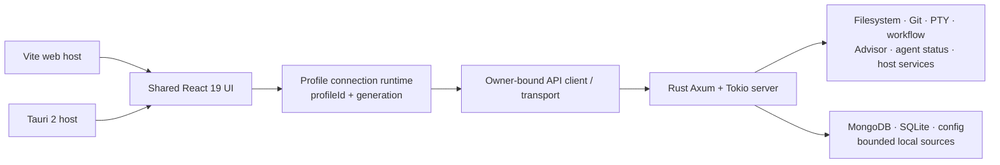

# System Architecture

**Status:** Current architecture overview, updated 2026-10-05. Detailed subsystem contracts are linked below; source code is authoritative.

## Runtime Overview

DamHopper is a monorepo with an Axum/Tokio Rust server and two hosts for shared React UI. The server owns remote project/workspace configuration, filesystem operations, Git, PTYs, authentication, workflow data, host resources, and privileged helper coordination. The browser and desktop app own only their local profile connection state and UI presentation.



### Code Boundaries

- `server/src/api/` registers protected HTTP, REST-backed client operations, and authenticated WebSocket routes. `server/src/state.rs` contains shared application state.
- `server/src/` domains include `auth`, `config`, `crypto`, `fs`, `git`, `pty`, `workflow`, `advisor`, `agent_status`, `agent_store`, `telemetry`, `idle_suspend`, `linux_release`, `port_forward`, and `tunnel`.
- `packages/ui/src/` owns the shared React application, owner-bound API clients, transports, query keys, stores, and feature components (canonical entry `packages/ui/src/embed/dam-hopper-app.tsx`).
- `apps/web/` is the Vite browser host; `apps/native/` is the Tauri 2 desktop host. `packages/shared/` contains shared utilities; `packages/browser-bridge/` contains browser-debug runtime protocol v1.
- The former DamHopper plugin platform, runner, SDK, plugin APIs, and plugin iframe bridge are retired. Native Advisor is an in-process native domain, not a plugin host.

### Port & Network Topology

| Runtime Environment | API Port | Web Port | Bind Address | Authority & Invariants |
| --- | --- | --- | --- | --- |
| **Standalone Server** (`dam-hopper-server`) | `4800` | N/A (combined if `--web-dir`) | `0.0.0.0` | `server/src/main.rs:44,48` default. |
| **Production Systemd Managed** | `4801` | `4802` (`dam-hopper-web`) | `0.0.0.0` | `deploy/systemd/dam-hopper-api.service`, `dam-hopper-web.service`. |
| **Development Mode** | `4803` | `5173` (Vite) | `0.0.0.0` / loopback | `apps/web/vite.config.ts` proxy to `127.0.0.1:4803`. |

*Security Warning:* When starting the server with `--no-auth` during local development, operators should explicitly bind to loopback (`--host 127.0.0.1`) to prevent exposing unauthenticated control surfaces to the local network.

### UI Surfaces and Settings Topology

The shared React 19 UI partitions workbench surfaces into IDE mode (`IdeShell`), terminal workspace mode (`TerminalWorkspaceShell`), Git management (`GitPage`), and server settings (`SettingsPage`). On the Settings page, persistent uncollapsed server selectors govern the active target server and workbench preferences source, while all individual configuration sections (`SettingsSectionAccordion`) default to a collapsed state (`defaultOpen = false`), reducing cognitive load and mount overhead across appearance, shortcuts, idle suspend, native advisor, maintenance, and import/export panels.

The ambient ribbon and floating surface (`WorkflowContextRibbon`, `WorkflowContextDeck`, `WorkflowContextSheet`) provide responsive task tracking across all shell viewports without persisting ephemeral UI state.

### Traditional Projects + Agents navigator

Traditional terminal mode retains Projects first and adds a flat Agents list across open terminals on both wide and compact surfaces. `TraditionalTerminalProjectsDisplay` projects exact qualified UI session metadata into the roster builder's raw-server metadata contract without changing terminal routing IDs. The roster joins registered profile, mounted/tab membership, live incarnation and existing status observations; it does not read terminal content or create another terminal host.

Connection generation/status and profile metadata are subscribed once in the display. Retained observations become Unavailable until the current owner has a ready baseline. Agent activation rejects stale instance callbacks and forwards the exact existing terminal selection, including split panes. Agent Settings targets the selected project's registered owner; unresolved owners require explicit choice, never ambient fallback.

`WorkspacePage` owns the sole `TerminalKeepAliveHost` above responsive shell selection, keeping backend PTY attachments and xterm DOM elements alive across wide/compact shell switches (`MobileWorkspaceShell` vs. `TerminalWorkspaceShell`). Responsive shells and split panes own visible host attachment and layout geometry, not xterm object lifetime.

Primary labels are Working, Idle, Needs attention and Unknown. `Done (turn ended)` is a secondary historical hint only for ready, nonexpired Idle evidence with explicit ended outcome and no current turn; it is not task success. Notification preferences and server semantics are unchanged. Component, focused browser, and production application journey gates have been qualified; full-viewport visual review is accepted. See [implementation progress](../plans/261008-0233-traditional-terminal-agents-sidebar/progress.md).

### Traditional Terminal Worktree Shortcut

**Implemented and qualified.** See [implementation plan](../plans/261009-1403-traditional-terminal-worktree-switching/phase-01-scoped-target-routing.md).

- Each existing configured-project row in the Traditional terminal navigator exposes a compact inline worktree dropdown independent of optional commit metadata. Free-terminal groups have no project worktree selector.
- Selection reuses the Project panel's session-scoped project-target store, keyed by the owning profile and project (`{ profileId, project }`). Other target-aware surfaces observe the same target; reload returns to the primary project root.
- New terminals resolve the selected target through the owning profile's launch path (`worktreePath`). Existing PTYs, terminal grouping, splits, and editor target bindings remain completely unchanged; selection never sends `cd`, restarts a process, or checks out a branch.
- Discovery uses profile/generation-qualified worktree queries (`useWorktrees`). Project root is explicit; unavailable, bare, or prunable paths are disabled and cannot be selected. Detached HEAD and locked worktree states are informative; failed discovery or transport errors preserve the current target selection safely.
- Project tabs and dropdown triggers remain separate interactive controls in desktop and compact Projects-sheet layouts. Same-name cross-profile isolation, root switching, and unchanged live-terminal identity/directory are verified by focused Chromium regressions and production application PTY journeys.
## Multi-Profile Ownership Model

A browser-side `profileId` selects one saved server endpoint/identity. A monotonically replaced connection `generation` identifies the current runtime for that profile. UI work captures both before issuing requests.

```text
profile selection -> capture { profileId, generation }
  -> owner-bound ApiClient + transport
  -> profile/generation-qualified queries and event subscriptions
  -> server request on that connection
  -> recheck captured owner before publishing response or cleanup
```

- Each profile has its own connection runtime, authentication state, and transport. Failure or reconnect of one profile does not block another.
- Projects, PTYs, filesystem data, workflow state, and server configuration remain authoritative on their owning server. Equal names or IDs across servers are not globally equivalent.
- Query identity, callbacks, subscriptions, cancellation, and cleanup are owner-qualified via tuple keys (`[profileId, project]`, `[profileId, generation]`). A stale response or event cannot update a replacement generation.
- Connection receipts (`host:uiConnection`, `getUiConnectionReceipt`) are bound to the exact captured `{ profileId, generation }` owner and discarded immediately on transport termination, close, or error.
- Project target, Settings target, preference source, and Browser target are independent selectors. Missing/unavailable qualified targets fail closed; there is no first-connected or ambient fallback.
- In Fleet mode, the top navigation host popover renders a multi-server deck (`HostResourceFleetDeck`), allowing operators to monitor disparate daemon endpoints simultaneously.

See [Multi-Server Profiles User Guide](./user-guide-multi-server-profiles.md) and [Workbench Files, Editor, Search, and Git Architecture](./architecture/workbench-files-editor-and-git.md).

## Backend State and Service Composition

`AppState` is cloned through Axum state extraction and holds shared subsystem services, config, storage, and synchronization points. Advisor-specific state includes `advisor_service: Arc<crate::advisor::AdvisorService>` and `advisor_settings_lock: Arc<tokio::sync::Mutex<()>>`; settings updates are serialized separately from history/policy domain operations.

Session metadata, port bindings, and terminal buffer snapshots are persisted locally in SQLite (`~/.config/dam-hopper/sessions.db`) via the background `PersistWorker`.

Keep API handlers responsible for request decoding, auth/role checks, and response mapping. Domain services enforce their own bounds and business invariants. Do not hold synchronous locks across `.await`; asynchronous process and filesystem work must not block PTY hot paths or server state locks. Persisted updates use validated revisions and atomic replacement where their contract requires it.

### Tunnel Isolation and Port Forwarding

Ephemeral Cloudflared quick tunnels (`server/src/tunnel/`) isolate subprocesses from host and user configurations by passing `--config ""` and `--no-autoupdate`. Forwarded dev-server requests rewrite the Host header (`--http-host-header localhost`) to prevent DNS rebinding rejections on modern dev servers (such as Vite 6 `server.allowedHosts`). The tunnel lifecycle enforces a **single-authority supervisor exit pattern**: `child.wait()` in the supervisor task is the sole authority for emitting `Exited` or `Failed` notifications, guarded by atomic state flags (`terminal_reached`) to eliminate race conditions with the stderr URL-discovery reader task. Discovered ports are validated against danger port deny-lists (`[22, 25, 110, 143, 3306, 5432, 6379, 27017]`) and ports < 1024.

Tunnels are explicitly started port forwards, independent of detected PTY ownership and origin-listener lifetime. Port loss, terminal exit/removal, and ownership replacement do not terminate Cloudflared or reset the tunnel's PID, URL, ID, or start time. Explicit Stop, connector termination/startup failure, and DamHopper shutdown remain terminal; no automatic restart or cross-server-restart restoration. A Tokio monotonic creation deadline marks required `reminderDue: boolean` at three hours and emits one `tunnel:reminder` event. REST retains due state for reload/reconnect catch-up. Shared web/native UI provides profile-qualified URL, port, Dismiss, and captured-owner Stop, without expiry; sessionStorage dismissal survives reload/reconnect in that browser session. Current-generation events cancel superseded list queries before patch/reconciliation. Undetected origins remain visible as untracked, not falsely listening. A replacement service binding the same port is public until Stop; an offline origin normally returns 502, and Quick Tunnel hostnames do not survive connector recreation.

## Native Desktop & Platform Boundaries

- **Windows Desktop:** Supports native local SSH port forwarding (`cfg(windows)`) via `apps/native/src-tauri/src/ssh_forward/` using `russh`, DPAPI credential storage, elliptic-curve host trust, and 20 specialized Tauri IPC commands. Allows connecting to remote HTTP/HTTPS profile URLs.
- **Linux Desktop & Web:** Native SSH port forwarding is unsupported (`cfg(windows)` gated). Non-Windows native desktop enforces exact same-origin server profile URLs for security isolation.
- **Host Remediation Actions:** The `HostActionService` scaffolding exists in `server/src/host_actions/` (`/api/system/actions/v1/*`), but `HostActionService::new()` uses `UnavailableExecutor`, and capabilities currently report `available: false` (reasons include `noAuth`, `reauthUnavailable`, or `helperNotEnrolled`).

## Workflow Tracking Engine

The `WorkflowService` manages hierarchical plans, phases, tasks (max depth 3), workflow sessions, notes, and activity event streams backed by SQLite (`010_workflow_tracking.sql`).
- Non-blocking PTY observation receives terminal lifecycle transitions via bounded `sync_channel(256)` without capturing terminal I/O.
- Event records in the database use a hardcoded 90-day retention (`DEFAULT_EVENT_RETENTION_DAYS = 90`) at insertion time, while deleted-note retention is configurable through `server.workflow_deleted_note_retention_days`, defaulting to 7 days.
- Optimistic concurrency control uses `updatedAt` CAS timestamps on item and note mutations.

See [Workflow API Specification](./workflow-api.md).

### Project Plans Dashboard (Implemented)

**Implemented and qualified 2026-10-07.** See the
[frozen contracts](../plans/261006-1653-project-plans-dashboard/contracts.md) and
[implementation plan](../plans/261006-1653-project-plans-dashboard/plan.md).

- Extends current Plan surface with folder-first selection, then one selected plan's Overview,
  Timeline, and read-only documents; preserves separate SQLite manual tracking.
- Resolves configured project / registered worktree on server; browses immediate
  folders under fixed `plans/`, reading plan/progress only after explicit selection.
- `plan.md` supplies metadata and the complete declared phase inventory, including
  valid short GFM rows. Presence of `progress.md` opts into its current report;
  unreadable progress retains historical evidence but makes current phase
  completion unknown. Conflicting/duplicate phase identity claims cannot complete
  another phase. Explicit Current status columns take precedence over Status.
- Progress is an administrative report, not verified completion or permission to
  execute. The dashboard never calls controllers, runs agents, or updates files.
- Selected Timeline uses explicit planned/actual ranges, creation milestones, or
  Undated state. No mtime/effort duration inference, cross-plan Board, or bulk status load.
- Scopes requests, queries, document links, and watcher cleanup to the captured
  profile, connection generation, and project/worktree target.
- Reuses native Rust API / auth / filesystem boundaries and shared React rendering;
  no database import, Node sidecar, iframe, or second terminal lifecycle.
- Strict bounded `plan-document` reads use rooted descriptors/native Windows
  handles, reject linked ancestors, and validate file identity, modification/change
  timestamps, named entries, and pinned ancestors before publishing a snapshot.
  Atomic replacement during a read reports changed without an automatic retry.
- Folder responses retain a whole sorted prefix under the 2 MiB JSON limit using
  bounded linear size accounting, not repeated full-response trimming.
- Owner-bound `watchOnly` subscriptions cover existing navigation ancestors and
  selected document parents, not all children. Registration/rebinding is serialized;
  coverage is live only after installation and a fresh authoritative read.
  Missing directories are covered through their existing parents; requirements
  beyond the 33-watch cap remain explicitly degraded. Reconcile retries missing
  watches rather than clearing the warning optimistically.
  Shared server watchers use pinned directory identities and exact generation
  leases; a retained Explorer subscription cannot force plans onto an old-inode
  watcher or release a replacement generation.
- Reuses Markdown / GFM / Mermaid; local images show notices, no media integration.
  Local document paths are URI-decoded once before containment checks; document
  Retry requests the failed path again.
- Linux runtime exercised. Windows strict source/tests cross-compiled in an
  isolated harness; full cross-target build requires native MSVC tools. Windows
  runtime remains explicitly unqualified until tested on Windows.
## Telemetry & OTLP Analytics

<a id="codex-otel-usage-analytics"></a>
DamHopper server includes an internal loopback OTLP collector (`server/src/telemetry/`) receiving protobuf metrics and execution traces:
- **Identifier Obfuscation:** Uses HMAC-SHA256 (`~/.config/dam-hopper/telemetry-hmac-key`, regular file, mode `0600`, opened with `O_NOFOLLOW`).
- **Strict Privacy Invariants:** Forbidden fields (`command`, `argv`, `cwd`, `environment`, `pty_output`, `prompt`, `response`, `tool_arguments`, `tool_output`) are dropped during normalization.
- **Storage:** Persisted locally in SQLite (`~/.config/dam-hopper/telemetry.db`) with daily retention rollups.

## Native Advisor

The Advisor is a native server domain in `server/src/advisor/` with Axum routes in `server/src/api/advisor.rs` and a direct React subtree in `packages/ui/src/advisor/`. It has no plugin runner, iframe, MessagePort bridge, or nested React root.

- Per-server setting `[server.advisor].enabled` defaults to `false`.
- Status/settings operations are available to administrators. Data routes require a normal authenticated session and current administrator role; `--no-auth` is explicitly denied (`NoAuthForbidden`).
- History is read from the server process `$HOME/.evcrate/advisor-history`; the final history root must be a real directory, not a symlink. Account routing policy is `$HOME/.evcrate/advisor-routing.json`.
- Routing changes compare a strict SHA-256 revision and use an atomic same-directory owner-only replacement. Updates preserve unrelated valid policy fields and reject credential-like fields.
- Discovery, scans, request sizes, and comparison work are bounded. Model discovery uses normalized fallback catalogs when the corresponding local harness cannot provide usable results.
- UI requests use an owner-bound client, abortable operations, and profile/generation-isolated state.

See [Native Advisor Architecture](./architecture/native-advisor.md) and [Advisor Configuration](./configuration/advisor.md).

## Agent Status

`AgentStatusRuntime` correlates terminal ID with PTY incarnation and stores current semantic state in process memory. It does not replace PTY process state, workflow lifecycle, or task outcome.

- Managed OMP uses a private loopback WebSocket collector, with 5-second heartbeats and a 15-second lease. The collector is not the public API or tunnel discovery surface.
- Codex and Claude hook reports enter through a protected Unix domain socket. Peer credentials (`SO_PEERCRED`) and PTY shell ancestry are verified before accepting reports.
- Reporter epochs and terminal incarnations fence stale callbacks. Hook reports and snapshots do not carry prompts, tool arguments, or transcript text.
- Silence, disconnect, a normal turn end, or an unknown outcome does not prove success. Unknown remains an explicit state.

See [Agent Status Architecture](./architecture/agent-status.md).

## Git Safety Model

Git operations use porcelain semantics for worktree/index state. Normal push remains fast-forward-only. A commit-message edit or squash operates on raw object plumbing without modifying working tree files or index entries:
- **Compare-and-swap ref updates**: First captures branch and HEAD, checks candidate rewrites against that snapshot, and updates refs via compare-and-swap. Squash requires a unique contiguous oldest-first parent chain reaching the captured tip and preserving the final tree. Signature loss requires explicit consent when applicable.
- **Active vs. inactive branch safety**:
  - Active branch updates lock `HEAD` then the branch ref (`refs/heads/<branch>`), checking worktree invariants.
  - Inactive branch rewrites lock only the target branch ref (`refs/heads/<branch>`), atomically verifying `HEAD` did not transition to the target branch during mutation. Active checkout, index, staged, unstaged, and untracked files remain completely untouched.
  - Operations fail closed with `checked-out-branch` if the target is checked out in another linked worktree, and with `active-operation` if a rebase, merge, or cherry-pick is ongoing.
- **UI surface parity and accessibility**:
  - Both the compact Workspace Git Panel and standalone Git Page permit commit-message editing and squashing when viewing any local branch (`isViewingLocalBranch`), active or inactive.
  - Checkout-sensitive operations (`reset`, `drop`, `undoLastCommit`) remain strictly guarded by `isViewingActiveBranch`.
  - The branch banner communicates current context: `Viewing {branchLabel}. Cherry-pick and revert apply to checked-out branch {activeBranch}.`
  - Ineligible views (remote branches, detached `HEAD`) provide accessible disabled explanations via `aria-describedby` linking to a unique `useId()` description ID in `GitLogTree` context menus.
- **Leased publication**: Local rewrite and publication are strictly decoupled. Publication uses an exact-OID CAS lease tied to the target branch (`PublishSnapshot`) and expected remote OID; stale remote state aborts the push with `stale-remote`. The lease is invariant to subsequent checkout state changes.

Search filters full commit messages before pagination without mutating refs. See [Git History Architecture](./architecture/git-history-search.md) and [Git API Reference](./api/git.md).

## Cognito Privacy Mode

<a id="cognito-mode"></a>
Cognito is an ephemeral in-app overlay controlled by the Cognito state store and configurable shortcut (`Mod+Alt+KeyB`). The app installs a window input guard using event capture to intercept 38 pointer, keyboard, clipboard, wheel, and drag events, and places app content behind an `inert` and `aria-hidden="true"` boundary while the mask is active. Activation is memory-only; only supported presentation style preferences persist.

Current CSS in `packages/ui/src/index.css` sets Heavy Blur to `blur(16px) saturate(180%)` with `rgba(148, 163, 184, 0.12)` when backdrop-filter is supported. Unsupported engines and reduced-transparency preferences use opaque black; Black Screen is solid black. This is an in-browser visual screen mask, not an operating system-wide screenshot boundary.

## Authentication, Privacy, and Capability Boundaries

- Normal server requests use validated session authentication and role checks across default MongoDB or environment-selected SQLite lite mode (`DAM_HOPPER_LITE_MODE` set to trim/case-insensitive `true` or `1`; unset/empty/`false`/`0` selects MongoDB, other nonempty values fail startup, and there is no automatic backend detection or fallback). `DAM_HOPPER_AUTH_SQLITE_PATH` applies only to SQLite (default `auth.db` in the global config directory; production uses absolute local storage, strictly one server process per local auth file, never network/shared filesystems, and fatal startup on SQLite failure). Production authenticated mode requires a dedicated 32-byte owner-only `DAM_HOPPER_MFA_KEY_FILE`.
- `POST /api/auth/register` creates disabled `user` accounts (`auth_version = 0`) and never grants automatic first-user `admin` rights; login returns `401 ACCOUNT_DISABLED` until a local operator approves and, when intended, promotes the account to `admin`, after which password login without an enrolled factor returns `enrollmentRequired` for TOTP MFA completion. The server's `server-token` is the JWT signing secret, never a client credential. See [Authentication API](./api/authentication.md), [Authentication State & Cryptography](./architecture/authentication-state-and-cryptography.md), and the canonical runbook in [Server Environment & Authentication](./configuration/server-environment-auth.md#operator-account-approval-and-role-promotion-runbook).
- Credentialed browser requests use explicit allowed origins. `--no-auth` is a separate loopback development bypass—never SQLite lite mode—and must be bound to `127.0.0.1`, never to an untrusted network interface. Native Advisor remains forbidden in `--no-auth` mode.
- Filesystem and media operations validate resolved targets and bound data. Opaque media tickets bind actor, client namespace, target, file identity/version, kind, purpose, and incarnation; cleanup stays with the original owner.
- Encrypted uploads use OPAQUE PAKE exchange and chunked AES-256-GCM over the WebSocket transport. One captured profile/generation transport owns authentication and final write; no plaintext or alternate-owner fallback is allowed.
- The shared logger redacts sensitive metadata. Agent status carries lifecycle facts only, never conversation content.

## Idle Suspend and Deployment

<a id="server-authoritative-terminal-idle-suspend-architecture"></a>
Linux terminal idle suspend is coordinated by the server and an enrolled Unix-socket helper (`dam-hopper-idle-suspend-helper`) with systemd integration. The server applies bounded policy (`empty-fleet` or `agent-activity`) and sysfs RTC wakealarm preflight; helper peer verification, deduplication, audit ordering, and fixed execution keep side effects fail-closed. Quiet period and wake interval are clamped between 60 and 86,400 seconds. Quiet is not proof of agent completion. See [Terminal Idle-Suspend Security](./terminal-idle-suspend-security.md) and [PTY Activity Observation](./pty-activity-observation.md).

### Semantic agent-free automatic sleep

Feature branch `feat/host-resources-auto-sleep`; implementation plan: `plans/261010-1746-host-resources-auto-sleep/plan.md`.
Phase 01 through Phase 06 are fully implemented and certified, including end-to-end verification, security boundaries, and safe operational rollout runbooks.
- **Policy & Fixed Timing**:
  - Opt-in startup policy `agent-free` (`IdleSuspendAutomaticPolicy::AgentFree`); retains existing `empty-fleet` and `agent-activity` policies without regression.
  - Fixed 10,800s (3 hours) quiet period enforced fail-closed at startup validation and timing PATCH admission; dynamic adjustment rejected.
  - Startup policy is immutable: full configuration updates, workspace reload, and settings import preserve the running startup policy even if the on-disk file changes.
  - Wire protocol `IdleSuspendStatusV1` enforces strict mutual exclusivity between `activity` (`agent-activity` only) and `agentFree`/`clientPresence`/`consent` (`agent-free` only).
- **Managed Agent Inventory & Descendant Closures**:
  - `ProcessDiscovery` in `server/src/idle_suspend/activity/process.rs` bounds candidate matching strictly to managed PTY session roots and retained lineage (`MAX_MANAGED_ROOTS_LIMIT = 64`, `MAX_RELEVANT_PROCESSES_LIMIT = 1024`, `MAX_SCANNED_PROCESSES_LIMIT = 8192`).
  - Traces complete `descendant_processes` closures per recognized agent (Codex, Claude, OMP) using process-tree traversal; child workers or subagents cannot hide running activity under an idle parent.
  - Privacy-preserving `ProcessImageKey` captures device ID (`exe_dev`), inode (`exe_ino`), and sanitized entrypoint token without exposing raw arguments or environment variables.
  - Produces deduplicated, sorted `matched_agents: Vec<MatchedManagedAgent>` with exact process identities (`pid`, `start_ticks`) and terminal bindings.
  - Independent external agents (tmux, SSH, shell outside managed PTYs) are deliberately excluded by product design and do not block sleep.
- **Verified OMP TCP Peer Binding**:
  - `verify_tcp_peer_process` in `server/src/agent_status/collector.rs` binds loopback WebSocket connections to verified OS process identities on Linux:
    1. Pre-check: reads `/proc/<claimed_pid>/stat` to record `start_ticks` and reject zombie/dead states (`Z`, `X`).
    2. Socket lookup: locates client socket inode from `/proc/net/tcp` and `/proc/net/tcp6` matching `peer_addr.port()`.
    3. Descriptor check: scans `/proc/<claimed_pid>/fd/` for symlinks targeting `socket:[<inode>]`, bounded by `MAX_PEER_FDS_SCAN = 256` to prevent DoS.
    4. Ancestry check: traces `/proc/<pid>/stat` parent PIDs (up to 32 hops) ensuring lineage connects to the registered terminal root; asserts `stat_before.start_ticks == root.start_ticks` on direct root match to defeat recycled PID spoofing.
    5. Post-check: re-reads `/proc/<claimed_pid>/stat` ensuring `start_ticks` remained identical and the process remained alive.
  - Unverified connections fail closed in semantic evaluation as `UnverifiedProcessBinding` without leaking socket inodes or PIDs to clients.
- **Hard Fail-Closed Native Freshness Gate**:
  - Codex and Claude CLI hooks lack keepalive heartbeats; leases expire after 15s (`DEFAULT_LEASE_MS = 15_000`).
  - Enforces hard fail-closed gate: zero synthetic lease stretching, zero simulated Idle states from stop events, zero screen/transcript scraping, and zero cloud API substitution.
  - Unrefreshed native providers transition to `AgentSemanticBlockReason::UnrefreshedNativeProvider` (`AgentSemanticEvaluation::Unknown`), blocking automatic sleep until refreshed or proven exited.
- **Monotonic Non-Free Generation Tracking & Semantic Evaluation**:
  - `AgentStatusRegistry` maintains monotonic `non_free_generation: u64` (initialized at 1) incremented on every non-free mutation: working reporter admission, hook state transition, lease expiration sweep, terminal removal, or reconnect.
  - Brief `Working -> Idle` gaps between coordinator polling sweeps increment `non_free_generation`, invalidating previous Free claim tickets.
  - `evaluate_managed_agents` executes under registry read lock:
    - Empty matched agents -> `Free` (0 idle, 0 blocked).
    - Any agent `Working` -> `Working` (capturing implicated PIDs).
    - Expired lease, unrefreshed native provider, unverified binding, ambiguous owner, or uncovered subagent -> `Unknown`.
    - All matched agents `Idle` or `Blocked` with active leases -> `Free` with `min_lease_remaining_ms`, current `non_free_generation`, and `semantic_revision`.
- **AgentFreeClaimTicket & PTY Manager Handoff Fences**:
  - `AgentFreeClaimTicket` in `server/src/idle_suspend/activity/sampler.rs` captures atomic evaluation snapshot with sanitized `Debug` formatting.
  - `PtySessionManager::try_claim_agent_free_handoff` in `server/src/pty/manager.rs` enforces 8-point admission fence under `inner` lock:
    1. Policy is `AgentFree` and enabled.
    2. Request ID, semantic revision, non-free generation, and timing revision match ticket.
    3. Monotonic eligibility deadline is expired.
    4. Observation age <= 5 seconds (`MAX_ACCEPTED_OBSERVATION_AGE`).
    5. Input revision matches ticket.
    6. Fleet generation matches ticket.
    7. Live sessions count and root process identities match ticket roots exactly.
    8. Atomic fleet handoff claim acquires handoff flag, verifying no session is creating, closing, disposing, or restarting.
- **Public WebSocket Client Presence Registry & RAII Guards**:
  - `ClientPresenceRegistry` (`server/src/idle_suspend/client_presence.rs`) provides a bounded in-memory registry (`DEFAULT_MAX_PUBLIC_CLIENTS = 1024`) embedded in `AppState.client_presence`.
  - Exclusions: Strictly tracks authenticated public UI `/ws` WebSocket connections. Private loopback OMP reporter sockets (`/ws/agent-status`) and HTTP Server-Sent Events streams (host-resource SSE) are deliberately excluded.
  - Two-Phase Connection Admission:
    1. `PendingUpgradeGuard`: Reserved post-authentication (`reserve_pending_upgrade`) before Axum WebSocket upgrade. Capacity saturation immediately rejects admission with `PresenceAdmissionError::CapacityExceeded` (HTTP 503 `PRESENCE_UNAVAILABLE`). Expired pending reservations (`PENDING_UPGRADE_TIMEOUT = 30s`) are pruned on every mutation. Dropped guards cleanly release reservation slots without leaking active state.
    2. `ClientPresenceGuard`: Promoted upon upgrade completion (`promote_pending_to_live`), capturing connection ID (UUIDv4) and actor session invariants (`subject`, `session_id`, `auth_version`, `credential_version`, `effective_deadline`). Guard drop automatically decrements connection count and increments monotonic membership revision.
  - Zero-Client Admission Fence: `try_claim_no_client_fence(expected_revision)` atomically asserts zero live connections and zero pending upgrades while verifying monotonic revision match; latches `host_suspending = true` to immediately reject new upgrades with `HostSuspending` (HTTP 503).
  - Monotonic `membership_revision: u64`: Increments on every reservation, promotion, liveness prune, retirement, or fence transition. Broadcasts `IdleSuspendClientPresenceStatusV1` snapshots via a Tokio watch channel without lock contention.
- **Cryptographic Capability Verification & Session Invariants**:
  - Immediate Receipt Delivery: Immediately after upgrade promotion, the server sends a private `host:uiConnection` frame (`UiConnectionFrame`: `{ kind: "host:uiConnection", version: 1, connectionId, decisionCapability }`) directly to the socket's private channel ahead of broadcast events.
  - 122-bit high-entropy secret (`Uuid::new_v4()`) generated per socket. Server stores only a 32-byte SHA-256 digest (`hash_capability`); plaintext capability secrets are never logged, never emitted to `event_sink`, and never exposed in GET/status endpoints.
  - `verify_decision_capability`: Validates candidate capability secrets using constant-time comparison (`subtle::ConstantTimeEq`) to defeat timing attacks. Enforces actor session invariants (`subject`, `session_id`, `auth_version`, `credential_version`, and non-expired `effective_deadline`).
  - Active/Closing Invariant: Rejects connections with `closing: true`; explicit `mark_closing()` immediately revokes decision capability prior to task teardown.
- **Decoupled Frame Reader & Heartbeat Supervision**:
  - Dedicated `frame_reader` loop in `server/src/api/ws.rs` decouples WebSocket control frames (Ping, Pong, Close) from the bounded application queue (`APP_MSG_CAP = 64`), ensuring long PTY or filesystem commands cannot starve transport liveness.
  - Control frames and application data immediately refresh `last_liveness` via `record_pong()`.
  - Dedicated heartbeat supervisor task sends periodic pings (`HEARTBEAT_INTERVAL = 30s`) and evaluates elapsed silence against `HEARTBEAT_DEADLINE = 90s`. Silent connections exceeding 90 seconds are marked closing, logged, and gracefully terminated via unified cancellation channels.
- **UI Exact-Owner Receipt Binding & Lifecycle**:
  - `WsTransport` (`packages/ui/src/api/ws-transport.ts`): Caches `host:uiConnection` receipt in memory upon arrival (`getUiConnectionReceipt()`); immediately delivers cached snapshot to late subscribers (`subscribeUiConnection`). Socket disconnect, close, error, reconnect, or transport disposal resets receipt to `null` and notifies subscribers.
  - `connections.ts` (`packages/ui/src/api/connections.ts`): Provides `getUiConnectionReceipt(owner)` and `subscribeUiConnectionReceipt(owner, listener)` gated strictly by `isCurrentConnection(owner)` with generation matching. Stale owners, disconnected profiles, or non-WebSocket transports return `null` with no ambient or fallback profile resolution.
- **Three-Hour Coordinator Engine & Monotonic Epochs**:
  - Tracks continuous quiescence epoch (>10,800s, 3 hours) using monotonic `Instant` timestamps (`free_anchor`, `elapsed > Duration::from_secs(quiet_period_seconds)`). Strict inequality required; exact boundary (`== 10,800s`) rejected.
  - Clean zero-agent boot support: fleets starting with zero agents initialize directly in valid tracking epoch without false blockers.
  - Intervening non-free agent activity (`Working`, hook transitions, lease expiration) or safety invalidations immediately reset continuity and clear `free_anchor`.
- **Public Client Presence Arbitration & Branching**:
  - Zero connected public clients (`connection_count == 0 && pending_upgrade_count == 0`): coordinator enters `FinalCheck` automatically, bypassing consent prompt.
  - Positive connected public clients (`connection_count > 0`): coordinator issues single active consent request (`ActiveConsentRequest`) with unique UUID (`consent-<uuid>`), monotonic revision, and 60-second expiration (`expires_at = now + 60s`), transitioning to `AgentFreePhase::AwaitingConsent`.
  - Pending-only connection upgrades (`pending_upgrade_count > 0`): coordinator pauses and waits across cadence ticks until pending upgrades complete promotion or timeout, eliminating handshake race conditions.
- **First-Valid Consent Latching & Immediate Final Check Dispatch**:
  - `POST /api/system/idle-suspend/v1/consent/decision` endpoint passes decisions to coordinator actor loop.
  - First valid server-accepted decision latches atomically into `active_consent.decision` and records `last_settled_consent`.
  - Subsequent contrary decisions return HTTP 409 `decisionAlreadySettled`.
  - Duplicate identical decisions return idempotent HTTP 200 OK (`Success { idempotent: true }`).
  - Approval (`Approve`): sets `AgentFreePhase::Approved`, captures approving actor and connection ID, responds HTTP 200 OK, and immediately dispatches `attempt_agent_free_final_check(true, ...)` without waiting for the 60s timeout.
  - Refusal (`Deny`): sets `AgentFreePhase::Deferred` with reason `ClientRefusal`, responds HTTP 200 OK, and defers coordinator for full `> 10,800s` (3 hours) cooldown.
- **Timeouts, Disconnects, and Pre-Dispatch Invalidation**:
  - 60s Unanswered Timeout: if `now >= expires_at` with no decision, consent request transitions to `ConsentState::Expired`, sets reason `UnansweredTimeout`, and defers coordinator for `> 10,800s`.
  - Last-Client Disconnect: if client count drops to 0 while in `AwaitingConsent` or `Approved`, in-flight consent transitions to `ConsentState::Cancelled`, sets reason `LastClientDisconnected`, and defers for `> 10,800s`.
  - Pre-Dispatch Actor Revalidation: `revalidate_approving_actor` re-checks the approving actor before final execution against database: user enabled, auth version matched, session unrevoked, session non-expired (`now < expires_at`), MFA deadline valid (`now < mfa_due_at`), and credential version matched. Revalidation failure cancels consent with `SafetyInvalidation` and defers for `> 10,800s`.
- **Fresh Final Check Pipeline & Atomic Handoff**:
  - Captures fresh PTY snapshot and runs `process_discovery.prepare_sample` / `commit_sample` and `agent_status.evaluate_managed_agents`.
  - Any working agent, ambiguous owner, unrefreshed native provider, or expired lease cancels consent, sets `Blocked`, and resets quiet anchor.
  - All-free evaluation acquires PTY handoff claim via `try_claim_agent_free_handoff(admission)` under middle lock.
  - Zero-client flow: atomically claims `try_claim_no_client_fence(pres_rev)`. If clients arrived during final check, releases PTY claim and issues consent request instead.
  - Approved client flow: sets `client_presence.set_host_suspending(true)`.
  - Emits `FinalCheckCompleted`, `HandoffClaimAccepted`, `HelperRequestDispatched` server events and dispatches single `SuspendWithRtcWakeRequest` to executor.
- **Audit Logging & Privacy-Preserving Redaction**:
  - `IdleSuspendServerAudit` appends `ConsentAuditRecord` (version, timestamp, actor, request_id, request_revision, connection_id, decision, status_revision, result) via verified file descriptors (`O_NOFOLLOW | O_CLOEXEC | O_NONBLOCK`, mode 0600, UID/GID checks, `sync_data`).
  - `project_server_audit` redacts actor subject to boolean `actor_present: bool`, omits `connection_id`, projects canonical UUID `correlation_id`, and redacts details to `requestRevision,statusRevision` for diagnostic bundles.
- **Canonical Admission Lock Order**:
  1. Outer / Coarse: `ClientPresenceRegistry` lock (synchronous in-memory lock for live/pending sockets and reservation guards).
  2. Middle: `PtySessionManager::inner` lock (synchronous lock for fleet generation and managed terminal sessions).
  3. Inner / Fine: `AgentStatusRuntime::registry` lock (synchronous read/write lock for semantic agent states).
  Invariants:
  - Never hold any lock across `.await`, Tokio channel dispatch, filesystem I/O, or procfs/network inspection.
  - Never acquire in reverse order (`AgentStatusRuntime` -> `PtySessionManager` -> `ClientPresence`).
  - Asynchronous authentication, database verification, and fresh process sampling complete before acquiring the final admission fence; only monotonic session/revocation epochs and fleet/semantic revisions are checked under the fence.

`deploy/release/` provides release packaging, installers, and service templates. Host-resource SSE streams deep Linux metrics under capped subscriber leases (max 32 global, 4 per subject). See [Host-Resource SSE Architecture](./architecture/host-resource-sse.md).

## Qualification Boundary

Automated unit and integration tests establish only their exercised contracts. Live browser behavior, particular agent versions, Linux deployment behavior, Windows native scopes, and deployed proxies are separately qualified. See [Project Roadmap](./project-roadmap.md) and [Testing Guide](./testing.md) for current open gates.
