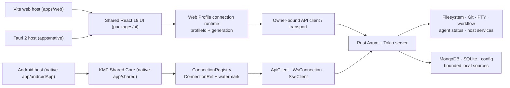

# System Architecture

**Status:** Current architecture overview, updated 2026-10-23. Detailed subsystem contracts are linked below; source code is authoritative.

## Runtime Overview

DamHopper is a monorepo with an Axum/Tokio Rust server and multiple workbench clients: shared React UI for browser and desktop (Tauri 2), and a dedicated native Android client (`native-app`) built with Kotlin Multiplatform and Jetpack Compose. The server owns remote project/workspace configuration, filesystem operations, Git, PTYs, authentication, workflow data, host resources, and privileged helper coordination. Clients own only their local profile connection state, credentials, and UI presentation.



### Code Boundaries

- `server/src/api/` registers protected HTTP, REST-backed client operations, and authenticated WebSocket routes. `server/src/state.rs` contains shared application state.
- `server/src/` domains include `auth`, `config`, `crypto`, `fs`, `git`, `pty`, `workflow`, `agent_status`, `agent_store`, `telemetry`, `idle_suspend`, `linux_release`, `port_forward`, and `tunnel`.
- `packages/ui/src/` owns the shared React application, owner-bound API clients, transports, query keys, stores, and feature components (canonical entry `packages/ui/src/embed/dam-hopper-app.tsx`).
- `apps/web/` is the Vite browser host; `apps/native/` is the Tauri 2 desktop host. `packages/shared/` contains shared utilities; `packages/browser-bridge/` contains browser-debug runtime protocol v1.
- `native-app/` is the native Android workbench implementation using Kotlin Multiplatform (`:shared` for core models, connection registry, and live transports; `:androidApp` for Jetpack Compose UI, `MainActivity`, and Android platform OkHttp network factory).
- The former DamHopper plugin platform, runner, SDK, plugin APIs, and plugin iframe bridge are retired.

### Port & Network Topology

| Runtime Environment | API Port | Web Port | Bind Address | Authority & Invariants |
| --- | --- | --- | --- | --- |
| **Standalone Server** (`dam-hopper-server`) | `4800` | N/A (combined if `--web-dir`) | `0.0.0.0` | `server/src/main.rs:44,48` default. |
| **Production Systemd Managed** | `4801` | `4802` (`dam-hopper-web`) | `0.0.0.0` | `deploy/systemd/dam-hopper-api.service`, `dam-hopper-web.service`. |
| **Development Mode** | `4803` | `5173` (Vite) | `0.0.0.0` / loopback | `apps/web/vite.config.ts` proxy to `127.0.0.1:4803`. |

*Security Warning:* When starting the server with `--no-auth` during local development, operators should explicitly bind to loopback (`--host 127.0.0.1`) to prevent exposing unauthenticated control surfaces to the local network.

### UI Surfaces and Settings Topology

The shared React 19 UI partitions workbench surfaces into IDE mode (`IdeShell`), terminal workspace mode (`TerminalWorkspaceShell`), Git management (`GitPage`), and server settings (`SettingsPage`). On the Settings page, persistent uncollapsed server selectors govern the active target server and workbench preferences source, while all individual configuration sections (`SettingsSectionAccordion`) default to a collapsed state (`defaultOpen = false`), reducing cognitive load and mount overhead across appearance, shortcuts, idle suspend, maintenance, and import/export panels.

The ambient ribbon and floating surface (`WorkflowContextRibbon`, `WorkflowContextDeck`, `WorkflowContextSheet`) provide responsive task tracking across all shell viewports without persisting ephemeral UI state.

### Traditional Projects + Agents navigator

Traditional terminal mode retains Projects first and adds a flat Agents list across open terminals on both wide and compact surfaces. `TraditionalTerminalProjectsDisplay` projects exact qualified UI session metadata into the roster builder's raw-server metadata contract without changing terminal routing IDs. The roster joins registered profile, mounted/tab membership, live incarnation and existing status observations; it does not read terminal content or create another terminal host.

Connection generation/status and profile metadata are subscribed once in the display. Retained observations become Unavailable until the current owner has a ready baseline. Agent activation rejects stale instance callbacks and forwards the exact existing terminal selection, including split panes. Agent Settings targets the selected project's registered owner; unresolved owners require explicit choice, never ambient fallback.

`WorkspacePage` owns the sole `TerminalKeepAliveHost` above responsive shell selection, keeping backend PTY attachments and xterm DOM elements alive across wide/compact shell switches (`MobileWorkspaceShell` vs. `TerminalWorkspaceShell`). Responsive shells and split panes own visible host attachment and layout geometry, not xterm object lifetime.

Primary labels are Working, Idle, Needs attention and Unknown. `Done (turn ended)` is a secondary historical hint only for ready, nonexpired Idle evidence with explicit ended outcome and no current turn; it is not task success. Notification preferences and server semantics are unchanged. Component, focused browser, and production application journey gates have been qualified; full-viewport visual review is accepted. See [implementation progress](../plans/261008-0233-traditional-terminal-agents-sidebar/progress.md).

The navigator includes an accessible multi-select status filter dropdown (`TraditionalTerminalAgentFilter`) directly beneath the `agents` header that filters observed agents across seven presentation statuses (`Needs attention`, `Working`, `Idle`, `Unknown`, `Unavailable`, `Platform unqualified`, `Unsupported`) plus an `"all"` reset sentinel, with live count badges and multi-status selection support. The in-memory selection (`"all" | readonly TraditionalAgentStatusLabel[]`) is saved to `localStorage` under `dam-hopper:traditional-terminal-agents-status-filter` (persisting single statuses as legacy scalar strings and multi-status selections as canonical JSON arrays; falling back to `"all"` without writes on mount) and restored on page refresh or component mount. When no agents match an active filter, a descriptive empty state is displayed (`No observed agents match <status>.` or `No observed agents match <status1>, <status2>.`). In compact sheets, the listbox dynamically adapts positioning by flipping upward (`bottom-full mb-1`) and limiting listbox height to available viewport space when opening near the viewport bottom. Filtering is purely presentational: it operates before status grouping, never interferes with active session selection or PTY processes, and preserves exact cycling and tab activation semantics.

### Traditional Terminal Worktree Shortcut

**Implemented and qualified.** See [implementation plan](../plans/261009-1403-traditional-terminal-worktree-switching/phase-01-scoped-target-routing.md).

- Each existing configured-project row in the Traditional terminal navigator exposes a compact inline worktree dropdown independent of optional commit metadata. Free-terminal groups have no project worktree selector.
- Selection reuses the Project panel's project-target store, keyed by the owning profile and project (`{ profileId, project }`). Other target-aware surfaces observe the same target. Narrow Zustand persistence under `dam-hopper:project-target-state` (version 1) preserves the selected worktree across reloads, while root represents absence (selecting root removes the stored entry), and discovery gracefully demotes missing targets to root.
- New terminals resolve the selected target through the owning profile's launch path (`worktreePath`). Existing PTYs, terminal grouping, splits, and editor target bindings remain completely unchanged; selection never sends `cd`, restarts a process, or checks out a branch.
- Discovery uses profile/generation-qualified worktree queries (`useWorktrees`). Project root is explicit; unavailable, bare, or prunable paths are disabled and cannot be selected. Detached HEAD and locked worktree states are informative; failed discovery or transport errors preserve the current target selection safely.
- Project tabs and dropdown triggers remain separate interactive controls in desktop and compact Projects-sheet layouts. Same-name cross-profile isolation, root switching, and unchanged live-terminal identity/directory are verified by focused Chromium regressions and production application PTY journeys.
## Multi-Profile Ownership Model

A browser-side `profileId` selects one saved server endpoint/identity. A monotonically replaced connection `generation` identifies the current runtime for that profile. UI work captures both before issuing requests.

```text
profile selection -> capture { profileId, generation }
  -> owner-bound ApiClient + transport
  -> profile/generation-qualified queries and event subscriptions
  -> server request on that connection
  -> recheck captured owner before publishing response or cleanup
```

- Each profile has its own connection runtime, authentication state, and transport. Failure or reconnect of one profile does not block another.
- Projects, PTYs, filesystem data, workflow state, and server configuration remain authoritative on their owning server. Equal names or IDs across servers are not globally equivalent.
- Query identity, callbacks, subscriptions, cancellation, and cleanup are owner-qualified via tuple keys (`[profileId, project]`, `[profileId, generation]`). A stale response or event cannot update a replacement generation.
- Connection receipts (`host:uiConnection`, `getUiConnectionReceipt`) are bound to the exact captured `{ profileId, generation }` owner and discarded immediately on transport termination, close, or error.
- Project target, Settings target, preference source, and Browser target are independent selectors. Missing/unavailable qualified targets fail closed; there is no first-connected or ambient fallback.
- In Fleet mode, the top navigation host popover renders a multi-server deck (`HostResourceFleetDeck`), allowing operators to monitor disparate daemon endpoints simultaneously.

See [Multi-Server Profiles User Guide](./user-guide-multi-server-profiles.md) and [Workbench Files, Editor, Search, and Git Architecture](./architecture/workbench-files-editor-and-git.md).

### Native Android Ownership Implementation (Kotlin Multiplatform)

The native Android client (`native-app/shared/src/commonMain/kotlin/dev/damhopper/nativeapp/core/`) realizes the exact multi-profile ownership invariants natively in Kotlin without browser runtime dependencies:

1. **`ConnectionRef` Tuple Keys:** Modeled as `ConnectionRef(profileId, generation)` producing deterministic JSON tuple keys `["profileId", generation]` identically matching web TypeScript clients.
2. **Monotonic Watermark ABA Guard:** `ConnectionRegistry` maintains an in-memory `generationWatermarks` table that survives profile deletion/logout within the registry process lifetime, ensuring newly registered profiles with previously used IDs never reuse earlier generation numbers.
3. **Socket Lifecycle Separation:** `SocketInstanceRef(connection, socketId)` separates individual WebSocket socket attempts from overall profile connection generations. Capabilities such as `host:uiConnection` receipts (`UiConnectionReceipt`) are bound to the concrete socket and revoked immediately on disconnect, error, or reconnect.
4. **Owner Verification Fences:** `ConnectionRegistry.assertCurrentOwner` gates request initiation and completion across REST (`ApiClient`), WebSocket (`WsConnection`), and SSE (`HostResourceSseClient`), rejecting stale responses and retired generations with typed `ConnectionOwnerError`.

### Native Android Profiles, Auth, MFA & Credential Vault Architecture

The native Android client implements end-to-end multi-server profile management, protocol version 2 authentication with TOTP MFA, and fail-closed credential custody (`native-app/shared/src/commonMain/kotlin/dev/damhopper/nativeapp/features/profiles/` and `native-app/androidApp/src/main/kotlin/dev/damhopper/nativeapp/platform/`):

1. **Profile Lifecycle & Non-Secret Metadata Storage:**
   - `ProfileRepository`: Central orchestrator for profile CRUD, active profile selection, and auth state coordination across independent server endpoints.
   - `ServerProfile`: Immutable profile model (`id`, `name`, `baseUrl`, `username`). URL normalization via `validateServerUrl` enforces `http`/`https` schemes, strips trailing slashes, rejects user-info credentials in authority, query parameters, and fragments, and maps Android emulator loopback (`10.0.2.2`).
   - `ProfileMetadataStore` & `AndroidProfileMetadataStore`: Persists non-secret profile configurations across application restarts in Android `SharedPreferences` under key `"damhopper_server_profiles"`.
2. **Attempt Watermark Fencing (`AuthAttemptTracker` & `AuthAttemptRef`):**
   - Fences asynchronous authentication calls (login, MFA setup, TOTP verification, step-up) against concurrent lifecycle transitions (endpoint edit, account logout, profile deletion, credential rotation).
   - `AuthAttemptTracker.startAttempt(profileId)` issues monotonically increasing `AuthAttemptRef(profileId, attemptId)` watermarks under coroutine `Mutex`.
   - `assertActive(attempt)` validates attempt freshness before session tokens are stored in the vault; stale callbacks throw `AuthAttemptStaleException`.
   - Profile edits, deletions, or logouts call `attemptTracker.invalidate(profileId)`, immediately advancing the watermark and cancelling pending in-flight callbacks.
3. **Android Keystore Credential Custody (`CredentialVault` & `AndroidCredentialVault`):**
   - `CredentialVault`: Contract defining token storage keyed by `token:${profileId}:${baseUrl}`. Passwords, TOTP setup secrets, and challenge tokens are transient and strictly prohibited from persistent storage.
   - `AndroidCredentialVault`: Platform implementation using Android Keystore-backed `MasterKey` (`KeyScheme.AES256_GCM`) and `EncryptedSharedPreferences` (`AES256_SIV` key encryption, `AES256_GCM` value encryption).
   - Fail-Closed Invariant: Keystore key invalidation or corruption throws `VaultKeyInvalidatedException`, forcing explicit user re-authentication rather than falling back to unencrypted storage.
   - Backup Exclusion: Android manifest sets `android:allowBackup="false"`; `data_extraction_rules.xml` excludes `sharedpref` domain from both `<cloud-backup>` and `<device-transfer>`.
4. **Frozen Protocol v2 Authentication & TOTP MFA (`AuthRepository`, `AuthState`):**
   - `AuthRepository`: Executes REST auth endpoints (`/api/auth/login`, `/api/auth/register`, `/api/auth/mfa/setup`, `/api/auth/mfa/confirm`, `/api/auth/mfa/verify`, `/api/auth/mfa/challenge`, `/api/auth/status`, `/api/auth/logout`).
   - `AuthResponseParser` and `AuthStatusParser`: Validate frozen protocol versions (`authProtocol = 2`, `workbenchProtocol = 2`), rejecting incompatible protocols with `INCOMPATIBLE_PROTOCOL`.
   - Error mapping: Mapped codes include `ACCOUNT_DISABLED` (newly registered accounts require local operator approval), `MFA_REQUIRED`, `SESSION_EXPIRED`, `SESSION_REVOKED`, and `ATTEMPT_STALE`.
   - Redaction: `AuthSession`, `LoginChallenge`, and `MfaSetupData` sanitize Bearer tokens and TOTP setup secrets in `toString()` diagnostics (`[REDACTED]`).
5. **ConnectionRegistry Session Lifecycle & Generation Retirement:**
   - Any endpoint modification (`baseUrl` or `username`), credential rotation, or logout automatically retires the active connection generation via `ConnectionRegistry.retireConnection()`.
   - Retiring a connection generation immediately invalidates all active REST requests (`ApiClient`), WebSocket instances (`WsConnection`), and SSE streams (`HostResourceSseClient`) bound to the retired `ConnectionRef(profileId, generation)`.
   - Profiles are strictly isolated: invalidating, rotating, or logging out one profile has zero side effects on other active profiles.

## Backend State and Service Composition

`AppState` is cloned through Axum state extraction and holds shared subsystem services, config, storage, and synchronization points.

Session metadata, port bindings, and terminal buffer snapshots are persisted locally in SQLite (`~/.config/dam-hopper/sessions.db`) via the background `PersistWorker`.

Keep API handlers responsible for request decoding, auth/role checks, and response mapping. Domain services enforce their own bounds and business invariants. Do not hold synchronous locks across `.await`; asynchronous process and filesystem work must not block PTY hot paths or server state locks. Persisted updates use validated revisions and atomic replacement where their contract requires it.

### Tunnel Isolation and Port Forwarding

Ephemeral Cloudflared quick tunnels (`server/src/tunnel/`) isolate subprocesses from host and user configurations by passing `--config ""` and `--no-autoupdate`. Forwarded dev-server requests rewrite the Host header (`--http-host-header localhost`) to prevent DNS rebinding rejections on modern dev servers (such as Vite 6 `server.allowedHosts`). The tunnel lifecycle enforces a **single-authority supervisor exit pattern**: `child.wait()` in the supervisor task is the sole authority for emitting `Exited` or `Failed` notifications, guarded by atomic state flags (`terminal_reached`) to eliminate race conditions with the stderr URL-discovery reader task. Discovered ports are validated against danger port deny-lists (`[22, 25, 110, 143, 3306, 5432, 6379, 27017]`) and ports < 1024.

Tunnels are explicitly started port forwards, independent of detected PTY ownership and origin-listener lifetime. Port loss, terminal exit/removal, and ownership replacement do not terminate Cloudflared or reset the tunnel's PID, URL, ID, or start time. Explicit Stop, connector termination/startup failure, and DamHopper shutdown remain terminal; no automatic restart or cross-server-restart restoration. A Tokio monotonic creation deadline marks required `reminderDue: boolean` at three hours and emits one `tunnel:reminder` event. REST retains due state for reload/reconnect catch-up. Shared web/native UI provides profile-qualified URL, port, Dismiss, and captured-owner Stop, without expiry; sessionStorage dismissal survives reload/reconnect in that browser session. Current-generation events cancel superseded list queries before patch/reconciliation. Undetected origins remain visible as untracked, not falsely listening. A replacement service binding the same port is public until Stop; an offline origin normally returns 502, and Quick Tunnel hostnames do not survive connector recreation.

## Native Desktop & Platform Boundaries

- **Windows Desktop:** Supports native local SSH port forwarding (`cfg(windows)`) via `apps/native/src-tauri/src/ssh_forward/` using `russh`, DPAPI credential storage, elliptic-curve host trust, and 20 specialized Tauri IPC commands. Allows connecting to remote HTTP/HTTPS profile URLs.
- **Linux Desktop & Web:** Native SSH port forwarding is unsupported (`cfg(windows)` gated). Non-Windows native desktop enforces exact same-origin server profile URLs for security isolation.
- **Host Remediation Actions:** The `HostActionService` scaffolding exists in `server/src/host_actions/` (`/api/system/actions/v1/*`), but `HostActionService::new()` uses `UnavailableExecutor`, and capabilities currently report `available: false` (reasons include `noAuth`, `reauthUnavailable`, or `helperNotEnrolled`).

### Android Native Client Transport Boundary (`native-app`)

The native Android client connects directly to the Axum backend using a specialized, owner-fenced Kotlin networking stack:

- **Origin-less WebSocket Handshake:** Native client connects to `GET /ws?token=<bearer_token>` without forging browser `Origin` headers, matching server admission requirements in `server/src/api/ws.rs`.
- **Polymorphic Wire Contracts:** Strict JSON envelope using `"kind"` class discriminator for client-to-server `ClientMsg` and server-to-client `ServerMsg`, with `ServerMsgSerializer` falling back safely to `ServerMsg.Unknown` to preserve forward compatibility.
- **Atomic Frame Serialization:** `SerializedWsWriter` serializes outgoing frames with coroutine `Mutex`. Atomic JSON-header and binary frame pairs (for `fs:write_chunk_binary` and `fs:upload_chunk`) abort the connection with `CloseReason.Codes.PROTOCOL_ERROR` if partial transmission occurs, preventing server desynchronization.
- **Bounded Request Correlator:** `WsRequestCorrelator` bounds in-flight request capacity (default 256) and unregisters requests upon timeout (`unregister(reqId)`), eliminating capacity leaks. Cancels all pending requests on socket replacement.
- **Close Code Mapping:** Maps server close codes to typed `WsState`: `4403` (`MfaRequired`), `4401` (`LoginRequired`), `1013` (`AuthUnavailable`), and `4001` (`Overflow`).
- **Bounded Host Resource SSE:** `HostResourceSseClient` enforces a 256 KiB data cap (`MAX_DATA_EVENT_BYTES`) and 4 KiB status cap (`MAX_CONTROL_EVENT_BYTES`), requiring strict revision adjacency between status and data frames before emitting metrics.
- **Credential Redaction:** `redactUrl()` sanitizes query tokens and user-info passwords across `http`, `https`, `ws`, and `wss` schemes; masks `decisionCapability=[REDACTED]` in `toString()` diagnostics.
- **Android Platform Engine:** `AndroidHttpClientFactory` configures OkHttp with pinned 15s connect / 30s read/write timeouts, 15s WebSocket ping intervals, disabled redirects (`followRedirects(false)`, `followSslRedirects(false)`), and release TLS-only network security config.

## Workflow Tracking Engine

The `WorkflowService` manages hierarchical plans, phases, tasks (max depth 3), workflow sessions, notes, and activity event streams backed by SQLite (`010_workflow_tracking.sql`).
- Non-blocking PTY observation receives terminal lifecycle transitions via bounded `sync_channel(256)` without capturing terminal I/O.
- Event records in the database use a hardcoded 90-day retention (`DEFAULT_EVENT_RETENTION_DAYS = 90`) at insertion time, while deleted-note retention is configurable through `server.workflow_deleted_note_retention_days`, defaulting to 7 days.
- Optimistic concurrency control uses `updatedAt` CAS timestamps on item and note mutations.

See [Workflow API Specification](./workflow-api.md).

### Project Plans Dashboard (Implemented)

**Implemented and qualified 2026-10-07.** See the
[frozen contracts](../plans/261006-1653-project-plans-dashboard/contracts.md) and
[implementation plan](../plans/261006-1653-project-plans-dashboard/plan.md).

- Extends current Plan surface with folder-first selection, then one selected plan's Overview,
  Timeline, and read-only documents; preserves separate SQLite manual tracking.
- Resolves configured project / registered worktree on server; browses immediate
  folders under fixed `plans/`, reading `plan.md` only after explicit selection.
- `plan.md` supplies metadata and the complete declared phase inventory, including
  valid short GFM rows. Status, phases, completion fractions, and dates derive
  exclusively from `plan.md` frontmatter and declared phase rows. Explicit Current status
  columns take precedence over Status.
- Reported status is an administrative declaration, not verified execution evidence.
  The dashboard never calls controllers, runs agents, or updates files.
- Selected Timeline uses explicit planned/actual ranges, creation milestones, or
  Undated state. No mtime/effort duration inference, cross-plan Board, or bulk status load.
- Scopes requests, queries, document links, and watcher cleanup to the captured
  profile, connection generation, and project/worktree target.
- Reuses native Rust API / auth / filesystem boundaries and shared React rendering;
  no database import, Node sidecar, iframe, or second terminal lifecycle.
- Strict bounded `plan-document` reads use rooted descriptors/native Windows
  handles, reject linked ancestors, and validate file identity, modification/change
  timestamps, named entries, and pinned ancestors before publishing a snapshot.
  Atomic replacement during a read reports changed without an automatic retry.
- Folder responses retain a whole sorted prefix under the 2 MiB JSON limit using
  bounded linear size accounting, not repeated full-response trimming.
- Owner-bound `watchOnly` subscriptions cover existing navigation ancestors and
  selected document parents, not all children. Registration/rebinding is serialized;
  coverage is live only after installation and a fresh authoritative read.
  Missing directories are covered through their existing parents; requirements
  beyond the 33-watch cap remain explicitly degraded. Reconcile retries missing
  watches rather than clearing the warning optimistically.
  Shared server watchers use pinned directory identities and exact generation
  leases; a retained Explorer subscription cannot force plans onto an old-inode
  watcher or release a replacement generation.
- Reuses Markdown / GFM / Mermaid; local images show notices, no media integration.
  Local document paths are URI-decoded once before containment checks; document
  Retry requests the failed path again.
- Linux runtime exercised. Windows strict source/tests cross-compiled in an
  isolated harness; full cross-target build requires native MSVC tools. Windows
  runtime remains explicitly unqualified until tested on Windows.
## Telemetry & OTLP Analytics

<a id="codex-otel-usage-analytics"></a>
DamHopper server includes an internal loopback OTLP collector (`server/src/telemetry/`) receiving protobuf metrics and execution traces:
- **Identifier Obfuscation:** Uses HMAC-SHA256 (`~/.config/dam-hopper/telemetry-hmac-key`, regular file, mode `0600`, opened with `O_NOFOLLOW`).
- **Strict Privacy Invariants:** Forbidden fields (`command`, `argv`, `cwd`, `environment`, `pty_output`, `prompt`, `response`, `tool_arguments`, `tool_output`) are dropped during normalization.
- **Storage:** Persisted locally in SQLite (`~/.config/dam-hopper/telemetry.db`) with daily retention rollups.

## Agent Status

`AgentStatusRuntime` correlates terminal ID with PTY incarnation and stores current semantic state in process memory. It does not replace PTY process state, workflow lifecycle, or task outcome.

- Managed OMP uses a private loopback WebSocket collector, with 5-second heartbeats and a 15-second lease. The collector is not the public API or tunnel discovery surface.
- Codex and Claude hook reports enter through a protected Unix domain socket. Peer credentials (`SO_PEERCRED`) and PTY shell ancestry are verified before accepting reports.
- Reporter epochs and terminal incarnations fence stale callbacks. Hook reports and snapshots do not carry prompts, tool arguments, or transcript text.
- Silence, disconnect, a normal turn end, or an unknown outcome does not prove success. Unknown remains an explicit state.

See [Agent Status Architecture](./architecture/agent-status.md).

## Git Safety Model

Git operations use porcelain semantics for worktree/index state. Normal push remains fast-forward-only. A commit-message edit or squash operates on raw object plumbing without modifying working tree files or index entries:
- **Compare-and-swap ref updates**: First captures branch and HEAD, checks candidate rewrites against that snapshot, and updates refs via compare-and-swap. Squash requires a unique contiguous oldest-first parent chain reaching the captured tip and preserving the final tree. Signature loss requires explicit consent when applicable.
- **Active vs. inactive branch safety**:
  - Active branch updates lock `HEAD` then the branch ref (`refs/heads/<branch>`), checking worktree invariants.
  - Inactive branch rewrites lock only the target branch ref (`refs/heads/<branch>`), atomically verifying `HEAD` did not transition to the target branch during mutation. Active checkout, index, staged, unstaged, and untracked files remain completely untouched.
  - Operations fail closed with `checked-out-branch` if the target is checked out in another linked worktree, and with `active-operation` if a rebase, merge, or cherry-pick is ongoing.
- **UI surface parity and accessibility**:
  - Both the compact Workspace Git Panel and standalone Git Page permit commit-message editing and squashing when viewing any local branch (`isViewingLocalBranch`), active or inactive.
  - Checkout-sensitive operations (`reset`, `drop`, `undoLastCommit`) remain strictly guarded by `isViewingActiveBranch`.
  - The branch banner communicates current context: `Viewing {branchLabel}. Cherry-pick and revert apply to checked-out branch {activeBranch}.`
  - Ineligible views (remote branches, detached `HEAD`) provide accessible disabled explanations via `aria-describedby` linking to a unique `useId()` description ID in `GitLogTree` context menus.
- **Leased publication**: Local rewrite and publication are strictly decoupled. Publication uses an exact-OID CAS lease tied to the target branch (`PublishSnapshot`) and expected remote OID; stale remote state aborts the push with `stale-remote`. The lease is invariant to subsequent checkout state changes.

Search filters full commit messages before pagination without mutating refs. See [Git History Architecture](./architecture/git-history-search.md) and [Git API Reference](./api/git.md).

## Cognito Privacy Mode

<a id="cognito-mode"></a>
Cognito is an ephemeral in-app overlay controlled by the Cognito state store and configurable shortcut (`Mod+Alt+KeyB`). The app installs a window input guard using event capture to intercept 38 pointer, keyboard, clipboard, wheel, and drag events, and places app content behind an `inert` and `aria-hidden="true"` boundary while the mask is active. Activation is memory-only; only supported presentation style preferences persist.

Current CSS in `packages/ui/src/index.css` sets Heavy Blur to `blur(16px) saturate(180%)` with `rgba(148, 163, 184, 0.12)` when backdrop-filter is supported. Unsupported engines and reduced-transparency preferences use opaque black; Black Screen is solid black. This is an in-browser visual screen mask, not an operating system-wide screenshot boundary.

## Authentication, Privacy, and Capability Boundaries

- Normal server requests use validated session authentication and role checks across default MongoDB or environment-selected SQLite lite mode (`DAM_HOPPER_LITE_MODE` set to trim/case-insensitive `true` or `1`; unset/empty/`false`/`0` selects MongoDB, other nonempty values fail startup, and there is no automatic backend detection or fallback). `DAM_HOPPER_AUTH_SQLITE_PATH` applies only to SQLite (default `auth.db` in the global config directory; production uses absolute local storage, strictly one server process per local auth file, never network/shared filesystems, and fatal startup on SQLite failure). Production authenticated mode requires a dedicated 32-byte owner-only `DAM_HOPPER_MFA_KEY_FILE`.
- `POST /api/auth/register` creates disabled `user` accounts (`auth_version = 0`) and never grants automatic first-user `admin` rights; login returns `401 ACCOUNT_DISABLED` until a local operator approves and, when intended, promotes the account to `admin`, after which password login without an enrolled factor returns `enrollmentRequired` for TOTP MFA completion. The server's `server-token` is the JWT signing secret, never a client credential. See [Authentication API](./api/authentication.md), [Authentication State & Cryptography](./architecture/authentication-state-and-cryptography.md), and the canonical runbook in [Server Environment & Authentication](./configuration/server-environment-auth.md#operator-account-approval-and-role-promotion-runbook).
- Credentialed browser requests use explicit allowed origins. `--no-auth` is a separate loopback development bypass—never SQLite lite mode—and must be bound to `127.0.0.1`, never to an untrusted network interface.
- Filesystem and media operations validate resolved targets and bound data. Opaque media tickets bind actor, client namespace, target, file identity/version, kind, purpose, and incarnation; cleanup stays with the original owner.
- Encrypted uploads use OPAQUE PAKE exchange and chunked AES-256-GCM over the WebSocket transport. One captured profile/generation transport owns authentication and final write; no plaintext or alternate-owner fallback is allowed.
- The shared logger redacts sensitive metadata. Agent status carries lifecycle facts only, never conversation content.

## Idle Suspend and Deployment

<a id="server-authoritative-terminal-idle-suspend-architecture"></a>
Linux terminal idle suspend is coordinated by the server and an enrolled Unix-socket helper (`dam-hopper-idle-suspend-helper`) with systemd integration. The server applies bounded policy (`empty-fleet` or `agent-activity`) and sysfs RTC wakealarm preflight; helper peer verification, deduplication, audit ordering, and fixed execution keep side effects fail-closed. Quiet period and wake interval are clamped between 60 and 86,400 seconds. Quiet is not proof of agent completion. See [Terminal Idle-Suspend Security](./terminal-idle-suspend-security.md) and [PTY Activity Observation](./pty-activity-observation.md).

### Semantic agent-free automatic sleep

Feature branch `feat/host-resources-auto-sleep`; implementation plan: `plans/261010-1746-host-resources-auto-sleep/plan.md`.
Phase 01 through Phase 06 are fully implemented and certified, including end-to-end verification, security boundaries, and safe operational rollout runbooks.
- **Policy & Fixed Timing**:
  - Opt-in startup policy `agent-free` (`IdleSuspendAutomaticPolicy::AgentFree`); retains existing `empty-fleet` and `agent-activity` policies without regression.
  - Fixed 10,800s (3 hours) quiet period enforced fail-closed at startup validation and timing PATCH admission; dynamic adjustment rejected.
  - Startup policy is immutable: full configuration updates, workspace reload, and settings import preserve the running startup policy even if the on-disk file changes.
  - Wire protocol `IdleSuspendStatusV1` enforces strict mutual exclusivity between `activity` (`agent-activity` only) and `agentFree`/`clientPresence`/`consent` (`agent-free` only).
- **Managed Agent Inventory & Descendant Closures**:
  - `ProcessDiscovery` in `server/src/idle_suspend/activity/process.rs` bounds candidate matching strictly to managed PTY session roots and retained lineage (`MAX_MANAGED_ROOTS_LIMIT = 64`, `MAX_RELEVANT_PROCESSES_LIMIT = 1024`, `MAX_SCANNED_PROCESSES_LIMIT = 8192`).
  - Traces complete `descendant_processes` closures per recognized agent (Codex, Claude, OMP) using process-tree traversal; child workers or subagents cannot hide running activity under an idle parent.
  - Privacy-preserving `ProcessImageKey` captures device ID (`exe_dev`), inode (`exe_ino`), and sanitized entrypoint token without exposing raw arguments or environment variables.
  - Produces deduplicated, sorted `matched_agents: Vec<MatchedManagedAgent>` with exact process identities (`pid`, `start_ticks`) and terminal bindings.
  - Independent external agents (tmux, SSH, shell outside managed PTYs) are deliberately excluded by product design and do not block sleep.
- **Verified OMP TCP Peer Binding**:
  - `verify_tcp_peer_process` in `server/src/agent_status/collector.rs` binds loopback WebSocket connections to verified OS process identities on Linux:
    1. Pre-check: reads `/proc/<claimed_pid>/stat` to record `start_ticks` and reject zombie/dead states (`Z`, `X`).
    2. Socket lookup: locates client socket inode from `/proc/net/tcp` and `/proc/net/tcp6` matching `peer_addr.port()`.
    3. Descriptor check: scans `/proc/<claimed_pid>/fd/` for symlinks targeting `socket:[<inode>]`, bounded by `MAX_PEER_FDS_SCAN = 256` to prevent DoS.
    4. Ancestry check: traces `/proc/<pid>/stat` parent PIDs (up to 32 hops) ensuring lineage connects to the registered terminal root; asserts `stat_before.start_ticks == root.start_ticks` on direct root match to defeat recycled PID spoofing.
    5. Post-check: re-reads `/proc/<claimed_pid>/stat` ensuring `start_ticks` remained identical and the process remained alive.
  - Unverified connections fail closed in semantic evaluation as `UnverifiedProcessBinding` without leaking socket inodes or PIDs to clients.
- **Hard Fail-Closed Native Freshness Gate**:
  - Codex and Claude CLI hooks lack keepalive heartbeats; leases expire after 15s (`DEFAULT_LEASE_MS = 15_000`).
  - Enforces hard fail-closed gate: zero synthetic lease stretching, zero simulated Idle states from stop events, zero screen/transcript scraping, and zero cloud API substitution.
  - Unrefreshed native providers transition to `AgentSemanticBlockReason::UnrefreshedNativeProvider` (`AgentSemanticEvaluation::Unknown`), blocking automatic sleep until refreshed or proven exited.
- **Monotonic Non-Free Generation Tracking & Semantic Evaluation**:
  - `AgentStatusRegistry` maintains monotonic `non_free_generation: u64` (initialized at 1) incremented on every non-free mutation: working reporter admission, hook state transition, lease expiration sweep, terminal removal, or reconnect.
  - Brief `Working -> Idle` gaps between coordinator polling sweeps increment `non_free_generation`, invalidating previous Free claim tickets.
  - `evaluate_managed_agents` executes under registry read lock:
    - Empty matched agents -> `Free` (0 idle, 0 blocked).
    - Any agent `Working` -> `Working` (capturing implicated PIDs).
    - Expired lease, unrefreshed native provider, unverified binding, ambiguous owner, or uncovered subagent -> `Unknown`.
    - All matched agents `Idle` or `Blocked` with active leases -> `Free` with `min_lease_remaining_ms`, current `non_free_generation`, and `semantic_revision`.
- **AgentFreeClaimTicket & PTY Manager Handoff Fences**:
  - `AgentFreeClaimTicket` in `server/src/idle_suspend/activity/sampler.rs` captures atomic evaluation snapshot with sanitized `Debug` formatting.
  - `PtySessionManager::try_claim_agent_free_handoff` in `server/src/pty/manager.rs` enforces 8-point admission fence under `inner` lock:
    1. Policy is `AgentFree` and enabled.
    2. Request ID, semantic revision, non-free generation, and timing revision match ticket.
    3. Monotonic eligibility deadline is expired.
    4. Observation age <= 5 seconds (`MAX_ACCEPTED_OBSERVATION_AGE`).
    5. Input revision matches ticket.
    6. Fleet generation matches ticket.
    7. Live sessions count and root process identities match ticket roots exactly.
    8. Atomic fleet handoff claim acquires handoff flag, verifying no session is creating, closing, disposing, or restarting.
- **Public WebSocket Client Presence Registry & RAII Guards**:
  - `ClientPresenceRegistry` (`server/src/idle_suspend/client_presence.rs`) provides a bounded in-memory registry (`DEFAULT_MAX_PUBLIC_CLIENTS = 1024`) embedded in `AppState.client_presence`.
  - Exclusions: Strictly tracks authenticated public UI `/ws` WebSocket connections. Private loopback OMP reporter sockets (`/ws/agent-status`) and HTTP Server-Sent Events streams (host-resource SSE) are deliberately excluded.
  - Two-Phase Connection Admission:
    1. `PendingUpgradeGuard`: Reserved post-authentication (`reserve_pending_upgrade`) before Axum WebSocket upgrade. Capacity saturation immediately rejects admission with `PresenceAdmissionError::CapacityExceeded` (HTTP 503 `PRESENCE_UNAVAILABLE`). Expired pending reservations (`PENDING_UPGRADE_TIMEOUT = 30s`) are pruned on every mutation. Dropped guards cleanly release reservation slots without leaking active state.
    2. `ClientPresenceGuard`: Promoted upon upgrade completion (`promote_pending_to_live`), capturing connection ID (UUIDv4) and actor session invariants (`subject`, `session_id`, `auth_version`, `credential_version`, `effective_deadline`). Guard drop automatically decrements connection count and increments monotonic membership revision.
  - Zero-Client Admission Fence: `try_claim_no_client_fence(expected_revision)` atomically asserts zero live connections and zero pending upgrades while verifying monotonic revision match; latches `host_suspending = true` to immediately reject new upgrades with `HostSuspending` (HTTP 503).
  - Monotonic `membership_revision: u64`: Increments on every reservation, promotion, liveness prune, retirement, or fence transition. Broadcasts `IdleSuspendClientPresenceStatusV1` snapshots via a Tokio watch channel without lock contention.
- **Cryptographic Capability Verification & Session Invariants**:
  - Immediate Receipt Delivery: Immediately after upgrade promotion, the server sends a private `host:uiConnection` frame (`UiConnectionFrame`: `{ kind: "host:uiConnection", version: 1, connectionId, decisionCapability }`) directly to the socket's private channel ahead of broadcast events.
  - 122-bit high-entropy secret (`Uuid::new_v4()`) generated per socket. Server stores only a 32-byte SHA-256 digest (`hash_capability`); plaintext capability secrets are never logged, never emitted to `event_sink`, and never exposed in GET/status endpoints.
  - `verify_decision_capability`: Validates candidate capability secrets using constant-time comparison (`subtle::ConstantTimeEq`) to defeat timing attacks. Enforces actor session invariants (`subject`, `session_id`, `auth_version`, `credential_version`, and non-expired `effective_deadline`).
  - Active/Closing Invariant: Rejects connections with `closing: true`; explicit `mark_closing()` immediately revokes decision capability prior to task teardown.
- **Decoupled Frame Reader & Heartbeat Supervision**:
  - Dedicated `frame_reader` loop in `server/src/api/ws.rs` decouples WebSocket control frames (Ping, Pong, Close) from the bounded application queue (`APP_MSG_CAP = 64`), ensuring long PTY or filesystem commands cannot starve transport liveness.
  - Control frames and application data immediately refresh `last_liveness` via `record_pong()`.
  - Dedicated heartbeat supervisor task sends periodic pings (`HEARTBEAT_INTERVAL = 30s`) and evaluates elapsed silence against `HEARTBEAT_DEADLINE = 90s`. Silent connections exceeding 90 seconds are marked closing, logged, and gracefully terminated via unified cancellation channels.
- **UI Exact-Owner Receipt Binding & Lifecycle**:
  - `WsTransport` (`packages/ui/src/api/ws-transport.ts`): Caches `host:uiConnection` receipt in memory upon arrival (`getUiConnectionReceipt()`); immediately delivers cached snapshot to late subscribers (`subscribeUiConnection`). Socket disconnect, close, error, reconnect, or transport disposal resets receipt to `null` and notifies subscribers.
  - `connections.ts` (`packages/ui/src/api/connections.ts`): Provides `getUiConnectionReceipt(owner)` and `subscribeUiConnectionReceipt(owner, listener)` gated strictly by `isCurrentConnection(owner)` with generation matching. Stale owners, disconnected profiles, or non-WebSocket transports return `null` with no ambient or fallback profile resolution.
- **Three-Hour Coordinator Engine & Monotonic Epochs**:
  - Tracks continuous quiescence epoch (>10,800s, 3 hours) using monotonic `Instant` timestamps (`free_anchor`, `elapsed > Duration::from_secs(quiet_period_seconds)`). Strict inequality required; exact boundary (`== 10,800s`) rejected.
  - Clean zero-agent boot support: fleets starting with zero agents initialize directly in valid tracking epoch without false blockers.
  - Intervening non-free agent activity (`Working`, hook transitions, lease expiration) or safety invalidations immediately reset continuity and clear `free_anchor`.
- **Public Client Presence Arbitration & Branching**:
  - Zero connected public clients (`connection_count == 0 && pending_upgrade_count == 0`): coordinator enters `FinalCheck` automatically, bypassing consent prompt.
  - Positive connected public clients (`connection_count > 0`): coordinator issues single active consent request (`ActiveConsentRequest`) with unique UUID (`consent-<uuid>`), monotonic revision, and 60-second expiration (`expires_at = now + 60s`), transitioning to `AgentFreePhase::AwaitingConsent`.
  - Pending-only connection upgrades (`pending_upgrade_count > 0`): coordinator pauses and waits across cadence ticks until pending upgrades complete promotion or timeout, eliminating handshake race conditions.
- **First-Valid Consent Latching & Immediate Final Check Dispatch**:
  - `POST /api/system/idle-suspend/v1/consent/decision` endpoint passes decisions to coordinator actor loop.
  - First valid server-accepted decision latches atomically into `active_consent.decision` and records `last_settled_consent`.
  - Subsequent contrary decisions return HTTP 409 `decisionAlreadySettled`.
  - Duplicate identical decisions return idempotent HTTP 200 OK (`Success { idempotent: true }`).
  - Approval (`Approve`): sets `AgentFreePhase::Approved`, captures approving actor and connection ID, responds HTTP 200 OK, and immediately dispatches `attempt_agent_free_final_check(true, ...)` without waiting for the 60s timeout.
  - Refusal (`Deny`): sets `AgentFreePhase::Deferred` with reason `ClientRefusal`, responds HTTP 200 OK, and defers coordinator for full `> 10,800s` (3 hours) cooldown.
- **Timeouts, Disconnects, and Pre-Dispatch Invalidation**:
  - 60s Unanswered Timeout: if `now >= expires_at` with no decision, consent request transitions to `ConsentState::Expired`, sets reason `UnansweredTimeout`, and defers coordinator for `> 10,800s`.
  - Last-Client Disconnect: if client count drops to 0 while in `AwaitingConsent` or `Approved`, in-flight consent transitions to `ConsentState::Cancelled`, sets reason `LastClientDisconnected`, and defers for `> 10,800s`.
  - Pre-Dispatch Actor Revalidation: `revalidate_approving_actor` re-checks the approving actor before final execution against database: user enabled, auth version matched, session unrevoked, session non-expired (`now < expires_at`), MFA deadline valid (`now < mfa_due_at`), and credential version matched. Revalidation failure cancels consent with `SafetyInvalidation` and defers for `> 10,800s`.
- **Fresh Final Check Pipeline & Atomic Handoff**:
  - Captures fresh PTY snapshot and runs `process_discovery.prepare_sample` / `commit_sample` and `agent_status.evaluate_managed_agents`.
  - Any working agent, ambiguous owner, unrefreshed native provider, or expired lease cancels consent, sets `Blocked`, and resets quiet anchor.
  - All-free evaluation acquires PTY handoff claim via `try_claim_agent_free_handoff(admission)` under middle lock.
  - Zero-client flow: atomically claims `try_claim_no_client_fence(pres_rev)`. If clients arrived during final check, releases PTY claim and issues consent request instead.
  - Approved client flow: sets `client_presence.set_host_suspending(true)`.
  - Emits `FinalCheckCompleted`, `HandoffClaimAccepted`, `HelperRequestDispatched` server events and dispatches single `SuspendWithRtcWakeRequest` to executor.
- **Audit Logging & Privacy-Preserving Redaction**:
  - `IdleSuspendServerAudit` appends `ConsentAuditRecord` (version, timestamp, actor, request_id, request_revision, connection_id, decision, status_revision, result) via verified file descriptors (`O_NOFOLLOW | O_CLOEXEC | O_NONBLOCK`, mode 0600, UID/GID checks, `sync_data`).
  - `project_server_audit` redacts actor subject to boolean `actor_present: bool`, omits `connection_id`, projects canonical UUID `correlation_id`, and redacts details to `requestRevision,statusRevision` for diagnostic bundles.
- **Canonical Admission Lock Order**:
  1. Outer / Coarse: `ClientPresenceRegistry` lock (synchronous in-memory lock for live/pending sockets and reservation guards).
  2. Middle: `PtySessionManager::inner` lock (synchronous lock for fleet generation and managed terminal sessions).
  3. Inner / Fine: `AgentStatusRuntime::registry` lock (synchronous read/write lock for semantic agent states).
  Invariants:
  - Never hold any lock across `.await`, Tokio channel dispatch, filesystem I/O, or procfs/network inspection.
  - Never acquire in reverse order (`AgentStatusRuntime` -> `PtySessionManager` -> `ClientPresence`).
  - Asynchronous authentication, database verification, and fresh process sampling complete before acquiring the final admission fence; only monotonic session/revocation epochs and fleet/semantic revisions are checked under the fence.

`deploy/release/` provides release packaging, installers, and service templates. Host-resource SSE streams deep Linux metrics under capped subscriber leases (max 32 global, 4 per subject). See [Host-Resource SSE Architecture](./architecture/host-resource-sse.md).

## Android Native Client Architecture

**Android app entry flow implemented; deployment/runtime qualification remains open.** `native-app/` is the Kotlin Multiplatform and Jetpack Compose client, isolated from the Tauri host (`apps/native/`). The active root presents Profile Login → Project List → Project Terminal over the existing Rust backend. Automated unit-level coverage does not imply live-server or physical-device qualification.

### Two-Module Architecture
- `:shared` — Kotlin Multiplatform module targeting Android and JVM (`jvmTarget` set to JVM 17, `minSdk = 29`). Contains common domain models (`dev.damhopper.nativeapp.model.WorkbenchModel`), state containers, theme definitions, and Compose Multiplatform UI components (`WorkbenchScreen`, `WorkbenchHeader`, `PanelNavigationRow`, `PanelPlaceholders`). Common code strictly excludes Android- or Swing-specific APIs.
- `:androidApp` — Android application module (`compileSdk = 35`, `minSdk = 29`, `targetSdk = 35`, ABI filters `arm64-v8a` and `x86_64`). Hosts `MainActivity.kt` providing Compose entry point with `statusBarsPadding()` top status bar inset handling, Android application manifest, and security configurations.

### Active Android root flow and navigation lifecycle

`MainActivity` initializes `ProfileRepository`, creates `AppFlowNavigation`, and installs the root Back handler. `DamHopperMobileApp` renders `ProfileLoginScreen`, `ProjectListScreen`, or `ProjectTerminalScreen` from `AppFlowState`. The state stores the current stage, profile ID, project, and terminal session ID.

After successful authentication the flow enters Project List; choosing a project updates `ProjectTargetStore` and opens Terminal. The root reconstructs `WorkspaceRepository` and `TerminalRepository` when profile ID, base URL, or connection generation changes, clearing prior repository references before creating replacements. Loss of authentication returns the UI to Profile Login.

Back changes only the visible stage: Terminal → Project List → Profile Login; at Profile Login the handler yields to the activity. These back transitions preserve selection values. Profiles / Switch explicitly clears the session ID; a different profile clears project and session, and a different project clears the session. Leaving the terminal screen deactivates input and disposes local controllers but does not kill or remove the server-owned PTY.

The current root does not mount `WorkbenchScreen` or `PanelHost`. Their separate 12-panel shell remains in source and in the panel-shell contract below, but those destinations are not reachable through the active three-screen flow.


### Toolchain Pins
Cataloged in `native-app/gradle/libs.versions.toml` and pinned in wrapper:
- **Gradle**: 8.11.1 wrapper with verified SHA-256 checksum (`f397b287023acdba1e9f6fc5ea72d22dd63669d59ed4a289a29b1a76eee151c6`).
- **Android Gradle Plugin (AGP)**: 8.7.3.
- **Kotlin**: 2.1.10 (`org.jetbrains.kotlin.multiplatform`, `org.jetbrains.kotlin.plugin.serialization`, `org.jetbrains.kotlin.plugin.compose`).
- **Compose Multiplatform**: 1.7.3 (`org.jetbrains.compose`).
- **Kotlinx Libraries**: Coroutines 1.10.1, Serialization 1.8.0, Datetime 0.6.1.
- **Ktor Client**: 3.1.0 (`ktor-client-okhttp`, `ktor-client-java` staged for Phase 03 transport).
- **Bytecode & SDK Target**: Java 17 across modules; minSdk 29 (Android 10+), targetSdk 35, compileSdk 35.

### Retained 12-Panel Workbench Shell (Separate from Active Root Flow)

`WorkbenchScreen`, `PanelHost`, and `WorkbenchNavigation` describe a separate panel subsystem. `MainActivity` currently hosts `DamHopperMobileApp`, which exposes only the three core flow screens; do not infer panel reachability from the retained components or their unit tests.
- **12-Panel Registry**: Modeled authoritatively in `dev/damhopper/nativeapp/model/WorkbenchModel.kt` (`WorkbenchPanel` enum) and registered in `ui/navigation/PanelRegistry.kt` (`PanelDescriptor` map for all 12 entries: `TERMINAL`, `FILES`, `EDITOR`, `DIFF`, `MERGE`, `GIT`, `WORKFLOW`, `AGENTS`, `RESOURCES`, `PORTS`, `SSH_HOST`, `SETTINGS`), each with display label, monospace short code (e.g. `RESOURCES` / `RES`, `SSH_HOST` / `HOST`), icon glyph, and description. Fails closed on unmodeled panel identifiers.
- **Single-Row Navigation**: Docked horizontal scrollable row (`ui/navigation/PanelNavigationRow.kt`) directly beneath the server/project header. Monospace short codes and labels indicate active selection; Compose `BringIntoViewRequester` automatically scrolls the selected button into viewport on activation. Zero floating action buttons (FABs) or secondary navigation drawers.
- **Shell Restrictions**: Strict TERMINAL mode only (`workspaceMode = "terminal"`), Traditional terminal presentation only (`terminalUsageMode = "traditional"`), and a single content area across all screen geometries (`singleContentArea = true`). Selecting a panel replaces the visible content area without multi-panel or split docking.
- **Single Content Area Host**: `ui/navigation/PanelHost.kt` renders exactly one visible panel content area across all screen geometries; selected panel replaces visible content without multi-panel or split docking.
- **Back-Stack Precedence**: `ui/navigation/WorkbenchNavigation.kt` state machine coordinates navigation with deterministic back-press fixed precedence (auth -> workspace switch warning -> target picker -> workspace switcher -> profile list -> return to TERMINAL -> platform exit).
- **Preview Exceptions**: Embedded interactive HTML previews and DOM-rendered Mermaid diagrams are explicitly excluded for this release; HTML and Markdown are edited as raw source with notices.

### Security Policies & Manifest Isolation
- **Network Security Configuration**:
  - Release base config (`src/main/res/xml/network_security_config.xml`) sets `cleartextTrafficPermitted="false"` with system trust anchors.
  - Debug network configuration (`src/debug/res/xml/network_security_config.xml`) permits cleartext traffic to any host and trusts system and user-installed certificates. This is a debug-only transport allowance; authenticated device traffic should use HTTPS. Release config remains TLS-only with system trust anchors.
- **Data Extraction & Backup**:
  - Application manifest explicitly sets `android:allowBackup="false"` and `android:fullBackupContent="false"`.
  - Data extraction rules (`src/main/res/xml/data_extraction_rules.xml`) exclude root path (`.`) from both `<cloud-backup>` and `<device-transfer>`.
- **Component Isolation**: All components non-exported by default except `MainActivity` (`android:exported="true"` with `MAIN`/`LAUNCHER` intent filter).
- **IME Window Management**: Configured with `android:windowSoftInputMode="adjustResize"` to request window resizing when the software keyboard opens (visual dock stability across third-party IMEs pending device testing).
- **Web Engine Exclusion**: Zero occurrences of `WebView` or `tauri` detected in `native-app` source code by the static verification suite.
### Workspaces, Target Fencing & Remote Configuration (Phase 06)
- **Project Target Store & Revision Fencing (`features/workspace/`):**
  - `ProjectTargetStore` manages active project target (root vs worktree) with monotonic workspace revisions (`invalidateWorkspace`) preventing race conditions and stale async worktree responses from contaminating cross-workspace or cross-project state.
  - Fail-closed unavailable target handling: worktrees marked prunable or missing do not silently redirect to root; UI reflects unverified or unavailable state explicitly.
  - `WorkspaceRepository` wires `/api/workspace/status`, `/api/workspace`, `/api/projects`, `/api/git/{project}/worktrees`, `/api/workspace/known`, `/api/workspace/discover`, and `/api/workspace/switch`.
- **Destructive Workspace Switch Lifecycle & PTY Disposal:**
  - Workspace switching via `WorkspaceRepository.switchWorkspace(path)` reinitializes server sandboxes and terminates all active remote PTY sessions.
  - `WorkspaceSwitchWarningDialog` presents a mandatory two-phase confirmation dialog explicitly alerting users to terminal process termination.
  - Fenced at initiation: `isSwitchingWorkspace` mutex prevents concurrent switches, target cache is invalidated and revision bumped before network dispatch, and stale project/worktree state is synchronously cleared.
- **Lossless & Conflict-Aware Remote Config Editor (`features/settings/`):**
  - `RemoteConfigRepository` interfaces with `/api/config`, `/api/config/projects/{name}`, `/api/global-config`, and `/api/global-config/ui`.
  - `RemoteConfigEditor` preserves raw JSON documents (`baseConfigJson`, `draftConfigJson`) to avoid stripping unmodeled server fields during whole-document updates.
  - Background server refreshes preserve dirty local drafts without clobbering, surfacing external server drift via `hasConflict = true` and `conflictingServerJson` for user resolution.
  - Granular `UiPreferences` (system font size, editor font size, terminal font size, Cognito mode style/shortcut) supported via `/api/global-config/ui`.

### Terminal Sessions, Stream Replay & Agent Status (Phase 07)
- **Retained Session Controller (`features/terminal/`):** `TerminalSessionController` manages PTY incarnation, input isolation, modifier translations, and ANSI escape sequences, decoupled from Compose recomposition lifecycles.
- **Stream Replay Gate & Output Reconciliation:** `TerminalReplayGate` queues live WebSocket output during attach buffer replay; `reconcileTerminalOutput` performs duplicate chunk discard, gap detection, and overlap slicing; outbound terminal queries are suppressed during replay to prevent echo loops.
- **Agent Status Reducer:** `AgentStatusReducer` applies `serverEpoch` and monotonic `revision` ordering with snapshot reloads hoisted outside non-reentrant mutex locks to avoid deadlocks; unread attention alerts deduplicated with a bounded 1,000-entry LRU cache.

### Filesystem Watchers, Search & Replace Architecture (Phase 08)
- **Target-Qualified Filesystem Repository (`features/files/`):**
  - `FileRepository` provides target-qualified operations (`listDirectory`, `stat`, `readFile`, `writeFile`, `executeFsOp`). Requests forward the specified `ProjectTargetRef` through `ApiClient` and `WsConnection` without independent in-client `target.profileId` validation against captured generation.
  - `FsWriteCoordinator` serializes chunked writes (`fs:write_begin` with `expected_mtime` CAS, chunk frames, `fs:write_commit`) under coroutine `Mutex` with monotonic `reqId` allocated by `WsConnection`.
  - `TreeSubscriptionManager` buffers incoming `fs:event` and `fs:overflow` messages via an in-memory channel before the subscribe request completes, filtering events by `subId` and protecting unsubscriptions with generation fencing (unbounded buffering carries memory risk under high event volume).
- **File Tree State & Virtualized Explorer:**
  - `FileTreeState` manages lazy directory expansion, virtualized node flattening (`FileTreeItemView`), selection highlight, and hidden file visibility toggle.
  - Handles server `fs:event` path mapping (including root `.` relative paths) and `fs:overflow` by re-subscribing and reloading loaded folders. Live directory watching is currently bounded to the root directory without automatic per-subfolder subscription.
  - Destructive mutations (`create_file`, `create_dir`, `rename`, `delete`) execute via `FileMutationCoordinator` with inline Compose dialogs (`FileModalsHost`), preserving input on error with zero FABs.
- **Search & Federated Search:**
  - `SearchRepository` executes REST content search (`/api/fs/search`) and filename path search (`/api/fs/search-paths`).
  - `FederatedSearchCoordinator` launches parallel searches across provided connected profile bindings via coroutine `async` (without desktop 4-request concurrency throttling), enforcing an aggregate 500-match cap, isolating partial profile errors, and projecting workspace-scope matches to their originating project target.
- **Replace Coordinator & Data Safety Boundaries:**
  - `ReplaceCoordinator` generates previews retaining match counts per enumerated file, not exact match positions.
  - `applyBatch` executes sequential replacements using the frozen search spec; it checks only that some occurrence remains in current content, then replaces all occurrences literally.
  - Concurrency safety uses a read-to-write CAS: write commit uses the freshly read mtime, which does not guard against changes between preview and apply.
  - Dirty-buffer checks run in preview and before each batch-file read; the provider is wired through `WorkbenchScreen` to `EditorTabsState`.
- **Recorded Limitations & Open Gates:**
  - Remaining limitations include permissive UTF-8 decode in fallback paths, generic-cancellation batch abort, root-only directory watcher without subfolder re-subscription, secondary-profile display-name target resolution, and partial failure/outcome UI detail. See [Android Native Architecture](./architecture/android-native-client.md) and [Acceptance Ledger](./android-native-acceptance.md).


### Native Editor Language Services & Safe Saves (Phase 09)

#### Phase 03 Shared Editor State (2026-10-23)

  - **Document authority:** `EditorSession` delegates text, undo/redo, and save-point tracking to injected `EditorDocument`. Obsolete `EditorUndoManager`, `EditorFindReplaceHelper`, and `EditorPositionHelper` were removed; `TestEditorDocument` is the `jvmTest` double.
  - **Bounded reads and saves:** `EditorRepository` implements `EditorRangeRequestPort` and fail-closed `EditorSavePort`. `saveDocument` requires `documentProvider` and an installed `saveGate`; saturated `loadEditableText` reads escalate `NORMAL → DEGRADED → LARGE` and fall back to 64 KiB `BoundedRangeWindow`s.
  - **Tab ports and identity:** `EditorTabsState` implements `EditorTabLifecyclePort`, `EditorDirtyGuardPort`, `EditorDocumentAccessPort`, `EditorCommandPort`, and `EditorSaveOutcomePort`. A reload changing tier rotates `tabIncarnation` and `DocumentId`; `CloseIntent.DISCARD` is rejected if document revision advanced after consent.
  - **Open carryovers:** W-P03-1 (Phases 05/06): 64 MiB / 8-document / 2-degraded retention budget admission and eviction; DEGRADED 50-undo cap is wired. W-P03-2 (Phase 05): remove remaining full-text `EditorTab` mirrors and per-edit `getText()` snapshots; collect `DocumentEvent` to publish `openTabs` metadata.
  - **Open carryovers, continued:** W-P03-3 (Phase 06): Unknown-save arbiter token, submitted snapshot preservation, and original stage/opId quarantine. W-P03-4 (Phase 06): open/reload/range error watermarks and disposed-session save-cleanup fencing.
  - **Disposition:** Cycle 4 user approval (2026-10-23, 8/10, 0 Critical) closed the work cycle; full technical acceptance remains gated on W-P03-1..4. Phase 02 W1–W6 remain open through their assigned Phase 04/05/06 gates. Reported verification: `:shared:jvmTest` 458/458 passed (45 across seven Phase 03 test classes); `:shared:compileDebugKotlinAndroid` and `:androidApp:compileDebugKotlin` succeeded.
- **File Tier Policy (`FileTierPolicy`):** Enforces exact size boundaries: normal (< 1 MiB editable), degraded (≥ 1 MiB and < 5 MiB editable), large (≥ 5 MiB read-only 64 KiB range pager), binary (raw hex view), and media (preview-only card). `decodeUtf8Safe` safely drops incomplete trailing multi-byte sequences at 64 KiB chunk boundaries.
- **Language Services:** Offline `JsonLanguageService` (AST diagnostics & symbols) and `TsJsLanguageService` (delimiter scanner with quote-before-comment precedence). Formal `TypeScriptLanguageServiceAudit` records TS semantic analysis blocker pending QuickJS/Hermes engine or server LSP decision.

### Native Diff, 3-Way Merge & Git Blame (Phase 10)
- **Native Diff Review (`DiffReviewController`, `DiffCalculator`, `LcsDiffEngine`):** Side-by-side and inline layouts with 10,000 line computation cap. Server hunk index mapping, hunk discard mapping with dirty buffer / modified / read-only guards, CAS baseline mtime saves, and commit diff inspection.
- **3-Way Merge Conflict Resolution (`MergeConflictController`, `ConflictParser`):** 2-way and 3-way/diff3 marker parsing, ours/theirs/ancestor/both resolution, malformed marker detection, and server resolution submission.
- **Git Blame Attribution & Caching (`BlameRepository`, `BlameValidator`, `BlameCache`):** 5 MiB buffer threshold, 250 ms keystroke debounce with per-file coroutine cancellation, contiguous partition validation, bounded 64-entry / 32 MiB LRU cache with SHA-256 buffer fingerprinting (`Sha256Digest`), editor gutter annotations (`EditorBlameGutter`), and commit reveal routing (`CommitRevealRequest`).

### Encrypted Transfers, Media Streaming & Android Storage Scaffolding (Phase 11)
- **Cryptographic Envelopes & Sessions (`core/security/`):**
  - `CryptoEnvelope` implements exact wire parity with server `decrypt_blob` (`iv(12) || ciphertext + tag(16)`), packing metadata JSON (`FileBlobMetadata`/`TextBlobMetadata`), 0x00 delimiter, and content bytes with max 4096-byte metadata JSON.
  - `CryptoSession` manages derived 32-byte AES-256-GCM key, generation validation via `assertValid(expectedOwner)`, and explicit `close()` zeroization (`keyBytes.fill(0)`), subject to JVM GC zeroization limitations.
  - `PlatformCrypto` expect/actual and `OpaqueClientBridge` JNI bindings to `libdamhopper_crypto_bridge.so` (7 Rust unit/parity tests).
- **Chunked Binary Transfer State Machine (`features/files/TransferCoordinator.kt`):**
  - `TransferCoordinator` coordinates chunked binary and encrypted uploads over WebSocket using atomic frame pairs (`sendAtomicPair`), default 64 KiB chunks, and 100 MiB enforced envelope/document cap where applicable. Pre-registers ack listeners before chunk dispatch; handles timeouts on in-flight commits as `UnknownOutcome`.
- **Encrypted Saves & Conflict Protection (`features/editor/EncryptedSaveCoordinator.kt`):**
  - `EncryptedSaveCoordinator` provides conflict-aware `saveEncrypted` (using expected mtime CAS) and explicit single-blob `forceOverwriteEncrypted` (`fs:put_save` atomic pair). `EditorRepository` strictly fails closed without plaintext downgrade if crypto session is unavailable or fails.
- **Android SAF Document Storage (`platform/storage/AndroidDocumentStorage.kt`):**
  - `AndroidDocumentStorage` implements `DocumentStorage` over scoped content URIs without broad storage permissions; enforces 100 MiB document size cap (`MAX_DOCUMENT_BYTES`), filename sanitization (`sanitizeFilename`), and bounded chunk streaming (`streamFromUri`, `streamToUri`).
- **Origin-Bound Media Client & Cookie Isolation (`platform/media/`):**
  - `AndroidMediaClient` enforces UUIDv4 `mediaClientId`, namespaced session cookie (`damhopper-media-session-<uuidv4>`), strict same-origin checks (`assertSameOrigin`), redirect rejection (`followRedirects(false)`, `followSslRedirects(false)`), and purpose-scoped capabilities (`PLAYBACK` vs `DOWNLOAD`).
  - `AndroidVideoSurface` utilizes `SurfaceView` and `MediaPlayer` backed by `LeaseMediaDataSource`; `MediaPreviewCard` renders metadata and optional SAF download button with zero FABs.
- **Blocking Integration Gaps & Open Qualification:**
  - Scaffolding delivered; documented critical defects from code review (score 5/10) prevent production enablement: unwired production paths for crypto session and SAF picker, permissive non-fail-closed cookie capture (`contains` matching, nullable `cookieHeader`), unbounded `readRangeSync` memory allocation, incomplete asynchronous generation fencing, and duplicate Rust/Kotlin envelope implementations. End-to-end device/server qualification is deferred to Phase 18.
### Native Android Git & Safe History Workflows (Phase 12)
- **Domain Repositories & Facade (`features/git/`):**
  - Unified `GitRepository` facade aggregates target-qualified domain repositories: `GitQueryRepository` (roots, branches, logs with literal `messageQuery`, diff summaries, commit details/files/diffs), `GitMutationRepository` (stage, unstage, discard, commit, fetch, pull, push), `GitBranchWorktreeRepository` (branch CRUD/checkout, worktree list/add/remove/prune), `GitHistoryMutationRepository` (cherry-pick, revert, reset, drop, undo-last-commit, message edit, squash), and `GitPublishRepository` (leased push prepare/publish).
  - Operations capture `GitOperationScope(profileId, generation, project, worktreePath)` to prevent cross-profile collisions and enforce generation fencing.
- **Changes, Staging, Commit & Worktree Guarding:**
  - `GitChangesController` coordinates working tree diff summaries, individual/batch staging (`stage`/`unstage`), discard, and commits with optional amend.
  - `WorktreeMutationController` enforces prechecks (`validateRemovalPrecheck`) before worktree deletion, checking `isTargetDirty` via `EditorTabsState.isDirtyTarget` (preventing deletion with unsaved in-memory editor tabs) and `hasActiveTerminal`.
- **Safe History Rewrites & Action Controllers:**
  - `GitHistoryController` manages paginated commit history, branch selection, and commit inspection.
  - Distinguishes inactive local branch rewrites (`isViewingLocalBranch`) from active-only destructive mutations (`isViewingActiveBranch`). Commit message editing and contiguous-chain squashing with receipts (`GitRewriteActionController`) are permitted on inactive local branches.
  - Destructive operations (`reset`, `drop`, `undoLastCommit`) and working-tree mutations (`cherryPick`, `revert`) are strictly restricted to checked-out active branches via `GitHistoryActionController`.
- **Leased Push Publication Safety Gate (`LeasedPublishController`):**
  - Local history rewrites never publish automatically. Publication is an explicit, separate user action.
  - `LeasedPublishController` prepares leased push with exact expected remote OID (`PrepareLeasedPushRequest`), verifies target branch and `sourceOid`, and publishes via `PublishLeasedPushRequest`.
  - Aborts on stale remote with blocked status; zero blind `--force` push fallback.
- **UI Architecture & Zero FABs:**
  - Integrated into `GitPanelScreen` (docked Changes, History, and Branches/Worktrees sections in single content area) and `GitModalsHost` (inline dialogs for message edit, squash, leased push, worktree add/remove, commit details, confirmations, and errors); zero floating action buttons.
- **Documented Limitations & Defect Ledger (Cycle 3 Review 6/10, NOT Accepted):**
  - H1: Branch checkout scope sync defect (branch controller `refreshBranches()` cancels in-flight reload; history entries not reloaded on checkout).
  - H2: Repeated identical action failures are suppressed after first dismissal due to un-reset `modalState.actionErrorResult`.
  - H3: File-variant mutations in commit details dialog (cherry-pick-files, revert-files, drop-files) bypass invalidation hooks and error handling.
  - H4: Discard invalidation hook executes immediately before async request completes and fires on failure.
  - H5: Query parameter encoding via default `encodeURLQueryComponent()` leaves `& + # =` raw, risking path corruption for special worktree paths.
  - Real disposable multi-root/worktree repository verification deferred to Phase 18.

### Native Android Workflow Tracking & Project Plans (Phase 13)
- **Workflow Domain Models & DTO Contracts (W01):**
  - Strict enum typing: `ItemKind` (`PLAN`, `PHASE`, `TASK`), `ItemStatus` (`todo`, `in_progress`, `blocked`, `done`, `canceled`), `SessionStatus` (`active`, `ended`, `abandoned`), `ResourceLinkType` (`terminal`, `agent`), `ResourceObservedState`, `WorkflowSource`.
  - Request DTOs: `CreateItemRequest`, `PatchItemRequest` with custom `PatchItemRequestSerializer`, `DeleteItemRequest`, `CreateSessionRequest`, `EndSessionRequest`, `AbandonSessionRequest`, `LinkResourceRequest`, `UnlinkResourceRequest`, `CreateNoteRequest`, `DeleteNoteRequest`, `PurgeHistoryRequest`.
  - Domain helpers: `WorkflowDomainHelpers` (hierarchy validation `isValidParentKind`, valid status transitions `isValidStatusTransition`, progress formatting `formatTrackedTasksProgress`).
- **Workflow Repository & Manual Tracking Controller (`features/workflow/`):**
  - `WorkflowRepository`: Protected REST operations (`/api/workflow/overview`, `/events`, items, sessions, notes, purge); HTTP 404 detection for profiles without workflow tracking enabled (`WorkflowOverviewResult.Unavailable`); RFC4122 v4 UUID request identity generation.
  - `WorkflowController`: Multi-server profile and generation fencing via `updateContext`; optimistic concurrency control preserving remote edits and user drafts on 409 conflict (`conflictWarning = "Item was modified remotely. Your draft was preserved."`); manual session lifecycle (terminal exits never automatically complete tasks).
  - Explicit confirmation for history purge labelled workspace-wide ("Purge All Workspace History", deleting events across all workspace projects).
- **Project Plans Repository & Bounded Document Reads (W02):**
  - `ProjectPlansRepository`: Read-only queries `/api/plans/folders` and `/api/plans` (with camelCase `planPath` parameter); strict path traversal guards rejecting absolute paths, leading slashes, parent segments (`..`, `.`), and external URLs (`http://`, `https://`).
  - 64 KiB document read ceiling (`MAX_DOCUMENT_BYTES = 64 * 1024`) via `FileRepository` with `maxBytes + 1` range requests, mapping excess sizes to `PlanDocumentReadResult.Oversize`.
  - `ProjectPlansController`: Folder browsing, auto-opening plan file on `PLAN` kind folder (`selectPlan(response.path)`), hierarchical back-stack navigation (`handleBack()`), target switching via `updateTarget`.
- **Workflow Panel UI & Shell Invariants (NAV01, B01, B02):**
  - `WorkflowPanelScreen` acts as single content host for `WorkbenchPanel.WORKFLOW`, providing a top segmented switcher between `WorkflowSubProduct.TRACKING` and `WorkflowSubProduct.PROJECT_PLANS`.
  - Shell invariants: Zero floating action buttons (`FloatingActionButton`), zero WebViews (`WebView`), single content host in `PanelHost`.
  - Conditional back handler in `WorkbenchScreen`: intercepts system back when active panel is `WORKFLOW` and sub-product is `PROJECT_PLANS`, delegating to `projectPlansController.handleBack()`.
  - Native Markdown document rendering with GFM support via `MarkdownPreviewView`. Mermaid diagrams display an explicit rendering-unavailable warning notice (`⚠ Mermaid rendering deferred for this release`) adhering to approved exception B02.
- **Documented Open Limitations & Review Findings:**
  - Session links exist client-side only (server overview has no link list endpoint; links clear on context update).
  - Purge history is workspace-wide across all projects (server scope).
  - Terminal/agent link is free-text ID entry, not live terminal picker.
  - Full live device qualification and WebSocket chunked integration deferred to Phase 18.

### Native Android Agent Store, Imports & Memory (Phase 14)
- **Domain Models & Repositories (`features/agents/`):**
  - Strict enum typing: `AgentType` (`claude`, `gemini`), `AgentItemCategory` (`skill`, `command`, `hook`, `mcp-server`, `subagent`, `memory-template`), `DistributionMethod` (`symlink`, `copy`).
  - Wire DTO contracts: `AgentStoreItem`, `DistributionStatus`, `ShipResult`, `HealthCheckResult`, `ProjectAgentScanResult`, `MemoryTemplateInfo`, `ProjectMemoryDetailResponse`, `RepoScanItem`, `ScanRepoResponse`, `ScanLocalResponse`, `ImportConfirmRequest`, `ImportResult`.
  - Repositories: `AgentStoreRepository` (catalog, item content, delete, ship, unship, absorb, bulk-ship, matrix, scan, health; HTTP 404 detection for unavailable store feature), `AgentMemoryRepository` (templates, project memory CRUD, template application), `AgentImportRepository` (Git repository clone scan, server directory scan, confirm import).
- **Controllers & Lifecycle Fencing:**
  - Isolation model: Controller-instance ownership with explicit `retire()` clearing state on profile disconnect or reconnect.
  - `AgentStoreController`: Monotonic `requestSequence` and `contentRequestSequence` fencing in-flight catalog loads; surfaces partial bulk ship results.
  - `AgentMemoryController`: Monotonic `readOpRevision`, `templateOpRevision`, and `saveOpRevision`. Dirty draft protection (`isDirty = content != initialSavedContent`); preserves dirty draft on project switch via `pendingTargetSwitch` dialog; safe saves update `initialSavedContent`.
  - `AgentImportController`: Monotonic `scanRevision` tracking; switching source or resetting increments revision and purges prior captured scan and selection; safe cleanup derivation (`cleanup = source == ImportSource.REPO`, never true for local scans).
- **Unified UI Architecture & Shell Invariants (NAV01, B01, B02):**
  - Authoritative single panel host `AgentsUnifiedPanelScreen` docked under `WorkbenchPanel.AGENTS` in `WorkbenchScreen.kt`.
  - Top segmented switcher across 4 sub-products: `STORE` (`AgentStoreView`, `AgentDistributionMatrixView`), `MEMORY` (`AgentMemoryView`), `IMPORT` (`AgentImportView`), and `OBSERVATION` (`TerminalAgentsScreen` hosting the Phase 07 Observation Engine with OMP and native Claude/Codex integration).
  - Shell invariants: Zero floating action buttons (`FloatingActionButton`, `ExtendedFloatingActionButton`), zero WebViews (`WebView`), single content host in `PanelHost`, native markdown preview via `MarkdownPreviewView`.
- **Documented Open Limitations & Review Findings (Cycle 2 Review 7/10):**
  - Save retry lockout (H1): Shared `error` field in `AgentMemoryState` locks out save retries after transient failure until target switch.
  - Controller reconnect initialization (H2): Reconnect effect replacing controller without project list change can miss initial `setProjects` call.
  - Stale import confirm race (H3): `confirmImport` lacks scan-revision fencing on late response application.
  - Empty project list draft loss (M5): Switching to empty project list drops dirty memory drafts without a prompt.
  - REPO partial-import cleanup (M3): Retaining captured scan on partial failure risks retry hitting deleted temp directory.
  - Absorb action semantics (M2): Server absorb moves project-local non-symlink items to the store; offering absorb on shipped matrix cells contradicts server distributor semantics.
  - Unused repository methods: `getItem` and `listProjectMemory` lack UI callers.
  - Live qualification (L1/L2): Physical Android device execution, symlink traversal across filesystems, and live temp dir deletion deferred to Phase 18.
### Native Android Host Resources Fleet & Usage Insights (Phase 15)
- **Host Resource & Alert Models (H01):**
  - Strict enum typing: `AvailabilityState` (`NORMAL`, `DEGRADED`, `UNKNOWN`), `AlertState` (`ACTIVE`, `RESOLVED`, `UNKNOWN`), `AlertSeverity` (`INFO`, `WARNING`, `CRITICAL`).
  - Wire DTO contracts: `HostResourceSnapshotV1`, `HostIdentity`, `Availability`, `MemorySnapshot`, `PressureInfo`, `MemoryPressure`, `CgroupMemory`, `ProcessMemory`, `ProcessInventory`, `MountContext`, `BatterySnapshot`, `HostMetrics`, `CpuMetrics`, `MemoryMetrics`, `DiskMetrics`, `AlertSummary`, `AlertIncident`.
  - Repositories: `HostResourceRepository` (REST accessors for `/api/system/resources/v1/snapshot`, `/api/system/metrics`, and `/api/system/resources/v1/alerts`).
- **Resource Streaming, Coordination & Pairing (H01):**
  - Authenticated SSE transport: `HostResourceSseClient` uses Ktor/OkHttp engine with `Accept: text/event-stream`, `Cache-Control: private, no-store, no-transform`, and bearer token authorization. Bounded control reads (< 4 KiB) and 256 KiB data event overflow limit (`MAX_DATA_EVENT_BYTES = 262_144`); progressive read tracking via `onByteProgress`.
  - Centralized coordinator: `ResourceStreamCoordinator` provides single-owner stream coordination, demand-driven visible streaming, 5-second REST fallback cadence via `canUseResourceRest()`, subscriber interest tracking (`registerInterest`), and foreground/background awareness (`setForeground`).
  - Atomic frame committer: `ResourceFrameCommitter` verifies monotonic decimal-string revisions (`newRev <= currentRev`), tracks server epoch restart (`currentEpoch == data.serverEpoch`), and commits paired snapshot/metrics atomically.
  - Failure handler & timers: `ResourceFailureHandler` latches `AUTH_UNAVAILABLE` to `AuthBlocked` and `FRAME_TOO_LARGE` to `RestOnly`; `ResourceStreamTimers` manages 10s initial data deadline, 45s byte idle timeout, 5-attempt retry limit with exponential backoff, and 60s stable live window.
- **Aggregate Usage Analytics & Safe Deletion (U01):**
  - Domain models: `UsageRange`, `TokenAggregate`, `UsageTimeBucket`, `CollectorHealthSnapshot`, `UsageHealth`, `UsageSummaryResponse`, `SessionRange`, `SessionTokens`, `SessionSummaryDto`, `SessionListResponse`, `SessionDetailResponse`, `DeleteUsageRequest` (default confirmation token `"delete-usage-data"`), `CodexExporterStatus`, `UsageSettingsResponse`, `SettingsPatchRequest`, `UsageSetupStatusResponse`.
  - Usage repository: `UsageRepository` provides typed operations for `/api/usage/summary`, `/api/usage/health`, `/api/usage/settings`, `/api/usage/setup`, `/api/usage/sessions`, and `/api/usage` deletion.
  - Controller & safety invariants: `UsageController` isolates aggregate summaries from raw prompt telemetry; manages opaque cursor pagination (omitting `from/to` on continuation pages when `cursor != null`); enforces UTC midnight floored date-range calculations (`calculateUtcDayRange`); protects against race conditions with re-entrancy and disposed guards; and bumps `summaryGeneration` and `sessionsGeneration` after deletion to fence stale loads.
- **Unified UI Architecture & Shell Invariants (NAV01, B01, B02):**
  - Authoritative panel host `ResourcesUnifiedPanelScreen` docked under `WorkbenchPanel.RESOURCES` in `WorkbenchScreen.kt`.
  - Top segmented switcher across 2 sub-products: `FLEET` (`FleetScreens`, `FleetDetailComponents`) and `USAGE` (`UsageScreens`, `UsageDialogs`, `UsageSettingsSection`).
  - Shell invariants: Zero floating action buttons (`FloatingActionButton`, `ExtendedFloatingActionButton`), zero WebViews (`WebView`), single content host in `PanelHost`, honest null rendering (`--` for missing/unsupported values without fabricating zero metrics).
- **Documented Open Limitations & Review Findings (Cycle 3 Review 7/10):**
  - Range-delete today exclusion: Range deletion floors to UTC midnight with `to = todayUtc`, excluding today's events from day-count deletion (deferred semantics clarification/relabeling).
  - Dialog epoch-ms display: Range delete dialog displays raw epoch-ms bounds instead of formatted UTC date strings.
  - Incomplete settings controls: Only pause/resume is wired in settings; enable, exporter, retention, and retry controls remain read-only.
  - Hardcoded model filter chip: Hardcoded `"gpt-4"` filter chip instead of deriving model options dynamically from session summaries.
  - Live qualification: Physical Android device execution, real SSE proxy buffering, and 32 global / 4 per-subject server admission limit qualification deferred to Phase 18.

### Native Android Ports, Tunnels, Idle Consent & Host Controls (Phase 16)
- **Host Ports & Cloudflared Tunnels (P01):**
  - Models & Repositories: `PortModels.kt`, `PortRepository.kt`, `TunnelModels.kt`, `TunnelRepository.kt` (`features/host/`).
  - REST endpoints: `GET /api/ports`, `GET /api/tunnels`, `POST /api/tunnels`, `DELETE /api/tunnels/{id}`, `GET /api/tunnels/install`, `POST /api/tunnels/install`.
  - WebSocket framing: `PortDiscovered`, `PortLost` with monotonic incarnation sequence checking (`msg.incarnation >= existing.incarnation`); `TunnelReady`, `TunnelFailed`, `TunnelStopped`, `TunnelReminder` (`reminderDue = true`).
  - Presentation: `PortsPanelScreen` docked under `WorkbenchPanel.PORTS` with `PortsDialogs` (quick tunnel creation, URL copy, service installation confirmation; zero FABs, single content host).
- **Idle Suspend & Live Socket Capability Consent (H02):**
  - Models & Repositories: `IdleSuspendModels.kt`, `IdleSuspendRepository.kt`, `IdleConsentController.kt`, `IdleSuspendDialogs.kt` (`features/host/`).
  - REST operations: `GET /api/system/idle-suspend/v1/status`, `PATCH /timing`, `POST /force-suspend`, `POST /consent/decision`.
  - Fallback normalization: `decodeIdleSuspendStatusV1` fallback normalization for old/unsupported server responses.
  - Fail-closed capability gating: `IdleConsentController` requires live WebSocket capability receipt (`receiptProvider: () -> UiConnectionReceipt?`), rejecting consent decisions when absent (`live WebSocket capability receipt not available`).
  - Typed conflict handling: Maps 409 responses to `IdleSuspendActiveFleetConflictException`, `IdleSuspendFleetChangedConflictException`, `IdleSuspendHandoffConflictException` (conflict test currently exercises success branch).
  - Countdown presentation: `WorkbenchSleepConsentBanner` with 1-second ticking countdown, disabling decision buttons at 0s remaining.
- **Remote SSH Keys, Host Controls & Diagnostics (C03):**
  - Models & Repositories: `SshModels.kt`, `SshRepository.kt`, `HostActionModels.kt`, `HostControlRepository.kt`, `DiagnosticsModels.kt`, `DiagnosticsRepository.kt` (`features/host/`).
  - Remote SSH: `GET /api/ssh/keys`, `GET /api/ssh/agent`, `POST /api/ssh/keys/load` with `passphrase=[REDACTED]` masking; per-key credentials and forget/load operations mapped by key basename.
  - Host remediation actions: `GET /capabilities`, `POST /intents`, `POST /intents/{id}/approve`, `POST /executions`, `GET /audit` (repository scaffolding; action execution flows lack UI callers in Phase 16).
  - Diagnostics export: `POST /api/diagnostics/export` defaulting `includeTerminalOutput = false` and acknowledging server-daemon memory storage (no direct device save/share in Phase 16).
  - Presentation: `HostControlScreens` docked under `WorkbenchPanel.SSH_HOST` with zero FABs, zero WebViews.
- **Documented Open Limitations & Review Findings (Cycle 2 Review 7/10 — Changes Required / Qualification Open):**
  - High-1 (Action error clearing): `refreshStatus()` clears `_actionError` before render; mutation failures in `submitConsent` / `requestForceSuspend` remain unrendered in banner and force dialog.
  - High-2 (Reconnect reconciliation): Missing status reconciliation on WebSocket reconnect or new receipt; consent becoming pending while WS is down is not pushed until subsequent hint or tab switch.
  - High-3 (Default forget check): Default credential forget ignores `success=false` / `forgotten=false` / `error`; silent agent/capabilities query failures.
  - Warnings W-A through W-I: WS handler coroutine launch on every message; mixed-owner profile window during initialization; tunnel/port snapshot replacement races vs live WS updates; device clock skew vs server `expiresAtMs`.
  - Static structural assertions (194/194) assert AST/source invariants (models, routes, wire mappings, 0 FABs, 0 WebViews, redactions) without establishing dynamic Compose interaction or behavioral execution.
  - Live qualification: Physical Android hardware, live server WebSocket integration, and credential keystore binding deferred to Phase 18.
### Native Android Preferences, Privacy, Notifications & Lifecycle (Phase 17)
- **Settings & Preferences Models and Boundaries (C02, C03):**
  - Models & Store: `SettingsModels.kt`, `PreferencesStore.kt`, `AndroidPreferencesStore.kt` (`features/settings/`, `platform/storage/`).
  - Typed Enums: `WorkbenchTheme` (`DARK`, `LIGHT`, `SYSTEM`), `CognitoModeStyle` (`HEAVY_BLUR`, `BLACK_SCREEN`), `ExplorerLanguageFilter` (`ALL`, `KNOWN`, `CODE`, `TEXT`), `PreferenceSourceStatus` (`ACTIVE`, `SOURCE_REMOVED`, `UNSET`).
  - Clamping Invariants: Font sizes strictly clamped to 10..32 (`FONT_MIN = 10`, `FONT_MAX = 32`), terminal scroll step clamped to 1..20 (`SCROLL_STEP_MIN = 1`, `SCROLL_STEP_MAX = 20`).
  - Repository & Synchronization: `SettingsRepository` manages local `PreferencesStore` and debounced (500ms) synchronization with the active preference source profile via `RemoteConfigRepository.updateGlobalUi`; client-side stale-owner fencing captures profile, connection generation, and edit revision, rejecting out-of-order responses if ownership changes or the edit is superseded; preference source switching hydrations (`switchPreferenceSource`); target server selection (`setSettingsTarget`); 1 MiB TOML import (`MAX_CONFIG_IMPORT_BYTES = 1024L * 1024L`) with generation verification (`expectedGeneration`); TOML export (`/api/settings/export/workspace.toml`), server cache clear (`/api/settings/cache-clear`), and nuclear reset (`/api/settings/reset`).
- **Ephemeral Privacy & Three-Layer Input Gating (N01):**
  - Models & Controller: `PrivacyController.kt` (`core/security/`).
  - Strict In-Memory Ephemerality: The configured keyboard shortcut preference (`cognitoModeShortcut`) persists and syncs remotely, while runtime mask activation (`isMaskActive`) and the captured dismissal chord (`activationChord`) remain strictly in memory and are never persisted or restored across process restarts.
  - 3-Layer Input Gating: Input is blocked at the Compose overlay boundary (`CognitoOverlay.kt`), at session/controller dispatch (`TerminalSessionController.sendInput/getSelectedText/copySelection/pasteText`, `EditorSession.setText/applyEdit/undo/redo/saveEdit`, `EditorTabsState`), and at the platform surface boundary (`TerminalInputController` hardware keys, IME text commits, IME delete backward, clipboard paste; `AndroidEditorSurface`).
  - Interaction Suppression: Mask activation triggers soft keyboard hiding (`keyboardController.hide()`) and focus clearance (`focusManager.clearFocus(force = true)`); underlying workbench is marked `semantics { invisibleToUser() }`; overlay consumes all pointer events.
  - Chord & Emergency Dismissal: Dismissal requires exact matching of the captured activation chord, with emergency touch dismissal fallback; trailing release events are consumed (`consumeTrailingRelease()`). Note: modal dialogs outside `CognitoOverlay` are not covered by the overlay boundary; physical key chord recognition is limited to supported letter keys (P, L, K, C, D, Z, Esc) and numeric keyCodes.
- **Notification Sink, Redaction & Target-Routing Scaffolding (N01):**
  - Channels & Sink: `NotificationSink.kt`, `AndroidNotificationSink.kt` (`core/notifications/`, `platform/notifications/`).
  - Channels: `channel_terminal_attention` ("Terminal Attention", high importance), `channel_transfers` ("File Transfers", low importance), `channel_idle_suspend` ("Idle Suspend", high importance).
  - Lock-Screen Redaction: All channels configure `Notification.VISIBILITY_PRIVATE` and attach a sanitized generic public version (`publicTitle = "DamHopper"`, `publicBody = "Attention required"` via `setPublicVersion`) intended to redact confidential terminal or file content on lock screens (on-device presentation unqualified).
  - Target-Routing Scaffolding & Deep Links: Notification intents carry `EXTRA_TARGET_PROFILE_ID`, `EXTRA_TARGET_GENERATION`, `EXTRA_TARGET_SERVER_EPOCH`, `EXTRA_TARGET_TERMINAL_ID`, `EXTRA_TARGET_INCARNATION`, and `EXTRA_TARGET_ATTENTION_REVISION` with `FLAG_UPDATE_CURRENT or FLAG_IMMUTABLE`. `MainActivity.handleDeepLink` verifies matching profile and target generation; carrying epoch/incarnation/revision extras does not establish server-side validation or single-consumption semantics.
  - Profile Retirement: `cancelNotificationsForProfile(profileId)` cancels all notifications registered for a retired profile.
- **Lifecycle Coordination & Demand-Pausing (V01):**
  - Coordinator: `LifecycleCoordinator.kt`, `AndroidLifecycleCoordinator.kt` (`core/lifecycle/`, `platform/lifecycle/`).
  - State Machine: `LifecycleState` (`INITIALIZED`, `FOREGROUND`, `BACKGROUND`, `DESTROYED`); `DefaultLifecycleObserver` maps Android lifecycle to coordinator methods.
  - Demand-Driven Pausing: Backgrounding pauses host resource streaming (`hostResourceController?.coordinator?.setForeground(false)`) and resets ephemeral privacy state (`privacyController.reset()`); foregrounding re-evaluates visible streaming demand (`setForeground(true)`). Note: other features (SSE, usage polling, filesystem watchers) do not yet implement `LifecycleAware`.
  - Profile Retirement: `onProfileRetired(profileId)` tears down notifications, settings source/target states, and profile-bound terminal session controllers (`terminalControllers.remove(key)?.close()`).
- **Settings Screen Presentation & UI Invariants (NAV01, B01, B02):**
  - Panel Host: Authoritative screen host `SettingsScreens` docked under `WorkbenchPanel.SETTINGS` in `PanelHost`.
  - Top Horizontal Sub-Section Switcher: Switcher across 5 sub-sections: `PREFERENCES` (`PreferencesPrivacyView`), `MAINTENANCE` (`MaintenanceView`), `NOTIFICATIONS` (`NotificationsView`), `REMOTE_CONFIG` (`RemoteConfigScreen`), `PROFILES` (`ProfileListScreen`).
  - UI Invariants: Zero FABs (`FloatingActionButton`, `ExtendedFloatingActionButton`), zero WebViews (`WebView`), single content host, dark workbench theme.
- **Documented Open Limitations & Review Findings (Cycle 2 Review 6/10 — Changes Requested / Qualification Open):**
  - Inert Preferences: Theme, font sizes (system, editor, terminal), sound, haptics, and explorer filters persist and sync with remote server, but downstream native rendering components (editor, terminal surface, file tree) have not yet wired reactive consumers.
  - Test-Only Notification Producer: Notifications are only posted via manual test alert button; background agents, transfers, and idle suspend do not post notifications; runtime `POST_NOTIFICATIONS` permission launcher is not wired in UI.
  - Partial Lifecycle Demand-Pausing: Only `HostResourceController` implements demand pause on background; SSE, usage, watchers, and media remain active or unwired; endpoint change does not trigger full owner retirement.
  - Storage & Deep Linking: TOML import/export uses clipboard/paste instead of Android SAF file picker; deep link extras are not consumed once and lack server-side target terminal validation.
  - Live Qualification: Physical Android hardware, native IME suppression, lockscreen notification redaction, and process death recovery deferred to Phase 18.
### Native Android Integrated Device Security & Performance Qualification (Phase 18)
- **Core Qualification Suites & Ownership Fencing:**
  - `OwnershipAndReplayTests.kt` (`commonTest`): Validates multi-server profile isolation, generation watermark rejection, UTF-8 chunk boundary splitting across multi-byte characters, monotonic terminal replay ordering/gap/overlap/duplicate handling, clean SSE stream EOF completion, 5s REST fallback interval verification, UTC date interval calculation and formatting, and fail-closed crypto envelope tamper rejection.
  - `WorkbenchJourneysUnitTest.kt` (`androidApp/src/test/`): Validates in-memory 12-panel navigation journey (`TERMINAL`, `FILES`, `EDITOR`, `DIFF`, `MERGE`, `GIT`, `WORKFLOW`, `AGENTS`, `RESOURCES`, `PORTS`, `SSH_HOST`, `SETTINGS`), solitary top navigation row, zero FABs, zero WebViews, back-stack hierarchical unwinding, and Cognito privacy overlay input gating.
  - `WorkbenchJourneys.kt` (`androidApp/src/androidTest/`): Android JUnit4 instrumentation journey suite validating package identity, device workbench state invariants, 12-panel navigation on device runtime, and Cognito overlay touch/keyboard dismissal.
- **Automation & Security Audit Tooling:**
  - `run-device-journeys.sh`: Automated device test runner configuring reverse port forwarding (4801); cleanly exits with code 2 and `BLOCKED_PENDING_DEVICE` status when ADB or physical/emulator hardware is absent without faking evidence.
  - `audit-apk-security.sh`: Unpacks `androidApp-debug.apk` to inspect manifest backup exclusions, `adjustResize`, release TLS-only policy, debug network configuration, secret leaks, ABI filters, and packaged-library ELF alignment. Its debug check verifies common development-domain entries are present; it does not assert that cleartext is limited to those domains. The current debug base config permits cleartext to any host.
- **Cross-Phase Residual Remediations Delivered:**
  - Phase 15: Clean EOF handling in `ResourceStreamCoordinator`; 5s REST fallback and `LifecycleAware` in `HostResourceController` registered in `WorkbenchScreen`; dynamic model filter derivation with `knownModels` accumulation in `UsageController`/`UsageScreens`; explicit UTC date bounds and completed-days interval labeling in `UsageDialogs`.
  - Phase 16: Action error preservation across refresh in `IdleConsentController`; explicit failure validation on SSH credential forget in `SshRepository`.
  - Phase 17: Runtime `WorkbenchTheme` application in `NativeTheme`; font sizes wired into `TerminalPanelScreen` (header label), `EditorPanelScreen`, and `NativeTextEditorView`.
- **Documented Open Limitations & Review Findings (Cycle 2 Review 6/10):**
  - L1 (Device Hardware & Runtime): Physical ARM64 device attachment, physical 16 KiB page size execution, and human visual review tracked for physical device testbed (GATE-C BLOCKED_PENDING_DEVICE).
  - L2 (Native Library Packaging): Native crypto bridge packaging: `libdamhopper_crypto_bridge.so` is built in `crypto-bridge` host crate but not yet packaged into Android APK `jniLibs` (tracked for Phase 19 release packaging).
  - L3 (Phase 15 Residuals): Live SSE proxy buffering, 32 global / 4 per-subject server admission limits, background dispatcher payload decoding, exporter toggle, and end-of-day boundary option open.
  - L4 (Phase 17 Residuals): Terminal scrollback preference consumption, runtime `POST_NOTIFICATIONS` permission launcher, and Android SAF file picker open.
  - L5 (Live Journeys, Performance & Licensing): Real-server UI/IME/PTY journeys, performance/soak profiling, and third-party license audit open.
### Test Commands & Foundation Verification
- `pnpm native-app:test` — Runs `:shared:jvmTest` (state invariants, panel registry, serialization).
- `pnpm native-app:test:android` — Runs `:androidApp:testDebugUnitTest` (manifest security, network security configs, data extraction rules).
- `pnpm native-app:assembleDebug` — Assembles debug APK for ARM64 and x86_64 targets.
- `bash tests/test-phase-02-foundation.sh` — Foundation and security static verification suite (47/47 assertions passing).
- `bash tests/test-phase-06-shell-workspace.sh` — Phase 06 shell, navigation, workspace, and config static verification suite (64/64 assertions passing).
- `bash tests/test-phase-07-terminal-agents.sh` — Phase 07 terminal sessions, replay gate, input, and agent status static assertions (45/45 passing).
- `bash tests/test-phase-08-filesystem-watchers.sh` — Phase 08 filesystem models, watchers, search, and replace static assertions (57/57 passing).
- `bash tests/test-phase-09-editor-saves.sh` — Phase 09 native editor, safe saves, and language services static assertions (70/70 passing).
- `bash tests/test-phase-10-diff-merge-blame.sh` — Phase 10 native diff, merge conflict, and blame static assertions (77/77 passing).
- `bash tests/test-phase-11-encrypted-transfers-media.sh` — Phase 11 encrypted transfers, media streaming, and SAF storage static assertions (84/84 passing).
- `bash tests/test-phase-12-git-history.sh` — Phase 12 Git models, repositories, controllers, leased push, and zero-FAB presentation static verification suite (139/139 assertions passing).
- `bash tests/test-phase-13-workflow-plans.sh` — Phase 13 workflow models, repositories, controllers, 64 KiB bounded reads, and UI invariants verification suite (100/100 assertions passing).
- `bash tests/test-phase-14-agent-store-memory.sh` — Phase 14 Agent Store, imports, memory models, repositories, controllers, unified switcher, and zero-FAB invariants verification suite (99/99 assertions passing).
- `bash tests/test-phase-15-host-resources-usage.sh` — Phase 15 host resources fleet streaming, coordination, usage models, and zero-FAB invariants verification suite (81/81 assertions passing).
- `bash tests/test-phase-16-ports-tunnels-host-controls.sh` — Phase 16 ports, tunnels, idle consent, and host controls static assertion suite (194/194 assertions passing).
- `bash tests/test-phase-17-preferences-privacy-lifecycle.sh` — Phase 17 preferences, privacy, notification sink, lifecycle, and zero-FAB invariants static verification suite (104/104 assertions passing).
- `bash tests/test-phase-18-device-qualification.sh` — Phase 18 integrated device qualification, journeys, APK security audit, and zero-FAB invariants static verification suite (98/98 assertions passing).
- *Automated Verification Evidence:* 1,430 cumulative static structural assertions passing across 17 phase test scripts (Phases 02–18, 100% pass rate); 7/7 Rust crypto-bridge unit tests passing (`native-app/crypto-bridge`); 481 unit test executions across shared JVM and Android variants (310 `:shared:jvmTest`, 82 debug, 82 release, 399 unique test definitions, 0 failures, 0 skipped); clean debug APK assembly (`:androidApp:assembleDebug`). Phase 18 tooling baseline recorded under review Cycle 2 (score 6/10, approved by user); GATE-C physical device/visual qualification is BLOCKED_PENDING_DEVICE.
- *Qualification Gate*: Static checks and unit tests establish contract implementation only. Live Android runtime feasibility, physical hardware execution, real server-backed WebSocket integration, and live media decoding remain open under GATE-B / Phase 18 (GATE-C BLOCKED_PENDING_DEVICE).

See [Android native client architecture](./architecture/android-native-client.md), [frozen acceptance ledger](./android-native-acceptance.md), and [implementation plan](../plans/261015-1647-android-native-app/plan.md).
## Qualification Boundary

Automated unit and integration tests establish only their exercised contracts. Live browser behavior, particular agent versions, Linux deployment behavior, Windows native scopes, and deployed proxies are separately qualified. See [Project Roadmap](./project-roadmap.md) and [Testing Guide](./testing.md) for current open gates.
