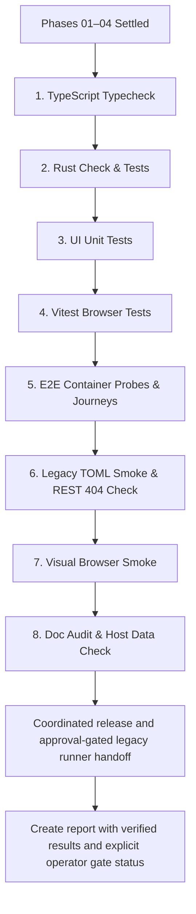

# Phase 05: Integration Verification

## 1. Context links

- Plan Root: [plan.md](./plan.md)
- Scope and Architecture Decisions: [reports/00-scope-and-design.md](./reports/00-scope-and-design.md)
- Ownership Manifest: [reports/01-ownership-manifest.json](./reports/01-ownership-manifest.json)
- Upstream Phase 01: [phase-01-ui-presentation-removal.md](./phase-01-ui-presentation-removal.md)
- Upstream Phase 02: [phase-02-client-and-test-infrastructure-removal.md](./phase-02-client-and-test-infrastructure-removal.md)
- Upstream Phase 03: [phase-03-native-server-removal.md](./phase-03-native-server-removal.md)
- Upstream Phase 04: [phase-04-feature-documentation-removal.md](./phase-04-feature-documentation-removal.md)
- User Validation: [confirmed decisions](./plan.md#validation-summary).
- Linux Service Evidence: [installed service re-audit](./reports/03-linux-service-audit.md).

## 2. Parallelization Info

- **Group:** Sequential Verification Group E
- **Pre-requisites:** All concurrent editing phases (Phase 01, Phase 02, Phase 03, Phase 04) MUST be 100% complete and settled.
- **Unblocks:** Plan completion and final user sign-off.
- **Strict Boundary:** Phase 05 owns NO application source files, tests, or product documentation. It ONLY creates verification artifacts inside `plans/261011-1640-remove-advisor/reports/`. Any compilation or test defects discovered during verification route back to the owning phase (01–04) for correction.
- **Operator Boundary:** Read-only audit and handoff are in this phase. Production deployment and destructive runner cleanup require separate explicit approval and an authorized operator; never auto-apply them as test cleanup.

## 3. Overview

- **Date:** 2026-10-11
- **Description:** Integrated build/runtime/browser verification plus the confirmed coordinated UI/server release handoff and approval-gated legacy Linux runner inspection/cleanup evidence.
- **Priority:** P2
- **Status:** completed (source verification passed; operator gates pending)
- **Review:** Phase 05 source integration verification complete and passed; production release and runner cleanup remain gated on explicit operator approval.

## 4. Key Insights

- Editing was decomposed into 4 concurrent slices (Groups A–D). Mid-flight builds were suppressed. Phase 05 is the sole validation gate that runs the aggregate build and test pipelines.
- Verification must confirm the complete vertical-slice cutover:
  1. Frontend TypeScript typecheck passes with zero `@/advisor/*` or `ApiClient.advisor` errors.
  2. Rust server builds without removal-related errors/new warnings; legacy unknown TOML keys follow normal parser semantics.
  3. UI unit tests and browser component tests pass without regression.
  4. Playwright E2E probes (`application-services.spec.ts`) and SQLite lite journey pass.
  5. Live server startup with a legacy TOML config containing `[server.advisor]` succeeds, reads and writes without crashing, and omits `[server.advisor]` on write.
  6. Authenticated REST calls to `/api/advisor/status` and `/api/advisor/settings` return HTTP 404 Not Found via Axum's standard fallback router without any shim.
  7. Visual inspection of Workspace in both IDE and Terminal modes, and Settings page in compact and wide viewports, demonstrates zero Advisor UI remnants, intact terminal continuity, and healthy surviving tools.
  8. Host data `$HOME/.evcrate` is proven untouched.
  9. Documentation contains zero dead links and zero 'Advisor removed' commentary.
  10. Web SPA builds and native shared-host type/build checks pass on the available platform; Windows/native runtime remains unqualified unless actually exercised.
  11. Stale persisted IDE/terminal tool IDs normalize through existing valid-ID logic; surviving profile/generation ownership and terminal keep-alive behavior remain intact.

- User confirmed one coordinated UI/server release, historical feature-doc scrubbing and exclusion of other-project tooling.
- Audit observed an enabled/inactive legacy runner pinned to v0.8.4. Existing nonprivileged dry-run exited 1 before complete state inspection; owner-only state requires a privileged audit. Do not report that dry-run as passed.
- Keep API/web/helper/recovery units and shared IPC; obsolete installed runner is separate from native Advisor's in-process service.
## 5. Requirements

- R05.1: Run UI/E2E typechecks, built web SPA, native host build and root lint after all writers settle. Report actual unavailable platform prerequisites; never claim unexecuted native runtime qualification.
- R05.2: Run `cargo check` and `cargo test` with zero failures.
- R05.3: Run `pnpm --filter @dam-hopper/ui test` with zero failures.
- R05.4: Run `pnpm --filter @dam-hopper/ui test:browser` with zero failures.
- R05.5: Run `pnpm --filter @dam-hopper/ui test:e2e:probes` and SQLite lite mode journey.
- R05.6: Perform legacy TOML startup smoke: start server with `dam-hopper.toml` containing `[server.advisor]`, confirm healthy startup, query status, trigger config rewrite, and verify `[server.advisor]` is omitted.
- R05.7: Verify old endpoints return HTTP 404 under authenticated sessions.
- R05.8: Conduct interactive/browser smoke across wide IDE, Terminal float, compact Workspace, and Settings page.
- R05.9: Verify host `$HOME/.evcrate` files were not modified or deleted.
- R05.10: Verify documentation links and LOC limits across all edited markdown files.
- R05.11: Generate `reports/02-integration-verification-report.md` documenting evidence for all verification gates.
- R05.12: Capture actual wide/compact UI evidence and observe no `/api/advisor/*` requests during Settings/Workspace interaction.
- R05.13: Prepare one coordinated API/web release after integration qualification; production execution remains subject to explicit deployment approval.
- R05.14: Require complete privileged dry-run and legacy-consumer review before requesting guarded runner cleanup approval. Preserve other-project tooling/data, retained releases and account/group by default.
- R05.15: After separately approved cleanup, verify obsolete runner unit/enablement absence and surviving API/web/helper health. Record pending/refused/unavailable operator gates separately from source verification; never claim full deployment completion while they remain open.

## 6. Architecture

Sequential verification workflow:


## 7. Related code files (exclusive)

All paths relative to `ROOT=/home/loidinh/WS/dam-hopper-ws/remove-advisor`:

### Created Files (1 file)
- `plans/261011-1640-remove-advisor/reports/02-integration-verification-report.md`

## 8. File Ownership

Phase 05 exclusively owns `plans/261011-1640-remove-advisor/reports/02-integration-verification-report.md`. Phase 05 modifies NO source code, tests, or product documentation.

## 9. Implementation Steps

1. Verify that all sibling agents (Phases 01, 02, 03, 04) have yielded terminal completion.
2. Execute TypeScript type checking:
   ```bash
   pnpm --filter @dam-hopper/ui build
   pnpm --filter @dam-hopper/ui test:e2e:typecheck
   pnpm build
   pnpm build:native
   pnpm lint
   ```
   Native host build is Linux qualification only; record missing system dependencies/platform limitations rather than silently dropping this gate.
3. Execute Rust checks once from repository ROOT:
   ```bash
   cargo check --manifest-path server/Cargo.toml
   cargo test --manifest-path server/Cargo.toml
   ```
4. Execute frontend Vitest unit test suite:
   ```bash
   pnpm --filter @dam-hopper/ui test
   ```
5. Execute frontend Vitest browser component tests:
   ```bash
   pnpm --filter @dam-hopper/ui test:browser
   ```
6. Execute E2E container probes and surviving SQLite lite mode journey:
   ```bash
   pnpm --filter @dam-hopper/ui test:e2e:probes
   pnpm --filter @dam-hopper/ui test:e2e e2e/sqlite-auth-lite-mode/sqlite-auth-lite-mode.spec.ts
   ```
7. Execute legacy configuration smoke in an isolated temporary HOME/workspace:
   - Supply the required `[workspace]` and legacy `[server.advisor] enabled=true` TOML; bind loopback and a unique port, use SQLite lite auth with real seeded credentials.
   - Launch the newly built server, confirm `/api/health` and authenticated `/api/config`.
   - Re-submit the surviving config via authenticated `PUT /api/config` (router.rs:137-138); verify rewritten TOML contains no Advisor section and unrelated settings/projects retain their values.
   - Never use production config or mutate user HOME; clean up the smoke process and temporary files.
8. Execute endpoint 404 verification:
   - Send authenticated `GET /api/advisor/status` and `PATCH /api/advisor/settings`.
   - Verify both return HTTP 404 Not Found from standard Axum router (not 403 or custom shim).
9. Execute interactive browser smoke:
   - Open Workspace in desktop IDE mode (wide viewport): verify tools (explorer, git, ports, terminals) open normally and right-top tool toggle operates without `"advisor"`.
   - Open Workspace in terminal mode: verify terminal panels and floating tools render cleanly.
   - Open Workspace in compact mode: verify bottom tabs contain only surviving tools and resolve default cleanly.
   - Open Settings page: verify Native Advisor accordion is absent; Appearance, Shortcuts, Idle Suspend, and Maintenance panels render.
   - Seed stale persisted `advisor` tool selections in each actual supported layout key; reload and verify valid default panels without crash/blank overlay. Do not invent a compact storage key if that state is ephemeral.
   - Across mode/viewport/profile transitions, exercise terminal input/output and split selection without new PTYs or ownership crossover; inspect network traffic for zero Advisor requests.
   - Capture wide IDE, wide terminal, compact Workspace and compact/wide Settings visual evidence; reference actual browser screenshot artifacts in the report, then close test tabs/processes.
10. Execute documentation and safety audits:
    - Run with isolated HOME; compare only explicit pre-existing data sentinels before/after (no content disclosure or recursive personal-data scan). External OMP processes may update their own data independently; distinguish that from DamHopper mutation.
    - Check for broken Markdown links across `docs/`.
    - Check that all edited documentation files are under 800 LOC.
11. Execute the Linux operator handoff after code/runtime qualification:
    - Recheck installed unit states, actual unit definitions and dependency edges; the service audit is a dated observation, not permanent state.
    - Authorized operator runs `sudo bash deploy/remove-plugin-platform.sh --scope system` (no `--apply`); require a complete dry-run and inspect allowlisted state/legacy consumers. If privilege is unavailable or inspection fails, report the exact operational blocker.
    - Present the coordinated API/web release and cleanup scope for explicit approval. Never infer permission to mutate production from source-plan approval.
    - After approved deployment, retain API/web/helper/recovery services. Only after separate cleanup approval may the authorized operator use `sudo bash deploy/remove-plugin-platform.sh --scope system --apply`; omit `--purge-account`.
    - Verify runner unit/enablement absence and API/web/helper health/shared IPC preservation. Retain external Evcrate data, other-project tooling and old release archives; do not weaken owner-only directory permissions.
12. Write the integration report with separate source-verification, coordinated-release and legacy-cleanup statuses; pending operator approval is not a passing deployment result.

## 10. Todo list

- [x] Confirm Phases 01–04 terminal completion
- [x] Run UI typechecks
- [x] Run Rust compilation and tests
- [x] Run UI unit tests
- [x] Run UI browser tests
- [x] Run E2E probes and SQLite auth journey
- [x] Run legacy TOML startup smoke
- [x] Verify authenticated REST 404 absence
- [x] Perform interactive browser smoke
- [x] Audit host data and documentation links
- [ ] Prepare coordinated UI/server release and request explicit deployment approval (gated on operator)
- [ ] Obtain complete privileged legacy-runner dry-run and legacy-consumer review (gated on operator)
- [ ] Request separate guarded cleanup approval; verify runner absence and surviving services only after approved execution (gated on operator)
- [x] Write `02-integration-verification-report.md`

## 11. Success Criteria

- 100% of test suites (Rust, UI unit, UI browser, E2E probes, surviving SQLite journey) pass.
- Legacy TOML boots cleanly and drops `[server.advisor]` on write.
- Authenticated requests to `/api/advisor/*` return HTTP 404 Not Found.
- Zero visual traces of Advisor in Workspace and Settings.
- Host `~/.evcrate` files untouched.
- Report published with actual verification results and explicit operator gate status; no fabricated cleanup/deployment success. Deployment is complete only after approved execution and health/absence checks.

## 12. Conflict Prevention

- Do not modify any application code, tests, or documentation. If a test fails, report the failure back to the owning phase (01–04).

## 13. Risk Assessment

- **Risk:** Port conflicts during browser tests or E2E containers.
  - **Mitigation:** Ensure previous container/process cleanup runs before starting verification suites.

- **Risk:** Enabled legacy runner can activate despite being inactive at audit time; source deletion does not remove installed unit.
  - **Mitigation:** Privileged dry-run, consumer review and approval-gated existing allowlist cleanup; keep unrelated units and data intact.
## 14. Security Considerations

- Verifies that obsolete endpoints are completely inaccessible and return 404.
- Confirms that host environment files were not touched during retirement.
- Production service changes are operator-owned and separately approval-gated. Never remove external tooling/data, purge the dedicated account by default or delete shared runtime/release directories.

## 15. Next steps

- Publish `02-integration-verification-report.md`.
- Report implementation evidence only after every declared gate is exercised or an exact missing platform prerequisite is documented; do not confuse planning completion with feature removal completion.
