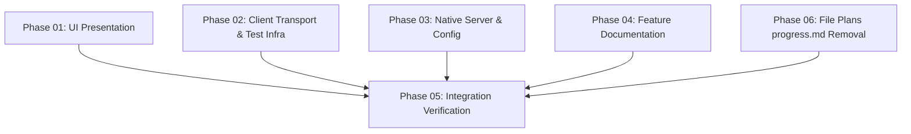

# DamHopper Advisor Complete Feature Removal

Worktree `remove-advisor` created from `538da1d3`, merged to origin/main `abba947c`. Complete clean cutover removal of Advisor UI, client transport, Rust backend domain/API, test suites, and documentation. All five phases executed and qualified via integration verification; production deployment and legacy runner cleanup remain approval-gated.

## Phases

| Phase | Status | Progress | Group | Effort | Link |
|---|---|---|---|---|---|
| 01 UI presentation & shortcuts | done (2026-10-11) | 100% | A | 5h | [phase-01](./phase-01-ui-presentation-removal.md) |
| 02 Client transport & test infra | done (2026-10-11) | 100% | B | 4h | [phase-02](./phase-02-client-and-test-infrastructure-removal.md) |
| 03 Native server & config | done (2026-10-11) | 100% | C | 3h | [phase-03](./phase-03-native-server-removal.md) |
| 04 Feature documentation | done (2026-10-11) | 100% | D | 2h | [phase-04](./phase-04-feature-documentation-removal.md) |
| 05 Integration verification | done (2026-10-11) | 100% | E | 4h | [phase-05](./phase-05-integration-verification.md) |
| 06 File plans progress.md removal | done (2026-10-11) | 100% | F | 4h | [phase-06](./phase-06-remove-progress-md-from-file-plans.md) |

## Dependency Graph

## Dependency Matrix

| Phase | Editing Pre-requisites | Validation Pre-requisites |
|---|---|---|
| Phase 01 | None (Independent Group A) | Phases 01-04 settle |
| Phase 02 | None (Independent Group B) | Phases 01-04 settle |
| Phase 03 | None (Independent Group C) | Phases 01-04 settle |
| Phase 04 | None (Independent Group D) | Phases 01-04 settle |
| Phase 05 | Phases 01-04 complete | Phases 01-04 complete |
| Phase 06 | Phases 01-04 complete | Server and UI tests pass |
## Execution Strategy & Ownership Matrix

- **Concurrent Editing (Groups A–D):** Phases 01, 02, 03, and 04 operate independently on strictly mutually exclusive file sets with zero overlap. No intermediate lint, build, or test runs occur while editing.
- **Sequential Validation (Group E):** Phase 05 executes comprehensive typecheck, Rust unit/integration suites, UI tests, Playwright journeys, and browser smoke once Groups A–D settle. Phase 05 owns no source files; issues route back to the owning phase.
- **External Data Protection:** Host `~/.evcrate` data is never modified. No compatibility shims or 'Advisor removed' documentation additions are created.

| Owner | Exclusive files | Boundary |
|---|---|---|
| 01 / A | 66 | React Advisor tree, Settings/Workspace, hooks/context/layout and unit tests |
| 02 / B | 40 | API client/transport, package exports/scripts, browser/E2E infrastructure and fixtures |
| 03 / C | 28 | Rust domain/routes/state/config/auth cleanup, server tests and example |
| 04 / D | 23 | Dedicated/mixed feature docs and guidance; workflow rename source **and destination** |
| 05 / E | 1 | New verification report only; fixes return to existing owners |
| 06 / F | 18 | File plans parser/scanner/DTOs, UI viewer/tabs, E2E fixtures/specs, docs |

Exact path/action inventory: [ownership manifest](./reports/01-ownership-manifest.json).
Editing groups A–D have no prerequisites; their combined runtime verification waits for all writers.
Documentation work only deletes feature content and repairs surviving links; no retirement notices.

## Validation Summary

**Validated:** 2026-10-11; three decision topics plus scope/service clarification.
- Other-project OMP/Evcrate tooling stays out of scope; complete DamHopper removal scope unchanged.
- Scrub historical DamHopper Advisor feature documentation too; preserve unrelated facts/sealed evidence.
- Ship UI and server in one coordinated release.
- Installed legacy runner is enabled/inactive and pins v0.8.4; current API/helper use v0.12.0.
- Keep API/web/helper/recovery units; no dedicated Advisor unit found in queried system-level inventory.
- [Linux service audit and exercised dry-run limitation](./reports/03-linux-service-audit.md).

### Validation Reflection
- [x] Decisions synchronized into all five phases; Phase 05 contains coordinated-release and privileged legacy-runner approval/verification gates.
- [x] Implementation completed across all phases; source verification passed 100%; operator deployment and runner cleanup remain gated on authorization.

### Scope Amendment (2026-10-11)
- **Deprecation basis:** With Native Advisor removal and tooling removing 'advice' mode, `progress.md` is deprecated in the Project Plans Dashboard ("File plans").
- **Plan-only authority:** Derives status, phases, completion, and dates purely from `plan.md`. Preserves date-range validation and frontmatter conflict detection.
- **Navigation compatibility:** Preserves generic sandboxed Markdown link navigation for viewing legacy subdocuments without letting them alter plan status. Does not modify or delete user progress files.
- **Advisory review:** Scope extension reviewed via `xd://ask_advisor` incorporating regression testing for ignored legacy progress files and test suite bounding.
- **Verification settlement:** All 6 phases implemented and verified. Rust unit/integration suites (20/20 plans tests, 16/16 plans_api tests, 1427/1427 full suite), UI unit tests (2,695/2,695), browser tests (287/287), and full workspace typecheck/build passed.
