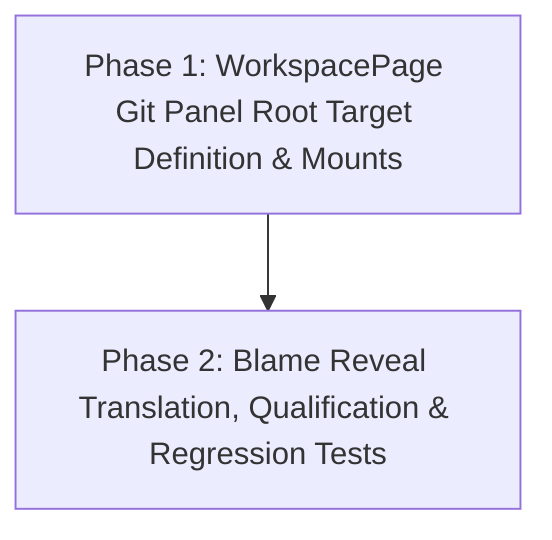

# Plan: Git Panel Worktree Workspace Retention

## Goal
Ensure that in `WorkspacePage`, switching worktrees does not redirect the Git panel (`WorkspaceGitPanel`) to the worktree path. The Git panel in Workspace retains the configured project root target (`{ profileId, project }`), maintaining stable repository inspection and operations while allowing FileTree, EditorTabs, SearchPanel, and Terminals to bind to the selected worktree.

## Dependency Graph

## Execution Strategy
- **Phase 1 (Sequential/Implementation)**:
  - Define profile-qualified `rootGitTarget` and `isRootGitAvailable` in `WorkspacePage.tsx`.
  - Update all 3 mounts of `WorkspaceGitPanel` (`terminalGitContent`, bottom tool `git`, `compactGitSurface`) to use `rootGitTarget`, `${activeProfileId ?? "ambient"}:${projectName}:root` key, and `isRootGitAvailable`.
  - Update `handleRevealGitCommit` in `WorkspacePage.tsx` to safely handle reveal requests across worktree tabs and the root Git panel without unsafe wildcard matching.
- **Phase 2 (Implementation & Qualification)**:
  - Update `packages/ui/browser-tests/project-worktree-target.browser.tsx` to assert that `WorkspaceGitPanel` retains the root target when a worktree is selected, while FileTree, Search, and Terminals correctly switch to the selected worktree.
  - Extend unit test coverage in `WorkspacePageBlameReveal.test.tsx` verifying root Git panel mount properties and reveal request handling across worktree and root tabs.

## File Ownership Matrix
| File | Phase | Scope |
| --- | --- | --- |
| `packages/ui/src/components/pages/WorkspacePage.tsx` | Phase 1 | Git panel mount targets, keys, availability, and reveal routing |
| `packages/ui/src/lib/git-commit-reveal.ts` | Phase 1 | Targeted translation/validation for root Git panel reveal requests |
| `packages/ui/src/components/organisms/WorkspaceGitPanel.tsx` | Phase 1 | Reveal request consumption when panel is root-scoped |
| `packages/ui/browser-tests/project-worktree-target.browser.tsx` | Phase 2 | Browser qualification for worktree switching with root Git panel |
| `packages/ui/src/components/pages/WorkspacePageBlameReveal.test.tsx` | Phase 2 | Blame reveal unit qualification with root Git panel |

## Side-Effect Review Checklist
- [x] Profile isolation: Profile ID and generation must be preserved in `rootGitTarget`.
- [x] Multi-mount synchronization: All three Git panel mounts (`terminalGitContent`, IDE bottom tool, `compactGitSurface`) must use the identical root target and key.
- [x] Worktree editor tabs: Editor tabs, FileTree, Search, and terminal launches must remain worktree-bound.
- [x] Blame commit reveal: Blame reveal from a worktree tab must locate the commit in the root Git panel when targeting the same project and connection owner.
- [x] Unconnected/unconfigured project safety: When disconnected or project is invalid, Git panel must not claim unconditional availability.

## Per-Phase Success Criteria
- **Phase 1**:
  - `WorkspacePage.tsx` passes `rootGitTarget` (worktreePath undefined) to `WorkspaceGitPanel`.
  - Mounting keys follow `${activeProfileId ?? "ambient"}:${projectName}:root`.
  - Type checking (`pnpm --filter @dam-hopper/ui check` or `tsc`) passes with zero diagnostics.
- **Phase 2**:
  - `project-worktree-target.browser.tsx` tests pass in Chromium.
  - `WorkspacePageBlameReveal.test.tsx`, `WorkspaceGitPanelBlame.test.tsx`, and `WorkspacePage.test.tsx` all pass.
