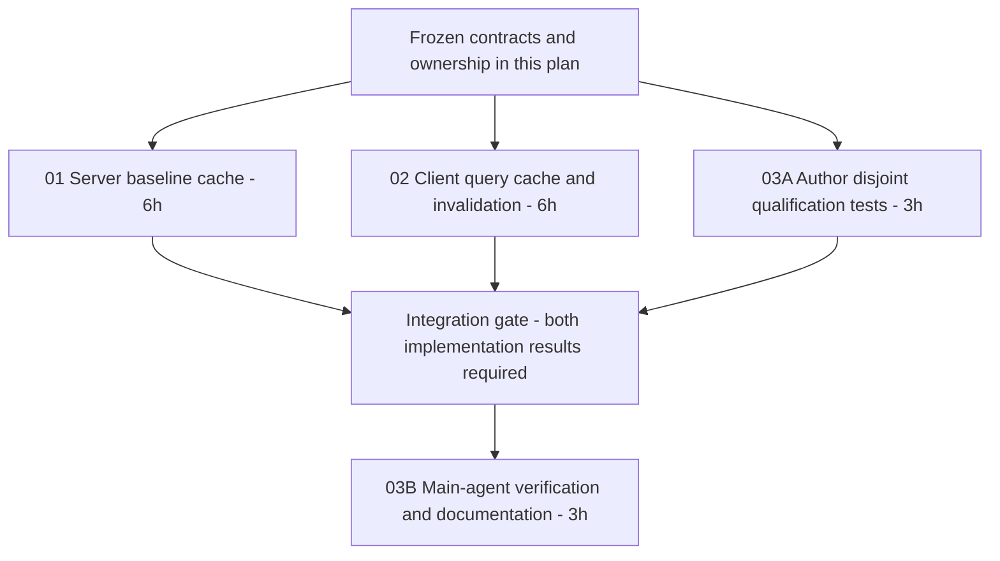

# Git Blame Caching — Parallel Execution Plan

## Outcome and researched constraints
- Work completed in `/home/loidinh/WS/worktrees/dam-hopper-git-blame-caching`; all paths below relative to that root. Implementation, qualification, and review remediations complete across all phases. Estimates: engineering effort, not measured elapsed time.
- Unchanged eligible file + current owner/root/HEAD/content: tab remount, reopen then re-enable, and toggle-on reuse validated attribution without another blame POST or `Loading blame…` transition. Existing per-tab opt-in remains session-only.
- Dirty edits still clear annotations immediately and debounce 250 ms; server cache avoids another historical `repo.blame_file` traversal, not buffer projection/serialization.
- Observed: hook uses mount-local `useState`; `blame.rs` computes history every request; API acquires two-permit semaphore before target resolution. `root_id = "."` is not globally unique; server key needs repository namespace. Borrowed native blame handles cannot be placed in shared application state.
- Frozen contract: existing request/response JSON unchanged; snapshot/model envelope remains per request. Cache only successful attribution. No persistence, cache endpoints, polling, automatic retries, worker-pool replacement, or admission-policy changes.

## Architectural Contract: Git Panel Root Scope vs Editor Blame Scope (Commit 514084d)
- **Git Panel Scope (`WorkspaceGitPanel`)**: Commit `514084d` updated `WorkspacePage` so the Git panel always binds to `rootGitTarget` (`{ profileId, project }` without `worktreePath`), keeping repository-wide history inspection stable even when switching worktrees.
- **Editor Blame Scope (`useEditorGitBlame`)**: Git blame MUST remain bound to the open tab's actual project target, including `worktreePath` and the worktree's checked-out HEAD. Blaming against the root project HEAD would falsely mark worktree-committed lines as uncommitted.
- **Blame Commit Reveal**: Commit `514084d` updated `isGitCommitRevealRequestMatchingTarget` so the root Git panel accepts commit reveal requests originating from worktree editor tabs. Blame caching preserves this separation: client cache keys include the tab's `worktreePath`, while reveal dispatches to the root panel.

## Invalidation Architecture: Automatic Handling vs Refresh Annotation
- **Automatic Server Replacement**: Server cache keys include `head_oid` (immutable Git commit OID). Any commit, branch change, rebase, or pull changes `head_oid`, automatically selecting a new cache key on demand without requiring active filesystem watchers. Staged rename origins are resolved on every request before lookup.
- **Automatic Client Revocation**: Client cache actively revokes stale entries via shared Git mutation helpers (`invalidateGit*`), SSE repository events, and focus/visibility HEAD discovery, even while blame hooks are unmounted.
- **Manual Refresh Annotation**: Acts as an explicit user force-revalidation escape hatch that bypasses the client query cache, not the primary freshness mechanism.
## Dependency graph

## Execution strategy and phase success
| Phase | Status | Dependencies / observable completion | Plan |
| --- | --- | --- | --- |
| 01 | completed | Sequential warm requests invoke historical blame once; bounded cache and projection equivalence tests passed (31 unit/diff, 16 API) | [Server](phase-01-server-blame-cache.md) |
| 02 | completed | Warm remount makes zero blame calls; inactive-target invalidation and owner retirement implemented; H1/H2 remediations applied | [Client](phase-02-client-blame-query-cache.md) |
| 03 | completed | Targeted qualification passed (144 test assertions passed + 1 release benchmark; >21x speedup on warm baseline); B01 remount and E01/E02 container journeys open for Main agent | [Qualification](phase-03-invalidation-qualification-tests.md) |
- Intended implementation orchestration: spawn 3 agents on strict ownership below, collect all 3 terminal results, then synthesize. If spawning unavailable, execute same slices inline; do not claim parallel execution occurred.
- Each implementer authors owned tests but skips builds/tests/lint/formatters mid-flight. Integration owner runs checks once after all changes land; test failures go back to file owner. No concurrent shared-file repair.
- Phase 01 owns native differential oracle and final LF projection cutover; comparison failures block shipping, never justify changed blame semantics. Phase 03 owns execution, not production fixes.

## Strict file ownership matrix
| Owner | Exclusive files — modify unless marked new |
| --- | --- |
| 01 | `server/src/git/blame.rs` (including colocated unit tests); `server/src/state.rs`; `server/src/api/git_blame.rs`; `server/src/git/mod.rs`; `server/Cargo.toml`; `server/Cargo.lock`; new `server/src/git/blame-cache.rs` (explicit `#[path]` module declaration, matching kebab-case convention) |
| 02 | `packages/ui/src/hooks/use-editor-git-blame.ts`; `packages/ui/src/api/queries.ts`; `packages/ui/src/hooks/use-sse.ts`; `packages/ui/src/lib/editor-git-blame.ts`; `packages/ui/package.json`; `pnpm-lock.yaml`; new `packages/ui/src/lib/editor-git-blame-cache.ts` and `editor-git-blame-cache.test.ts` |
| 03 | `server/tests/git_blame_api.rs`; `packages/ui/src/hooks/use-editor-git-blame.test.tsx`; `packages/ui/src/hooks/use-sse.test.ts`; `packages/ui/src/api/queries-git-diff.test.ts`; `packages/ui/src/lib/editor-git-blame.test.ts`; `packages/ui/browser-tests/editor-git-blame.browser.tsx`; `packages/ui/e2e/editor-git-blame/editor-git-blame.spec.ts`; `packages/ui/e2e/editor-git-blame/git-fixture.ts`; `docs/architecture/workbench-files-editor-and-git.md`; `docs/api/git.md`; `docs/testing.md`; `docs/project-roadmap.md`; `docs/CHANGELOG.md`; new plan-local `qualification.md` |
- Read access unrestricted. No parallel phase edits another owner's files, manifests, fixtures, or tests. Newly discovered callsites go to existing owner; integration owner records any expanded allocation before edits. UI components/transport DTOs intentionally unchanged.

## Side-effect review checklist — mandatory qualification gates
- [x] Equal project/path across profiles, generations, worktrees, nested roots and canonical repository identities never cross-hit; binding mismatch fails closed.
- [x] Dirty edit clears old attribution synchronously; 250 ms coalescing, model-version checks and late-response rejection retained; no cache write after repository epoch changes.
- [x] Mutation, index/staged rename, commit/rewrite/reset, branch/HEAD/root change, workspace remap and owner replacement retire reuse even with all blame hooks unmounted.
- [x] Focus/visibility discover external HEAD changes; unknown/invalidated root cannot authorize an immediate hit; manual Refresh always bypasses client reuse.
- [x] No retained Monaco/editor/DOM instances; timers/subscriptions/owner leases disposed; pending request payloads released on settle/cancel; no disk or browser-storage persistence.
- [x] Server LRU: 128 entries / 64 MiB retained weight; client: 64 entries / 32 MiB retained weight, five-minute inactive GC; oversized entries compute normally but are not admitted.
- [x] Cache mutex never covers Git work, projection or await; native historical handles never outlive repository; HEAD checked on warm path; two-permit busy semantics unchanged.
## Delivery evidence and unresolved questions
- Verification evidence: 144 unit/integration/regression test assertions passed across 6 test suites (Rust unit/differential: 31, Rust API integration: 16, UI client cache unit: 25, UI client hook unit: 19, UI blame/diff regressions: 50, Monaco browser component: 3), UI build/typecheck clean (tsc exit 0), plus 1 release performance benchmark executed and passed (145 test executions total).
- Performance qualification: server release benchmark fixture `blame_cache_large_file_performance` (10,000 lines, 101 commits, 407,986 bytes): cold 161.85 ms → warm repeat median 7.59 ms (>21x speedup), dirty buffer median 10.79 ms (>15x speedup), accounted retained memory stable at 416,269 bytes.
- Remediations applied: H1 (reschedule on invalidated lease), H2 (render-phase model buffer metadata memoization per version), M3 (pop_entry accounted byte eviction), M7 (removed circular re-export); M4 architecture doc synchronization delegated to `GitBlameDocsManager`.
- Open integration gates for Main agent: B01 hook-driven Monaco remount harness, E01/E02 containerized authenticated E2E journeys.
- Unresolved questions: none blocking.
