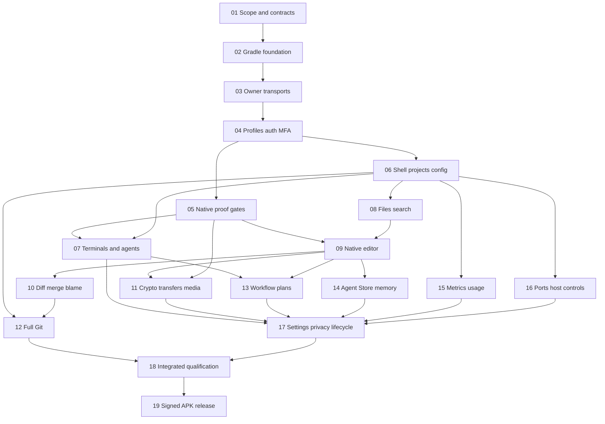

# Execution Guide and Implementation Handoff

[Overview](./plan.md) · [scope ledger](./scope-and-acceptance.md) · [contracts/modules](./contracts-and-modules.md).

**No commands below were run as app verification during planning.** The Gradle project/scripts do not exist yet. Phase02 must freeze actual task names/toolchain; later scripts are outputs of their owning phase, not current executable deliverables.

## Enter the correct checkout

- Worktree: `/home/loidinh/WS/worktrees/dam-hopper-android-native-app`.
- Branch: `feat/android-native-app`; base `d897a91f76a07ec819a50ffc2756cb69327b2fe3`.
- Canonical plan: `plans/261015-1647-android-native-app/plan.md`.
- Future application source/build/scripts: `native-app/` only. Current directory is reserved/empty; no scaffold created.
- Original `/home/loidinh/WS/dam-hopper` dirty files/reports are not prerequisites or part of this plan's changes.
- Do not create another branch/worktree or switch original checkout when implementing this plan.
- Read actual source before editing and recheck baseline drift. User changes remain theirs; no reset/stash/commit/merge without appropriate instruction.
- Workspace is TERMINAL + Traditional only. One top panel-button row below server/project header uses icon + short text and horizontal single-line scrolling; always visible with IME. One content area on every screen size, retaining hidden terminal/editor controllers. No IDE/Runtime mode, floating buttons, wide-screen terminal/panel dock or additional panel-navigation surface; [validation answers](./validation-answers.md) are binding.

Native hard-planning command admitted this task through installed `/evc-cmd-plan-x-hard`. Planning skill/architecture gate completed; no implementation command has run. Active-plan helper reported missing `EVCRATE_SESSION_ID`; pass plan path explicitly rather than claiming activation persisted.

## Dependency graph



Numeric phase order is the default easy-follow sequence. Graph shows true dependencies when dividing work; parallelism is optional, not required. Phase05's terminal/editor/crypto subgates separately block their dependents; all remain release-critical.

## Safe work division

- Single integration owner for `shared/core`, app composition/navigation, Gradle catalog/locks, manifests and root scripts.
- After Phase06: terminal/agents, files/search, host metrics/usage and ports/host controls can be separate owned feature slices if Phase05 subgates permit them.
- After Phase09: diff/blame, encrypted transfer/media, workflow and Agent Store can be divided by feature files/repository interfaces. Agree interfaces before concurrent edits.
- No sibling edits to common DTOs/owner registry/catalog without integration-owner handoff.
- Each implementation phase delivers real behavior, consumer-visible regression tests where valuable, actual surface smoke, then affected docs. Skip unrelated build/lint/formatter runs mid-flight; run appropriate checks once integration settles.
- Do not introduce inactive placeholders, no-op repositories, fake connected data, unsupported-notice substitutes for included features, or compatibility aliases for old hosts.

## Planned verification commands

Run from the new worktree root after Phase02 implements/finalizes the wrapper/tasks:

```bash
./native-app/gradlew -p native-app :shared:jvmTest
./native-app/gradlew -p native-app :androidApp:testDebugUnitTest
./native-app/gradlew -p native-app :androidApp:assembleDebug
./native-app/gradlew -p native-app :androidApp:installDebug
./native-app/gradlew -p native-app :androidApp:connectedDebugAndroidTest
```

These are proposed conventional task contracts, not claims that today's repository provides them. If selected plugins change task names, update this guide during Phase02. Add native lint/ABI/license tasks through the chosen compatible build rather than guessing names in CI.

Phase18 adds concrete native-app/scripts device-journey and APK-audit tools; exercise installed app, not mock transport echoes. Phase19 adds release verification and runs signed artifact installation/upgrade; `assembleRelease` alone is insufficient.

## Real server/device environment

- Use isolated temporary server config, SQLite lite auth DB or dedicated MongoDB, MFA key/session signing data and disposable project/worktree/catalog roots. Follow current [auth runbook](../../docs/configuration/server-environment-auth.md#operator-account-approval-and-role-promotion-runbook).
- Canonical authenticated fixtures must provision/approve test accounts and exercise MFA; do not use `--no-auth` as evidence for profile/auth/role/consent/media acceptance.
- Bind local development server to `127.0.0.1`; never use root dev scripts that bind unauthenticated service to all interfaces.
- `adb reverse tcp:4803 tcp:4803` can expose loopback development API to an attached emulator/device with debug-only cleartext policy. Do not change release TLS validation for this convenience.
- Release/private-APK journeys also run against properly trusted HTTPS/WSS endpoints; no trust-all, fake Origin, certificate-import UI or backend-header change assumed.
- Test baseline API29/current API with x86_64 emulator, named physical ARM64 hardware/IMEs, and an actual supported16KiB environment for native code paths. API level/ABI alone does not establish page-size testing.
- Controlled network fault injection and process recreation use disposable endpoints; record setup/teardown and observed server state. No real-user reset/suspend/tunnel exposure during automated acceptance.

## Verification selection by phase

| Phases | Required evidence beyond compilation |
| --- | --- |
| 01–02 | Approved full behavior/device ledger; reproducible dependency resolution and actual app launch |
| 03–04 | Real REST/WS/MFA/account/vault flows plus delayed-old-owner rejection |
| 05 | Native terminal/TUI/IME, native editor/language-service seam, OPAQUE/tamper/ABI proof; decision record |
| 06–08 | Native navigation and live PTY lifetime; file/watch/search/replace results on actual server targets |
| 09–12 | Remote safe save/conflict, diff/merge/blame outcomes, encrypted transfer/media and actual Git refs/index/files |
| 13–16 | Actual workflow/store/host/usage/tunnel operations and denial/partial-failure/capability behavior |
| 17 | Focused native terminal/editor/IME privacy isolation; permissions and full lifecycle/owner retirement |
| 18 | All requirement IDs + security/ABI/performance/soak + human-reviewed full-app evidence |
| 19 | Signed optimized APK clean install/upgrade, signatures/licenses/provenance and release compatibility manifest |

Existing server/web checks remain current package-manifest commands and run when their code/integration is changed. Existing13-file version-alignment check stays required; do not assume root pnpm lint/check sees native-app or change existing Tauri scripts implicitly.

## Completion/stop discipline

1. Start only actionable dependencies. Keep plan/phase status pending until implementation is authorized and begins.
2. Review phase source references and actual current schemas before code; update contract ledger for observed drift.
3. Keep meaningful permanent tests for behavioral edges/invariants; discard brittle source-text/incidental-default tests rather than re-pin them.
4. Exercise changed native surface, record actual outcome, update affected docs and ledger; tests alone do not qualify UI.
5. A failed native library/language/crypto proof requires candidate/design resolution and reproof. No silent feature reduction, browser runtime or new service.
6. Explicitly mark unmet consumer-visible criteria blocked; later release cannot call a partially working app complete.
7. No Tauri retirement, desktop implementation or future full browser-preview parity approval is implied by Android release completion.

## Unresolved prerequisites

A named available ARM64 device/IME set, exact SDK/toolchain/dependency pins, signing-key custody, validated native JSON/TS implementation and frozen measured budgets must be supplied/proved by their owning phases. This plan does not claim those resources or integrations already exist.
