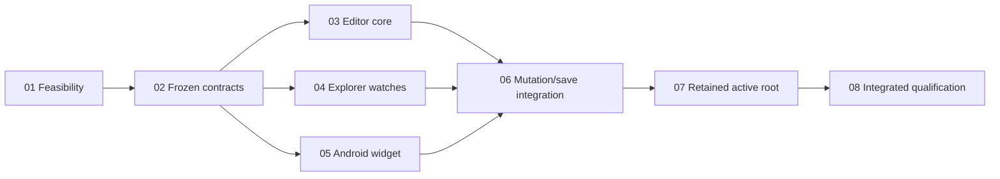

# Native editor and file explorer

## Authority and readiness
- Origin: explicit native-user `plan/parallel` planning request following the [approved design](../reports/brainstorm-261023-1351-native-editor-file-explorer.md); Phase 01 qualification was separately approved and completed 2026-10-23. Remaining feature implementation stays gated by the phases below.
- Phase 01 feasibility completed 2026-10-23 on x86_64/API 36 (2/2 instrumentation tests). Phase 02 contract freeze is the next prerequisite for feature work; API 29 (`android-29`), `arm64-v8a`, and LGPL-2.1 distribution compliance remain Phase 08 release gates. No guessed APIs, silent upgrade or TextField fallback.
- Review: user-approved Advisor substitute (standard reviewer agents hit provider usage limit). 4 High + 4 Medium accepted and propagated, 1 rejected with source evidence; [triage](reports/independent-plan-review.md). Structural validation re-passed after revision. Final prompt-policy interview not run; no user decision outstanding. Authoring does not hydrate task state.
- Canonical path: `G:/ws/sharing/dam-hopper/plans/261023-1429-native-editor-file-explorer/plan.md`. Session persistence unavailable (`EVCRATE_SESSION_ID` missing); explicit path retained, no activation claimed.

## Outcome and boundaries
- Login → projects → focused workspace; one header/inline Terminal–Files–Editor row above IME, one visible panel phone/tablet. Preserve current ProjectTerminalScreen/VtTerminalSurface, PTY/replay/font/pinch/FIFO and hidden-input isolation.
- Native document is sole text/undo authority; retain docs/tree/view state across panels/Activity recreation, not process death. Owner includes captured endpoint/account/profile/project/worktree; generation/socket revocable. Dirty/unknown buffers never retarget or silently evict.
- Existing REST/WS APIs only: lazy explorer and all approved mutations; conditional saves/conflicts/unknown reconciliation; shared nonrecursive watches; strict bounded UTF-8/tier reads. Full [contracts C1–C7](contracts.md) and [all ten acceptance journeys](acceptance-matrix.md).
- Excludes backend changes, WebView, unrelated workbench panels, transfer, project search/replace, Git/blame, rich preview, TS/LSP, durable drafts and new crypto enrollment. No security strengthening claim for existing differing fs:op/write protections.

## Phases (Phase 01 complete; Phases 02–08 pending)
| Phase | Deliverable | Status | Execution / owner | Detail |
|---|---|---|---|---|
| 01 | Exact dependency/native document feasibility | Complete (2026-10-23; x86_64/API 36, 2/2) | Sequential / qualification owner | [phase01](phase-01-pinned-widget-feasibility.md) |
| 02 | Identity/document/watch/mutation/outcome contracts | Pending | Sequential / Main | [phase02](phase-02-frozen-common-contracts.md) |
| 03 | Shared documents, bounded tiers, safe tabs/saves | Pending | Concurrent group / EditorCore | [phase03](phase-03-shared-editor-state.md) |
| 04 | Explorer actions + shared ordered watchers | Pending | Concurrent group / Explorer | [phase04](phase-04-explorer-and-shared-watchers.md) |
| 05 | Android native document + shared editor bridge | Pending | Concurrent group / AndroidEditor | [phase05](phase-05-android-native-editor.md) |
| 06 | Save/mutation identity + uncertain reconciliation | Pending | Sequential / Main | [phase06](phase-06-mutation-save-integration.md) |
| 07 | Retained runtime, current terminal, guarded active root | Pending | Sequential / Main | [phase07](phase-07-retained-active-workspace.md) |
| 08 | Actual app/server/device/distribution + docs | Pending | Sequential / Main | [phase08](phase-08-qualification-and-documentation.md) |

## Ownership and execution groups
| Group | Exact ownership expansion | Transfers / conflicts |
|---|---|---|
| G1:01 then02 | Literal create/modify/delete paths + task IDs in linked phases | Architecture prerequisite; no feature workers before evidence/interface freeze. |
| G2:03 ∥04 ∥05 | 03 sessions/tabs/load/save/tests;04 subscriptions/tree/actions/tests;05 Android surface/shared UI/Workbench caller migration/tests | Disjoint literal paths in task records. Frozen common files read-only; no blanket directory ownership. |
| G3:06 then07 | 06 receives listed editor/file state/repository paths;07 owns runtime/MainActivity/root/current terminal/navigation | [Transfer ledger](ownership.md) names each repeated-file writer chain; all dependent, never simultaneous. Main sole integration owner. |
| G4:08 | Actual-app journey tests/build transfers, then verification, docs/licenses, acceptance | Sequential transfers only; one coherent Main verification, no competing mid-flight suites. No estimates/speedup claims. |

## Related plans and evidence
- [Broader native release](../261015-1647-android-native-app/plan.md): **concurrent-overlap arbitration required**, not an implementation prerequisite inferred from phase labels. Shared editor/files/host/Gradle/docs writers serialize; preview/TS/semantic release obligations remain open and are neither satisfied nor deleted here.
- [Core-flow refactor](../261018-1643-android-core-flow-refactor/plan.md): informational active-root provenance; overlap if resumed. [Terminal font resize](../261023-1058-native-terminal-font-resize/plan.md) and [icon/font reuse](../261023-0747-android-icon-font-reuse/plan.md): preservation constraints + overlap on listed shared UI files if resumed; related ANR/replay behavior preserved.
- Read-only evidence: [coordinator/source map](reports/coordinator-evidence.md), [files/watchers](reports/files-watchers-evidence.md), [editor/widget](reports/editor-widget-evidence.md). Intended architecture documented at `docs/architecture/android-native-client.md`; not runtime proof.
- Review/validation receipts: [review triage](reports/independent-plan-review.md), [structural validation](reports/structural-validation.md), [design decisions](reports/design-decisions.md). No external research budget reset or nested interview.

## Acceptance and release gates
- Twenty durable tasks, eight linked phases; exact task graph and task-state markers live in phases. [Traceability](acceptance-matrix.md) covers every approved journey, races, owners, mutation descendants, watch recovery, IME/rotation/hidden input and exact tier boundaries.
- Future Main checks: common/app build + unit/instrumentation; installed active-root real-server byte journeys; Android29/x86_64 + arm64-v8a, actual native IME/rotation/memory. Phase 01 pinned dependency/language graph and feasibility are qualified; detailed evidence is linked from Phase 01.
- Phase 01 dependencyInsight/debug assembly and connected API 36 x86_64 instrumentation (2/2) are recorded in its qualification reports. API 29, arm64-v8a, integrated app/server, and LGPL distribution evidence remain Phase 08 gates; no AAR dynamic-linking assumption. Broader native release contract remains separate.

## Unresolved questions
- No product-scope question. Remaining evidence blockers: exact facade freeze (02); integrated runtime/device/distribution compliance (08), including API 29, arm64-v8a, and LGPL-2.1 distribution. Phase 01 pinned artifact/native-document feasibility is qualified on x86_64/API 36. Parent review/final validation pending.
