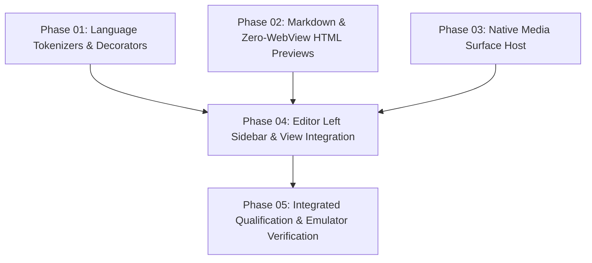

# Native Editor IDE Enhancements, Previews & Left File Tree Sidebar

## Authority and Readiness
- **Origin:** Explicit user request for native editor improvements:
  1. Syntax highlighting and visual decorators for programming languages (`SchemeDarcula`, bracket pairs, indent guides, current line).
  2. Markdown preview in focused workspace (live buffer sync, unhide toggle).
  3. HTML/HTM preview mode (zero-WebView reader preview).
  4. Real media playback (image viewer and video player).
  5. Collapsible left File Tree sidebar in Edit view for seamless IDE file switching.
- **Preflight Research:**
  - Synthesis: `plans/reports/research-261024-1627-editor-ide-enhancements.md`
  - Sora Editor Capabilities: `plans/reports/research-261024-1627-sora-editor-capabilities.md`
  - Preview & Sidebar Architecture: `plans/reports/research-261024-1627-preview-sidebar-ux.md`
- **Canonical Path:** `G:/ws/sharing/dam-hopper/plans/261024-1627-native-editor-ide-enhancements/plan.md`.
- **Status:** Implemented with passing scoped tests and verified emulator smoke checks; media playback and HTML previews validated via unit suites pending end-to-end device media session test (see qualification-report.md).

---

## Key Invariants and Architectural Decisions

1. **Zero-WebView Invariant (B01/B02):**
   `WorkbenchJourneysUnitTest.testZeroWebViewsAcrossEntireApplication` and project policy strictly forbid any `WebView` or `androidx.webkit` imports. HTML preview is implemented via Android Compose `AnnotatedString.fromHtml` ("Reader Preview") without any browser engine.
2. **Table-Driven Lexer on AsyncIncrementalAnalyzeManager:**
   Avoids external grammar assets or native binary dependencies (`language-textmate` and `language-treesitter` rejected). A table-driven lexer extending Sora's `AsyncIncrementalAnalyzeManager` (`UniversalLanguage`) provides pure-DEX syntax highlighting for all target languages. Degradation (>1 MiB UTF-8 bytes) is evaluated first and falls back to `EmptyLanguage` across all languages (including `.java`), with `JavaLanguage` preserved for normal-tier Java. Reassessment occurs only when edits cross the threshold. Long lines (>10,000 chars) scan state only to preserve outgoing lexer state without allocating per-character spans.
3. **No Second Text Authority for Previews:**
   Previewing Markdown or HTML reads an immutable snapshot obtained through `LocalDocumentSnapshotProvider` returning `DocumentPreviewSnapshot(documentId, revision, text, isTruncated)` captured on the Main dispatcher. It does NOT mutate `tab.content`, nor does it alter dirty flags, revision numbers, or CAS save metadata. Truncation feedback is displayed if content exceeds 262,144 characters (UTF-16 code units).
4. **Stable CodeEditor View Identity & Input Isolation:**
   Sidebar open/close and screen rotation MUST preserve the underlying `CodeEditor` view identity during responsive recomposition. Swapping between `ModalNavigationDrawer` and `PermanentNavigationDrawer` is prohibited because reparenting triggers `AndroidView.onRelease` and drops IME composition/selection. When the compact slide-over sidebar is open, native interaction suppression sets `effectiveReadOnly = isReadOnly || document.isReadOnly.value || !isInputAllowed`, calling `hideSoftInput()` and `clearFocus()` unconditionally whenever `!isInputAllowed` to guarantee hardware keyboard isolation independently of editability state transitions.
5. **Media Session & Resource Hardening:**
   `AndroidVideoSurface` is hardened with aspect ratio preservation, seek-on-drag-finish, a 2 MiB bounded LRU block cache in `LeaseMediaDataSource`, pause on tab departure and lifecycle `ON_STOP`, and synchronous player release with background non-cancellable ticket revocation. `AndroidMediaClient` synchronizes call tracking by connection and cancels only that owner's calls on retirement, validates `206 Content-Range` headers with exact interval and EOF bounds (returning -1 on EOF in `MediaDataSource`), rejects `200 OK` on Range requests, redacts tickets from `streamPath` logs, caps byte streaming (32 MiB), and enforces a 50 MP decoded pixel limit.

---

## Phases and Dependency Graph

| Phase | Deliverable | Status | Execution / Owner | Detail |
|---|---|---|---|---|
| **01** | Syntax Highlighting & Editor Decorators | Planned | Concurrent Group 1 / Dev | [phase-01](phase-01-syntax-highlighting-and-editor-decorators.md) |
| **02** | Markdown & Zero-WebView HTML Rich Previews | Planned | Concurrent Group 1 / Dev | [phase-02](phase-02-markdown-and-html-rich-previews.md) |
| **03** | Native Media Player & Image Viewer | Planned | Concurrent Group 1 / Dev | [phase-03](phase-03-native-media-player-and-image-viewer.md) |
| **04** | Editor Left Sidebar File Tree & Integration | Planned | Sequential / Dev | [phase-04](phase-04-editor-left-sidebar-file-tree.md) |
| **05** | Integrated Qualification & Emulator Verification | Planned | Sequential / Main | [phase-05](phase-05-integrated-qualification-and-verification.md) |

---

## File Ownership Matrix

Strict disjoint ownership enforced. Concurrent phases 01, 02, and 03 have zero file overlap. Phase 04 sequentially receives `AndroidEditorSurface.kt` from Phase 01 for compact sidebar input suppression.

| Literal Project-Relative Path | Phase 01 | Phase 02 | Phase 03 | Phase 04 | Phase 05 |
|---|:---:|:---:|:---:|:---:|:---:|
| `native-app/androidApp/src/main/kotlin/dev/damhopper/nativeapp/platform/editor/UniversalLanguage.kt` | **Create** | | | | Read |
| `native-app/androidApp/src/main/kotlin/dev/damhopper/nativeapp/platform/editor/AndroidEditorSurface.kt` | **Modify** | | | **Modify** | Read |
| `native-app/androidApp/src/main/kotlin/dev/damhopper/nativeapp/platform/editor/AndroidEditorDocument.kt` | **Modify** | | | | Read |
| `native-app/androidApp/src/test/kotlin/dev/damhopper/nativeapp/platform/editor/AndroidEditorSurfaceTest.kt` | **Modify** | | | | Read |
| `native-app/shared/src/commonMain/kotlin/dev/damhopper/nativeapp/features/editor/HtmlPreviewView.kt` | | **Create** | | | Read |
| `native-app/androidApp/src/main/kotlin/dev/damhopper/nativeapp/platform/editor/AndroidHtmlSurface.kt` | | **Create** | | | Read |
| `native-app/shared/src/commonMain/kotlin/dev/damhopper/nativeapp/features/editor/EditorTopBar.kt` | | **Modify** | | | Read |
| `native-app/shared/src/commonMain/kotlin/dev/damhopper/nativeapp/features/editor/EditorModels.kt` | | **Modify** | | | Read |
| `native-app/shared/src/commonMain/kotlin/dev/damhopper/nativeapp/features/editor/EditorTabsState.kt` | | **Modify** | | | Read |
| `native-app/shared/src/jvmTest/kotlin/dev/damhopper/nativeapp/features/editor/EditorTabsStateTest.kt` | | **Modify** | | | Read |
| `native-app/shared/src/commonMain/kotlin/dev/damhopper/nativeapp/features/media/MediaSurfaceHost.kt` | | | **Create** | | Read |
| `native-app/androidApp/src/main/kotlin/dev/damhopper/nativeapp/platform/media/AndroidImageSurface.kt` | | | **Create** | | Read |
| `native-app/androidApp/src/main/kotlin/dev/damhopper/nativeapp/platform/media/AndroidMediaSurfaceHost.kt` | | | **Create** | | Read |
| `native-app/androidApp/src/main/kotlin/dev/damhopper/nativeapp/platform/media/AndroidMediaClient.kt` | | | **Modify** | | Read |
| `native-app/androidApp/src/main/kotlin/dev/damhopper/nativeapp/platform/media/AndroidVideoSurface.kt` | | | **Modify** | | Read |
| `native-app/androidApp/src/test/kotlin/dev/damhopper/nativeapp/platform/media/AndroidMediaClientTest.kt` | | | **Modify** | | Read |
| `native-app/shared/src/commonMain/kotlin/dev/damhopper/nativeapp/features/media/MediaModels.kt` | | | **Modify** | | Read |
| `native-app/shared/src/commonMain/kotlin/dev/damhopper/nativeapp/ui/flow/AppFlowNavigation.kt` | | | | **Modify** | Read |
| `native-app/shared/src/commonMain/kotlin/dev/damhopper/nativeapp/features/workspace/ProjectWorkspaceState.kt` | | | | **Modify** | Read |
| `native-app/shared/src/commonMain/kotlin/dev/damhopper/nativeapp/ui/screens/ProjectWorkspaceScreen.kt` | | | | **Modify** | Read |
| `native-app/shared/src/commonMain/kotlin/dev/damhopper/nativeapp/features/editor/EditorScreens.kt` | | | | **Modify** | Read |
| `native-app/shared/src/commonMain/kotlin/dev/damhopper/nativeapp/features/editor/EditorPanelScreen.kt` | | | | **Modify** | Read |
| `native-app/androidApp/src/main/kotlin/dev/damhopper/nativeapp/MainActivity.kt` | | | | **Modify** | Read |
| `native-app/androidApp/src/test/kotlin/dev/damhopper/nativeapp/FileScreensPhase08Test.kt` | | | | **Modify** | Read |
| `plans/261024-1627-native-editor-ide-enhancements/qualification-report.md` | | | | | **Create** |
| `docs/CHANGELOG.md` | | | | | **Modify** |
| `docs/architecture/android-native-client.md` | | | | | **Modify** |

---

## Side-Effect Review Checklist (Implementation Acceptance Criteria)
- [ ] **Zero WebViews Invariant:** Ensure `android.webkit.WebView` and `androidx.webkit` remain 100% absent across all product sources; `testZeroWebViewsAcrossEntireApplication` must pass.
- [ ] **Single Text Authority & CAS Baseline:** Opening previews or toggling modes must never mutate `tab.content` or increment document revision; save operations and CAS mtime checks remain authoritative.
- [ ] **Editor Widget Slot Identity:** Opening or closing the sidebar must use a stable Compose layout without swapping drawer components, preventing `CodeEditor` remounting or focus drops.
- [ ] **Hardware Keyboard Isolation:** When the slide-over sidebar is open, background `CodeEditor` must have `isEditable = false` and cleared focus via `isInputAllowed` independently of previous editability, preventing accidental typing while preserving natural read-only state on close.
- [ ] **Media Session Lifetime & Memory:** Streaming reads must be capped at 32 MiB, decoded bitmaps must be capped at 50 MP, and video seeks must be throttled with a 2 MiB LRU block cache to eliminate range request floods.

---

## Per-Phase Success Criteria

1. **Phase 01:** Kotlin, Java, JS/TS, Python, Rust, JSON, Shell, TOML, YAML, Dockerfile show distinct syntax colors under dark theme (`SchemeDarcula`) with visible current line highlight, bracket matching, and indentation guide lines.
2. **Phase 02:** Markdown files show working `Preview` / `Source` button in the focused workspace displaying parsed Markdown; HTML files show working `Preview` / `Source` button rendering zero-WebView reader HTML via `AnnotatedString.fromHtml`.
3. **Phase 03:** Image files display decoded Bitmap in editor tab with zoom/fit; Video files mount inline `AndroidVideoSurface` with playback and seek controls without range thrashing or OOM.
4. **Phase 04:** Editor view contains `[📁 Tree]` toggle button; opening it displays the File Tree on the left (split on wide screens, slide-over on compact screens) and clicking files opens tabs directly in the editor.
5. **Phase 05:** All unit tests (`:shared:jvmTest` and `:androidApp:testDebugUnitTest`) pass 100%, `testZeroWebViewsAcrossEntireApplication` passes, debug APK builds cleanly, and smoke verification confirms all 5 features on `emulator-5554`.
