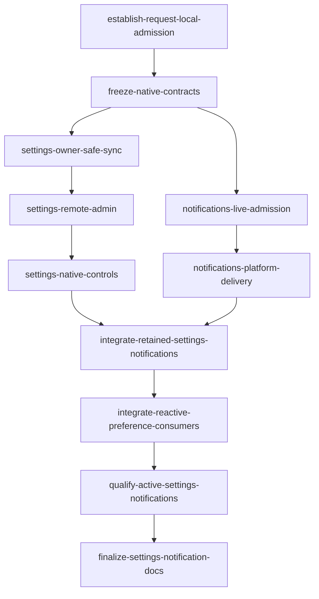

# Android notifications and Settings

## Outcome and boundaries
Native Compose Settings with exact return origin, inline bell/history/transients, reactive consumers and existing remote APIs. Preserve guided root, retained dirty editor/sidebar/PTY and hidden-input gates. All Android-applicable web Settings; see per-control [parity](parity-matrix.md) and frozen [contracts](contracts.md).
Notifications only newly accepted live OMP/qualified Claude attention; Codex status-only. Background opportunity while process+connection survive, **no after-stop guarantee**. No WebView, unrelated panels, backend/schema changes, new runtime, scheduler, flags, FCM or service.

## Phases — current implementation and acceptance status (2026-10-25)
| Phase | Deliverable | Status | Tracking |
|---|---|---|---|
| [01 Shared contracts](phase-01-shared-contracts.md) | existing transport/registry/profile admission + awaited retirement barrier, then ports | Complete | Both G0 tasks complete |
| [02 Complete Settings](phase-02-settings-parity.md) | sync/fencing, admin APIs, native controls/SAF | Complete | All 3 G1 settings tasks complete |
| [03 Live notifications](phase-03-live-notifications.md) | hardened reducer, bounded feed, OS/audio adapters | Complete | Both G1 notification tasks complete |
| [04 Retained integration](phase-04-retained-root-integration.md) | one root/platform/consumer owner; dormant caller cutover | Complete | Both G2 integration tasks complete |
| [05 Qualification/docs](phase-05-qualification-and-docs.md) | coherent actual-app checks, then docs-manager | In progress | 905 unit tests pass, assembleDebug passes; live/device acceptance gates open |
## Graph and execution groups

G0 transport/profile gate→contract freeze; G1 disjoint Settings/Notifications branches; both terminal before G2 single root/consumer owner, then G3 qualification/docs. The original dependency order was satisfied for implementation delivery; remaining open tasks are correction/closeout work, not skipped prerequisites. Task markers record reported implementation delivery, not full feature acceptance: five of 11 markers are checked, four implementation tasks await review corrections and both Phase05 closeout tasks remain open.

## Ownership matrix
| Owner/group | Exclusive scope (exact files in phase contracts) | Ordered transfer/conflict |
|---|---|---|
| Contract/G0 | ApiClient, ConnectionRegistry, ProfileRepository + real tests, then shared models/ports | Freeze proposed retirement barrier/API before G1; registry/profile never reopened in G2 |
| Settings/G1 | Settings/host plus WorkspaceRepository/TerminalRepository/IdleSuspendRepository guard propagation and serializers/tests | Sole agent endpoint owner reused; views/Phase17 test transfer to G2 |
| Notifications/G1 | reducer/coordinator/readiness consumer, sink/audio/platform tests | No Settings/root/reused-repo writes; delivery test transfers G3 |
| Integration/G2 | root, transition-fenced runtime publication, C3a provider/cache, VM barrier lifetime + readiness tests, every caller | Both branches terminal; explicit root→consumer transfer and cross-plan release |
| Qualification/G3 | actual MainActivity/server/OS journeys, transferred tests/obsolete static-scan deletion | Permanent behavior regressions; static script not required behavior proof |
| Docs/G3 | native README, architecture, acceptance, CHANGELOG, scoped code-standards and project-overview-pdr required scroll bound | docs-manager only after qualification; unrelated baseline caveats preserved |

## Settled decisions
- Target ≠ source ≠ event runtime. Existing transport local admission after credentials/resolve; registry→operation tryLock, ordered invalidation. **Proposed** registry suspend retirement barriers revoke N atomically, fence N+1 through full NonCancellable drain/finalization; shared failure latches unavailable, explicit bounded recovery only. G0 freezes API, I1 wires VM before watchers/through teardown; no reentry under retained profile lock.
- Exact web v2 agents plus **all/rust/javascript-typescript/java**. Legacy known/code/text local-all non-equivalent notice/recoverable bytes, never dirty/remote auto-save. Local history/real accessory keyboard, scroll1..50/default5; unsupported policy preserved.
- Hardware Android Mod=Ctrl, explicit Meta/physical DOM codes, default filename DoubleShift450 monotonic/reset/input gates. Search/font/Files/reveal/Projects/Cognito real; only Git/Ports/Fleet/IDE-layout visibly unavailable.
- Full usage/idle/defaults/known/config/maintenance/SAF/integration. Reuse existing repository endpoints/structured JSON; defaults Set `{defaults:{workspace:path}}`, Clear `{defaults:{}}`; import `imported`, never obsolete ok; malformed2xx not success; reset PTYs/runtime not saved preferences.
- C3a frame-captured owner/socket/endpoint/account/path revision; serialized effects + awaited edit/install/registry retirement prune/cancel/audio. Pending/failed transitions deny runtime publication, not numeric-generation checks alone; cancellation propagates after cleanup without canceled-caller replacement publication. Silent baseline/gaps/high-water/dedupe; memory50/3, exact-owner clicks/safe integers.
- Foreground app pattern/volume plus silent OS notification; background OS channel sound only. Exactly three stable channels, user sound/importance authoritative; explicit API33+ permission and OS-status refresh.

## Dependencies and related plans
- `plans/261015-1647-android-native-app/phase-17-preferences-privacy-notifications-and-lifecycle.md`: baseline/informational, focused reachability/fencing gaps supersede prior completion claims; not acceptance proof.
- `plans/261023-1429-native-editor-file-explorer/phase-07-retained-active-workspace.md` and `plans/261024-1627-native-editor-ide-enhancements/phase-04-editor-left-sidebar-file-tree.md`: concurrent root/consumer overlap; obtain explicit writer release/current-source reconciliation before affected writes. Do not edit/import those plans or infer completion from labels. Actual source root `native/android-app`.

## Current implementation, review and validation state
Implementation handoff reports Phases01–04 delivered and verified. Task markers record implementation delivery; affected tasks stay open for corrections, while overall acceptance remains separate. Planning evidence remains in the [design brief](design-brief.md), [web scout](scout/web-feature-evidence.md), [Android scout](scout/android-feature-evidence.md), and original [final planning validation receipt](reports/final-validation.md); that receipt records the planning-time state, not current implementation status.
The latest [source review](../reports/code-reviewer-261025-0728-android-final-signoff.md) reports no confirmed critical issue but is **7/10 — changes required**: W1 is a high-priority readiness/mutation-lifetime defect that blocks correctness sign-off; W2 is cancellation-unsafe mutation-token cleanup; W3 is an AudioTrack exception-path resource leak. For W1, Unknown/canceled admitted writes must remain unresolved; cleanup or coroutine completion is not proof that remote mutation settled or authority can be re-verified. These source-traced findings were not executed as runtime failures. Preserve the review report unchanged.
Runtime qualification remains open: physical-device and live qualified Linux-server/MainActivity qualification are planned future gates, not inferred from unit tests or APK build. API29/API33+ notification/permission/channel/audio, SAF, retained-state and visual journeys remain specified in Phase05 and unclaimed here. `docs/` was not edited; final documentation remains a docs-manager task after qualification.

## Acceptance and open gates
Done only when every parity row and C1–C5 passes observed checks, all exported callers are migrated without shims, ownership transfers complete, severe review findings resolved and docs truthful. Overall plan remains **in progress**: close W1/W2/W3 with required regression evidence, complete Phase05 live-server/device qualification, then hand documentation to docs-manager. Planning and reported unit/build evidence do not imply implementation/release approval.
No unresolved product questions; source-review corrections, live/device qualification and docs closeout remain open acceptance work.
