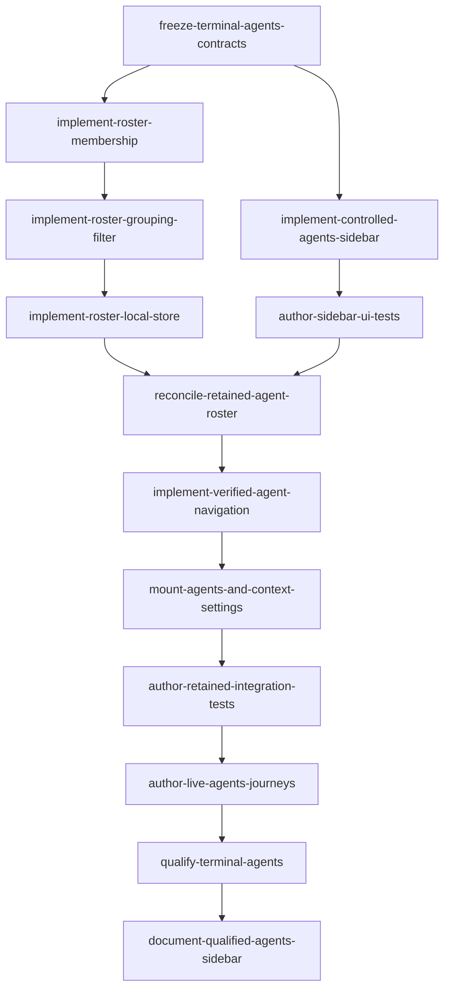

# Android Traditional terminal Agents sidebar

## Scope and decisions
All retained open Traditional tabs across already-attached profiles/projects; no added connections/keepalive. Responsive LEFT sidebar: >=600dp pinned 280dp; phone sheet. Existing focused shell/Terminal-Files-Editor navigation preserved. Observation/navigation + contextual Settings HOST/AGENTS, not Agent Store. [Evidence and decisions](design-evidence.md) · [Frozen implementation contracts](contracts.md).

Owner/account/endpoint/generation/socket + monotonic host attachment incarnation qualify membership/captures; same-value replacement is stale. Inactive freshness uses shared existing-runtime inventory, no timer. Local-only filter; offline Unavailable, typed404 Unsupported. Fresh post-guard validation plus profile/registry -> try-roster -> try-socket -> try-reducer admission atomically commits exact route/profile/receipt; only Committed closes sheet. One complete input cover + minimal overlay exclusivity/topmost Back/shortcut suppression, not a new overlay framework. No backend/schema/notification-policy change.

## Phases and execution ownership
| Phase | Status | Owner / exclusive scope | Plan |
|---|---|---|---|
| 01 | Complete (administrative; review caveats retained) | Contract owner: four NEW terminal contract files only | [Shared contracts](phase-01-shared-contracts.md) |
| 02 | Complete (administrative; review caveats retained) | Pure/store owner: projection/group/filter + narrow Android local adapter/tests | [Roster and local filter](phase-02-roster-and-local-filter.md) |
| 03 | Complete (administrative; review caveats retained) | UI owner: NEW controlled sidebar components + UI tests only | [Native sidebar](phase-03-native-sidebar.md) |
| 04 | Complete (administrative; review caveats retained) | ONE integration owner: VM/coordinators; WsConnection/reducer + tests; profile/flow/root/workspace/terminal/Settings; exact sequential transfers | [Retained integration](phase-04-retained-integration.md) |
| 05 | Journey/qualification task closure is administrative per user direction; docs complete; connected-device technical qualification remains open | Qualification owner, then read-only verifier, then docs-manager; sequential transfer | [Qualification and docs](phase-05-qualification-and-docs.md) |

13 durable tasks. Phases 01–04 (10 implementation tasks) are Complete per explicit user direction, with Cycle 3 warnings retained. All Phase05 task markers are closed: journey authoring and reported automated qualification are administratively closed per explicit user direction; project-doc handoff is complete. Connected-device technical qualification remains an open gate. Exact literal writable paths and task markers remain authoritative; no task-state hydration/flags/scheduler. G1: contracts; G2: roster and UI branches; G3: retained integration; G4: qualification then docs-manager.

## Related-plan overlap / release gates
- [Notifications/Settings](../261024-2042-android-notifications-settings/plan.md): overlapping shared VM/root/reducer/Settings writers. Before any future Phase04 reopening, explicitly verify writer release/current source and W1 readiness/mutation-lifetime, W2 cleanup and W3 audio-leak dispositions. Administrative Complete status does not establish closure of those findings.
- [Editor/explorer](../261023-1429-native-editor-file-explorer/plan.md), Phase07/08, and [IDE enhancements](../261024-1627-native-editor-ide-enhancements/plan.md), sidebar integration: their plan required explicit root/workspace/input writer release before Phase04; this update has no separate release evidence, so do not infer it from status. Docs writer release was required before Phase05 documentation and the docs-manager handoff is now complete; no imported or edited task state.
- [Native baseline](../261015-1647-android-native-app/plan.md): informational broader caveats remain; dormant Agent Store unchanged. Web feature source is authoritative, not another backend slice. Local branches need not wait for unrelated device acceptance.

## Completion and evidence
Journey source is authored; Cycle 3's missing two-profile/observed-agent coverage and lifecycle/fixture issues remain user-approved warnings, not claimed as fixed. Three review cycles completed; user approved with noted issues after Cycle 3 (7/10, zero Critical, four warnings). User-reported qualification: 824 shared JVM tests, 224 Android unit tests (1,048 total), `assembleDebug`, and controlled real-loopback HTTP404 passed. Connected-device/current-server MainActivity journeys, API, visual and input coverage remain open; loopback transport proof is not a substitute.

Project documentation is now recorded in the existing [native README](../../native/android-app/README.md), [native architecture](../../docs/architecture/android-native-client.md), [acceptance](../../docs/android-native-acceptance.md), and [changelog](../../docs/CHANGELOG.md), updated by the docs-manager after reported automated qualification.

## Review / validation / prerequisites
Planning review and artifact validation remain recorded in [targeted follow-up](reports/independent-plan-followup.md), [triage](reports/review-triage.md), [final validation](reports/final-validation.md), and [structural checks](reports/structural-validation.md); these are not implementation verification. Phases 01–04 are Complete per user direction. Three review cycles completed; user approved with noted issues after Cycle 3. User-reported qualification is 824 shared JVM + 224 Android unit tests (1,048 total), `assembleDebug`, and controlled real-loopback HTTP404 passing; not rerun here. Connected-device qualification remains open; see [Cycle 3 review](../reports/code-review-261025-1647-terminal-agents-sidebar-cycle3.md).

Docs validator command: `node C:/Users/loidi/.omp/agent/evcrate/scripts/validate-docs.cjs docs/`; the first 300-second attempt timed out, then the extended and post-correction runs completed with exit 0 (the script exits 0 unconditionally). The final run scanned 36 Markdown files under `docs/` (excluding the native README): 344 internal links working and 9 code references validated; it reported 2,172 unresolved code-reference and 471 config-key candidates, with no broken-link section. The earlier summary counted 343 valid targets; the docs-manager confirms the post-correction edit changed prose only, so the one-count difference remains unexplained (possible concurrent docs change or counter variation). The validator checks target existence, not anchors or meaning, and shows only the first 10 examples per category without per-file distribution. Displayed config examples in acceptance lines 50, 72, and 207–209 concern general panel/editor/resource content outside the new sidebar section; remaining candidates cannot be attributed. Manual source review confirmed the feature-specific `ProjectTerminalScreen` and `terminal_agents_sidebar/status_filter` references. This is a completed-with-warnings result, not a clean validation pass.

## Unresolved questions
No product questions. Open gates: connected-device/current-server MainActivity journeys, API 29/API 33+, hardware/input/visual coverage, and the Cycle 3 warnings (successor-inventory freshness, incomplete live journey assertions, lifecycle-test behavior and fixture metadata). Documentation handoff is complete; its validator scope and candidate findings are recorded above.
