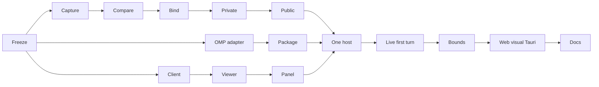

# Session changes panel

Approved scope: [design](../reports/design-261030-0043-session-changes-panel.md). Planning only; no implementation approval.
Compare dirty session-start bytes with current bytes for one validated Git root; read-only web/shared Tauri UI.
No attribution, undo/edit/stage/commit, restart archive, ignored/outside-root capture or Android-native work.

## Decisions and acceptance

- Private bounded `session_changes` domain; raw-byte original, one immutable current revision, certified absence/explicit unknown coverage.
- Existing collector HTTP prepare/activate/receipt barrier; origin-qualified acknowledgment before first turn; bounded from-now adoption, fail-open unavailable.
- PTY incarnation/session/root authority; normal exit retains until actual metadata removal (existing TTL unchanged).
- One shared host above responsive shells; dedicated capability-free Monaco, owner/revision fences, existing Git Changes unchanged.
- All eight approved criteria, executable future checks and release gates: [acceptance matrix](acceptance-matrix.md).
- Exact DTOs/endpoints/defaults/lifecycle/security/rollback: [contracts](contracts.md). Evidence is source-only, not delivered behavior.

## Phases

| Phase | Owner | Status | Detail |
|---|---|---|---|
| 01 | Contract owner | completed | [Wire freeze](phase-01-contracts-and-wire-types.md) |
| 02 | Engine owner | completed | [Snapshots/comparison](phase-02-snapshot-and-comparison-engine.md) |
| 03 | Server owner | completed | [PTY/control/public API](phase-03-server-control-and-terminal-lifecycle.md) |
| 04 | Adapter owner | completed | [OMP/managed packaging](phase-04-omp-readiness-and-managed-adapter.md) |
| 05 | Client owner | completed | [Owner client/query](phase-05-owner-client-and-queries.md) |
| 06 | UI owner | completed | [Read-only viewer/panel](phase-06-readonly-session-review-ui.md) |
| 07 | Sole integration owner | completed | [Host/live protocol](phase-07-host-and-live-protocol-integration.md) |
| 08 | Verification/docs owners | completed | [Qualification/docs](phase-08-qualification-and-documentation.md) |

## DAG, execution groups and ownership

Exact task IDs/file transfers and distinct execution groups: [ownership](ownership.md).

Every arrow requires prerequisite-local compile/tests/smoke/review first; pause shared-build writers at coherent handoffs.
Final integrated full suites are separate downstream gates. No unordered shared writers or descendant-evidence deadlock.
Contract drift stops dependents; one integration owner reconciles schema/DAG before resumption.

## Related plans, review and validation

[Conflict resolver](../261019-1505-git-conflict-resolver/plan.md): concurrent overlap; serialize shared writers.
Independent review: cleared (0 blockers / 0 high / 0 medium in targeted follow-up).
Validation: prompt mode; user accepted reviewed plan and declined interview.
Execution gates: real OMP 18.13.3 tool turn, bounds measurement, Monaco/Tauri and human visual review.
Windows producer unqualified (explicit unavailable); Android-native excluded.

## Delivered Implementation & Verification

Implementation delivered across all layers with automated qualification passing:
- **Rust Server**: Domain module `server/src/session_changes/` (types, root preflight, absence trie, inventory, storage, capture, comparison, text diff, binding, control), private collector controls, authenticated public REST routes, and PTY manager binding.
- **Agent Status Adapter**: Standalone managed asset packaging (`omp-agent-status.ts`) with async lifecycle hooks, barrier handshake, and turn-settling reporting.
- **Frontend UI**: Owner-fenced client channels (`session-changes-client.ts`), React Query integration (`session-changes-queries.ts`), capability-free Monaco viewer (`ReadonlyMonacoDiffViewer`), changed files list (`SessionChangedFilesList`), review panel (`SessionChangesPanel`), and modal host (`SessionChangesHost`) integrated across desktop, mobile accessory, and runtime output shells.
- **Automated Verification**:
  - Server integration: 7 passed (`session_changes_protocol`, `session_changes_controls`, `session_changes_api`, `session_changes_lifecycle`, `session_changes_adversarial`).
  - Server unit: 20 passed (`session_changes::*`).
  - Frontend browser: 6 passed across 3 test files (`session-changes-viewer.browser.tsx`, `session-changes-panel.browser.tsx`, `session-changes-host.browser.tsx`).
  - TypeScript E2E typecheck: Clean (0 errors).

## Carried Review & Qualification Items

The following 7 items are documented from Code Review Cycles 1–3 and qualification reports as follow-up improvements:
1. **CAS Reservation on All Publication Paths**: Require live reservation/generation tokens for all publications (including from-now and failure tombstones) to ensure concurrent capture cannot overwrite an acknowledged original.
2. **Pre-Allocation Quota & Memory Accounting**: Enforce candidate, current-snapshot, and retained-from-now admission against the 512 MiB limit before allocation; de-duplicate snapshot buffers between inventory and comparison artifacts, removing unused `current_revision_manifest` copies.
3. **Absence vs. Unknown Parity in Detail View**: Derive `ContentSide.presence` directly from stored row presence rather than capture option membership, avoiding fabricated `Absent` for unproven/excluded paths.
4. **UI Pagination & Load-More**: Implement cursor-based pagination in `SessionChangesPanel` beyond the initial 200 files, displaying loaded vs total count (`comparison.changedFileCount`).
5. **Retained Session Selection & Multi-Root Propagation**: Expose explicit retained session picker when semantic status row expires; propagate `rootId` end-to-end across status, refresh, client, and UI.
6. **Diff Viewer Renderability Bounds**: Enforce 16 KiB max line length and 20,000 line limits before Monaco rendering; render metadata-only diffs for binary mode-only changes.
7. **Production Container Journey & Visual Sign-Off**: Production container E2E journey and human visual sign-off pending governance approval.

## Unresolved questions

None. All 8 acceptance criteria automated checks verified; carried items tracked for future hardening.
