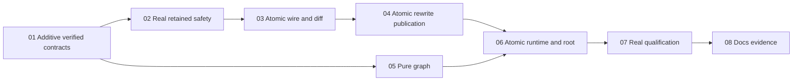

# Android focused-project Git implementation plan

Implementation has landed, but correctness sign-off and acceptance remain incomplete. The post-C1 tester report records 937 shared JVM and 231 Android unit tests passing, successful compilation, and 13 fixture self-test checkpoints. Cycle 3 reports no identified critical issue in its inspected scope, but unresolved high-priority safety, lifecycle, navigation, fixture, and qualification findings remain. Release is blocked on those corrections, fresh scoped review and verification, and required live-server/device qualification.

## Outcome and authority
Terminal / Files / Editor / Git in one retained focused workspace; Changes, History/native graph, Branches/Worktrees; nested read-only review, guarded daily actions/CAS rewrites and separate exact-lease publication.
[Approved design](../reports/brainstorm-261030-1451-android-focused-git-view.md), [contracts/caller closure/wire inventory](contracts.md), [ten-criterion acceptance](acceptance-matrix.md), [evidence](reports/coordinator-evidence.md), [review triage](reports/review-triage.md), [authoring receipt](reports/planner-authoring.md).
Reuse Kotlin/Compose/API29+ and current server; no server/packages/ui/dependency/API changes, WebView/local Git, broad shell cutover, offline retry, native resolver or editable diff/hunk writer.

## Phases / evidence-complete execution
| Phase | Scope | Group | Status |
|---|---|---|---|
| [01](phase-01-shared-contracts.md) | Additive frozen values/ports/graph models; live APIs unchanged | G0 prerequisite | complete |
| [02](phase-02-workspace-safety-runtime.md) | Retained consumers + screen binding; actual safety, NO runtime | G1 mainline | in-progress (W3/W4/W5/W7/W8 open) |
| [03](phase-03-daily-git.md) | Atomic wire/scope/diff caller cutovers; daily/sync | G1 mainline | in-progress (W4/W6 open) |
| [04](phase-04-history-rewrite-publication.md) | History/actions; atomic receipt/leased callers | G1 mainline | in-progress (W4/W5 open) |
| [05](phase-05-native-history-graph.md) | Pure graph + independent Canvas | G1 graph | in-progress (W11 open) |
| [06](phase-06-focused-workspace-integration.md) | Atomic final runtime/constructors/hosts/root + all callers | G2 integration | in-progress (W3/W4/W5/W6 open) |
| [07](phase-07-live-qualification.md) | Fixture self-test FIRST, then real-root/Git/device journeys | G3 qualification | blocked (GATE-C device pending adb; W9/W10 open) |
| [08](phase-08-documentation-release-evidence.md) | Existing docs/changelog/release evidence | G4 docs | in-progress (docs underway; review pending) |

## Dependency graph

Every task: coherent code + applicable compile/scoped behavior tests/real smoke/passing review BEFORE completion/dependents. One verifier after editors stop; Q1 after06 additional. No shims/fake hosts/waivers or altered task semantics. Only graph may overlap mainline; coordinate checks over stable source, no speedup claim.

## Ownership / execution matrix
Aliases expand EXACTLY to literal file action tables/task arrays in linked phases, no directory ownership.
| Set | Sole writes / explicit ordered transfer |
|---|---|
| S01 | New contracts/graph models/helper tests; GitPanelScreen enum move; shared Gradle explicit smoke discovery task (default suite deterministic) |
| W02 | Retained state/root/VM/flow/editor/tree/mutation/terminal + ProjectTerminalScreen callbacks/tokens and tests; no GitWorkspaceRuntime |
| D03 | Wire/scope/diff atomic callers and sync hardening; same-task Wire/Diff/Sync LiveSmoke classes via explicit test task |
| H04 | History/actions/receipt atomic callers; same-task Query/Actions/Rewrite LiveSmoke classes via explicit test task |
| G05 | Four new graph layout/Canvas/test files only; disjoint from all post01 mainline |
| I06 | Atomic runtime/host/revoke/root/leaf/test closure INCLUDING six explicit live-smoke callers; default Q1 independent of external fixture |
| Q07 / D08 | Dedicated fixture/journeys/evidence, then sole native README/architecture/acceptance/docs CHANGELOG owner |

## Related-plan writer arbitration
[Recovery](../261028-1659-android-connection-recovery-lifecycle/plan.md), [Agents sidebar](../261025-1157-android-terminal-agents-sidebar/plan.md), [editor](../261023-1429-native-editor-file-explorer/plan.md): inspect actual claims/current artifacts and serialize shared root/VM/editor/terminal/docs. Recovery conflict explicitly includes ProjectTerminalScreen.kt; no unrelated feature-completion prerequisite.
[Legacy overview](../261015-1647-android-native-app/plan.md): exact superseded phase `phase-12-complete-git-and-safe-history-workflows.md` recorded in contracts prose; broader Phase18/19 obligations retained. Overview phase links are local siblings only; installed source loader passed.

## Evidence / remaining gates
Implementation has landed across all phases (01–08), but correctness sign-off and release approval remain open.
Reported automated verification: 937 shared JVM unit tests passed, 231 Android debug unit tests passed (1,168 total passing; 0 failures/errors/skips), all module compilation targets successful (`:shared:compileKotlinJvm`, `:androidApp:compileDebugKotlin`, `:androidApp:compileDebugAndroidTestKotlin`), and Node Git fixture self-test passed with 13/13 checkpoints. Note that default JVM test suite excludes the six external `LiveSmoke` classes by design.
Cycle 3 code review identified no remaining critical issue in its inspected scope (C1 absolute evidence path, child HOME/XDG config isolation, and Win32/Darwin refusal repaired in smoke source; C2 dirty-document guard repaired in source).
Remaining release blockers:
1. High-priority architectural findings W2–W12 remain open (W2 ambient credential isolation; W3 revocation late refresh fence; W4 post-dispatch uncertainty vs rejection; W5 whole-target clean tab reload and complete affected-document transaction; W6 mounted diff, worktree Open, and conflict recovery UI wiring; W7 terminal binding epoch fence; W8 editor completion admission; W9 runner-owned fixture lifetime; W10 visible authenticated acceptance journeys; W11 graph measured row geometry and hot-path allocations).
2. Supported-POSIX current-server live smoke launch and verified disposable sentinel non-mutation checks.
3. GATE-C connected Android qualification (physical ARM64 device, API 29 target, phone/tablet form factors, and emulator instrumentation journeys) truthfully blocked pending Android SDK platform-tools (`adb`) on workstation PATH.
Safe rollback target is the prior installed client artifact. Unresolved product decisions: none.
