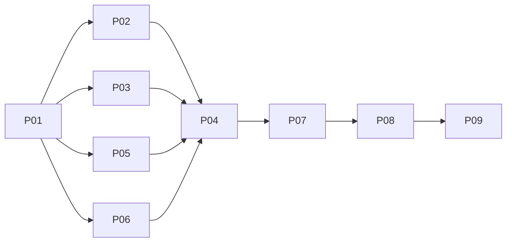

# OS session management and interaction consistency
**Status: completed (administratively completed per user approval; critical carryovers C1–C3 and C4 oracles resolved; technical release qualification incomplete).** Implementation of Phases P01 through P07 complete; Phase P08 automated regression testing passed; Phase P09 documentation handoff completed; Phase critical-carryovers marked DONE (2026-11-05 01:40:00 +07:00) with 4,619 unit/integration test passes reported by tester across server lib and UI Vitest suites. Live authenticated containerized daemon qualification and human visual review ledgers remain open as release qualification gates.

## Summary of completed phases and test results
- **Completed phases**:
  - **P01 Shared contracts**: Completed. Terminal session contracts, DTOs, termination envelopes, lifecycle predicates (`terminal-session-contract.ts`).
  - **P02 Backend guard**: Completed. Backend guarded session lifetime, termination request handling, restart cancellation (`server/src/pty/`, `server/src/api/`).
  - **P03 Client observation/actions**: Completed. Client session action triggers, query hooks, optimistic tracking, termination states.
  - **P04 Hub/Close/Review UI**: Completed. Inventory-first Agent Hub session navigation, Close session modal dialogs, Launch Review drawer (`AgentHubApp.tsx`, `LaunchReview.tsx`).
  - **P05 Recipe capture**: Completed. Explicit Recipe capture context, parameter binding, recipe source models (`RecipeEditor.tsx`, `recipe-source-context.ts`).
  - **P06 Shell interaction/canvas**: Completed. Window placement cascade offsets (28px), atomic titlebar mode gestures, input isolation (`OsShell.tsx`, `WindowFrame.tsx`).
  - **P07 Integrated routing/retirement**: Completed. Sequential routing integration and retirement cleanups.
  - **P08 Integrated qualification**: Completed per user direction (Automated regression suite passed; technical release qualification incomplete). Initial automated suites across server PTY, server API, UI Vitest, and linter executed with 0 failures per [tester report](../reports/tester-261104-2321-cycle3-regression-verification.md); UI tsc typecheck and wider server lib suites were subsequently executed and passed in critical-carryovers verification; live container/browser execution and human visual review remain open.
  - **P09 Docs/handoff**: Completed per user direction. Updated roadmap (`docs/project-roadmap.md`) and plan tracking.
  - **critical-carryovers**: DONE (2026-11-05 01:40:00 +07:00). All critical carryover fixes resolved and approved by user, with 4,619 passing tests reported by tester (0 failures, 1 ignored):
    - **C1 originating lifetime provenance**: PTY manager construction epoch (`X-DamHopper-PTY-Epoch`) returned on terminal creation and inventory; client creation paths and resolvers enforce full tuple provenance `(profileId, generation, serverEpoch, incarnationExact)` before authority adoption.
    - **C2 presentation-independent actions**: Centralized action coordinator (`TerminalSessionActionCoordinator`) decoupled from component mounts; snapshot publication and attempt tokens isolate cancellation and termination state across tab/window navigation and unmounts.
    - **C3 production TypeScript contracts**: Aligned termination failure category unions (`TerminationFailureDetail.category`) in `PortsPanel.tsx` and normalized profile snapshot mappings in `RecipeEditor.tsx` with clean production and E2E `tsc` compilation.
    - **C4 physical-byte PTY oracle implementation**: Distinct hex output sentinels (`od -An -v -tx1 -w1`) implemented in Playwright E2E specs for blocked shell interaction verification; Playwright test files and types updated and passing static analysis (`test:e2e:typecheck`); live authenticated containerized daemon execution and human visual review remain open release qualification gates.
- **Reported test results (4,619 passed, 0 failed, 1 ignored; per tester report)**:
  - `cargo test --manifest-path server/Cargo.toml --lib`: 1,418 passed, 0 failed, 1 ignored.
  - `pnpm --filter @dam-hopper/ui test`: 3,201 passed across 334 test files, 0 failed.
  - `pnpm --filter @dam-hopper/ui build`: 0 errors (`tsc -p tsconfig.json`).
  - `pnpm --filter @dam-hopper/ui test:e2e:typecheck`: 0 errors (`tsc -p tsconfig.e2e.json`).
  - `pnpm lint`: 0 errors, 325 warnings.
  - `pnpm build`: extension staged and Vite web build completed (6,033 modules transformed).
- **Review & approval status**:
  - Initial 3 review cycles completed ([code review cycle 3](../reports/code-review-261104-2325-os-session-management-cycle-3.md)).
  - Critical carryovers review completed ([code review cycle 3](../reports/code-review-261105-0104-critical-carryovers-cycle-3.md)) and verified ([tester report](../reports/tester-261105-0059-cycle-3-verification.md)).
  - Critical carryovers C1–C3 and C4 oracles resolved and approved by user; live containerized daemon qualification and human visual review ledgers remain open as release qualification gates.
## Authority and design
[Approved brainstorm](../reports/brainstorm-261104-1231-os-session-management-and-interactions.md), [intake](reports/planning-intake.md), [terminal evidence](reports/session-contract-evidence.md), [Recipe/shell evidence](reports/recipe-interaction-evidence.md).
[Frozen C1–C5 intended architecture](architecture-contracts.md) + [exact P01 contracts](phase-01-shared-contracts.md). Original response headers bind manager UUID/capability to additive exact-string identity/state rows. Guarded POST: live ->202 terminationRequested; exact pending restart ->200 restartCancelled before replacement admission.
Close view preserves PTY/history; End no retry/retarget/eviction. Unknown/unsupported identity disables End, not Close. Pending restart uses Close/End/Cancel; cancellation completion differs from observed live exit. Inventory-first Hub opens ordinary adjacent windows; Review requires losslessly proven complete metadata tuple and hidden protected-data retirement.
Recipe capture explicit source/canonical context, not executor repair. Existing primitives/input ownership, reversible 28px cascade, atomic primary titlebar mode gesture. Preserve float preference, os:v1/layout:v3 and one qualified resource claim.
No new runtime/overlay registry/poller/flags/producers/Android redesign/idle cleanup; no same-xterm promise across Close/reopen. Placement requires SAME xterm and ZERO attach/replay/reset.
## Phases and ownership matrix
Phases P01 through P09 and critical-carryovers completed (user-approved; 4,619 automated tests passing). Literal task IDs in each linked phase JSON are exhaustive allowlists; [ownership/handoffs/callers](execution-ownership.md) and [acceptance matrix](acceptance-matrix.md) are binding details.
| Phase | Status | Owner / execution group | Dependencies | Effort |
|---|---|---|---|---:|
| [P01 Shared contracts](phase-01-shared-contracts.md) | Completed | ContractOwner / G0 sequential | execution authority + cross-plan handoff | 8h |
| [P02 Backend guard](phase-02-backend-guard.md) | Completed | BackendOwner / G1 concurrent | P01 | 16h |
| [P03 Client observation/actions](phase-03-client-observation-actions.md) | Completed | ClientOwner / G1 concurrent | P01 | 16h |
| [P04 Hub/Close/Review UI](phase-04-session-hub-review-ui.md) | Completed | SessionUiOwner / G2 sequential | P02+P03+P05+P06 terminal | 20h |
| [P05 Recipe capture](phase-05-recipe-capture.md) | Completed | RecipeOwner / G1 concurrent | P01 | 12h |
| [P06 Shell interaction/canvas](phase-06-shell-interactions.md) | Completed | ShellOwner / G1 concurrent | P01 | 20h |
| [P07 Integrated routing/retirement](phase-07-sequential-integration.md) | Completed | IntegrationOwner / G3 sequential | P04 (all G1 transitively) | 16h |
| [P08 Integrated qualification](phase-08-integrated-qualification.md) | Completed per user direction (Tested; technical qualification incomplete) | QualificationOwner -> actual HumanReviewer / G4 | P07 | 20h |
| [P09 Docs/handoff](phase-09-documentation-handoff.md) | Completed | DocsFinalizer / G5 sequential | P08 runtime+human gate | 4h |
| critical-carryovers | DONE (2026-11-05 01:40:00 +07:00) | IntegrationOwner / QualificationOwner | P08, P09 | 8h |
## Dependency graph and execution

Estimates sum 132h original estimate + 8h critical carryovers (140h total), not delivery dates/staffing promises.
Shared shell/frame/list/store: ContractOwner type seams -> ShellOwner behavior -> IntegrationOwner final Close/routing/input wiring; no A-vs-C racing edits. One final integrated check owner, no mid-flight suites.
## Evidence, review and validation state
Implementation, automated regression testing, and critical-carryovers verification complete: [regression verification report](../reports/tester-261104-2321-cycle3-regression-verification.md), [cycle 3 review](../reports/code-review-261104-2325-os-session-management-cycle-3.md), [critical carryovers tester verification](../reports/tester-261105-0059-cycle-3-verification.md), and [critical carryovers code review cycle 3](../reports/code-review-261105-0104-critical-carryovers-cycle-3.md). Across executed test suites, tester reported 4,619 tests passed (1,418 Cargo lib, 3,201 UI Vitest across 334 files; 0 test failures, 1 ignored); UI and E2E TypeScript compilation clean (0 errors); repository lint reported 0 errors, 325 warnings; web build completed. Critical carryovers C1–C3 and C4 oracle implementation are delivered and code-reviewed; live containerized daemon qualification and human visual review ledgers remain open as release qualification gates.
Predecessor [OS plan](../261101-1738-ai-dev-os-redesign/plan.md) administratively closed phases do not certify H1/H2; qualify only exercised scope. AC8/F1 Recipe execution/unknown-create gaps remain unresolved, outside remediation.
Related overlap: [project marks](../261103-1608-workspace-file-tree-project-marks/plan.md), [user concerns](../261103-2016-user-concerns-resolution/plan.md); external exclusive file handoff before execution, no whole-plan completion prerequisite. Prior blocker history preserved in intake.
## Unresolved material facts
Implementation and critical-carryover phases complete and user-approved; automated unit/integration test suites fully passing per tester report (4,619 passed, 0 failed, 1 ignored). Critical carryovers C1–C3 and C4 physical-byte sentinel implementation are resolved. Technical release qualification remains incomplete: live containerized daemon qualification journeys and physical human visual review ledgers across placement/loss flows remain open.
