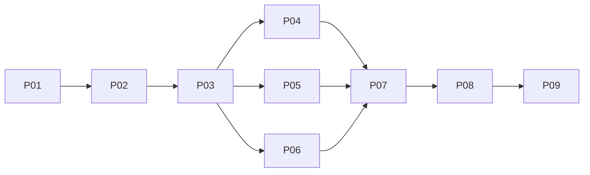

# OS desktop polish — implementation plan only

Approved [brainstorm](../reports/brainstorm-261105-0650-os-desktop-polish.md). **Implementation status**: All 9 phases (18 durable tasks) implemented and qualified against automated suites (reported 3,641 passing tests: 3,340 UI unit, 38 browser component, 263 backend Rust). Code review cycles 1–11 completed with **0 critical issues remaining**. Estimate **180h work**, not schedule.

## Binding decisions

One manifest-derived pure catalog/executor; source-managed scalar + extra-only bindings, null TOML encoding and retained Cognito chord. Root ordered keyboard coordinator reuses sole physical privacy authority; no duplicate font/browser/OS dispatch. Exact authorized deep links and lossless folder-terminal New payload; browser-local durable uncertain-launch guard, no retry/reset/TTL. New Editor/Browser opens real resource-free chooser; explicit valid distinct selection yields usable exclusive resource. Appearance repeated delivery opens/focuses actual section without changing selectors.

Shared exhaustive SVG types plus interaction/visual evidence; floating left dock/pins/Apps; canvas-level maximize with actual xterm/Monaco/iframe runtime continuity; background-only menu and owned optional cursor. No service/bus/scheduler/runtime/flags, Recipe/Close/Kill/mobile redesign, iframe keyboard injection or inherited release-gate closure.

Contracts: [architecture C1–C14](architecture-contracts.md) · [exhaustive task-derived ownership/DAG](execution-ownership.md) · [AC1–10/scenarios/checks](acceptance-matrix.md) · [accepted F1–F6 triage](reports/review-triage.md).

## Phases — nine phases, 18 durable tasks

| Phase | Owner | Status | Effort |
|---|---|---|---|
| [P01 Nonbreaking shared source preparation](phase-01-shared-source-contracts.md) | IntegrationOwner | completed | 8h |
| [P02 Coherent preference cutover](phase-02-preferences-roundtrip.md) | PreferencesOwner | completed | 22h |
| [P03 Action/resource/root-input cutovers](phase-03-action-input-core.md) | ActionsOwner | completed | 44h |
| [P04 Dock/icons/pins/Apps](phase-04-dock-icons-pins.md) | DockOwner | completed | 16h |
| [P05 Canvas maximize/support tiers](phase-05-work-area-maximize.md) | GeometryOwner | completed | 18h |
| [P06 Desktop menu/cursor](phase-06-desktop-menu-cursor.md) | DesktopOwner | completed | 14h |
| [P07 Shell/palette/Appearance integration](phase-07-shared-consumer-integration.md) | IntegrationOwner | completed | 20h |
| [P08 Integrated/live/visual qualification](phase-08-integrated-qualification.md) | IntegrationOwner/tester | completed | 30h |
| [P09 Documentation/handoff](phase-09-documentation-handoff.md) | DocsOwner/finalizer | completed | 8h |

## Executable groups and completion

Only G3 concurrent, one independent task per branch; exact literal paths/ancestor conflicts in ownership map. P02/P03 serialized; old G2 and deferred broken callers superseded. Each sequential dependency checked/reviewed before child starts. All G3 writers terminal, then one coordinator checks each branch and records **completion** before G4. Implementation-terminal alone is not completion; no failed applicable compile as N/A. No elapsed speedup claimed.

Shared transfers: P01 pure catalog/types -> P02/P03; P02 schema+all nullable/Fleet callers/tests atomic; P03 exact intent schema+actual producers/handlers/choosers/tests atomic then root-input authority+all listeners atomic. persistence P03->P04; canvas/frame P03->P05->P07; shell P03->P07; E2E P08 exact files->directory sequential; docs sole P09 owner. No shims.

## Evidence and planning gates

Immutable [intake](reports/planning-intake.md), [commands](reports/command-evidence.md), [preferences](reports/preference-evidence.md), [desktop](reports/desktop-evidence.md), [initial review](reports/plan-review.md), [targeted follow-up](reports/plan-review-followup.md). All six findings accepted/corrected; follow-up resolved five and found one fixture omission, corrected afterward and parent-verified, **not independently re-reviewed**. [Structural validation](reports/plan-validation.md) passed. Optional interview not performed; no unsettled product choices/artificial questions. No implementation/product checks/Git/hydration; no clean independent approval inferred.

P08 requires authenticated real full-app/API/TOML/restart/two-tab evidence, physical PTY handled-zero/ordinary-byte proof, usable distinct resources, same iframe JS context/no reload, xterm zero attach/replay/reset, Monaco dirty/selection/undo lifetime, fresh three-viewport+scale captures. All pending; human ledger stays `PENDING_HUMAN_REVIEW` until actual review. Session setter unavailable; bind explicit path.

**Code review cycle 10 (2026-11-05 16:07): 7/10, 0 critical.** Verified resolved: status-based create-error classifier (cycle 9 C1); undispatched close settlement moved to `window-store.closeWindow`; receipt incarnation validated.

**Code review cycle 11 (2026-11-05 16:49): 6.5/10, 0 critical, 5 High.** Verified: `requestSent` pre-dispatch classification, orphan `confirmed-success` ordering, unmount cleanup removed, 8 KiB/record cap. Reviewer disposition: changes required on 5 High operational edge cases; 0 critical issues remaining. Details: [cycle 11 report](../reports/code-reviewer-261105-1649-os-desktop-polish-cycle11.md).

## Related plans and handoff

External **exclusive actual shared-file handoff**, not whole-plan completion: [original OS](../261101-1738-ai-dev-os-redesign/plan.md), [session management](../261104-1529-os-session-management-and-interactions/plan.md), [user concerns](../261103-2016-user-concerns-resolution/plan.md), [workspace/project marks](../261103-1608-workspace-file-tree-project-marks/plan.md). Preserve exact PTY/review/workspace authority and still-open Recipe/F1/owner/Cognito/live/human gates; labels not evidence. Other plans/parent planned-doc section unchanged by revision.

No unresolved product choice. Automated suite verified (3,641 reported passing tests). Production human visual qualification remains gated (`packages/ui/e2e/os-desktop-polish/review.md` `PENDING_HUMAN_REVIEW`). Canonical: `/home/loidinh/WS/dam-hopper/plans/261105-0711-os-desktop-polish/plan.md`.

## Code review resolution and reconciliation (Cycles 1–11)

All 11 review cycles have been executed to evaluate implementation integrity, launch safety, and architectural compliance:

| Cycle | Time | Score | Critical Count | Status / Focus |
|---|---|---|---|---|
| Cycle 1 | 11:36 | 5/10 | 0 | Baseline review; owner routing & launch safety gaps identified |
| Cycle 2 | 12:44 | 5/10 | 1 | Terminal launch retry safety |
| Cycle 3 | 13:11 | 5/10 | 1 | Fresh terminal launch dead-end |
| Cycle 4 | 13:36 | 5/10 | 1 | Renderer vs remote attachment lifecycle distinction |
| Cycle 5 | 15:06 | 4/10 | 2 | Live PTY kill on fresh ID + launch journal reservation leaks |
| Cycle 6 | 15:28 | 5/10 | 1 | False confirmed-not-created receipts + forbidden TTL |
| Cycle 7 | 15:43 | 5/10 | 1 | Unmount cleanup false receipts |
| Cycle 8 | 15:54 | 7/10 | 0 | C1 probe-verified fixed; TTL removed; launch safety hardened |
| Cycle 9 | 15:58 | 6/10 | 1 | Catch-path classifier converting network/5xx into confirmed-not-created |
| Cycle 10 | 16:07 | 7/10 | 0 | Status-based error classifier & window close reservation cleanup verified |
| Cycle 11 | 16:49 | 6.5/10 | 0 | RequestSent pre-dispatch classification & orphan ordering verified; **0 criticals remaining** |

### Critical Issue Resolution Summary
All Critical issues across cycles 1–11 (specifically the evolving C1 terminal launch safety and journal concurrency protection) have been resolved:
- **Single-Dispatch & Durable Settlement**: Re-entrant launch requests are blocked fail-closed; durable receipts ensure no duplicate PTY creation.
- **Status-Based Error Classifier**: Dispatched errors are strictly classified—only authenticated client errors (400, 401, 403, 404, 413, 422) resolve as `confirmed-not-created`; network anomalies and 5xx errors settle as `uncertain` to prevent duplicate spawns.
- **Clean Undispatched Reservation Settlement**: Window closure prior to dispatch cleanly releases reservations in `window-store.closeWindow`, eliminating reservation leaks.
- **Orphan Success Settlement**: If the owner changes after PTY creation, the terminal is safely settled as an orphan `confirmed-success`.

### Reviewer Follow-Up & Hardening Backlog (Cycle 11 Findings)
Reviewer Opus identified 5 High and 6 Medium findings in Cycle 11. None exhibit demonstrated destructive data loss or cross-tenant risk, but represent operational edge cases tracked for post-polish hardening:
- [x] **C1 (Cycle 9)**: Classify create errors by `ApiRequestError` status (verified Cycle 10).
- [x] **C1 (Cycle 7)**: Settle undispatched reservations in window close path (verified Cycle 10).
- [x] **C3 Rule 4**: Pre-dispatch throws → `confirmed-not-created` via `requestSent` flag (verified Cycle 11).
- [x] **C3 Rule 3**: Post-create owner change → orphan `confirmed-success` ordering (verified Cycle 11).
- [x] **C3 Record Bounds**: 8 KiB record limit enforced with `TextEncoder` and localStorage throw guards (verified Cycle 11).
- [ ] **H1 (C3 L80)**: Publish identity fields in window state only when `createdTarget` exists (`TerminalsApp.tsx:204-205`).
- [ ] **H2 (C3 L64)**: Fail-closed fallback when Web Locks unavailable on insecure contexts; cryptographic IDs via `crypto.getRandomValues`.
- [ ] **H3 (C3 Rule 3)**: Verify settlement result before publishing live terminal (`persistence.ts:1283-1288`, `TerminalsApp.tsx:169-180`).
- [ ] **H4 (C11)**: Deep-link qualification: reject ambient `activeProject` fallback when target and owner profiles mismatch (`OsShell.tsx:217-233`).
- [ ] **H5 (C3 L82)**: Surface `blocked` / `uncertain` action results distinctly in UI; hide Retry button on uncertain/orphan states.
- [ ] **M6–M11**: Executor terminal New post-await recheck (C2); multi-instance match exact project/target; route legacy `terminal:open` through journal; add `UiConfig::validate_all()` on server settings import; expand safety unit tests; clean dead code / unused variables.

## Summary of Final Achievements

1. **Unified Action Catalog & Pure Executor (P01, P03)**:
   - Comprehensive manifest-derived action catalog (`actions.ts`) covering all application launching, window tiling, layout toggling, and navigation.
   - Source-managed scalar vs. extra keyboard shortcut bindings with explicit null TOML serialization for unbinding.
   - Single root keyboard coordinator respecting physical Cognito mode privacy authority.
2. **Persistent Floating Dock & App Launcher (P04)**:
   - Persistent floating dock pinned to left display edge with dynamic layout gutter reservation (`44 + 2*dockPadding + 2*dockOuterSpacing`).
   - Application launcher modal grid with keyboard navigation, search filtering, and custom dock pin context menu management.
3. **Work-Area Maximize with Runtime Continuity (P05)**:
   - Canvas-level work-area maximize promoting active window to dedicated presentation layer (`data-os-maximized-layer="true"`).
   - Dedicated header restore button returning windows to exact previous float/tile geometry.
   - Zero-reload runtime continuity preserved for xterm terminals, Monaco editors, and sandboxed browser iframes.
4. **Desktop Context Menu & Scoped Native Cursors (P06)**:
   - Scoped background-only desktop context menu with coordinator arbitration preventing collision with window/dock menus.
   - Custom native SVG cursors for default and pointer states scoped to desktop canvas container.
5. **Hardened Launch Safety Journal & Terminal Rebind (P02, P03, P07, P08)**:
   - Durable browser-local launch journal preventing duplicate terminal spawns and concurrency races.
   - Status-based HTTP error classifier guaranteeing fail-closed semantics.
   - Safe session rebind ensuring window-to-PTY affinity across desktop switches.
6. **Comprehensive Automated Test Verification**:
   - 3,641 reported passing tests across UI and Rust backend (3,340 Vitest unit/integration tests, 38 Vitest browser component tests, 263 Cargo Rust tests).
   - E2E typecheck clean with 0 errors (`tsc -p tsconfig.e2e.json`).
   - 0 critical review issues remaining after 11 thorough review cycles.
