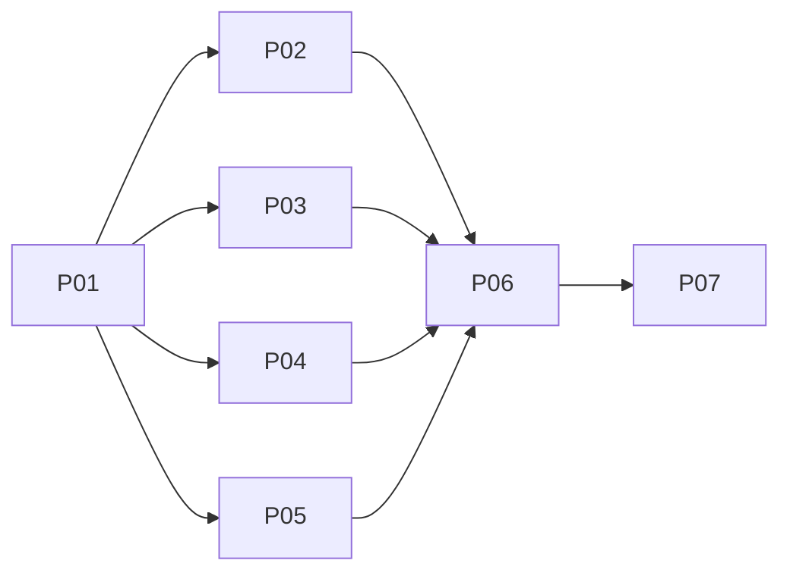

# Agent Hub terminal-first workspace

## Overview
Implements APPROVED design `../reports/ui-ux-designer-261106-0226-agent-hub-workspace-flow.md` (AC1–AC6) using evidence/decisions in `./reports/scout-261106-0334-evidence-and-decisions.md`. UI-only (`packages/ui`); Rust server untouched. Revised per red-team review `./reports/plan-review-261106-0334-red-team.md` and user validation decisions (V1–V7).

### Execution & Verification Summary
- **Implementation Status:** Delivered across all 7 phases (Phases 01–07).
- **Code Review Remediation:**
  - **Integrated Review (`plans/reports/code-review-261106-1647-agent-hub-integrated-changes.md`):**
    - **H1 (Per-profile pin retention authority):** Replaced aggregate success check with per-profile `loadedProfileIds` Set and connection status fencing in `use-hub-terminal-tab-actions.ts`. Stored pins are preserved across pending, error, disconnected, or unloaded owner states and pruned only against authoritative loaded inventory for that individual profile.
    - **H2 (Presentation input policy enforcement):** Fixed `PaneContainer.tsx` to compute `suppress = shouldSuppressTerminalFocus || !isActiveSession` so hidden/quiet terminals remain strictly suppressed without being overridden by raw pane loops.
    - **W2 (Clean file-tree relocation):** Removed redundant inline file trees and disclosure buttons from `TraditionalTerminalProjectWorkspaceRow.tsx`; mounted exclusively in the right sidebar of `TraditionalTerminalProjectsDisplay.tsx`.
    - **Critical (Unsafe ambient termination fallback):** Removed ambient `api.terminal.remove/kill` fallback in `use-hub-terminal-tab-actions.ts`. Live sessions without an authoritative target or coordinator fail closed with a descriptive action notice.
  - **Cycle 1 Review (`plans/reports/code-review-261106-1427-agent-hub-cycle-1.md`):**
    - **W1 (Delayed restore selection persistence):** Gated cold workspace selection persistence on completed inventory restoration to prevent null/default overwrites.
    - **W2 (Attach gate StrictMode cleanup):** Cleaned up claim re-acquisition handling under React StrictMode in `use-hub-terminal-attach-gate.ts`.
    - **W4 (Reactive header worktree subscription):** Wired header worktree badge reactively via `useProjectTargetStore`.
    - **Technical Carryover Retained:** W3 (close-target currency comparison against live inventory snapshot before dispatch) remains an open technical carryover.
- **Verified Test Metrics:**
  - **UI Unit Tests:** 3,537 tests passed across 370 files (`plans/reports/full-suite-tester-261106-1356-full-test-suite-execution.md`, `vitest run`).
  - **Chromium Browser Tests:** 58 tests passed in Chromium across 5 test suites (`vitest.browser.config.ts`: `os-agent-hub.browser.tsx`, `os-hub-terminal-mounts.browser.tsx`, `os-file-open-float.browser.tsx`, `terminal-traditional-projects.browser.tsx`, `os-agent-hub-renderer-measurement.browser.tsx`); 358 tests passed across 64 browser test files.
  - **Playwright E2E Spec:** Passed under local test runner (`packages/ui/e2e/os-agent-hub-workspace/os-agent-hub-workspace.spec.ts`).
  - **Web & Extension Build:** Clean (`pnpm build`).
  - **E2E Typecheck:** Clean 0 diagnostic errors (`tsc -p tsconfig.e2e.json`).
  - **Repository Lint:** Passed (0 errors, 379 warnings).
  - **R5 Renderer Telemetry:** Verified 0 unreleased tracked subscriptions in mocked-transport fixture (`176 -> 0` in `os-agent-hub-renderer-measurement.browser.tsx`) across 22 sessions in 2 profiles; 0 xterm remounts across project switch/sidebar toggle/split.
- **Open Qualification Boundary:** Technical release qualification remains open pending: (1) Visual review ledger `packages/ui/e2e/os-agent-hub-workspace/review.md` initialized as `PENDING_HUMAN_REVIEW` per `docs/code-standards.md:214`; (2) Live container streaming PTY daemon continuity gate across container restarts; (3) Operator acceptance or closure of Cycle 1 W3 carryover.
## Phases
| # | Phase | Group | Effort | Status | Link |
|---|-------|-------|--------|--------|------|
| 01 | Shared contracts (claim key, runtime identity, mounts store, workspace union, file:open mode, revealWindow, presentation input) | seq | 5h | complete | [phase-01](./phase-01-shared-contracts.md) |
| 02 | Float file-open + float/maximized stacking + editor endpoint save fence | A | 10h | complete | [phase-02](./phase-02-float-file-open-and-stacking.md) |
| 03 | Hub terminal mounts + claim attach gate + presentation input adoption | A | 9h | complete | [phase-03](./phase-03-hub-terminal-mount-and-attach-gate.md) |
| 04 | Shared terminal launch lifecycle + manual stuck-launch resolution | A | 8h | complete | [phase-04](./phase-04-shared-terminal-launch-lifecycle.md) |
| 05 | Sidebar project workspace rows | A | 7h | complete | [phase-05](./phase-05-sidebar-project-workspace-rows.md) |
| 06 | Agent Hub integration (single owner) | seq | 13h | complete | [phase-06](./phase-06-agent-hub-integration.md) |
| 07 | Qualification, E2E evidence, renderer measurement, docs | seq | 7h | complete | [phase-07](./phase-07-qualification-and-docs.md) |

## Execution groups
- Sequential: P01. Parallel Group A (disjoint writes): P02, P03, P04, P05. Sequential: P06 (integration owner) → P07.
- Each phase runs only its own tests; full suites once in P07.

## Ownership matrix (writable files; amendments marked *)
| Phase | Writable files (summary; exact list in each fence) |
|-------|------|
| P01 | new `os/terminal-claim-key`, `lib/terminal-runtime-identity`, `os/agent-hub/hub-terminal-mounts-store`, `lib/agent-hub-open-workspaces`, `lib/terminal-presentation-input`* (+tests); `lib/terminal-input-policy.ts`* (sole owner, expected unchanged); `os/intents.ts`(+test); `os/window-ops.ts`*, `window-ops.test.ts`*, `window-store.ts`* (revealWindow) |
| P02 | `os/OsShell.tsx` (file:open only), `os/window-ops.ts`(+test), `os/window-store.ts`, `os/DesktopCanvas.tsx`, `os/maximized-presentation.test.tsx`*, `stores/editor.ts`*(+test*), `os/apps/EditorApp.tsx`* (V1 notice only), new `browser-tests/os-file-open-float.browser.tsx` |
| P03 | `os/OsResourceHost.tsx`, `MultiTerminalDisplay.tsx`(+test), `SplitLayout.tsx`*, `PaneContainer.tsx`(+test*), `TerminalPanel.tsx`*(+test*), `lib/terminal-host-attachment.ts`*(+test*), new `os/agent-hub/{merge-hub-terminal-mounts*, use-hub-terminal-attach-gate, HubTerminalClaimPlaceholder}`(+tests), new `browser-tests/os-hub-terminal-mounts.browser.tsx` |
| P04 | new `os/terminal-launch-lifecycle.ts`(+test), `os/apps/TerminalsApp.tsx`(+new test*), `os/action-executor.ts`(+test), `os/persistence.ts`* (read-only `getLaunchAttempt` only; then → P06), `os/app-launch-journal.test.ts`* |
| P05 | `TraditionalTerminalProjectsNavigator.tsx`(+test), new `TraditionalTerminalProjectWorkspaceRow`, `TraditionalProjectWorkspaceTree`, `OpenProjectWorkspacePicker` (+tests) |
| P06 | `os/apps/AgentHubApp.tsx`+`os/agent-hub.ts`(+test) (one task, F4), new `os/agent-hub/{use-agent-hub-workspaces, agent-hub-review, AgentHubHeader, use-hub-terminal-launch, HubStuckLaunchNotice*, use-hub-terminal-tab-actions*}`(+tests), `TraditionalTerminalProjectsDisplay.tsx`, `hooks/use-traditional-terminal-project-selection.ts`*(+new test), `os/persistence.ts`(agent-hub projection, after P04)+`persistence.test.ts`*, `os/terminal-close-context.tsx`*(+test, only if proven necessary), `browser-tests/os-agent-hub.browser.tsx`, `terminal-traditional-projects.browser.tsx`, `terminal-traditional-projects.browser-fixture.tsx`* |
| P07 | new `e2e/os-agent-hub-workspace/`, `reports/qualification-report.md`, new `browser-tests/os-agent-hub-renderer-measurement.browser.tsx`* (F10), docs (frontend-components, codebase-summary, system-architecture, CHANGELOG, project-roadmap, code-standards*) |
- Group A pairwise disjoint (P02 ∩ P03 ∩ P04 ∩ P05 = ∅). Sequential-only sharing: `window-ops.ts`/`window-ops.test.ts`/`window-store.ts` (P01 → P02); `os/persistence.ts` (P04 `p04-stuck-launch-resolution` → P06). Barriers in `blocked_by`: every Group A root waits on all seven P01 tasks; `p03-hub-mounts-browser` also waits on `p04-adopt-lifecycle` (ordering only); P06 roots wait on all Group A tails incl. `p04-stuck-launch-resolution`; P07 waits on `p06-agent-hub-compose`.
- Integrated rollback (consumers before providers): P06 → P02, P03, P04, P05 (all mandatory before P01; P05 imports P01 workspace types/`canDismissWorkspace`) → P01. Partial rollback stopping before P01 may retain P01. P02 stacking is GLOBAL; reverting P06 alone keeps it and float file-open active.

## Key decisions (binding)
- B1 First claim wins; loser Hub pane shows placeholder + "Go to window" (atomic `revealWindow`: switch desktop + restore + focus). Never closes/kills. TerminalsApp denied button adopts the same reveal.
- B2 Global stacking: focused float above maximized plane; focusing maximized brings it back on top.
- B3 Hub launches in-stage via lifecycle extracted from TerminalsApp (P04); Hub-closed-while-pending settles normally → background session.
- B4 Roster/filters/Jump/Open Beside removed; Review relocated to terminal tab action with identical fences; header keeps Attn/Work + Recipes.
- Derived: resolver reuses inventory `terminationTarget` (C1); Hub mounts outlive Hub unmount, pruned reactively in `OsResourceHost`; legacy untargeted presenter = compatibility exception; presentation input is owner-scoped tokens (F2); float reuse (restore + float + move to Hub desktop) for windows whose `ctx.generation` is undefined (live-owner, e.g. Files-opened) or equal to the request; reveal-only fail closed only for a defined, differing generation (F1); Hub tab close is target-fenced and never closes the Hub (F3).
- V1 Endpoint-identity save fence (`p02-editor-save-endpoint-fence`): identity (profileId + normalized `ConnectionSnapshot.serverUrl`) bound to the content baseline — captured before the read's I/O, committed only when that read replaces the buffer; dirty-skip reload/loadContent and alias reuse keep the original identity (F1); only ConfirmDialog-guarded `discardAndReload` rebinds; missing identity fails closed; same-endpoint reconnect saves; never fenced on generation.
- V2 No renderer cap; P07 measures (no thresholds) deduped renderer instances, active listener registrations minus releases, cumulative attach/replay attempts and JS heap as separate metrics (F10); known limitation recorded.
- V3 Manual "Clear stuck launch" (`p04-stuck-launch-resolution` + P06 notice/confirm): not-created only for `definitely-absent` from a fresh owner-qualified per-profile observation re-taken at confirmation and not in-flight in this page; `present-unresolvable`/`unknown`/`in-flight` stay blocked (F8); `found`/`cleared` only after a durable re-read confirms the intended state, else `unavailable`/`conflict` (F9); no auto-reconcile.
- V4 BrowserApp iframe host (fixed z 20) stays outside B2 stacking — decided documented limitation, out of scope.
- V5 Cross-tab in-flight launch = DOCUMENTED LIMITATION: page-scoped in-flight registry, no journal format change; a create pending in another tab is caught only once its PTY appears in fresh inventory (P04; P07 known limitations + docs).
- V6 Dirty-tab endpoint identity is PERSISTED with saved dirty tabs/documents (optional field, no version bump); legacy entries without identity fail closed once until discard/reload (P02 R7e).
- V7 Selected Hub workspace PERSISTED as logical `selectedWorkspace` projectKey in the agent-hub appState projection (no runtime authority); validated against inventory/open workspaces on restore, fallback = active session's project (`p06-hub-workspaces-state`, wired in `p06-agent-hub-compose`).

## Related plans
- `plans/261103-1608-workspace-file-tree-project-marks` (pending): overlaps `os/intents.ts`, `os/OsShell.tsx`, `stores/editor.ts`, `EditorApp.tsx`, `os/persistence.ts`, editor identity — serialize; never concurrent with P01/P02/P04/P06.
- `plans/261103-2016-user-concerns-resolution` (in_progress): edits `EditorApp.tsx` — P02 V1 notice touches EditorApp; check/serialize before `p02-editor-save-endpoint-fence`.
- `plans/261101-1738-ai-dev-os-redesign` (in-progress): Phase 09 H1 live PTY attach/replay informs P07 live checks.

## Unresolved questions
- None.
