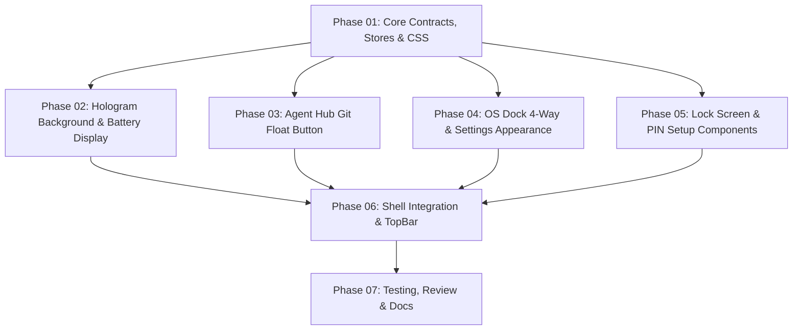

# DamHopper OS Enhancements Plan

## Overview
Implements 5 core OS enhancements designed by `evc-ui-ux-designer`:
1. **Agent Hub Git Float Button**: Header and contextual button to open Git as a floating window for the active project.
2. **OS Dock Positioning**: 4-way configurable positioning (`left`, `right`, `top`, `bottom`) in Settings and `Dock.tsx`.
3. **Top Bar Battery Display**: Compact battery percentage and charging indicator in `MonitorTray.tsx` beside CPU (`C:`) and Memory (`M:`).
4. **Hologram Home Background**: Lightweight, theme-adaptive cyber grid and focal telemetry reticle in `DesktopCanvas.tsx`.
5. **Client-Side PIN Lock Screen**: Lock button in `TopBar.tsx`, full-screen `LockScreenOverlay` with keypad, clock, focus trap, and `PinSetupDialog`.

## Dependency Graph

## Execution Strategy
- **Sequential Foundation (Phase 01)**: Shared type definitions, store additions (`dockPosition`, `useLockScreenStore`), intent payload updates, and CSS utilities.
- **Parallel Group A (Phases 02, 03, 04, 05)**: Disjoint writable file sets executed in parallel:
  - Phase 02: Canvas background & Monitor Tray battery telemetry.
  - Phase 03: Agent Hub Git button and workspace actions.
  - Phase 04: Dock 4-way orientation and Appearance Settings row.
  - Phase 05: Standalone LockScreenOverlay and PinSetupDialog components.
- **Sequential Integration (Phase 06)**: Integration owner wiring `OsShell.tsx`, `TopBar.tsx`, and `input-arbiter.ts`.
- **Sequential Qualification (Phase 07)**: Full test suite verification, code review, and documentation updates.

## File Ownership Matrix
| Phase | Mode | Exclusive Writable Files |
|---|---|---|
| **Phase 01** | Sequential | `server/src/config/schema.rs` `server/src/config/global.rs` `packages/ui/src/lib/ui-config.ts` `packages/ui/src/stores/settings.ts` `packages/ui/src/api/client.ts` `packages/ui/src/os/intents.ts` `packages/ui/src/stores/lock-screen.ts` (new) `packages/ui/src/stores/lock-screen.test.ts` (new) `packages/ui/src/os/os.css` |
| **Phase 02** | Parallel A | `packages/ui/src/os/DesktopCanvas.tsx` `packages/ui/src/os/DesktopCanvas.test.tsx` `packages/ui/src/os/MonitorTray.tsx` `packages/ui/src/os/MonitorTray.test.tsx` (new) |
| **Phase 03** | Parallel A | `packages/ui/src/os/agent-hub/AgentHubHeader.tsx` `packages/ui/src/os/agent-hub/AgentHubHeader.test.tsx` `packages/ui/src/os/apps/AgentHubApp.tsx` `packages/ui/src/components/organisms/TraditionalTerminalProjectsDisplay.tsx` |
| **Phase 04** | Parallel A | `packages/ui/src/os/Dock.tsx` `packages/ui/src/os/Dock.test.tsx` `packages/ui/src/components/organisms/SettingsAppearanceSection.tsx` `packages/ui/src/components/organisms/SettingsAppearanceSection.test.tsx` |
| **Phase 05** | Parallel A | `packages/ui/src/os/LockScreenOverlay.tsx` (new) `packages/ui/src/os/LockScreenOverlay.test.tsx` (new) `packages/ui/src/os/PinSetupDialog.tsx` (new) `packages/ui/src/os/PinSetupDialog.test.tsx` (new) |
| **Phase 06** | Sequential | `packages/ui/src/os/TopBar.tsx` `packages/ui/src/os/TopBar.test.tsx` `packages/ui/src/os/OsShell.tsx` `packages/ui/src/os/input-arbiter.ts` `packages/ui/src/os/input-arbiter.test.ts` |
| **Phase 07** | Sequential | `docs/` updates, test reports, qualification ledger |

## Side-Effect Review Checklist
1. **React Fiber & Portal Keepalive**: Changing `dockPosition` must NOT reorder `<Dock>` and `<main>` elements in the JSX tree; flex direction is toggled via CSS classes on the parent container to prevent unmounting active terminal sessions or Monaco instances.
2. **Ambient Fallback Prevention**: Git floating button must strictly bind `selectedGroup.profileId`, `selectedGroup.projectName`, and `selectedWorktree`. Never fall back to ambient active profile or window.
3. **Cognito Mode Precedence**: Cognito mode (`z-[9999]`) takes strict precedence over Lock Screen (`z-[9990]`); battery display must mask to `●●●` under Cognito mode.
4. **Zero-CPU Hologram**: Decorative background must be static CSS gradients and inline SVG with `pointer-events-none` and `aria-hidden="true"`, ensuring no frame drops or layout recalculations.
5. **Brute-Force & Input Security**: PIN lock is stored as a salted SHA-256 verifier in `localStorage`, never plaintext. Failed attempts enforce a 15-second cooldown after 5 failures. Keyboard event capture consumes all keys except Cognito toggle while locked.

## Implementation & Signoff Status
- **Overall Status**: Complete
- **Completed Date**: 2026-11-07
- **Phases Completed**:
  - [x] Phase 01: Core Contracts, Stores & CSS (`schema.rs`, `global.rs`, `ui-config.ts`, `settings.ts`, `lock-screen.ts`, `os.css`)
  - [x] Phase 02: Hologram Background & Battery Display (`DesktopCanvas.tsx`, `MonitorTray.tsx`)
  - [x] Phase 03: Agent Hub Git Float Button (`AgentHubHeader.tsx`, `TraditionalTerminalProjectsDisplay.tsx`, `AgentHubApp.tsx`)
  - [x] Phase 04: OS Dock 4-Way & Settings Appearance (`Dock.tsx`, `SettingsAppearanceSection.tsx`)
  - [x] Phase 05: Lock Screen & PIN Setup Components (`LockScreenOverlay.tsx`, `PinSetupDialog.tsx`)
  - [x] Phase 06: Shell Integration & TopBar (`TopBar.tsx`, `OsShell.tsx`, `input-arbiter.ts`, `SettingsAppearanceSection.tsx`)
  - [x] Phase 07: Testing, Review & Docs (Qualification pass, code review audit, docs update, PM signoff)
- **Test Evidence**:
  - 10/10 focused test files passed (105 tests).
  - 50/50 UI OS test suite passed (473/474 tests passed, 0 failures).
  - TypeScript check: 0 errors (`tsc --noEmit`).
  - Server unit test suite: 1,419 tests passed, 0 failures (`cargo test --lib`).
  - Side-effect checklist: All 5 invariants verified.
