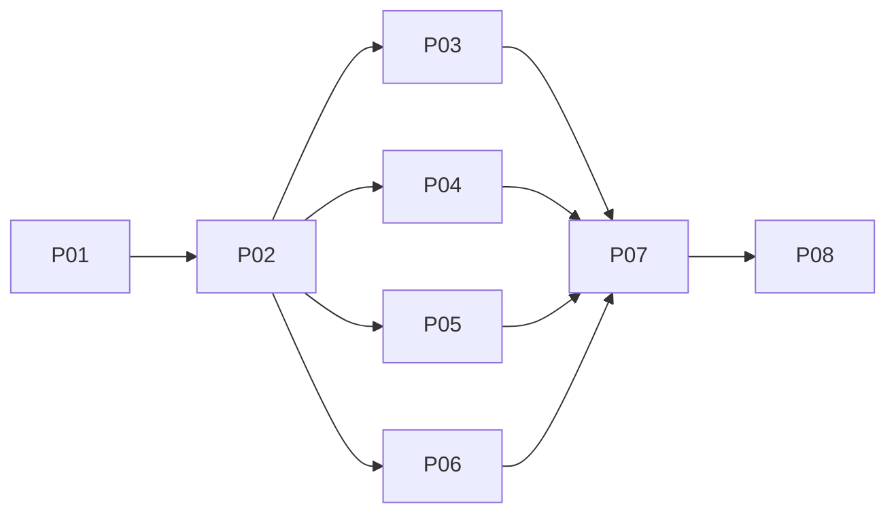

# Native Android Agent Hub redesign

## Outcome and boundary
Secure Profile Login -> Agent Hub by default; globally reachable retained Settings/Notifications; nested Terminal/Files/Editor/focused Git. Match current web concepts/semantics, not desktops/windows/docks/Recipes or dormant 12-panel activation. Reuse current KMP/Compose/retained owners; no new runtime, poller, scheduler, flags or dependencies. P01/P02 implementation accepted with known limitations by user approval; qualification gates remain open.

## Phases (P01–P02 accepted with known limitations, P03–P08 pending; 36h planned effort of accepted phases / 158h total)
| Phase | Status | Effort | Owner/group | Detail |
|---|---|---:|---|---|
| P01 Contracts | Completed (accepted with known limitations by user approval) | 8h | Contract01 / S-1 | [Schemas and settled ports](phase-01-shared-contracts.md) |
| P02 Atomic cutover | Completed (accepted with known limitations by user approval) | 28h | Api02 / S-2 | [All current serializers and callers](phase-02-atomic-api-cutover.md) |
| P03 Hub/terminal | Pending | 22h | Feature03 / G-A | [Navigator and terminal presentation](phase-03-hub-terminal-presentation.md) |
| P04 Settings | Pending | 16h | Feature04 / G-A | [Scopes, preferences and config](phase-04-settings-ui-preferences.md) |
| P05 Notifications | Pending | 16h | Feature05 / G-A | [Feed and Android delivery](phase-05-notifications-feed-platform.md) |
| P06 Codebase | Pending | 24h | Feature06 / G-A | [Files, native editor and focused Git](phase-06-codebase-files-editor-git.md) |
| P07 Integration | Pending | 24h | Integration07 / S-3 | [Active root and retained lifecycle](phase-07-root-lifecycle-integration.md) |
| P08 Qualification | Pending | 20h | Qualification08 / S-4 | [Coherent checks then docs/handoff](phase-08-qualification-docs-handoff.md) |

## Dependency DAG and eligible groups

Only G-A has concurrent writers: W01 contract alone; W02/03/04 each atomic API task alone; W05 four first feature tasks; W06 four second feature tasks; W07 focused Git alone; W08 root then W09 lifetime alone; W10–13 P08 release gates/docs. At EVERY stopped task/wave, coordinator runs applicable compile/focused regressions/separate meaningful smoke/independent review, records evidence-backed completion, then admits dependents. No delegate checks or checks while siblings edit. W06 depends on all W05; Git on all W06. Full integrated/live/device suites repeat only P08; task-local acceptance never waits on future root/release work. Every unordered pair has disjoint case-insensitive exact/ancestor ownership.

## Abbreviated ownership matrix
| Owner | Writable domain (exact exhaustive literal lists are authoritative in linked task fences) |
|---|---|
| Contract01 -> Api02 | Shared model/schema preparation, then atomic API/serializer plus every affected source/test caller |
| Feature03 | Hub navigator/terminal presentation and its tests; no root/platform coordinator writes |
| Feature04 | Settings UI/repository/config document workflows and tests, excluding NotificationsView |
| Feature05 | Notification feed/platform/NotificationsView and tests, excluding SettingsRepository/schema |
| Feature06 | Nested workspace/files/editor/focused Git surfaces and tests; no root/Activity/ViewModel |
| Integration07 | Shared active root/Activity/ViewModel/AppFlow/theme, retained lifecycle and integration tests |
| Qualification08/docs | Report-only coherent checks, then exact README/architecture/acceptance/changelog/roadmap files |
[Execution ownership](execution-ownership.md) expands **every literal file and sequential transfer**; exact exhaustive paths remain in the single `evcrate-tasks` fence per phase. No wildcard/directory grants.

## Architecture and acceptance
[Binding C1-C10](architecture-contracts.md) | [Acceptance matrix](acceptance-matrix.md). Guarded POST End only; local hide/reopen != PTY death. Persist minimal uncertain-create identity across process death, no retry/TTL/list-absence proof. Explicit FS targets and same-read canonical FileIdentity; existing retained owner holds canonical native lifetime; alias/view leases, final dirty guard and canonical replacement preserve dirty/undo without crash-recovery promise. Sparse null-aware Settings preserve unknown web fields; root switch warns of remote PTY destruction. Bounded silent-snapshot feed, exact click fences, user-only permission, generic public notification. One native content host/two-row adaptive chrome/48dp controls; actual device/IME/human proof required.

## Cross-plan overlap (read-only references; no completion inferred)
[Overlap ledger](execution-ownership.md#cross-plan-classification): original OS `261101-1738` and later `261103-1608`, `261103-2016`, `261104-1529`, `261105-0711`, `261106-0334` are informational current-source API/concept references, not imported work. Old Android `261015-1647`/editor `261023-1429` have potential concurrent source overlap: serialize any active implementation with this plan; replaced root semantics superseded here only after final validation. No other-plan writes/activation.

## Evidence, review and readiness

### Historical planning baseline evidence
[Evidence intake](reports/planning-intake.md), [Android](reports/android-evidence.md), [API](reports/api-compatibility-evidence.md), [UX](reports/android-ui-ux-design.md), [binding corrections](reports/design-dispositions.md), [live baseline](reports/local-api-smoke.md). Historical planning evidence workers complete; C1-C10 correct report inaccuracies. Current-source REST/WS bytes observed; WS close1006 failed. Owned4804 cleaned, Termius4803 untouched; Windows OPAQUE not fully isolated; baseline recorded zero ready physical devices. [Structural authoring](reports/authoring-validation.md), [initial review](reports/independent-plan-review.md), [accepted revisions](reports/revision-disposition.md), [targeted follow-up](reports/independent-plan-followup.md): F1/F2 resolved by design. [Final validation](reports/final-plan-validation.md) confirms defaults.

### P01 & P02 cutover evidence & review cycle 3
- **Review Record & Attribution**: Reviewer output artifact ([Cycle 3 review](../reports/code-review-261107-1312-p02-w03-w04-cycle3.md)) scored 7/10 with 1 critical issue (202 selection retargeting on pending terminal refresh) and 6 warnings. User explicitly approved this checkpoint with noted issues and known residual risks; P01/P02 implementation accepted with known limitations, NOT full verification or completion of the overall redesign.
  - Reviewer verified in source: companion `Mutex` atomic create admission (`TerminalRepository.kt`), direct 202 termination eviction prevention (`ProjectTerminalScreen.kt`), and lowercase UUID & positive bounded u64 DTO validation. Pending-termination refresh/selection and input lifecycle behavior remain open.
  - Concurrency regression note: the concurrency test verifies rejection after a reservation exists, not simultaneous contention between checking and saving.
- **Demonstrated Evidence (Targeted Tests & Compilations)**:
  - 44 distinct targeted tests exercised across separate runs covering Terminal and Settings components/repositories (not a single final-state suite run, and NOT full qualification suite).
  - Clean shared JVM compilation: `cmd.exe /c gradlew.bat :shared:compileKotlinJvm` (exit 0).
  - Clean Android debug compilation: `cmd.exe /c gradlew.bat :androidApp:compileDebugKotlin` (exit 0).
  - Live daemon PTY/Settings smoke executed on loopback 4899: round-trip verification against live running Axum server; HTTP 409 conflict refusal verified; remote web OS key (`defaultWindowPlacement`) preserved and sparse patch unbind verified.

### Known implementation residual risks
1. **Null-store bypass**: Guarded creation still skips reservation checks and writes when `preferencesStore` is null.
2. **Unvalidated reservation settlement**: Pending records are removed without validating matching response ID, incarnation, and epoch.
3. **Blanket 4xx-clearing**: All HTTP 4xx responses are treated as definitive refusal.

## Validation summary and execution risks
Validated 2026-11-07: two genuine questions; user confirmed adaptive navigator and all already-connected profiles, without saved-profile auto-connect/keepalive. No unresolved product design questions. Secure login -> main Hub retained; C1/C8 supersede previous navigation rules only as specified.

### Preserved open future qualification gates
1. **Live Windows termination**: Server exercises HTTP 500 signal-dispatch failure on live daemon (HTTP 409 conflict refusal verified; successful live termination on Windows remains a future device/daemon qualification gate).
2. **Android process-death recovery**: Recovery of persistent uncertain-create reservation barrier across actual OS process restart remains an open device qualification gate.
3. **Smoke storage isolation and cleanup**: Complete test isolation and teardown cleanup on persistent storage fixtures.
4. **202 lifecycle behavior**: Refresh and input suppression vs selectable lifetime behavior during pending termination.
5. **Downstream waves and integration**: Downstream feature waves W05–W07 and root integration P07 remain pending.
6. **Release qualification gates**: Physical device (API 29 / API 33+), phone/tablet adaptive layout, IME, TalkBack, human verification, WS retirement, and authenticated/isolated crypto-fixture evidence remain future release gates, not completed implementation or release acceptance.
