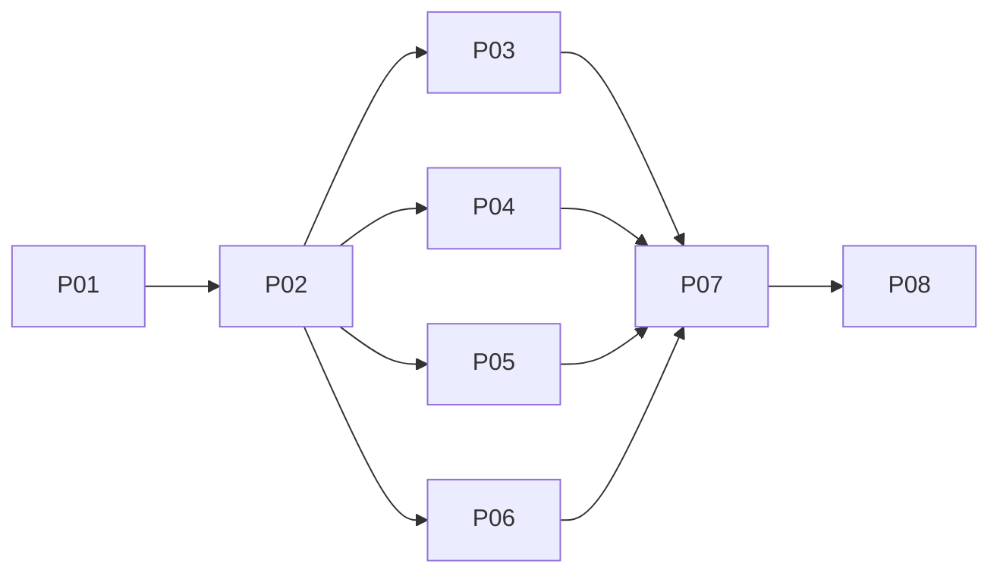

# Native Android Agent Hub redesign

## Outcome and boundary
Secure Profile Login -> Agent Hub by default; globally reachable retained Settings/Notifications; nested Terminal/Files/Editor/focused Git. Match current web concepts/semantics, not desktops/windows/docks/Recipes or dormant 12-panel activation. Reuse current KMP/Compose/retained owners; no new runtime, poller, scheduler, flags or dependencies. All phases P01–P08, Remediation phase, and Hardening phase administratively accepted with noted issues following 9 code review cycles and explicit user approval on 2026-11-08 (technical acceptance and release qualification remain open); 1,305 / 1,305 automated unit/integration tests passed across 142 suites (100% on latest full task rerun); device qualification BLOCKED_PENDING_DEVICE; live multi-server qualification DEFERRED_PENDING_CONTAINER_RUNTIME.

## Phases (P01–P08, Remediation & Hardening completed with noted issues by user approval; 158h planned effort [remediation & hardening effort unmeasured])
| Phase | Status | Effort | Owner/group | Detail |
|---|---|---:|---|---|
| P01 Contracts | Completed (accepted with known limitations by user approval) | 8h | Contract01 / S-1 | [Schemas and settled ports](phase-01-shared-contracts.md) |
| P02 Atomic cutover | Completed (accepted with known limitations by user approval) | 28h | Api02 / S-2 | [All current serializers and callers](phase-02-atomic-api-cutover.md) |
| P03 Hub/terminal | Completed (approved with noted issues by user approval) | 22h | Feature03 / G-A | [Navigator and terminal presentation](phase-03-hub-terminal-presentation.md) |
| P04 Settings | Completed (approved with noted issues by user approval) | 16h | Feature04 / G-A | [Scopes, preferences and config](phase-04-settings-ui-preferences.md) |
| P05 Notifications | Completed (approved with noted issues by user approval) | 16h | Feature05 / G-A | [Feed and Android delivery](phase-05-notifications-feed-platform.md) |
| P06 Codebase | Completed (approved with noted issues by user approval) | 24h | Feature06 / G-A | [Files, native editor and focused Git](phase-06-codebase-files-editor-git.md) |
| P07 Integration | Completed (approved with noted issues by user approval) | 24h | Integration07 / S-3 | [Active root and retained lifecycle](phase-07-root-lifecycle-integration.md) |
| P08 Qualification | Completed (automated gates passed; device qualification BLOCKED_PENDING_DEVICE; live multi-server gate DEFERRED_PENDING_CONTAINER_RUNTIME) | 20h | Qualification08 / S-4 | [Coherent checks then docs/handoff](phase-08-qualification-docs-handoff.md) |
| Remediation | DONE (approved with noted issues; documentation finalization 2026-11-08 14:15:00 +07:00) | — | Multi-agent remediation & review | [Cycles 4–6 review remediation and full suite validation](#remediation-phase-cycles-4-6) |
| Hardening | DONE (administrative acceptance with noted issues by user approval on 2026-11-08) | — | Multi-agent hardening & review | [Cycles 7–9 review remediation and full suite validation](#hardening-phase-cycles-7-9) |

## Dependency DAG and eligible groups

Only G-A has concurrent writers: W01 contract alone; W02/03/04 each atomic API task alone; W05 four first feature tasks; W06 four second feature tasks; W07 focused Git alone; W08 root then W09 lifetime alone; W10–13 P08 release gates/docs. At EVERY stopped task/wave, coordinator runs applicable compile/focused regressions/separate meaningful smoke/independent review, records evidence-backed completion, then admits dependents. No delegate checks or checks while siblings edit. W06 depends on all W05; Git on all W06. Full integrated/live/device suites repeat only P08; task-local acceptance never waits on future root/release work. Every unordered pair has disjoint case-insensitive exact/ancestor ownership.

## Abbreviated ownership matrix
| Owner | Writable domain (exact exhaustive literal lists are authoritative in linked task fences) |
|---|---|
| Contract01 -> Api02 | Shared model/schema preparation, then atomic API/serializer plus every affected source/test caller |
| Feature03 | Hub navigator/terminal presentation and its tests; no root/platform coordinator writes |
| Feature04 | Settings UI/repository/config document workflows and tests, excluding NotificationsView |
| Feature05 | Notification feed/platform/NotificationsView and tests, excluding SettingsRepository/schema |
| Feature06 | Nested workspace/files/editor/focused Git surfaces and tests; no root/Activity/ViewModel |
| Integration07 | Shared active root/Activity/ViewModel/AppFlow/theme, retained lifecycle and integration tests |
| Qualification08/docs | Report-only coherent checks, then exact README/architecture/acceptance/changelog/roadmap files |
[Execution ownership](execution-ownership.md) expands **every literal file and sequential transfer**; exact exhaustive paths remain in the single `evcrate-tasks` fence per phase. No wildcard/directory grants.

## Architecture and acceptance
[Binding C1-C10](architecture-contracts.md) | [Acceptance matrix](acceptance-matrix.md). Guarded POST End only; local hide/reopen != PTY death. Persist minimal uncertain-create identity across process death, no retry/TTL/list-absence proof. Explicit FS targets and same-read canonical FileIdentity; existing retained owner holds canonical native lifetime; alias/view leases, final dirty guard and canonical replacement preserve dirty/undo without crash-recovery promise. Sparse null-aware Settings preserve unknown web fields; root switch warns of remote PTY destruction. Bounded silent-snapshot feed, exact click fences, user-only permission, generic public notification. One native content host/two-row adaptive chrome/48dp controls; actual device/IME/human proof required.

## Cross-plan overlap (read-only references; no completion inferred)
[Overlap ledger](execution-ownership.md#cross-plan-classification): original OS `261101-1738` and later `261103-1608`, `261103-2016`, `261104-1529`, `261105-0711`, `261106-0334` are informational current-source API/concept references, not imported work. Old Android `261015-1647`/editor `261023-1429` have potential concurrent source overlap: serialize any active implementation with this plan; replaced root semantics superseded here only after final validation. No other-plan writes/activation.

## Evidence, review and readiness

### Historical planning baseline evidence
[Evidence intake](reports/planning-intake.md), [Android](reports/android-evidence.md), [API](reports/api-compatibility-evidence.md), [UX](reports/android-ui-ux-design.md), [binding corrections](reports/design-dispositions.md), [live baseline](reports/local-api-smoke.md). Historical planning evidence workers complete; C1-C10 correct report inaccuracies. Current-source REST/WS bytes observed; WS close1006 failed. Owned4804 cleaned, Termius4803 untouched; Windows OPAQUE not fully isolated; baseline recorded zero ready physical devices. [Structural authoring](reports/authoring-validation.md), [initial review](reports/independent-plan-review.md), [accepted revisions](reports/revision-disposition.md), [targeted follow-up](reports/independent-plan-followup.md): F1/F2 resolved by design. [Final validation](reports/final-plan-validation.md) confirms defaults.

### P01 & P02 cutover evidence & review cycle 3
- **Review Record & Attribution**: Reviewer output artifact ([Cycle 3 review](../reports/code-review-261107-1312-p02-w03-w04-cycle3.md)) scored 7/10 with 1 critical issue (202 selection retargeting on pending terminal refresh) and 6 warnings. User explicitly approved proceeding with the noted issues. W05 was admitted under an accepted-checkpoint exception following that approval, NOT because every P02 qualification gate passed.
  - Reviewer verified in source: companion `Mutex` atomic create admission (`TerminalRepository.kt`), direct 202 termination eviction prevention (`ProjectTerminalScreen.kt`), and lowercase UUID & positive bounded u64 DTO validation. A subsequent corrective edit to clear `destroyingSessionIds` before refresh compiled cleanly, but the complete refresh/selection/input lifecycle remains unverified.
  - Concurrency regression note: the concurrency test verifies rejection after a reservation exists, not simultaneous contention between checking and saving.
- **Demonstrated Evidence (Targeted Tests & Compilations)**:
  - 44 distinct targeted tests exercised across separate runs covering Terminal and Settings components/repositories (not a single final-state suite run, and NOT full qualification suite).
  - Clean shared JVM compilation: `cmd.exe /c gradlew.bat :shared:compileKotlinJvm` (exit 0).
  - Clean Android debug compilation: `cmd.exe /c gradlew.bat :androidApp:compileDebugKotlin` (exit 0).
  - Live daemon PTY/Settings smoke executed on loopback 4899: round-trip verification against live running Axum server; HTTP 409 conflict refusal verified; remote web OS key (`defaultWindowPlacement`) preserved and sparse patch unbind verified.

### P01 & P02 known implementation residual risks (disclosed for handoff)
1. **Null-store bypass**: Guarded creation still skips reservation checks and writes when `preferencesStore` is null.
2. **Unvalidated reservation settlement**: Pending records are removed without validating matching response ID, incarnation, and epoch.
3. **Blanket 4xx-clearing**: All HTTP 4xx responses are treated as definitive refusal.
4. **202 lifecycle uncertainty**: Complete refresh, input suppression, and selection retention vs selectable lifetime behavior during pending termination remain unverified.

### Final Integrated Qualification & Code Review Cycle 3
- **Review Record & Attribution**: Independent reviewer output artifact ([Cycle 3 review](reports/code-review-cycle3-wave05.md) and [Final Cycle 3 review](../reports/code-review-261108-0225-android-agent-hub-redesign-cycle-3.md)):
  - **Reviewer Technical Disposition**: **Changes requested** (score 5/10; 7 critical findings, 7 warnings; static code review across P01–P08 contracts C-01 through C-08; no builds, tests, or device runs executed by reviewer).
  - **Administrative Closure**: **Approved with noted issues** by explicit user authorization. Technical acceptance, device verification, and release qualification remain open; passing automated suites do not overturn reviewed correctness, contract, or privacy findings.
- **Exact Automated Test Verification (Reported Evidence)**:
  - **1,299 / 1,299 unit & integration tests reported PASSED across 142 suites** (0 failures, 0 errors, 0 skipped; forced rerun in [tester report](../reports/full-suite-tester-261108-0035-android-agent-hub-redesign.md) and [integrated qualification report](reports/integrated-automated-qualification.md)):
    - Multiplatform Core Unit & Integration Suite (`:shared:jvmTest`): **1,044 / 1,044 tests PASSED** across 111 suites.
    - Android Application Unit Suite (`:androidApp:testDebugUnitTest`): **255 / 255 tests PASSED** across 31 suites.
  - Packaging (`:androidApp:assembleDebug`): **BUILD SUCCESSFUL** (debug APK produced).
  - Instrumented Test Compilation (`:androidApp:compileDebugAndroidTestKotlin`): **BUILD SUCCESSFUL** (0 compilation errors; prior `ProfileId` string constructor defect in `TerminalAgentsSidebarTest.kt` resolved; instrumented test execution on device remains unexecuted).
  - Disposable Git Workspace Fixture Oracle (`git-workspace-fixture.mjs --self-test`): **12 / 12 assertions PASSED** (0 failures).
- **P08 Qualification Status**:
  - Automated test and compilation gates: **PASSED**.
  - Connected device qualification (`GATE-C`): **BLOCKED_PENDING_DEVICE** (0 connected Android physical devices or emulators observed via `adb.exe devices`).
  - Live multi-server qualification: **DEFERRED_PENDING_CONTAINER_RUNTIME** (dual-server runtime on ports 4804/4805 deferred to dedicated containerized environment because host-shared Windows OPAQUE storage is not isolated by `XDG_CONFIG_HOME`).

### Noted Issues & Residual Technical Debt (Cycle 3 Code Review — Historical Baseline Superseded by Cycle 6)
1. **[Critical C-01] Rendered Hub actions contract routing**: Terminal click owner lookup searches only within `selectedProject`, failing to route row's exact project/worktree/profile; projectless Files/Editor remain unavailable (`DamHopperMobileApp.kt`, `NativeWorkspaceViewModel.kt`).
2. **[Critical C-02] Manufactured canonical identity**: Editable reads still accept missing or invalid server identity fallback (`EditorContentLoader.kt`, `EditorTabsState.kt`).
3. **[Critical C-03] Reconnection document reauthorization**: Reconnection clears `_isAuthorityRetired` without re-verifying fresh canonical baseline against server workspace (`ProjectWorkspaceState.kt`, `NativeWorkspaceViewModel.kt`).
4. **[Critical C-04] Exact-document disposal on final discard**: Dirty documents rejected by `canDispose` predicate during explicit discard and reload replacement (`EditorTabsState.kt`, `AndroidEditorDocument.kt`).
5. **[Critical C-05] Dirty-departure dialog privacy masking**: Dirty departure `AlertDialog` branches mount in separate unmasked windows outside in-content Cognito privacy overlay (`ProjectWorkspaceScreen.kt`, `DamHopperMobileApp.kt`).
6. **[Critical C-07] Notification commit authority caching**: Post-consent notification commits re-read cached reducer state rather than fresh server inventory, dropping exact incarnation (`NativeWorkspaceViewModel.kt`, `AppFlowNavigation.kt`).
7. **[Critical C-08] Target commit owner revalidation**: Post-consent project target selection validates connection presence rather than matching captured logical owner/generation (`NativeWorkspaceViewModel.kt`).
8. **[Warning W-01] Unqualified Hub presentation state**: Raw session IDs used in pin/hidden sets across profiles (`AgentHubModels.kt`, `NativeWorkspaceViewModel.kt`).
9. **[Warning W-02] Uncertain-create admission gaps**: Timestamp intent IDs used instead of UUIDs; all 4xx responses clear uncertainty (`TerminalRepository.kt`).
10. **[Warning W-03] Inferred termination support**: Version header advertisement not required before enabling End Session UI (`TerminalPresentationPolicy.kt`).
11. **[Warning W-04] Command rename/delete reconciliation**: Merging remote config preserves obsolete original represented keys (`RemoteConfigEditor.kt`).
12. **[Warning W-05] Duplicate upload target selectors**: `FsUploadBegin` sends nested target plus flat selectors (`TransferCoordinator.kt`).
13. **[Warning W-06] Redundant document serialization**: Reconstructing session and reading mtime serializes buffers repeatedly (`EditorSession.kt`, `EditorTabsState.kt`).
14. **[Warning W-07] Qualification documentation labeling**: Historical mock/oracle tests labeled as live disposable runtime in earlier reports.

### Remediation Phase (Code Review Cycles 4–6 & Validation)
- **Status**: **DONE (approved with noted issues by user approval in Step 4; documentation finalization timestamp: 2026-11-08 14:15:00 +07:00)**.
- **Administrative Closure & Review Attribution**:
  - Code review remediation proceeded through Cycle 4 ([Cycle 4 review](../reports/code-review-261108-1159-android-agent-hub-remediation-cycle-4.md)), Cycle 5 ([Cycle 5 review](../reports/code-review-261108-1226-android-agent-hub-remediation-cycle-5.md)), and Final Cycle 6 ([Cycle 6 review](../reports/code-review-261108-1231-android-agent-hub-remediation-cycle-6.md)).
  - **Reviewer Technical Disposition (Cycle 6)**: **Changes requested** (score 6/10; 5 critical issue groups remain partially unresolved [C-01, C-02, C-03, C-04, C-07], 4 warnings [W-01, W-02, W-06, W-08]; static code review across `native/android-app`).
  - **Administrative Closure**: **Approved with noted issues** by explicit user authorization (Step 4 approval). Technical acceptance and connected release qualification remain open; passing automated suites do not overturn reviewed source correctness and contract gaps.
- **Automated Test Verification (Tester-Reported Evidence)**:
  - **1,300 / 1,300 unit & integration tests reported PASSED across 142 suites** (0 failures, 0 errors, 0 skipped; verified in tester report [final-tester-261108-1158-android-agent-hub-remediation.md](../reports/final-tester-261108-1158-android-agent-hub-remediation.md) following clean `--rerun-tasks` execution):
    - Multiplatform Core Unit & Integration Suite (`:shared:jvmTest`): **1,044 / 1,044 tests PASSED** across 111 suites.
    - Android Application Unit Suite (`:androidApp:testDebugUnitTest`): **256 / 256 tests PASSED** across 31 suites (added `testDeterministicDeferredDisposalOnFinalDiscardWithOutstandingViewLeases`).
  - **Historical P08 Build/Packaging Gates** (verified in [integrated qualification report](reports/integrated-automated-qualification.md)): Packaging (`:androidApp:assembleDebug` SUCCESS), Instrumented Test Compilation (`:androidApp:compileDebugAndroidTestKotlin` SUCCESS), and Git Workspace Fixture Oracle (`git-workspace-fixture.mjs --self-test` 12/12 assertions PASSED).
- **Delivered Remediation Fixes**:
  - Consent-deferred session mutation repaired: mutation waits for user consent before proceeding, while full owner-qualified admission and exact incarnation consumption remain an open carryover under C-01.
  - C-05: Suppressed dirty departure dialogs while privacy masked (`ProjectWorkspaceScreen.kt`, `DamHopperMobileApp.kt`).
  - W-03: Inferred termination support requirements verified.
  - W-04: Merging remote config preserves command rename/delete reconciliation (`RemoteConfigEditor.kt`).
  - W-05: Duplicate upload target selectors removed (`TransferCoordinator.kt`).
  - Reauth ABA/empty-work check improvements with monotonic epoch fencing (`ProjectWorkspaceState.kt`).
  - Single replacement publication and explicit discard tracking (`EditorTabsState.kt`, `AndroidEditorDocument.kt`).
  - O(1) mtime getter avoids snapshot allocations (`EditorSession.kt`).
  - Nonblocking cached notification validation in reducer unblocks UI threads before route dispatch (fresh precommit HTTP resolution remains unresolved under C-07).
  - Whole-workspace browsing infrastructure was delivered in contracts/state, but rendered production routing is incomplete (projectless holder still initializes with `ProjectTargetRef("*")` per Cycle 6 C-01).
- **Noted Issues & Residual Technical Debt (Cycle 6 Code Review — Historical Baseline Superseded by Cycle 9)**:
  1. **[Critical C-01] Projectless holder target routing**: Projectless holder initialized with `ProjectTargetRef("*")` instead of explicit workspace target; Hub terminal admission validator checks only connection presence, omitting `action.incarnationExact` consumption and qualified profile routing (`DamHopperMobileApp.kt`, `NativeWorkspaceViewModel.kt`, `ProjectWorkspaceState.kt`).
  2. **[Critical C-02] Missing canonical identity save gate**: Missing/invalid same-read identity still returns editable Normal/Degraded success; repository identity validation bypassed when owner workspace epoch is unknown; tab save/overwrite bypasses `saveDocument` identity checks (`EditorContentLoader.kt`, `EditorTabsState.kt`, `EditorRepository.kt`).
  3. **[Critical C-03] Reconnection canonical baseline revalidation**: Write reauthorization keyed by dirty alias IDs rather than canonical documents; clean retained documents receive no fresh verification on rebind (`ProjectWorkspaceState.kt`, `EditorTabsState.kt`).
  4. **[Critical C-04] Exact-document save lifetime lease**: `beginSaveTracking` has no production caller; forced discard bypasses canonical save lock; production surface release bypasses registry retirement settlement (`EditorTabsState.kt`, `EditorRepository.kt`, `AndroidEditorDocument.kt`, `AndroidEditorSurface.kt`).
  5. **[Critical C-07] Post-consent notification routing fence**: Route commits prior to fresh HTTP resolution; post-consent check lacks current navigation-intent fence and can supersede newer user navigation (`NativeWorkspaceViewModel.kt`, `AppFlowNavigation.kt`).
  6. **[Warning W-01] Presentation qualification incomplete**: Reopen selects raw session ID; snapshot sets strip profile qualification (`NativeWorkspaceViewModel.kt`).
  7. **[Warning W-02] Uncertain-create account field unwired**: Production constructor omits `accountUser`; incomplete success with zero incarnation / missing PTY epoch clears reservation (`TerminalRepository.kt`).
  8. **[Warning W-06] Replacement publication metadata loss**: Successor load derives only LARGE/NORMAL, dropping DEGRADED tier and loaded size/mime/mtime; full-buffer copy repeated (`EditorTabsState.kt`, `EditorSession.kt`).
  9. **[Warning W-08] Negative production-boundary coverage**: Production denial paths and boundary conditions unexercised in test suites (`EditorTabsStateTest.kt`, `AgentHubLifecycleTest.kt`).

### Hardening Phase (Code Review Cycles 7–9 & Validation)
- **Status**: **Hardening Phase (Cycles 7–9 remediation): DONE — administrative acceptance with noted issues by explicit user approval on 2026-11-08.** Technical acceptance and release qualification remain explicitly open.
- **Administrative Closure & Review Attribution**:
  - Hardening proceeded across three review cycles: Cycle 7 ([Cycle 7 review](../reports/code-review-261108-1453-android-agent-hub-hardening-cycle-7.md), score 5/10), Cycle 8 ([Cycle 8 review](../reports/code-review-261108-1453-android-agent-hub-hardening-cycle-8.md), score 6/10), and authoritative Cycle 9 ([Cycle 9 review](../reports/code-review-261108-1453-android-agent-hub-hardening-cycle-9.md), score 7/10).
  - **Reviewer Technical Disposition (Cycle 9 Authoritative)**: **Changes requested** (score 7/10; two critical findings [C-01b / Cycle 9 C-01, C-07] and one high-priority finding [H-01] remain open in source; three warnings [W-01, W-02, W-08] and duplicated canonical-denial-authority maintainability warning; static review across 26 tracked files, +900/-266 in `native/android-app`).
  - **Administrative Closure**: **Administrative acceptance with noted issues** by explicit user approval on 2026-11-08. Technical acceptance, device verification, and release qualification remain open; passing unit test suites do not overturn reviewed correctness, contract, and routing gaps.
- **Automated Test Verification (Tester-Reported Evidence)**:
  - Latest full task rerun (`--rerun-tasks`) verified in tester report ([Cycle 3 hardening tester report](../reports/tester-261108-1453-android-agent-hub-hardening-cycle-3.md)): **1,305 / 1,305 tests reported PASSED (100%) across 142 suites** (0 failures, 0 errors, 0 skipped on Attempt 2; prior failed invocation in Attempt 1 retained in record; latest full rerun passed):
    - Multiplatform Core Unit & Integration Suite (`:shared:jvmTest`): **1,048 / 1,048 tests PASSED** across 111 suites.
    - Android Application Unit Suite (`:androidApp:testDebugUnitTest`): **257 / 257 tests PASSED** across 31 suites.
  - Test timing: Gradle build time 67s, tool-measured wall time 68.20s, aggregated XML duration 19.492s.
  - Passing unit test execution does not establish closure of unresolved architectural or device-boundary findings.
- **Delivered Hardening Fixes & Source Improvements**:
  - C-02 identity admission & physical preview tiers: demotion to read-only applies only for `!tier.isReadOnly && fileIdentity == null`; reload applies the same predicate; source preserves IMAGE/VIDEO/BINARY physical tiers; missing-identity write denials maintained; rendered runtime qualification remains open (`EditorContentLoader.kt`, `EditorTabsState.kt`, `EditorRepository.kt`).
  - C-03 baseline mtime & shared canonical denial: positive exact server mtime baseline reauthorization contract (`doc.serverMtime > 0L && serverMtime == doc.serverMtime` in `ProjectWorkspaceState.kt`); shared canonical registry denial is consulted via `unauthorizedCanonicalKeys` in `CanonicalDocumentRegistry` across tab/overwrite/document ports, while duplicate holder-local denial state remains.
  - C-04 save tracking leases & retirement settlement: exact-document production save tracking leases (`beginSaveTracking` with `finally` release in `EditorTabSaveCoordinator.kt`, `EditorRepository.kt`); documents trigger `onDisposalEligible` on final lease/save release (`AndroidEditorDocument.kt`); registry installs callbacks for retired entries.
  - C-01a Projectless workspace holder & serializers: repaired root-file constructor (`FileScreens.kt:345–351`); nonblank wildcard holder lookup and explicit `FilesystemTargetRef.Workspace` named FS wire target serializers (`FilesystemTargetRef.kt`, `FileRepository.kt`, `FsWriteCoordinator.kt`, `TransferCoordinator.kt`).
  - W-02 create response settlement: matching ID, positive exact ULong incarnation, alive predicate, and UUID-shaped epoch required before reservation settlement; authenticated account bound in constructors (`TerminalRepository.kt`).
  - W-06 alias metadata preservation: initial `openTab` passes actual load `result.size` and MIME into `SuccessorLoadMetadata` (`EditorTabsState.kt`).
  - C-07 notification precommit & epoch fencing: monotonic navigation epoch invalidation on settings/workspace requests; notification admission cancels pending Agents work; terminal route rechecks live state after profile persistence.
- **Noted Issues & Residual Technical Debt (Cycle 9 Authoritative Code Review)**:
  1. **[Critical C-01b / Cycle 9 C-01] Hub terminal admission & free-terminal profile switching**: Project-row `revalidate` checks only connection presence without checking captured generation, endpoint, authenticated account, socket, current terminal inventory, or incarnation; free terminal rows (`target == null`) mutate a holder for the requested profile without switching flow route or active profile (`NativeWorkspaceViewModel.kt`, `AgentHubModels.kt`, `DamHopperMobileApp.kt`, `AppFlowNavigation.kt`).
  2. **[Critical C-07] Split notification routing & unspent manual intent**: Newer manual terminal/Agents selections do not advance `notificationRouteEpoch`, allowing suspended notification resolution to overwrite newer manual intent; `selectProfile` publishes active profile before suspending persistence, leaving profile and route non-atomic on failure/cancellation; generic notification branch lacks post-suspension owner/generation revalidation (`NativeWorkspaceViewModel.kt`, `AppFlowNavigation.kt`, `ProfileRepository.kt`).
  3. **[High H-01] Workspace capability action holder routing**: Workspace `OpenFiles` / `OpenEditor` do not commit the requested Workspace route or clear active project in navigation, mutating hidden holder or falling back to an active project holder with project-bound repository mismatch (`NativeWorkspaceViewModel.kt`, `DamHopperMobileApp.kt`, `FileTreeState.kt`).
  4. **[Warning W-01] Raw-ID reopen & presentation projections**: Snapshot sets discard profile prefixes; same-profile reopen selects raw ID on active holder without the row's project/socket/incarnation qualification (`NativeWorkspaceViewModel.kt`).
  5. **[Warning W-02] Uncertain-create omitted alive & optional-store bypass**: Missing `alive` field defaults to `true` on deserialization; nullable `preferencesStore` bypasses persistent reservation check/write (`TerminalModels.kt`, `TerminalRepository.kt`).
  6. **[Warning W-08] Negative production-boundary coverage**: Real production suspended-save and native surface unmount boundaries remain unexercised in unit tests (`EditorSaveRaceTest.kt`, `EditorTabsStateTest.kt`).
  7. **[Maintainability] Duplicated canonical denial authority**: Concurrent decision sources between shared canonical registry (`CanonicalDocumentRegistry`) and holder-local denial sets (`unauthorizedCanonicalKeys` vs `unauthorizedDirtyDocIds`).

### Preserved Open Future Qualification Gates
1. **Physical Device Qualification (`GATE-C`)**: Execution on physical ARM64 device (API 29 and API 33+) verifying phone/tablet adaptive layout, soft keyboard IME, TalkBack accessibility, and visual presentation.
2. **Connected Instrumented Journeys**: Running `AgentHubRootJourneys`, `RetainedWorkspaceLifecycleTest`, `NativeEditorExplorerJourneys`, and `AndroidNotificationDeliveryTest` on connected hardware.
3. **Live Multi-Server Isolation**: Dual-server runtime verification (ports 4804/4805) under containerized isolated crypto storage (Windows OPAQUE dirs).
4. **Live Windows PTY Termination**: Verification of signal-dispatch and HTTP 202/500 handling on live Windows server daemons.
5. **Android OS Process-Death Recovery**: Persistent reservation barrier validation across real OS process termination and restart.
