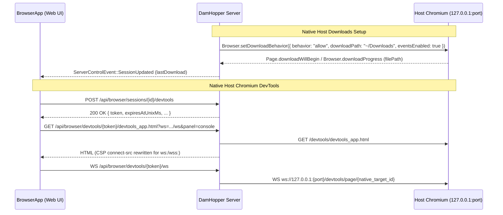

# Phase 01 — Backend DevTools Proxy & Native Host Downloads

Priority: P2 · Status: DONE (2026-11-16 04:20:50 EST) · Effort: 6h · Owner: Backend implementer

## Context Links

- [Plan Overview](./plan.md)
- [Independent Plan Review (`reports/plan-review.md`)](./reports/plan-review.md)
- [Host Browser CDP Streaming Architecture](../../docs/architecture/host-browser-cdp-streaming.md)
- [Host Browser API Reference](../../docs/api/browser-host.md)
- [CDP Gateway (`server/src/browser_host/cdp_gateway.rs`)](../../server/src/browser_host/cdp_gateway.rs)
- [CDP Actor (`server/src/browser_host/cdp.rs`)](../../server/src/browser_host/cdp.rs)
- [Network Policy (`server/src/browser_host/network_policy.rs`)](../../server/src/browser_host/network_policy.rs)

## Overview

1. Expose the host machine's native Chromium DevTools frontend (`http://127.0.0.1:{chrome_port}/devtools/*`) and page-scoped DevTools WebSocket (`ws://127.0.0.1:{chrome_port}/devtools/page/{native_target_id}`) through authenticated, target-fenced DamHopper server endpoints.
2. Enable native host-machine file downloads in Chromium via `Browser.setDownloadBehavior({ behavior: "allow", downloadPath, eventsEnabled: true })` targeting the host's `Downloads` directory, permit `data:` and policy-checked `blob:` download navigations in `NetworkPolicy::check_request`, and publish live download status (`lastDownload`) on `BrowserSessionDto`.

## Key Insights

1. **Host Chromium Serves Bundled DevTools Locally:** `/usr/bin/chromium --headless=new --remote-debugging-port=0` serves `devtools_app.html`, `inspector.html`, and all ~195 ES module/CSS/SVG assets from its local `resources.pak` at `http://127.0.0.1:{chrome_port}/devtools/*`.
2. **Relative Module Resolution Under Token Prefix:** Serving `GET /api/browser/devtools/{token}/devtools_app.html` causes all ~195 relative ES module imports (`./entrypoints/...`, `../../core/...`, `../../panels/...`) to resolve under `/api/browser/devtools/{token}/{*path}`, authenticating every asset request across cross-origin profiles and Vite proxies without cookies.
3. **Target & Geometry Isolation (Review Findings 1 & 2):** Forwarding `Emulation.*` `GEOMETRY_METHODS` from `devtools_app.html` into `raw_geometry_fence` would set `SessionRegistry::input_available = false` permanently when `Emulation.clearDeviceMetricsOverride` is called. Rejecting `GEOMETRY_METHODS`, `Browser.*`, `Target.createTarget`, `Target.closeTarget`, `Target.activateTarget`, `Target.getTargets`, `Target.sendMessageToTarget`, and `Target.attachToTarget` (where `params.targetId != native_target_id`) with JSON-RPC `-32601` keeps `ScreencastProducer` as the sole geometry owner and strictly sandboxes DevTools to the active tab.
4. **Native Host Downloads via `Browser.setDownloadBehavior`:** Probing `/usr/bin/chromium` confirms that `Browser.setDownloadBehavior({ behavior: "allow", downloadPath, eventsEnabled: true })` saves HTTP, `data:`, and `blob:` downloads directly into `downloadPath` on the host machine with their suggested filenames and emits `Browser.downloadWillBegin` / `Browser.downloadProgress` (including `filePath` on `state: "completed"`).

## Requirements

### Functional

1. **DevTools Lease Endpoints (`POST /api/browser/sessions/{id}/devtools` & `DELETE /api/browser/sessions/{id}/devtools/{token}`):**
   - Authenticate caller via `authenticate_browser_caller` and validate request Origin (`validate_request_origin`).
   - Verify `session_id` belongs to `admission.principal` (foreign session returns HTTP 404 `sessionNotFound`), status is `running`, and `native_target_id` is present in `global_session_registry()`.
   - Mint a 256-bit random `OsRng` URL-safe unpadded Base64 token (`token`), storing only its SHA-256 hash `[u8; 32]` in `DevToolsLeaseManager` along with `principal`, `is_dev`, `auth_session_id`, `auth_version`, `credential_version`, `effective_deadline`, `browser_session_id`, `native_target_id`, `browser_incarnation`, and `profile_epoch` (capped at 8 leases per principal, 32 globally; initial TTL 300s clipped to `admission.effective_deadline`).
   - Refresh `expires_at` (clipped to `effective_deadline`) on asset access AND on every 5-second live-auth check tick while the DevTools WebSocket is active so lazy-loaded DevTools panel modules (`./panels/network/network.js`, etc.) never 401/404 while DevTools stays open.
   - Wire revocation hooks across all lifecycle boundaries:
     - `revoke_by_browser_session(session_id)` in `close_native_session`, `release_session_viewers` (`api/browser_host.rs`), and `NativePumpRequest::SessionsRetired` (`media.rs`).
     - `revoke_by_auth_session(principal, auth_session_id)` in `revoke_auth_session_browser_resources` (`api/browser_host.rs`).
     - `revoke_all_for_principal(principal)` in `fence_principal_browser_resources_sync` (`api/browser_host.rs`).
2. **Static DevTools Asset Proxy (`GET /api/browser/devtools/{token}/{*path}`):**
   - Validate `token` against `DevToolsLeaseManager` and verify running instance `browser_incarnation` and `profile_epoch`.
   - Validate `path`: reject empty, `..`, `\`, leading `/`, NUL/control bytes, or query strings; allow only `[A-Za-z0-9._/-]`.
   - Proxy `GET http://127.0.0.1:{chrome_port}/devtools/{path}` (2s timeout, 4 MiB cap).
   - For `text/html` (`devtools_app.html`, `inspector.html`), rewrite `ws://127.0.0.1:*` in `<meta http-equiv="Content-Security-Policy">` to `'self' ws: wss: ws://127.0.0.1:*` and set `Cache-Control: no-store`, `Referrer-Policy: no-referrer`, `X-Content-Type-Options: nosniff`.
   - For static subresources, preserve `Content-Type` and set `Cache-Control: private, max-age=300`, `Referrer-Policy: no-referrer`, `X-Content-Type-Options: nosniff`.
3. **Target-Scoped DevTools WebSocket Relay (`GET /api/browser/devtools/{token}/ws`):**
   - Enforce single-active-WS-per-token exclusivity and bounded concurrency (`MAX_DEVTOOLS_CONNECTIONS = 4`), then connect upstream to `ws://127.0.0.1:{chrome_port}/devtools/page/{native_target_id}`.
   - In `inspect_devtools_client_message`:
     - Reject `Browser.*`, `Target.createTarget`, `Target.closeTarget`, `Target.activateTarget`, `Target.exposeDevToolsProtocol`, `Target.disposeBrowserContext`, `Target.createBrowserContext`, `Target.getTargets`, `Target.sendMessageToTarget`, `Target.attachToTarget` (when `params.targetId != native_target_id`), and `GEOMETRY_METHODS` (`Emulation.setDeviceMetricsOverride`, `Emulation.clearDeviceMetricsOverride`, `Emulation.setPageScaleFactor`, `Emulation.setVisibleSize`) by returning synthetic JSON-RPC error `{ "id": id, "error": { "code": -32601, "message": "Command disallowed in target-scoped DevTools" } }` to `client_ws`.
   - In `should_forward_devtools_upstream_message`:
     - Drop upstream `Target.targetCreated`, `Target.targetInfoChanged`, and `Target.targetDestroyed` events where `params.targetInfo.type` is `"page"` or `"browser_ui"` and `params.targetInfo.targetId != native_target_id`.
   - Run 5s `verify_live_admission` supervision (refreshing lease `expires_at`), `global_memory_controller().try_reserve(...)`, and `write_with_cancel`; revoke the lease on WebSocket close.
4. **Native Host File Downloads (`cdp.rs`, `network_policy.rs`, `session.rs`, `media.rs`):**
   - Resolve the host machine's native downloads directory (`resolve_host_downloads_dir()`: `XDG_DOWNLOAD_DIR` if absolute, otherwise `$HOME/Downloads`, falling back to `std::env::temp_dir().join("dam-hopper-downloads")`, creating the directory if needed).
   - During browser policy setup (`install_browser_request_policy` in `cdp.rs` or page session setup in `screencast.rs`), send `Browser.setDownloadBehavior` with `{ "behavior": "allow", "downloadPath": host_downloads_dir, "eventsEnabled": true }`.
   - In `NetworkPolicy::check_request` (`network_policy.rs`), allow `data:` URLs for both `Subresource` and `Navigation` (since `<a href="data:..." download>` pauses as `Document`), and for `blob:` URLs with `RequestKind::Navigation`, parse the inner URL (`Url::parse(parsed.path())`) and validate it via `evaluate_network_url(&inner, RequestKind::Navigation)`.
   - Project `Page.downloadWillBegin` / `Browser.downloadWillBegin` and `Page.downloadProgress` / `Browser.downloadProgress` in `cdp.rs` into `CdpLifecycleEvent::DownloadWillBegin` and `CdpLifecycleEvent::DownloadProgress`, updating `last_download: Option<BrowserDownloadSummaryDto>` on `BrowserSession` (`session.rs`) and publishing `ServerControlEvent::SessionUpdated`.

### Non-Functional

- Keep new Rust modules (`devtools.rs`, `devtools_filter.rs`) focused and under 200 lines each.

## Architecture



## Related Code Files

- **Create:** `server/src/browser_host/devtools.rs`
- **Create:** `server/src/browser_host/devtools_filter.rs`
- **Create:** `server/tests/browser_host_devtools.rs`
- **Modify:** `server/src/browser_host/mod.rs`
- **Modify:** `server/src/browser_host/cdp.rs`
- **Modify:** `server/src/browser_host/network_policy.rs`
- **Modify:** `server/src/browser_host/session.rs`
- **Modify:** `server/src/browser_host/selection.rs`
- **Modify:** `server/src/browser_host/media.rs`
- **Modify:** `server/src/api/browser_host.rs`
- **Modify:** `server/src/api/router.rs`

## Implementation Steps

1. In `server/src/browser_host/network_policy.rs`, update `check_request` so `data:` is permitted on `Navigation` (`<a download>`) and `blob:` on `Navigation` validates its inner `http(s)` URL via `evaluate_network_url`.
2. In `server/src/browser_host/session.rs`, add `BrowserDownloadSummaryDto` (`guid`, `suggestedFilename`, `state`, `receivedBytes`, `totalBytes`, optional `filePath`) and `last_download: Option<BrowserDownloadSummaryDto>` on `BrowserSession` / `BrowserSessionDto`, plus a helper to record download events and a helper returning `(BrowserSessionDto, String)` (`native_target_id`) for an owned `Running` session.
3. In `server/src/browser_host/cdp.rs` and `selection.rs`, configure `Browser.setDownloadBehavior({ behavior: "allow", downloadPath, eventsEnabled: true })` and route `Page.downloadWillBegin` / `Page.downloadProgress` / `Browser.downloadProgress` to `global_session_registry().record_download_progress(...)`.
4. Create `server/src/browser_host/devtools_filter.rs` (<200 LOC) with pure path validation, CSP rewriting, client CDP command filtering (rejecting `Browser.*`, cross-target `Target.*`, and `GEOMETRY_METHODS`), and upstream foreign-page target event filtering.
5. Create `server/src/browser_host/devtools.rs` (<200 LOC) with `DevToolsLeaseManager`, `proxy_devtools_asset`, `devtools_ws_handler`, 5s live-auth TTL refresh, and revocation methods (`revoke_by_browser_session`, `revoke_by_auth_session`, `revoke_all_for_principal`).
6. Wire routes and revocation hooks in `server/src/api/browser_host.rs`, `server/src/browser_host/media.rs`, and `server/src/api/router.rs`, and add integration tests in `server/tests/browser_host_devtools.rs`.

## Todo List

```evcrate-tasks
[
  {
    "id": "backend-devtools-proxy",
    "title": "Implement target-scoped DevTools proxy and native host Chromium file downloads",
    "blocked_by": [],
    "allowed_files": [
      "server/src/browser_host/devtools.rs",
      "server/src/browser_host/devtools_filter.rs",
      "server/src/browser_host/mod.rs",
      "server/src/browser_host/cdp.rs",
      "server/src/browser_host/network_policy.rs",
      "server/src/browser_host/session.rs",
      "server/src/browser_host/selection.rs",
      "server/src/browser_host/media.rs",
      "server/src/api/browser_host.rs",
      "server/src/api/router.rs",
      "server/tests/browser_host_devtools.rs"
    ],
    "constraints": [
      "Keep devtools.rs and devtools_filter.rs under 200 lines each.",
      "Reject GEOMETRY_METHODS, Browser.*, Target.getTargets, Target.sendMessageToTarget, Target.createTarget, Target.closeTarget, and foreign Target.attachToTarget on the DevTools WebSocket with JSON-RPC -32601.",
      "Refresh DevTools lease expires_at on each 5s live-auth tick while the WebSocket is open and wire revocation into session close, target retirement, single-session logout, and profile reset."
    ],
    "acceptance": [
      "POST /api/browser/sessions/{id}/devtools mints a SHA-256-hashed capability token for a running owned session and returns 404 for foreign sessions.",
      "GET /api/browser/devtools/{token}/devtools_app.html proxies host Chromium DevTools assets, rewrites CSP connect-src for ws:/wss:, and rejects traversal paths.",
      "GET /api/browser/devtools/{token}/ws relays target-scoped CDP traffic, blocks disallowed Target/Browser/Emulation commands without disabling input_available, and tears down on revocation.",
      "Browser.setDownloadBehavior saves HTTP, data:, and allowed blob: downloads to the host Downloads directory and publishes lastDownload on BrowserSessionDto."
    ],
    "verification": [
      "cargo test --manifest-path server/Cargo.toml --test browser_host_devtools",
      "cargo test --manifest-path server/Cargo.toml browser_host"
    ]
  }
]
```

- [x] <!-- evcrate-task:backend-devtools-proxy --> Implement target-scoped DevTools proxy and native host Chromium file downloads

## Success Criteria

- Bundled `devtools_app.html` and subresources load via `/api/browser/devtools/{token}/*` and inspect the bound tab over `/api/browser/devtools/{token}/ws` without affecting other tabs or `input_available`.
- Clicking a download link (`http(s):`, `data:`, `blob:`) inside a hosted browser tab saves the file natively to the host machine's `Downloads` folder and publishes `lastDownload` updates.

## Risk Assessment

- **Geometry lockup from DevTools `EmulationModel`:** Prevented by rejecting `GEOMETRY_METHODS` with JSON-RPC `-32601` in `devtools_filter.rs`.
- **Expired lease on lazy DevTools tab switch:** Prevented by refreshing `expires_at` on every 5s live-auth check tick while the DevTools WebSocket is connected.

## Security Considerations

- Tokens use 256-bit `OsRng` entropy with SHA-256 storage, `Referrer-Policy: no-referrer`, and `Cache-Control: no-store` on HTML responses.
- `blob:` download navigations validate their inner origin against `NetworkPolicy::evaluate_network_url`.

## Next Steps

- Proceed to [Phase 02](./phase-02-ui-devtools-dock.md) to wire the DevTools dock and native host download status banner in `BrowserApp`.
