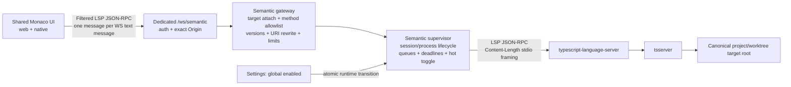

# LSP semantic navigation feasibility and architecture decision

## Decision status

**Accepted in part for planning; policy decisions superseded in place on 2026-10-23.** Feasibility is **conditional**, not verified GO. No implementation or runtime qualification performed. The [latest Validation Summary and reconciled phase ledger](../260901-1000-lsp-server-integration/plan.md#validation-summary) governs execution.

This September report remains architecture/history input. The current release boundary is Linux x64 server + actual web application, bundled TS/JS Definition + Implementation, runtime default OFF, current-admin-only global mutation and trusted workspaces without an OS sandbox. Phase 01 gates G0–G8 must pass before downstream implementation.

| September decision / claim | Status | Governing replacement |
|---|---|---|
| Required native/Linux Tauri remote-client qualification | **SUPERSEDED** | Linux server + web only; all native, Windows and Android qualification deferred/non-blocking; native same-origin guard unchanged |
| Any authenticated client may toggle globally; auth has no roles | **SUPERSEDED** | Existing User/Admin roles; fresh current Admin required across dedicated/import/raw/shared config mutation paths; `--no-auth` remains User and cannot mutate globally |
| Host-opted/browser or administrator-managed executable override | **SUPERSEDED — withdrawn, not postponed** | Only immutable bundled engines; no custom commands through flags/env/host config/import/API/UI |
| Full sync sufficient; incremental optional optimization | **SUPERSEDED** | Adaptive full/incremental required; exact single-kind contract remains Phase 01 G4 proof, not dual LSP capability values |
| Implicit document-version request/acknowledgment | **CLARIFIED; unproven assumption rejected** | G5 explicit filtered-profile extension, stripped child-side, writer ordering and source/destination freshness; no standard LSP version field/ack |
| “Containment” means child filesystem sandbox | **REJECTED interpretation** | Gateway result/URI containment only; child retains server-account filesystem authority; G6 plugin/hook suppression required |
| Startup/on-enable executable probe while ON starts zero children | **SUPERSEDED** | Passive integrity checks only at startup/ON; bounded executable qualification or first authorized lazy session |
| Original worktree/develop/env-copy acceptance prerequisite | **SUPERSEDED** | Existing reassessment worktree/branch in parent; no new worktree or secret copying |

Unchanged architecture: Rust-owned bounded child trees, dedicated filtered LSP/JSON-RPC WebSocket, independent unsaved overlays, target/URI mediation, lazy start and complete lifecycle cleanup. Missing optional hard controls permits warned runnable `portable-only`, not a hard RSS guarantee; only measured modes may be claimed qualified.

## Problem

Dam Hopper's shared Monaco editor can open and edit code but has no semantic code-navigation service. Desired behavior:

- analyze TypeScript/JavaScript in the selected project or registered worktree;
- resolve Definition and Implementation from current unsaved Monaco content;
- navigate to the correct file/range in the web application; shared code remains host-neutral, but native qualification is deferred;
- use Language Server Protocol semantics and JSON-RPC;
- preserve later `rust-analyzer` feasibility;
- protect existing terminal, filesystem, build, Git, and server responsiveness;
- allow a server-global runtime on/off setting without restarting Axum;
- use only bundled immutable engines; **SUPERSEDED:** explicitly unsafe host-opted/browser executable overrides are withdrawn.

Current code has Monaco, target-scoped editors, authenticated WebSocket infrastructure, target/worktree resolution, and child-process patterns. It has no LSP client, LSP process supervisor, semantic route, descriptor config, or packaged TypeScript language server.

## Terminology

- **LSP**: Language Server Protocol. Defines lifecycle, document synchronization, requests such as `textDocument/definition`, responses, positions, URIs, and cancellation.
- **JSON-RPC**: request/notification/response message format used by LSP. It is transport-independent.
- **WebSocket**: bidirectional network transport between browser/native UI and Dam Hopper server. It is not an alternative to JSON-RPC.
- **TSLS**: `typescript-language-server`, a community LSP wrapper around Microsoft's `tsserver`. It reads TypeScript/JavaScript project files, retains type graphs, and consumes CPU and RAM while initializing and answering requests.
- **Monaco**: browser editor component. It is not VS Code and does not include VS Code's extension host or remote workspace filesystem.

## Agreed requirements

### Final artifact

A feasibility/architecture decision record defining:

- process and trust boundaries;
- filtered LSP-over-WebSocket contract;
- TypeScript/JavaScript MVP behavior;
- resource isolation and runtime toggle semantics;
- target, document-version, URI, auth, and teardown invariants;
- bundled immutable toolchain only; **SUPERSEDED:** guarded unsafe executable override;
- later `rust-analyzer` seam;
- observable acceptance and measurement gates.

### MVP scope

- `.ts`, `.tsx`, `.js`, and `.jsx` models.
- Go to Definition: `textDocument/definition`.
- Go to Implementation: `textDocument/implementation`.
- Unsaved model content through versioned `didOpen`, `didChange`, and `didClose`.
- Filtered standard LSP JSON-RPC on a dedicated authenticated WebSocket.
- One shared Monaco integration in `packages/ui`; actual web qualification only, native qualification deferred.
- TSLS supervised as a bounded OS child by the current Rust server.
- Global server runtime toggle applied without server restart.
- Target-root containment; external canonical paths denied without disclosure.
- Bundled immutable Linux x64 Node/TypeScript/TSLS tuple only; no administrator-installed alternative.
- Explicit disabled, starting, ready, unsupported, missing-tool, overloaded, timeout, crashed, and invalidated states.
- Release default OFF; current Admin alone mutates global enabled intent, including alternate import/raw/shared-write paths. Ordinary authenticated Users may use enabled semantics.
- Trusted workspaces only; server-account child filesystem authority remains. Project plugins/engine selection/execution hooks must be suppressed and proven with real processes.
- Real local MVP validation, not a mocked or source-only prototype.

### Explicitly out of scope

- Rust semantic behavior in MVP. Rust models report unsupported and start no Rust process.
- Java/JDT, generic all-language support, arbitrary plugin registry, VS Code extension compatibility.
- Diagnostics, hover, completion, references, rename, formatting, code actions, workspace edits, semantic tokens, symbols, and persistent indexes.
- Automatic Node, TypeScript, or language-server downloads.
- Browser-side whole-project filesystem mirroring.
- Native-only sidecar or separate language-service microservice.
- Sharing one mutable language-server session across users with conflicting unsaved overlays.
- External definition navigation to host TypeScript libraries, global package stores, sibling roots, or symlink targets outside the selected target.
- Unrestricted LSP pass-through.

## Repository evidence and touchpoints

**Historical source snapshot:** paths/API observations below were collected in September, not reverified implementation evidence. Reconciled phases use current release/auth/editor touchpoints; conflicting support/override assumptions are superseded above.

### Existing boundaries

- `README.md`: `server/` owns backend logic; `apps/web/` and `apps/native/` are thin hosts; `packages/ui/` owns shared React UI.
- `apps/web/src/main.tsx` and `apps/native/src/main.tsx`: both initialize the same shared transport and mount the shared app. Native does not currently own workspace files or an LSP sidecar.
- `packages/browser-bridge/`: browser debug DOM bridge, unrelated to editor semantics.

### Backend

- `server/src/state.rs`: `AppState`, project/worktree target resolution, workspace-owned subsystem lifecycle.
- `server/src/api/router.rs`: authenticated REST routes and current `/ws`; candidate dedicated semantic route.
- `server/src/api/ws.rs`: current token/cookie auth, exact-Origin checks, split socket handling, and bounded-channel patterns.
- `server/src/api/ws_protocol.rs`: current `{kind: ...}` terminal/filesystem protocol. It is not JSON-RPC and must remain separate.
- `server/src/workspace_target.rs` and `server/src/fs/sandbox.rs`: canonical target/worktree and filesystem containment boundaries.
- `server/src/api/workspace.rs` and `server/src/api/config.rs`: workspace switch/config reload invalidation points.
- `server/src/api/usage.rs`, `server/src/telemetry/runtime.rs`, and `server/src/system/monitor.rs`: no-restart runtime transition, rollback, reconfigure, and shutdown precedents.
- `server/src/main.rs`: subsystem startup and graceful shutdown ownership.
- `server/Cargo.toml`: Axum/Tokio/process primitives exist; no LSP/JSON-RPC dependency exists.

### Shared UI

- `packages/ui/src/api/transport.ts`: host-independent transport seam.
- `packages/ui/src/api/ws-transport.ts`: current REST + `/ws` implementation, reconnect, auth, and pending-request handling.
- `packages/ui/src/components/organisms/MonacoHost.tsx`: Monaco model/editor lifecycle and provider integration seam.
- `packages/ui/src/components/organisms/EditorTabs.tsx`: active target/model context and navigation destination wiring.
- `packages/ui/src/stores/editor.ts`: target-scoped tab identity, unsaved content, changes, and view state.
- `packages/ui/src/api/client.ts` and `packages/ui/src/api/queries.ts`: `ProjectTargetRef`, target cache keys, and target-scoped calls.
- `packages/ui/src/components/pages/SettingsPage.tsx` and `packages/ui/src/stores/settings.ts`: shared Settings UI. Existing appearance settings are not the correct persistence boundary for a server runtime control.
- `packages/ui/package.json`: Monaco exists; no LSP client package exists.

### Documentation

- Historical architecture sketch is not a qualification claim. Phase 11 updates current architecture references only after implementation/evidence, with Linux server + web TS/JS scope and future included Java/Rust separately gated.
- `docs/project-roadmap.md` uses “Programming Language Navigation” for extension-based/manual navigation, not semantic LSP. Future updates must distinguish the two.
- `docs/ws-protocol-guide.md` mixes current and historical terminal protocol details. Semantic transport must be documented independently rather than appended ambiguously.

## Evaluated execution locations

| Option | CPU/RAM placement | Latency and data locality | Correctness and parity | Decision |
|---|---|---|---|---|
| Rust-supervised TSLS child beside workspace | TS analysis CPU/RAM on server; independent child tree, not filesystem sandbox | Cold indexing dominates; warm lookup adds RTT and TS query; files remain local | **Accept for planning**, subject to Phase 01 proof; shared adapter does not qualify native |
| Monaco TypeScript worker with mirrored project | CPU and RAM duplicated in every browser/WebView | Warm lookup can avoid RTT, but cold path must transfer source closure, configs, declarations, package metadata, generated files, and watcher updates | Plain Monaco sees in-memory models/libs only; authoritative project semantics require a major virtual-filesystem subsystem | Reject for authoritative MVP; possible degraded fallback later |
| Native Tauri sidecar | CPU and RAM on native client | Fast only when native owns the exact local workspace | Current native host is a remote UI without workspace FS or sidecar permissions; web cannot share this path | Reject for shared MVP; reconsider only for a future explicit local-workspace profile |
| Separate service on same server host | TSLS still consumes the same host CPU/RAM | Same workspace locality; extra process/port hop | Duplicates auth, target trust, config, deployment, and failure coordination without removing machine contention | Reject until measurements justify extraction |

### Brutal workload conclusion

Changing typed messages to raw JSON-RPC does **not** move or reduce compiler work. TSLS still parses files and builds type graphs where its process runs.

Moving TSLS from an Axum-supervised child to a Tauri sidecar on the same physical machine changes ownership and failure isolation, not total CPU cycles, RAM, or heat. Moving work to a different client machine requires that machine to possess or mirror the authoritative workspace.

The selected design therefore controls server impact rather than pretending transport removes it:

- lazy process start;
- no Explorer-triggered indexing;
- global hot off;
- core server priority over semantics;
- independent route/tasks/queues;
- bounded process count, queue bytes, document bytes, request concurrency, deadlines, memory, CPU priority, restart attempts, and idle lifetime;
- explicit overload/disabled response instead of terminal or filesystem degradation;
- measurement before broader capability rollout.

## Evaluated network contracts

| Contract | Strengths | Costs | Decision |
|---|---|---|---|
| Filtered standard LSP JSON-RPC over dedicated WebSocket | Reuses LSP lifecycle and Monaco LSP-client model; straightforward Definition, Implementation, and later standard capabilities; no custom request correlation | Requires explicit WebSocket profile, target attach, method allowlist, URI mediation, capability filtering, server-request handling, reconnect/replay, and client dependency | **Accept** |
| Typed Dam Hopper semantic messages over dedicated WebSocket | Smallest product API and attack surface; backend hides LSP completely | Every added semantic feature needs translation and custom types | Good alternative, rejected because accepted roadmap includes more than one LSP query and favors standard expansion |
| Filtered LSP on existing `/ws` | Reuses one connection | Competes with terminal/FS traffic and tangles unrelated reconnect/backpressure lifecycles | Reject |
| REST Definition/Implementation facade | Simple auth and request tracing | Unsaved content still requires hidden sessions; weak bidirectional lifecycle and cancellation; likely later replacement | Reject |
| Unrestricted raw LSP pass-through | Minimal apparent forwarding | Exposes arbitrary methods, commands, edits, capabilities, URIs, and resource use; backend still must secure every boundary | Reject |

## Recommended architecture

**Historical diagram — partially SUPERSEDED:** native is not a blocking release surface, and the unversioned route label is obsolete. Use `/ws/semantic/v1`, current-admin global control and Phase 01-proven model/wire bindings from the reconciled phases. The diagram is not native qualification or a child filesystem-sandbox claim.



### Boundary decisions

1. The supervisor belongs in the current Rust server and is owned by `AppState`.
2. Each language server is still an independent OS child, never an in-process compiler and never a PTY.
3. Semantic traffic uses a dedicated WebSocket and cannot consume current terminal/FS outbound queues.
4. Web and native use one shared Monaco/LSP adapter from `packages/ui`.
5. The browser speaks a filtered standard LSP subset, not arbitrary LSP.
6. The server rewrites and validates all root/document/result URIs. The child alone sees host `file://` URIs.
7. The server remains authoritative for target/worktree identity and process/tool configuration.

## WebSocket and JSON-RPC profile

WebSocket is the outer byte/message transport. JSON-RPC is the message format. LSP is the allowed method and lifecycle contract.

### Connection profile

- Dedicated endpoint: `/ws/semantic/v1`; **SUPERSEDED:** unversioned `/ws/semantic` proposal.
- WebSocket subprotocol: `dam-hopper.semantic.lsp.v1`.
- Current token/cookie/exact-Origin policy plus live revocation/account/auth-version/credential-version/MFA/expiry/backend checks. Recheck cadence5s, store lookup bound2s; cancellation must not wait for outbound close/status. Total detection/reap timing must be measured, not promised within5s.
- One complete JSON-RPC object per WebSocket text message.
- JSON-RPC batches and binary messages rejected in V1.
- Frame/message, inbound-rate, queue-byte, and in-flight-request limits mandatory.
- Preserve existing redacted credential transport policy; no credentials in routine logs. A new ticket/auth redesign is not part of this plan.

### Target attachment

Before the proxied LSP session begins, one versioned JSON-RPC control request binds the socket to a target and trusted descriptor:

```json
{
  "jsonrpc": "2.0",
  "id": "attach-1",
  "method": "damHopper/attachTarget",
  "params": {
    "target": { "project": "web", "worktreePath": "/registered/worktree" },
    "descriptor": "typescript"
  }
}
```

Rules:

- `ProjectTargetRef` is resolved through the existing registered target/worktree resolver.
- `worktreePath`, when present, is an identifier that must exactly resolve to a registered target; it is never accepted as an arbitrary root.
- Target root and target generation become immutable session state.
- Client LSP `rootUri`, workspace folders, process path, cwd, environment, and initialization options are ignored/rejected as authority and rewritten from server state.
- Child LSP still receives `initialize` as its first request; `damHopper/attachTarget` is consumed by the gateway and never forwarded.

### Allowed MVP LSP messages

Client to gateway:

- `initialize`
- `initialized`
- `textDocument/didOpen`
- `textDocument/didChange`
- `textDocument/didClose`
- `textDocument/definition`
- `textDocument/implementation`
- `$/cancelRequest`
- `shutdown`
- `exit`

Everything else fails closed with a stable JSON-RPC error and bounded `data.damHopperCode`.

The gateway owns required child-facing replies such as `workspace/configuration` when selected TSLS behavior requires them. It suppresses or sanitizes unadvertised notifications. No workspace edit, command execution, registration, arbitrary configuration, or filesystem request crosses to the client in MVP.

### Stdio bridge

The child side uses LSP base-protocol framing:

```text
Content-Length: <UTF-8 byte count>\r\n
\r\n
<JSON-RPC JSON bytes>
```

WebSocket boundaries must never be reused as stdio framing. The parser must handle partial headers/bodies, multiple messages per read, malformed headers, oversized lengths, EOF, stderr draining, and child crash without blocking Axum.

## Document and navigation lifecycle

1. Settings global `enabled` must be true.
2. Client opens semantic WebSocket and attaches one authenticated target/descriptor.
3. Gateway resolves the target and lazily starts an isolated TSLS session.
4. Gateway rewrites `initialize` root/workspace data from canonical server state, validates negotiated capabilities and UTF-16 position encoding, then forwards `initialized`.
5. Monaco model open sends full text and a version. Unsaved text stays memory-only.
6. **SUPERSEDED:** full-only MVP sync. Adaptive sync uses full below the candidate post-edit UTF-8 threshold and incremental at/above; open/replay/resync are full. Phase 01 G4 must prove one negotiated sync kind against the exact TSLS tuple.
7. Definition/Implementation requires the G5 candidate filtered-profile `params.damHopperDocumentVersion`, removed before standard child LSP dispatch, validated against current overlay/incarnation and actual-writer FIFO ordering. There is no standard document-version request field or didChange acknowledgment; source correctness and exact destination-coordinate/content freshness must be proven.
8. Newer requests may send `$/cancelRequest`; cancellation is advisory. Late responses are discarded by request ID, document version, session generation, and target generation.
9. Child `Location`/`LocationLink` results are canonicalized and re-authorized.
10. Only canonical files inside the attached target root become client-visible virtual URIs/relative paths. Outside-root results are dropped and reported as `outsideTarget` without host path disclosure.
11. Shared editor code opens or focuses the target-scoped tab and reveals/selects the range. Multiple results remain multiple results.
12. Document `didClose` cancels/releases only that document; other open models remain live. Socket disconnect, global disable, auth/target invalidation, workspace/config changes, worktree removal, profile rebind and server shutdown retire affected sessions, drop their overlays and reap their full trees.
13. Shutdown: revoke admission/cancel independently of socket delivery → drop affected documents → bounded `shutdown`/`exit` → forced complete-tree termination/reaping. One document's `didClose` preserves other open models; session retirement, not every document close, reaps the shared tree.

## URI and position contract

- Monaco/client models use a stable virtual target-scoped identity; clients never receive child `file://` URIs.
- Gateway maps virtual target URI + relative path to canonical host file URI only after target containment.
- Returned URI normalization handles percent encoding, separators, symlinks, and later Windows drive-letter rules.
- LSP/Monaco positions use negotiated UTF-16 for MVP.
- Lines/characters are zero-based; range end is exclusive.
- Non-BMP characters before the cursor are mandatory validation cases.
- `null`/empty definition is normal and distinct from timeout, cancellation, unsupported method, missing tool, or external-path denial.

## Mixed TypeScript and Rust repositories

A mixed repository does not use one combined language server.

- A TS/JS request lazily starts only the TypeScript descriptor for that target.
- A Rust request in MVP returns explicit unsupported state and starts no child.
- TSLS may navigate among authorized TS/JS files under the same target root.
- Later Rust support starts a separate `rust-analyzer` child/session for the same target.
- The shared WebSocket, target attach, document lifecycle, cancellation, URI mediation, Definition, and Implementation contract remain unchanged.
- Rust adds reviewed server-owned root selection, provisioning, initialization/config handling, capability validation, and resource limits. It does not add an arbitrary public plugin registry.

## Runtime Settings design

### Accepted scope

- **Server-global only** in MVP.
- Persisted in server-owned global/runtime configuration, not browser-local appearance state.
- Shared Settings page displays the connected server's actual runtime state.
- **SUPERSEDED:** “Any authenticated client can toggle; auth has no roles.” Existing `UserRole::{User,Admin}` applies. Every global semantic mutation requires fresh server-verified current Admin across settings/import/raw/shared writers. `--no-auth` actor is User and denied mutation; ordinary authenticated Users can navigate when enabled. UI hiding does not authorize writes.

### Hot transition

`enabled: true -> false`:

1. serialize transition under a supervisor transition lock;
2. reject new attaches/requests with stable disabled state;
3. cancel pending work;
4. attempt bounded best-effort disabled notification in parallel; never await it before child cancellation/cleanup;
5. gracefully shutdown then force-reap all semantic children within a deadline;
6. clear queues, overlays, sessions, and crash-backoff state;
7. atomically persist setting;
8. if persistence/final authorization fails after irreversible cleanup, remain safely disabled with prior durable intent and explicit mismatch/error; never fabricate restoration of killed sessions/overlays.

`enabled: false -> true`:

1. validate immutable bundled integrity/config without executing a child;
2. persist/apply enabled state atomically;
3. publish enabled-but-idle state;
4. start zero children; bounded real protocol validation occurs in qualification or the first authorized lazy session.

Existing telemetry runtime transitions are the repository precedent. A client-only visual toggle is insufficient because it could leave server processes consuming resources.

## Tool provisioning and unsafe override

### Current bundled-only policy

- Exact server-release-owned Node/TypeScript/TSLS tuple, hashes, transitive lock, licenses/SBOM and verified immutable paths.
- Direct absolute Node + fixed TSLS entrypoint/arguments, server-derived root and minimal explicit environment; no shell/PATH/project package resolution or inherited execution hooks.
- Startup/ON passive integrity checks spawn zero children. Real capabilities/version/protocol are qualified boundedly or checked in the first authorized lazy session.
- Existing Linux archive/manifest/installer owners stage the tuple with the server role; runtime and local-bundle install need no engine download/package manager.
- Included-engine updates normally arrive through a qualified server release and daemon restart; ordinary navigation and OFF/ON do not restart DamHopper.

### Superseded unsafe mode — withdrawn

**SUPERSEDED:** the September accepted `allowUnsafeLspOverride`, host-only opt-in, browser executable/argument fields, administrator-installed alternate profiles, disable/probe/profile-swap transactions and associated command audit UX. Do not implement these paths, even for a trusted host operator's semantic configuration.

OS operators/pre-existing server-account terminals retain filesystem/process authority; HTTP config authorization is not an OS security boundary. This limitation does not create a supported custom engine setting. Later Java/Rust inclusion needs its own integration, real-process/security/resource qualification and bundled release, not an arbitrary plugin registry.

## Resource and thermal policy

**Core server wins.** Semantic navigation degrades before terminal, filesystem, build, Git, alert, or workspace-control paths.

Mandatory controls:

- independent semantic WebSocket task and bounded channels;
- lazy process start and idle eviction;
- per-connection/target/descriptor process isolation for unsaved-buffer correctness initially;
- per-client and global child caps;
- child CPU priority and OS resource containment where supported;
- child RSS observation and termination policy;
- bounded document bytes, aggregate overlay bytes, queue bytes, message bytes, and in-flight requests;
- initialize, request, shutdown, and crash-backoff deadlines;
- no eager diagnostics/index trigger outside TSLS's unavoidable project load;
- finite restart attempts and explicit crashed/degraded state;
- no shared locks or queues with terminal/FS traffic;
- no blocking stdio/process work on Tokio request executors.

Phase 01 G0 records finite conservative experiment bounds before any execution; Phase 03 enforces passed initial runtime limits before admission. Phase 09 measures and selects final numerical limits/threshold, with acceptance budgets frozen before final runs. No circular dependency postpones all bounds to qualification.

Required metrics:

- TSLS/tsserver child CPU and RSS;
- child count and restart count;
- cold attach-to-ready time;
- warm Definition/Implementation p50/p95 latency;
- queue wait, timeout, cancellation, stale-drop, and overload counts;
- Axum event-loop/endpoint latency during indexing;
- terminal output latency and dropped/overflow signals during indexing;
- shutdown/reap duration and orphan-process count.

No source text, absolute paths, child command, token, unsanitized stderr, or returned symbol content in telemetry.

## Security invariants

- Authentication plus exact Origin on the semantic WebSocket.
- Trusted workspaces only: canonical gateway URI/results do not confine analyzer filesystem reads. Child retains server-account authority; G6 must prove project plugin/tsserver/Node preload/execution hooks cannot load.
- Global config mutation is current-admin-only; no-auth never elevates. Reject bundled-engine override fields on every write path.
- Authentication success does not imply target authorization; every session binds a live registered target generation.
- Method/capability allowlist; unknown methods fail closed.
- No unrestricted client root URI, cwd, environment, initialization options, workspace edit, command, plugin, or filesystem operation.
- Canonical containment on every input document and every returned location.
- No external absolute path or `file://` disclosure.
- Unsaved source is memory-only, bounded, connection-scoped, redacted, and dropped on teardown.
- Monotonic versions; stale/cancelled responses never navigate.
- Malformed/oversized JSON-RPC and stdio framing fail closed.
- Child stdout is protocol-only; stderr is drained and sanitized.
- Child crash/overload cannot block or consume terminal/FS queues.
- No orphan language-server process after disable, invalidation, disconnect, or shutdown.

## Failure model

| Condition | Observable behavior |
|---|---|
| Global disabled | Attach/request rejected as disabled; no TSLS child exists |
| Unsupported Rust/other language | Editor remains usable; semantic request reports unsupported; no child starts |
| Missing/incompatible TSLS | Explicit missing-tool/incompatible state; terminal/FS unaffected |
| Cold initialization | Visible starting/indexing state; request bounded by startup deadline |
| Over capacity/thermal policy | Stable overloaded response; no unbounded queue or core-server degradation |
| Request timeout | Timed-out request cannot navigate later |
| Explicit/superseding cancel | Inner cancel sent; eventual late response discarded |
| Child crash | In-flight requests fail; bounded backoff; no infinite restart loop |
| Target/worktree invalidated | Session generation revoked; responses dropped; child reaped |
| External returned URI | Result omitted; outside-target state without path disclosure |
| WebSocket disconnect/profile change | Overlay dropped; child shutdown/reaped; reconnect opens fresh session |

## Acceptance criteria

1. Use the existing reassessment plan/worktree/branch identified by the parent. **SUPERSEDED:** creating the old develop-based worktree or copying `.env` is not an acceptance requirement.
2. In the actual authenticated built web application, Definition/Implementation navigates to the correct target-relative file/range. **SUPERSEDED:** blocking native/Tauri qualification; all native remains unqualified/deferred.
3. Unsaved source uses the current captured model/version/incarnation, with G5-proven exact destination-coordinate/content association; neither disk state nor an invented LSP acknowledgment substitutes.
4. Rapid repeated requests, explicit cancellation, and stale responses cannot move the cursor incorrectly.
5. Multiple authorized results remain selectable; empty result is distinct from failure.
6. Non-BMP Unicode before cursor and result ranges remains position-correct.
7. Mixed Rust+TS target supports TS/JS while Rust is explicitly unsupported and starts no Rust child.
8. Unauthenticated or disallowed-Origin semantic WebSocket connections fail.
9. Unconfigured project/worktree, `..`, symlink escape, sibling target, stale target generation, absolute client URI, or external returned URI cannot be opened or disclosed.
10. Only current Admin may hot OFF/ON via any write path; User/no-auth denied mutation. OFF cancels independently of socket delivery and leaves zero trees/overlays on success; passive ON remains zero-child idle. Failed irreversible OFF exposes safe-disabled/intent mismatch.
11. Missing, incompatible, overloaded, timed-out, or crashed TSLS degrades only semantic navigation; existing terminal, filesystem, save, Git, build, and alert behavior remains responsive.
12. Document close releases only its overlay/requests and preserves other models; last-document idle eviction or whole-session disconnect, auth/target invalidation, workspace/config changes, removal, profile rebind, disable and shutdown reap the full affected tree.
13. The WebSocket accepts only the agreed JSON-RPC profile; unknown methods, batches, binaries, malformed frames, and oversized payloads fail boundedly.
14. Resource evidence reports cold/warm latency, child CPU/RSS, process counts, queue pressure, terminal latency during indexing, and reap/orphan state for representative TS/JS projects.
15. Later `rust-analyzer` Definition/Implementation can use the same shared Monaco and filtered LSP contract through a separate reviewed descriptor, without host-app forks or raw host URI exposure.
16. Bundled offline tuple passes G1/G6 provenance and hostile-loading gates; custom command selection absent on every input surface.
17. Required forced portable-only mode runs with visible degradation and finite application bounds, without sandbox/hard-RSS claims. Every claimed hard mode needs actual capable-host evidence.
18. Actual web qualification includes fresh non-sensitive full-viewport captures and human acceptance; tests-only/CI success cannot synthesize approval.

## Success metrics

Release thresholds must be set from baseline measurements, but success requires:

- zero unauthorized or external path disclosure;
- zero stale/cancelled navigation;
- zero orphan language-server children after teardown;
- zero unbounded queues or restart loops;
- no material terminal/FS latency regression under accepted semantic load;
- bounded and visible cold-start/overload behavior;
- correct actual-web semantics with exact owner/target/model fences; **SUPERSEDED:** native parity as this release's blocking metric;
- global OFF reducing semantic process count and retained overlay bytes to zero.

## Feasibility conclusion

### Accepted direction — not runtime GO

- Current Rust server is the correct workspace-local supervisor.
- Axum/Tokio can host an isolated semantic gateway and child-process bridge.
- Shared Monaco/UI is the selected integration point; native qualification remains deferred and requires separate evidence.
- Existing target resolver, sandbox, auth, Origin, runtime transition, and shutdown patterns are reusable.
- Definition and Implementation use standard LSP operations and leave a clean later Rust descriptor seam.

### Conditional

- TSLS packaging/version compatibility is not yet proven.
- Exact resource limits and UX latency thresholds require measurement on representative projects.
- Filtered LSP requires deliberate capability/server-request handling; it is not a transparent proxy.
- **SUPERSEDED:** acceptance of host-opted browser command override. No custom executable mode is supported.

### NO-GO variants

- unrestricted raw LSP pass-through;
- browser/host/config-selected executable, even with host opt-in;
- client-supplied arbitrary root/cwd/environment;
- native-only semantics for the shared MVP;
- browser project mirroring presented as a cheap Monaco feature;
- mixing semantic traffic into existing terminal/FS `/ws` queues;
- release without resource, containment, stale-result, failure, and cleanup evidence.

## Dependencies and next steps

1. Reconciled implementation plan exists; run its Phase 01 G0–G8 STOP/GO spike before downstream implementation.
2. Choose exact pinned Node, TypeScript, and `typescript-language-server` versions and distribution method.
3. Choose shared Monaco LSP client library after source/API evaluation; avoid assuming Monaco equals VS Code.
4. Define the versioned WebSocket subprotocol, attach handshake, method/capability allowlist, virtual URI mapping, and error codes.
5. Define semantic supervisor state machine and global runtime transition contract.
6. Select representative small/medium/large TS/JS fixtures and measure baseline terminal/server behavior before fixing numeric limits.
7. Keep native/Windows/Android explicitly unqualified/deferred and unchanged origin policy; no such runner/emulator gate blocks Linux server + web.
8. Plan documentation updates: semantic architecture, protocol guide, configuration/security, roadmap/changelog, and distinction from existing extension-based navigation.

## Primary references

- [Language Server Protocol specification 3.17](https://microsoft.github.io/language-server-protocol/specifications/lsp/3.17/specification/)
- [JSON-RPC 2.0](https://www.jsonrpc.org/specification)
- [RFC 6455 WebSocket Protocol](https://www.rfc-editor.org/rfc/rfc6455)
- [WHATWG WebSockets](https://websockets.spec.whatwg.org/)
- [Axum WebSocket extractor](https://docs.rs/axum/latest/axum/extract/ws/index.html)
- [Tokio bounded MPSC](https://docs.rs/tokio/latest/tokio/sync/mpsc/fn.channel.html)
- [Tokio process](https://docs.rs/tokio/latest/tokio/process/struct.Command.html)
- [`typescript-language-server`](https://github.com/typescript-language-server/typescript-language-server)
- [TypeScript standalone server](https://github.com/microsoft/TypeScript/wiki/Standalone-Server)
- [Monaco editor README and FAQ](https://github.com/microsoft/monaco-editor/blob/main/README.md)
- [VS Code extension host](https://code.visualstudio.com/api/advanced-topics/extension-host)
- [VS Code remote extensions](https://code.visualstudio.com/api/advanced-topics/remote-extensions)
- [VS Code web extensions](https://code.visualstudio.com/api/extension-guides/web-extensions)
- [Tauri sidecars](https://v2.tauri.app/develop/sidecar/)
- [`rust-analyzer` architecture guide](https://rust-analyzer.github.io/book/contributing/guide.html)
- [`rust-analyzer` LSP extensions](https://rust-analyzer.github.io/book/contributing/lsp-extensions.html)

## Unresolved questions

All unresolved feasibility is explicit in [Phase 01 gates G0–G8](../260901-1000-lsp-server-integration/phase-01-protocol-dependency-real-process-spike.md#architecture), not assumed resolved by ADR acceptance:

- Exact transport/dependency and Node/TypeScript/TSLS pins, provenance/licenses, Linux release layout and nested-config/project-reference behavior.
- Required fixed TSLS configuration replies; project plugin, engine-resolution and inherited execution-hook suppression with positive-control real processes.
- One-kind adaptive sync compatibility, explicit filtered-profile version extension, actual writer ordering, source/open-incarnation fences and exact destination-coordinate/content freshness.
- Stable dirty local model identity versus replaceable wire URIs; model-scoped Monaco provider coexistence without changing OFF/nonowned behavior.
- Portable complete-tree ownership/reaping and bounded optional child-only hard controls.

Phase 09 owns final measured numerical limits/threshold/performance budgets; Phase 10 owns actual application/visual evidence. Native/Windows/Android qualification and future Java/Rust are separate later work, not unresolved user policy. No custom-command or host-opt-in question remains.
