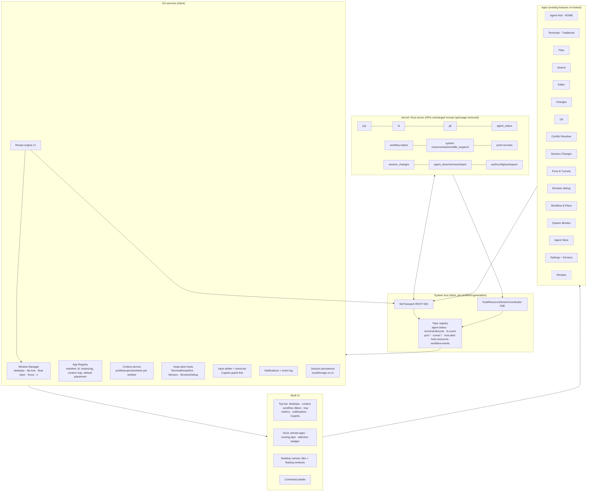

# DamHopper OS — AI-centered development OS (web) redesign

## 1. Problem / final artifact
Current web UI = 3 divergent shells (`IdeShell`, `TerminalWorkspaceShell`, `MobileWorkspaceShell`) + page routes (`/`, `/workspace`, `/git`, `/settings`, `/agent-store`, `/usage`, `/devices`, `/ssh-forwarding`) + ad-hoc float panels (`TerminalFloatingFilePanel`, `TerminalFloatingToolPanel`). Goal: one desktop-web "OS" shell, ROS-inspired, agents as first-class citizens; existing features re-hosted as apps/windows.

**Final artifact (of the implementation, not this brainstorm):** single OS shell in `packages/ui` served by `apps/web`; Tauri desktop, web Usage feature + server `/api/usage/*`, SSH-forwarding UI, mobile shell removed; Dashboard + Host resources merged into System Monitor app + tray metrics; Agent Hub home + Launch Recipes.

## 2. Decisions (user-confirmed 2026-11-01)
| # | Topic | Decision |
|---|---|---|
| D1 | API | No change to existing APIs. New APIs only additive + subsystem path-versioned (`/api/<area>/v1/*`, existing convention). This design needs **zero new server APIs**. |
| D2 | Usage | **Full removal incl. server** (`/api/usage/*`, `server/src/telemetry/`, Codex OTLP exporter). Accepted Android impact (see §7). |
| D3 | Window model | Tiling + float hybrid per virtual desktop. |
| D4 | Persistence | Browser `localStorage` (`dam-hopper:os:v1:*`); JSON export/import. No server sync. |
| D5 | Cutover | Phased: build at `/os`, reach parity, flip `/` → OS, delete old shells same release train. |
| D6 | Viewport | Min 1024×640; primary 1440×900 / 1920×1080; 1024–1279 compact desktop rules; no mobile/touch. Proposed consequence: delete all mobile-specific web code (§4.1) — confirm at approval. |
| D7 | AI layer | Assistant decision (user delegated after comparison): Agent Hub (home) + Launch Recipes. Node/topic graph view deferred (new dep, low daily value). Confirm at approval. |
| D8 | Desktop app | Delete `apps/native` (Tauri 2) + all native-only abstractions. |
| D9 | Android | Out of scope for OS architecture; server API compat kept (except D2). Small P0 item: remove Android Usage UI (`UsageRepository`, `UsageController`, `UsageModels`, `UsageDialogs`, `UsageSettingsSection`, Usage tab in `ResourcesUnifiedPanelScreen`) so no dead feature remains. |
| D10 | Future ROS server layer | Not in this scope. Current plan keeps seams (§11) to minimize (not eliminate) client rework for a later additive `/api/os/v1/*` layer. |

## 3. ROS mapping (conceptual model)
| ROS | DamHopper OS | Existing source |
|---|---|---|
| Master / core | Rust server (unchanged) | `server/` |
| Nodes | PTY sessions, agents (OMP/Claude/Codex), services (fs watchers, ports, tunnels, idle-suspend) | `pty/`, `agent_status/`, `port_forward/`, `tunnel/` |
| Topics | Typed client bus over existing WS kinds + SSE | `WsTransport`, `useIpcEvent`, `HostResourceStreamCoordinator`, `AgentStatusBridge` |
| Services (req/resp) | REST `/api/*` | `packages/ui/src/api/client.ts` |
| Namespaces | Context = `profileId` + `generation` + project + worktree | profile store, `project-target-state` |
| launch files | Launch Recipes (client JSON v1) | new, over `POST /api/terminal` |
| rqt tools | Apps (Terminals, Git, Files, Monitor, …) | existing organisms |
| rqt_graph | deferred | — |

## 4. Architecture (component diagram)



### 4.1 Current → OS placement
| Current | OS location | Action |
|---|---|---|
| `IdeShell`, `TerminalWorkspaceShell`, `MobileWorkspaceShell`, `TopNavWorkspaceModeSwitch`, `lib/workspace-mode.ts` | replaced by `OsShell` | delete at cutover |
| `TraditionalTerminalProjectsDisplay` → `MultiTerminalDisplay` → `SplitLayout` | **Terminals** app (inner layout unchanged, keys `terminal-layout:v3:*` kept) | re-host |
| `ActiveTerminalRuntimeDisplay` (runtime mode) | Terminals app view toggle | re-host |
| `FileTree` (+ explorer from `TerminalFloatingFilePanel`) | **Files** app | split out |
| `SearchPanel` | **Search** app | split out |
| `EditorTabs` + Monaco/Markdown/LargeFile/Binary/media | **Editor** app | re-host |
| `ChangedFilesList`, `GitLocalChanges`, `DiffViewer` | **Changes** app | split out |
| `GitPage`, `WorkspaceGitPanel`, `GitLogTree`, `CommitDetailsPanel`, branch/worktree controls | **Git** app | merge page+panel |
| `ConflictResolverPanel` / `ConflictDialog` | **Conflict Resolver** window (opened by intent) | split out |
| `SessionChangesHost` modal | **Session Changes** window | modal → window |
| `PortsPanel`, tunnels | **Ports & Tunnels** app | re-host |
| `BrowserDebugPanel` + keep-alive | **Browser** app | re-host (web-only path) |
| `WorkflowContextSurface/Ribbon/Deck`, Plans dashboard | ribbon in top bar; **Workflow & Plans** app | re-host |
| `DashboardPage` (counts, session table+kill, activity log) | **System Monitor** (counts, sessions); event log → notifications | fold, delete page |
| `HostResourcePopover/Glance/Diagnosis/FleetDeck`, `HostIdleSuspendStatus`, `ForceSleepDialog` | **System Monitor** + tray mini-meters | popover → tray widget |
| `AgentStorePage` | **Agent Store** app | re-host |
| `SettingsPage`, `DevicesPage` | **Settings** app (Devices section) | re-host |
| `ProjectOverview`, `FleetTerminalPanel` | Project info app / Hub | re-host |
| `CognitoModeOverlay`, `GlobalShortcuts`, toasts, `AgentStatusBridge`, `HostSleepConsentHost`, `PassphrasePrompt`, `TunnelReminderBanner` | OS root (unchanged) | keep |
| `UsagePage`, `components/usage/`, `SettingsUsageInsightsSection` | — | delete |
| SSH-forwarding UI (`SshForwardingPage`, `Ssh*Card/Dialog/Fields`, `SshForwardHostContext`, `use-ssh-forward*`, `lib/ssh-forward-*`) | — | delete |
| Mobile: `MobileWorkspaceShell`, `MobileTerminal*`, `AndroidChrome*` policy/notice, `use-coarse-pointer`, compact-workspace query | — | delete (server UI-config fields kept; Android may read) |
| `apps/native`, `isNativeBrowserHost/WindowsHost`, native browser-debug viewport, WebView2 WebGL workaround | — | delete |

### 4.2 Client state model (localStorage `dam-hopper:os:v1:session`)
```ts
type Ctx = { profileId: ProfileId; project?: string; worktreePath?: string };
type OsWindow = { id; appId; ctx: Ctx; title?; mode: "tiled"|"floating"|"minimized"; maximized: boolean; appState?: Json };
type Desktop = { id; name; defaultCtx?: Ctx; tiles: TileTree<WindowId>; floating: { id: WindowId; rect; z }[]; focused?: WindowId };
type OsSessionV1 = { schema: 1; desktops: Desktop[]; active: DesktopId; windows: Record<WindowId, OsWindow> };
```
- `TileTree<T>` = generalization of `types/terminal-layout.ts` `LayoutNode` (pane holds `items: T[]` + active). Terminal layout keeps its exact JSON (v3 compatible); `SplitLayout` gains generic item rendering. Generalize, don't fork (DRY), guarded by existing SplitLayout tests.
- Window context is explicit, never ambient. Top-bar context selector = **default for new windows only** (resolves UX Q1).
- **Persisted identity ≠ live identity.** Persist only stable refs (`profileId`, project, worktree, app state). Never persist `generation`, `serverEpoch`, terminal incarnation. At runtime every action captures `generation` (+ `serverEpoch`/incarnation where the API has them). On reconnect, windows revalidate resources; a reused terminal id with a new incarnation is never silently rebound.
- Single-visible-slot rule for each PTY enforced centrally in the keep-alive host registry (covers overlapping profile-wide and project-wide Terminals windows), not per window.
- Profile disconnect: window stays, read-only, fail-closed (designer §5.5); never rebinds.

### 4.3 Recipes v1 (client JSON, `dam-hopper:os:v1:recipes`, export/import)
```ts
type RecipeV1 = { schema: 1; id; name; profileId; project;
  steps: ({ kind: "terminal"; key; name; worktreePath?; command; agent?: "omp"|"claude"|"codex" }
        | { kind: "app"; key; appId; worktreePath? })[];
  layout: { tiles: TileTree<StepKey>; floating: { key: StepKey; rect }[] } };
```
- Launch = preflight (profile connected, project + worktrees exist, commands/targets shown) → new desktop → per terminal step `POST /api/terminal` (existing body: `id, command, cwd, project, worktreePath, name`) → open windows → apply layout.
- **Idempotency via launch record, not name matching.** Each launch gets `launchId`; step ids persisted before dispatch; record `stepKey → {terminalId, incarnation, status}` in `dam-hopper:os:v1:recipe-launches`. `POST /api/terminal` with an existing id kills/replaces that session (`pty/manager.rs`), so: never repost a successful, alive or **outcome-unknown** step id; unknown outcomes (timeout, lost response, reload, second tab) fail closed until reconciled by exact profile + serverEpoch + id + incarnation. Launch records are evidence to revalidate, not live ownership. No exactly-once claim. Name/project match never adopts an unrelated process. Partial failure: desktop stays, failed steps flagged; no rollback kill.
- **Imported recipes are inert** until reviewed: import validates schema/appIds/topology/bounds, shows target profile, commands, worktrees; launch requires explicit action. Commands are only explicitly authored/confirmed (never derived from terminal content); a command may itself contain secrets, so export warns that commands + paths are included. Persistence excludes credentials, terminal output, unsaved editor text; appState fields allowlisted (recipe has no `env` field in v1).
- Missing worktree → preflight prompt; never auto-create (resolves UX Q3).
- "Save current desktop as recipe" from desktop menu.

### 4.4 Agent Hub (home, desktop 1)
Reuse the existing qualified roster builder + status reducer (`TraditionalTerminalProjectsDisplay` roster, `useAgentStatusStore`, provenance rules) — no new status inference. Inputs: agent status across connected profiles + terminal lists + workflow overview + session-changes status (counts bounded, fetched lazily). Order: Needs attention → Working → Idle → Unknown/Unavailable. Actions: jump to terminal (focus existing window/desktop, else open Terminals window in that ctx), review session changes, open workflow item, launch recipe. Semantics unchanged (Idle ≠ success; Codex status-only; Claude attention-only; never derive working/attention/success from PTY lifecycle).

**Correction to UI design §4.1 wireframe:** "Reason" lines showing raw tool commands (`bash: pnpm test`), env vars, per-row lease timing and lifecycle-derived states are illustrative only and NOT supported by the status contract (hook payloads carry no prompts/tool args). Hub shows only fields the existing contract provides.

### 4.5 Remaining UX resolutions
- Q2: one xterm instance per PTY (keep-alive host). Opening a session already visible elsewhere focuses that window; no duplicate attach. Each Terminals window filters by its ctx (profile; project optional = all projects).
- **Input scope (two split hierarchies):** split/cycle chords act on the *focused app* (terminal panes inside Terminals) when an app has focus, and on OS tiles only when the *window frame* has focus (`Ctrl+Alt+Escape` escape hatch). OS chords default to `Ctrl+Alt+*` but are platform-qualified + remappable (some Linux DEs grab `Ctrl+Alt`), and every window op has a frame-toolbar alternative.
- **Session Changes modal → window** must keep: PTY input isolation while focused, owner tuple keying (`profileId:generation:terminalId:incarnation:ompSessionId:rootId`), fail-closed close + cache purge on disable/disconnect.
- Q4: minimized windows = dock pips + popover list.
- Q6: transient windows (Session Changes, Conflict Resolver, Ports) open floating by default.

### 4.6 OS services layer (client, `packages/ui/src/os/`)
No plugins (retired plugin platform stays retired): static, typed, in-repo registry only.

| Service | Owns | Key API | Invariants | Reuses |
|---|---|---|---|---|
| Window Manager | `OsSessionV1` (Zustand store) + pure ops over `TileTree` | `open(appId, ctx, placement?)`, `focus`, `close`, `float`, `tile(target, zone)`, `maximize`, `minimize`, `restore`, `moveToDesktop`, `resizeSplit`, `setRect`, desktop CRUD | window lives in exactly one place (tile pane / floating / minimized); per-desktop focus stack; rects clamped; ops pure + unit-tested | `types/terminal-layout.ts`, `SplitLayout`, `TerminalDockPreview`, `use-floating-panel-geometry`, `terminal-workspace-panel` z-stack |
| App Registry | static `OsAppManifest[]` + intent router | `resolve(appId)`, `dispatch(intent)` | lazy `import()` per app; instancing rule enforced on open; unknown intent → toast, no-op | lazy routes in `dam-hopper-app.tsx` |
| Context service | ctx resolution + validity | `<OsWindowContext ctx>`, `useWindowOwner()` → owner-bound client + `{status, generation}` | explicit ctx only; generation captured per action; revalidate on reconnect; no rebinding | profile store, `getConnectionSnapshot`, `project-target-state`, `useWorktrees` |
| Keep-alive registry | long-lived DOM resources at OS root | `claimSlot(resourceKey, el, visible)`, `releaseSlot` | one visible slot per PTY/editor model/iframe; hidden ⇒ no fit, no WebGL; other windows show "shown in X [focus]" | `TerminalKeepAliveHost`, Monaco host, `BrowserDebugKeepAliveHost` |
| Input arbiter | key routing | scope stack: global → os-frame → app keymap → terminal passthrough | Cognito guard first; IME/AltGr ignored; app chords beat OS chords unless frame focused | `GlobalShortcuts`, `lib/shortcuts.ts`, `useCognitoModeInputGuard` |
| Topic facade | named cross-profile subscriptions | `useTopic(scope, "agent.status" \| "terminal.lifecycle" \| "fs.event" \| "port" \| "tunnel" \| "host.alert" \| "host.resources" \| "workflow.events")` | thin naming + multi-profile fan-in over existing hooks; no new transport | `useIpcEvent`, `AgentStatusBridge`, `HostResourceStreamCoordinator`, `WsTransport` |
| Notifications | toasts, bell log, attention routing | `notify`, `attention(windowRef)` | redacted under Cognito; drives dock badges + desktop pills | `TerminalNotificationToastViewport`, Dashboard activity log |
| Persistence | `dam-hopper:os:v1:{session,recipes,recipe-launches,dock}` | debounced save, `migrate(schema)`, export/import | corrupt/unknown schema ⇒ default session + notice; no secrets | existing localStorage helpers |
| Recipe engine | launch execution | `preflight`, `launch`, `retry(launchId)` | §4.3 | `client.terminal.create`, WM |

```ts
type OsAppManifest = {
  id: OsAppId; title: string; icon: IconRef; category: "ai" | "workspace" | "system";
  instancing: "singleton" | "perContext" | "multi";
  ctx: "none" | "profile" | "project" | "worktree";      // minimum context required to open
  defaultPlacement: "tile" | "float" | "maximize";
  minSize: { w: number; h: number };
  intents: OsIntentKind[];                                // e.g. "file.open", "terminal.focus"
  available?: (owner) => boolean;                         // e.g. sessionChangesEnabled
  load: () => Promise<{ default: OsAppComponent }>;       // lazy
};
type OsAppComponent = (p: { windowId; ctx; appState; setAppState; visible: boolean }) => JSX.Element;
```
Inactive desktops unmount app bodies (cheap); long-lived resources survive via keep-alive registry; apps keep restorable view state in `appState` (scroll, selected tab, selected commit), never secrets/unsaved text (unsaved editor text lives in existing editor store, memory only).

Intent examples (replace today's cross-panel callbacks in `WorkspacePage` and URL deep links `?open=`): `terminal.focus{owner, terminalId, incarnation}` → Terminals; `file.open{ctx, path, line?}` → Editor; `git.commit.show{ctx, hash}` → Git; `git.conflicts{ctx}` → Conflict Resolver; `sessionChanges.review{ownerTuple}` → Session Changes; `browser.open{url}` → Browser; `workflow.item{ctx, itemId}` → Workflow; `monitor.alert{profileId, incidentId}` → System Monitor.

### 4.7 App catalog (17 apps)
| # | App | Cat | Purpose | Built from | Instancing / ctx | Default |
|---|---|---|---|---|---|---|
| 1 | Agent Hub | ai | Home: every agent across profiles by urgency; jump, review, workflow link, launch recipe | roster builder, `useAgentStatusStore`, workflow + session-changes status | singleton / none | maximized, Desktop 1 |
| 2 | Recipes | ai | Create/edit/import/launch recipes; launch history + retry | new (recipe engine) | singleton / none | float |
| 3 | Session Changes | ai | Read-only review of files an agent touched | `SessionChangesPanel`, `ReadonlyMonacoDiffViewer` (modal → window) | perContext / owner tuple | float |
| 4 | Workflow & Plans | ai | Plans/phases/tasks, sessions, notes, plan docs + timeline | `WorkflowContextDeck`, `WorkflowItemList`, `WorkflowExecutionList`, Plans dashboard | perContext / project | tile |
| 5 | Agent Store | ai | Distribute agent items, memory, harness settings/hooks, health | `AgentStorePage` subviews | perContext / profile | tile |
| 6 | Terminals | workspace | Many PTYs: projects+agents navigator + split panes; runtime view toggle | `TraditionalTerminalProjectsDisplay`, `MultiTerminalDisplay`, `SplitLayout`, `ActiveTerminalRuntimeDisplay` | multi / profile (project optional) | tile |
| 7 | Files | workspace | Tree, file ops, upload/encrypted upload | `FileTree`, explorer half of `TerminalFloatingFilePanel`, `EncryptedUploadDialog` | perContext / worktree | tile |
| 8 | Search | workspace | Federated content + path search | `SearchPanel` | perContext / worktree | tab with Files |
| 9 | Editor | workspace | Monaco/Markdown/large/binary/media viewers, blame | `EditorTabs`, `MonacoHost`, `MarkdownHost`, `LargeFileViewer`, `BinaryPreview`, blame gutter | multi / worktree | tile |
| 10 | Changes | workspace | Working-tree changes, stage/unstage/discard hunk, commit | `ChangedFilesList`, `GitLocalChanges`, `DiffViewer` | perContext / worktree | tab with Git |
| 11 | Git | workspace | History graph, commit details, branches, worktrees, squash/edit, leased push | `GitPage`, `WorkspaceGitPanel`, `GitLogTree`, `CommitDetailsPanel`, `GitBranchControl`, `GitSquashFlow`, push dialogs | perContext / worktree | tile |
| 12 | Conflict Resolver | workspace | Resolve merge/rebase/cherry-pick conflicts | `ConflictResolverPanel`, toolbar, region nav | perContext / worktree+operation | float→maximize |
| 13 | Browser | workspace | Preview + debug dev servers, capture handoff to terminal | `BrowserDebugPanel`, keep-alive host (web path) | multi / profile | tile |
| 14 | Ports & Tunnels | workspace | Discovered ports, cloudflared tunnels | `PortsPanel`, tunnel hooks | perContext / profile | float |
| 15 | Project Info | workspace | Project overview, commands, project config | `ProjectOverview`, `ConfigEditor` (project) | perContext / project | float |
| 16 | System Monitor | system | Fleet + host metrics, pressure diagnosis, alerts/actions, idle suspend, sessions table w/ kill, counts | `DashboardPage` cards/table, `HostResourceFleetDeck/Glance/Diagnosis/StorageDetails/IncidentDetails`, `HostIdleSuspendStatus`, `ForceSleepDialog` | singleton / none (profile filter) | tile |
| 17 | Settings | system | Appearance, shortcuts, global/workspace config, idle timing, devices/sessions/MFA, import/export, maintenance | `SettingsPage` sections, `DevicesPage` | singleton / none (target-server selector) | tile |

Shell chrome (not apps): top bar = desktop switcher, default-ctx selector, workflow ribbon, tray (CPU/MEM meters + alert dot → Monitor; idle-suspend; notifications bell/event log; profile connections; Cognito). Dock = pinned apps grouped AI / Workspace / System, running pips, minimized list popover, attention badges.

Default desktops: D1 "Hub" = Agent Hub maximized. New project desktop template = Terminals (60%) | [Files, Search] over [Git, Changes] (40%); Editor opens as tile right of Terminals (or float); transient apps float.

## 5. Alternatives rejected
| Option | Why rejected |
|---|---|
| Free-floating desktop | Space waste, buried terminals, z-order/focus bugs. |
| `dockview` dependency | Must re-prove xterm/Monaco keep-alive reparenting; existing tree + dnd already qualified. |
| Server-synced layouts (`/api/os/v1/layouts`) | YAGNI; per-browser fine; additive later if needed. |
| Big-bang shell swap | Long broken window over qualified E2E journeys. |
| Unified server event bus API | Client bus over existing WS/SSE suffices. |
| Graph view now | New graph dep, mostly debug value. |
| Keep Usage server for Android | User chose full removal (D2). |

## 6. Phases (dependency order)
| Phase | Scope | Depends |
|---|---|---|
| P0 Removals | Delete `apps/native` + CI/release/version-script/test refs; SSH-forward UI; native branches; Usage web UI; **Usage server**: routes, `api/usage*.rs`, `telemetry/` (after extracting DB path helpers), `TelemetryConfig` (tolerate legacy `server.telemetry` key), `config/replacement.rs` telemetry guard, ownership-verified Codex exporter cleanup; **Android Usage UI removal (D9)**; docs/CHANGELOG "Removed" | — |
| P1 OS core at `/os` | `TileTree<T>` generalization, window-manager store, app registry, desktops, top bar, dock, palette, input arbiter, keep-alive hosts lifted to OS root, persistence v1. **Exit gate = lifecycle prototype:** 1 live terminal + 1 dirty Monaco editor + 1 browser preview survive tile↔float↔minimize↔desktop move, profile disconnect/reconnect (generation change), and keyboard-isolation checks (Cognito, terminal, frame chords) | P0 (native branches gone) |
| P2 App migration | Wrap all §4.1 features as apps; deep-link intents (`/os?open=git&profile=…&project=…`) | P1 |
| P3 Metrics | System Monitor app + tray widget; Dashboard folded | P1 |
| P4 AI layer | Agent Hub home; Recipes engine + editor | P2 |
| P5 Cutover | `/` → OS; legacy routes (`/workspace`, `/git`, `/settings`, `/agent-store`, `/devices`, `/terminals`, `/ide`) → OS intents via existing `LegacyRedirect`/`LegacyDeepLinkNotice`; delete old shells, Dashboard page, popover, mobile code; rewrite E2E journeys; docs | P2–P4 |

## 7. Touchpoints, risks, mitigations
- **Android impact of D2 (accepted Usage-only compatibility exception):** `UsageRepository.kt:49` maps 404/503 → `UsageResult.Unavailable` on the read path seen; other controller/settings-mutation/screen paths NOT verified → Android degradation is unverified, accepted by user. Android config editor round-trips `server.telemetry`; `ServerConfig` has no `deny_unknown_fields` (`schema.rs:648`) → key ignored; must also drop `replacement.rs:14` guard. Verify by Rust test: PUT config with legacy `telemetry` succeeds.
- **Shared code inside `telemetry/`:** `auth/config.rs:216` and `main.rs:786` use `telemetry::runtime::{ensure_distinct_database_paths, telemetry_path}` for DB path-collision safety. Extract to a neutral module (e.g. `server/src/utils/db_paths.rs`) before deleting `telemetry/`; keep auth collision check semantics (minus the telemetry DB entry).
- **Codex exporter residue:** `CodexExporterManager::configure` wrote `[otel].exporter` (otlp-http → `127.0.0.1:4811/v1/logs`, bearer = collector token) into `~/.codex/config.toml`. Cleanup = one-shot, ownership-verified only: reuse existing `ownership()` check (endpoint + secret match) → set `exporter = "none"` only when `Managed`; `Conflict`/user-owned → untouched + log warning. Retain this small migration for ≥1 release, then delete. Leftover `telemetry.db`, HMAC key, collector token: leave + document (no silent user-data deletion) — confirm at planning.
- **Keep-alive invariants** (xterm/Monaco/browser-debug) across tile↔float↔desktop moves: highest technical risk; keep single-owner host at OS root, windows provide slots only.
- **WebGL context cap** (~16 per page in Chromium): many terminals across desktops. `lib/terminal-renderer.ts` already falls back to DOM on context loss; add policy: WebGL only for visible terminals on active desktop.
- **Keyboard isolation** with many windows: precedence chain per designer §5.2 (Cognito → IME → capture → OS chords), scope rule in §4.5, existing `shortcuts.ts` bindings preserved.
- **Profile/generation scoping** per window: every app mount captures ctx; reuse existing owner-bound clients.
- **Test churn:** qualified E2E journeys target old shells; P5 requires rewrite + fresh visual review (`review.md` policy). Largest schedule risk.
- **Scope honesty:** multi-month; P0 alone is a shippable release.
- Touchpoints: `packages/ui/src/{embed,components,hooks,stores,lib,api,types}`, `apps/web`, `apps/native` (delete), `server/src/{api,telemetry,config,state.rs,main.rs,lib.rs,auth/config.rs}`, `.github/workflows/*`, `scripts/*version*`, `scripts/run-all-tests.sh`, `tests/deploy/bump-version.test.mjs`, `packages/ui/e2e`, `packages/ui/browser-tests`, docs (`system-architecture`, `frontend-components*`, `api-reference`, `api/agent-usage-and-sessions.md`, `codebase-summary`, `project-roadmap`, README, AGENTS.md).

## 8. Acceptance criteria (observable)
1. `apps/native` absent; `pnpm check`/CI pass without native jobs; version scripts/tests updated.
2. `GET /api/usage/summary` → 404; server boots with legacy `[server.telemetry]` TOML; `PUT /api/config` with `server.telemetry` accepted; no listener on 4811; managed Codex exporter block removed.
3. All other existing REST routes and WS kinds unchanged (route-table diff limited to `/api/usage/*`).
4. `/` renders OS shell at 1440×900 and 1024×640; no mobile shell code paths remain.
5. Every §4.1 feature reachable as an app window; tile/float/maximize/minimize/move-desktop preserve live PTY output and Monaco unsaved state (no reattach/reload).
6. Every window shows ctx badge; profile disconnect → fail-closed read-only, no rebinding.
7. Agent Hub lists agents across ≥2 profiles in urgency order; jump focuses correct terminal.
8. Recipe: save desktop → reload browser → launch recreates desktop, reuses alive terminals, flags failed steps.
9. Layout survives reload (localStorage v1); terminal layouts v3 preserved.
10. Legacy routes redirect to OS intents.
11. Cognito overlay still blocks input to all windows.

## 9. Assumptions / unresolved
- `POST /api/terminal` with an id of an alive session: reuse vs error semantics — verify at planning (affects recipe idempotency).
- Leftover telemetry files on disk: keep + document vs delete — planning decision.
- Old global-config UI fields (mobile keyboard) stay server-side; web ignores.
- Graph view (rqt_graph) future brainstorm.

## 10. Evidence
Scout reports: `agent://ShellLayoutScout`, `agent://RemovalScout`, `agent://ApiSurfaceScout` (session). Code checked: `server/src/api/terminal.rs:28-43`, `server/src/config/schema.rs:648-660`, `server/src/config/replacement.rs:14`, `native/android-app/shared/.../UsageRepository.kt:49`, `packages/ui/src/lib/terminal-renderer.ts`, `packages/ui/src/hooks/use-sse-events.ts`. UI design: `./ui-ux-designer-261101-1738-ai-dev-os-initial-ui.md`.

## 11. Future: server-side ROS layer (out of scope; seams kept)
Client-only plan gives ROS-like UX but lacks: authoritative cross-client node registry, headless launches, agent↔agent / agent→OS communication.

Future additive module `server/src/os_runtime/` + `/api/os/v1/*` (existing APIs + WS kinds unchanged, still emitted):
- **Graph registry** (read model over pty, agent_status, ports, tunnels, workflow, session_changes; node id `{profileId, kind, id, incarnation}`; revision + serverEpoch fencing) → `GET /api/os/v1/graph`, WS `os:graph_delta`.
- **Topic bus**: typed server topics re-publishing internal events; WS `os:subscribe{topics}`.
- **Launch service**: Recipe v1 executed server-side (`/api/os/v1/recipes`, `/launches`); headless; Android/CLI can trigger. Client recipes would need target binding (browser `profileId` is client-local), authorization and durable launch semantics — import is a migration, not guaranteed unchanged. UDS peer identity proves *who* calls, not permission: syscalls need their own authorization policy.
- **Agent syscalls**: `notify`, `publish`, `open_intent`, `launch`, `request_attention` via existing private UDS hook ingress (SO_PEERCRED + PTY ancestry ⇒ caller identity = terminal id + incarnation); metadata only, no prompts; MCP facade optional.
- Later: actions (long-running goals over workflow sessions), graph view (rqt_graph).

Triggers to start: headless/Android/CLI launches; agent coordination or agent-driven UI; graph view; cross-browser recipe sync.

Seams kept in current plan (no extra code now):
1. Topic facade names = future server topic names.
2. Recipe v1 + launch record transport-neutral; engine isolated in one module (no speculative interface).
3. Intent vocabulary = future `open_intent` payloads.
4. Node identity `{profileId, kind, id, incarnation}` used by Hub + keep-alive registry.
5. Window layout stays client-only permanently.

## 12. Post-approval validation amendments (2026-11-01, user decisions; supersede earlier text)
- **V1** P0 removals ship as own early release; prototype-first kept (prototype waits only on native shared-host pruning).
- **V2** `/os` shipped hidden (URL-only, no nav, no flag) until cutover.
- **V3** Recipe "save current desktop" on mixed context: save chosen server+project subset, excluded windows listed before confirm.
- **V4** Conflict resolver = normal web app, qualified in OS Phase 09; resolver plan not a blocker.
- **V5** No migration code (drops §7 Codex exporter cleanup + data-retention text). Manual one-time delete of `~/.config/dam-hopper/telemetry.db` + `telemetry-hmac-key` on this machine (no collector token, no Codex `[otel]` block present).
- **V6** Delete Usage/telemetry docs entirely and scrub old CHANGELOG entries; no "Removed" entry.
- Plan: [`plans/261101-1738-ai-dev-os-redesign/plan.md`](../261101-1738-ai-dev-os-redesign/plan.md) (reviewed: F1 high + F2 medium resolved; validated).
