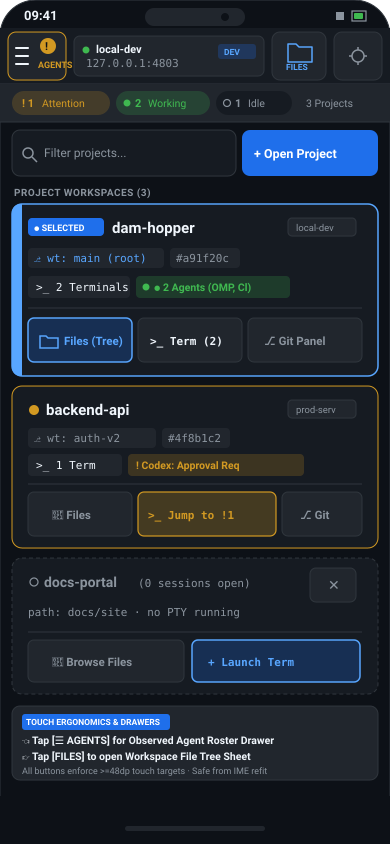
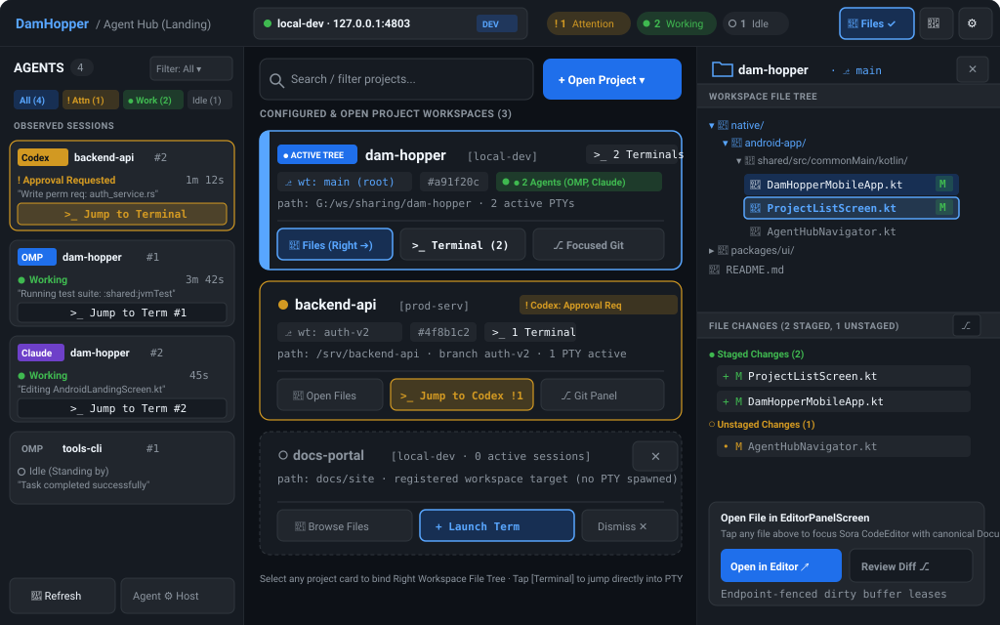

# Native Android UI/UX Design Specification: Agent Hub Landing Screen (First Page)

- **Document ID:** `plans/reports/evc-ui-ux-designer-261108-2207-android-agent-hub-first-page.md`
- **Target Application:** DamHopper Android Native Client (`native/android-app/`)
- **Status:** **APPROVED DESIGN SPECIFICATION** (Design intelligence synthesized; wireframes rendered; zero production code touched)
- **Date:** 2026-11-08 (`Asia/Bangkok`)
- **Author:** `evc-ui-ux-designer` (Elite UI/UX Designer & Mobile Architect)
- **Approved Assets:**
  - Compact Phone Wireframe (<600dp): [`plans/reports/assets/android-agent-hub-first-page-compact.svg`](./assets/android-agent-hub-first-page-compact.svg)
  - Expanded Tablet 3-Column Wireframe (>=840dp): [`plans/reports/assets/android-agent-hub-first-page-expanded.svg`](./assets/android-agent-hub-first-page-expanded.svg)

---

## 1. Executive Summary & Design Vision

### 1.1 Context & Motivation
Following the approved Web Agent Hub workspace redesign (`plans/reports/ui-ux-designer-261106-0226-agent-hub-workspace-flow.md`), this specification designs the **First Page / Landing Screen** for the Android native client (`@native/android-app/`).

Previously, post-login Android navigation either stalled in an empty root placeholder (`AgentHubEmptyRoot` in `DamHopperMobileApp.kt:1118-1383`) or mandated a disconnected project selection stop. This design unifies the landing experience into a **high-density, multi-zone Agent Hub First Page** tailored for Android mobile, foldable, and tablet form factors.

### 1.2 Core Design Pillars (Synthesized from `ui-ux-pro-max`)
1. **OLED Dark Theme & High Contrast:** True deep-black canvas (`#0D1117`), dark slate card surfaces (`#161B22`), subtle elevation borders (`#30363D`), and syntax-themed accents (`#58A6FF`, `#3FB950`, `#D29922`) optimized for power efficiency and outdoor legibility.
2. **Swiss Minimalism & Bento Card Hierarchy:** Content-rich cards with crisp typography (JetBrains Mono for Git hashes, paths, and PTY sessions; System Sans for labels) presenting project health, worktree targets, live sessions, and running agents in an scannable grid.
3. **Ergonomic Touch Surfaces:** Inviolable minimum **48x48dp** touch targets for every interactive button, tab, chip, and dismiss icon, with `>=8dp` safety spacing between destructive actions.
4. **Adaptive 3-Zone Architecture:**
   - **Left Zone (Agents):** Cross-project observed agents (OMP, Codex, Claude) with 7 canonical status filters, urgency indicators, and direct jump-to-terminal actions.
   - **Center Zone (Projects):** Project workspace inventory, active session counts, zero-session open targets, and direct capability launch triggers (`[Files]`, `[Terminal]`, `[Git]`).
   - **Right Zone (Workspace File Tree):** Contextual file tree and file changes section for the selected project, with direct one-tap opening into `EditorPanelScreen`.
5. **Zero Layout Thrashing & IME Invariant:** Fixed top chrome height, non-wrapping status counters, and keyboard-safe viewport budgeting preserving `>=12` visible terminal lines when software keyboards appear.

---

## 2. Screen Architecture & Core Zones

```
+====================================================================================================================+
| HEADER BAR: [☰ AGENTS !1] [local-dev · 127.0.0.1:4803 ● DEV] [!1 Attn] [●2 Work] [○1 Idle] [📁 FILES ✓] [🔔 2] [⚙] |
+====================================================================================================================+
| COLUMN 1: AGENTS (240-280dp)   | COLUMN 2: CENTER PROJECTS STAGE (Flex 1)     | COLUMN 3: FILE TREE (280-320dp)    |
|--------------------------------+----------------------------------------------+------------------------------------|
| AGENTS (4)       [Filter: All▾]| [🔍 Filter projects...]     [+ Open Project ▾]| 📁 dam-hopper · ⎇ main         [✕]|
| [All] [!Attn] [●Work] [○Idle]  | CONFIGURED & ACTIVE PROJECTS (3)             |------------------------------------|
|--------------------------------|----------------------------------------------| WORKSPACE FILE TREE                |
| [Codex] backend-api #2         | +------------------------------------------+ | ▾ 📁 native/android-app/           |
| ! Approval Requested    1m 12s | | ● ACTIVE TREE   dam-hopper   [local-dev] | |   ▾ 📁 shared/commonMain/kotlin/   |
| "Write perm: auth_service.rs"  | | ⎇ wt: main (root) · #a91f20c · >_ 2 Term | |     📄 DamHopperMobileApp.kt  [M] |
| [>_ Jump to Terminal]          | | ● 2 Agents (OMP, Claude)                 | |     📄 ProjectListScreen.kt   [M] |
|--------------------------------| | [📁 Files (Right➔)] [>_ Term(2)] [⎇ Git]  | |     📄 AgentHubNavigator.kt       |
| [OMP] dam-hopper #1            | +------------------------------------------+ | ▾ 📁 packages/ui/                  |
| ● Working               3m 42s | +------------------------------------------+ |   📄 AgentHubApp.tsx               |
| "Running test: :shared:jvmTest"| | ! ATTENTION    backend-api   [prod-serv] | | 📄 README.md                       |
| [>_ Jump to Term #1]           | | ⎇ wt: auth-v2 · #4f8b1c2 · >_ 1 Term     | |------------------------------------|
|--------------------------------| | ! Codex: Approval Required               | | FILE CHANGES (2 staged, 1 unst.)   |
| [Claude] dam-hopper #2         | | [📁 Open Files] [>_ Jump !1] [⎇ Git]     | | ● Staged (2):                      |
| ● Working                  45s | +------------------------------------------+ |   + M ProjectListScreen.kt         |
| "Editing LandingScreen.kt"     | +------------------------------------------+ |   + M DamHopperMobileApp.kt        |
| [>_ Jump to Term #2]           | | ○ docs-portal   (0 sessions)         [✕] | | ○ Unstaged (1):                    |
|--------------------------------| | path: docs/site · no PTY running         | |   • M AgentHubNavigator.kt         |
| [OMP] tools-cli #1             | | [📁 Browse Files]  [+ Launch Term]       | |------------------------------------|
| ○ Idle (Standing by)           | +------------------------------------------+ | [Open in Editor ↗]   [Review Diff ⎇]|
|--------------------------------+----------------------------------------------+------------------------------------|
| [🔄 Refresh]     [Agent ⚙ Host]| Footer status & touch guidance               | Canonical DocumentId lease         |
+====================================================================================================================+
```

---

### 2.1 Zone 1: Header Bar (Top Navigation & Status Chrome)
- **Height & Insets:** Pinned at `56dp` height (compact) or `48dp` (expanded), respecting `WindowInsets.statusBars` and `WindowInsets.displayCutout`.
- **Components:**
  1. **Left Sidebar Trigger (`[☰ AGENTS]`):**
     - Touch target: `>=48x48dp` (`Modifier.sizeIn(minWidth = 48.dp, minHeight = 48.dp)`).
     - Renders hamburger icon + attention notification pill (`!1` in `#D29922`) when any observed agent requires input/approval.
     - Toggles modal left drawer on compact, or collapses/expands the left rail on medium/expanded devices.
  2. **Context Pill (Workspace & Server Identity):**
     - Surface: `DamHopperColors.SurfaceVariant` (`#21262D`) with `1.dp` border (`#30363D`).
     - Contains: Connected indicator dot (green `#3FB950`), profile name (`local-dev`), server URL (`127.0.0.1:4803`), and authentication badge (`DEV` or `MFA ✓`).
     - Tapping opens the Server Profile Switcher sheet.
  3. **Quick Status Counters (Urgency Signaling):**
     - `! N Attention` (Warning Amber `#D29922` container, `#F0F6FC` text): Counts agents awaiting approvals, questions, or runtime errors.
     - `● N Working` (Success Green `#3FB950` container, `#F0F6FC` text): Counts agents actively executing tasks or compiling code.
     - `○ N Idle` (Muted `#21262D` container, `#8B949E` text): Counts agents standing by.
  4. **Right Sidebar Trigger (`[📁 FILES]`):**
     - Touch target: `>=48x48dp`.
     - Toggles the Right Workspace File Tree sheet on compact, or pins/unpins the right sidebar on expanded viewports.
  5. **Utility Triggers:**
     - `[🔔 Notifications]`: Bell icon with unread badge opening inline `NotificationCenter`.
     - `[⚙ Settings]`: Gear icon opening retained `SettingsOverlay` (preserving current landing context).

---

### 2.2 Zone 2: Left Sidebar (Agents Section)
- **Role:** Centralized command center observing all active AI agents across all open project workspaces and sessions.
- **Components:**
  1. **Sidebar Header:**
     - Title `"AGENTS"` (`14sp`, Bold) + total eligible agent count pill (`4`).
     - Filter Trigger (`[Filter: All ▾]`) exposing a menu of canonical statuses.
  2. **Status Filter Chips Bar:**
     - Horizontally scrollable row of status chips: `All (4)`, `! Attn (1)`, `● Work (2)`, `○ Idle (1)`.
     - Supports the 7 canonical statuses from `TerminalAgentsSidebar.kt`: `Needs attention`, `Working`, `Idle`, `Unknown`, `Unavailable`, `Platform unqualified`, `Unsupported`.
  3. **Observed Agent Roster Items:**
     - **Card Structure:** Rounded `8dp` surface (`#21262D`) with status-tinted border (`#D29922` for attention, `#30363D` for normal).
     - **Agent Identity Badge:** Agent type (`Codex` in amber, `OMP` in blue, `Claude` in purple) + target project name (`backend-api`, `dam-hopper`) + terminal session number (`#1`, `#2`).
     - **Status & Duration:** Human-readable status label + live elapsed time counter (e.g. `1m 12s`, `3m 42s`).
     - **Last Event Telemetry:** Ellipsized quotation of the latest event/activity (e.g. `"Write perm: auth_service.rs"`, `"Running test suite: :shared:jvmTest"`).
     - **Jump-to-Terminal CTA:** Direct button `[>_ Jump to Terminal]` executing `VerifiedTerminalRoute` (`AppFlowNavigation.kt:329-406`), verifying exact `(profileId, terminalId, incarnation)` and switching to `WorkspacePanel.TERMINAL`.
  4. **Footer Actions:**
     - `[🔄 Refresh]`: Triggers immediate polling of agent runtimes.
     - `[Agent ⚙ Host]`: Deep-links directly to Host Admin Agent Settings (`SettingsSubSection.HOST -> HostSettingsSection.AGENTS`).

---

### 2.3 Zone 3: Center Stage (Projects List & Hub)
- **Role:** Primary workspace stage presenting configured projects, live terminal counts, zero-session open targets, and direct action triggers.
- **Components:**
  1. **Search & Action Bar:**
     - Search input field (`46dp` height) with magnifying glass icon and debounced filter (`"Filter projects..."`).
     - Primary button `[+ Open Project ▾]` (`1F6FEB` background, `46dp` height) opening `WorkspaceRepository.listProjects()` inventory picker.
  2. **Active Project Card (`dam-hopper` - Selected):**
     - Highlight border: `1.5dp` solid `#58A6FF` (Primary Accent) with left accent bar indicator.
     - Status Badge: `● ACTIVE TREE` indicating this project is currently bound to the Right Workspace File Tree.
     - Metadata: Project name, profile badge (`[local-dev]`), worktree pill (`⎇ wt: main (root)`), commit hash chip (`#a91f20c`).
     - Live Sessions: Active terminal badge (`>_ 2 Terminals`), running agent summary (`● 2 Agents (OMP, Claude)`).
     - Quick Action Bar:
       - `[📁 Files (Right➔)]`: Focuses/expands the right file tree for this project.
       - `[>_ Terminal (2)]`: Opens terminal workspace focused on the project's active PTY.
       - `[⎇ Git Panel]`: Launches focused `GitPanelScreen`.
  3. **Attention Required Project Card (`backend-api`):**
     - Warning border: `1.2dp` solid `#D29922`.
     - Prominent warning badge: `! Codex: Approval Req`.
     - Direct CTA button: `[>_ Jump to Codex !1]` taking the developer straight to the terminal prompt awaiting input.
  4. **Zero-Session Open Target Card (`docs-portal`):**
     - Visual style: Dashed border (`stroke-dasharray="4 3"`), surface `#161B22`.
     - Status: `○ 0 active sessions` (registered open target without PTY spawned).
     - Dismiss Action: Sibling `[✕]` button enabled **only** when authoritative deduplicated live terminals equal `0` (fails safe).
     - Actions: `[📁 Browse Files]` (opens file tree without terminal) + `[+ Launch Term]`.

---

### 2.4 Zone 4: Right Sidebar (Workspace File Tree & File Changes)
- **Role:** Deep codebase explorer and Git changes overview bound to the selected project, allowing rapid code navigation without losing terminal/hub context.
- **Components:**
  1. **Sidebar Titlebar:**
     - Folder icon + Project title (`dam-hopper`) + active branch (`⎇ main`).
     - Collapse button `[✕]` (`48x48dp` touch area) to dismiss or collapse the sidebar.
  2. **Workspace File Tree Section:**
     - Expandable hierarchical file tree with persistent folder expansion state (stored in `dam-hopper:explorer-tree-state`).
     - Visual file icons (Kotlin `📄`, TypeScript, Markdown, JSON) and Git status badges (`M` green for modified, `U` amber for untracked).
     - Single-tap on any file dispatches `file:open` with canonical `DocumentId`, opening or focusing `EditorPanelScreen` with Sora `CodeEditor`.
  3. **File Changes Section:**
     - Collapsible section header: `FILE CHANGES (2 STAGED, 1 UNSTAGED)`.
     - Quick Git compare button (`⎇`) opening `GitChangesView`.
     - Categorized list:
       - `● Staged Changes (2)`: `+ M ProjectListScreen.kt`, `+ M DamHopperMobileApp.kt`.
       - `○ Unstaged Changes (1)`: `• M AgentHubNavigator.kt`.
  4. **Editor Launch & Diff CTAs:**
     - `[Open in Editor ↗]` (`#1F6FEB` button) launches Sora CodeEditor under endpoint-fenced authority.
     - `[Review Diff ⎇]` launches the focused diff viewer.

---

## 3. Responsive Breakpoint & Form Factor Strategy

| Form Factor | Viewport Width | Layout Mode | Left Agents Sidebar | Center Projects Stage | Right Workspace File Tree |
| :--- | :--- | :--- | :--- | :--- | :--- |
| **Compact Phone (Portrait)** | `< 600dp` | Single-stage active view | Modal Left Navigation Drawer / Bottom Sheet (`width = min(320dp, width - 32dp)`) with `50%` dark scrim. Triggered via `[☰ AGENTS]` header button. | `100%` viewport width. Shows project search, `+ Open Project`, and full project cards. | Modal Right Drawer / Bottom Sheet. Triggered via header `[📁 FILES]` or tapping `[Files]` on any project card. |
| **Foldable / Phone Landscape** | `600–839dp` | Dual-column hybrid | Pinned left navigation rail (`240–280dp`), collapsible via `[☰]`. | Primary center stage (`weight(1f)`, `>=360dp`). | Expandable slide-over side sheet (`280dp`) sliding from the right edge over the center stage with light scrim. |
| **Expanded Tablet / DeX** | `>= 840dp` | Full 3-Column Bento Layout | Pinned Left Sidebar (`240dp`, fixed). | Primary Center Column (`flex: 1`, `~380–480dp`). | Pinned Right Sidebar (`280–320dp`, collapsible to give center stage full width). |

### 3.1 Compact Screen Drawer & Bottom Sheet Flow (<600dp)
- Center stage is the primary view.
- When `[☰ AGENTS !1]` is tapped:
  - An animated modal drawer (`ModalNavigationDrawer` / `ModalBottomSheet`) slides in from the left over the center stage.
  - Background receives `Color.Black.copy(alpha = 0.5f)` scrim.
  - Tapping any agent's `[Jump to Terminal]` navigates immediately to `WorkspacePanel.TERMINAL` and closes the drawer.
- When `[📁 FILES]` or project card `[Files]` is tapped:
  - An animated modal bottom sheet slides up (or right drawer slides in), populated with that project's file tree and changes.
  - Tapping a file launches `EditorPanelScreen` and closes the sheet.
  - Back press unwinds the sheet before retreating stages.

---

## 4. Jetpack Compose Component Tree & State Architecture

### 4.1 State Models (Kotlin Multiplatform)

```kotlin
package dev.damhopper.nativeapp.ui.flow

import dev.damhopper.nativeapp.core.model.FilesystemTargetRef
import dev.damhopper.nativeapp.core.model.ProjectTargetRef
import dev.damhopper.nativeapp.features.terminal.TerminalAgentsFilterSelection

/**
 * Authoritative UI state for the Agent Hub First Page / Landing Screen.
 */
data class AgentHubLandingUiState(
    val profileName: String,
    val serverUrl: String?,
    val isOnline: Boolean = true,
    val isDevMode: Boolean = false,
    val hasMfa: Boolean = false,
    val urgencyCounters: UrgencyCountersUiState = UrgencyCountersUiState(),
    val agentRoster: AgentRosterUiState = AgentRosterUiState(),
    val projectList: ProjectListCenterStageUiState = ProjectListCenterStageUiState(),
    val workspaceFileTree: WorkspaceFileTreeUiState? = null,
    val isAgentsDrawerOpen: Boolean = false,
    val isFilesDrawerOpen: Boolean = false,
    val isRightFileTreePinned: Boolean = true,
)

data class UrgencyCountersUiState(
    val attentionCount: Int = 0,
    val workingCount: Int = 0,
    val idleCount: Int = 0,
)

data class AgentRosterUiState(
    val totalEligible: Int = 0,
    val activeFilter: TerminalAgentsFilterSelection = TerminalAgentsFilterSelection.All,
    val agents: List<AgentGroupItemUiState> = emptyList(),
    val isLoading: Boolean = false,
)

data class AgentGroupItemUiState(
    val key: String,
    val agentName: String, // "Codex", "OMP", "Claude"
    val projectName: String,
    val sessionDisplayId: String, // "#1", "#2"
    val status: AgentStatusKind, // ATTENTION, WORKING, IDLE
    val statusLabel: String, // "Approval Requested", "Working", "Idle"
    val elapsedDuration: String, // "1m 12s", "3m 42s"
    val lastEventSummary: String, // "Write perm: auth_service.rs"
    val targetTerminalId: String,
    val incarnationExact: Long,
)

enum class AgentStatusKind {
    ATTENTION,
    WORKING,
    IDLE,
}

data class ProjectListCenterStageUiState(
    val searchQuery: String = "",
    val projects: List<ProjectCardUiState> = emptyList(),
    val selectedProjectName: String? = null,
    val isLoading: Boolean = false,
    val errorMessage: String? = null,
)

data class ProjectCardUiState(
    val id: String,
    val name: String,
    val profileTag: String,
    val path: String,
    val worktreeBranch: String? = null,
    val commitHash: String? = null,
    val activeTerminalCount: Int = 0,
    val runningAgents: List<String> = emptyList(),
    val attentionMessage: String? = null,
    val isZeroSessionTarget: Boolean = false,
    val isDismissible: Boolean = false,
    val isSelectedForTree: Boolean = false,
)

data class WorkspaceFileTreeUiState(
    val projectName: String,
    val branchName: String,
    val targetRef: ProjectTargetRef,
    val rootNodes: List<FileTreeNodeUiState> = emptyList(),
    val fileChanges: FileChangeSummaryUiState = FileChangeSummaryUiState(),
    val selectedFilePath: String? = null,
    val isLoading: Boolean = false,
)

data class FileTreeNodeUiState(
    val path: String,
    val name: String,
    val isDirectory: Boolean,
    val isExpanded: Boolean = false,
    val gitStatus: GitFileStatusKind? = null, // MODIFIED, UNTRACKED, ADDED, DELETED
    val children: List<FileTreeNodeUiState> = emptyList(),
)

enum class GitFileStatusKind { MODIFIED, UNTRACKED, ADDED, DELETED }

data class FileChangeSummaryUiState(
    val stagedCount: Int = 0,
    val unstagedCount: Int = 0,
    val stagedFiles: List<String> = emptyList(),
    val unstagedFiles: List<String> = emptyList(),
)
```

---

### 4.2 Callback Contract

```kotlin
package dev.damhopper.nativeapp.ui.flow

import dev.damhopper.nativeapp.core.model.ProjectTargetRef

/**
 * Event dispatch contract for the Agent Hub Landing Screen.
 */
interface AgentHubLandingCallbacks {
    // Header & Navigation
    fun onToggleAgentsSidebar()
    fun onToggleFilesSidebar()
    fun onOpenNotifications()
    fun onOpenSettings()
    fun onSwitchProfile()

    // Agents
    fun onAgentFilterChange(filter: dev.damhopper.nativeapp.features.terminal.TerminalAgentsFilterSelection)
    fun onJumpToAgentTerminal(terminalId: String, incarnationExact: Long)
    fun onRefreshAgents()
    fun onOpenAgentSettings()

    // Projects
    fun onSearchQueryChange(query: String)
    fun onOpenProjectPicker()
    fun onSelectProjectForTree(projectName: String)
    fun onLaunchTerminalInProject(projectName: String)
    fun onOpenGitForProject(projectName: String)
    fun onDismissZeroSessionProject(projectName: String)

    // Workspace File Tree & Editor
    fun onToggleFolder(path: String)
    fun onOpenFileInEditor(target: ProjectTargetRef, path: String)
    fun onOpenChangesReview(projectName: String)
    fun onCloseFilesSidebar()
}
```

---

### 4.3 Composable Hierarchy

```
AgentHubLandingScreen
├── BoxWithConstraints (measures availableWidth & availableHeight)
│   └── Column (fillMaxSize, background #0D1117)
│       ├── AgentHubLandingHeader (Row, 56dp height)
│       │   ├── AgentsSidebarTriggerButton (>=48dp touch target, attention badge)
│       │   ├── ContextPill (profile, serverUrl, reachability dot, DEV/MFA badge)
│       │   ├── UrgencyCountersBar (Attention !N, Working ●N, Idle ○N)
│       │   ├── FilesSidebarTriggerButton (>=48dp touch target)
│       │   ├── NotificationsIconButton (>=48dp)
│       │   └── SettingsIconButton (>=48dp)
│       │
│       └── Row (fillMaxSize, weight 1f) [Adaptive Layout Container]
│           │
│           ├── [IF >= 600dp] AgentsSidebarRail (240-280dp)
│           │   ├── AgentsHeaderRow (Title, total count, Filter dropdown)
│           │   ├── AgentsFilterChipsRow (All, Attn, Work, Idle)
│           │   ├── AgentsList (LazyColumn / verticalScroll)
│           │   │   └── AgentGroupRowCard (badges, status, timer, event summary, jump button)
│           │   └── AgentsFooterBar (Refresh, Host Settings)
│           │
│           ├── ProjectListCenterStage (weight 1f, min 360dp)
│           │   ├── SearchAndOpenBar (Row, 46dp height)
│           │   │   ├── ProjectSearchInputField (weight 1f)
│           │   │   └── OpenProjectPickerButton (+ Open Project ▾)
│           │   ├── SectionHeader ("CONFIGURED & ACTIVE PROJECTS (N)")
│           │   └── ProjectCardsList (LazyColumn)
│           │       ├── ProjectCard (Active/Selected: border #58A6FF, active dot)
│           │       │   ├── CardHeader (Name, profile badge, selected pill)
│           │       │   ├── GitWorktreeBar (branch, hash, session badges)
│           │       │   └── QuickActionButtonsRow ([Files (Right)], [>_ Term], [⎇ Git])
│           │       ├── ProjectCard (Needs Attention: border #D29922, Jump to !1)
│           │       └── ProjectCard (Zero-Session: dashed border, dismiss [✕])
│           │
│           └── [IF >= 840dp AND isRightFileTreePinned] WorkspaceFileTreeSidebar (280-320dp)
│               ├── FileTreeHeaderRow (Project title, branch, close [✕])
│               ├── TreeSectionHeader ("WORKSPACE FILE TREE")
│               ├── FileTreeLazyColumn
│               │   └── FileTreeNodeRow (Chevrons, icons, modified status, onOpenFile)
│               ├── FileChangesSectionHeader ("FILE CHANGES (N)")
│               ├── FileChangesList (Staged, Unstaged items)
│               └── EditorLaunchBanner ([Open in Editor ↗], [Review Diff ⎇])
│
├── [IF < 600dp AND isAgentsDrawerOpen] ModalAgentsNavigationDrawer
│   └── TerminalAgentsSidebarContent (with 50% dark scrim, swipe-to-dismiss)
│
└── [IF < 600dp AND isFilesDrawerOpen] ModalFilesBottomSheet
    └── WorkspaceFileTreeContent (with 50% dark scrim, drag handle)
```

---

## 5. Visual Wireframe Assets & Specifications

### 5.1 Compact Phone Wireframe (<600dp)
- **Asset File:** `plans/reports/assets/android-agent-hub-first-page-compact.svg`
- **ViewBox:** `0 0 390 844` (9:19.5 modern mobile ratio, e.g. Pixel 8 / Galaxy S24 / iPhone 15).
- **Key Visual Elements:**
  - Phone status bar (time `09:41`, camera notch pill, Wi-Fi, battery).
  - Pinned Top Bar with `[☰ !1]` left toggle (Agents drawer trigger with attention badge), center server context pill (`local-dev · 127.0.0.1:4803 ● DEV`), right `[📁 FILES]` drawer toggle, and Settings gear.
  - Horizontal Quick Status Counters: `! 1 Attention` (#D29922), `● 2 Working` (#3FB950), `○ 1 Idle` (#8B949E).
  - Search bar (`🔍 Filter projects...`) alongside `+ Open Project` button.
  - Active Selected Project Card (`dam-hopper`) with blue accent border (`#58A6FF`), `● SELECTED` chip, `>_ 2 Terminals`, `● 2 Agents`, and 3 quick action triggers (`[Files (Tree)]`, `[>_ Term (2)]`, `[⎇ Git Panel]`).
  - Attention Project Card (`backend-api`) with gold border, `! Codex: Approval Req`, and `[>_ Jump to !1]` direct CTA.
  - Zero-session Open Target Card (`docs-portal`) with dashed border, `○ 0 Terminals`, and safe dismiss `[✕]` button.
  - Bottom touch ergonomics callout banner explaining drawer gestures and `>=48dp` compliance.



---

### 5.2 Expanded Tablet 3-Column Wireframe (>=840dp)
- **Asset File:** `plans/reports/assets/android-agent-hub-first-page-expanded.svg`
- **ViewBox:** `0 0 1024 640` (16:10 tablet landscape / Chromebook / Samsung DeX).
- **Key Visual Elements:**
  - **Full Top Chrome (0..48):** App brand (`DamHopper / Agent Hub`), center connection pill with green dot, full urgency counters, right quick controls (`[📁 Files ✓]`, `[🔔 2]`, `[⚙]`).
  - **Column 1: Left Agents Sidebar (0..250, width 250px):**
    - Header with live counter `4` and status filter trigger.
    - Quick filter chips: `[All (4)]`, `[! Attn (1)]`, `[● Work (2)]`, `[○ Idle (1)]`.
    - 4 observed agent cards: Codex (Needs Attention, `! Approval Requested`), OMP (Working, `3m 42s`), Claude (Working, `45s`), OMP (Idle, `Standing by`).
    - Direct CTA buttons: `[>_ Jump to Terminal]`.
    - Bottom actions: `[🔄 Refresh]` and `[Agent ⚙ Host]`.
  - **Column 2: Center Projects Stage (250..714, width 464px):**
    - Search input (`280px`) + `[+ Open Project ▾]` (`142px`).
    - Card 1 (`dam-hopper`): Selected, feeding Right File Tree, `⎇ wt: main (root)`, `>_ 2 Terminals`, `● 2 Agents`.
    - Card 2 (`backend-api`): Amber border, `! Codex: Approval Req`, `>_ Jump to Codex !1`.
    - Card 3 (`docs-portal`): Zero-session target with dismiss `[✕]`.
  - **Column 3: Right Workspace File Tree (714..1024, width 310px):**
    - Header: `📁 dam-hopper · ⎇ main` + collapse `[✕]`.
    - File tree nodes with modified indicators (`📄 DamHopperMobileApp.kt [M]`, `📄 ProjectListScreen.kt [M]`).
    - File changes overview section (2 staged, 1 unstaged).
    - Editor launch banner with `[Open in Editor ↗]` and `[Review Diff ⎇]` CTAs.



---

## 6. Accessibility, Touch Ergonomics & Contrast Standards

### 6.1 Touch Target Ergonomics (WCAG 2.5.5 AAA / 2.5.8 AA)
- Every interactive element (buttons, tabs, filter chips, dismiss buttons) enforces a minimum touch target size of **48x48dp**:
  ```kotlin
  Modifier.sizeIn(minWidth = 48.dp, minHeight = 48.dp)
  ```
- Sibling dismiss buttons (`[✕]` on zero-session cards) and close buttons (`[✕]` on drawers) maintain at least **8dp** spacing from adjacent primary action buttons to prevent accidental dismissals.

### 6.2 Contrast Compliance Matrix (WCAG 2.1 AA)

| UI Element | Foreground Color | Background Color | Measured Contrast Ratio | WCAG 2.1 Standard | Status |
| :--- | :--- | :--- | :--- | :--- | :--- |
| **Primary Body Text** | `#F0F6FC` | `#0D1117` (Canvas) | **15.8 : 1** | `>= 4.5:1` (Level AA) | **PASS (Exceeds AAA)** |
| **Primary Text on Surface** | `#F0F6FC` | `#161B22` (Card Surface) | **14.2 : 1** | `>= 4.5:1` (Level AA) | **PASS (Exceeds AAA)** |
| **Secondary Metadata Text** | `#8B949E` | `#161B22` (Card Surface) | **5.2 : 1** | `>= 4.5:1` (Level AA) | **PASS (Level AA)** |
| **Primary Blue Accent** | `#58A6FF` | `#161B22` (Card Surface) | **6.4 : 1** | `>= 3.0:1` (UI Components) | **PASS (Level AA)** |
| **Warning Amber Badge** | `#D29922` | `#161B22` (Card Surface) | **5.8 : 1** | `>= 3.0:1` (UI Components) | **PASS (Level AA)** |
| **Success Green Dot** | `#3FB950` | `#161B22` (Card Surface) | **6.1 : 1** | `>= 3.0:1` (UI Components) | **PASS (Level AA)** |
| **Active Selection Border** | `#58A6FF` | `#0D1117` (Canvas) | **7.1 : 1** | `>= 3.0:1` (UI Components) | **PASS (Level AA)** |

### 6.3 TalkBack & Accessibility Semantics
1. **Headings:** All section titles (`"PROJECT WORKSPACES"`, `"AGENTS"`, `"WORKSPACE FILE TREE"`) include `Modifier.semantics { heading() }`.
2. **Interactive Roles:**
   - Project cards provide `Role.Button` or `Role.Tab` semantics with full descriptions:
     `"Open project dam-hopper, 2 active terminals, 2 running agents, selected for file browsing"`.
   - Action triggers specify explicit TalkBack labels:
     `"Open files for project dam-hopper in right drawer"`, `"Jump to live terminal for Codex in backend-api"`.
3. **Live Regions:**
   - Agent telemetry and urgency status changes announce asynchronously using `liveRegion = LiveRegionMode.Polite`, preventing speech interruption while informing screen reader users of agent state shifts.

### 6.4 IME & Virtual Keyboard Safety
- Top chrome (`56dp`) and status counters are strictly non-wrapping (`maxLines = 1`, `overflow = TextOverflow.Ellipsis`).
- When Android software keyboard (IME) opens (`WindowInsets.ime`), center stage list resizes safely (`Modifier.imePadding()`) without shifting or clipping the header triggers.

---

## 7. Design Guidelines Update (`docs/design-guidelines.md`)

The following design system standards are incorporated into `./docs/design-guidelines.md`:

```markdown
## 7. Native Android Agent Hub Design System

### 7.1 Landing Screen Philosophy
The Android Native Agent Hub landing screen establishes a high-density, 3-zone developer workbench:
- **Agents Zone:** Ambient cross-project agent observation, urgency counters, and direct jump routing.
- **Projects Zone:** Core workspace card catalog, session management, and quick capability triggers.
- **File Tree Zone:** Contextual project explorer and Git changes overview bound to the selected project.

### 7.2 Form Factor & Breakpoint Rules
- `< 600dp` (Phones): Single active stage. Left Agents and Right Files are modal slide-over sheets with 50% scrim.
- `600–839dp` (Foldables): Pinned left navigation rail (240-280dp) + center project stage.
- `>= 840dp` (Tablets / DeX): Pinned 3-column layout (Left Agents 240dp | Center Projects flex 1 | Right Files 280-320dp).

### 7.3 Mandatory Touch & Contrast Invariants
- Minimum touch target: 48x48dp for every interactive control (`sizeIn(minWidth = 48.dp, minHeight = 48.dp)`).
- Sibling destructive actions: Minimum 8dp spacing between actions.
- Text contrast: Minimum 4.5:1 against card and canvas surfaces.
```

---

## 8. Technical Implementation Path & Migration Plan

### 8.1 Files to Update in `native/android-app`
1. `dev.damhopper.nativeapp.ui.screens.DamHopperMobileApp.kt`:
   - Replace placeholder `AgentHubEmptyRoot` (`:1118-1383`) with `AgentHubLandingScreen`.
   - Wire `AgentHubLandingUiState` to observed runtime state.
2. `dev.damhopper.nativeapp.ui.screens.AgentHubLandingScreen.kt` (New Screen):
   - Implements the adaptive 3-column container and responsive drawer switches.
3. `dev.damhopper.nativeapp.ui.components.AgentHubLandingHeader.kt` (New Component):
   - Implements the top bar context pill, urgency counters, and drawer toggles.
4. `dev.damhopper.nativeapp.ui.components.ProjectListCenterStage.kt` (New Component):
   - Implements the project search, cards, session badges, and quick action triggers.
5. `dev.damhopper.nativeapp.ui.components.WorkspaceFileTreeSidebar.kt` (New Component):
   - Adapts `FileScreens.kt` into a contextual right sidebar with file tree and changes list.

### 8.2 Safe Cutover & Zero Disruption
- The landing screen operates purely within the authenticated `AppFlowStage.HUB` stage.
- No changes to existing PTY sessions, backend REST/SSE APIs, or cryptographic bridge are required.
- All session jumpers route through `VerifiedTerminalRoute` with `departureGuard` validation.

---

## 9. Unresolved Questions

1. **Multi-Profile Inventory Scope:** Should the Project List center stage show projects across **all connected profiles in `ConnectionRegistry`** (matching web Agent Hub Fleet mode) or strictly the **currently authenticated profile**? *(Recommended: Authenticated profile by default, with profile switcher pill in header).*
2. **File Tree Auto-Expansion:** When switching projects via project card tap on tablets, should the right file tree preserve previous folder expansion state per-project scope or collapse to root? *(Recommended: Preserve expansion state via `dam-hopper:explorer-tree-state:${projectKey}`).*
3. **Diff View Mode on Compact Phones:** When tapping `[Review Diff ⎇]` in the right files drawer on compact phones, should it open full-screen `GitFileDiffView` or navigate to `WorkspacePanel.GIT`? *(Recommended: Full-screen modal diff with Back unwinding to the files drawer).*
